# The flying sidekick traveling salesman problem: Optimization of drone-assisted parcel delivery


Chase C. Murray ⇑, Amanda G. Chu

Department of Industrial & Systems Engineering, Auburn University, 3301 Shelby Center, Auburn, AL 36849-5346, USA

a r t i c l e i n f o

Article history: Received 10 October 2014 Received in revised form 3 March 2015 Accepted 4 March 2015

Keywords: Unmanned aerial vehicle Vehicle routing problem Traveling salesman problem Logistics Integer programming Heuristics

## a b s t r a c t

Once limited to the military domain, unmanned aerial vehicles are now poised to gain widespread adoption in the commercial sector. One such application is to deploy these aircraft, also known as drones, for last-mile delivery in logistics operations. While significant research efforts are underway to improve the technology required to enable delivery by drone, less attention has been focused on the operational challenges associated with leveraging this technology. This paper provides two mathematical programming models aimed at optimal routing and scheduling of unmanned aircraft, and delivery trucks, in this new paradigm of parcel delivery. In particular, a unique variant of the classical vehicle routing problem is introduced, motivated by a scenario in which an unmanned aerial vehicle works in collaboration with a traditional delivery truck to distribute parcels. We present mixed integer linear programming formulations for two delivery-by-drone problems, along with two simple, yet effective, heuristic solution approaches to solve problems of practical size. Solutions to these problems will facilitate the adoption of unmanned aircraft for last-mile delivery. Such a delivery system is expected to provide faster receipt of customer orders at less cost to the distributor and with reduced environmental impacts. A numerical analysis demonstrates the effectiveness of the heuristics and investigates the tradeoffs between using drones with faster flight speeds versus longer endurance.

\- 2015 Elsevier Ltd. All rights reserved.

## 1. Introduction

Amazon CEO Jeff Bezos recently captured headlines when he announced on the CBS broadcast of 60 Minutes that his company has developed a fleet of unmanned aerial vehicles (UAVs) for small parcel delivery (Rose, 2013). The plan set forth by Bezos would use UAVs to deliver parcels from distribution centers (warehouses) directly to customers via Amazon’s Prime Air UAV, pictured in Fig. 1a. In the warehouse-to-customer operation, parcels are loaded into a container that is held by the UAV, also known as a drone, unmanned aircraft system (UAS), and remotely piloted aircraft (RPA). The UAV departs from the warehouse and travels to the customer location, where it navigates via the onboard global positioning system (GPS). The container (with parcel inside) is dropped off near the customer’s front door and the UAV returns to the warehouse. All of this takes place without human intervention or guidance.

While some dismissed this announcement as a publicity stunt (Carlson, 2013 notes that the story aired the night before ‘‘Cyber Monday,’’ one of the busiest online shopping days annually), Amazon is not alone in the race towards deliveryby-drone. German postal and logistics group Deutsche Post DHL recently announced that their Parcelcopter, pictured in

<small><span class="docvortex-page-footnote" data-block-type="page_footnote" style="color:#6b7280">⇑ Corresponding author. Tel.: +1 334 844 7931; fax: +1 334 844 1381.</span></small>

<small><span class="docvortex-page-footnote" data-block-type="page_footnote" style="color:#6b7280">E-mail addresses: [cmurray@auburn.edu](mailto:cmurray@auburn.edu) (C.C. Murray), [agc0009@auburn.edu](mailto:agc0009@auburn.edu) (A.G. Chu).</span></small>

Fig. 1b, has been authorized to deliver medical supplies to a car-free island off the coast of Germany (Bryan, 2014). Australian textbook distributor Zookal has begun testing delivery-by-drone in Australia, Singapore, and Malaysia, with hopes of entering the U.S. market in 2015 (Welch, 2013). UPS is also said to be considering the use of drones for moving packages within, or between, warehouses (Stern, 2013). More recently, Google entered the arena with the announcement of their Project Wing, featuring a vertical-takeoff-and-landing aircraft with a wing-shaped body (Madrigal, 2014).

The use of UAVs for ‘‘last-mile’’ parcel delivery promises to change the landscape of the logistics industry. However, there remain several significant regulatory and technological barriers to overcome before drones realize widespread adoption in the commercial sector. In the United States, Federal Aviation Administration (FAA) rules currently prohibit the use of UAVs for commercial purposes (although other countries have less restrictive regulations). The FAA also requires UAVs to be operated under a ceiling of 400-feet and within the ‘‘pilot’s’’ line-of-sight, severely limiting their effective range and forcing a human operator to be occupied throughout the flight. However, while Amazon’s fleet of drones remains grounded for now, the FAA has cleared oil and gas company BP (formerly British Petroleum) to fly UAVs at sea and over Alaska (Jansen, 2014). This move may signal that companies like Amazon could be given the green-light soon, as the FAA is expected to provide updated guidance on the use of commercial UAVs in 2015.

From the technical perspective, researchers are working to improve the endurance and safety of UAVs. Because UAVs of the size appropriate for small parcel delivery are battery operated, one such research area involves the improvement of battery energy storage. Limited battery capacity impacts the flight endurance of these aircraft, which can also be affected by flight speed and payload. Additionally, for safety and reliability purposes, these UAVs may require redundant systems (e.g., additional motors and sensors) that further reduce flight endurance. Furthermore, UAVs rely on GPS, which has a limited accuracy of about 10 m without corrective technologies (Arnold and Zandbergen, 2011). UAVs operating in heavily forested areas or so-called urban canyons may lose contact with a GPS signal. As such, there is increased interest in localization and navigation approaches that enable UAVs to function in GPS-denied environments (c.f., Clark and Bevly, 2008; Marais et al., 2014). Similar research is also being conducted to combat GPS ‘‘spoofing,’’ whereby false signals are broadcast to enable the hijacking of a UAV (c.f., Humphreys, 2012; Faughnan et al., 2013). Even with perfect localization information, (semi-)autonomous UAVs require the ability to perform obstacle detection and avoidance. This is a fertile research area in robotics, where vision-, sonar-, and laser-based methodologies are being improved (c.f., Jimenez and Naranjo, 2011; Merz and Kendoul, 2013; Apatean et al., 2013; Pestana et al., 2014; Park and Kim, 2014). Given the potential for UAV applications, it is not surprising that a recent market study by the Teal Group forecasted that UAV spending will more than double over the next decade, with cumulative worldwide expenditures exceeding \$89 billion. Although much of this research will be for military purposes, small UAVs (those weighing less than 55 lb) of the type suitable for commercial applications represent the highest growth potential (Teal Group, 2014).

While research related to overcoming the aforementioned technical issues is abundant, we are aware of no studies addressing the operational challenges. For example, consider the direct warehouse-to-customer operation proposed by Amazon. The Prime Air UAV has a range of 10 miles (Gross, 2013). Thus, UAV deliveries must originate from distribution centers located in close proximity to customers. This may require a relocation of existing distribution centers, or the construction of new ones. To enjoy economies of scale, these distribution centers (DCs) would presumably be located near densely populated urban areas where, paradoxically, customers tend to live in high-rise housing with no ‘‘front door’’ on which to receive deliveries via UAV. Furthermore, although Amazon indicates that 86% of its deliveries weigh less than the five-pound payload capacity of its Prime Air UAVs (Gross, 2013), the remaining percentage of deliveries would still require delivery by traditional means. Such a system is depicted in Fig. 2b, where circular nodes indicate customers whose parcels cannot be delivered via UAV.

Depending upon the number of available UAVs, as well as the performance characteristics of the fleet, it may not be optimal to deliver-by-drone to all eligible customers. For example, in Fig. 2c the total time required to deliver to all customers is decreased if the truck delivers parcels to some of the customers that could feasibly be served by the UAV.

In cases where the distribution center is located far from the customers, an alternative is to pair the UAV with a traditional delivery truck, as depicted in Fig. 3b. The delivery truck departs from the DC carrying a UAV and all customer parcels. As the driver makes deliveries, the UAV is launched from the truck, carrying parcels for individual customers.

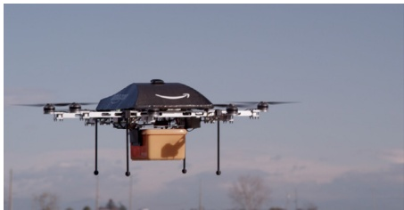

(a) Amazon’s Prime Air UAV (source: amazon.com)

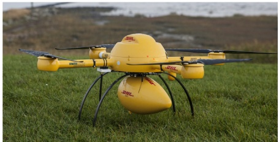

(b) DHL’s Parcelcopter (source: dhl.com)

Fig. 1. UAVs under evaluation for small parcel delivery.

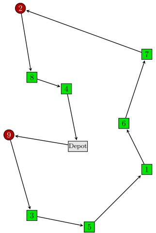

(a) The traditional approach, where a delivery truck visits all customers.

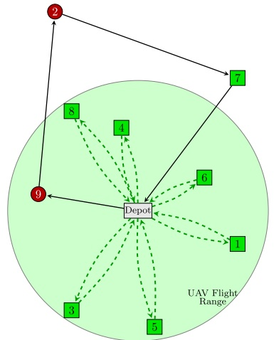

(b) UAVs deliver to all eligible customers within the UAV's flight range; the delivery truck serves customers with large parcels or those outside of flight range.

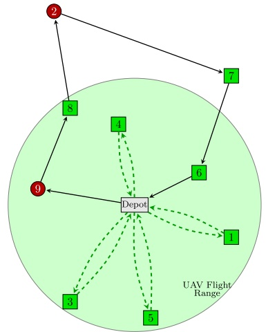

(c) Optimized assignment of customers to either a UAV or a traditional delivery truck.

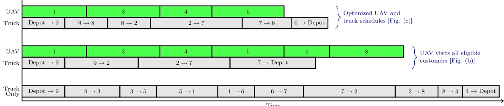

(d) A comparison of delivery schedules for the three systems depicted above.

Fig. 2. Customer deliveries are made by either a traditional delivery truck or via UAV. Customers 2 and 9 (circular nodes) are ineligible to be served via UAV (e.g., due to parcel weight restrictions).

While the UAV is en route, it needs no intervention from the delivery driver (autonomous flight). The UAV then returns to the truck, which has moved to a new customer location. The driver is required to load packages, replace batteries, and to recover the UAV to be secured aboard the truck while in transit.

There are several advantages associated with this unique approach to using UAVs for last-mile delivery. Primarily, by transporting the UAV closer to customer locations onboard the truck, the UAV may be launched within flight range of more customers, increasing the effective flight range of the UAV. Additionally, this system leverages the ground vehicle’s much larger cargo capacity, with the truck serving dual roles as both a mobile depot and a delivery resource. Furthermore, as Ralph Rio of the ARC Advisory Group notes, in the event that the UAV experiences technical difficulties, the delivery driver is nearby to address the issue (Banker, 2013). While AMP Electric Vehicles has teamed with researchers at the University of Cincinnati to develop a working prototype of a drone that takes off from, and returns to, a delivery truck (Wohlsen, 2014), we are aware of no published algorithms that optimize delivery scheduling for UAV/truck tandems.

The primary contribution of this paper is to introduce a new variant of the traditional traveling salesman problem (TSP) that addresses the challenge of determining optimal customer assignments for a UAV working in tandem with a delivery truck. We term this problem, as depicted in Fig. 3b, the flying sidekick traveling salesman problem (FSTSP). A review of the literature related to the FSTSP is presented in Section 2. This is followed by a formal definition of the FSTSP in Section 3, where a mixed integer linear programming formulation is provided. Owing to the NP-hard nature of this problem, an efficient heuristic is proposed to solve large-scale FSTSP instances of the size that may be encountered by a parcel delivery service.

Secondarily, we also introduce the problem associated with devising optimal truck and UAV assignments in the case of a DC located in close proximity to customers (i.e., as depicted in Fig. 2b and c). We term this the parallel drone scheduling TSP (PDSTSP), and provide a formal definition, mathematical programming formulation, and heuristic solution approach in Section 4. We demonstrate empirically, via an extensive numerical analysis in Section 5, the effectiveness of the proposed heuristics and highlight the benefits of last-mile parcel delivery by a UAV/truck tandem over the traditional truck-only operation. Also provided in Section 5 is an analysis of the trade-offs between UAV speed and endurance. Finally, a summary and overview of the myriad future research opportunities related to the FSTSP and PDSTSP are highlighted in Section 6.

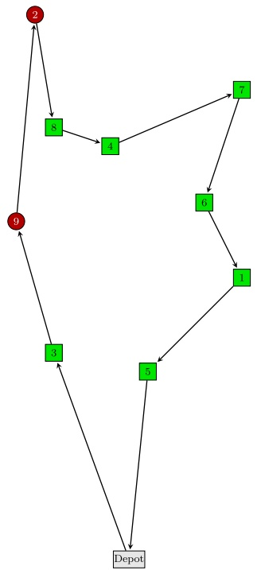

(a) An optimal truck delivery sequence, without the aid of a UAV.

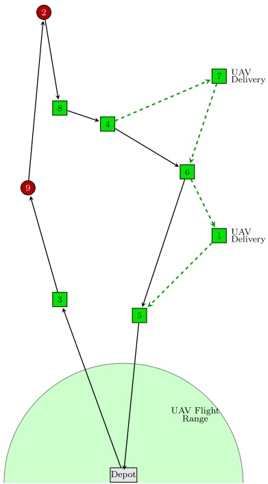

(b) The UAV is launched from a delivery truck, delivering parcels to two eligible customers.

<table><tr><td>UAV</td><td colspan="5"></td><td>4→7→6</td><td>6→1→5</td><td></td></tr><tr><td>Truck</td><td>Depot → 3</td><td>3→9</td><td>9→2</td><td>2→8</td><td>8→4</td><td>4→6</td><td>6→5</td><td>5→Depot</td></tr><tr><td>Truck Only</td><td>Depot → 3</td><td>3→9</td><td>9→2</td><td>2→8</td><td>8→4</td><td>4→7</td><td>7→6</td><td>6→1</td></tr></table>

(c) A comparison of delivery schedules for the two scenarios depicted above.

Fig. 3. In cases where the distribution center (depot) is not conducive to direct UAV deliveries, a truck/UAV tandem may reduce delivery times. Customers 2 and 9, depicted by circular nodes above, are ineligible to be served via UAV.

## 2. Related literature

There is a vast body of literature on the TSP and the vehicle routing problem (VRP). While these foundational problems are not directly applicable to the problems at hand, the interested reader is referred to the recent TSP surveys by Golden et al. (2008) and Eksioglu et al. (2009), the book on the VRP and its extensions by Toth and Vigo (Eds.), the survey on the multiple TSP (mTSP) provided by Bektas (2006), the survey on automated guided vehicles provided by Vis (2006), and the review of order-first split-second heuristic approaches presented by Prins et al. (2014). Despite the myriad TSP and VRP variants (e.g., problems resulting from the incorporation of time windows, customer priorities, asymmetric travel distances, or heterogeneous vehicles), we are aware of no study that addresses the two particular problems under consideration. In the remainder of this section we discuss works that share some common features with the proposed PDSTSP and FSTSP.

One broad categorization of related problems involves VRPs with multiple coordination constraints (c.f., Gelareh et al., 2013). Of the seven classifications of vehicle synchronization defined in the survey paper by Drexl (2012), the FSTSP may be categorized under movement synchronization en route, whereby vehicles may join and separate multiple times along a route. Although the author notes that this particular category has received limited attention in the literature, one such paper considers the VRP with trailers and transshipments (VRPTT), as in Drexl (2007). In this problem, trucks and trailers are routed to customers, such that customers may require service from either a truck or from a truck-trailer pair. The trailers, which may only be moved by trucks, can be decoupled from one truck and picked up by a different truck. These transfers may be conducted at transshipment locations. The problem is to determine minimum-cost routes for the vehicles.

A similar problem is the truck and trailer routing problem (TTRP), in which two sets of customers exist: those that may be visited by a truck only, or those that may be visited by a truck-and-trailer pair. Thus, it may be necessary for a truck to decouple from a trailer before visiting a certain customer. In the original version proposed by Chao (2002), each trailer is paired with a particular truck (i.e., trailers may not be shared by trucks). However, the survey of TTRPs provided by Derigs et al. (2013) describes less restrictive variants of the problem. Regarding solution approaches, Villegas et al. (2013) proposed a two-phased ‘‘matheuristic’’ approach for the TTRP, where a combination of greedy randomized adaptive search procedures (GRASP) and iterated local search (ILS) are used to generate a candidate pool of routes in the first phase. Subsequently, the candidate solutions are used as columns in a set partitioning formulation, which is solved via integer programming software. Although the truck and trailer problems require the coordination of vehicles that may be decoupled, these problems differ from the proposed FSTSP in that the FSTSP considers two types of vehicles that may move independently.

Another related problem is considered by Crevier et al. (2007), who explore a VRP where vehicles may be replenished by intermediate depots along each vehicle’s route. A three-phase heuristic (a cost-saving construction function, a tabu searchbased improvement function, and a guided local search function for final improvements) was proposed by Tarantilis et al. (200). Our problem shares the feature of a vehicle being replenished along a tour. However, in the FSTSP, the replenishment ‘‘node’’ is actually another vehicle that is, itself, also visiting customers.

The work most closely related to the FSTSP appears to be Lin (2011), which considers a pickup and delivery problem where heavy resources (e.g., vans) can transport light resources (e.g., scooters or foot couriers). The resources depart from, and return to, a depot (either separately or in tandem), with the condition that all parcels collected from customers must be delivered to the depot before a cutoff time. While en route, the resources may pick up parcels from customers independently, such that pickups must be performed within a customer’s pre-specified time window. Light resources may disembark from heavy resources at a customer location, although the light resources may not separate from a heavy resource more than once. If the light and heavy resources return to the depot in tandem, they must rendezvous at the location of the last customer in the heavy vehicle’s route. While the interesting paper of Lin (2011) considers vehicles that may separate and reconnect, our problem exhibits several distinguishing characteristics. First, the UAV in our problem may separate and reconnect with the delivery truck multiple times along a route. Second, due to its limited payload capacity, our UAV is constrained to visiting one customer at a time. Also due to payload limitations, our problem of interest considers that some customer requests may be too heavy for the UAV. Finally, the UAVs in our problem are subject to a maximum flight endurance.

In the next two sections, new models are presented to leverage the unique capabilities afforded by the incorporation of UAVs into logistics operations.

## 3. The flying sidekick TSP

The FSTSP considers a set of c customers, each of whom must be served exactly once by either a driver-operated delivery truck or an unmanned aircraft operating in coordination with the truck. Because some customer requests may be infeasible to fulfill by the UAV (e.g., parcels that exceed the UAV’s payload capacity, parcels requiring a signature, or customer locations not amenable to safely landing the UAV), these customers must be served by the truck only.

The truck and UAV must depart from, and return to, a single depot (distribution center) exactly once. The two vehicles may depart (or return) either in tandem or independently; while traveling in tandem the UAV is transported by the truck, thus conserving battery power.

Over the course of a delivery cycle the UAV may make multiple sorties, each consisting of three locations (nodes). A UAV sortie may begin at either the depot (where the UAV is loaded with a parcel for a customer) or from a customer location (where it is loaded by the truck driver with a parcel). Prior to launch, a service time may be required for the driver to change the UAV’s battery and to load the parcel. The second node in a sortie must be a customer that is serviced by the UAV. The final node of a sortie may be either the depot or the location of the truck. If a sortie ends at the truck, another service time may be required for the driver to recover the UAV. Once launched, the UAV must visit a customer and return to either the truck or the depot within the UAV’s flight endurance limit. The objective of the FSTSP is to minimize the time required to service all customers and return both vehicles to the depot.

## 3.1. Assumptions

The following operating conditions are assumed:

\- Although the UAV may visit only one customer per sortie, the truck may visit multiple customers while the UAV is in flight.

\- The UAV is assumed to remain in constant flight while on a sortie, except to deliver the parcel at a customer. Thus, when coordinating the return to the truck, the UAV cannot temporarily land while en route to conserve battery power should the UAV arrive before the truck.

\- If the UAV is collected by the truck at some customer node i, the UAV may be re-launched from i. However, if the UAV is launched from i, it may not return to the truck at node i.

\- If the final leg of a UAV sortie involves a rendezvous with the truck, this must take place at the location of a customer serviced by the truck; the UAV cannot reconnect with the truck at some intermediate location. Furthermore, the truck may not revisit any customer nodes to retrieve the UAV.

\- Neither the UAV nor the truck may visit any non-customer nodes (other than the depot, of course). Additionally, neither vehicle may revisit any customers.

\- In the event that a UAV sortie ends at the depot, the UAV is taken out of service $( \mathbf { i . e . } ,$ it cannot be re-launched from the depot). Because the FSTSP is motivated by situations where it is impractical to operate sorties directly from a depot (distribution center), this seems to be a reasonable assumption. In such a case, where there is no need to coordinate the UAV with the delivery truck, the PDSTSP presented in Section 4 would be more applicable.

## 3.2. Notation and mathematical formulation

The following parameter notation is employed by the mixed integer linear programming (MILP) formulation of the FSTSP. Let $C = \{ 1 , 2 , \ldots , c \}$ represent the set of all customers, and let $C ^ { \prime } \subseteq C$ denote the subset of customers that may be serviced by the UAV. Although a single physical depot location exists, notationally we assign it to two unique node numbers, such that vehicles depart from the depot at node 0 and return to the depot at node $c + 1$ . Thus, $N = \{ 0 , 1 , \ldots , c + 1 \}$ represents the set of all nodes in the network. To further facilitate the network structure of the problem, let $N _ { 0 } = \{ 0 , 1 , \ldots , c \}$ represent the set of nodes from which a vehicle may depart, and let $N _ { + } = \{ 1 , 2 , \ldots , c + 1 \}$ represent the set of nodes to which a vehicle may visit, during the course of a tour.

The time required for the truck to travel from node $i \in N _ { 0 }$ to node $j \in N _ { \cdot }$ is given by $\tau _ { i j } .$ Parameter $\tau _ { i j } ^ { \prime }$ represents the analogous travel time for the UAV. Differentiating the travel times for the truck and UAV accounts for each vehicle’s unique travel speed. Thus, as UAVs are allowed to fly between customers, road restrictions are ignored; however, the truck would presumably be confined to travel along the road network. Because it is assumed that a vehicle may not revisit any node, $\tau _ { i i }$ and $\tau _ { i i } ^ { \prime }$ are undefined for all $i \in N ,$ Note that, for the sake of completeness, $\tau _ { 0 , c + 1 } \equiv 0 .$ , to account for the pathological case where only a single customer exists and is served by the UAV directly from the depot.

The times required by the truck driver to prepare the UAV for launch and to recover the UAV upon rendezvous are given by parameters $s _ { L }$ and ${ \mathcal { S } } _ { R } ,$ respectively. The flight endurance of the UAV, measured in units of time, is given by parameter e.

Finally, new notation is required to identify all possible three-node sorties that may be flown by the UAV. Let P represent the set of tuples, of the form $\langle i , j , k \rangle$ . An element $\langle i , j , k \rangle$ may be included in P if the following conditions hold:

1. The launch point, i, must not be the ending depot node $( \mathrm { i . e . , } i \in N _ { 0 } )$

2. The delivery point, j, must be a UAV-eligible customer and must not be the same as the launch point, $i \left( \mathrm { i . e . , } j \in \{ C ^ { \prime } : j \neq i \} \right)$ 3. The rendezvous point, k, may be either a customer or the ending depot, it must not equal either i or j, and the UAV’s travel time from $i \rightarrow j \rightarrow k$ must not exceed the endurance of the UAV $( \mathrm { i . e . , } ~ k \in \{ N _ { + } : k \neq j , k \neq i , \tau _ { i j } ^ { \prime } + \tau _ { j k } ^ { \prime } \leq e \} )$

With the parameter notation in hand, we may now define the decision variables. Let $x _ { i j } \in \{ 0 , 1 \}$ equal one if the truck travels from node $i \in N _ { 0 }$ to node $j \in N _ { + }$ , where $i \neq j .$ UAV sorties are identified by $y _ { i j k } \in \{ 0 , 1 \}$ , which equals one if the UAV is launched from node $i \in N _ { 0 }$ , travels to node $j \in C$ (visiting a customer without the truck), and returns to a truck or the ending depot at node $k \in \{ N _ { + } : \langle i , j , k \rangle \in P \}$ . The time at which the truck arrives at node $j \in N .$ <sub>þ</sub> is given by $t _ { j } \geqslant 0 .$ . Similarly, the time at which the UAV arrives at node $j \in N _ { + }$ is given by $t _ { j } ^ { \prime } \geqslant 0$ . We define $t _ { 0 } = t _ { 0 } ^ { \prime } = 0$ to represent the earliest time at which the truck or UAV may leave the depot (either independently or in unison).

Two auxiliary decision variables are also required. First, $p _ { i j } \in \{ 0 , 1 \}$ equals one if customer $i \in C$ is visited at some time before customer $j \in \{ C : j \neq i \}$ in the truck’s path. The purpose of this variable is to ensure that consecutive UAV sorties are consistent with the ordering of the truck’s visitation sequence. If customers i or j are visited only by a UAV, the value of $p _ { i j }$ will be inconsequential in the constraints. We define $p _ { 0 j } = 1$ for all $j \in C ,$ to indicate that the depot (node 0) must be the starting node in the truck’s route. Finally, as in standard TSP subtour elimination constraints, $1 \leqslant u _ { i } \leqslant c + 2$ specifies the position of node $i \in N .$ in the truck’s path. However, unlike a TSP, the FSTSP involves multiple vehicles (one truck and one UAV) and the nodes assigned to the truck are not known a priori. Thus, the values assigned to $u _ { i }$ for nodes visited by the truck are critical to preventing truck subtours, while the values for $u _ { i }$ associated with a node that is visited only by the UAV are effectively ignored by the constraints.

Min $t _ { c + 1 }$

s:t:

$$
\sum_{\substack{i\in N_{0}\\ i\neq j}}x_{ij} + \sum_{\substack{i\in N_{0}\\ i\neq j}}\sum_{\substack{k\subset N_{+}\\ (i,j,k)\in P}}y_{ijk} = 1 \quad \forall j\in C\tag{1}
$$

(2)

$$
\sum_ {j \in N _ {+}} x _ {0 j} = 1\tag{3}
$$

$$
\sum_ {i \in N _ {0}} x _ {i, c + 1} = 1\tag{4}
$$

$$
u _ {i} - u _ {j} + 1 \leqslant (c + 2) (1 - x _ {i j}) \quad \forall i \in C, j \in \{N _ {+}: j \neq i \}
$$

$$
\sum_{\substack{i\in N_{0}\\ i\neq j}}x_{ij} = \sum_{\substack{k\in N_{+}\\ k\neq j}}x_{jk}\quad \forall j\in C\tag{5}
$$

(6)

$$
\sum_{\substack{j\in C\\ j\neq i}}\sum_{\substack{k\in N_{i}\\ (i,j,k)\in P}}y_{ijk}\leqslant 1 \quad \forall i\in N_{0}\tag{7}
$$

$$
\sum_{\substack{i\in N_{0}\\ i\neq k}}\sum_{\substack{j\subset C\\ (i,j,k)\in P}}y_{ijk}\leqslant 1 \quad \forall k\in N_{+}\tag{8}
$$

$$
2y_{ijk}\leqslant \sum_{\substack{h\in N_{0}\\ h\neq i}}x_{hi} + \sum_{\substack{l\in C\\ l\neq k}}x_{lk}\quad \forall i\in C,j\in \{C:j\neq i\} ,k\in \{N_{+}:\langle i,j,k\rangle \in P\}\tag{9}
$$

$$
y_{0jk}\leqslant \sum_{\substack{h\in N_{0}\\ h\neq k}}x_{hk}\quad \forall j\in C,k\in \{N_{+}:\langle 0,j,k\rangle \in P\}\tag{10}
$$

$$
u_{k} - u_{i}\geqslant 1 - (c + 2)\left(1 - \sum_{\substack{j\in C\\ (i,j,k)\in P}}y_{ijk}\right)\quad \forall i\in C,k\in \{N_{+}:k\neq i\}\tag{11}
$$

$$
t_{i}^{\prime}\geqslant t_{i} - M\left(1 - \sum_{\substack{j\in C\\ j\neq i}}\sum_{\substack{k\in N_{+}\\ (i,j,k)\in P}}y_{ijk}\right)\quad \forall i\in C\tag{12}
$$

$$
t_{i}^{\prime}\leqslant t_{i} + M\left(1 - \sum_{\substack{j\in C\\ j\neq i}}\sum_{\substack{k\in N_{+}\\ (i,j,k)\in P}}y_{ijk}\right)\quad \forall i\in C\tag{13}
$$

$$
t_{k}^{\prime}\geqslant t_{k} - M\left(1 - \sum_{\substack{i\in N_{0}\\ i\neq k}}\sum_{\substack{j\in C\\ (i,j,k)\in P}}y_{ijk}\right)\quad \forall k\in N_{+}\tag{14}
$$

$$
t_{k}^{\prime}\leqslant t_{k} + M\left(1 - \sum_{\substack{i\in N_{0}\\ i\neq k}}\sum_{\substack{j\in C\\ (i,j,k)\in P}}y_{ijk}\right)\quad \forall k\in N_{+}\tag{15}
$$

$$
t_{k}\geqslant t_{h} + \tau_{hk} + s_{L}\left(\sum_{\substack{l\in C\\ l\neq k}}\sum_{\substack{m\in N_{+}\\ (k,l,m)\in P}}y_{klm}\right) + s_{R}\left(\sum_{\substack{i\in N_{0}\\ i\neq k}}\sum_{\substack{j\in C\\ (i,j,k)\in P}}y_{ijk}\right) - M(1 - x_{hk})
$$

$$
\forall h \in N _ {0}, k \in \{N _ {+}: k \neq h \}\tag{16}
$$

$$
t_{j}^{\prime}\geqslant t_{i}^{\prime} + \tau_{ij}^{\prime} - M\left(1 - \sum_{\substack{k\in N_{+}\\ (i,j,k)\in P}}y_{ijk}\right)\quad \forall j\in C^{\prime},i\in \{N_{0}:i\neq j\}\tag{17}
$$

$$
t_{k}^{\prime}\geqslant t_{j}^{\prime} + \tau_{jk}^{\prime} + s_{R} - M\left(1 - \sum_{\substack{i\in N_{0}\\ (i,j,k)\in P}}y_{ijk}\right)\forall j\in C^{\prime},k\in \{N_{+}:k\neq j\}\tag{18}
$$

$$
t _ {k} ^ {\prime} - \left(t _ {j} ^ {\prime} - \tau_ {i j} ^ {\prime}\right) \leqslant e + M \left(1 - y _ {i j k}\right) \forall k \in N _ {+}, j \in \{C: j \neq k \}, i \in \left\{N _ {0}: \langle i, j, k \rangle \in P \right\}\tag{19}
$$

$$
u _ {i} - u _ {j} \geqslant 1 - (c + 2) p _ {i j} \forall i \in C, j \in \{C: j \neq i \}\tag{20}
$$

$$
u _ {i} - u _ {j} \leqslant - 1 + (c + 2) (1 - p _ {i j}) \forall i \in C, j \in \{C: j \neq i \}\tag{21}
$$

$$
p _ {i j} + p _ {j i} = 1 \forall i \in C, j \in \{C: j \neq i \}\tag{22}
$$

$$
t_{l}^{\prime}\geqslant t_{k}^{\prime} - M\left(3 - \sum_{\substack{j\in C\\ (i,j,k)\in P\\ j\neq l}}y_{ijk} - \sum_{\substack{m\in C\\ m\neq i\\ m\neq k\\ m\neq l}}\sum_{\substack{n\in N_{+}\\ (l,m,n)\in P\\ n\neq i\\ n\neq k}}y_{lmn} - p_{il}\right)
$$

$$
\forall i \in N _ {0}, k \in \{N _ {+}: k \neq i \}, l \in \{C: l \neq i, l \neq k \}\tag{23}
$$

$$
| t _ {0} = 0 |\tag{24}
$$

$$
\left| t _ {0} ^ {\prime} = 0 \right|\tag{25}
$$

$$
p _ {0 j} = 1 \quad \forall j \in C\tag{26}
$$

$$
\mathsf {x} _ {i j} \in \{0, 1 \} \quad \forall i \in N _ {0}, j \in \{N _ {+}: j \neq i \}\tag{27}
$$

$$
y _ {i j k} \in \{0, 1 \} \quad \forall i \in N _ {0}, j \in \{C: j \neq i \}, k \in \{N _ {+}: \langle i, j, k \rangle \in P \}\tag{28}
$$

$$
1 \leqslant u _ {i} \leqslant c + 2 \quad \forall i \in N _ {+}\tag{29}
$$

$$
t _ {i} \geqslant 0 \quad \forall i \in N\tag{30}
$$

$$
t _ {i} ^ {\prime} \geqslant 0 \quad \forall i \in N\tag{31}
$$

$$
p _ {i j} \in \{\mathbf {0}, 1 \} \quad \forall i \in N _ {0}, j \in \{C: j \neq i \}.\tag{32}
$$

The objective function (1) seeks to minimize the latest time at which either the truck or the UAV return to the depot. Although $t _ { c + 1 }$ describes the truck’s return time to the depot, Constraints (14) and (15) serve to link the UAV’s and truck’s return time to the depot. Thus, the objective function is equivalent to minfmax $\{ t _ { c + 1 } , t _ { c + 1 } ^ { \prime } \} \}$ . Constraint (2) requires each customer to be visited exactly once. Constraint (3) ensures that the truck departs from the depot exactly once, while Constraint (4) requires the truck to return to the depot exactly once. Subtour elimination constraints for the truck are provided by (5), where the bounds for continuous variable ui are specified by (29). Constraint (6) indicates that a truck visiting node j must also depart from j, while Constraint (7) states that the UAV may launch from any particular node, including the depot, at most once. Similarly, Constraint (8) indicates that the UAV may rendezvous at any particular node (including customers and the ending depot) at most once.

In Constraint (9), if the UAV launches from customer i and is collected by the truck at node k, then the truck must be assigned to both nodes i and k. Furthermore, Constraint (10) ensures that if the UAV launches from the starting depot 0 and is collected at node k, then the truck must be assigned to node k. Similarly, in Constraint (11), if the UAV launches from customer i and is collected at node $k ,$ then the truck must visit i before k.

Constraints (12) and (13) ensure that the truck and the UAV are time-coordinated when the UAV is launched from customer node i. Note that the UAV and truck may depart from the depot at different times. These constraints will force the truck and the UAV to arrive at node i at the same time. Similarly, (14) and (15) time-coordinate the truck and UAV when the UAV returns to the truck at node k. These constraints will force the truck and the UAV to arrive at node k at the same time. Constraints (12)–(15) assume that if the UAV were launched from i it cannot rendezvous at $i ,$ and that a UAV may not be launched multiple times from the same node.

To explain Constraint (16), suppose the truck travels from $h \in N _ { 0 }$ to $k \in N _ { + }$ . The truck’s effective arrival time at k must incorporate the truck’s arrival time at h and the truck’s travel time from h to k. If the UAV were launched from $k ,$ then the setup time for launch $( s _ { L } )$ must be incorporated. If, prior to launching from k, the UAV returns to k, then the retrieval time $\left( s _ { R } \right)$ must also be incorporated. This constraint will be nonbinding if the truck does not travel from h to k. Note that $t _ { 0 }$ is defined to be zero, as in Constraint (24), to accomodate the truck’s departure from the depot (i.e., when $h = 0 )$

Constraint (17) states that if the UAV launches from node i, then its arrival time at some node j must incorporate the travel time from i to j. The load time, sL, is not included because Constraints (12) and (13) will force $t _ { i } ^ { \prime } = t _ { i }$ if launching from i, and (14) and (15) incorporate $s _ { L }$ for the arrival time at j. These constraints require $t _ { 0 } ^ { \prime }$ to be defined to be zero, as in Constraint (25).

Similarly, in Constraint (18), if the UAV is retrieved by the truck at node $k ,$ then the arrival time at k must incorporate the travel time from j to k plus the recovery service time at $k , s _ { R } .$ Parameter $s _ { R }$ must be included to address situations where the truck could reach node k before the UAV. For example, suppose the truck could reach node k as early as time 9, and that the UAV could reach this node as early as time 11. Constraints (14) and (15) alone would force $t _ { k } = t _ { k } ^ { \prime } = 1 1$ . Now, suppose that the recovery time is $s _ { R } = 1$ . Constraint (16) incorporates the UAV’s recovery time into the truck’s arrival time, but it does not capture the time at which the UAV actually arrives. Without (18), (16) would allow the recovery time to be charged to the truck prior to the UAV’s arrival, as (16) relates the sequential times for only the truck (irrespective of the UAV’s arrival time). Constraint (18) effectively increases the arrival time for the UAV, to ensure that the recovery time is correctly captured. Thus, in this example, the UAV’s correct effective arrival time would be $1 1 + 1 = 1 2$ . Now, (14) and (15) will correctly force $t _ { k } = t _ { k } ^ { \prime } = 1 2$ . In other words, Constraints (14), (15), and (18) become binding. Conversely, if the UAV could reach node k before the truck, constraints (14)–(16) would be binding.

The UAV’s flight endurance is addressed in Constraint (19), where $t _ { k } ^ { \prime }$ represents the arrival time to node k and the second term determines the departure time from node i. This constraint becomes active only if the UAV travels from $i \to j \to k .$ Constraints (20)–(22) determine the proper values of $p _ { i j } .$ Recall that $u _ { i }$ and $p _ { i j }$ describe the ordering of nodes visited by the truck only, and that their values are inconsequential for any i and j that are visited only by the UAV.

To explain Constraint (23), suppose the UAV launches from i and returns to k. Further, suppose that the UAV later launches from $l \left( p _ { i l } = 1 \right)$ . Constraint (23) will prevent the launch time from $l , t _ { l } ^ { \prime } ,$ from preceding the return time to $k , t _ { k } ^ { \prime }$ . If the UAV does not return to k, the UAV does not launch from l, or i does not precede l, then this constraint will not be binding. This constraint requires the definition of $p _ { 0 l } = 1$ for all $l \in C ,$ as in Constraint (26). Finally, (27)–(32) specify the decision variable definitions.

In Constraints (12)–(19), M is a sufficiently large number that should be greater than or equal to the latest time at which both the UAV and the truck return to the depot. Since the minimum acceptable value for M cannot be determined a priori, one approach is to use a nearest neighbor heuristic to calculate an upper bound on the time required to visit all customers and return to the depot. Initialize $M = 0 ,$ and begin constructing a truck route that starts from the depot (i ¼ 0). Find the nearest unvisited customer, j, and let $M \leftarrow M + \tau _ { i j } . \mathrm { U p d a t e } i = j$ and repeat the process of adding the nearest customer until all customers have been visited. Finally, let $M \gets M + \tau _ { i , c + 1 }$ , returning the truck to the depot.

## 3.3. A FSTSP heuristic

As an extension of the TSP, it is clear that the FSTSP is NP-hard. In fact, our preliminary testing revealed that MILP solvers may require several hours to solve the above formulation optimally for seemingly simple 10-customer problems. Clearly, heuristic solution approaches are required for problems of practical size. The framework for one such heuristic is proposed here, where pseudocode of the main function is provided in Algorithm 1.

This is a route and re-assign heuristic, whereby the procedure begins by solving a TSP that assigns the truck to visit all customers. Because the TSP is itself an NP-hard problem, we explore several TSP heuristics in the numerical analysis of Section 5. For now, presume that solveTSP is a generic function that returns the sequence of nodes visited by the truck (denoted by the array truckRoute), starting from and returning to the depot. Fig. 4a shows a truck route in which all six customers are assigned to the truck. The ordered vector truckSubRoutes initially contains the sequence of stops made by the truck. As the procedure progresses, the truck’s route will be partitioned into numerous subroutes. The solveTSP function should also return the time at which the truck arrives at each node (denoted by the array t). These arrival times will be used later in the heuristic to determine the savings associated with adjusting the customer assignments.

Algorithm 1. Pseudocode for the main FSTSP heuristic.

| 1: | Initialize: |
| --- | --- |
| 2: | Cprime = C' % Make a copy of the set of UAV-eligible customers |
| 3: | [truckRoute, t] = solveTSP(C) |
| 4: | truckSubRoutes = {truckRoute} |
| 5: | maxSavings = 0 |
| 6: | repeat |
| 7: | for all (j ∈ Cprime) do |
| 8: | Call the calcSavings(j, t) function. |
| 9: | for all (subroute in truckSubRoutes) do |
| 10: | if (there is a UAV assoc. with this subroute) then |
| 11: | Call the calcCostTruck(j, t, subroute) function. |
| 12: | else |
| 13: | Call the calcCostUAV(j, t, subroute) function. |
| 14: | end if |
| 15: | end for |
| 16: | end for |
| 17: | if (maxSavings > 0) then |
| 18: | Call the performUpdate function. |
| 19: | Reset maxSavings = 0. |
| 20: | else |
| 21: | STOP |
| 22: | end if |
| 23: | until (Stop) |

Next, the procedure considers each UAV-eligible customer (i.e., for each ${ \tt j } \in { \tt C p r i m e } ,$ as in line 7 of Algorithm 1) and determines the savings associated with removing that customer from its position in the truck’s route. This is performed within the calcSavings function, as described in Algorithm 2. As an example, consider the truck sequence shown in Fig. 4a. Suppose that UAV-eligible customer 5 2 Cprime were removed from the truck’s tour. Let i ¼ 2 and k ¼ 1 represent the nodes immediately preceding and succeeding node $\mathrm { j } = 5$ in this route. The savings associated with removing node 5 is equal to $\tau _ { 2 , 5 } + \tau _ { 5 , 1 } - \tau _ { 2 , 1 }$ (that is, the sequence $2 \rightarrow 5 \rightarrow 1$ is replaced by 2 ! 1), as in line 3 of Algorithm 2. In this case, the savings calculation associated with removing customer 5 from the truck’s route is straightforward because no UAV assignments currently exist.

However, the savings calculation is slightly more complex when a candidate customer for removal from the truck’s route is positioned between the launch and recovery nodes for the UAV. For example, consider the assignment depicted in Fig. 4b, and suppose that we wish to calculate the potential savings associated with removing customer $\mathtt { j = 6 \in C p r i }$ me from the truck’s route. Note that customer 6 is currently assigned to a portion of the truck’s route in which customer $\mathsf { j } ^ { \prime } = 5$ is being served by the UAV in parallel. Specifically, the UAV is launched from node $\mathsf { a } = 0$ and is recovered at node ${ \mathfrak { b } } = 2 .$ Due to the

## ①→③→⑥→2→→①→4→⑦

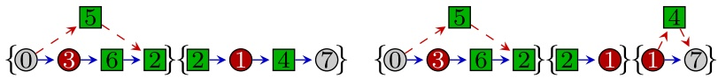

(b) UAV-eligible customer 5 has been removed from the truck's route and is assigned to the UAV. The UAV is launched from the depot (node 0) and is recovered by the truck at node 2. There are now two truck subroutes, {0, 3, 6, 2} and {2, 1, 4, 7}; Cprime = {6, 4}.

(c) Customer 4 is assigned to the UAV. There are now three truck subroutes, and Cprime = {6}.

$$
\{0, 3, 6, 2, 5, 1, 4, 7 \}
$$

$$
C ^ {\prime} = \{6, 2, 5, 4 \}
$$

Fig. 4. A notional example to demonstrate the FSTSP heuristic. Nodes 0 and 7 represent the depot. Customers in C<sup>0</sup>(UAV-eligible) are shown in boxed nodes, while the remaining circular nodes represent UAV-ineligible customers.

required synchronization between the truck and the UAV, the savings associated with removing customer 6 from this subroute is subject to the time required for the UAV to travel from 0 ! 5 ! 2 plus the recovery service time, s<sub>R</sub>. This calculation is performed in line 11 of Algorithm 2.

Algorithm 2. Pseudocode for the calcSavings function. This function calculates the savings achieved by removing some customer j from the truck’s route.

```txt
Require: j (a customer currently assigned to the truck) and t (the vector of the truck's arrival time to each node).
Find i, the node immediately preceding j in the truck's route.
Find k, the immediate successor node to j in the truck's route.
savings = τi,j + τj,k - τi,k
if (j is currently in a truck subroute paired with the UAV) then
% Savings may be limited by the existing UAV assignment
% (e.g., the truck waits for the UAV to return):
Find a, the first node in the truck's subroute (where the UAV launches).
Find b, the last node in the truck's subroute (where the UAV returns).
Find j', the customer visited by the UAV associated with this subroute.
Calculate t'[b], the truck's arrival time to b if j is removed from the truck route.
savings = min{savings, t'[b] - (t[a] + τa,j' + τj',b + sR)}
end if
```

Note that a negative savings value in line 11 of Algorithm 2 can occur in cases where removing customer j from the truck’s route would result in the truck waiting at customer b for the UAV to arrive. By contrast, a positive savings value will result if the UAV is currently waiting for the truck, but removing j from the truck’s route would reduce the wait. The heuristic seeks these positive savings, as they are indicative of customers whose removal may hasten the delivery times to subsequent customers. An assignment change is only implemented if the net savings (that is, the savings associated with removing j from the truck’s route minus the cost incurred by serving j at a different time by either the truck or the UAV) is positive. Since the cost of moving j can never be negative, it is not necessary to explicitly bound savings below by zero. The cost functions for the truck and UAV are described next.

Returning to the main FSTSP pseudocode, in line 9 of Algorithm 1 each truck subroute is investigated to calculate the cost of either inserting j into a different position in the truck route or serving j via the UAV. For example, Fig. 4b shows two truck subroutes, where the first subroute is associated with a UAV sortie. For the case of j ¼ 4 2 Cprime, this customer could be inserted into the truck’s first subroute (f0; 3; 6; 2g), where it would be served by the truck. The cost associated with this insertion is calculated in the calcCostTruck function, described in Algorithm 3. Alternatively, customer 4 could be served by the UAV in the second subroute (f2; 1; 4; 7g), which is not currently associated with a UAV sortie. This cost is calculated in the calcCostUAV function, as in Algorithm 4.

Focusing on the calcCostTruck function, an attempt is made to insert customer j into the truck’s route between adjacent nodes i and k. For example, in Fig. 4b, customer j ¼ 4 might be inserted between nodes 0 and 3, 3 and 6, or 6 and 2 in the first truck subroute. Even if this is an attractive insertion (i.e., if cost < savings), the insertion of j will necessarily add to the duration of this subroute. Thus, one must verify that the UAV has sufficient endurance to rendezvous with the truck at the last node in this subroute (i.e., node b ¼ 2). If the net savings associated with this insertion is the best observed thus far, store the nodes between which j will be inserted and set a flag to indicate that j will not be served by the UAV.

Algorithm 3. Pseudocode for the calcCostTruck function, which calculates the cost of inserting some customer j into a different position of the truck’s route.

```matlab
Require: j, t, subroute
Find a, the first node in the truck's subroute.
Find b, the last node in the truck's subroute.
for all (adjacent i and k in subroute) do
    % Try to insert j into this truck subroute
    % i → j would become i → j → k
    cost = τ_{ij} + τ_{j,k} - τ_{i,k}
    if (cost < savings) then
        % Can the UAV assigned to this subroute still feasibly fly?
        if (t[b] - t[a] + cost ≤ e) then
            if (savings - cost > maxSavings) then
                % Save this change
                servedByUAV = False
                j* = j; i* = i; k* = k
                maxSavings = savings - cost
            end if
        end if
    end if
end for
```

Similarly, the calcCostUAV function (Algorithm 4) calculates the cost associated with serving some customer j 2 Cprime via the UAV. Investigate each pair of nodes, i and k, such that the two nodes are not necessarily adjacent but that i precedes k, in a given subroute that is not currently connected with the UAV. For example, in Fig. 4b, if j = 4 were to be visited by the UAV in the truck’s second subtour, the ði; kÞ pairs to investigate would be (2, 1) (2, 7), or (1, 7). It is desired to calculate the time delay associated with a UAV sortie that launches from node i, visits customer j, and returns to the truck at node k. This candidate sortie’s duration must not exceed the UAV’s endurance. If customer j is served by the truck in the current subroute, the truck’s arrival times to each node must be re-calculated (as j would be removed from the truck’s route). The cost associated with the candidate UAV sortie will be the maximum of either the extra time required by the truck to perform the launch and recovery activities at node i, or the time delay associated with the truck waiting to retrieve the UAV at node k.

Algorithm 4. Pseudocode for the calcCostUAV function, which calculates the cost of serving some customer j via the UAV.

<div class="docvortex-algorithm" style="white-space: pre-wrap; font-family:monospace;">
Require: j, t, subroute
% This truck subroute is not associated with a UAV visit
% Try to use the UAV to visit j
for all (i and k in subroute, such that i precedes k) do
    if ($\tau_{ij}' + \tau_{j,k}' \leqslant e$) then
        Find t'[k], the truck's arrival time to node k if j were removed from the truck's route.
        cost = max{0, max{(t'[k] - t[i]) + sL + sR, $\tau_{ij}' + \tau_{j,k}' + sL + sR$} - (t'[k] - t[i])} if (savings - cost &gt; maxSavings)
        servedByUAV = True
        j* = j; i* = i; k* = k
        maxSavings = savings - cost
    end if
end if
end for
</div>

At the end of each iteration (i.e., for each choice of $\mathtt { j } \in \mathtt { C p r i }$ me in Algorithm 1), the modification associated with the maximum savings must be implemented. This is accomplished in the performUpdate function, as shown in Algorithm 5. As the procedure continues, truckRoute will be partitioned into subroutes; the exact partitioning being determined by the launch and recovery nodes for the sidekick UAV. Other customers may be inserted into truck subroutes associated with the UAV. For example, in the assignment shown in Fig. 4c, customer 4 could be inserted into the truck’s subroute $0 \to 3 \to 6 \to 2 .$ However, since the UAV is launched from the beginning of this subroute (node 0) and is recovered at the end of the subroute (node 2), no additional UAV assignments can be attributed to this subroute. Note that, although the UAV is recovered at node 2, it could also be re-launched from this node. Thus, Node 2 also appears as the first node of the second truck subroute in Fig. 4c. The procedure continues until no improving reassignments of customers can be found.

Algorithm 5. Pseudocode for the performUpdate function.

```txt
Require: servedByUAV, i*, j*, k*
  if (servedByUAV == True) then
    The UAV is now assigned to i* → j* → k*.
    Remove j* from truckRoute and truckSubRoutes
    Append a new truck subroute that starts at i* and ends at k*
    Remove i*, j*, and k* from Cprime
    Update t (the vector of truck arrival times to each node)
  else
    Remove j* from its current truck subroute
    Insert j* between i* and k* in the new truck subroute
    Update truckRoute to reflect the new sequence of nodes visited
    Update t
  end if
```

## 4. The parallel drone scheduling TSP

The FSTSP is applicable to scenarios in which the DC is relatively far from the customer locations and a single UAV is available to operate in synchronization with a delivery truck. However, in the event that a significant proportion of customers are located within a UAV’s flight range from the DC, a different problem arises. The parallel drone scheduling TSP (PDSTSP) may be formally defined as follows, where the notation from the FSTSP is adopted unless stated otherwise.

A single depot exists, from which a single delivery truck and a fleet of one or more identical UAVs (given by the set V) must depart and return. The truck serves customers along a TSP route, while the UAVs serve customers directly from the DC. Unlike the FSTSP, there is no synchronization between a UAV and a truck in the PDSTSP. Let $C ^ { \prime } \subseteq C$ represent the set of customers that may receive delivery of their parcel via UAV (i.e., the parcel’s weight does not exceed the UAV’s payload capacity, no customer signature is required, and the customer’s location is accessible by UAV). Additionally, let $C ^ { \prime \prime } \subseteq C ^ { \prime }$ denote those UAV customers that are also within the UAV’s range from the DC (i.e., customer $i \in C ^ { \prime }$ is in set $C ^ { \prime \prime } \; \mathrm { i f } \; \tau _ { 0 , i } ^ { \prime } + \tau _ { i , c + 1 } ^ { \prime } \leqslant e )$ . The objective is to minimize the latest time that a vehicle returns to the depot, such that each customer is served exactly once.

A mixed integer linear programming formulation of the PDSTSP may be constructed with the introduction of one new decision variable; define the binary decision variable $\hat { y } _ { i , \nu }$ to equal one if customer $i \in C ^ { \prime \prime }$ is served by UAV $\nu \in V .$ The model also employs the binary variable $\hat { \boldsymbol { \chi } } _ { i j } ,$ which equals one if the truck travels from node $i \in N _ { 0 }$ to node $j \in \{ N _ { + } : j \neq i \}$ , and the auxiliary decision variable $\mathbf { 1 } \leqslant \hat { u } _ { i } \leqslant c + 2$ . The latter two decision variables are consistent with $x _ { i j }$ and $u _ { i }$ from the FSTSP formulation. Thus, the PDSTSP may be stated as:

Min z

$$
z\geqslant \sum_{i\in N_{0}}\sum_{\substack{j  \in   N_{+}\\ j\neq i}}\tau_{i,j}\hat{x}_{i,j}\tag{33}
$$

$$
z \geqslant \sum_ {i \in \mathbf {C} ^ {\prime \prime}} (\tau_ {0, i} ^ {\prime} + \tau_ {i, c + 1} ^ {\prime}) \hat {y} _ {i, v} \quad \forall v \in V\tag{34}
$$

$$
\sum \hat {x} _ {i, j} + \sum \hat {y} _ {j, v} = 1 \quad \forall j \in C\tag{35}
$$

$$
i \in N _ {0} \qquad v \in V\tag{36}
$$

$$
i \neq j \quad j \in C ^ {\prime \prime}
$$

$$
\sum_ {j \in N _ {+}} \hat {x} _ {0, j} = 1\tag{37}
$$

$$
\sum_ {i \in N _ {0}} \hat {x} _ {i, c + 1} = 1\tag{38}
$$

$$
\sum \hat {x} _ {i, j} = \sum \hat {x} _ {j, k} \forall j \in C\tag{39}
$$

$$
i \in N _ {0} \quad k \in N _ {+}
$$

$$
i \neq j \quad k \neq j
$$

$$
\hat {u} _ {i} - \hat {u} _ {j} + 1 \leqslant (c + 2) (1 - \hat {x} _ {i, j}) \quad \forall i \in C, j \in \{N _ {+}: j \neq i \}\tag{40}
$$

$$
1 \leqslant \hat {u} _ {i} \leqslant c + 2 \quad \forall i \in N _ {+}\tag{41}
$$

$$
\hat {x} _ {i j} \in \{0, 1 \} \quad \forall i \in N _ {0},   j \in \{N _ {+}: j \neq i \}\tag{42}
$$

$$
\hat {y} _ {i, v} \in \{0, 1 \} \quad \forall i \in C ^ {\prime \prime}, v \in V\tag{43}
$$

The objective function (33) seeks to minimize the latest return time to the depot for both the UAV and the truck, where Constraints (34) and (35) provide lower bounds on z, based on truck and UAV assignments, respectively. Constraint (36) ensures that each customer is visited exactly once, either by the truck or a UAV. Constraint (37) requires the truck to leave the depot exactly once, while Constraint (38) ensures that the truck returns to the depot. Additional routing constraints are provided by (39), which specifies that a truck entering a customer node must also leave that node, and (40), which is a standard subtour elimination constraint. Finally, Constraints (41)–(43) specify the decision variable definitions.

## 4.1. A PDSTSP heuristic

The PDSTSP is an amalgamation of two classical operations research problems. First, a TSP exists to sequence those customers assigned to the delivery truck. Second, the problem of scheduling the remaining customers to the fleet of UAVs is equivalent to the parallel identical machine scheduling problem with a minimal makespan objective. Here, each customer represents a ‘‘job’’ to be scheduled, the ‘‘processing time’’ of each being given by the UAV’s round trip flight time to serve that customer from the distribution center. The two problems, each of which are NP-hard, are connected by the need to select the partitioning of customers to be served either by the truck or by a UAV.

While we are not aware of any existing work on this particular combined problem, both the TSP and the parallel machine scheduling (PMS) problem have received considerable attention individually. For example, regarding the PMS problem, Min and Cheng (1999) propose a genetic algorithm and Xu and Nagi (2013) provide an exact approach utilizing column generation.

The proposed PDSTSP heuristic, summarized in Algorithm 6, guides the partitioning of customers that are either served by a UAV or by the delivery truck. The procedure begins by assuming that the UAVs will serve all eligible customers (i.e., all $j \in C ^ { \prime \prime } ) ;$ ; the remaining customers are assumed to be served by the delivery truck. For customers in the candidate UAV partition, a PMS problem is solved to determine the assignments of customers to UAVs and the corresponding makespan. Similarly, a TSP is solved to determine the truck’s route to visit all customers in the truck partition. The ‘‘makespan’’ for the TSP represents the time at which the truck returns to the depot. For now, assume the existence of functions that will solve the PMS problem and TSP (either exactly or heuristically). We denote these functions as solvePMS() and solveTSP(), respectively. A variety of specific solution approaches to these subproblems are explored in Section 5.

As the procedure continues, an improvement step reassigns individual customers to either the UAV or truck partitions, with the aim of balancing the UAV and truck makespans. If the makespan for the UAV assignments exceeds the duration of the truck’s tour, a customer from the UAV partition is chosen as a candidate to be served by the truck. The move affording the greatest net savings is chosen (as in Line 12 of Algorithm 6). If no move yields a savings in the overall makespan a swap is investigated. The swap() function, described in Algorithm 7, explores all pairwise exchanges of customers in the UAV and truck partitions. If the makespan for the truck assignments determines the overall makespan, the swap() function is again employed. The process of reallocating customers to the UAV and truck partitions is repeated until no improved solutions may be obtained.

## Algorithm 6. Pseudocode of the main PDSTSP heuristic

```matlab
Initialize: uavCustomers = C";truckCustomers = C \ C"
[uavMkspn, uavAssignments] = solvePMS(uavCustomers)
[truckMkspn, truckRoute] = solveTSP(truckCustomers)
repeat
    if (uavMkspn > truckMkspn) then
        % Seek to improve solution by reducing the UAV makespan
        maxSavings = 0
        for all i ∈ uavCustomers do
            uavCustomers' = uavCustomers \ i;truckCustomers' = truckCustomers ∪ i
            [uavMkspn', uavAssignments'] = solvePMS(uavCustomers')
            [truckMkspn', truckRoute'] = solveTSP(truckCustomers')
            savings = uavMkspn - uavMkspn'; cost = truckMkspn' - truckMkspn
            if ((savings - cost) > maxSavings) then
                maxSavings = savings - cost
                i* = i
                uavMkspn* = uavMkspn'; truckMkspn* = truckMkspn'
                uavAssignments* = uavAssignments'; truckRoute* = truckRoute'
            end if
```

```txt
end for
if (maxSavings > 0) then
    uavCustomers = uavCustomers \ i*;truckCustomers = truckCustomers \ i*
    uavMkspn = uavMkspn*;truckMkspn = truckMkspn*
else
    [maxSavings, uavMkspn, truckMkspn, uavAssignments, truckRoute]
= swap(uavMkspn, truckMkspn, uavCustomers, truckCustomers, C'')
    if (maxSavings == 0) then
        Stop. No improved solution found via the swap.
    end if
endif
else
    [maxSavings, uavMkspn, truckMkspn, uavAssignments, truckRoute]
= swap(uavMkspn, truckMkspn, uavCustomers, truckCustomers, C'')
    if (maxSavings == 0) then
        Stop. No improved solution found via the swap.
    end if
end if
until Stop
return uavMkspn, truckMkspn, uavAssignments, truckRoute
```

## Algorithm 7. Pseudocode of the swap function

```txt
Require: uavMkspn, truckMkspn, uavCustomers, truckCustomers, C"
Initialize: maxSavings = 0
forall i ∈ uavCustomers do
    for all j ∈ {truckCustomers ∩ C''} do
        uavCustomers' = {uavCustomers \ i} ∪ j; truckCustomers' = {truckCustomers ∪ i} \ j
        [uavMkspn', uavAssignments'] = solvePMS(uavCustomers')
        [truckMkspn', truckRoute'] = solveTSP(truckCustomers')
        if (max{uavMkspn, truckMkspn} - max{uavMkspn', truckMkspn'} > maxSavings) then
            maxSavings = max{uavMkspn, truckMkspn} - max{uavMkspn', truckMkspn'}
            uavMkspn* = uavMkspn'; truckMkspn* = truckMkspn'
            uavAssignments* = uavAssignments'; truckRoute* = truckRoute'
        end if
    end for
end for
if (maxSavings > 0) then
    uavMkspn = uavMkspn*; truckMkspn = truckMkspn*
    uavAssignments = uavAssignments*; truckRoute = truckRoute*
end if
return maxSavings, uavMkspn, truckMkspn, uavAssignments, truckRoute
```

## 5. Empirical results

A series of numerical experiments were conducted to assess the effectiveness of the proposed FSTSP and PDSTSP heuristics, and to gain insights into potential strategies for future enhancements. In addition to assessing the proposed heuristics, a study was conducted to explore the trade-offs between increased UAV flight speed and longer flight endurance. All computational work was conducted on an HP 8100 Elite desktop PC with a quad-core Intel i7–860 processor and 4 GB RAM running Ubuntu Linux 14.04 in 64-bit mode. Where applicable, mixed integer linear programming models were solved via Gurobi version 5.6.0, a popular solver software package. Heuristics were coded in Python version 2.7.5.

## 5.1. Analysis of the FSTSP heuristic framework

Because the FSTSP is a newly-defined problem, there exist no solution approaches against which the proposed heuristic framework may be evaluated. Therefore, our basis for comparison is to solve the FSTSP via a MILP solver, which is possible only for small-scale problem instances.

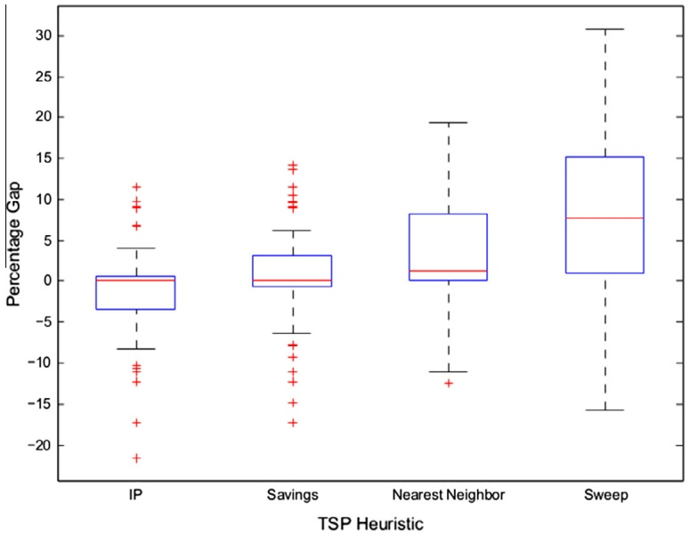

Fig. 5. A comparison of the FSTSP heuristic’s effectiveness using various solution approaches for the underlying TSP.

As discussed in Section 3.3, the proposed FSTSP heuristic framework relies on a mechanism for repeatedly solving TSPs. Four candidate TSP solution approaches were investigated. The first involves solving the TSP subproblem optimally via an integer programming solver (e.g., Gurobi). The integer programming formulation for the so-called ‘‘IP’’ approach for the TSP subproblem is described in Appendix A. While this is an acceptable approach for small-scale problems, it may not be computationally expedient for problems of practical size. Therefore, three common and easy to implement TSP construction heuristics were also tested, details of which may be found in Chapter 8 of Goetschalckx (2011).

The first heuristic is a modification of the well-known Clarke–Wright savings heuristic (Clarke and Wright, 1964). In this procedure, each customer is initially connected directly to the depot. Then, the pair of customers affording the maximum ‘‘savings’’ resulting from connecting them in succession is chosen, where the savings associated with replacing $0 \rightarrow i \rightarrow c + 1$ and ${ \pmb 0 } \rightarrow { \pmb j } \rightarrow { \pmb c } + { \pmb 1 }$ by ${ \pmb 0 } \rightarrow { \pmb i } \rightarrow { \pmb j } \rightarrow { \pmb c } + 1$ 1 is calculated as $\tau _ { i , c + 1 } + \tau _ { 0 , j } - \tau _ { i , j }$ . The procedure adds one customer at a time to the ‘‘outside’’ of the connected nodes until a valid TSP tour is obtained.

The second TSP heuristic is the ‘‘nearest neighbor,’’ whereby a route is constructed by starting at the depot location and choosing the customer closest to the current location. Finally, the third TSP heuristic is a ‘‘sweep’’ approach. The procedure begins by constructing a ray that emanates from a chosen focal point. For the purpose of our numerical analysis, the focal point was chosen to be the location of the depot and the initial angle of the ray was zero radians. A route is constructed by starting at the depot and visiting customers in the order in which they are intersected by the ray as it rotates back to its initial orientation; we chose a clockwise rotation in our analysis. Different solutions may be obtained by changing the focal point, initial angle, and rotation direction of the ray.

A collection of 72 test problems was generated, each containing 10 customers distributed across an 8-mile square region. For each problem, the depot location was randomly chosen to be either the average of the x- and y-coordinates of the customers (i.e., near the center of gravity), the average of the customers’ x-coordinates with a y-coordinate of zero, or at the southwest corner of the region (origin). Between 80% and 90% of the customers were designated as being UAV-eligible. The endurance of the UAV was chosen to be either 20 or 40 min. UAV speeds were selected as 15, 25, or 35 miles/h, with Euclidean UAV flight paths. The truck speed was assumed to be 25 miles/h, with truck travel being based on the Manhattan metric. The parameters $s _ { L }$ and $s _ { R }$ were assumed to be one minute each.

A summary of the FSTSP heuristic’s performance with various TSP solution approaches.

<table><tr><td rowspan="2">TSP solution approach</td><td colspan="3">Gap (%)</td><td colspan="3">Runtime (s)</td></tr><tr><td>Avg</td><td>Min</td><td>Max</td><td>Avg</td><td>Min</td><td>Max</td></tr><tr><td>IP</td><td>-1.16</td><td>-21.73</td><td>11.59</td><td>5.026</td><td>0.380</td><td>31.540</td></tr><tr><td>Savings</td><td>0.33</td><td>-17.33</td><td>14.07</td><td>0.004</td><td>0.001</td><td>0.006</td></tr><tr><td>Nearest neighbor</td><td>2.91</td><td>-12.45</td><td>19.26</td><td>0.004</td><td>0.001</td><td>0.006</td></tr><tr><td>Sweep</td><td>8.33</td><td>-15.70</td><td>30.93</td><td>0.004</td><td>0.001</td><td>0.006</td></tr><tr><td>FSTSP formulation</td><td></td><td></td><td></td><td>1800.000</td><td>1800.000</td><td>1800.000</td></tr></table>

Each test problem was solved via the MILP formulation provided in (1)–(32) of Section 3.2 using Gurobi, with a time limit of 30-min per problem. The FSTSP heuristic framework was evaluated with the four TSP solution methodologies described above. Fig. 5 provides a summary of the FSTSP heuristic’s performance for the various TSP solution approaches, where ‘‘IP’ represents the use of the integer programming formulation found in Appendix A to solve the TSP subproblem, and ‘‘savings’’, ‘‘nearest neighbor’’, and ‘‘sweep’’ represent the three candidate TSP heuristics evaluated. The ‘‘gap’’ reported is the percentage difference between the solution obtained by Gurobi for the MILP formulation of the FSTSP and each heuristic. Note that Gurobi required the full 30-min limit for all 72 problems, such that none of the solutions to the FSTSP formulations were provably optimal. For this reason, a negative gap was reported for many test instances, indicating that the heuristics often found better solutions than Gurobi. Additional performance details are provided in Table 1.

There was a marked difference in solution quality among the different TSP heuristics employed. In particular, the ‘‘IP’’ approach outperformed all others in terms of solution quality, with an average solution being better than what was obtained by Gurobi when solving the comprehensive FSTSP formulation. While this approach is not practical for large-scale problems (it is time-prohibitive to repeatedly solve large TSP instances to optimality), the results suggest that the incorporation of effective TSP heuristics will improve the performance of the overall FSTSP heuristic. In particular, the savings heuristic performed well, especially when considering that it required only fractions of a second to solve. However, the nearest neighbor and sweep heuristics were not competitive in terms of solution quality. To put the optimality gaps into perspective, the 8.33% average gap associated with the sweep heuristic indicates that this solution approach produces solutions that result in only 4.8 min of additional delivery time beyond what was found by the complete MILP formulation solved via Gurobi. Meanwhile, the 30.93% maximum gap represented an additional delivery time of 18 min from Gurobi’s solution.

Although there are numerous alternative TSP heuristics, the purpose of this paper is not to determine the definitive heuristic. However, as demonstrated above, the numerical analyses suggest that high-quality (i.e., near-optimal) TSP solutions have a positive impact on the solution quality obtained by the proposed FSTSP heuristic framework. An attractive future research topic would be to explore and identify alternative TSP heuristics that offer improved performance within the proposed solution framework.

## 5.2. Analysis of the PDSTSP heuristic framework

Recall that the proposed PDSTSP heuristic framework requires the solution to a TSP for truck routes and to a PMS problem for the UAV-to-customer assignments. In this analysis, three TSP heuristics were evaluated in the framework; namely, the optimal TSP solution obtained via a MILP solver, the savings heuristic, and the nearest neighbor heuristic. The sweep heuristic evaluated above was excluded due to its poor performance in the FSTSP testing.

Similarly, the PMS subproblem was evaluated via a binary integer programming formulation to obtain optimal PMS solutions and the popular longest processing time (LPT) first heuristic. The integer programming formulation for the PMS subproblem appears in Appendix B. The LPT heuristic (c.f., Chapter 5 of Pinedo, 2012) first sorts all processing times (e.g., the UAV’s roundtrip travel time from the depot to a particular customer) in descending order. It then assigns the longest tour to the first available UAV. This is repeated until each customer is assigned to exactly one UAV.

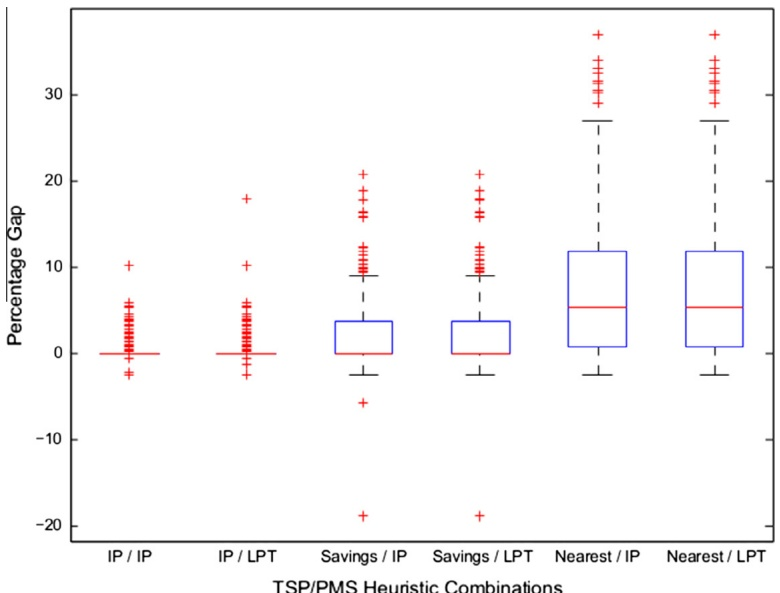

TSP/PMS Heuristic Combinations

Fig. 6. Solution quality for variants of the PDSTSP heuristic on combined 10- and 20-customer problems. The gap is based on the best solution obtained by Gurobi within the time limit.

Table 2

Details of heuristic performance on small PDSTSP instances.

<table><tr><td colspan="2">Solution approach</td><td colspan="4">10 Customers</td><td colspan="4">20 Customers</td></tr><tr><td colspan="2"></td><td colspan="2">Gap (%)</td><td colspan="2">Runtime (s)</td><td colspan="2">Gap (%)</td><td colspan="2">Runtime (s)</td></tr><tr><td>TSP</td><td>PMS</td><td>Avg</td><td>Max</td><td>Avg</td><td>Max</td><td>Avg</td><td>Max</td><td>Avg</td><td>Max</td></tr><tr><td>IP</td><td>IP</td><td>0.12</td><td>10.13</td><td>2.4856</td><td>29.97</td><td>0.22</td><td>5.53</td><td>495.272</td><td>21510.61</td></tr><tr><td>IP</td><td>LPT</td><td>0.12</td><td>10.13</td><td>2.3093</td><td>28.85</td><td>0.31</td><td>18.00</td><td>498.057</td><td>21521.31</td></tr><tr><td>Savings</td><td>IP</td><td>1.57</td><td>20.68</td><td>0.2373</td><td>8.26</td><td>3.79</td><td>18.83</td><td>3.721</td><td>80.68</td></tr><tr><td>Savings</td><td>LPT</td><td>1.58</td><td>20.68</td><td>0.0003</td><td>0.01</td><td>3.90</td><td>18.83</td><td>0.008</td><td>0.07</td></tr><tr><td>Nearest</td><td>IP</td><td>5.46</td><td>37.17</td><td>0.2335</td><td>8.26</td><td>10.63</td><td>34.21</td><td>3.137</td><td>65.83</td></tr><tr><td>Nearest</td><td>LPT</td><td>5.46</td><td>37.17</td><td>0.0003</td><td>0.01</td><td>10.68</td><td>34.21</td><td>0.002</td><td>0.02</td></tr><tr><td colspan="2">PDSTSP formulation</td><td></td><td></td><td>0.3194</td><td>2.02</td><td></td><td></td><td>77.775</td><td>180.00</td></tr></table>

Test problems were generated with either 10 or 20 customers, such that 80–90% of customers were UAV-eligible according to weight. The truck and UAV speeds were fixed at 25 miles/h, with the UAV having a flight endurance of 30 min. The depot location was selected as being either near the center of all customers, near the edge of the customer region, or at the origin (as with the FSTSP test problems). Customer locations were generated such that either 20%, 40%, 60%, or 80% of all customers were located within the UAV’s range of the depot. Each of the above parameter settings were repeated 10 times, resulting in the generation of 240 unique test problems (120 10-customer problems and 120 20-customer problems). Each of these problems was solved with a single truck and either 1, 2, or 3 available UAVs, resulting in 720 test instances.

To evaluate the quality of solutions obtained by the PDSTSP heuristic framework, the MILP formulation provided in (33)– (43) of Section 4 was solved via Gurobi, with a 3-min time limit per problem. Gurobi was able to find the optimal solution for all of the 10-customer problems. However, Gurobi was terminated at the time limit on 87 of the 360 20-customer instances. Thus, negative gaps shown in Fig. 6 are indicative of cases where the heuristic outperformed Gurobi. The labels on the x-axis describe the solution approaches to the underlying TSP and PMS subproblems. For example, ‘‘IP/IP’’ indicates that the TSP and PMS subproblems were solved optimally via the integer programming (IP) formulations provided in Appendices A and B, respectively. Similarly, ‘‘Savings/LPT’’ indicates that the TSP subproblems were solved via the savings heuristic while the PMS subproblems were solved by the LPT first heuristic.

Fig. 6 and Table 2 highlight some interesting characteristics of the proposed PDSTSP solution framework. First, we observe that the use of exact (integer programming) approaches for solving the individual TSP and PMS subproblems (labeled ‘‘IP/IP’’ in the figure) yielded near-optimal results. However, the runtimes required to repeatedly solve the TSP subproblems to optimality for the 20-customer instances were significantly longer than Gurobi’s cutoff time for solving the full PDSTSP formulation. Alternatively, the use of the savings heuristic to solve TSP subproblems required significantly shorter runtimes while producing competitive solutions in terms of optimality gaps. This was true when the PMS subproblems were solved by either the ‘‘IP’’ or LPT first approaches. In fact, for a given TSP solution approach, solutions obtained via the LPT first heuristic were often identical in quality to those obtained when the IP formulation was used to solve the PMS subproblems optimally. Furthermore, when observing the runtimes in Table 2, we note that the LPT first heuristic is generally faster than the IP approach to solving the PMS subproblems (when using the same TSP solution approach). Thus, this analysis underscores the importance of the TSP heuristic and indicates that the LPT first heuristic appears to provide near-optimal solutions to the PMS subproblems.

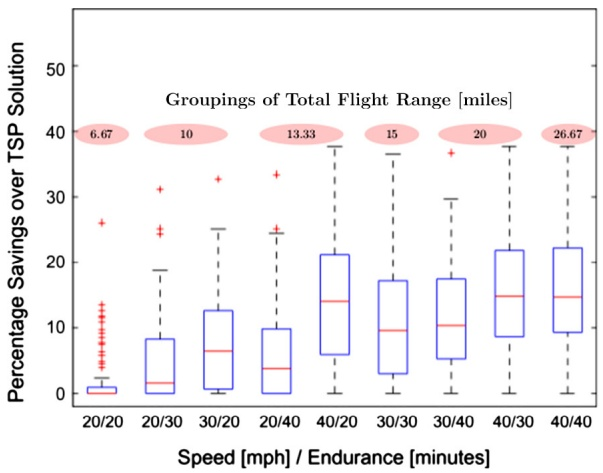

(a) One available UAV

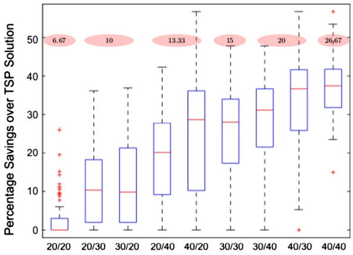

Speed [mph] / Endurance [minutes]

(b) Three available UAVs

Fig. 7. Impacts of speed and endurance for the PDSTSP. Numbers above each speed/endurance pair represent groupings of equivalent total flight distances.

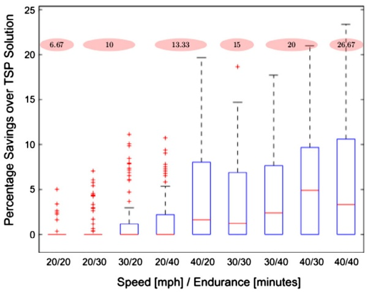

(a) Improvement over TSP solution

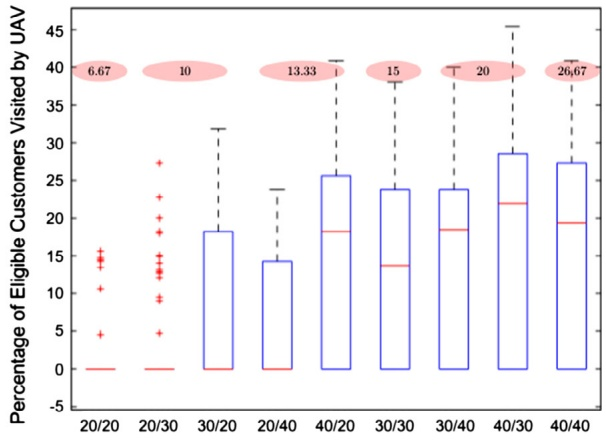

Speed [mph] / Endurance [minutes]

(b) Percentage of eligible customers visited by UAV

Fig. 8. Impacts of speed and endurance for the FSTSP. Numbers above each speed/endurance pair represent groupings of equivalent total flight distances.

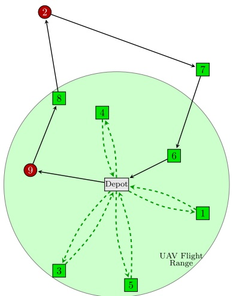

(a) Optimal PDSTSP solution

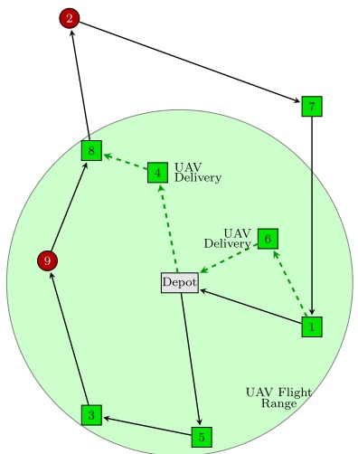

(b) Optimal FSTSP solution

<table><tr><td rowspan="2">UAVTruck</td><td colspan="2">1</td><td colspan="2">3</td><td colspan="2">4</td><td colspan="2">5</td><td colspan="2">PDSTSP Solution</td><td></td></tr><tr><td colspan="2">D → 9</td><td colspan="2">9 → 8</td><td colspan="2">8 → 2</td><td colspan="2">2 → 7</td><td colspan="2">7 → 6</td><td>6 → D</td></tr><tr><td rowspan="2">UAVTruck</td><td colspan="2">D → 5</td><td colspan="2">5 → 3</td><td colspan="2">3 → 9</td><td colspan="2">9 → 8</td><td colspan="2">8 → 2</td><td>2 → 7</td></tr><tr><td colspan="2"></td><td colspan="2"></td><td colspan="2"></td><td colspan="2"></td><td colspan="2"></td><td>7 → 1</td></tr><tr><td rowspan="3">Truck Only</td><td colspan="3">D → 3</td><td colspan="2">3 → 9</td><td colspan="2">9 → 2</td><td colspan="2">2 → 8</td><td colspan="2">8 → 4</td></tr><tr><td colspan="2"></td><td colspan="2"></td><td colspan="2"></td><td colspan="2"></td><td colspan="2">4 → 7</td><td>7 → 6</td></tr><tr><td colspan="2"></td><td colspan="2"></td><td colspan="2"></td><td colspan="2"></td><td colspan="2">6 → 1</td><td>1 → 5</td></tr></table>

(c) A comparison of delivery schedules for the two systems depicted above. The “Truck Only" schedule represents an optimal TSP solution for a single truck serving all customers.

Fig. 9. Six customers are within the UAV’s flight radius from a centrally-located depot. Customers 2 and 9 (circular nodes) are ineligible to be served via UAV (e.g., due to parcel weight restrictions).

Regarding the optimality gap percentages reported in Table 2, we note that the 0.12% average gap associated with the ‘‘IP/IP’’ approach indicates that the heuristic solution results in average delivery times that are only 0.09 min longer than optimal for the 10-customer problems. Similarly, the 0.22% average gap for the 20-customer problems represents an average delivery time increase of 0.24-min when compared to the best-known solutions. At the other end of the spectrum, the 10-customer problems employing the nearest neighbor heuristic for solving the TSP resulted in solutions requiring an average of roughly 6.8 min of additional delivery time for the 10-customer problems and approximately 16.7 min of extra delivery time for the 20-customer problems.

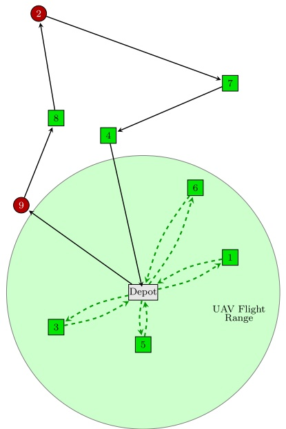

(a) Optimal PDSTSP solution

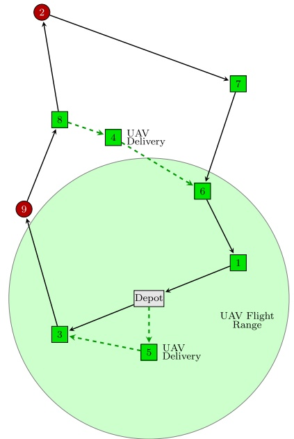

(b) Optimal FSTSP solution

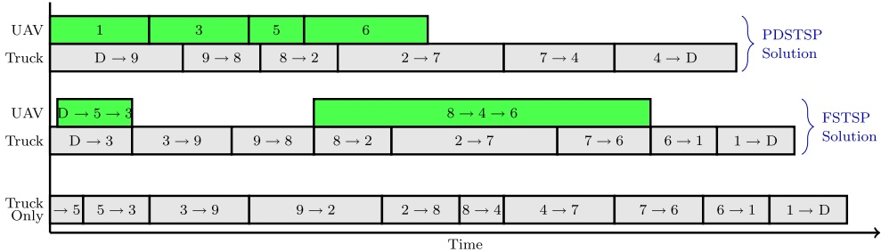

(c) A comparison of delivery schedules for the two systems depicted above. The “Truck Only" schedule represents an optimal TSP solution for a single truck serving all customers.

Fig. 10. Four customers are within the UAV’s flight radius from a slightly offset depot. Customers 2 and 9 (circular nodes) are ineligible to be served via UAV (e.g., due to parcel weight restrictions).

## 5.3. Speed versus endurance

Battery-powered UAVs are subject to limited flight endurance, which is a function of the aircraft’s travel speed. Whereas traditional delivery vehicles are subject to posted speed limits, such restrictions currently do not apply to UAVs. As highlighted below, the determination of a UAV’s travel speed is an important consideration in the overall efficiency of potential drone-facilitated parcel delivery operations.

A total of 90 unique test problems were generated to assess the trade-offs between longer flight times and faster travel speeds. These problems considered 25-, 50-, and 75-customer instances with varying depot locations. Nine speed/endurance combinations were tested, ranging from 20 miles per hour and 20 min to 40 miles-per-hour and 40 min. To highlight the impacts of speed and endurance, the speed/endurance combinations shown in Figs. 7 and 8 are grouped according to equivalent total flight distances. For example, a UAV traveling 20 miles per hour with an endurance of 30 min has a total maximum flight distance of 10 miles, which is the same distance resulting from a speed of 30 miles per hour with an endurance of 20 min. The truck speed in each instance was held constant at 25 miles per hour. These test problems were solved by the proposed PDSTSP and FSTSP frameworks, using the savings heuristic to solve the TSP subproblems and the LPT first heuristic to solve PMS subproblems in the case of the PDSTSP.

Summaries of the experiments for PDSTSP instances involving either one or three UAVs are shown in Fig. 7, where solutions to the PDSTSP are compared against optimal solutions from a TSP (e.g., when only a traditional delivery truck is used, without the aid of a UAV). The results suggest that speed, even at the expense of endurance, is a critical factor in leveraging UAVs in last-mile delivery operations. The effects of increased speed are especially evident in the three-UAV test cases. In particular, for the two scenarios in which the UAV’s flight range is 13.33 miles in Fig. 7b, note that the faster speed of 40 mph (with an endurance of 20 min) leads to improved performance versus the slower speed of 20 mph (with an endurance of 40 min). Similarly, there is a dramatic improvement between a UAV traveling at 40 mph versus 30 mph for a fixed endurance of 20 min of flight time.

Results for FSTSP instances, summarized in Fig. 8a, demonstrate a similar behavior. Fig. 8b shows that low travel speeds, even with high endurance, limit the number of eligible customers that are visited by the UAV. In general, the overall benefit over traditional delivery means is less than what is realized from the PDSTSP. This is not surprising, as the UAV operating in conjunction with the delivery truck results in a system that must be highly synchronized. Recall that in the proposed FSTSP formulation, a UAV launching from or returning to the truck must do so at customer locations only (rather than at intermediate locations). Relaxing such restrictions may lead to more significant savings in overall delivery times.

## 5.4. Contrasting the FSTSP and PDSTSP

The PDSTSP and FSTSP, first defined in this paper, are motivated by two distinct operating scenarios. Specifically, the PDSTSP, represented in Fig. 2, is motivated by cases where a large percentage of customers are located within the flight range of one or more UAVs departing from the depot. Conversely, when the depot is remotely located, as in the case of Fig. 3, the FSTSP is a viable approach. However, there are scenarios in which the choice of operating policy is not obvious. As an example, consider the scenarios shown in Figs. 9–11. Each figure depicts the same collection of customers, but with a different depot location. For the sake of comparison, a single UAV is assumed for both the PDSTSP and FSTSP (although the model for the PDSTSP does allow multiple UAVs). Note that the truck paths shown in these figures are represented by straight arcs, although the actual truck travel along the underlying road network (not shown) is rectilinear. Consistent with our intuition, as the number of customers within the UAV’s flight radius from the depot decreases the FSTSP approach becomes more attractive.

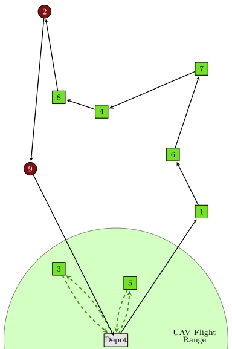

(a) Optimal PDSTSP solution

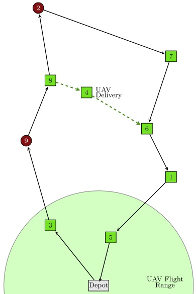

(b) Optimal FSTSP solution

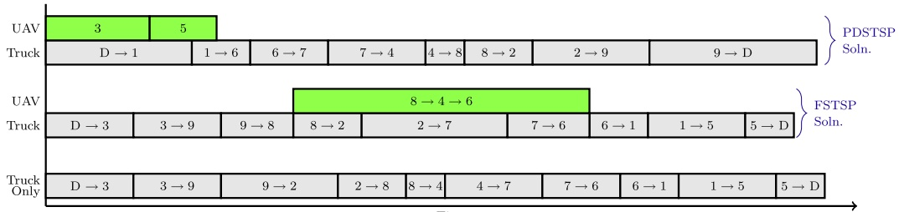

(c) A comparison of delivery schedules for the two systems depicted above. The "Truck Only' schedule represents an optimal TSP solution for a single truck serving all customers.

Fig. 11. Only two customers are within the UAV flight radius from a remotely-located depot. Customers 2 and 9 (circular nodes) are ineligible to be served via UAV (e.g., due to parcel weight restrictions).

Consider Fig. 9, where six of the nine customers are within the UAV’s flight range. The PDSTSP solution represents a much shorter makespan than what is afforded by the FSTSP. Note that the optimal PDSTSP solution (Fig. 9a) only assigns four of the six UAV-eligible customers to the single UAV operating from the depot. This demonstrates that a naive approach assigning all UAV-eligible customers to a UAV would be suboptimal. It also indicates that the total required delivery time could be reduced by incorporating a second UAV. In contrast, although the FSTSP solution (Fig. 9b) only assigns two customers to the UAV, the resulting makespan is still shorter than what is possible when only a delivery truck is employed. Thus, while the FSTSP was not motivated by scenarios in which the depot is centrally located, it does offer improvements over a TSP-only solution.

Fig. 10 depicts a situation where four customers are within range of the depot. Note that the optimal PDSTSP solution (Fig. 10a) assigns all four of the UAV-eligible customers within the flight range to the UAV. The optimal FSTSP solution, shown in Fig. 10a, assigns two customers to the UAV. One of these customers is outside of the UAV flight range centered about the depot. In this case, with a smaller percentage of customers that may be visited directly from the depot, the difference in makespans between the PDSTSP and FSTSP is smaller than what was observed in Fig. 9.

Finally, Fig. 11 shows a case in which only two customers are within the UAV’s flight range from the remote depot. Although the optimal FSTSP solution (11b) only assigns the UAV to visit one customer, the resulting makespan is shorter than the optimal PDSTSP makespan in which two customers are visited (Fig. 11a). This is a result of the truck’s rectilinear travel, which requires the truck in the PDSTSP solution to pass near the locations of customers 3 and 5.

This brief analysis indicates that, outside of the distinct operating environments in which the PDSTSP and FSTSP were motivated, it may be difficult to determine a priori whether the PDSTSP or FSTSP is more appropriate. An interesting potential research direction would be to identify the operating characteristics that may determine whether the FSTSP or PDSTSP approach is preferable. Such an analysis will be influenced by a number of key problem parameters, including the geographic spread and number of customers, the number of UAVs (recall that the PDSTSP considers multiple possible UAVs while the FSTSP is limited to a single UAV), the location of the depot, UAV speeds and endurance, truck speeds, density of the road network and presence of one-way streets (both of which will influence the truck’s travel time), and the time required for launching and retrieving UAVs from the truck. Furthermore, due to the computational complexity of both problems, only very small-scale problems may be solved optimally. However, problems of practical size must be solved via heuristic methods. Thus, it may be difficult to determine if differences in solutions between the FSTSP and PDSTSP are a result of fundamental operating differences, or simply due to differences in optimality gaps.

## 6. Discussion and future research

Recent demonstrations by Amazon, Google, and DHL (among others) have shown the potential of UAVs for small parcel delivery. While extensive research efforts have focused on the technical aspects of UAVs, this paper seeks to provide new algorithms designed to optimize the operational elements of a delivery-by-drone logistics system.

In particular, two new problems have been formally defined. The FSTSP seeks to coordinate a traditional delivery truck with a UAV that may be launched from the truck. Solutions to this problem enable the benefits of UAVs in cases where direct flights from distribution centers to customers are impractical due to the UAV’s limited flight endurance. In cases where a significant proportion of customers are located within close proximity to the distribution center, solutions to the proposed PDSTSP provide optimal assignments of a fleet of UAVs and a delivery truck to customers.

Due to the NP-hard nature of these problems, only small-scale problems may be solved optimally via mixed integer programming solvers. Therefore, simple yet effective heuristic solution frameworks for solving large-sized instances of the FSTSP and PDSTSP were proposed. These solution approaches were validated via an extensive numerical analysis, which also indicated that these delivery-by-drone systems may be made more efficient by utilizing faster UAVs, even at the expense of reduced flight endurance.

This work represents a foundation from which a variety of future research may be conducted. For example, further work that relaxes some of the operational constraints imposed for the sake of model tractability will enable improved logistic system performance. This includes allowing UAVs to launch from, and return to, the same location, or allowing UAVs to rendezvous at non-customer locations. Extending the FSTSP formulation to consider multiple UAVs and multiple delivery trucks is another logical future research direction. Furthermore, there are opportunities to integrate the FSTSP and PDSTSP to address scenarios in which a truck/UAV tandem can operate in parallel with a fleet of UAVs operating from a distribution center. The resulting problem may leverage aspects of the foundational heuristics developed for the individual FSTSP and PDSTSP.

From an algorithmic perspective, subsequent studies may identify improvements to the proposed heuristic frameworks for these problems. For example, consider the greedy PDSTSP heuristic described in Algorithm 6. Initially, all UAV-eligible customers are assigned to the UAVs, leaving the remaining customers assigned to the truck. If the truck’s makespan exceeds that of the UAV, minimal improvement may be possible given that solutions are initialized to assign all UAV-eligible customers to the UAVs. Thus, the current procedure focuses on the case where the UAV makespan exceeds that of the truck, where reductions to the UAV makespan are sought by shifting customers to the truck. As the heuristic is executed, if the UAV makespan continues to exceed that of the truck, the heuristic seeks to move the UAV customer with the greatest associated savings to the truck’s route. Another area for future heuristic improvement would be to incorporate a more sophisticated local search into Algorithm 6. Specifically, this could be applied to the block of code in lines 29–34 (which addresses the case where the truck makespan exceeds the UAV makespan). The use of simulated annealing, tabu search, or a related procedure may also be helpful in investigating moves that might escape local optima by exploring potentially non-improving moves of customers back to the UAV from the truck. These improved heuristics may benefit from the development of lower bounds, perhaps via constraint relaxation, to assess solution quality for problems in which optimality may not be reached within an acceptable time.

While this paper considers the minimization of the time required to complete all deliveries as the objective, future research may consider alternative objective functions, such as minimizing total cost. Presently, such cost-benefit analyses are impractical as there are currently no commercially-available UAVs designed explicitly for parcel delivery. When such UAVs do become available in the marketplace, there will likely be a wide variety of features offered. For example, some UAVs will come equipped with more sophisticated automated obstacle detection and avoidance functionality, which will obviously cost more but may reduce the need for remote human ‘‘pilots.’’ Furthermore, in a cost-benefit analysis, not only is the cost of the vehicles themselves important, but also maintenance, insurance, manpower, fuel, and operational costs. These costs will vary by operational area, which will dictate the number and geographic distribution of customers, labor rates, and fuel costs, among other factors. Fortunately, as companies move closer to implementing delivery-by-drone, estimates for these costs may be more readily obtained.

We expect that the modeling and algorithmic contributions provided by this work will facilitate the impending implementation of drone-facilitated parcel delivery as UAV technologies continue to evolve.

## Acknowledgements

The authors thank Eddie Robison Rivera for his editorial support. We are grateful to Editor-in-Chief Yafeng Yin and the two anonymous reviewers whose helpful suggestions have improved the quality of this research.

## Appendix A. IP formulation for the TSP

TSP subproblems may be solved optimally via the following integer program (IP), for a given subset of customers, ${ \widehat { C } } \subseteq C ,$ that must be visited by the truck.

$$
\begin{array}{ll}\text{Min} & \sum_{i\in N_{0}}\sum_{\substack{j\in N_{+}\\ j\neq i}}\tau_{ij}x_{ij}\\ \text{s.t.} & \sum_{\substack{i\in N_{0}\\ i\neq j}}x_{ij} = 1 \quad \forall j\in N_{+},\\ & \sum_{\substack{i\in N_{0}\\ i\neq j}}x_{ij} = \sum_{\substack{k\in N_{+}\\ k\neq j}}x_{jk}\quad \forall j\in \widehat{C},\\ & u_{i} - u_{j} + 1\leqslant (|\widehat{C} | + 2)(1 - x_{ij}) \quad \forall i\in \widehat{C},j\in \{N_{+}:j\neq i\} ,\\ & 1\leqslant u_{i}\leqslant |\widehat{C}| + 2 \quad \forall i\in N_{+},\\ & x_{ij}\in \{0,1\} \quad \forall i\in N_{0},j\in \{N_{+}:j\neq i\}. \end{array}
$$

The network representation defined for the FSTSP is applied here, such that trucks depart from the depot at node 0 and return to the depot at node $c + 1$ . Recall that c represents the number of customers in the overall FSTSP. Thus, node $c + 1$ represents the depot for both the overall FSTSP and for the TSP subproblem involving a subset of customers. This allows solutions from the TSP subproblem to be compatible with FSTSP solutions to the same problem. Let $N _ { 0 }$ represent the set of nodes from which the truck may depart; $N _ { 0 } = { \sf 0 } \cup \widehat { \sf C } \cup { \sf c } + { \sf 1 }$ . Similarly, N represents the set of nodes to which the truck may visit during the course of a tour; $N _ { \pm } = \widehat { \mathsf { C } } \cup \mathsf { c } + \mathsf { 1 }$ . Binary decision variable $x _ { i j }$ equals one if the truck travels directly from node $i \in N _ { 0 }$ to node $j \in N _ { + }$

## Appendix B. IP formulation for the PMS problem

PMS subproblems may be solved optimally via the following IP, for a given subset of customers, ${ \overline { { C } } } \subseteq C ,$ that must be visited by the fleet of UAVs, V.

Min z

$$
\begin{array}{l l} \text {Min.} & z \\ \text {s.t.} & z \geqslant \sum_ {i \in \overline {{C}}} (\tau_ {0, i} ^ {\prime} + \tau_ {i, c + 1} ^ {\prime}) y _ {i v} \quad \forall v \in V, \\ & \sum_ {v \in V} y _ {i v} = 1 \quad \forall i \in \overline {{C}}, \\ & y _ {i v} \in \{0, 1 \} \quad \forall i \in \overline {{C}}, v \in V. \end{array}
$$

The network representation defined for the PDSSTSP is applied here, such that UAVs depart from the depot at node 0 and return to the depot at node c þ 1. Recall that c represents the number of customers in the overall PDSTSP. Thus, node c þ 1 represents the depot for both the overall PDSTSP and for the PMS subproblem involving a subset of customers.

## References

[Apatean, A., Rogozan, A., Bensrhair, A., 2013. Visible-infrared fusion schemes for road obstacle classification. Transport. Res. Part C: Emerg. Technol. 35, 180–192](http://refhub.elsevier.com/S0968-090X%2815%2900084-4/h0005).

[Arnold, L.L., Zandbergen, P.A., 2011. Positional accuracy of the wide area augmentation system in consumer-grade GPS units. Comp. Geosci. 37 (7), 883–892](http://refhub.elsevier.com/S0968-090X%2815%2900084-4/h0010).

Banker, S., 2013. Amazon and drones – here is why it will work <[http://www.forbes.com/sites/stevebanker/2013/12/19/amazon-drones-here-is-why-it-will-work/](http://www.forbes.com/sites/stevebanker/2013/12/19/amazon-drones-here-is-why-it-will-work/)>.

[Bektas, T., 2006. The multiple traveling salesman problem: an overview of formulations and solution procedures. Omega 34 (3), 209–219](http://refhub.elsevier.com/S0968-090X%2815%2900084-4/h0020).

Bryan, V., 2014. Drone delivery: DHL ‘parcelcopter’ flies to German isle <[http://www.reuters.com/article/2014/09/24/us-deutsche-post-drones-idUSKCN0HJ1ED20140924](http://www.reuters.com/article/2014/09/24/us-deutsche-post-drones-idUSKCN0HJ1ED20140924)>.

Carlson, N., 2013. The real reason Amazon announced delivery drones last night: \$3 million in free advertising on Cyber Monday <[http://www.businessinsider.com/why-amazon-announced-delivery-drones-2013-12](http://www.businessinsider.com/why-amazon-announced-delivery-drones-2013-12)>.

[Chao, I.M., 2002. A tabu search method for the truck and trailer routing problem. Comp. Operat. Res. 29, 33–51](http://refhub.elsevier.com/S0968-090X%2815%2900084-4/h0035).

Clark, B.J., Bevly, D.M., 2008. GPS/INS integration with fault detection and exclusion in shadowed environments. In: Position, Location and Navigation Symposium, 2008 IEEE/ION, May 2008, pp. 1–8.

[Clarke, G., Wright, J., 1964. Scheduling of vehicles from a central depot to a number of delivery points. Operat. Res. 12, 568–581](http://refhub.elsevier.com/S0968-090X%2815%2900084-4/h0045).

[Crevier, B., Cordeau, J.-F., Laporte, G., 2007. The multi-depot vehicle routing problem with inter-depot routes. Eur. J. Oper. Res. 176 (2), 756–773](http://refhub.elsevier.com/S0968-090X%2815%2900084-4/h0050).

[Derigs, U., Pullmann, M., Vogel, U., 2013. Truck and trailer routing—problems, heuristics and computational experience. Comp. Operat. Res. 40 (2), 536–546](http://refhub.elsevier.com/S0968-090X%2815%2900084-4/h0055).

Drexl, M., 2007. On Some Generalized Routing Problems, Ph.D. thesis. Faculty of Business and Economics, RWTH Aachen University, Aachen, Germany

[Drexl, M., 2012. Synchronization in vehicle routing – a survey of VRPs with multiple synchronization constraints. Transport. Sci. 46 (3), 297–316](http://refhub.elsevier.com/S0968-090X%2815%2900084-4/h0065).

[Eksioglu, B., Vural, A.V., Reisman, A., 2009. The vehicle routing problem: a taxonomic review. Comp. Indust. Eng. 57 (4), 1472–1483](http://refhub.elsevier.com/S0968-090X%2815%2900084-4/h0070).

Faughnan, M.S., Hourican, B.J., MacDonald, G.C., Srivastava, M., Wright, J.A., Haimes, Y.Y., Andrijcic, E., Zhenyu, G., White, J.C., 2013. Risk analysis of unmanned aerial vehicle hijacking and methods of its detection. In: Systems and Information Engineering Design Symposium (SIEDS), April 2013. IEEE, pp. 145–150.

[Gelareh, S., Merzouki, R., McGinley, K., Murray, R., 2013. Scheduling of intelligent and autonomous vehicles under pairing/unpairing collaboration strategy in container terminals. Transport. Res. Part C: Emerg. Technol. 33, 1–21](http://refhub.elsevier.com/S0968-090X%2815%2900084-4/h0080).

[Goetschalckx, M., 2011. Supply chain engineering. International Series in Operations Research & Management Science, vol. 161. Springer](http://refhub.elsevier.com/S0968-090X%2815%2900084-4/h0085).

[Golden, B.L., Raghavan, S., Wasil, E.A. (Eds.), 2008. The Vehicle Routing Problem: Latest Advances and New Challenges. Operations Research/Computer Science Interfaces Series, vol. 43. Springer](http://refhub.elsevier.com/S0968-090X%2815%2900084-4/h0090).

Gross, D., 2013. Amazon’s Drone Delivery: How Would it Work? <[http://www.cnn.com/2013/12/02/tech/innovation/amazon-drones-questions/](http://www.cnn.com/2013/12/02/tech/innovation/amazon-drones-questions/)>.

Humphreys, T., 2012. Statement on the Vulnerability of Civil Unmanned Aerial Vehicles and Other Systems to Civil GPS Spoofing. University of Texas at Austin, July 18, 2012.

Jansen, B., 2014. FAA Approves First Commercial Drone Over Land <[http://www.usatoday.com/story/money/business/2014/06/10/faa-drones-bp-oil-pipeline-aerovironment-north-shore/10264197/](http://www.usatoday.com/story/money/business/2014/06/10/faa-drones-bp-oil-pipeline-aerovironment-north-shore/10264197/)>.

[Jimenez, F., Naranjo, J.E., 2011. Improving the obstacle detection and identification algorithms of a laserscanner-based collision avoidance system. Transport. Res. Part C: Emerg. Technol. 19 (4), 658–672](http://refhub.elsevier.com/S0968-090X%2815%2900084-4/h0110).

[Lin, C.K.Y., 2011. A vehicle routing problem with pickup and delivery time windows, and coordination of transportable resources. Comp. Operat. Res. 38 (11), 1596–1609](http://refhub.elsevier.com/S0968-090X%2815%2900084-4/h0115).

Madrigal, A.C., 2014. Inside Google’s Secret Drone-Delivery Program <[http://www.theatlantic.com/technology/archive/2014/08/inside-googles-secret-drone-delivery-program/379306/](http://www.theatlantic.com/technology/archive/2014/08/inside-googles-secret-drone-delivery-program/379306/)>.

[Marais, J., Meurie, C., Attia, D., Ruichek, Y., Flancquart, A., 2014. Toward accurate localization in guided transport: combining GNSS data and imaging information. Transport. Res. Part C: Emerg. Technol. 43, 188–197](http://refhub.elsevier.com/S0968-090X%2815%2900084-4/h0125).

[Merz, T., Kendoul, F., 2013. Dependable low-altitude obstacle avoidance for robotic helicopters operating in rural areas. J. Field Robot. 30 (3), 439–471](http://refhub.elsevier.com/S0968-090X%2815%2900084-4/h0130).

[Min, L., Cheng, W., 1999. A genetic algorithm for minimizing the makespan in the case of scheduling identical parallel machines. Artif. Intell. Eng. 13 (4), 399–403](http://refhub.elsevier.com/S0968-090X%2815%2900084-4/h0135).

Park, J., Kim, Y., 2014. 3D Shape Mapping of Obstacle Using Stereo Vision Sensor on Quadrotor UAV. American Institute of Aeronautics and Astronautics.

Pestana, J., Sanchez-Lopez, J.L., Saripalli, S., Campoy, P., 2014. Computer vision based general object following for GPS-denied multirotor unmanned vehicles. In: American Control Conference (ACC), June 2014, pp. 1886–1891.

[Pinedo, M.L., 2012. Scheduling: Theory, Algorithms, and Systems. Springer](http://refhub.elsevier.com/S0968-090X%2815%2900084-4/h0150).

[Prins, C., Lacomme, P., Prodhon, C., 2014. Order-first split-second methods for vehicle routing problems: a review. Transport. Res. Part C: Emerg. Technol. 40 (0), 179–200](http://refhub.elsevier.com/S0968-090X%2815%2900084-4/h0155).

Rose, C., 2013. Amazon’s Jeff Bezos Looks to the Future <[http://www.cbsnews.com/news/amazons-jeff-bezos-looks-to-the-future/](http://www.cbsnews.com/news/amazons-jeff-bezos-looks-to-the-future/)>.

Stern, J., 2013. Like Amazon, UPS Also Considering Using Unmanned Flying Vehicles <[http://abcnews.go.com/Technology/amazon-ups-drone-delivery-options/story?id=21086160](http://abcnews.go.com/Technology/amazon-ups-drone-delivery-options/story?id=21086160)>.

[Tarantilis, C.D., Zachariadis, E.E., Kiranoudis, C.T., 200. A hybrid guided local search for the vehicle-routing problem with intermediate replenishment facilities. INFORMS J. Comput. 20 (1), 154–168](http://refhub.elsevier.com/S0968-090X%2815%2900084-4/h0170).

Teal Group, 2014. Teal Group Predicts Worldwide UAV Market will Total \$89 billion in its 2013 UAV Market Profile and Forecast <[http://tealgroup.com/index.php/about-teal-group-corporation/press-releases/94-2013-uav-press-release](http://tealgroup.com/index.php/about-teal-group-corporation/press-releases/94-2013-uav-press-release)>.

Toth, P., Vigo, D., (Eds.), 2002. The Vehicle Routing Problem. SIAM Monographs on Discrete Mathematics and Applications, Philadelpha, PA.

[Villegas, J.G., Prins, C., Prodhon, C., Medaglia, A.L., Velasco, N., 2013. A matheuristic for the truck and trailer routing problem. Eur. J. Oper. Res. 230 (2), 231–244](http://refhub.elsevier.com/S0968-090X%2815%2900084-4/h0185).

[Vis, I.F.A., 2006. Survey of research in the design and control of automated guided vehicle systems. Eur. J. Oper. Res. 170 (3), 677–709](http://refhub.elsevier.com/S0968-090X%2815%2900084-4/h0190).

Welch, C., 2013. Zookal Will Deliver Textbooks Using Drones in Australia Next Year <[http://www.cnn.com/2013/10/18/tech/innovation/zookal-will-deliver-textbooks-using-drones/](http://www.cnn.com/2013/10/18/tech/innovation/zookal-will-deliver-textbooks-using-drones/)>.

Wohlsen, M., 2014. The Next Big Thing You Missed: Amazon’s Delivery Drones Could Work—They Just Need Trucks <[http://www.wired.com/2014/06/the-next-big-thing-you-missed-delivery-drones-launched-from-trucks-are-the-future-of-shipping/](http://www.wired.com/2014/06/the-next-big-thing-you-missed-delivery-drones-launched-from-trucks-are-the-future-of-shipping/)>.

[Xu, J., Nagi, R., 2013. Identical parallel machine scheduling to minimise makespan and total weighted completion time: a column generation approach. Int. J. Prod. Res. 51 (23–24), 7091–7104](http://refhub.elsevier.com/S0968-090X%2815%2900084-4/h0205).