# The Multiple Flying Sidekicks Traveling Salesman Problem: Parcel Delivery with Multiple Drones

Chase C. Murray

Ritwik Raj

Department of Industrial & Systems Engineering, University at Buffalo, Buffalo, New York, USA February 20, 2019

Abstract: This paper considers a last-mile delivery system in which a delivery truck operates in coordi nation with a fleet of unmanned aerial vehicles (UAVs, or drones). Deploying UAVs from the truck enables customers located further from the depot to receive drone-based deliveries. The problem is first formulated as a mixed integer linear program (MILP). However, owing to the computational complexity of this problem, only trivially-sized problems may be solved directly via the MILP. Thus, a heuristic solution approach that leverages a subset of subproblems is proposed. Extensive numerical testing demonstrates that this approach effectively solves problems of practical size within reasonable runtimes. Additional analysis quantifies the potential time savings associated with employing multiple UAVs. The analysis also reveals that additional UAVs may have diminishing marginal returns, and superior (high speed/range) UAVs offer benefits when deployed in larger regions. The model and heuristic also support anticipated future systems that feature automation for UAV launch and retrieval.

Keywords: Unmanned aerial vehicle; drone; vehicle routing problem; traveling salesman problem; logistics; integer programming; heuristics

## 1 Introduction

This paper introduces the multiple flying sidekicks traveling salesman problem (mFSTSP), in which a delivery truck and a heterogeneous fleet of unmanned aerial vehicles (UAVs, commonly called drones) coordinate to deliver small parcels to geographically distributed customers. Each UAV may be launched from the truck to deliver a single customer package, and then rendezvous (return) to the truck to be loaded with a new parcel or transported to a new launch location. The objective of the problem is to leverage the delivery truck and the fleet of UAVs to complete the delivery process and return to the depot in the minimum amount of time.

The problem of pairing UAVs with traditional delivery trucks was first introduced by Murray and Chu (2015). The paper provided a mathematical programming formulation and a simple heuristic for the problem of coordinating a single traditional delivery truck with a single UAV, dubbed the flying sidekick traveling salesman problem (FSTSP). That problem has also been described by other researchers as the TSP with drone.

A number of industry implementations have occurred since the original FSTSP paper appeared. For example, Amazon made its first delivery worldwide (Wells and Stevens 2016) and its first U.S. delivery a few months later (Rubin 2017). However, Drone-maker Flirtey beat Amazon to several milestones, including the first Federal Aviation Administration (FAA) approved U.S. drone delivery (Vanian 2016). Logistics solution provider UPS also entered the drone delivery race, teaming with UAV manufacturers Zipline to deliver blood for lifesaving transfusions in Rwanda (Tilley 2016), CyPhy Works to deliver medical supplies in the U.S. (Carey 2016), and electric truck and

UAV manufacturer Workhorse to demonstrate a truck/drone tandem (Peterson and Dektas 2017). Mercedes-Benz also revealed a concept for a drone delivery van that automatically loads UAVs with parcels without the need for a driver (Etherington 2017). The 2016 Material Handling Industry (MHI) Annual Industry Report (MHI 2016) notes that 59% of its survey respondents believe that emerging technologies like drones are already having an impact on supply chains. The report also claims that adoption rates for technologies like drones are expected to grow to 50% over the next decade.

The present paper extends the original FSTSP, as well as other related studies on truck/UAV routing, in several key respects. Most obviously, the mFSTSP considers an arbitrary number of heterogeneous UAVs that may be deployed from the depot or from the delivery truck. These UAVs may have different travel speeds, payload capacities, service times, and flight endurance limitations. Accounting for these differences accommodates service providers who may expand their fleet with a variety of drones over time.

The new problem also features a more realistic treatment of the operating conditions, to better reflect the realities associated with the complex nature of this coordinated vehicle routing problem. In particular, the mFSTSP considers a thorough treatment of UAV flight endurance, a constraint that is of significant importance in drone-based applications. Rather than simply assuming that each UAV has an endurance specified in total flight time, this paper acknowledges that endurance is a function of payload weight, travel distance while carrying a parcel, and travel distance without the burden of the parcel. For this reason, the mFSTSP also features a more explicit specification of UAV flight phases, including preparation, takeoff from launch point, cruising to service location, landing, service, takeoff from service location, cruising to recovery point, landing at recovery point, and retrieval time. Finally, because the delivery truck is typically too small to safely accommodate multiple drones landing or launching simultaneously, the mFSTSP explicitly queues the aircraft in both the launch and retrieval phases. This additional scheduling problem adds complexity to the problem, but more accurately reflects the limitations associated with deploying multiple drones from a relatively small space.

A small eight-customer example is provided to highlight the time savings that may be afforded by the mFSTSP. Figure 1 shows a comparison of vehicle routes for customers located in the Seattle area. The route generated by solving a standard traveling salesman problem (TSP) demonstrates the long travel distance that must be covered if a single truck makes all eight deliveries. With the addition of one UAV, the truck visits only four of the customers and avoids the eastern half of the region. When three UAVs are employed, the truck needs to visit only two customers. The Gantt chart in Figure 2 highlights the coordination required. In particular, as more UAVs are utilized, the truck driver must spend more time launching and retrieving the drones. Additionally, the drones may spend more time waiting for the truck to arrive at the recovery location. Table 1 reveals the significant time savings for even trivially-sized problems.

Table 1: Comparison of time savings for the small Seattle example.

|  | Makespan [hr:min:sec] | Time Savings [hr:min:sec] | Improvement over TSP |
| --- | --- | --- | --- |
| 3 UAVs | 0:54:55 | 0:53:01 | 49.1% |
| 1 UAV | 1:11:38 | 0:36:18 | 33.6% |
| TSP | 1:47:56 | - | - |

The remainder of this paper is organized as follows. An overview of related academic literature

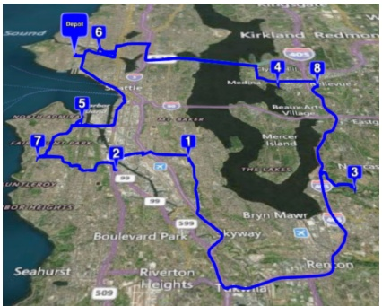

(a) TSP Solution (no UAVs)

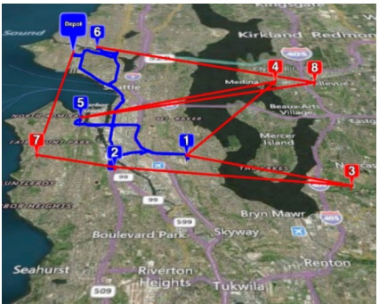

(b) mFSTSP with 1 UAV

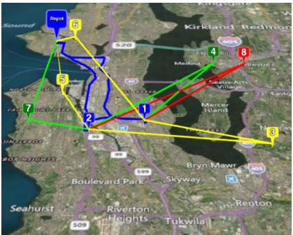

(c) mFSTSP with 3 UAVs

Figure 1: A comparison of routes for a small eight-customer problem in the Seattle region

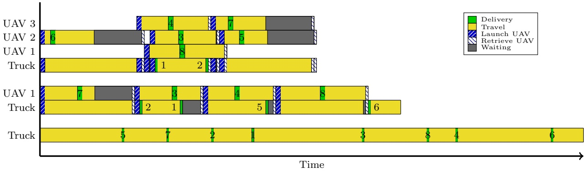

Figure 2: Detailed vehicle timing for the small Seattle example, using either a single truck (TSP), a truck with one UAV, or a truck with three UAVs. Numbers on the bars identify each of the eight customers.

is provided in Section 2. A formal problem definition and mixed integer linear programming (MILP) formulation are provided in Section 3. A three-phased heuristic solution approach is proposed in Section 4, followed by a numerical analysis in Section 5 to highlight the benefits, and limitations, of deploying multiple drones from the delivery truck. Additional analysis explores the impacts of the region size, UAV speeds and ranges, and potential automation improvements. Finally, conclusions and future research directions are provided in Section 6.

## 2 Related literature

This review focuses on problems involving the coordinated use of trucks and UAVs for parcel delivery. While beyond this scope, we note another class of problems that consider the use of only UAVs to make deliveries (i.e., without a truck). Variants of this problem include variable UAV battery energy (Dorling et al. 2017, Venkatachalam et al. 2017, Cheng et al. 2018), multi-objective (San et al. 2016), multiple UAV replenishment locations (Song et al. 2018), and coordinated UAVs (Oh et al. 2018). Additionally, numerous works have considered the benefits of UAVs in a variety of non-military applications. Recent examples include UAV logistics infrastructure (Shavarani et al. 2018, Hong et al. 2018, Kim and Awwad 2017, Chauhan et al. 2019), healthcare (Scott and Scott 2018, Kim et al. 2017), and disaster response (Rabta et al. 2018, Chowdhury 2018, Zhong et al. 2018). A survey of the literature on UAVs for civil applications is provided by Otto et al. (2018).

The problem of combining a drone with a traditional delivery truck for parcel delivery was first formally defined by Murray and Chu (2015). That paper introduced an MILP formulation for the FSTSP, and also defined the parallel drone scheduling TSP (PDSTSP), where multiple drones are launched from the depot to serve nearby customers, independent of the truck delivery. Greedy construction heuristics for both problems were provided.

Several studies have since explored variations of the single-truck single-drone problem, often called the TSP with drone (TSP-D). For example, Agatz et al. (2018) provided a new MILP model for the TSP-D, as well as several route first-cluster second heuristics. Ponza (2016), Ha et al. (2018), Freitas and Penna (2018), Daknama and Kraus (2017), and Schermer et al. (2018) explored neighborhood search based heuristics, while Bouman et al. (2018) present a dynamic programming approach for obtaining optimal solutions. Jeong et al. (2019) modified the FSTSP to consider variable UAV energy consumption and restricted flying areas. Dukkanci et al. (2019) consider a variation of the FSTSP that minimizes the operational cost and calculate UAV energy consumption as a function of speed.

In the case of single-truck multi-UAV problems, Ferrandez et al. (2016) and Chang and Lee (2018) consider a system in which the truck deploys multiple drones from distributed launch sites along the truck’s route. The drones return to the truck before the truck departs for its next destination. Clustering heuristics have been developed, such that the truck is routed to each cluster and nearby customers are served via UAV. Conversely, similar to the mFSTSP, Yoon (2018) consider a single truck that may launch multiple UAVs, with the UAVs returning to the truck at a different location. An MILP formulation is provided, which is tested on instances with up to 10 customers. Tu et al. (2018) propose an adaptive large neighborhood search heuristic for a similar problem, the TSP with multiple drones (TSP-mD).

The use of multiple trucks and multiple UAVs is considered by Kitjacharoenchai et al. (2019), which is an extension of the FSTSP, but without endurance limitations and launch/delivery time considerations. While UAVs can be launched from and retrieved at different trucks, only one UAV can be launched or retrieved at any customer location. They present an MILP formulation and propose an insertion based heuristic to solve problems with up to 50 customers.

Work related to the PDSTSP includes Saleu et al. (2018), who propose a two-step heuristic solution approach. A multi-truck variant of the PDSTSP, solved via constraint programming, is provided by Ham (2018) in which UAVs can perform both delivery and pickup activities. Kim and Moon (2019) consider a variation of the PDSTSP in which UAVs can be deployed from the depot and several drone stations.

Another class of truck/UAV problems assume that only the UAVs may make deliveries, such as the multi-visit drone routing problem (MVDRP) proposed by Poikonen (2018) and the truck/drone tandems considered by Mathew et al. (2015) and bin Othman et al. (2017). Although not a parcel delivery application, Luo et al. (2017) proposed a two-echelon ground vehicle and UAV cooperative routing problem in which a truck carries one UAV which is responsible for visiting one or more surveillance targets before returning to the truck.

Several theoretical studies have shown the benefits of using a combined truck-UAV delivery system. Wang et al. (2016) introduced the vehicle routing problem with drones (VRPD), and determined bounds on the ratio of VRPD time savings versus traditional routing problems (e.g., VRP and TSP). The analysis considered particular cases where trucks and drones follow the same distance metric and drone battery life is unlimited. Poikonen et al. (2017) relaxed these assumptions to develop bounds on similar ratios, but with differing distance metrics for trucks and drones and limited drone endurance. Carlsson and Song (2017) consider a continuous approximation model to replace computationally difficult combinatorial approaches. Their horsefly routing problem consists of one truck and one UAV. Unlike other models, the UAV launch/retrieval locations are not restricted to customer nodes. Campbell et al. (2017) and Li et al. (2018) also used continuous approximation methods, and developed cost models to study the economic impacts. Results by Campbell et al. (2017) suggest that substantial cost savings can be achieved using the combined truck-drone delivery system with multiple drones per truck, and highlight the benefits associated with automated loading and reduced delivery service times. Boysen et al. (2018) study the complexity of problems involving a given set of UAV customers and a fixed truck route.

In contrast to the above studies, Ulmer and Thomas (2018) introduce a problem in which customer orders arrive dynamically. For each incoming order, the firm must decide whether a truck or UAV will make the delivery (if at all). There is no interaction between trucks and UAVs.

## 3 Problem definition and mathematical programming formulation

This section provides a formal definition of the mFSTSP, as well as an MILP formulation of the problem. A summary of the parameter notation is described in Table 2.

Let C represent the set of all customer parcels, such that $C = \{ 1 , 2 , \ldots , c \}$ Each customer must receive exactly one delivery by either the single delivery truck or by one of the heterogeneous UAVs that are denoted by the set V . A particular customer $i   \in   C$ is said to be “droneable” by UAV $v \in V$ , and thus belongs to the set $\hat { C } _ { v }$ , if that customer’s parcel is eligible to be delivered by v. This categorization may be a function of several factors, including the parcel’s weight or size, whether a customer signature is required, whether the parcel contains hazardous material that should not be flown, or whether the customer’s location is conducive to accommodating a drone (e.g., apartments or heavily-wooded areas may be inaccessible to a UAV).

Each UAV is capable of carrying one droneable parcel at a time, although the weight or volume capacity of each UAV may differ. UAVs may be launched from the depot, or from the truck. While a UAV can be launched multiple times, it cannot be launched from the same location more than once. A UAV can be retrieved at the depot, or by the truck at a customer location, but it cannot be retrieved at the same customer location from which it was launched. When a UAV returns to the truck, it may be loaded onto the truck or it can be launched from the truck (at this location) with a new package. It is assumed that the truck can transport all of the available UAVs at once, although the truck may only launch or retrieve one UAV at a time.

<div class="docvortex-algorithm" style="white-space: pre-wrap; font-family:monospace;">
$V$ Set of UAVs.
$C$ Set of customers; $C = \{1, 2, \dots, c\}$.
$\hat{C}_v$ Set of customers that may be served by UAV $v \in V$; $\hat{C}_v \subseteq C$ for all $v \in V$.
$N$ Set of all nodes; $N = \{0, 1, \dots, c + 1\}$.
$N_0$ Set of nodes from which a vehicle may depart; $N_0 = \{0, 1, \dots, c\}$.
$N_+$ Set of nodes to which a vehicle may visit; $N_+ = \{1, 2, \dots, c + 1\}$.
$\tau_{ij}$ Truck's travel time from node $i \in N_0$ to node $j \in N_+$.
$\tau_{vij}'$ Travel time for UAV $v \in V$ from node $i \in N_0$ to node $j \in N_+$.
$s_{v,i}^L$ Launch time for UAV $v \in V$ from node $i \in N_0$.
$s_{v,k}^R$ Recovery time for UAV $v \in V$ at node $k \in N_+$.
$\sigma_k$ Service time by truck at node $k \in N_+$, where $\sigma_{c+1} \equiv 0$.
$\sigma_{vk}'$ Service time by UAV $v \in V$ at node $k \in N_+$, where $\sigma_{v,c+1}' \equiv 0$.
$P$ A set of tuples of the form $\langle v, i, j, k \rangle$, specifying all possible three-node sorties that may be flown by UAV $v \in V$.
$e_{vijk}$ Endurance, in units of [time], for UAV $v \in V$ traveling from nodes $i \in N_0$ to $j \in \hat{C}_v$ to $k \in N_+$.
</div>

For now, assume that the truck must be present at the depot when the UAVs are launched or retrieved; in Section 3.7 we address a variant of the problem for cases where the depot features automation or is sufficiently staffed to prepare and receive UAVs without the driver. We also initially assume that the driver must participate in the launch/recovery process when en route (away from the depot). However, Section 3.8 describes model modifications that leverage UAV-handling automation within the truck.

Because the truck may launch and retrieve (and re-launch) multiple UAVs at a particular customer location, it is important to coordinate these activities carefully to avoid mid-air collisions. Thus, the driver’s task of dropping off a customer’s parcel must also be scheduled with the UAV launch and recovery activities. Figure 3 shows an example of flow of the scheduled activities.

To characterize the underlying network structure of the mFSTSP, we define the set of all nodes in the network to be $N = \{ 0 , 1 , \ldots , c   +   1 \}$ , where nodes 0 and $c   + 1$ represent the depot from which all vehicles must originate and return. The truck may only depart from node 0, and must return to node $c + 1$ . The set of nodes from which a vehicle may depart is represented by $N _ { 0 } = \{ 0 , 1 , \ldots , c \}$ while $N _ { + } = \{ 1 , 2 , \ldots , c + 1 \}$ describes the set of all nodes to which a vehicle may visit.

The truck’s travel time along the road network from node $i   \in   N _ { 0 }$ to $j   \in   N _ { + }$ is given by $\tau _ { i j }$ Similarly, $\tau _ { v i j } ^ { \prime }$ represents the time required for ${ \mathrm { U A V } } v \in V$ to fly from node $i \in N _ { 0 }$ to node $j \in N _ { + }$

When UAV $v   \in   V$ is launched from node $i   \in   N _ { 0 } .$ , it requires $s _ { v , i } ^ { L }$ units of time. This launch time is indexed on v to incorporate differences in UAVs (some of which may be better designed to load parcels or swap batteries). The launch time is also indexed on the launch location; launching from the depot may require a different amount of time $( \mathbf { e . g . }$ , perhaps the drones are already loaded with their first parcel and already have a fresh battery, or perhaps there’s automation within the depot). The recovery time, $s _ { v , k } ^ { R }$ , is similarly defined for UAV $v \in V$ retrieved at node $k \in N _ { + }$

Truck deliveries require $\sigma _ { k }$ units of time for service at node $k \in N _ { + }$ , where $\sigma _ { c + 1 } \equiv 0$ as there is no delivery at the depot. Similarly, UAV $v \in V$ requires $\sigma _ { v k } ^ { \prime }$ units of time to perform the delivery service at node $k   \in   N _ { + }$ , where $\sigma _ { v , c + 1 } ^ { \prime }   \equiv   0$ This service time is indexed on the UAV to reflect differences in delivery mechanisms among UAVs in the fleet. For example, some UAVs deliver goods via a tether while the drone remains airborne (c.f., Google’s “egg” (Mogg 2015) and Flirtey’s pizza delivery UAV (Boyle 2016)), others require the UAV to land to release the package (c.f., DHL’s ‘parcelcopter’ (Adams 2016) and UPS/Workhorse truck/UAV tandem (Adams 2017)), while other designs drop goods via parachute (c.f., Amazon’s patent for a shipping label with built-in parachute (Mogg 2017) and Zipline’s blood deliveries (Toor 2016)).

(a) UAV 1 arrives

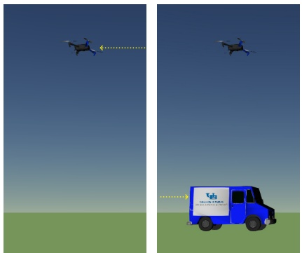

(b) Truck arrives

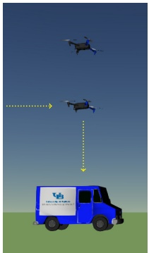

(c) UAV 2 arrives and is retrieved

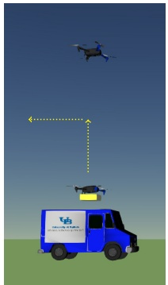

(d) UAV 2 is relaunched

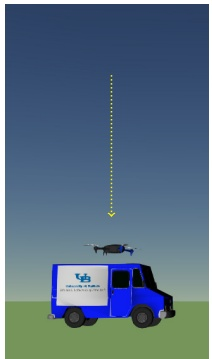

(e) UAV 1 is retrieved

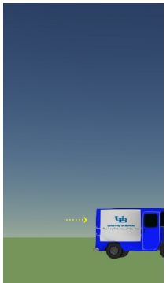

(f) Driver serves customer and truck departs

Figure 3: A notional example depicting the scheduling activities required at truck customer locations.

## 3.1 UAV endurance

Each UAV $v   \in   V$ has a unique endurance, represented as $e _ { v i j k }$ and measured in units of time, for which it may remain operational as it travels from node $i \in N _ { 0 }$ (launch) to $j \in \hat { C } _ { v }$ (delivery), and then to $k \in N _ { + }$ (rendezvous). The incorporation of the UAV’s endurance is critical, as UAV operations are hampered by limited battery capacity. We leverage the work of Dorling et al. (2017) to determine the energy consumed by drones as a linear function of parcel weight, speed, and operation time. This approach to incorporating endurance acknowledges the fact that energy consumption is increased as a drone carries a parcel a longer distance.

To estimate a UAV’s endurance, we partition its flight profile into eight distinct phases. For example, suppose UAV v launches from location $i ,$ delivers the parcel to customer $j ,$ and rejoins the truck at location k. This requires a takeoff time from location i (denoted as $\tau _ { v i } ^ { \prime t } )$ , cruise time from location i to $j ( \tau _ { v i j } ^ { \prime c } )$ , landing time at location $j ( \tau _ { v j } ^ { \prime l } )$ , service time at location j $( \sigma _ { v j } ^ { \prime } )$ , takeoff time from $j ( \tau _ { v j } ^ { \prime t } )$ , cruise time from $j$ to k $( \tau _ { v j k } ^ { \prime c } )$ , and a landing time at location k $( \tau _ { v k } ^ { \prime l } )$ . We denote this minimum travel time by:

$$
T _ {v i j k} ^ {\mathrm{min}} = \tau_ {v i} ^ {\prime t} + \tau_ {v i j} ^ {\prime c} + \tau_ {v j} ^ {\prime l} + \sigma_ {v j} ^ {\prime} + \tau_ {v j} ^ {\prime t} + \tau_ {v j k} ^ {\prime c} + \tau_ {v k} ^ {\prime l}.
$$

Note that $T _ { v i j k } ^ { \operatorname* { m i n } }$ does not include any time that the UAV might spend waiting for the truck to arrive at node $k ,$ as such waiting time is not known prior to solving the problem. This waiting time, the eighth flight phase, is addressed below.

During each phase of flight, the UAV may carry a different payload weight, may travel at a different speed, and may consume a different amount of power. In particular, during the leg from node i to $j ,$ the UAV carries a parcel of weight $w _ { j }$ kg, but it travels empty from node $j$ to k. Suppose that UAV v’s travel speeds for the takeoff, cruise, and landing phases are given by $\nu _ { v } ^ { t } ,   \nu _ { v } ^ { c } ,$ and $\nu _ { v } ^ { l } ,$ respectively. We denote the power consumption during different phases of the flight according to the notation provided in Table 3. Note that $\alpha ^ { t } , \; \alpha ^ { c }$ , and $\alpha ^ { l }$ only represent the additional power consumption requirements imposed by carrying the parcel; power required for the UAV itself is added separately. Thus, we express the minimum energy required for UAV v to complete the visit from i to $j$ to k as:

$$
\begin{array}{r} E _ {v i j k} ^ {\mathrm{min}} = \tau_ {v i} ^ {\prime t} \nu_ {v} ^ {t} (\alpha^ {t} w _ {j} + \beta^ {t}) + \tau_ {v i j} ^ {\prime c} \nu_ {v} ^ {c} (\alpha^ {c} w _ {j} + \beta^ {c}) + \tau_ {v j} ^ {\prime l} \nu_ {v} ^ {l} (\alpha^ {l} w _ {j} + \beta^ {l}) + \\ \sigma_ {v j} ^ {\prime} \gamma + \tau_ {v j} ^ {\prime t} \nu_ {v} ^ {t} \beta^ {t} + \tau_ {v j k} ^ {\prime c} \nu_ {v} ^ {c} \beta^ {c} + \tau_ {v k} ^ {\prime l} \nu_ {v} ^ {l} \beta^ {l}. \end{array}
$$

Recall that the service time required by drone v at node $j$ is given by $\sigma _ { v j } ^ { \prime }$

Table 3: Notation describing power consumption across all flight phases.

| Power Consumed | Description | Units |
| --- | --- | --- |
| $\alpha^{t}$ | Takeoff with parcel | [W/((kg)(m/s))] |
| $\alpha^{c}$ | Cruise with parcel | [W/((kg)(m/s))] |
| $\alpha^{l}$ | Land with parcel | [W/((kg)(m/s))] |
| $\beta^{t}$ | Takeoff empty | [W/(m/s)] |
| $\beta^{c}$ | Cruise empty | [W/(m/s)] |
| $\beta^{l}$ | Land empty | [W/(m/s)] |
| $\gamma$ | Serving customer | [W] |
| $\delta$ | Waiting to land | [W] |

We denote the energy of the battery loaded on UAV v by $E _ { v } ^ { a v a i l }$ . Thus, the UAV requires $E _ { v i j k } ^ { m i n } \leq E ^ { a v a i l }$ to safely fly from i to $j$ to k. If this requirement is satisfied, the endurance $e _ { v i j k }$ (in seconds) is given by

$$
e _ {v i j k} = T _ {v i j k} ^ {m i n} + \frac {E _ {v} ^ {a v a i l} - E _ {v i j k} ^ {m i n}}{\delta},
$$

where the second term in the expression captures the maximum length of time that the UAV may loiter above node k while waiting for the truck to arrive.

To identify potential valid UAV sorties (i.e., the sequence of a launch, customer delivery, and rendezvous), P is defined to be a set of four-tuples of the form $\langle v , i , j , k \rangle$ for $v \in V ,   i \in N _ { 0 } ,   j \in \hat { C } _ { v }$ and $k \in N _ { + }$ . This set has the following properties:

• The launch node, i, must not be the ending depot node (i.e., i is restricted to N<sub>0</sub>);

• The delivery node, $j ,$ must be an eligible customer for UAV $v ( \mathrm { i . e . , } j \in \{ \hat { C } _ { v } : j \neq i \} )$ ;

• The rendezvous point, k, may be either a customer or the ending depot (but it must not be either node i or j); and

• The UAV’s travel time from $i \rightarrow j \rightarrow k$ must not exceed the endurance of the UAV (i.e., $\tau _ { v i j } ^ { \prime } + \sigma _ { v j } ^ { \prime } + \tau _ { v j k } ^ { \prime } \leq e _ { v i j k } { \mathrm { ~ f o r ~ } } k \in \{ N _ { + } : k \neq j , k \neq i \} )$

## 3.2 Objective and decision variables

The objective of the mFSTSP is to minimize the time required to deliver all parcels and return to the depot (i.e., to minimize the makespan). This is accomplished via determination of decision variable values across six main classes, a summary of which is provided in Table 4. First, binary decision variable $x _ { i j } = 1$ if the truck travels from node $i   \in   N _ { 0 }$ to node $j   \in   \{ N _ { + }   :   j   \neq   i \}$ . This decision variable determines the route of the delivery truck. Similarly, in the second class, binary decision variable $p _ { i j } \; = \; 1$ if the truck visits node $i \in N _ { 0 }$ at some time prior to visiting node $j \in \{ C : j \neq i \}$ We define $p _ { 0 j } \equiv 1$ for all $j \in C$ to indicate that the truck must leave the depot (node 0). This decision variable is employed to ensure that a UAV’s launch and recovery nodes are consistent with the truck’s route (i.e., if a UAV is launched from a truck, it cannot return to the truck at a location that was earlier in the truck’s route).

In the third class, binary decision variable $y _ { v i j k } = 1$ if UAV $v \in V$ travels from node $i \in N _ { 0 }$ to customer $j \in \{ \hat { C } _ { v } : j \neq i \}$ , re-joining the truck at node $k \in \{ N _ { + } : \langle v , i , j , k \rangle \in P \}$ . This decision variable identifies UAV sorties.

The fourth class involves five continuous decision variables to determine the time at which key events for the truck and UAVs occur. Specifically, $\check { t } _ { i } \geq 0$ captures the truck’s arrival time to node $i \in N$ , where $\check { t } _ { 0 } \equiv 0$ to indicate that the truck is available to begin operations at time zero. The truck’s service time completion at node $i \in N _ { + }$ is given by $\bar { t } _ { i } \geq 0$ , where $\bar { t } _ { 0 } \equiv 0$ to reflect the fact that there is no customer associated with the depot. This decision variable indicates the time at which customer i’s parcel has been delivered. Next, $\hat { t } _ { i } \geq 0$ identifies the truck’s completion time at node $i \in N ( \mathrm { e . g . }$ , the earliest departure time from this node if $i \in N _ { 0 } )$ . In the problem variant where the truck is not required to be at the depot when UAVs launch, then $\hat { t } _ { 0 } \equiv 0$ Similarly, timing for the UAVs is determined by $\check { t ^ { \prime } } _ { v i } \geq 0$ , which denotes the arrival time for ${ \mathrm { U A V } } v \in V$ to node $i \in N$ , and $\hat { t ^ { \prime } } _ { v i } \geq 0$ , which identifies the completion time for UAV $v \in V$ at node $i \in N$

Next, numerous binary decision variables (all identified by the letter z) are employed to determine the coordination between the driver and each UAV, and to establish the sequencing of UAV launches and retrievals at each node. Details on each of these variables are provided in Table 4.

Finally, $1 \leq u _ { i } \leq c + 2$ are standard truck subtour elimination variables, defined for all $i \in N _ { + }$ that indicate the relative ordering of visits to node i.

Details of the MILP formulation are provided in the remainder of this section. Due to the length of the model, constraints are grouped according to functionality.

## 3.3 Core model components from the FSTSP

The mFSTSP leverages core components of the FSTSP model provided by Murray and Chu (2015), with modifications to accommodate multiple UAVs. This model employs several $\text{" big-M " }$ constraints, where the value of M represents a sufficiently large number. One valid value of M is the length of a TSP tour such that the truck visits each customer, plus the sum of truck service times over all customers.

The objective function and the general constraints related to guaranteeing customer deliveries and eliminating truck subtours are as follows:

$$
\begin{array}{ll}\hline \text{Min} & \hat{t}_{c + 1}\\ \text{s.t.} & \sum_{\substack{i\in N_{0}\\ i\neq j}}x_{ij} + \sum_{v\in V}\sum_{\substack{i\in N_{0}\\ i\neq j}}\sum_{\substack{k\in N_{+}\\ \langle v,i,j,k\rangle \in P}}y_{vijk} = 1\quad \forall   j\in C,\\ \end{array}\tag{1}
$$

(2)

Table 4: Decision variables

| $x_{ij} \in \{0,1\}$ | $x_{ij} = 1$ if the truck travels from node $i \in N_0$ to node $j \in \{N_+: j \neq i\}$. |
| --- | --- |
| $p_{ij} \in \{0,1\}$ | $p_{ij} = 1$ if node $i \in N_0$ appears in the truck's route before node $j \in \{C: j \neq i\}$. $p_{0j} \equiv 1$ for all $j \in C$. |
| $y_{vijk} \in \{0,1\}$ | $y_{vijk} = 1$ if UAV $v \in V$ travels from node $i \in N_0$ to customer $j \in \{\hat{C}_v: j \neq i\}$, re-joining the truck at node $k \in \{N_+: \langle v, i, j, k \rangle \in P\}$. |
| $\check{t}_i \geq 0$ | Truck's arrival time to node $i \in N$, where $\check{t}_0 \equiv 0$. |
| $\bar{t}_i \geq 0$ | Truck's service time completion at node $i \in N_+$, where $\bar{t}_0 \equiv 0$. |
| $\hat{t}_i \geq 0$ | Truck's completion time at node $i \in N$ (e.g., the earliest departure time from this node if $i \in N_0$). If the truck is not required to be at the depot when UAVs launch, then $\hat{t}_0 \equiv 0$ |
| $\check{t}'_{vi} \geq 0$ | Arrival time for UAV $v \in V$ to node $i \in N$. |
| $\hat{t}'_{vi} \geq 0$ | Completion time for UAV $v \in V$ at node $i \in N$. |
| $z_{v_1,v_2,k}^R \in \{0,1\}$ | $z_{v_1,v_2,k}^R = 1$ if $v_1 \in V$ and $v_2 \in \{V: v_2 \neq v_1\}$ are recovered at node $k \in N_+$, such that $v_1$ is recovered before $v_2$. |
| $z_{0,v,k}^R \in \{0,1\}$ | $z_{0,v,k}^R = 1$ if the truck completes its service activities at node $k \in N_+$ before UAV $v \in V$ is retrieved at node $k$. |
| $z_{v,0,k}^R \in \{0,1\}$ | $z_{v,0,k}^R = 1$ if UAV $v \in V$ is retrieved at node $k \in N_+$ before the truck completes its service activities at node $k$. We define $z_{v,0,c+1}^R \equiv 0$ for all $v \in V$ (since the truck has no service activities at the depot node, the order does not matter). |
| $z_{v_1,v_2,i}^L \in \{0,1\}$ | $z_{v_1,v_2,i}^L = 1$ if UAV $v_1 \in V$ is launched from node $i \in N_0$ before $v_2 \in \{V: v_2 \neq v_1\}$ is launched from $i$. |
| $z_{0,v,i}^L \in \{0,1\}$ | $z_{0,v,i}^L = 1$ if the truck completes its service activities at node $i \in N_0$ before UAV $v \in V$ is launched from $i$. |
| $z_{v,0,i}^L \in \{0,1\}$ | $z_{v,0,i}^L = 1$ if UAV $v \in V$ is launched from node $i \in N_0$ before the truck completes its service activities at node $i$. If the truck is not required to be present when UAVs launch from the depot, we may define $z_{v,0,0}^L = 0$ for all $v \in V$ (since the truck has no service activities at the depot node, the order does not matter). |
| $z_{v_1,v_2,i}^{\prime} \in \{0,1\}$ | $z_{v_1,v_2,i}^{\prime} = 1$ if UAV $v_1 \in V$ launches from node $i \in C$ before UAV $v_2 \in \{V: v_2 \neq v_1\}$ lands at $i$. |
| $z_{v_1,v_2,i}^{\prime\prime} \in \{0,1\}$ | $z_{v_1,v_2,i}^{\prime\prime} = 1$ if UAV $v_1 \in V$ lands at node $i \in C$ before UAV $v_2 \in \{V: v_2 \neq v_1\}$ launches from $i$. |
| $1 \leq u_i \leq c + 2$ | Truck subtour elimination variables, defined for all $i \in N_+$, which indicate the relative ordering of visits to node $i$. |

$$
\left| \sum_ {j \in N _ {+}} x _ {0 j} = 1, \right.\tag{3}
$$

$$
\sum_ {i \in N _ {0}} x _ {i, c + 1} = 1,\tag{4}
$$

$$
\sum x _ {i j} = \sum x _ {j k} \quad \forall j \in C,\tag{5}
$$

$$
\sum_{\substack{j\in C\\ j\neq i}}\sum_{\substack{k\in N_{+}\\ \langle v,i,j,k\rangle \in P}}y_{vijk}\leq 1\quad \forall i\in N_{0},\forall v\in V,\tag{6}
$$

$$
\sum_{\substack{i\in N_{0}\\ i\neq k}}\sum_{\substack{j\in C\\ \langle v,i,j,k\rangle \in P}}y_{vijk}\leq 1\quad \forall k\in N_{+},\forall v\in V,\tag{7}
$$

$$
2y_{vijk}\leq \sum_{\substack{h\in N_{0}\\ h\neq i}}x_{hi} + \sum_{\substack{l\in C\\ l\neq k}}x_{lk}
$$

$$
\forall v \in V, i \in C, j \in \{C: j \neq i \}, k \in \{N _ {+}: \langle v, i, j, k \rangle \in P \},\tag{8}
$$

$$
y_{v0jk}\leq \sum_{\substack{h\in N_{0}\\ h\neq k}}x_{hk}\quad \forall v\in V,j\in C,k\in \{N_{+}:\langle v,0,j,k\rangle \in P\} ,\tag{9}
$$

$$
u_{k} - u_{i}\geq 1 - (c + 2)\left(1 - \sum_{\substack{j\in C\\ \langle v,i,j,k\rangle \in P}}y_{vijk}\right)\quad \forall   i\in C,k\in \{N_{+}:k\neq i\} ,\forall   v\in V,\tag{10}
$$

$$
u _ {i} - u _ {j} + 1 \leq (c + 2) (1 - x _ {i j}) \quad \forall i \in C, j \in \{N _ {+}: j \neq i \},\tag{11}
$$

$$
u _ {i} - u _ {j} \geq 1 - (c + 2) p _ {i j} \quad \forall i \in C, j \in \{C: j \neq i \},\tag{12}
$$

$$
u _ {i} - u _ {j} \leq - 1 + (c + 2) (1 - p _ {i j}) \quad \forall i \in C, j \in \{C: j \neq i \},\tag{13}
$$

$$
p _ {i j} + p _ {j i} = 1 \quad \forall i \in C, j \in \{C: j \neq i \}.\tag{14}
$$

The objective function (1) seeks to minimize the latest time at which either the truck or a UAV return to the depot. Although $\hat { t } _ { c + 1 }$ is explicitly defined for only the truck’s return time to the depot, constraints in Sections 3.4 and 3.5 serve to link the UAVs’ and truck’s return time to the depot. Thus, the objective function is equivalent to min $\{ \operatorname* { m a x } _ { v \in V } \{ \hat { t } _ { c + 1 } , \hat { t ^ { \prime } } _ { v , c + 1 } \} \}$

Constraint (2) requires each customer to be visited exactly once. Constraint (3) ensures that the truck departs from the depot exactly once, while Constraint (4) requires the truck to return to the depot exactly once.

Constraint (5) provides flow balance for the truck, which must depart from each node that it visits (except the ending depot node), while Constraint (6) states that each UAV may launch at most once from any particular node, including the depot. Similarly, Constraint (7) indicates that each UAV may rendezvous at any particular node (including customers and the ending depot) at most once.

If a UAV is launched from customer i and is collected by the truck at node k, then Constraint (8) states that the truck must be assigned to both nodes i and k. Furthermore, Constraint (9) ensures that if a UAV launches from the starting depot 0 and is collected at node k, then the truck must be assigned to node k. Similarly, Constraint (10) ensures that the truck must visit i before k if a UAV launches from customer i and is collected at node k. Subtour elimination constraints for

the truck are provided by (11).

Constraints (12)–(14) determine the proper values of $p _ { i j }$ . Because $u _ { i }$ and $p _ { i j }$ describe the ordering of nodes visited by the truck only, values of these decision variables are inconsequential for any i and $j$ that are visited only by a UAV.

## 3.4 UAV timing constraints

The following constraints establish the times at which each UAV launches from either the depot or the truck, arrives at a customer location, and returns to either the truck or the depot. These constraints also address UAV flight endurance limitations.

$$
\hat{t^{\prime}}_{vl}\geq \check{t^{\prime}}_{vk} - M\left(3 - \sum_{\substack{j\in C\\ \langle v,i,j,k\rangle \in P\\ j\neq l}}y_{vijk} - \sum_{\substack{m\in C\\ m\neq i\\ m\neq k\\ m\neq l}}\sum_{\substack{n\in N_{+}\\ \langle v,l,m,n\rangle \in P\\ n\neq i\\ n\neq k}}y_{vlmn} - p_{il}\right)
$$

$$
\forall i \in N _ {0}, k \in \{N _ {+}: k \neq i \}, l \in \{C: l \neq i, l \neq k \}, \forall v \in V\tag{15}
$$

$$
\hat{t^{\prime}}_{vi}\geq \check{t^{\prime}}_{vi} + s^{L}_{v,i} - M\left(1 - \sum_{\substack{j\in C\\ j\neq i}}\sum_{\substack{k\in N_{+}\\ \langle v,i,j,k\rangle \in P}}y_{vijk}\right)\quad \forall   v\in V,i\in N_{0},\tag{16}
$$

$$
\hat {t ^ {\prime}} _ {v i} \geq \check {t} _ {i} + s _ {v, i} ^ {L} - M \left(1 - z _ {v 0 i} ^ {L}\right) \quad \forall v \in V, i \in N _ {0},\tag{17}
$$

$$
\hat {t ^ {\prime}} _ {v i} \geq \bar {t} _ {i} + s _ {v, i} ^ {L} - M \left(1 - z _ {0 v i} ^ {L}\right) \quad \forall v \in V, i \in N _ {0},\tag{18}
$$

$$
\hat {t ^ {\prime}} _ {v i} \geq \hat {t ^ {\prime}} _ {v _ {2}, i} + s _ {v, i} ^ {L} - M \left(1 - z _ {v _ {2}, v, i} ^ {L}\right) \quad \forall v \in V, v _ {2} \in \{V: v _ {2} \neq v \}, i \in N _ {0},\tag{19}
$$

$$
\hat {t ^ {\prime}} _ {v _ {2}, i} \geq \check {t ^ {\prime}} _ {v i} + s _ {v _ {2}, i} ^ {L} - M \left(1 - z _ {v, v _ {2}, i} ^ {\prime \prime}\right) \quad \forall v \in V, v _ {2} \in \{V: v _ {2} \neq v \}, i \in C,\tag{20}
$$

$$
\check{t^{\prime}}_{vj}\geq \hat{t^{\prime}}_{vi} + \tau^{\prime}_{vij} - M\left(1 - \sum_{\substack{k\in N_{+}\\ \langle v,i,j,k\rangle \in P}}y_{vijk}\right)\quad \forall   v\in V,j\in C,i\in \{N_{0}:i\neq j\} ,\tag{21}
$$

$$
\hat{t^{\prime}}_{vj}\geq \check{t^{\prime}}_{vj} + \sigma^{\prime}_{vj}\sum_{\substack{i\in N_{0}\\ i\neq j}}\sum_{\substack{k\in N_{+}\\ \langle v,i,j,k\rangle \in P}}y_{vijk}\quad \forall v\in V,j\in C,\tag{22}
$$

$$
\check {t ^ {\prime}} _ {v k} \geq \check {t} _ {k} + s _ {v, k} ^ {R} - M \left(1 - z _ {v 0 k} ^ {R}\right) \quad \forall v \in V, k \in N _ {+},\tag{23}
$$

$$
\check {t ^ {\prime}} _ {v k} \geq \bar {t} _ {k} + s _ {v, k} ^ {R} - M \left(1 - z _ {0 v k} ^ {R}\right) \quad \forall v \in V, k \in N _ {+},\tag{24}
$$

$$
\check {t ^ {\prime}} _ {v k} \geq \check {t ^ {\prime}} _ {v _ {2}, k} + s _ {v, k} ^ {R} - M \left(1 - z _ {v _ {2}, v, k} ^ {R}\right) \quad \forall v \in V, v _ {2} \in \{V: v _ {2} \neq v \}, k \in N _ {+},\tag{25}
$$

$$
\check {t ^ {\prime}} _ {v k} \geq \hat {t ^ {\prime}} _ {v _ {2}, k} + s _ {v, k} ^ {R} - M \left(1 - z _ {v _ {2}, v, k} ^ {\prime}\right) \quad \forall v \in V, v _ {2} \in \{V: v _ {2} \neq v \}, k \in C,\tag{26}
$$

$$
\check{t^{\prime}}_{vk}\geq \hat{t^{\prime}}_{vj} + \tau^{\prime}_{vjk} + s^{R}_{v,k} - M\left(1 - \sum_{\substack{i\in N_{0}\\ \langle v,i,j,k\rangle \in P}}y_{vijk}\right)\quad \forall   v\in V,k\in N_{+},j\in \{C:j\neq k\} ,\tag{27}
$$

$$
\left(\check {t ^ {\prime}} _ {v k} - S _ {v, k} ^ {R}\right) - \hat {t ^ {\prime}} _ {v i} \leq e _ {v i j k} + M \left(1 - y _ {v i j k}\right)
$$

$$
\forall v \in V, i \in N _ {0}, j \in \{\hat {C} _ {v}: j \neq i \}, k \in \{N _ {+}: \langle v, i, j, k \rangle \in P \}.\tag{28}
$$

Constraint (15) prohibits individual UAV sorties from overlapping. For example, suppose that $\mathrm { U A V } v$ launches from i and returns to k. Further, suppose that the UAV later launches from l (thus, $p _ { i l } = 1 )$ . This constraint prevents the launch time from $l ,   \hat { t } _ { v l } ^ { \prime }$ , from preceding the return time to $k ,   \check { t } _ { v k } ^ { \prime }$ . If the UAV does not return to $k ,$ the UAV does not launch from $l ,$ or $i$ does not precede $l ,$ then this constraint will not be binding. This constraint requires the definition of $p _ { 0 l } = 1$ for all $l \in C$

Constraints (16)–(20) address launching of UAVs. The launch service (preparation) time, $s _ { v , i } ^ { L } ,$ is included in these constraints to be consistent with the definition of $\hat { t ^ { \prime } } _ { v i }$ (the time at which UAV v is launched from node i). Constraint (16) states that v cannot launch from $i ( \mathrm { t o } j$ and $k )$ until after $v$ has arrived at node $i ;$ if v were transported on the truck to node $i ,   \check { t ^ { \prime } } _ { v i }$ would be a meaningless value. Per Constraint (17), UAV v cannot launch from i until after the truck has arrived to node i if the truck customer is served after $v$ is launched $( \mathrm { i . e . , \; i f \; } z _ { v 0 i } ^ { L } = 1 )$ . Conversely, Constraint (18) states that UAV $v$ cannot launch from i until after the truck has served this customer if the truck serves the customer before v is launched $( \mathrm { i . e . , \; i f \; } z _ { 0 v i } ^ { L } = 1 )$ . In Constraint (19), UAV v cannot launch from i until $\mathrm { U A V } ~ v _ { 2 }$ has launched if $v _ { 2 }$ launches before v (i.e., if $| \boldsymbol { z } _ { v _ { 2 } , v , i } ^ { L } = \dot { 1 } )$ , while Constraint (20) ensures that $v _ { 2 }$ does not launch until after v has landed, if v lands before $v _ { 2 }$ launches $( \mathrm { i . e . , ~ i f ~ } z _ { v , v _ { 2 } , i } ^ { L } = 1 )$ Note that, in Constraint (20), node i is restricted to being a customer node since no other node type permits both launching and landing.

Constraints (21) and (22) govern the arrival and departure timing, respectively, for a UAV serving some customer $j .$ Constraints (23)–(27) address the landing of UAVs at retrieval locations (i.e., not at a drone delivery customer). The recovery service time $( \mathrm { e . g . } , s _ { v , k } ^ { R } )$ is included to be consistent with the definition of $\breve { t ^ { \prime } } _ { v k }$ (the time at which v is deemed to have arrived at node k). In particular, Constraint (23) states that v can land at node k as soon as the truck has arrived if the truck serves customer k after retrieving $v ( \mathrm { i . e . , } \mathrm { i f } z _ { v 0 k } ^ { R } = 1 )$ . However, if the truck serves customer k first $( \mathrm { i . e . , ~ i f ~ } z _ { 0 v k } ^ { R } = 1 )$ , then UAV v cannot land at k until the truck completed this service.

If UAV $v _ { 2 }$ is recovered at node k before UAV $v \mathrm { ~ ( i . e . , } \mathrm { ~ i f ~ } z _ { v 2 , v , k } ^ { R } = 1 \mathrm { ) }$ , Constraint (25) ensures that the arrival time for v is after the arrival time for $v _ { 2 }$ . Similarly, if $v _ { 2 }$ is launched from node k before $v$ is recovered $( \mathrm { i . e . , ~ i f ~ } z _ { v _ { 2 } , v , k } ^ { \prime }   =   1 )$ , Constraint (26) requires the arrival time for $v$ to be after the launch time for $v _ { 2 }$ . In this constraint, k is restricted to the set of customers because UAVs cannot launch and land from any other nodes. In Constraint (27), UAV v cannot land at k until it has launched from customer $j$ and travels from $j$ to $k .$

UAV endurance limitations are addressed by Constraint (28). If v travels from i to $j$ to $k ,$ then the difference between the arrival time at $k$ (less the recovery time, which is incorporated in $\tilde { t ^ { \prime } } _ { v k } )$ and the departure time from i must not exceed the endurance limit.

## 3.5 Truck timing constraints

The following constraints govern the arrival, service, and departure activities for the truck.

$$
\check {t} _ {j} \geq \hat {t} _ {i} + \tau_ {i j} - M (1 - x _ {i j}) \quad \forall i \in N _ {0}, j \in \{N _ {+}: j \neq i \},\tag{29}
$$

$$
\bar {t} _ {k} \geq \check {t} _ {k} + \sigma_ {k} \sum x _ {j k} \quad \forall k \in N _ {+},\tag{30}
$$

$$
\begin{array}{c} j \in N _ {0} \\ j \neq k \end{array}
$$

$$
\bar {t} _ {k} \geq \check {t ^ {\prime}} _ {v k} + \sigma_ {k} - M \left(1 - z _ {v 0 k} ^ {R}\right) \quad \forall k \in N _ {+}, v \in V,\tag{31}
$$

$$
\bar {t} _ {k} \geq \hat {t ^ {\prime}} _ {v k} + \sigma_ {k} - M \left(1 - z _ {v 0 k} ^ {L}\right) \quad \forall k \in C, v \in V,\tag{32}
$$

$$
\hat {t} _ {k} \geq \bar {t} _ {k} \quad \forall k \in N _ {+},\tag{33}
$$

$$
\hat{t}_{k}\geq \check{t}^{\prime}_{vk} - M\left(1 - \sum_{\substack{i\in N_{0}\\ i\neq k}}\sum_{\substack{j\in C\\ \langle v,i,j,k\rangle \in P}}y_{vijk}\right)\quad \forall   k\in N_{+},v\in V,\tag{34}
$$

$$
\hat{t}_{k}\geq \hat{t^{\prime}}_{vk} - M\left(1 - \sum_{\substack{l\in C\\ l\neq k}}\sum_{\substack{m\in N_{+}\\ \langle v,k,l,m\rangle \in P}}y_{vklm}\right)\quad \forall   k\in N_{0},v\in V.\tag{35}
$$

The truck’s travel time is incorporated in Constraint (29), which states that the truck cannot arrive at $j$ until after it has left i and traveled from i to $j .$

Constraints (30), (31), and (32) establish the truck’s service time completion at a customer. Note that there is no customer service time at the depot $(i.e.,   \sigma_{c+1}   \equiv   0)$ Thus, the service completion time for the truck when visiting the depot does not have a service time component, although it does also depend on the arrival of any UAVs to the depot in the event that we require the truck to be present when UAVs arrive. In Constraint (30), the truck’s service time completion at node k must not be prior to arriving at the node and finishing service. If the truck does not serve k, then $\check { t } _ { k }$ will be a meaningless value (probably zero). Constraint (31) states that the truck cannot complete service to customer k until UAV v has arrived, if v is recovered at node k before the truck service begins $( \mathrm { i . e . , \; i f \; } z _ { v 0 k } ^ { R } = 1 )$ . Similarly, the truck cannot complete its service of customer k until UAV v has launched, if v is launched from k before the truck begins service $( \mathrm { i . e . , ~ i f ~ } z _ { v o k } ^ { L } = 1 )$ , as in Constraint (32). Note that $k \in C$ (rather than in $N _ { + } )$ because UAVs cannot be launched from node c + 1.

Constraints (33), (34), and (35) establish the truck’s earliest departure from a node. Constraint (33) prevents the truck from departing a node until it has completed serving the customer. If the truck does not serve k, then $\check { t } _ { k }$ will be a meaningless value. In Constraint (34), if a UAV is retrieved at node $k ,$ then the truck cannot depart until that UAV has arrived. Similarly, the truck cannot depart from a node until after all UAVs have launched from that node, as per Constraint (35).

## 3.6 Sequencing of retrievals, launches, and truck service

In this section, constraints are provided to establish proper values of the binary decision variables used to sequence the activities at each node. We begin with constraints for setting the $z _ { \cdot , \cdot , } ^ { R }$ · values:

$$
z_{0vk}^{R} + z_{v0k}^{R} = \sum_{\substack{i\in N_{0}\\ i\neq k}}\sum_{\substack{j\in C\\ \langle v,i,j,k\rangle \in P}}y_{vijk}\quad \forall v\in V,k\in N_{+},\tag{36}
$$

$$
z_{v,v_{2},k}^{R}\leq \sum_{\substack{i\in N_{0}\\ i\neq k}}\sum_{\substack{j\in C\\ \langle v,i,j,k\rangle \in P}}y_{vijk}\quad \forall v\in V,v_{2}\in \{V:v_{2}\neq v\} ,k\in N_{+},\tag{37}
$$

$$
z_{v,v_{2},k}^{R}\leq \sum_{\substack{i\in N_{0}\\ i\neq k}}\sum_{\substack{j\in C\\ \langle v_{2},i,j,k\rangle \in P}}y_{v_{2}ijk}\quad \forall v\in V,v_{2}\in \{V:v_{2}\neq v\} ,k\in N_{+},\tag{38}
$$

$$
z _ {v, v _ {2}, k} ^ {R} + z _ {v _ {2}, v, k} ^ {R} \leq 1 \quad \forall v \in V, v _ {2} \in \{V: v _ {2} \neq v \}, k \in N _ {+},\tag{39}
$$

$$
\begin{array}{c}z_{v,v_{2},k}^{R} + z_{v_{2},v,k}^{R} + 1\geq \sum_{\substack{i\in N_{0}\\ i\neq k}}\sum_{\substack{j\in C\\ \langle v,i,j,k\rangle \in P}}y_{vijk} + \sum_{\substack{i\in N_{0}\\ i\neq k}}\sum_{\substack{j\in C\\ \langle v_{2},i,j,k\rangle \in P}}y_{v_{2}ijk}\\ \\ \forall   v\in V,v_{2}\in \{V:v_{2}\neq v\} ,k\in N_{+}. \end{array}\tag{40}
$$

In Constraint (36), if v is retrieved at node $k ,$ then the truck must serve $k$ either before or after v arrives. Conversely, $z _ { v , v _ { 2 } , k } ^ { R }$ cannot equal one if neither v nor $v _ { 2 }$ are retrieved at node $k ,$ as per Constraints (37) and (38). Constraint (39) states that either $v$ is retrieved before $v _ { 2 } ,   v _ { 2 }$ is retrieved before $v ,$ or at least one of these UAVs is not retrieved at $k .$ Finally, if v and $v _ { 2 }$ are both retrieved at $k ,$ then either v is retrieved before $v _ { 2 } ,$ or $v _ { 2 }$ is retrieved before $v ,$ as in Constraint (40).

Constraints (41)–(45), below, are the launch analogues to Constraints (36)–(40). These constraints are used to set the $z _ { \cdot , \cdot , \cdot } ^ { L }$ decision variable values:

$$
z_{0vi}^{L} + z_{v0i}^{L} = \sum_{\substack{j\in C\\ j\neq i}}\sum_{\substack{k\in N_{+}\\ \langle v,i,j,k\rangle \in P}}y_{vijk}\quad \forall v\in V,i\in N_{0},\tag{41}
$$

$$
z_{v,v_{2},i}^{L}\leq \sum_{\substack{j\in C\\ j\neq i}}\sum_{\substack{k\in N_{+}\\ \langle v,i,j,k\rangle \in P}}y_{vijk}\quad \forall   v\in V,v_{2}\in \{V:v_{2}\neq v\} ,i\in N_{0},\tag{42}
$$

$$
z_{v,v_{2},i}^{L}\leq \sum_{\substack{j\in C\\ j\neq i}}\sum_{\substack{k\in N_{+}\\ \langle v_{2},i,j,k\rangle \in P}}y_{v_{2}ijk}\quad \forall v\in V,v_{2}\in \{V:v_{2}\neq v\} ,i\in N_{0},\tag{43}
$$

$$
z _ {v, v _ {2}, i} ^ {L} + z _ {v _ {2}, v, i} ^ {L} \leq 1 \quad \forall v \in V, v _ {2} \in \{V: v _ {2} \neq v \}, i \in N _ {0},\tag{44}
$$

$$
\begin{array}{c}z_{v,v_{2},i}^{L} + z_{v_{2},v,i}^{L} + 1\geq \sum_{\substack{j\in C\\ j\neq i}}\sum_{\substack{k\in N_{+}\\ \langle v,i,j,k\rangle \in P}}y_{vijk} + \sum_{\substack{j\in C\\ j\neq i}}\sum_{\substack{k\in N_{+}\\ \langle v_{2},i,j,k\rangle \in P}}y_{v_{2}ijk}\\ \\ \forall   v\in V,v_{2}\in \{V:v_{2}\neq v\} ,i\in N_{0}. \end{array}\tag{45}
$$

Next, constraints are required for nodes at which one UAV launches and another UAV lands. Binary decision variable $z _ { v _ { 1 } , v _ { 2 } , i } ^ { \prime }   =   1 \mathrm { ~ i f ~ U A V ~ } v _ { 1 }   \in   V$ launches from node $i   \in   C$ before UAV $v _ { 2 } \in$ $\{ V   :   v _ { 2 }   \neq   v _ { 1 } \}$ lands at $i ,$ while $z _ { v _ { 1 } , v _ { 2 } , i } ^ { \prime \prime }   =   1   \mathrm { i f }   \mathrm { U A V }   v _ { 1 }   \in   V$ lands at node $i \in C$ before UAV $v _ { 2 } \in \{ V : v _ { 2 } \neq v _ { 1 } \}$ launches from i.

$$
z^{\prime}_{v_{2},v,k}\leq \sum_{\substack{l\in C\\ l\neq k}}\sum_{\substack{m\in N_{+}\\ \langle v_{2},k,l,m\rangle \in P}}y_{v_{2},k,l,m} \quad \forall v_{2}\in V,v\in \{V:v\neq v_{2}\} ,k\in C,\tag{46}
$$

$$
z_{v_{2},v,k}^{\prime \prime}\leq \sum_{\substack{l\in C\\ l\neq k}}\sum_{\substack{m\in N_{+}\\ \langle v,k,l,m\rangle \in P}}y_{v,k,l,m}\quad \forall v\in V,v_{2}\in \{V:v_{2}\neq v\} ,k\in C,\tag{47}
$$

$$
z^{\prime}_{v_{2},v,k}\leq \sum_{\substack{i\in N_{0}\\ i\neq k}}\sum_{\substack{j\in C\\ \langle v,i,j,k\rangle \in P}}y_{vijk}\quad \forall v\in V,v_{2}\in \{V:v_{2}\neq v\} ,k\in C,\tag{48}
$$

$$
z_{v_{2},v,k}^{\prime \prime}\leq \sum_{\substack{i\in N_{0}\\ i\neq k}}\sum_{\substack{j\in C\\ \langle v_{2},i,j,k\rangle \in P}}y_{v_{2},i,j,k}\quad \forall v_{2}\in V,v\in \{V:v\neq v_{2}\} ,k\in C,\tag{49}
$$

$$
z^{\prime}_{v_{2},v,k} + z^{\prime \prime}_{v,v_{2},k} + 1\geq \sum_{\substack{i\in N_{0}\\ i\neq k}}\sum_{\substack{j\in C\\ \langle v,i,j,k\rangle \in P}}y_{vijk} + \sum_{\substack{l\in C\\ l\neq k}}\sum_{\substack{m\in N_{+}\\ \langle v_{2},k,l,m\rangle \in P}}y_{v_{2}klm}
$$

$$
\forall v \in V, v _ {2} \in \{V: v _ {2} \neq v \}, k \in C,\tag{50}
$$

$$
z _ {v _ {2}, v, k} ^ {\prime} + z _ {v, v _ {2}, k} ^ {\prime \prime} \leq 1 \quad \forall v \in V, v _ {2} \in \{V: v _ {2} \neq v \}, k \in C,\tag{51}
$$

$$
z _ {v _ {2}, v, k} ^ {\prime} + z _ {v, v _ {2}, k} ^ {\prime} \leq 1 \quad \forall v \in V, v _ {2} \in \{V: v _ {2} \neq v \}, k \in C,\tag{52}
$$

$$
z _ {v _ {2}, v, k} ^ {\prime \prime} + z _ {v, v _ {2}, k} ^ {\prime \prime} \leq 1 \quad \forall v \in V, v _ {2} \in \{V: v _ {2} \neq v \}, k \in C.\tag{53}
$$

Constraint (46) states that $z _ { v _ { 2 } , v , k } ^ { \prime } = 0$ if $v _ { 2 }$ does not launch from $k ,$ while Constraint (47) sets $z _ { v _ { 2 } , v , k } ^ { \prime \prime } = 0$ if $v$ does not launch from k. Similarly, Constraint (48) requires $z _ { v _ { 2 } , v , k } ^ { \prime } = 0$ if v is not retrieved at $k$ and Constraint (49) sets $z _ { v _ { 2 } , v , k } ^ { \prime \prime } = 0$ if $v _ { 2 }$ is not retrieved at k. If v is retrieved at customer k and $v _ { 2 }$ is launched from customer $k .$ then either $v _ { 2 }$ is launched before v lands, or v lands before $v _ { 2 }$ launches, per Constraint (50).

Constraint (51) states that it is impossible for $v _ { 2 }$ to be launched before v lands and for $v$ to land before $v _ { 2 }$ launches. Similarly, Constraint (52) indicates that $v _ { 2 }$ cannot launch before v lands, if v launches before $v _ { 2 }$ lands; while Constraint (53) states that it is impossible for $v _ { 2 }$ to land before v launches and for v to land before $v _ { 2 }$ launches.

## 3.7 Variant 1: Truck not required at depot

The model above assumes that the truck must be present at the depot when UAVs are launched, and must also be at the depot when UAVs return. This reflects the case that the driver is responsible for manually performing these activities. However, the model may be relaxed to allow the UAVs to launch from, and return to, the depot independent of the driver.

We begin by modifying the definitions of two decision variables. First, we define $\hat { t } _ { 0 }   \equiv   0$ to allow the truck to immediately depart from the depot (without waiting for UAVs to be launched). Second, we define $z _ { v , 0 , 0 } ^ { L }   \equiv   0$ for all $v   \in   V ;$ since the truck has no service activities at the depot node, it does not need to be considered in the UAV launch sequencing.

Next, Constraints (23), (24) and (31) need not be satisfied at depot node $c   +   1$ , since v can land at the depot independent of the truck’s arrival and service time completion. Thus, those constraints should be replaced by

$$
\check {t ^ {\prime}} _ {v k} \geq \check {t} _ {k} + s _ {v, k} ^ {R} - M \left(1 - z _ {v 0 k} ^ {R}\right) \quad \forall v \in V, k \in C,\tag{54}
$$

$$
\check {t ^ {\prime}} _ {v k} \geq \bar {t} _ {k} + s _ {v, k} ^ {R} - M \left(1 - z _ {0 v k} ^ {R}\right) \quad \forall v \in V, k \in C,\tag{55}
$$

$$
\bar {t} _ {k} \geq \check {t ^ {\prime}} _ {v k} + \sigma_ {k} - M \left(1 - z _ {v 0 k} ^ {R}\right) \quad \forall v \in V, k \in C.\tag{56}
$$

Finally, Constraint (35) should be relaxed for node $k = 0$ since the departure of UAV v from the depot is now independent of the truck’s departure. Thus, (35) should be replaced by

$$
\hat{t}_{k}\geq \hat{t^{\prime}}_{vk} - M\left(1 - \sum_{\substack{l\in C\\ l\neq k}}\sum_{\substack{m\in N_{+}\\ \langle v,k,l,m\rangle \in P}}y_{vklm}\right)\quad \forall   k\in C,v\in V.\tag{57}
$$

## 3.8 Variant 2: Automated launch and recovery systems

The default mFSTSP model assumes that the truck driver must be engaged in the UAV launch and recovery process at customer locations. However, concept vehicles have been proposed (c.f., (Etherington 2017)) that automate these activities. The obvious benefit of such automation is that the truck driver can make a delivery at a customer location independent of the UAV launches and retrievals. Note, however, that the truck still has to be present for the launch and recovery at a customer location; the difference is that the driver is not required.

To accommodate automated launch and recovery systems, the following modifications to the baseline mFSTSP model are required. First, the UAV launch timing is no longer a function of the driver’s service at the customer. Thus, Constraint (17) should be replaced by

$$
\hat {t ^ {\prime}} _ {v i} \geq \check {t} _ {i} + s _ {v, i} ^ {L} - M \left(1 - \sum_ {j \in \{C: j \neq i \}} \sum_ {k \in \{N _ {+}: \langle v, i, j, k \rangle \in P \}} y _ {v, i, j, k}\right) \quad \forall v \in V, i \in N _ {0},\tag{58}
$$

and Constraint (18) should be removed. Similarly, the UAV recovery timing constraints should be modified such that Constraint (23) is replaced by

$$
\check {t} _ {v k} ^ {\prime} \geq \check {t} _ {k} + s _ {v, k} ^ {R} - M \left(1 - \sum_ {i \in N _ {0}} \sum_ {j \in \{C: \langle v, i, j, k \rangle \in P \}} y _ {v, i, j, k}\right) \quad \forall v \in V, k \in N _ {+},\tag{59}
$$

and Constraint (24) is removed.

The truck service constraints in (31) and (32) should be removed, as the start of the truck driver’s service at a customer is no longer dependent upon the UAV arrivals or departures. Similarly, Constraints (36) and (41), which require sequencing for driver service with recovery and launch operations, respectively, should be removed.

Finally, the decision variables $z _ { v , 0 , i } ^ { L } , \; z _ { 0 , v , i } ^ { L } , \; z _ { v , 0 , k } ^ { R } ,$ and $z _ { 0 , v , k } ^ { R }$ are no longer required. Although the UAVs still require queueing, driver service at a customer may start immediately (i.e., the UAV queueing is now independent of the driver’s service at a truck customer).

## 4 A three-phased heuristic solution approach

Due to the NP-hard nature of the mFSTSP, heuristic approaches are required for problems of practical size. A three-phased iterative heuristic, depicted in Figure 4, is proposed.

In Phase I, customers are partitioned into two sets – those that will be served via truck and those served via UAVs. The minimum number of customers in the truck set is given by an input parameter called the lower truck limit (LTL). The LTL is initialized to

$$
\mathrm{LTL} _ {0} = \left\lceil \frac {| C | - | V |}{| V | + 1} \right\rceil ,
$$

where $\mathrm { L T L _ { 0 } }$ represents the minimum number of truck customers required for a feasible solution. For example, consider a 50-customer problem. If only 1 UAV is available, $\mathrm { L T L _ { 0 } = 2 5 }$ , indicating that at least 25 customers must be assigned to the truck route. If 4 UAVs are available, then at least 10 customers must be assigned to the truck. The value of the LTL is increased over the course of the iterative procedure. In addition to partitioning the customer base into truck- and UAV-assigned customers, Phase I also produces a unique TSP-like truck tour.

In Phase II, sorties for the UAV-assigned customers (as determined in Phase I) are generated. These sorties define the launch and recovery locations associated with each UAV customer, as well as the UAV assigned to each sortie. At the conclusion of Phase II, all truck and UAV routes are identified, but the timing of the activities is determined in Phase III.

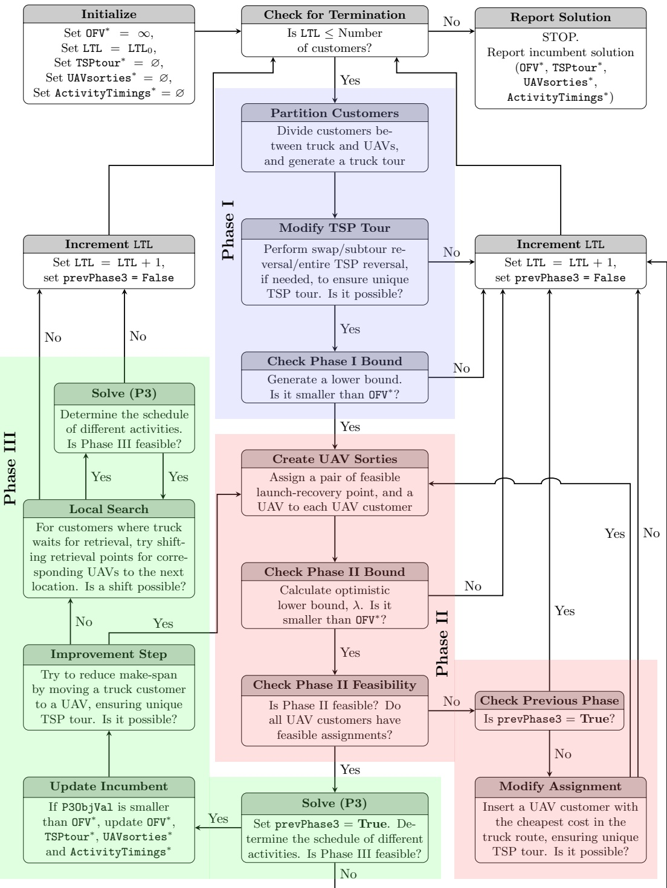

Figure 4: Heuristic flowchart

In Phase III, an MILP is solved to determine the exact timing of the launch, recovery, and service activities for the truck and the UAVs. Phase III also determines the queueing sequences for the UAVs.

After Phase III is completed, a local search procedure is executed to refine the solution. The value of LTL is then incremented to add diversity to the search space, and the procedure returns to Phase I. The iterative procedure is repeated until the LTL equals the number of customers $( \mathrm { i . e . }$ until the problem becomes simply solving a TSP tour to visit all customers via truck). Details of each phase are described in the remainder of this section.

## 4.1 Phase I – Initial Customer Assignments

The goal of Phase I is to establish a unique truck tour containing at least LTL customers, which is analogous to finding the $x _ { i j }$ decision variables in the mFSTSP formulation. Any customer not on the truck’s route will be allocated (if possible) in Phase II to the UAVs. Pseudocode for Phase I is provided in Algorithms 1, 2, and 3.

This phase begins by creating a TSP tour of only those customers that are not UAV-eligible (lines 1–4 of Algorithm 1). The getTSP() function solves an MIP using the “lazy constraints” method detailed in Gurobi Optimization (2018).

Next, customers are added or removed from the truck tour (lines 6–27 of Algorithm 1) according to a savings metric, with the aim of reducing the makespan. The savings metric captures tradeoffs between truck travel times, truck service time, and UAV launch and recovery times. This process is repeated until either no further improvements are found, or a cycle of moving the same customers between the truck and UAVs occurs.

The third step (lines 28-66 of Algorithm 2) ensures that at least LTL customers are served. This step also attempts to evaluate the feasibility of the UAV assignments that will be made in Phase II. Feasibility is first determined by identifying UAV customers $j$ for any UAV v that do not have a corresponding valid sortie $\langle v , i , j , k \rangle \in P$ (line 31) for customers i and k that are currently assigned to the truck’s route.

Feasibility is further assessed via the checkP2Feasibility() function, which solves the following objective-free integer linear program:

$$
\sum_ {j \in H _ {i}} r _ {i j} \leq | V | \quad \forall \quad i \in \text {TruckCustomers} \cup \{0 \},\tag{60}
$$

$$
\sum_ {i \in G _ {j}} r _ {i j} = 1 \quad \forall \quad j \in \text {UAVCustomers},\tag{61}
$$

$$
r _ {i j} \in \{0, 1 \} \quad \forall i \in \text {TruckCustomers} \cup \{0 \}, j \in \text {UAVCustomers}.\tag{62}
$$

The set $G _ { j }$ contains all customers $i \in$ TruckCustomers ∪ {0} that can act as a UAV launch point for customer $j \in \mathtt { U A V } ($ Customers, such that the retrieval point $k \in N _ { + }$ is immediately after i in the TSPtour and $\langle v , i , j , k \rangle \in P$ . Similarly, $H _ { i }$ is the set of customers j ∈ UAVCustomers that can be served by launching from customer $i \in$ TruckCustomers∪ {0}, such that the retrieval point $k \in N _ { + }$ is immediately before i in the TSPtour and $\langle v , i , j , k \rangle   \in   P$ . Binary decision variable $r _ { i j }$ equals 1 if j ∈ UAVCustomers is assigned to $i \in$ TruckCustomers ∪ {0} as the launch point. Constraint (60) ensures that only a maximum of |V | UAVs can be launched from any launch location, while Constraint (61) requires each UAV customer to have exactly one launch point. If a feasible solution to these constraints exists, the function checkP2Feasibility() returns an empty set; otherwise, the function returns a set of UAV customers that do not have feasible assignments.

If any infeasible UAV customers are identified, or if the number of truck customers is less than the LTL, one customer at a time will be added to the truck’s tour. $\mathtt { c o s t } _ { j k }$ represents the change in the truck’s makespan that would result from inserting UAV customer $j$ immediately before customer $k$ in the truck tour. $\mathtt { c o v e r } _ { j k }$ is the set of customers in infeasCust whose assignment would become feasible by inserting $j$ in the truck tour immediately before $k .$

In the event that inserting $j$ into the truck’s route leads to a reduction in the makespan $( \mathrm { i . e . }$ a negative cost), the scor $\mathbf { e } _ { j k }$ metric is calculated by multiplying cos $\mathbf { t } _ { j k }$ by the number of UAV customers supported by the insertion. This indicates that the benefit is shared among numerous UAV customers. Conversely, if the makespan increases by inserting $j ,$ $\mathtt { s c o r e } _ { j k }$ is calculated as the cost per infeasible UAV customer that is being supported. Thus, if two insertions have the same cost, the one that may eliminate a larger number of infeasibilities would be preferable. In lines 52 and 53, the UAV customers $j _ { 1 } ^ { * }$ and $j _ { 2 } ^ { * }$ with minimum $\mathtt { c o s t } _ { j k }$ and $\mathtt { s c o r e } _ { j k }$ , respectively, are identified. If there are no infeasible UAV customers but the number of truck customers is less than LTL, we choose to move the customer with the cheapest cost to the truck (and re-solve the TSP). However, if infeasible UAV customers have been identified and a sufficient number of truck customers have already been added, we choose to insert the customer with the cheapest score immediately before customer $k .$ Otherwise (i.e., if there are infeasible UAV customers and the length of the truck route is less than LTL), the customer with the cheapest score is added to the truck route and a new TSP tour is generated. This process of moving customers to the truck route is continued until there are no more UAV customers with infeasible assignments and there are at least LTL truck customers.

Phase I continues in Line $6 7$ of Algorithm 3, where the truck tour is perturbed if it has been previously evaluated. If such a modification is necessary, the procedure attempts to (1) swap a truck customer and a UAV customer, (2) perform a subtour reversal $(i.e., $i \to j \to k \to l$$ becomes $i \rightarrow k \rightarrow j \rightarrow l )$ , and (3) reverse the entire TSP tour. The modification that produces a unique truck route with the minimum associated cost is selected. If no unique tour is found, the value of LTL is increased by one and the procedure returns to Phase I. Otherwise, a lower bound is generated by using the TSP duration (including truck customer service times) and adding launch and retrieval times for the UAV customers. If the lower bound exceeds the current incumbent (OFV<sup>∗</sup>), the LTL is increased by one and the procedure repeats Phase I. If the bound appears promising, the procedure continues to Phase II.

## 4.2 Phase II – Create UAV sorties

The goal of Phase II is to determine the individual sorties $\langle v , i , j , k \rangle$ for each UAV $v ,$ where i is the launch location, $j$ is the customer that is being served by the UAV, and k is the retrieval location. This is analogous to determining the $y _ { v i j k }$ decision variables in the mFSTSP formulation. Pseudocode for Phase II is provided in Algorithms 4 and $5 .$

Inputs to this phase include the set of customers to be assigned to UAVs (UAVcust) and the truck route found in Phase I (TSPtour). Additionally, the earliest time at which the truck can arrive at each location on the route, denoted as $t _ { j }$ for all $j   \in   \mathtt { T S P t o u r }$ , is calculated. While $t _ { j }$ incorporates truck customer service times, UAV launch and retrieval times are ignored. Thus, $t _ { j }$ is sum of the arrival time at $j$ according to TSPtour and the service times at all previous truck customer locations.

This phase begins in lines 3–6 by initializing the lists of UAV sorties (UAVsorties), customers with no feasible assignments (infeasCust), UAVs available at each launch location $( \mathtt { a v a i l U A V s } _ { j } )$ , and unassigned UAV customers (UnasgnCust).

Next, in lines 8–12, the number of potential UAV sorties $( \mathtt { n u m O p t i o n s } _ { j } )$ is determined for each UAV customer $j .$ We define $P ^ { \prime } \subseteq P$ such that $\langle v , i , j , k \rangle   \in   P ^ { \prime }$ represents only valid $i , j ,$ k

<div class="docvortex-algorithm" style="white-space: pre-wrap; font-family:monospace;">
Algorithm 1 Pseudocode for Phase I - Part 1 of 3
# Initialize:
TruckCust = all $j \in \{C : j \notin \hat{C}_v \ \forall \ v \in V\}$
UAVCust = $C \setminus$ TruckCust
TSPtour = getTSP(TruckCust)

# Reduce TSP tour cost by adding/removing truck customers:
while (improvements are possible and no cycles occur) do
    # Try to move customers from UAV to truck:
    for $j \in$ UAVCust do
        savings = $\max_{v \in V, \langle i,k \rangle \in \text{TSPtour}} (\tau_{ik} + s_{vj}^L + s_{vj}^R - \tau_{ij} - \tau_{jk} - \sigma_j)$
        if (savings &gt; 0) then
            TruckCust ← TruckCust ∪ $\{j\}$
        end if
    end for
    UAVCust ← UAVCust \ TruckCust
    TSPtour ← getTSP(TruckCust)

    # Try to move customers from truck to UAV:
    for $j \in \{TruckCust : j \in \hat{C}_v \text{ for any } v \in V\}$ do
        savings ← $\max_{\langle v, i, j, k \rangle \in P} (\tau_{ij} + \tau_{jk} + \sigma_j - \tau_{ik} - s_{vj}^L - s_{vj}^R)$
        if (savings &gt; 0) then
            UAVCust ← UAVCust ∪ $\{j\}$
        end if
    end for
    TruckCust ← TruckCust \ UAVCust
    TSPtour ← getTSP(TruckCust)
end while
</div>

<div class="docvortex-algorithm" style="white-space: pre-wrap; font-family:monospace;">
Algorithm 2 Pseudocode for Phase I – Part 2 of 3
# Move customers to truck for feasibility (and to satisfy LTL requirement):
feasible = False      # Assume infeasible by default
while (not feasible) do
    infeasCust = all $j \in \{UAVCust : \langle v, i, j, k \rangle \notin P \forall v \in V, i \in TruckCust, k \in TruckCust\}$
    if (infeasCust == $\varnothing$) then
        infeasCust ← checkP2Feasibility(UAVCustomers, TSPtour)
    end if
    if ((infeasCust == $\varnothing$) and (len(TruckCust) ≥ LTL)) then
        feasible ← True
    else
        for $j \in UAVCust$ do
            for $k \in TruckCust \cup \{c + 1\}$ do
                cost$_{jk}$ = min$_{\langle i, k \rangle \in TSPtour, \langle v, i, j, k \rangle \in P} (\tau_{ij} + \tau_{jk} + \sigma_j - \tau_{ik} - s_{vj}^L - s_{vj}^R)$
                cover$_{jk}$ = all $l \in \{infeasCust : (\langle v, m, l, j \rangle \text{ or } \langle v, j, l, m \rangle) \in P \forall v \in V, m \in TruckCust\}$
                if ($j \in infeasCust$) then
                    cover$_{jk}$ ← cover$_{jk} \cup \{j\}$
                end if
                if (cost$_{jk} &lt; 0$) then
                    score$_{jk}$ = cost$_{jk}$ * len(cover$_{jk}$)
                else
                    score$_{jk}$ = cost$_{jk}$ / len(cover$_{jk}$)
                end if
            end for
        end for
        $\langle j_1^*, k_1^* \rangle$ = arg min (cost$_{jk}$)$_{j \in UAVCust, k \in TruckCust \cup \{c + 1\}}$
        $\langle j_2^*, k_2^* \rangle$ = arg min (score$_{jk}$)$_{j \in UAVCust, k \in TruckCust \cup \{c + 1\}}$
        if ((infeasCust == $\varnothing$) and (len(TruckCust) &lt; LTL)) then
            TruckCust ← TruckCust ∪ $\{j_1^*\}$
            TSPtour ← getTSP(TruckCust)
        else if ((infeasCust ≠ $\varnothing$) and (len(TruckCust) ≥ LTL)) then
            TruckCust ← TruckCust ∪ $\{j_2^*\}$
            TSPtour ← insert $j_2^*$ in current TSPtour immediately before $k_2^*$
        else
            TruckCustomers ← TruckCustomers ∪ $\{j_2^*\}$
            TSPtour ← getTSP(TruckCustomers)
        end if
        UAVCust ← UAVCust \ TruckCust
    end if
end while
</div>

<div class="docvortex-algorithm" style="white-space: pre-wrap; font-family:monospace;">
Algorithm 3 Pseudocode for Phase I – Part 3 of 3

67: Modify TSP tour if not unique. If no unique tour is found, increase LTL and repeat Phase I.
68:
69: # Evaluate lower bound:
70: lowBound = TSPcost + min $\left\{ \sum_{j \in UAVCust} (s_{vj}^L + s_{vj}^R) \right\}$
71: if (lowBound &gt; OFV*) then
72: increaseLTL() # See function below
73: else
74: Continue to Phase II.
75: end if
76:
77: procedure INCREASELTL()
78: LTL ← LTL + 1
79: prevPhase3 = False
80: if (LTL ≤ |C|) then
81: Return to Phase I with new LTL value.
82: else
83: Stop. Report OFV*, TSPtour*, UAVsorties*, ActivityTimings*.
84: end if
85: end procedure
</div>

combinations where i and k are consecutive stops on the truck’s tour. Thus, in Phase II, there are no truck customers between the launch and recovery points in the UAV sorties. A local search procedure is applied in Phase III to relax this restriction (i.e., to allow the truck to make multiple stops while a UAV is en route).

In lines 14–32, UAV sorties are generated. Customers with the minimum numOptions are prioritized, as they possess the fewest number of feasible candidate sorties. For each chosen UAV customer, j, the assignment $\langle v , i , j , k \rangle \in P ^ { \prime }$ is selected based on its impact on the waiting time for both the truck and the UAV. Variable w (line 20) captures the time difference between the UAV’s activities (travel from launch point i to customer $j ,$ serve customer $j ,$ and travel to retrieval point k) and the truck’s activities (travel from launch point i to retrieval point k). A positive value of w indicates that the truck must wait for the UAV. If $( \mathtt { W a i t T i m e }   \geq   0 )$ and $( \mathtt { w }   <   \mathtt { W a i t T i m e } )$ , the current truck assignment incurred a waiting time that can be reduced by assigning this UAV sortie. Conversely, if WaitTime $< \mathtt { w } \: < \: 0 .$ , this UAV assignment would lead to a reduction in the time that a UAV would wait for the truck. Thus, the aim is to find an assignment that results in zero truck waiting and minimum UAV waiting, or minimum truck waiting (if zero truck waiting is not possible). If no feasible assignment is found (line 26), the customer is added to the infeasCust list; otherwise (line 28), the assignment is stored in the UAVsorties list and the corresponding UAV becomes unavailable at the corresponding launch location $i ^ { * }$

If any UAV customers remain without an assigned sortie, it is necessary to move a UAV customer to the truck route. In lines 34–37 of Algorithm 5 we calculate cheapestInsCost, which is the minimum cost associated with inserting a UAV customer into the current TSP tour which might make Phase II feasible. The following costs comprise cheapestInsCost, and are associated with the insertion of UAV customer i into position p of the truck route:

$$
\begin{array}{l} c _ {i, p} ^ {\text {ins}} = \text {Additional time associated with inserting customer} i \in \text {UAVCust into position} p \text {of} \\ \quad \text {the truck's route.} \\ \quad = \tau_ {h, i} + \sigma_ {i} + \tau_ {i, k} - \tau_ {h, k}, \\ \quad \text {where node} h \text {is at position} p - 1 \text {and node} k \text {is at position} p \text {in TSPtour.} \\ c _ {i, p, j} ^ {\text {wait,launch}} = \text {Truck waiting time if a UAV were launched from customer} i \in \text {UAVCust inserted} \\ \quad \text {into position} p \in \{\text {TSPtour positons} \} \text {to serve customer} j \in \text {infeasCust} \setminus i. \\ \quad = \min _ {\substack {v \in V \\ k \in \{\text {TSPtour positions after} p \}}} \left\{\tau_ {v, i, j} ^ {\prime} + \sigma_ {v, j} ^ {\prime} + \tau_ {v, j, k} ^ {\prime} - (t _ {k} - t _ {i} - \sigma_ {i}) \right\}, \\ c _ {i, p, j} ^ {\text {wait,retrieve}} = \text {Truck waiting time if a UAV were retrieved at customer} i \in \text {UAVCust inserted} \\ \quad \text {into position} p \in \{\text {TSPtour positons} \} \text {after serving customer} j \in \text {infeasCust} \setminus i. \\ \quad = \min _ {\substack {v \in V \\ k \in \{\text {TSPtour positions before} p \}}} \left\{\tau_ {v, k, j} ^ {\prime} + \sigma_ {v, j} ^ {\prime} + \tau_ {v, j, i} ^ {\prime} - (t _ {i} - t _ {k} - \sigma_ {k}) \right\}, \\ c _ {i, p, j} ^ {\text {wait}} = \text {Minimum time the truck would spend waiting for a UAV, if the UAV is} \\ \quad \text {launched or retrieved at customer} i \in \text {UAVCust inserted into position} \\ \quad p \in \{\text {TSPtour positions} \} \text {to serve customer} j \in \text {infeasCust} \setminus i. \\ \quad = \min \{c _ {i, p, j} ^ {\text {wait,launch}}, c _ {i, p, j} ^ {\text {wait,retrieve}} \}. \\ c _ {i, p, j} ^ {\text {fail}} = \text {Cost of inserting} j \in \text {infeasCust into the truck's route, if inserting customer} \\ \quad i \in \text {UAVCust} \setminus j \text {into position} p \in \{\text {TSPtour positions} \} \text {cannot make the assignment} \\ \quad \text {of customer} j \text {feasible.} \\ \quad = \min _ {\langle i, k \rangle \in \text {TSPtour}} \tau_ {i, j} + \sigma_ {j} + \tau_ {j, k} - \tau_ {i, k}. \end{array}
$$

Thus, we may calculate

$$
\text {cheapestInsCost} = \min _ {i \in \text {UAVCust}, p \in \{\text {TSPtour positions} \}} \left[ c _ {i, p} ^ {\text {ins}} + \sum_ {j \in \text {infeasCust}} \left(c _ {i, p, j} ^ {\text {wait}} + c _ {i, p, j} ^ {\text {fail}}\right) \right].\tag{63}
$$

The indices resulting in cheapestInsCost are saved as $i _ { \mathrm { m i n } }$ and $p _ { \mathrm { m i n } }$

The lower bound, λ (line 40), reflects the truck tour duration (including truck service time), launch and retrieval times for UAV customers, and cheapestInsCost (in the event that there are UAV customers with no feasible assignments). If the lower bound is not promising (line 42), increase the LTL and return to Phase I.

If no infeasible UAV assignments have been identified (line 44), the procedure continues to Phase III. Otherwise, if Phase II infeasibility occurred as a result of trying to improve upon the Phase III solution (line 47), stop the trial for improvement and return to Phase I with an incremented LTL. In lines 50–57, insert customer $i _ { m i n }$ into position $p _ { m i n }$ in the truck’s route and update the truck tour. If this tour is unique, repeat Phase II. Otherwise, return to Phase I with a new LTL value.

<div class="docvortex-algorithm" style="white-space: pre-wrap; font-family:monospace;">
Algorithm 4 Pseudocode for Phase II – Part 1 of 2
Inputs: TSPtour, TruckCust, UAVCust, Truck Arrival Times ($t_j$), prevPhase3
UAVsorties = $\varnothing$
infeasCust = $\varnothing$
availUAVs$_j$ = $V \ \forall \ j \in \text{TruckCust}$
UnasgnCust = UAVCust
# Determine number of potential sorties for each UAV customer:
numOptions$_j$ = 0 $\forall \ j \in \text{UAVCust}$
for ($\langle v, i, j, k \rangle \in P'$) do
    numOptions$_j \leftarrow \text{numOptions}_j + 1$
end for
# Create UAV sorties:
while (UnasgnCust ≠ $\varnothing$) do
    $j = \underset{j \in \text{UnasgnCust}}{\arg \min} \text{numOptions}_j$
    UnasgnCust $\leftarrow$ UnasgnCust \ $\{j\}$
    WaitTime = $\infty$
    for ($\langle v, i, j', k \rangle \in \{P' : j' = j \text{ and } v \in \text{availUAVs}_j\}$) do
        $w = (\tau_{v, i, j}^{\prime} + \sigma_{vj}^{\prime} + \tau_{v, j, k}^{\prime}) - (t_k - t_i)$
        if ([(WaitTime $\geq 0$) and (w &lt; WaitTime)] or (WaitTime &lt; w &lt; 0)) then
            WaitTime $\leftarrow$ w
            $\langle v^*, i^*, j^*, k^* \rangle \leftarrow \langle v, i, j, k \rangle$
        end if
    end for
    if (WaitTime == $\infty$) then
        infeasCust $\leftarrow$ infeasCust $\cup \{j\}$
    else
        UAVsorties $\leftarrow$ UAVsorties $\cup \{\langle v^*, i^*, j^*, k^* \rangle\}$
        availUAVs$_i^* \leftarrow \text{availUAVs}_i^* \setminus \{v^*\}$
    end if
end while
</div>

<div class="docvortex-algorithm" style="white-space: pre-wrap; font-family:monospace;">
Algorithm 5 Pseudocode for Phase II – Part 2 of 2

CheapestInsCost = 0
if (infeasCust ≠ ∅) then
    Calculate CheapestInsCost per Equation (63).
    Store $i_{\min}$ and $p_{\min}$.
end if

# Calculate lower bound:
$\lambda = \text{TSPcost} + \sum_{\langle v, i, j, k \rangle \in \text{UAVsorties}} (s_{v, i}^L + s_{v, k}^R) + \text{CheapestInsCost}$

if ($\lambda \geq \text{OFV}^*$)) then
    increaseLTL() # See function in Algorithm 3
else if (infeasCust == ∅) then
    Procede to Phase III
else
    if (prevPhase3 == True) then
        increaseLTL() # See function below
    else
        # Modify Assignment (Insert customer with cheapest cost into truck route):
        TSPtour ← TSPtour with customer $i_{\min}$ inserted into position $p_{\min}$
        if (TSPtour ∉ prevTSPtours) then
            prevTSPtours ← prevTSPtours ∪ TSPtour
            Repeat Phase II with updated TSPtour
        else
            increaseLTL() # See function in Algorithm 3
        end if
    end if
end if
</div>

## 4.3 Phase III – Timing

The role of Phase III is to determine the activity start times for the truck and UAVs (analogous to finding the various versions of the $^ { \circ } t ^ { \prime \prime }$ decision variables in the mFSTSP formulation), as well as the queueing of the launch and retrieval operations (analogous to the $^ { a } z ^ { \prime \prime }$ decision variables in the mFSTSP). Phase III makes use of the truck tour found in Phase I and the UAV sorties identified in Phase II. Pseudocode for Phase III is outlined in Algorithm 6.

Phase III begins by solving an MILP, denoted as formulation (P3). The solution to (P3) provides the detailed timing of truck and UAV activities, including sequencing of launch, recovery, and service activities performed at the truck. In addition to several previously-defined decision variables, (P3) requires a new decision variable, $\ddot { z } _ { j } \in \{ 0 , 1 \}$ , defined for all $j \in { \bar { C } } ,$ where $\ddot { z } _ { j } = 1$ if customer j was assigned in Phases I and II to be served by a UAV but cannot do so. New parameters used in formulation (P3), most of which are derived from inputs TSPtour and UAVsorties, are described in Table 5. Formulation (P3) as presented below assumes that the truck is required at the depot to launch and retrieve UAVs; this assumption is relaxed in Section 4.4.

## Table 5: Additional parameters required by formulation (P3)

| $N_0'$ | Subset of nodes from which the truck can depart (excluding the customers not assigned to the truck). |
| --- | --- |
| $N_+'$ | Subset of nodes to which the truck may visit. |
| $\bar{C}$ | Subset of $C$, represents only customers not assigned to the truck. |
| $\triangle_i$ | Set of all $v \in V$ such that $v$ launches from node $i$ (i.e., where $\langle v, i, j, k \rangle \in \text{UAVsorties}$ in Phase II for some $j \in \bar{C}$ and $k \in N_+'$). |
| $\nabla_k$ | Set of all $v \in V$ such that $v$ lands at node $k$ (i.e., where $\langle v, i, j, k \rangle \in \text{UAVsorties}$ in Phase II for some $i \in N_0'$ and $j \in \bar{C}$). |
| $A(v, i)$ | The customer who is supposed to be visited by UAV $v \in \triangle_i$ after launching from node $i$. $A(v, i) = j$ where $\langle v, i, j, k \rangle \in \text{UAVsorties}$. |
| $B(v, k)$ | The customer who is supposed to be visited by UAV $v \in \nabla_k$ before landing at node $k$. $B(v, k) = j$ where $\langle v, i, j, k \rangle \in \text{UAVsorties}$. |
| $\lambda$ | Optimistic lower bound from Phase II. |
| $x$ | Set of all the pairs $\langle i, j \rangle$ such that the truck visits $j$ immediately after $i$. |
| $\delta_j$ | Same definition as in Section 4.2. |
| $M$ | Duration of the TSP tour including return time to depot and truck service times. |

(P3)

Min

$$
\left| \dot {\hat {t}} _ {c + 1} + \sum_ {j \in \bar {C}} (\lambda + (1 0) \delta_ {j}) \ddot {z} _ {j} \right.\tag{64}
$$

$$
\text {s.t.} \quad \dot {\hat {t}} _ {v i} ^ {\prime} \geq \dot {\hat {t}} _ {v i} ^ {\prime} + s _ {v i} ^ {L} \left(1 - \ddot {z} _ {A (v, i)}\right) \quad \forall i \in N _ {0} ^ {\prime}, v \in \triangle_ {i},\tag{65}
$$

$$
\left| \dot {\hat {t}} _ {v i} ^ {\prime} \geq \dot {\hat {t}} _ {i} + s _ {v i} ^ {L} - M (1 - \dot {z} _ {v, 0, i} ^ {L}) \quad \forall i \in N _ {0} ^ {\prime}, v \in \triangle_ {i}, \right.\tag{66}
$$

$$
\dot {\hat {t}} _ {v i} ^ {\prime} \geq \dot {\bar {t}} _ {i} + s _ {v i} ^ {L} - M (1 - \dot {z} _ {0, v, i} ^ {L}) \quad \forall i \in N _ {0} ^ {\prime}, v \in \triangle_ {i},\tag{67}
$$

$$
\dot {\bar {t}} _ {v i} ^ {\prime} \geq \dot {\bar {t}} _ {v _ {2}, i} ^ {\prime} + s _ {v i} ^ {L} - M (1 - \dot {z} _ {v _ {2}, v, i} ^ {L}) \quad \forall i \in N _ {0} ^ {\prime}, v \in \triangle_ {i}, v _ {2} \in \{\triangle_ {i}: v _ {2} \neq v \},\tag{68}
$$

$$
\dot {\bar {t}} _ {v _ {2}, i} ^ {\prime} \geq \dot {\bar {t}} _ {v i} ^ {\prime} + s _ {v _ {2}, i} ^ {L} - M (1 - z _ {v, v _ {2}, i} ^ {\prime \prime})
$$

```fortran
Algorithm 6 Pseudocode for Phase III
Inputs: TruckCust, UAVCust, TSPtour, UAVsorties, λ
P3ObjVal, ActivityTimings ← Solve formulation (P3) using an MILP solver
prevPhase3 = True
if ((Formulation (P3) is infeasible) or (∃ j ∈ Ĉ such that žj == 1)) then
    increaseLTL() # See function in Algorithm 3
else
    if (P3ObjVal < OFV*) then
        # Save new-found incumbent solution
        ⟨OFV*,ActivityTimings*⟩ ← ⟨P3ObjVal,ActivityTimings⟩
        ⟨TSPtour*,UAVsorties*⟩ ← ⟨TSPtour,UAVsorties⟩
    end if
    # Improve by moving a customer from truck to a UAV:
    candCust = Ø      # Empty list of candidates
    for j ∈ TruckCust do
        if ((Launch and retrieval points exist) and (TSPtour \ {j}∉ prevTSPtours)) then
            candCust ← candCust ∪ {j}
        end if
    end for
    j* ← Customer with maximum potential reduction in makespan among candCust
    bestSaving ← Potential reduction in makespan if j* is moved to a UAV
    if (bestSaving > 0) then
        Return to Phase II with j* removed from TruckCust and added to UAVCust
    else
        # Local Search on UAV sorties:
        newUAVsorties = Ø
        while True do
            for k ∈ TruckCust do
                if (Truck has to wait at k for a UAV retrieval) then
                    Assign the retrieval at next truck customer, if feasible assignment possible
                    newUAVsorties ← Updated UAVsorties with the new retrieval assignment
                end if
            end for
            if (newUAVsorties ≠ UAVsorties) then
                Solve formulation (P3) with newUAVsorties
                if ((Formulation (P3) is infeasible) or (∃ j ∈ Ĉ such that žj == 1)) then
                    Break while loop; increaseLTL()
                end if
            else
                Break while loop; increaseLTL()
            end if
        end while
    end if
end if
```

$$
\forall i \in \{N _ {0} ^ {\prime}: i \neq 0 \}, v \in \nabla_ {i}, v _ {2} \in \{\triangle_ {i}: v _ {2} \neq v \},\tag{69}
$$

$$
\dot {\bar {t}} _ {v j} ^ {\prime} \geq \dot {\bar {t}} _ {v i} ^ {\prime} + \tau_ {v i j} ^ {\prime} (1 - \ddot {z} _ {j}) \quad \forall \langle v, i, j, k \rangle \in y,\tag{70}
$$

$$
\dot {\bar {t}} _ {v j} ^ {\prime} \geq \dot {\bar {t}} _ {v j} ^ {\prime} + \sigma_ {v j} ^ {\prime} (1 - \ddot {z} _ {j}) \quad \forall \langle v, i, j, k \rangle \in y,\tag{71}
$$

$$
\dot {\bar {t}} _ {v k} ^ {\prime} \geq \dot {\bar {t}} _ {k} + s _ {v, k} ^ {R} - M \ddot {z} _ {B (v, k)} \quad \forall k \in N _ {+} ^ {\prime}, v \in \nabla_ {k},\tag{72}
$$

$$
\dot {\bar {t}} _ {v k} ^ {\prime} \geq \dot {\bar {t}} _ {k} + s _ {v, k} ^ {R} - M \left(1 - \dot {z} _ {0 v k} ^ {R}\right) \quad \forall k \in N _ {+} ^ {\prime}, v \in \nabla_ {k},\tag{73}
$$

$$
\dot {\bar {t}} _ {v k} ^ {\prime} \geq \dot {\bar {t}} _ {v _ {2}, k} ^ {\prime} + s _ {v, k} ^ {R} - M \left(1 - \dot {z} _ {v _ {2}, v, k} ^ {R}\right) \quad \forall k \in N _ {+} ^ {\prime}, v \in \nabla_ {k}, v _ {2} \in \{\nabla_ {k}: v _ {2} \neq v \},\tag{74}
$$

$$
\dot {\hat {t}} _ {v k} ^ {\prime} \geq \dot {\hat {t}} _ {v _ {2}, k} ^ {\prime} + s _ {v, k} ^ {R} - M \left(1 - \dot {z ^ {\prime}} _ {v _ {2}, v, k}\right)
$$

$$
\forall k \in \{N _ {+} ^ {\prime}: k \neq c + 1 \}, v \in \nabla_ {k}, v _ {2} \in \{\triangle_ {k}: v _ {2} \neq v \},\tag{75}
$$

$$
\dot {\bar {t}} _ {v k} ^ {\prime} \geq \dot {\bar {t}} _ {v j} ^ {\prime} + \left(\tau_ {v j k} ^ {\prime} + s _ {v k} ^ {R}\right) (1 - \ddot {z} _ {j}) \quad \forall \langle v, i, j, k \rangle \in y,\tag{76}
$$

$$
\dot {\tilde {t}} _ {v k} ^ {\prime} - s _ {v k} ^ {R} - \dot {\hat {t}} _ {v i} ^ {\prime} \leq e _ {v i j k} \quad \forall \langle v, i, j, k \rangle \in y,\tag{77}
$$

$$
\dot {\hat {t}} _ {j} \geq \dot {\hat {t}} _ {i} + \tau_ {i j} \quad \forall \langle i, j \rangle \in x,\tag{78}
$$

$$
\dot {\bar {t}} _ {k} \geq \dot {\bar {t}} _ {k} + \sigma_ {k} \quad \forall k \in \left\{N _ {+} ^ {\prime}: k \neq c + 1 \right\},\tag{79}
$$

$$
\dot {\bar {t}} _ {c + 1} \geq \dot {\bar {t}} _ {c + 1},\tag{80}
$$

$$
\dot {\bar {t}} _ {k} \geq \dot {\bar {t}} _ {v k} ^ {\prime} + \sigma_ {k} - M (1 - \dot {z} _ {v, 0, k} ^ {R}) \quad \forall k \in N _ {+} ^ {\prime}, v \in \nabla_ {k},\tag{81}
$$

$$
\dot {\bar {t}} _ {k} \geq \dot {\hat {t}} _ {v k} ^ {\prime} + \sigma_ {k} - M (1 - \dot {z} _ {v, 0, k} ^ {L}) \quad \forall k \in \{N _ {+} ^ {\prime}: k \neq c + 1 \}, v \in \triangle_ {k},\tag{82}
$$

$$
\dot {\hat {t}} _ {k} \geq \dot {\bar {t}} _ {k} \quad \forall k \in N _ {+} ^ {\prime},\tag{83}
$$

$$
\dot {\hat {t}} _ {k} \geq \dot {\hat {t}} _ {v k} ^ {\prime} \quad \forall k \in N _ {+} ^ {\prime}, v \in \nabla_ {k},\tag{84}
$$

$$
\dot {\hat {t}} _ {k} \geq \dot {\hat {t}} _ {v k} ^ {\prime} \quad \forall k \in \{N _ {+} ^ {\prime}: k \neq c + 1 \}, v \in \triangle_ {k},\tag{85}
$$

$$
\dot {\hat {t}} _ {0} \geq \dot {\hat {t}} _ {v 0} ^ {\prime} \quad \forall v \in \triangle_ {0},\tag{86}
$$

$$
\dot {z} _ {0, v, k} ^ {R} + \dot {z} _ {v, 0, k} ^ {R} + \ddot {z} _ {B (v, k)} = 1 \quad \forall k \in N _ {+} ^ {\prime}, v \in \nabla_ {k},\tag{87}
$$

$$
\dot {z} _ {v, v _ {2}, k} ^ {R} + \dot {z} _ {v _ {2}, v, k} ^ {R} \leq 1 \quad \forall k \in N _ {+} ^ {\prime}, v \in \nabla_ {k}, v _ {2} \in \{\nabla_ {k}: v _ {2} \neq v \},\tag{88}
$$

$$
\dot {z} _ {v, v _ {2}, k} ^ {R} + \dot {z} _ {v _ {2}, v, k} ^ {R} + \ddot {z} _ {B (v, k)} + \ddot {z} _ {B (v _ {2}, k)} \geq 1
$$

$$
\forall k \in N _ {+} ^ {\prime}, v \in \nabla_ {k}, v _ {2} \in \{\nabla_ {k}: v _ {2} \neq v \},\tag{89}
$$

$$
\dot {z} _ {0, v, i} ^ {L} + \dot {z} _ {v, 0, i} ^ {L} + \ddot {z} _ {A (v, i)} = 1 \quad \forall i \in N _ {0} ^ {\prime}, v \in \triangle_ {i},\tag{90}
$$

$$
\dot {z} _ {v, v _ {2}, i} ^ {L} + \dot {z} _ {v _ {2}, v, i} ^ {L} \leq 1 \quad \forall i \in N _ {0} ^ {\prime}, v \in \triangle_ {i}, v _ {2} \in \{\triangle_ {i}: v _ {2} \neq v \},\tag{91}
$$

$$
\dot {z} _ {v, v _ {2}, i} ^ {L} + \dot {z} _ {v _ {2}, v, i} ^ {L} + \ddot {z} _ {A (v, i)} + \ddot {z} _ {A (v _ {2}, i)} \geq 1 \quad \forall i \in N _ {0} ^ {\prime}, v \in \triangle_ {i}, v _ {2} \in \{\triangle_ {i}: v _ {2} \neq v \},\tag{92}
$$

$$
\dot {z ^ {\prime}} _ {v _ {2}, v, k} + \dot {z ^ {\prime \prime}} _ {v, v _ {2}, k} + \ddot {z} _ {B (v, k)} + \ddot {z} _ {A (v _ {2}, k)} \geq 1
$$

$$
\forall k \in \{N _ {0} ^ {\prime}: k \neq 0 \}, v \in \nabla_ {k}, v _ {2} \in \{\triangle_ {k}: v _ {2} \neq v \},\tag{93}
$$

$$
\dot {z ^ {\prime}} _ {v _ {2}, v, k} + \dot {z ^ {\prime \prime}} _ {v, v _ {2}, k} \leq 1 \quad \forall k \in \left\{N _ {0} ^ {\prime}: k \neq 0 \right\}, v \in \nabla_ {k}, v _ {2} \in \left\{\triangle_ {k}: v _ {2} \neq v \right\},\tag{94}
$$

$$
\dot {\hat {t}} _ {k} \geq \dot {\hat {t}} _ {k} + \sum_ {v \in \triangle_ {k}} s _ {v k} ^ {L} \left(1 - \ddot {z} _ {A (v, k)}\right) + \sum_ {v \in \nabla_ {k}} s _ {v k} ^ {R} \left(1 - \ddot {z} _ {B (v, k)}\right) \quad \forall k \in N _ {+} ^ {\prime},\tag{95}
$$

$$
\dot {z} _ {v, 0, c + 1} ^ {R} = 0 \quad \forall v \in V,\tag{96}
$$

$$
\dot {\bar {t}} _ {i}, \dot {\bar {t}} _ {i}, \dot {\bar {t}} _ {i} \geq 0 \quad \forall i \in N,\tag{97}
$$

$$
\dot {\tilde {t}} _ {v i} ^ {\prime}, \dot {\tilde {t}} _ {v i} ^ {\prime} \geq 0 \quad \forall v \in V, i \in N,\tag{98}
$$

$$
\dot {z} _ {v _ {1}, v _ {2}, i} ^ {L} \in \{0, 1 \} \quad \forall i \in N _ {0} ^ {\prime}, v _ {1} \in \{0 \cup \triangle_ {i} \}, v _ {2} \in \{0 \cup \triangle_ {i}: v _ {2} \neq v _ {1} \},\tag{99}
$$

$$
\dot {z} _ {v _ {1}, v _ {2}, k} ^ {R} \in \{0, 1 \} \quad \forall k \in N _ {+} ^ {\prime}, v _ {1} \in \{0 \cup \nabla_ {k} \}, v _ {2} \in \{0 \cup \nabla_ {k}: v _ {2} \neq v _ {1} \},\tag{100}
$$

$$
\dot {z ^ {\prime}} _ {v _ {1}, v _ {2}, i} \in \{0, 1 \} \quad \forall i \in N _ {+} ^ {\prime}, v _ {1} \in \triangle_ {i}, v _ {2} \in \nabla_ {i},\tag{101}
$$

$$
\dot {z ^ {\prime \prime}} _ {v _ {1}, v _ {2}, i} \in \{0, 1 \} \quad \forall i \in N _ {+} ^ {\prime}, v _ {1} \in \nabla_ {i}, v _ {2} \in \triangle_ {i},\tag{102}
$$

$$
\ddot {z} _ {j} \in \{0, 1 \} \quad \forall j \in \bar {C}.\tag{103}
$$

The objective function (64) seeks to minimize the makespan, but also includes a penalty for moving UAV customers to the truck’s route. While Phase II allowed such moves without penalty, these moves are discouraged in Phase III in an effort to minimize disruptions to the previouslyidentified assignments. Constraints (65)–(94) are modified from the original mFSTSP formulation, and reflect the fact that some decisions have been made in the previous phases; Table 6 summarizes these relationships. Constraint (95) is an optional strengthening constraint, which provides a lower limit for the truck’s departure from each visited node to be equal to its arrival time plus any applicable UAV launch and recovery times. Constraint (96) states that since the truck has no service activities at the depot node, the order of activity does not matter. Finally, Constraints (97)–(103) are decision variable definitions.

Table 6: Comparison of (P3) constraints with the base mFSTSP formulation.

| Constraint Type | (P3) Constraints | mFSTSP Constraints |
| --- | --- | --- |
| UAV Timing | (65) - (77) | (16) - (28) |
| Truck Timing | (78) - (86) | (29) - (35) |
| UAV Recovery | (87), (88) and (89) | (36), (39) and (40) |
| UAV Launch | (90), (91) and (92) | (41), (44) and (45) |
| UAV Launch/Recovery Sequencing | (93) and (94) | (50) and (51) |

Infeasibility in Phase III may be identified in two cases. First, formulation (P3) itself may be infeasible. Second (P3) may be feasible but any of the $\ddot { z } _ { j }$ variables turn out to be 1, meaning no feasible assignment was found for customer j. If Phase III is infeasible, the heuristic returns to Phase I with an updated LTL (lines 6–7).

If Phase III is feasible and the objective function value of (P3) is smaller than $\mathrm { 0 F V } ^ { * }$ , a new incumbent has been found. The corresponding truck tour (TSPtour), UAV sorties (UAVsorties), and the decision variable values corresponding to timings and coordination (ActivityTimings) from Phase III are stored (lines 9–13). The procedure then continues to an improvement stage.

The first step of the improvement stage is to consider moving a customer from the truck to a UAV. A truck customer that has feasible launch and recovery points in the current truck tour is a candidate to be moved to a UAV assignment, provided that the resulting truck tour – after removing that customer – is unique (lines 16–21). The candidate truck customer with the most favorable savings metric is selected. If the best savings is positive (i.e., it would reduce the makespan), the candidate customer is removed from the truck tour and the heuristic returns to Phase II. Otherwise, if the best savings is negative, the improvement stage is terminated and a final local search procedure begins.

The last local search procedure uses the most recent solution obtained after the improvement stage, and identifies customer locations where the truck waited for a UAV retrieval. For such locations, an attempt is made to shift the retrieval point of that UAV to the next truck customer location, maintaining assignment feasibility. If no shift in any of the retrieval points is possible, the procedure is terminated, and the heuristic returns to Phase I with an increased LTL. If the shift is possible for at least one retrieval point, a new set of UAV sorties is obtained by making all possible shifts. The new set of UAV sorties is then provided to formulation (P3) to generate a new solution. The local search procedure continues until (P3) becomes infeasible, at which point the heuristic returns to Phase I with an incremented LTL.

## 4.4 Modifying the heuristic for variants

Variant 1 – Truck not required at depot: As described in Section 3.7, the problem can be relaxed to allow drones to launch from, and return to, the depot independently. The only required heuristic changes are for formulation (P3) in Phase III. First, $\dot { \hat { t } } _ { 0 }   =   \dot { \check { t } } _ { 0 }   =   \dot { \bar { t } } _ { 0 }   =   0$ , since the truck can immediately depart from the depot. Second, $\dot { z } _ { v , 0 , 0 } ^ { L } = 0$ for all $v \in V ,$ because the truck does not have any service activity at the depot node. Also, Constraints (72), (73), and (95) should be modified such that they are no longer applicable at the depot (i.e., $k \in \{ N _ { + } ^ { \prime } : k \neq c + 1 \} )$ . Finally, Constraint (86) should be removed, since the truck is not required for launch/retrieval of UAVs at depot, and it can leave before the UAVs have been launched from the depot.

Variant 2 – Automated launch and recovery systems The problem can also be modified to allow the driver to make deliveries while UAVs are being launched/collected (as described in Section 3.8). Again, only formulation (P3) needs to be modified to account for this variant. First, the $\vec { z _ { v , 0 , i } ^ { L } } ,   \vec { \dot { z } _ { 0 , v , i } ^ { L } } ,   \vec { \dot { z } _ { v , 0 , k } ^ { R } }$ , and $\dot { z } _ { 0 , v , k } ^ { R }$ decision variables are no longer required. Because parcel delivery by the driver and launch/retrieval of UAVs can take place in parallel, their relative ordering is unimportant. For the same reason, Constraints (66), (67), (73), (81), (82), (87), and (90) should be removed from formulation (P3). Finally, the constraint

$$
\dot {\tilde {t}} _ {v i} ^ {\prime} \geq \dot {\tilde {t}} _ {i} + s _ {v i} ^ {L} - M (\ddot {z} _ {A (v, i)}) \quad \forall i \in N _ {0} ^ {\prime}, v \in \triangle_ {i}\tag{104}
$$

should be added as a replacement for Constraint (66). This ensures that, if customer $j$ has a feasible UAV assignment, then the UAV may be launched from customer i only after the truck has arrived at customer i and has performed the launch service activity.

## 5 Numerical analysis

We first provide an analysis of provably optimal solutions for small-scale problems. This analysis explores the behavior of the system as more UAVs are added. The analysis on small-scale problems also investigates the impacts of the size of the region and the speeds/ranges of the UAVs. Furthermore, an analysis is conducted to demonstrate the benefits of an automated depot (where the truck is not required to launch or recover UAVs at the depot) and an automated delivery truck (where the driver is not required for UAV launch or recovery operations at customer locations).

Next, an analysis is conducted to assess the performance of the heuristic on problems of realistic size. For small-scale problems, the heuristic is compared against optimal solutions generated via Gurobi. For larger-scale problems, the behavior of the heuristic is analyzed to demonstrate that it produces expected results and that it scales appropriately. All computational work was conducted on a Dell desktop PC with an 8-core Intel i7-6700 processor and 16 GB RAM running Ubuntu Linux 14.04 in 64-bit mode. Where applicable, MILP models were solved via Gurobi version 7.0.1, a popular solver software package. Heuristics were coded in Python version 2.7.6.

## 5.1 Test problem development

As the mFSTSP is a new problem, there are no existing benchmark problems (and, therefore, no existing solution approaches against which to compare). Thus, a suite of test problems has been generated. These problems include 8, 10, 25, 50, and 100 customers, such that 20 unique instances were generated for each level of number of customers – 10 for Buffalo (small city) and 10 for Seattle (large city). Of the 10 instances (for both Buffalo and Seattle), 5 have a depot located in the middle of the customer locations, while 5 have a depot at the periphery. Each problem instance was solved with 1, 2, 3 and 4 UAVs, and also with four different types of UAVs: (i) low speed and low range; (ii) high speed and low range; (iii) low speed and high range; and (iv) high speed and high range. Thus, 320 problem instances were solved for each of the 5 levels of number of customers, resulting in 1600 test instances.

Truck travel times were generated via pgRouting (pgRouting 2017), a PostgreSQL extension, with data from OpenStreetMap (OpenStreetMap 2017). UAV travel times were calculated assuming Euclidean distances, and using the speed parameters shown in Table 7.

Table 7: Speed Parameters for UAVs

| Speed Class | Takeoff Speed [m/s] ([mph]) | Cruise Speed [m/s] ([mph]) | Landing Speed [m/s] ([mph]) | Cruise Altitude [meters] |
| --- | --- | --- | --- | --- |
| Low Speed | 7.8 (17.5) | 15.6 (35.0) | 3.9 (8.75) | 50.0 |
| High Speed | 15.6 (35.0) | 31.3 (70.0) | 7.8 (17.50) | 50.0 |

UAV launch times $( s _ { v , i } ^ { L } )$ of 60 seconds and recovery times $\left( s _ { v , k } ^ { R } \right)$ of 30 seconds are assumed. Truck service times are assumed to be 30 seconds, while UAV service times are 60 seconds. UAV payload capacities were chosen as 2.27 kg (5 lbs). Averaged over all the test problems, 85% of the packages were light enough to be UAV-transported. For the purpose of the analysis, the UAVs in a particular problem instance are considered to be identical (although the model does not require this). Thus, each customer can either be served by any of the UAVs or none of them.

Table 8 highlights the power consumption and battery capacity parameters for low- and highrange UAVs. For this study, a low-range UAV is considered to have enough battery power to carry a 1.81 kg (4 lb) parcel up to 2.5 miles, with an empty return to the launch location (i.e., 5 miles round-trip). Note that a UAV carrying its full capacity (2.27 kg) would have a range shorter than 2.5 miles. For a high-range UAV, the battery is sufficient to carry a 1.81 kg parcel up to 5 miles, with an empty return.

Table 8: Endurance and Battery Capacity Parameters

<table><tr><td rowspan="2">UAV Range</td><td colspan="8">Endurance Parameters</td><td colspan="2">Battery Capacity</td></tr><tr><td colspan="2"> $\alpha^t$  [W/((kg)(m/s))]</td><td colspan="2"> $\alpha^c$  [W/(m/s))]</td><td colspan="2"> $\beta^t$  [W/(m/s)]</td><td colspan="2"> $\beta^c$  [W/(m/s)]</td><td> $\gamma$  [W]</td><td> $\delta$  [kJ]</td></tr><tr><td>Low</td><td>11</td><td>5.5</td><td>11</td><td>22</td><td>11</td><td>22</td><td>200</td><td>400</td><td>203.8</td><td>264.9</td></tr><tr><td>High</td><td>11</td><td>5.5</td><td>11</td><td>24</td><td>12</td><td>24</td><td>225</td><td>450</td><td>407.6</td><td>529.9</td></tr></table>

## 5.2 Analysis of optimal solutions

We first examine properties of optimal mFSTSP solutions, as generated by the MILP model and solved via Gurobi. Due to the computational complexity of the problem, provably optimal solutions may only be obtained for small-scale problems. Therefore, the analysis has been conducted for 8- customer problems only.

A cutoff time of 1-hour was given to Gurobi for each of the 320 8-customer problems; 220 of which (about 69%) solved to optimality within the time limit. Hence, the optimal solution analysis below is performed on these 220 problems.

Figures 5 and 6 provide summaries of the percentage improvement in makespan if UAVs are used in synchronization with the truck, as compared to the truck-only case. From Figure 5, as the speed and range of UAVs increase, the makespan becomes shorter, as expected. The noticeable improvement in the makespan for Seattle is attributed to the fact that the customers are distributed over a larger area. Therefore, UAVs with high range/speed are able to access more distant customers, compared to the ones with low speed/range. But Buffalo being a smaller city, UAVs with even low speed/range are able to access almost all customers, resulting in similar plots for all four cases. Hence, investment in high-speed, high-range UAVs may not be beneficial for smaller regions. As shown in Figure 6, increasing the number of UAVs does serve to reduce the makespan. However, due to the limited number of customers, the impact of additional UAVs is minimal. By contrast, more significant improvement is observed in the large-scale problems discussed in Section 5.3.

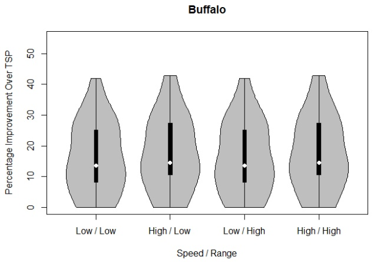

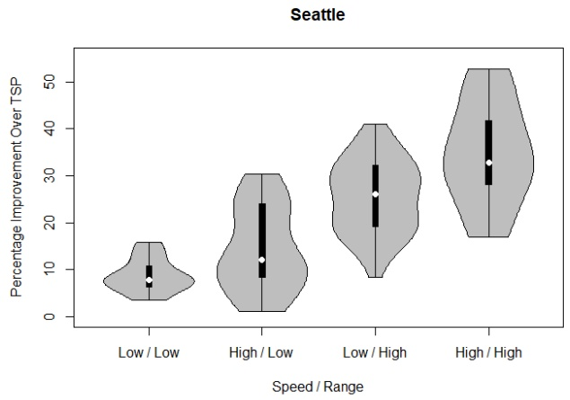

Figure 5: Impact of changing UAV speed and range combinations for small (Buffalo) and larger (Seattle) cities with eight customers.

As shown in Figure 7, the system rarely serves all “droneable” customers via UAVs. This is a function of the proximity among customers, the service times for preparing and retrieving the UAVs, and the flight endurance.

An analysis was also conducted to study the impacts of an automated depot and an automated delivery truck. Table 9 summarizes five cases involving combinations of these automation technologies, with two different metrics. After modifying the constraints corresponding to these different variants (as described in Sections 3.7 and 3.8), the same set of 320 problems were run using the IP model to study the improvements in makespan over a baseline system where (1) the truck is not automated for launch/recovery by itself, and (2) the truck is required at the depot for launch/recovery.

The results of this analysis, summarized in Figure 8, indicate a 4.5% average savings of the makespan if the truck is automated to launch and recover UAVs by itself (Case 1). The savings increases to an average of 7.9% if, instead, the truck is not required to launch and recover UAVs at the depot (Case 2a). However, if the objective is to minimize the time at which the truck returns

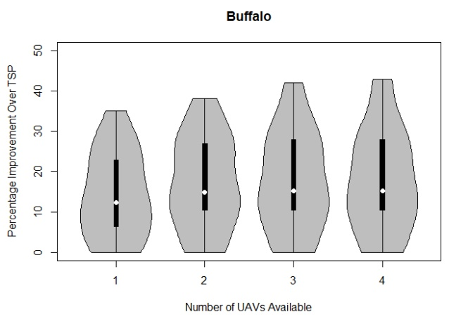

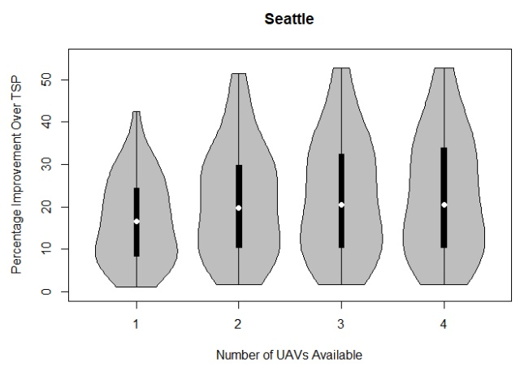

Figure 6: Impact of increasing the number of UAVs for eight-customer problems in a small (Buffalo) and a large (Seattle) city.

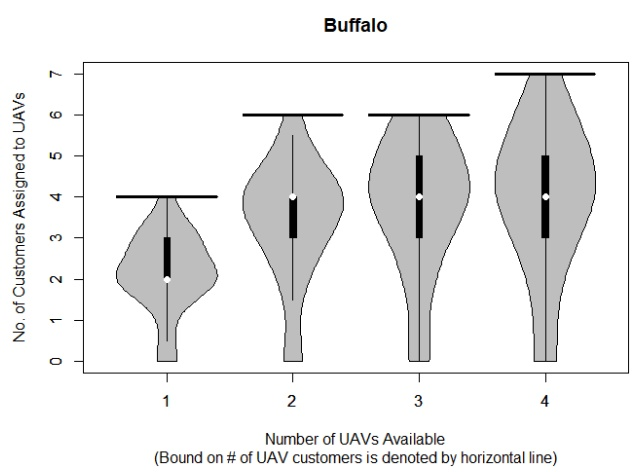

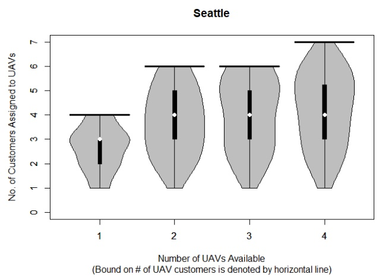

Figure 7: A comparison of the number of customers assigned to UAVs.

Table 9: A summary of the five cases studied for future automation enhancements.

|  | Metric Time at which the ... | Condi Driver not req'd at customer locations for launch/recovery | tion Truck not req'd at depot for launch/recovery |
| --- | --- | --- | --- |
| Case 1 | last vehicle returns to depot. | X |  |
| Case 2a | last vehicle returns to depot. |  | X |
| Case 2b | truck returns to depot. |  | X |
| Case 3a | last vehicle returns to depot. | X | X |
| Case 3b | truck returns to depot. | X | X |

to depot (i.e., the time at which the UAVs return is ignored), the savings further improves to 9.2% (Case 2b). When both Cases 1 and 2a are combined – so the truck is automated and is also not required at the depot – the average improvement over the default case becomes 11.0% (Case 3a). Finally, Case 3b provides the maximum average improvement of 13.0%. This analysis indicates that automation at the depot may be more beneficial than automating the truck.

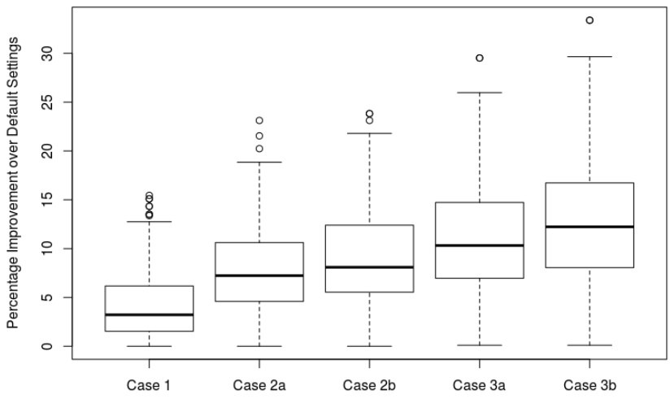

Figure 8: Comparison of percentage improvement for five different cases over a default system in which the truck is required to launch and retrieve UAVs at the depot, and the driver is required to participate in the launch and retrieval process at each customer location.

## 5.3 Heuristic performance

The effectiveness of the heuristic was assessed on 320 instances for each of the 8-, 10-, 25-, 50-, and 100-customer problems. A comparison of heuristic solutions to optimal solutions is only provided for 8-customer problems, due to the inability of Gurobi to generate optimal solutions (or, frequently, even feasible solutions) for larger-scale problems in a reasonable time. In the mFSTSP heuristic, a 5-second cutoff time was imposed when solving formulation (P3) in Phase III.

Table 10 provides a comparison of runtimes and gaps between Gurobi and the proposed heuristic. Recall that Gurobi was given a 1-hour (3600-second) cutoff time, such that 100 of the 320 8-customer test instances were unable to solve to optimality within this time limit. The average runtime for Gurobi to solve the 8-customer problems is 1326 seconds (about 22 minutes), while it is 0.08 seconds for the heuristic. One interesting observation is that the Gurobi runtimes for Seattle problems were nearly 87% less than for the Buffalo problems. One possible explanation is that the presence of multiple waterways in Seattle reduced the number of similarly-attractive truck tours. To put the optimality gaps into perspective, the 4.5% average gap associated with the heuristic indicates that this solution approach produces solutions that result in only 114 seconds of additional delivery time beyond what was found by the complete MILP formulation solved via Gurobi.

Table 10: Summary statistics for 8-customer problem instances.

<table><tr><td rowspan="2" colspan="2"></td><td colspan="2">Avg. Runtime [s]</td><td colspan="3">Gap to MILP220 Optimal Solns</td><td colspan="3">Gap to MILPAll 320 Solns</td></tr><tr><td>MILP</td><td>Heuristic</td><td>Avg.</td><td>Min</td><td>Max</td><td>Avg.</td><td>Min</td><td>Max</td></tr><tr><td rowspan="4">UAVs</td><td>1</td><td>51.2</td><td>0.06</td><td>4.7</td><td>0.0</td><td>20.3</td><td>4.7</td><td>0.0</td><td>20.3</td></tr><tr><td>2</td><td>1056.1</td><td>0.09</td><td>4.0</td><td>0.0</td><td>18.9</td><td>3.6</td><td>0.0</td><td>18.9</td></tr><tr><td>3</td><td>2000.8</td><td>0.09</td><td>4.6</td><td>0.0</td><td>21.7</td><td>3.1</td><td>0.0</td><td>21.7</td></tr><tr><td>4</td><td>2196.0</td><td>0.10</td><td>4.6</td><td>0.0</td><td>20.9</td><td>2.5</td><td>0.0</td><td>20.9</td></tr><tr><td rowspan="2">City</td><td>Buffalo</td><td>2340.8</td><td>0.09</td><td>4.8</td><td>0.0</td><td>18.9</td><td>2.9</td><td>0.0</td><td>18.9</td></tr><tr><td>Seattle</td><td>311.3</td><td>0.07</td><td>4.3</td><td>0.0</td><td>21.7</td><td>4.1</td><td>0.0</td><td>21.7</td></tr><tr><td></td><td>Overall</td><td>1326.0</td><td>0.08</td><td>4.5</td><td>0.0</td><td>21.7</td><td>3.5</td><td>0.0</td><td>21.7</td></tr></table>

To assess the solution quality of larger-scale problems, for which the MILP formulation becomes computationally intractable, a comparison with TSP solutions is provided. Table 11 summarizes the runtimes and percentage improvement over TSP solutions for these problems. As expected, the runtime increases with problem size, with most problems up to 50 customers solving in a minute or less. While the 100-customer problems have longer runtimes, the largest problems are still solved in approximately 16 minutes.

Also of note, the average improvements over the TSP for 10-, 25-, 50-, and 100-customer problems are 14%, 23%, 21% and 18% respectively. We suggest two possible explanations for this non-increasing behavior. First, it is possible that the heuristic is not providing near-optimal solutions for the 50- and 100-customer problems. Unfortunately, there is no existing method for assessing an optimality gap for the mFSTSP. However, there is also evidence that the relatively time-expensive launch time (60-seconds), recovery time (30-seconds), and customer service time (30-seconds longer for a drone delivery than a driver delivery) make it less beneficial to deploy the UAVs when the customer density increases (recall that the service region remains unchanged as more customers are added).

These factors also contribute to the diminishing rates of improvement as the number of UAVs is increased, as shown in Figure 9. However, the results do demonstrate that additional UAVs lead to a reduction in makespan, indicating that the heuristic’s behavior is consistent with expectations. Similarly, Figure 10 shows that the heuristic improves upon the TSP solution at similar rates when UAV speeds and ranges are improved, irrespective of the problem size. Consistent with the results of Section 5.2, UAV speed plays a more critical role in system performance than UAV endurance.

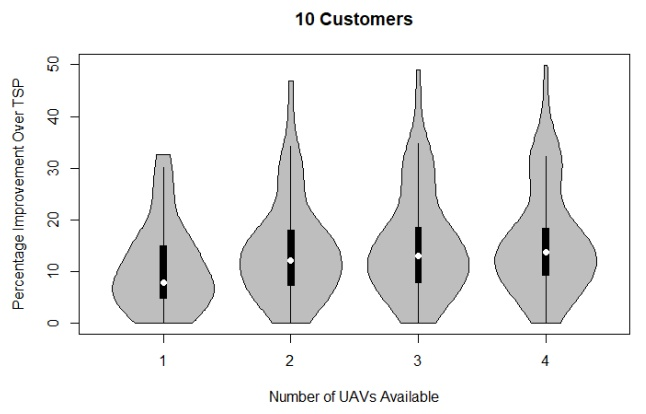

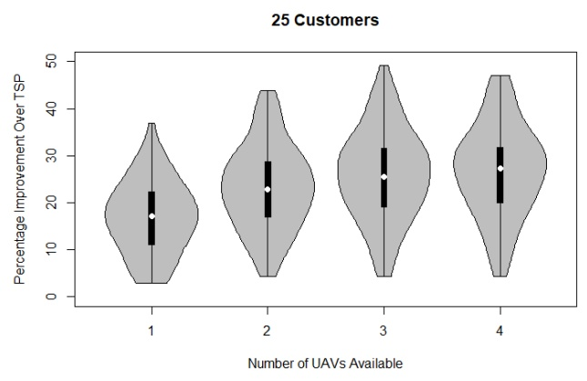

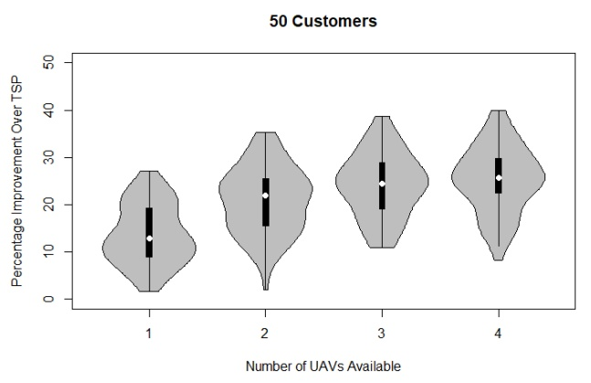

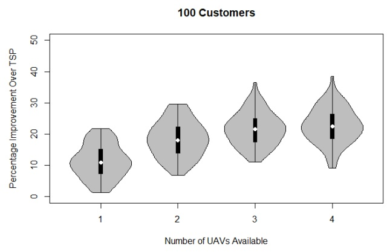

Figure 9: Impacts of additional UAVs for larger-scale problems.

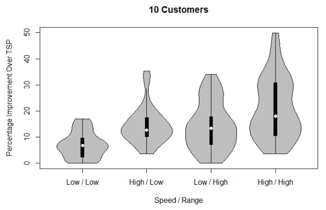

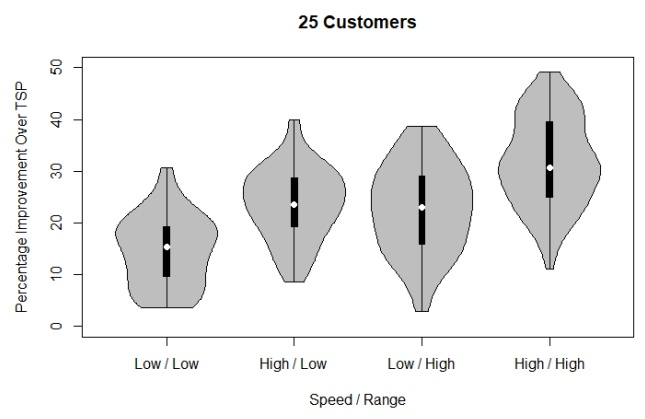

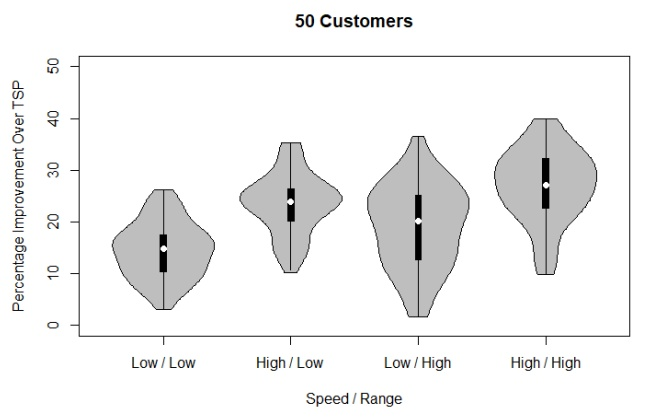

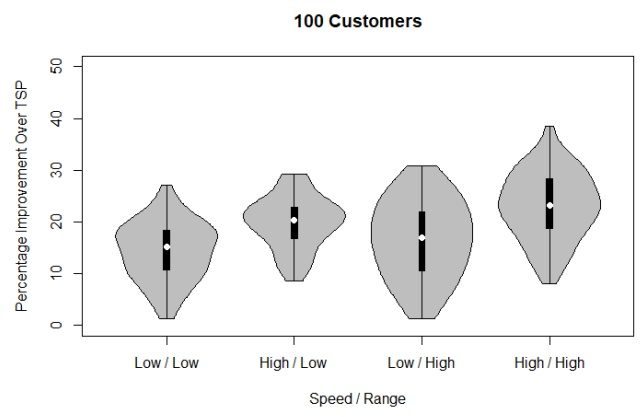

Figure 10: Impacts of UAV speed and endurance for larger-scale problems.

Table 11: Heuristic solution statistics.

<table><tbody><tr><td colspan="3">Avg. Runtime]</td><td>Avg. Improvement</td></tr><tr><td>Customers10</td><td>UAVs1</td><td>[seconds]0.1</td><td>over TSP [%]10.7</td></tr><tr><td></td><td>234</td><td>0.10.10.2</td><td>14.115.315.9</td></tr><tr><td>25</td><td>1234</td><td>0.91.94.34.7</td><td>17.023.225.926.8</td></tr><tr><td>50</td><td>1234</td><td>9.126.756.775.5</td><td>13.721.024.225.3</td></tr><tr><td>100</td><td>1234</td><td>156.2398.6728.8957.0</td><td>11.218.321.622.7</td></tr></tbody></table>

## 6 Conclusions and future research

This paper introduced the mFSTSP, whereby customer parcels may be delivered via multiple heterogeneous UAVs and a single delivery truck. These UAVs may be deployed from, and recovered by, the truck to extend the drones’ effective range. The flight endurance for each drone is modeled as a function of the drone’s battery size, payload, travel distance, and flight phases (e.g., takeoff, cruising, and landing). To reflect the realities of deploying multiple aircraft from a single truck, detailed queue scheduling for UAV arrivals and departures is incorporated within the proposed MILP formulation. A three-phased heuristic solution approach provides high-quality solutions with reasonable runtimes for problems of realistic size.

From the analyses conducted in this paper, we obtain some critical insights into the truck-UAV system design. Although it is generally faster to reach a customer with a UAV rather than truck, it is rarely beneficial to serve all UAV-eligible customers via drone. The analysis also reveals that UAVs with high-speed and long-range offer greater benefits in larger geographic regions, where customers are distributed over a larger area. Adding more UAVs to an existing fleet tends to have diminishing marginal makespan improvements, with UAVs offering a greater benefit in instances involving a larger number of customers. Furthermore, we observed that problem instances involving densely-distributed customers tend to benefit the most. Finally, the analyses reveal that automation within both the truck and the depot result in time savings, with depot automation providing the greatest savings.

There are myriad opportunities for future research in this area. For example, this study considers a last-mile delivery service whereby all parcels are available at the depot at the beginning of the delivery period; no additional orders arrive after the vehicle assignments have been made. However, UAVs also promise benefits to companies that seek to fulfill incoming orders directly from distribution centers (an obvious example of which is Amazon). In such a case, orders for on-hand products arrive throughout the day, resulting in a dynamic routing problem.

Of course there remain opportunities to develop more efficient heuristic approaches, and to continue adding realism to the models by eliminating unrealistic simplifying assumptions. Further studies that provide managerial insights would also be of great benefit. For example, although the mFSTSP model presented here considers UAVs of differing capacities, there was no analysis regarding the impact of these capacities. Additional studies may consider the impacts of customer density, and could further analyze the economic impact of these novel delivery systems.

## References

E. Adams. DHL’s tilt-rotor ‘Parcelcopter’ is both awesome and actually useful, 2016. URL https://www.wired.com/2016/05/dhls-new-drone-can-ship-packages-around-alps/.

E. Adams. UPS tests drone delivery, launching UAV from top of truck, 2017. URL http://www.techrepublic.com/article/ups-tests-drone-delivery-launching-uav-from-top-of-truck/.

N. Agatz, P. Bouman, and M. Schmidt. Optimization approaches for the traveling salesman problem with drone. Transportation Science, 2018.

M.S. bin Othman, A. Shurbevski, Y. Karuno, and H. Nagamochi. Routing of carrier-vehicle systems with dedicated last-stretch delivery vehicle and fixed carrier route. Journal of Information Processing, 25: 655–666, 2017.

P. Bouman, N. Agatz, and M. Schmidt. Dynamic programming approaches for the traveling salesman problem with drone. Networks, 72(4):528–542, 2018.

A. Boyle. Flying saucer? No, it’s the first drone pizza delivery, from Domino’s and Flirtey, 2016. URL https://www.geekwire.com/2016/drone-delivery-pizza-dominos-flirtey/.

N. Boysen, D. Briskorn, S. Fedtke, and S. Schwerdfeger. Drone delivery from trucks: Drone scheduling for given truck routes. Networks, 72(4):506–527, 2018.

J.F. Campbell, D. C. Sweeney II, and J. Zhang. Strategic design for delivery with trucks and drones. 2017. URL https://www.researchgate.net/profile/James\_Campbell3/publication/316169890\_Strategic\_Design\_for\_Delivery\_with\_Trucks\_and\_Drones/links/58f4efb7a6fdcc11e569fb5d/Strategic-Design-for-Delivery-with-Trucks-and-Drones.pdf.

N. Carey. UPS launches U.S. drone test flights for urgent medical deliveries, 2016. URL http://www.reuters.com/article/united-parcel-drones-delivery-idUSL2N1BY1UY.

J.G. Carlsson and S. Song. Coordinated logistics with a truck and a drone. Management Science, 2017.

Y.S. Chang and H.J. Lee. Optimal delivery routing with wider drone-delivery areas along a shorter truckroute. Expert Systems with Applications, 104:307–317, 2018.

D. Chauhan, A. Unnikrishnan, and M. Figliozzi. Maximum coverage capacitated facility location problem with range constrained drones. Transportation Research Part C: Emerging Technologies, 99:1–18, 2019.

C. Cheng, Y. Adulyasak, and L.M. Rousseau. Formulations and exact algorithms for drone routing problem. Technical report, 2018. URL https://www.cirrelt.ca/DocumentsTravail/CIRRELT-2018-31.pdf.

S. Chowdhury. Drone routing and optimization for post-disaster inspection. PhD thesis, Mississippi State University, 2018.

R. Daknama and E. Kraus. Vehicle routing with drones. arXiv preprint arXiv:1705.06431, 2017. URL https://arxiv.org/pdf/1705.06431.pdf.

K. Dorling, J. Heinrichs, G.G. Messier, and S. Magierowski. Vehicle routing problems for drone delivery. IEEE Transactions on Systems, Man, and Cybernetics: Systems, 47(1):70–85, 2017.

O. Dukkanci, B.Y. Kara, and T. Bektas. The drone delivery problem. Available at SSRN, January 2019. URL https://papers.ssrn.com/sol3/papers.cfm?abstract\_id=3314556.

D. Etherington. Check out the real world version of the Mercedes-Benz drone delivery van, 2017. URL https://techcrunch.com/2017/01/10/check-out-the-real-world-version-of-the-mercedes-benz-drone-delivery-van/.

S.M. Ferrandez, T. Harbison, T. Weber, R.R. Sturges, and R. Rich. Optimization of a truck-drone in tandem delivery network using k-means and genetic algorithm. Journal of Industrial Engineering and Management, 9(2):374, 2016.

J.C. Freitas and P.H.V. Penna. A variable neighborhood search for flying sidekick traveling salesman problem. arXiv preprint arXiv:1804.03954, 2018. URL https://arxiv.org/pdf/1804.03954.pdf.

Gurobi Optimization. tsp.py, 2018. URL https://www.gurobi.com/documentation/8.1/examples/tsp\_py.html.

Q.M. Ha, Y. Deville, Q.D. Pham, and M.H. Hà. On the min-cost traveling salesman problem with drone. Transportation Research Part C: Emerging Technologies, 86:597–621, 2018.

A.M. Ham. Integrated scheduling of m-truck, m-drone, and m-depot constrained by time-window, droppickup, and m-visit using constraint programming. Transportation Research Part C: Emerging Technologies, 91:1–14, 2018.

I. Hong, M. Kuby, and A.T. Murray. A range-restricted recharging station coverage model for drone delivery service planning. Transportation Research Part C: Emerging Technologies, 90:198–212, 2018.

H.Y. Jeong, S. Lee, and B.D. Song. Truck-drone hybrid delivery routing: Payload-energy dependency and no-fly zones. International Journal of Production Economics, 2019.

K. Kim and M.A. Awwad. Modeling effective deployment of airborne fulfilment centers. In Proceedings of the American Society for Engineering Management 2017 International Annual Conference, 2017.

S. Kim and I. Moon. Traveling salesman problem with a drone station. IEEE Transactions on Systems, Man, and Cybernetics: Systems, 49(1):42–52, 2019.

S.J. Kim, G.J. Lim, J. Cho, and M.J. Côté. Drone-aided healthcare services for patients with chronic diseases in rural areas. Journal of Intelligent & Robotic Systems, 88(1):163–180, 2017.

P. Kitjacharoenchai, M. Ventresca, M. Moshref-Javadi, S. Lee, J.M.A. Tanchoco, and P.A. Brunese. Multiple traveling salesman problem with drones: Mathematical model and heuristic approach. Computers & Industrial Engineering, 2019.

Y. Li, G. Zhang, Z. Pang, and L. Li. Continuum approximation models for joint delivery systems using trucks and drones. Enterprise Information Systems, pages 1–30, 2018.

Z. Luo, Z. Liu, and J. Shi. A two-echelon cooperated routing problem for a ground vehicle and its carried unmanned aerial vehicle. Sensors, 17(5):1144, 2017.

N. Mathew, S.L. Smith, and S.L. Waslander. Planning paths for package delivery in heterogeneous multirobot teams. IEEE Transactions on Automation Science and Engineering, 12(4):1298–1308, 2015.

MHI. The 2016 MHI Annual Industry Report – Accelerating change: How innovation is driving digital, always-on supply chains. Technical report, Material Handling Institute, 2016.

T. Mogg. Watch Google’s new Project Wing drone deliver a package, 2015. URL https://www.digitaltrends.com/cool-tech/watch-googles-new-project-wing-drone-deliver-a-package/.

T. Mogg. Amazon patents shipping label with built-in parachute for drone deliveries, 2017. URL http://money.cnn.com/2017/05/31/technology/amazon-parachute-shipping-label/index.html.

C.C. Murray and A.G. Chu. The flying sidekick traveling salesman problem: Optimization of drone-assisted parcel delivery. Transportation Research Part C: Emerging Technologies, 54:86–109, 2015.

G. Oh, Y. Kim, J. Ahn, and H.L. Choi. Task allocation of multiple UAVs for cooperative parcel delivery. In Advances in Aerospace Guidance, Navigation and Control, pages 443–454. Springer, 2018.

OpenStreetMap, 2017. URL http://openstreetmap.org.

A. Otto, N. Agatz, J. Campbell, B. Golden, and E. Pesch. Optimization approaches for civil applications of unmanned aerial vehicles (UAVs) or aerial drones: A survey. Networks, 72(4):411–458, 2018.

K. Peterson and M. Dektas. UPS tests residential delivery via drone launched from atop package car, 2017. URL https://www.pressroom.ups.com/pressroom/ContentDetailsViewer.page?ConceptType=PressReleases&id=1487687844847-162.

pgRouting, 2017. URL http://pgrouting.org.

S. Poikonen. Multi-visit drone routing problem. Working Paper, 2018. URL http://www.stefan-poikonen.net/MVDRP\_September\_2018.pdf.

S. Poikonen, X. Wang, and B. Golden. The vehicle routing problem with drones: Extended models and connections. Networks, 2017.

A. Ponza. Optimization of drone-assisted parcel delivery. Master’s thesis, Università Degli Studi Di Padova, 2016.

B. Rabta, C. Wankmüller, and G. Reiner. A drone fleet model for last-mile distribution in disaster relief operations. International Journal of Disaster Risk Reduction, 28:107–112, 2018.

B.F. Rubin. Amazon Prime Air drone completes its first U.S. public delivery, 2017. URL https://www.cnet.com/news/amazon-prime-air-first-drone-delivery-us-public-sunscreen-mars/.

R.G. Mbiadou Saleu, L. Deroussi, D. Feillet, N. Grangeon, and A. Quilliot. An iterative two-step heuristic for the parallel drone scheduling traveling salesman problem. Networks, 72(4):459–474, 2018.

K.T. San, E.Y. Lee, and Y.S. Chang. The delivery assignment solution for swarms of UAVs dealing with multi-dimensional chromosome representation of genetic algorithm. In Ubiquitous Computing, Electronics & Mobile Communication Conference (UEMCON), IEEE Annual, pages 1–7. IEEE, 2016.

D. Schermer, M. Moeini, and O. Wendt. Algorithms for solving the vehicle routing problem with drones. In Asian Conference on Intelligent Information and Database Systems, pages 352–361. Springer, 2018.

J.E. Scott and C.H. Scott. Models for drone delivery of medications and other healthcare items. International Journal of Healthcare Information Systems and Informatics (IJHISI), 13(3):20–34, 2018.

S.M. Shavarani, M.G. Nejad, F. Rismanchian, and G. Izbirak. Application of hierarchical facility location problem for optimization of a drone delivery system: A case study of Amazon Prime Air in the city of San Francisco. The International Journal of Advanced Manufacturing Technology, 95(9-12):3141–3153, 2018.

B.D. Song, K. Park, and J. Kim. Persistent UAV delivery logistics: MILP formulation and efficient heuristic. Computers & Industrial Engineering, 2018.

A. Tilley. UPS experiments with drone delivery in partnership with Zipline, 2016. URL https://www.forbes.com/sites/aarontilley/2016/05/09/ups-experiments-with-drone-delivery-in-partnership-with-zipline/#58f1c1d145a4.

A. Toor. Drones will begin delivering blood and medicine in the U.S., 2016. URL https://www.theverge.com/2016/8/2/12350274/zipline-drone-delivery-us-launch-blood-medicine.

P.A. Tu, N.T. Dat, and P.Q. Dung. Traveling salesman problem with multiple drones. In Proceedings of the Ninth International Symposium on Information and Communication Technology, pages 46–53. ACM, 2018.

M.W. Ulmer and B.W. Thomas. Same-day delivery with heterogeneous fleets of drones and vehicles. Networks, 72(4):475–505, 2018.

J. Vanian. This drone startup just achieved a milestone in doorstep delivery, 2016. URL http://fortune.com/2016/03/25/flirtey-drone-legal-delivery-urban/.

S. Venkatachalam, K. Sundar, and S. Rathinam. Two-stage stochastic programming model for routing multiple drones with fuel constraints. arXiv preprint arXiv:1711.04936, 2017. URL https://arxiv.org/pdf/1711.04936.pdf.

X. Wang, S. Poikonen, and B. Golden. The vehicle routing problem with drones: Several worst-case results. Optimization Letters, 4(11):679–697, 2016.

G. Wells and L. Stevens. Amazon conducts first commercial drone delivery, 2016. URL https://www.wsj.com/articles/amazon-conducts-first-commercial-drone-delivery-1481725956.

J.J. Yoon. The traveling salesman problem with multiple drones: An optimization model for last-mile delivery. Master’s thesis, Massachusetts Institute of Technology, 2018.

L. Zhong, K. Garlichs, S. Yamada, K. Takano, and Y. Ji. Mission planning for UAV-based opportunistic disaster recovery networks. In Consumer Communications & Networking Conference (CCNC), 2018 15th IEEE Annual, pages 1–6. IEEE, 2018.