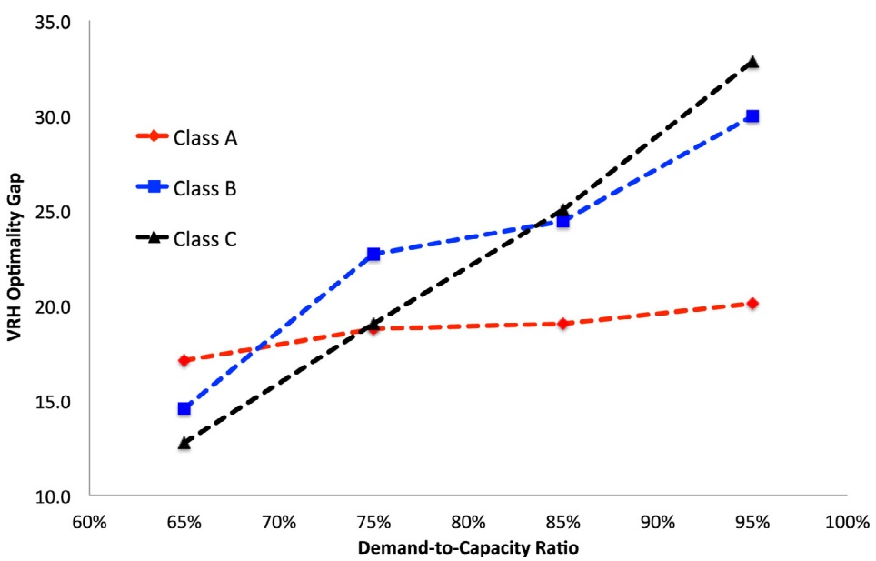
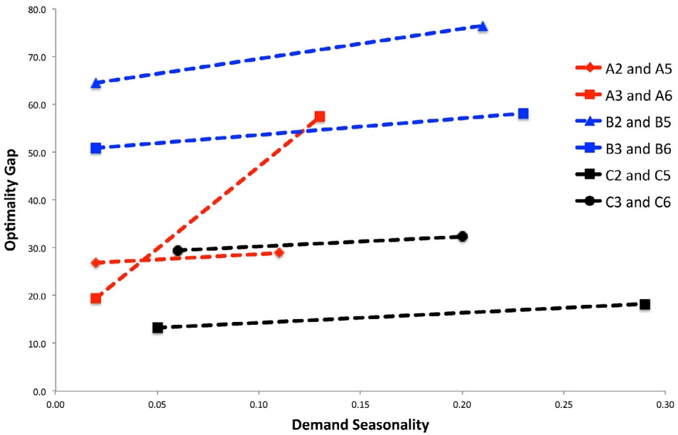
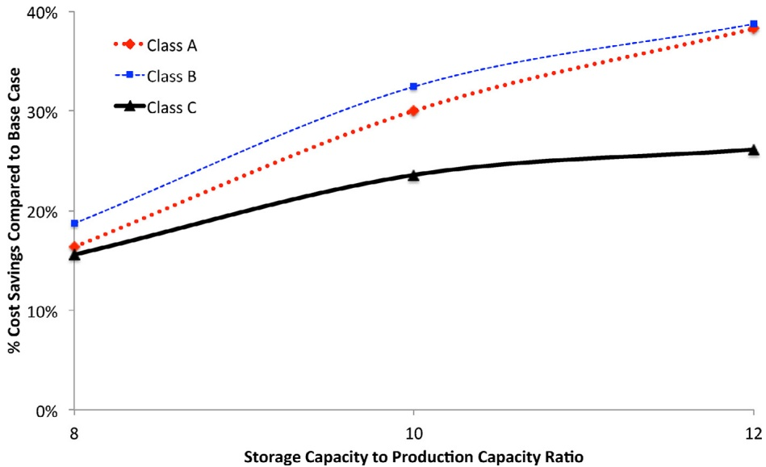

# A comprehensive annual delivery program for upstream liquefied natural gas supply chain

Fatih Mutlu a,∗, Mohamed K. Msakni a, Hakan Yildiz b, Erkut Sönmez c, Shaligram Pokharel a

a Mechanical and Industrial Engineering, Qatar University, Doha, Qatar

b Eli Broad College of Business, Michigan State University, MI, USA

c Carroll School of Management, Boston College, MA, USA

## a r t i c l e i n f o

Article history: Received 20 June 2015 Accepted 14 October 2015 Available online 23 October 2015

Keywords: OR in maritime industry Annual delivery planning problem LNG supply chain Large-scale optimization

## a b s t r a c t

Developing a cost-effective annual delivery program (ADP) is a challenging task for liquefied natural gas (LNG) suppliers, especially for LNG supply chains with large number of vessels and customers. Given significant operational costs in LNG delivery operations, cost-effective ADPs can yield substantial savings, adding up to millions. Providing an extensive account of supply chain operations and contractual terms, this paper aims to consider a realistic ADP problem faced by large LNG suppliers; suggest alternative delivery options, such as split-delivery; and propose an efficient heuristic solution which outperforms commercial optimizers. The comprehensive numerical study in this research demonstrates that contrary to the common belief in practice, split-delivery may generate substantial cost reductions in LNG supply chains.

© 2015 Elsevier B.V. and Association of European Operational Research Societies (EURO) within the International Federation of Operational Research Societies (IFORS). All rights reserved.

## 1. Introduction

Natural gas (NG) is the third largest energy source satisfying approximately 25 percent of the world’s energy demand (BP Department, 2014b). Pipelines are the major delivery method in global NG trade. Although pipeline delivery is highly cost efficient over short distances, it is not technically feasible and economically viable when the supplier and customers are geographically spread. In such cases, NG is transported in the form of liquefied natural gas (LNG), utilizing special ocean-going vessels over long distances. Shipping NG in the form of LNG offers gas suppliers the ability to reach distant markets.

Global LNG trade has been steadily growing for the past two decades. Its share in the global NG trade increased from 26 percent in 2000 to 32 percent in 2013 (BP Department, 2014b). This share is expected to grow to 46 percent by 2035. Similarly, LNG accounts for 10 percent of the world’s NG consumption, which is expected to increase to 15 percent by 2035, according to BP Department (2014a). This increase in LNG demand, coupled with the increasing production and delivery capacities, has led to complex global LNG supply chains. Currently, global annual liquefaction capacity is 408 billion cubic meters (BCM), which is expected to increase to 1427 BCM when the construction of new liquefaction terminals is completed (Enerdata, 2014). On the shipping side, there are currently 405 LNG vessels with a total capacity of 59.5 million cubic meters (MCM); and 132 more vessels are currently being built to increase this capacity to 81 MCM (Enerdata, 2014).

Both the production and the delivery of LNG require significant capital investments and operating expenses. Capital cost of a liquefaction plant can be as high as 600 dollars per ton per annum production while capital cost of an LNG vessel ranges between 200 and 400 million dollars. Operational costs are also significant; the cost of daily vessel charters averaging around 60,000 dollars (Tusiani & Shearer, 2007). In light of these figures, the vast majority of global LNG trade needs long-term contracts to secure intensive capital investments in the LNG supply chain and ensure income stability for LNG suppliers. Meanwhile, due to price volatility across NG markets and excess LNG production, LNG spot market has been growing very rapidly. According to Kent (2013), the share of spot sales in the LNG trade has risen from 6 percent in 2000 to 25 percent in 2012.

In order to survive in such a dynamic and complex market, suppliers should carefully plan for LNG production, inventory, and delivery in a cost effective way. Planning problems arise at strategic, tactical, and operational decision levels: Strategic planning typically involves decisions regarding production and vessel investments as well as long-term contract terms and conditions. Tactical planning involves developing an integrated fulfill, inventory, and delivery plan for a period of 12-to-18 months to satisfy the long-term contracts’ requirements. This plan is called the annual delivery program (ADP). Finally, operational planning typically includes mitigations to planned or unplanned changes in the ADP such as vessel breakdowns, port unavailability, variations in travel times, and emerging spot sales opportunities.

<small>∗ Corresponding author. Tel.: +974 44034326.</small>

<small>E-mail address: [fatihmutlu@qu.edu.qa](mailto:fatihmutlu@qu.edu.qa) (F. Mutlu).</small>

<small>[http://dx.doi.org/10.1016/j.ejor.2015.10.031](http://dx.doi.org/10.1016/j.ejor.2015.10.031)</small>

In this paper, focusing on tactical planning, we study the problem of preparing a cost-effective ADP for a global LNG supplier. This is an integrated production, inventory, and maritime routing problem. The supplier operates a liquefaction plant, where NG is cooled to −240 degree Fahrenheit and condensed into liquid form, which is called LNG production. The LNG is temporarily kept in storage tanks at a port near the liquefaction facility before it is loaded on LNG vessels. The supplier owns and/or charters a fleet of heterogeneous vessels that are used for delivering LNG to customers with long term contracts. For each customer, there are several contracts throughout a certain year, each of which comes with differing levels of flexibility in terms of delivery volume and time. In most practical cases, total annual long term contractual demand is less than the production capacity. Due to highly limited production changes and lack of facilities to store large amounts of LNG in storage tanks, there will usually be some excess production. Therefore, the ADP should also include a provisional plan for selling the excess production in the spot market.

In the ADP problem, we would like to minimize the sum of operating costs, penalty costs due to deviations from contractual terms, and penalty costs of handling excess production. We develop a novel heuristic method to create a cost effective ADP in a short amount of time. We then interpret the results from a comprehensive computational study to gain managerial insights.

There are a handful of studies that attempt to develop costeffective ADPs, such as Halvorsen-Weare and Fagerholt (2013), Rakke et al. (2011) and Stälhane et al. (2012). Our main contributions in this study are incorporating many practical aspects of upstream LNG operations and LNG contracts into the ADP preparation problem and proving managerial insights regarding these aspects. Furthermore, we propose a novel and efficient heuristic solution approach for this problem, which can be used as a practical decision support tool by the logistics planners of LNG suppliers. This heuristic consistently outperforms commercial optimizers by finding less-costly ADPs in a considerably shorter amount time.

The remainder of this paper is organized as follows: in Section 2, we present a review of the relevant literature and discuss the contribution of our work. In Section 3, we describe the mathematical model and present the formulation. In Section 4, we introduce our heuristic method to construct an ADP. Finally, we present our numerical analysis in Section 5 and conclude with model extensions and further research directions in Section 6.

## 2. Literature review

Maritime transportation optimization, reviewed by Ronen (1983, 1993), Christiansen, Fagerholt, and Ronen (2004) and Christiansen, Fagerholt, Nygreen, and Ronen (2007, 2013), has long been an active and well-established area of research. The research focusing on integrated vessel scheduling and inventory management problems, referred to as maritime inventory routing problem (MIRP), are motivated by maritime supply chains in various industries where one actor is responsible for both distribution and inventory management. Researchers studied variants of MIRP that address particular aspects of specific industrial applications. For instance, Christiansen (1999) focused on a company producing and consuming ammonia, Ronen et al. (2002) and Al-Khayyal and Hwang (2007) both considered the transportation of liquid bulk such as chemicals and oil products, Persson and Gothe-Lundgren (2005) studied MIRP at a petroleum refinery, Furman, Song, Kocis, McDonald, and Warrick (2011) studied vacuum gas oil routing and inventory management, and integrated it into a decision support tool, Christiansen et al. (2011) considered a case study from the cement industry, and Agra, Christiansen, and Delgado (2013b) presented an MILP model for a short sea fuel oil distribution problem. Recently, Agra, Andersson, Christiansen, and Wolsey (2013a) developed a new model leading to new valid inequalities for a single product MIRP to tighten a discrete time model.

Papageorgiou, Keha, Nemhauser, and Sokol (2014b) studied an MIRP with multiple ports per region and split pickups and split deliveries. However they restricted the planning horizon to 60 days, thus making the focus of the paper more operational rather than tactical as in the case of creating an ADP in LNG-IRP. Papageorgiou, Nemhauser, Sokol, Cheon, and Keha (2014c) focus on strategic and tactical deepsea MIRPs in which inventory levels at all loading and discharging ports are explicitly tracked but delivery time windows requirements are not considered. Most recently, Jiang and Grossmann (2015) studied a single product MIRP by exploring the use of continuous and discrete time models. Several other versions of MIRP are presented in Christiansen and Fagerholt (2009), Engineer, Furman, Nemhauser, Savelsbergh, and Song (2012), Hewitt, Nemhauser, Savelsbergh, and Song (2013), Siswanto, Essam, and Sarker (2011), Song and Furman (2013).

As demand for LNG increases worldwide, recent literature has witnessed an increasing amount of MIRP research with specific focus on optimizing LNG supply chains. Grønhaug and Christiansen (2009) introduce the LNG inventory routing problem (LNG-IRP), which considers a central planner who designs LNG vessel routes and schedules, LNG production and regasification (sales) plans, and terminal inventory targets in order to maximize the profit of an integrated supply chain. These authors present both an arc-flow and a pathflow formulation of LNG-IRP; but these formulations can only be solved for small instances (in terms of number of vessels, ports and planning horizon) by commercial software. Later, Grønhaug, Christiansen, Desaulniers, and Desrosiers (2010) proposed a branch-and-price method to solve the same path-flow formulation of LNG-IRP given in Grønhaug and Christiansen (2009). The instances that can be solved with this method are still small for developing practical ADPs for LNG producers. Recently, Andersson, Christiansen, and Desaulniers (2015) presented a new formulation and decomposition algorithm for the LNG-IRP presented by Grønhaug and Christiansen (2009) and Grønhaug et al. (2010). In addition, Anderson, Christiansen, and Fagerholt (2010) also presented two LNG-IRP formulations; one for an LNG producer and the other for a vertically integrated company. They did not present a solution method or computational results regarding with these two formulations. Recently, Rakke, Andersson, Christiansen, and Desaulniers (2014) introduced a new formulation based on delivery patterns and developed a branchprice-and-cut method to solve it. Papageorgiou, Cheon, Nemhauser, and Sokol (2014a) departed from the traditional MIP based methods and instead used approximate dynamic programming.

Although the LNG-IRP studies above formulated detailed vertically integrated supply chains, they ignored important ADP aspects such as spot sales and penalty charges associated with contractual terms. Furthermore, the solution methods in these studies can be effective for instances with fewer ships, ports and contracts, and a much shorter planning horizon than it is generally the case in a practical ADP.

To the best of our knowledge, similar to our work, six studies have so far presented heuristic methods for solving simplified versions of LNG-IRP in an effort to develop cost-effective ADPs. Halvorsen-Weare and Fagerholt (2013) presented a decomposition based heuristic solution algorithm. They assumed full shipload loading/unloading (no split-delivery) in their formulation. In other words, a vessel is not allowed to call multiple demand (unloading) ports on a scheduled voyage before returning to the liquefaction (loading) port. Rakke et al. (2011) and Stälhane et al. (2012) develop a rolling horizon heuristic and a construction-and-improvement heuristic, respectively. Goel, Furman, Song, and El-Bakry (2012) present an optimization model for analyzing supply chain design decisions for new LNG projects. They present a set of construction and improvement heuristics to solve this model. As a follow up study to Goel et al. (2012), Goel, Slusky, van Hoeve, Furman, and Shao (2015) develop a constraint programming model and use a dedicated search heuristic that provides better solutions in less time. Shao, Furman, Goel, and Hoda (2015) also develop a suite of heuristic methods and propose a hybrid heuristic strategy to improve solutions for the LNG-IRP model proposed by Goel et al. (2012). In all of these studies, split deliveries were not allowed; penalty cost schemes associated with delivery time windows as well as under or over delivery limits specific to contracts were ignored.

Our paper aims to contribute to the LNG-IRP literature by pre-senting a novel heuristic method to solve a comprehensive LNG-IRP model with the purpose of developing practical ADPs of realistic problem sizes. In contrast to previous studies discussed above which ignored both early and late delivery as well as under and over delivery penalties, our model is more comprehensive and allows for split deliveries. In Section 3.2, we benchmark our model against earlier studies, which were formulated as special cases for our model.

## 3. ADP problem and the mathematical model

We aim to develop a minimum cost ADP for an LNG supplier given a certain planning horizon. In broad terms, an ADP is an integrated plan of production of LNG and distribution of it to the long-term contracted customers. In this section, we describe both the ADP problem and our associated mathematical model.

A typical ADP is developed for a planning horizon of twelve months. In our model, the planning horizon is discretized into days and we represent it by the set $\mathcal { T } = \{ 1 , \ldots , T \}$ , where T is the last day.

There are three interrelated aspects of an ADP: production of LNG, control of the LNG inventory, and delivery to the long-term contracted customers. In this model, production, i.e., liquefaction, is done at a single location. The product, LNG, is temporarily stored nearby the production terminal, and it is loaded onto the LNG carrying vessels at a port adjacent to the production facility. In the model, this integrated production, storage, and loading facility is represented by a node called loading port. Daily production decisions are represented by $r _ { t } , \mathrm { A }$ common industry practice is to change the production rate at certain time intervals, e.g. at the beginning of each month. The production rate is bounded from below and above, $R ^ { m i n }$ and $R ^ { m a x }$ , respectively.

LNG is temporarily stored in cooled storage tanks until it is loaded on LNG vessels. The total tank capacity denotes the maximum amount that can be stored as inventory. In addition, storage tanks should maintain a minimum LNG level in order to remain cold. LNG inventory in storage tanks on a given day $t , \; s _ { t } ,$ should be between these minimum and maximum levels, $S ^ { m i n }$ and $S ^ { m a x }$ , respectively. These values are assumed to be parameters of the problem.

The last, and perhaps the most important, aspect of an ADP is the delivery scheduling of the LNG to the long-term contracts. For this purpose, the LNG supplier operates a fleet of specialized vessels, denoted with set V, indexed by v. LNG is loaded on the vessels at the loading port, denoted by l. The loading port has a number of berths, $B ,$ where each one can be used to load one vessel at a time. Associated with the loading port, we also define an artificial port, $l _ { d } .$ This artificial port can be considered as a waiting area nearby the loading port. We model that the loading port l can only be accessed through $l _ { d } . ^ { 1 }$

Vessel v has $G _ { \nu }$ identical isolated tanks to store LNG. The capacity of each tank of vessel v is denoted by $C _ { \nu } .$ Inventory level in vessel v at the end of day t is expressed as the number of full tanks and denoted by the integer variable $g _ { v t } .$ . We denote with $q _ { v i t }$ , the number of tanks loaded to or unloaded from vessel v at port i during day t.

Vessels visit customer ports and deliver LNG in order to satisfy customers’ contract requirements. Each customer in our model is represented with a pair of ports, denoted with i and $i _ { d } ,$ respectively. Port i is the actual customer port that vessels deliver LNG. Port $i _ { d }$ is an artificial port we created associated with the customer i as a waiting area to accommodate waiting due to berth unavailability or delivery time windows. Vessels can wait at $i _ { d }$ as many days as necessary. Port i is only accessible through $i _ { d } .$ We assume that each customer port has one berth for LNG delivery.

For each customer i, there is a set of contracts, $\mathcal { C } _ { i } = \{ C _ { i 1 } , \dots , C _ { i N _ { i } } \}$ to be satisfied during the planning horizon. Each contract $C _ { i n }$ consists of the following terms: (i) required volume, $D _ { i n } ,   ( \mathrm { i i } )$ minimum and maximum allowed delivery volumes, $\underline { { D } } _ { i n } ,$ and $\overline { { D } } _ { i n }$ , respectively, (iii) expected delivery time window, $\mathcal { T } _ { i n } ^ { e }$ , and (iv) allowed delivery time window, $\mathcal { T } _ { i n } ^ { a } , \underline { { D } } _ { i n } , \overline { { D } } _ { i n } ,$ and $\mathcal { T } _ { i n } ^ { a }$ constitute the flexibility of the contract.

In the mathematical model, locations and flow of vessels during the planning horizon is controlled by the binary variable $x _ { v i j t }$ , which is 1 if vessel v arrives at port j from port i on day $t ,$ and 0 otherwise. In this notation, subscripts i and j may denote any port including customer ports, loading port, maintenance ports, and their associated artificial ports. $x _ { v i j t }$ is defined for any $( i , j )$ pair for which vessel v can travel from $i \; \mathrm { t o } \; j . \; x _ { v i j t }$ variables help us follow the route of a vessel throughout the planning horizon. For initial and final locations of the vessels, we introduce the artificial origin, $O ,$ and destination, d, ports, respectively. We note that although one origin port is defined, physically it may represent a different location for each vessel.

There are several restrictions on vessel flows in the model due to our modeling assumptions, port-vessel compatibility issues, and that some vessels operate in joint ventures between the customers and the producer. We model that a vessel may go to l only from $l _ { d } ,$ and a compatible port i only from its artificial port $i _ { d } .$ It can go to artificial ports of its compatible customer ports from l. Moreover, a vessel may go to $l _ { d }$ or directly to an $i _ { d }$ from the origin port, depending on its initial inventory level; and it can go to the final destination port, d, from one of its compatible customer ports, i. In the formulation, we define $\nu ^ { i }$ as the set of vessels that can visit port i. Similarly, $\mathcal { P } ^ { \nu }$ is the set of ports that vessel v can visit. In our model, we allow for “split-delivery”, that is a vessel can sail between multiple customer ports and deliver its load partially to these ports before sailing back to the loading port. However, a vessel may not be able to sail on every $( i , j ) \in ( \mathcal { P } ^ { \nu } , \mathcal { P } ^ { \nu } )$ link due to its travel range. We define $\mathcal { P } ^ { v i }$ to be the set of ports that vessel v can sail from port i, and $\mathcal { P } _ { \odot } ^ { v i }$ to be the set of ports from where the vessel v can reach to port i.

Travel time of vessel v from port i to j is given by $T _ { v i j }$ . We model that the travel time from an artificial port to the corresponding actual port is one day. Although we are only interested in the flow of vessels during the planning horizon, $\mathcal { T } ,$ in order to be able to control the flow balance in our model, we also need to monitor beyond the planning horizon. Thus, we define two more sets: $(i) $\mathcal { T } _ { 0 } = \mathcal { T } \cup \{ 0 \} ,$ (ii) $\mathcal { T } _ { \mathcal { E } \mathcal { X } } =$$ $\mathcal { T } _ { 0 } \cup \{ T + 1 , \ldots , T + t _ { 0 } \}$ , where $t _ { 0 }$ is the maximum of travel times of vessels, $T _ { v i j } ,$

Vessels should $\mathtt { g 0 }$ through periodic maintenance, typically in every five years. We denote the set of vessels that should go to maintenance within the planning horizon by Vm. For each vessel $\mathcal { V } \in \mathcal { V } ^ { m }$ we model a maintenance time window, $\mathcal { T } _ { \nu } ^ { m }$ . Maintenance operation takes $T _ { \nu } ^ { m }$ days and it should be completed within $\mathcal { T } _ { v } ^ { m } = \{ \underline { { T } } _ { v } ^ { m } , \dots , \overline { { T } } _ { v } ^ { m } \}$ There is one maintenance port, which is modeled with a pair of actual and artificial ports, $( m ,   m _ { d } ) ,$ and the maintenance operation is modeled as the travel from m to $m _ { d } , \mathrm { i . e . } , T _ { v } ^ { m } = T _ { \nu m m _ { d } }$ . The vessels with maintenance requirements should go from $l _ { d }$ to m, and then travel from m to $m _ { d } .$ After the maintenance, vessels can directly sail to l or wait at the artificial port $m _ { d }$ until one of the berths in the loading port becomes available. We note that $T _ { v } ^ { m } < \left| \mathcal { T } _ { v } ^ { m } \right|$ , to allow some flexibility for the start of the maintenance. Moreover, we assume that the maintenance time windows of different vessels are disjoint.

The objective of an ADP is to plan the production, inventory, and delivery routing decisions at the lowest possible cost. In the model, we minimize the sum of the following three types of costs: (i) the operational costs, (ii) penalty costs associated with contractual deliveries, and (iii) the operational cost for clearing excess production by spot sales.

<small>1 The only exception to this is when the vessels are coming from maintenance, which we describe later in the model.</small>

$C _ { v i j }$ represents the operational cost of vessel v traveling from i to j. This includes fuel charges, personnel cost, and any additional costs such as port, channel, and demurrage fees. The variable production cost is negligible compared to the other operational costs; thus, it is not considered in the model.

The contractual penalty costs, on the other hand, are two-fold: First one is the penalty cost of over (under) delivery. We model this with a unit rate of $P _ { i n } ^ { + } ~ ( P _ { i n } ^ { - } )$ for each cubic meter of over (under) delivered amount, denoted by $d _ { i n } ^ { + } ( d _ { i n } ^ { - } )$ , for contract n of customer i. The second penalty cost pertains to the delivery time. As discussed before, for each contract there is an expected delivery time window, $\mathcal { T } _ { i n } ^ { e } ,$ during which the vessels are expected to deliver; and there is a larger time window $\mathcal { T } _ { i n } ^ { a } ,$ during which the vessels are allowed to deliver. No penalty costs are incurred if a vessel delivers for the contract during $\mathcal { T } _ { i n ^ { \bullet } } ^ { e }$ However, we model a piecewise increasing penalty cost, $P _ { i n t } ,$ i f a vessel delivers the LNG for a contract within $\mathcal { T } _ { i n } ^ { a }$ but outside ${ \mathcal { T } } _ { i n } ^ { e } .$

The last cost component is the operational costs associated with spot sales. Due to supply–demand mismatch or demand seasonality, there is usually excess production in the liquefaction ports. Excess production can be stored to satisfy future demand; but due to limited storage capacity, LNG suppliers typically try to sell excess production in spot markets. We incorporate spot sales into the ADP planning model by assuming that there is one potential spot vessel, with a capacity of $C _ { S } ,$ available during any day t, which is modeled with the binary variable $y _ { t } ,$ The operational costs of sending a spot cargo is represented by S.

At this stage, we do not consider revenues neither from long-term contract deliveries nor from spot sales. For long-term contracts, the sales prices are fixed and under-delivery costs include the opportunity costs of such revenues. On the other hand, at the ADP preparation stage, it is difficult to precisely estimate the amount and price of spot sales. Therefore, it would be misleading to model spot sales with revenues.

Based on the above problem and model descriptions, we provide the following MIP formulation for the ADP problem:

$$
\left| \begin{array}{c} \min \sum_ {\nu \in \mathcal {V}} \sum_ {i \in \mathcal {P} ^ {\nu}} \sum_ {j \in \mathcal {P} ^ {\nu i}} \sum_ {t \in \mathcal {T} _ {\varepsilon \chi}} C _ {v i j} x _ {v i j t} + \sum_ {i \in \mathcal {P} ^ {c}} \sum_ {n | C _ {i n} \in \mathcal {C} _ {i}} P _ {i n} ^ {-} d _ {i n} ^ {-} + P _ {i n} ^ {+} d _ {i n} ^ {+} \\ + \sum_ {i \in \mathcal {P} ^ {c}} \sum_ {\nu \in \mathcal {V} ^ {i}} \sum_ {n | C _ {i n} \in \mathcal {C} _ {i}} \sum_ {t \in \mathcal {T} _ {i n} ^ {a}} P _ {i n t} x _ {v i _ {d} i t} + S \sum_ {t \in \mathcal {T}} y _ {t} \end{array} \right|
$$

subject to

(1)

Initialization and termination constraints:

$$
x _ {\nu o o 0} = 1, \quad \nu \in \mathcal {V}\tag{2}
$$

$$
\sum_ {t \in \mathcal {T} _ {0}} \sum_ {j \in \mathcal {P} ^ {v o} \setminus \{o \}} x _ {v o j t} = 1, \quad v \in \mathcal {V}\tag{3}
$$

$$
x _ {\nu o j t} = 0, \quad \nu \in \mathcal {V},   j \in \mathcal {P} ^ {\nu o} \backslash \{o \},   t <   T _ {\nu o j}\tag{4}
$$

$$
x _ {v i j t} = 0, \quad \nu \in \mathcal {V},   i \in \mathcal {P} ^ {v o} \backslash \{o \}, \quad j \in \mathcal {P} ^ {v i}, t <   T _ {v o i} + T _ {v i j}\tag{5}
$$

$$
\sum_ {i \in P _ {\circ} ^ {v d} \setminus \{d \}} \sum_ {t \in \mathcal {T} _ {\mathcal {E} X}} x _ {v i d t} = 1, \quad v \in \mathcal {V}\tag{6}
$$

$$
x _ {v d d t} = 1 \quad \nu \in \mathcal {V}, t \in \mathcal {T} _ {\mathcal {E X}} \backslash \mathcal {T} _ {0}\tag{7}
$$

Flow constraints:

$$
\sum_ {k \in \mathcal {P} ^ {v i}} x _ {v k i t} = \sum_ {j \in \mathcal {P} ^ {v i}} x _ {v i j (t + T _ {v i j})}, \quad v \in \mathcal {V}, i \in \mathcal {P} ^ {v}, t \in \mathcal {T} _ {0}\tag{8}
$$

$$
\sum_ {i \in \mathcal {P} ^ {\nu}} \sum_ {j \in \mathcal {P} ^ {\nu i}} x _ {v i j t} \leq 1, \quad \nu \in \mathcal {V}, t \in \mathcal {T} _ {\mathcal {E X}}\tag{9}
$$

Vessel constraints:

$$
g _ {\nu t} = g _ {\nu t - 1} - \sum_ {i \in \mathcal {P} ^ {\nu \mathcal {C}}} q _ {\nu i t} + q _ {\nu l t}, \quad \nu \in \mathcal {V}, t \in \mathcal {T}\tag{10}
$$

$$
\begin{array}{l} 0 \leq g _ {v t} \leq G _ {v}, \quad v \in \mathcal {V}, t \in \mathcal {T} \end{array}\tag{11}
$$

$$
q _ {v i t} \leq G _ {v} \sum_ {j \in \mathcal {P} _ {0} ^ {v i t}} x _ {v j i t}, \quad v \in \mathcal {V},   i \in \mathcal {P} ^ {v C} \cup \{l \},   t \in \mathcal {T}\tag{12}
$$

Liquefaction port constraints:

$$
s _ {t} = s _ {t - 1} + r _ {t} - \sum_ {\nu \in \mathcal {V}} q _ {\nu l t} C _ {\nu} - C _ {S} y _ {t}, \quad t \in \mathcal {T}\tag{13}
$$

$$
S ^ {m i n} \leq s _ {t} \leq S ^ {m a x}, \quad t \in \mathcal {T}\tag{14}
$$

$$
\sum_ {\nu \in \mathcal {V}} x _ {\nu l _ {d} l t} + \sum_ {\nu \in \mathcal {V} ^ {m}} (x _ {\nu m _ {d} l t - 1} + x _ {\nu m _ {d} l t}) + y _ {t} \leq B, \quad t \in \mathcal {T}\tag{15}
$$

$$
r _ {3 0 k + 1} = r _ {3 0 k + \tau}, \quad k = \{0, \dots , 1 1 \}, \quad \tau = \{2, \dots , 3 0 \}\tag{16}
$$

$$
R ^ {m i n} \leq r _ {t} \leq R ^ {m a x} \quad t \in \{3 0 k + 1, k = 0, 1, 2, \dots \}\tag{17}
$$

Customer ports and contracts constraints:

$$
\sum_ {v \in \backslash^ {i}} x _ {v i _ {d} i t} \leq 1, \quad t \in \mathcal {T},   i \in \mathcal {P} ^ {C}\tag{18}
$$

$$
\underline {{D}} _ {i n} \leq \sum_ {v \in V ^ {i}} \sum_ {t \in \mathcal {T} _ {i n} ^ {a}} q _ {v i t} C _ {v} \leq \overline {{D}} _ {i n}, \quad i \in \mathcal {P} ^ {C}, n | C _ {i n} \in \mathcal {C} _ {i}\tag{19}
$$

$$
\sum_ {\nu \in \nu^ {i}} \sum_ {t \in t _ {i n} ^ {q}} q _ {\nu i t} C _ {\nu} + d _ {i n} ^ {-} - d _ {i n} ^ {+} = D _ {i n}, \quad i \in \mathcal {P} ^ {C}, n | C _ {i n} \in \mathcal {C} _ {i}\tag{20}
$$

$$
d _ {i n} ^ {+}, \quad d _ {i n} ^ {-} \geq 0 \quad i \in \mathcal {P} ^ {c}, n | C _ {i n} \in \mathcal {C} _ {i}
$$

Maintenance port constraints:

(21)

$$
\sum_ {t = \underline {{T}} _ {\nu} ^ {m}} ^ {\overline {{T}} _ {\nu} ^ {m} - T _ {v m m _ {d}}} x _ {v l _ {d} m t} = 1, \quad \nu \in \mathcal {V} ^ {m}\tag{22}
$$

$$
\sum_ {t \notin \mathcal {T} _ {M} ^ {M}} x _ {v l _ {d} m t} = 0, \quad \nu \in \mathcal {V} ^ {m}\tag{23}
$$

The first term in the objective function is the total operating costs of the LNG vessels over the planning horizon. The second and the third terms are the total over/under and early/late delivery penalties associated with the long-term contracts served, respectively. The last term captures the operational costs associated with spot sales deliveries.

Constraints $(2) - (5)$ are initialization constraints. They ensure all vessels originate from the origin port, o, and prevent any vessel going to two different ports during same time intervals. Constraints (6) and (7) ensure that each vessel terminates at the artificial destination port, d. Constraint (8) controls the flow of each vessel during the planning horizon. In this constraint, if a vessel arrived at port i at time t, then it should go to another port j that is accessible from port i at time $t + T _ { \nu i j } .$ Constraint (9) ensures that a vessel cannot be at more than one location at any point in time. Along with the initialization constraints, our flow constraints ensure a connected route for the vessels throughout the planning horizon. Constraint (10) is the inventory balance of a given vessel; and (11) ensures vessel inventory is within the limits of the vessel. Once a vessel reaches port d, its LNG inventory level is assumed to remain constant, i.e., inventory is not tracked. Constraint (12) states loading to or unloading from a vessel at a port can only happen if the vessel is visiting the port at that time period. Constraints (13) and (14) are the inventory balance and limits constraints for the loading port, respectively; and (15) is the berth capacity constraint at the loading port. Constraint (16) enforces that production rate can only be changed once every τ days. On the customer side, (18) is the berth capacity constraint at a given customer port. Constraint (19) ensures the delivery volume is within the contract limits. Constraint (20) defines the over and under delivered volumes, and constraint (21) indicates that they are nonnegative. Finally, constraint (22) ensures the maintenance starts on time, and constraint (23) limits the access to maintenance outside the scheduled period.

## 3.1. Benchmarking

To the best of our knowledge, apart from our study, there are three other papers in the literature, i.e. Halvorsen-Weare and Fagerholt (2013), Rakke et al. (2011) and Stälhane et al. (2012) that have studied the ADP preparation problem. In this section, we benchmark our model against the existing models and discuss how these formulations can be expressed as special cases of our model.

The main difference between our model and the others is that our model allows for “split-delivery”, that is a vessel can visit and deliver its LNG cargo to multiple customer ports in a single tour. In all of the previous studies, a vessel is only allowed to visit and deliver its entire LNG cargo to a single customer port and then return back to the loading port. This practice is called “shipload delivery”. Shipload deliveries are thought to be cost-effective due to the scale economies of the operational expenses related to delivery. However, shipload deliveries may lead to excessive over or under deliveries. This may result in significant penalty costs when the associated contract does not offer sufficient flexibility. To the best of our knowledge, there is no study that demonstrates the superiority of “shipload deliv-$\mathrm{e}\mathrm{Fy}^{\prime\prime}$ rule over allowing for “split-delivery”. On the other hand, “splitdelivery” is considered unsafe due to the increased risk of sloshing, i.e. the considerable movement of the LNG inside the vessel, which creates high impact pressure on the surface of the storage tank. At certain filling levels, sloshing can lead to structural damage to the vessel. Therefore, American Bureau of Shipping regulates that the filling level of a tank should be either more than 70 percent or less than 10 percent of the tank height (ABS, 2014). However, most LNG vessels consist of 4–6 isolated tanks (Curt, 2004), which makes splitdelivery technically possible and safe, provided that deliveries are full tank-loads. There are several studies in the LNG-IRP literature that allow for “split-delivery” in modeling LNG routing problems (Grønhaug & Christiansen, 2009; Grønhaug et al., 2010). Furthermore, it is a common practice to use large LNG vessels as a docking station and transfer LNG from them to smaller vessels, another example of splitdelivery.

Another advantage of our model is that it provides flexibility to the planner by introducing an artificial waiting port for each customer. With this, the schedule of voyages between ports can be adjusted to satisfy constraints such as delivery time windows, berth constraints at customer ports, and berth and inventory constraints at the loading port.

Halvorsen-Weare and Fagerholt (2013) only consider delivery time windows and penalty costs for deviations from expected delivery times. It also has bounds on delivery volumes but does not account for penalty charges for under and over delivery. Similarly, Rakke et al. (2011) and Stälhane et al. (2012) consider only hard delivery time windows and do not consider early or late delivery penalties. Furthermore, these formulations do not impose any bounds on the contract delivery volumes. Rakke et al. (2011) charges penalty for both under and over delivery but Stälhane et al. (2012) charges penalty only for under delivery. In light of this literature, our model also stands out as the most comprehensive among the existing formulations in terms of contract terms. It includes both hard and soft delivery time windows, lower and upper limits on delivery volumes, and penalty costs associated with deviations from expected delivery times and volumes.

Moreover, in the existing studies, production rate at the loading port is considered as a given parameter; whereas we model it as a decision variable that can be changed on a monthly basis. While preparing ADP, one of the major concerns is to manage excess production after fulfilling demand from long term contracts. In all of the previous studies, since production rate is a given parameter, excess production is assumed to be sold in the spot market. However, this assumption may not hold if there is not sufficient spot demand or available shipping (vessel) capacity.

Each of the previous studies models several features related to ADP, such as spot sales, maintenance of the vessels, and chartering of the vessels, at various levels of detail. Our model is the most comprehensive of all in terms of modeling spot sales and vessel maintenance. Furthermore, our model tries to develop an ADP using only the existing vessel fleet without allowing for chartering.

Finally, our model assumes constant sailing times between two locations as opposed to Rakke et al. (2011) and Stälhane et al. (2012), who formulate time-dependent travel times that change during the planning horizon.

We now discuss how other models can be derived from our model:

1. To enforce shipload deliveries, it suffices to restrict $\mathcal { P } ^ { v i } = \{ l _ { d } , d \}$ for all pairs of vessel v and customer port i, for which $\mathcal { P } ^ { v i }$ is defined. Moreover, $q _ { v i t }$ is no longer needed as a decision variable and constraints $(10) - (12)$ become unnecessary.

2. Contract terms can be relaxed as follows.

(a) If we set $P _ { i n } ^ { - } = P _ { i n } ^ { + } = 0$ , the contract terms become equivalent to those of Halvorsen-Weare and Fagerholt (2013), which do not penalize under and over delivery. With this setting, under and over delivery constraints (20) and (21) are removed. Constraints (13) and (19) need to be revised as (24) and (25) respectively, as follows:

$$
s _ {t} = s _ {t - 1} + r _ {t} - \sum_ {\nu \in \mathcal {V}} G _ {\nu} C _ {\nu} x _ {\nu l _ {d} l t}, \quad t \in \mathcal {T}\tag{24}
$$

$$
\underline {{D}} _ {i n} \leq \sum_ {v \in \mathcal {V} ^ {i}} \sum_ {t \in \mathcal {T} _ {i n} ^ {a}} G _ {v} C _ {v} x _ {v i _ {d} i t} \leq \overline {{D}} _ {i n}, \quad i \in \mathcal {P} ^ {C}, n | C _ {i n} \in \mathcal {C} _ {i}\tag{25}
$$

(b) If we set $\mathcal { T } _ { i n } ^ { a } \equiv \mathcal { T } _ { i n } ^ { e } , \underline { { D } } _ { i n } = 0$ and $\overline { { D } } _ { i n } = \infty$ , the contract terms become equivalent to those of Rakke et al. (2011). If we further set $P _ { i n } ^ { + } = 0 ,$ , the terms become identical to those of Stälhane et al. (2012).

Benchmarking our formulation against Halvorsen-Weare and Fagerholt (2013), Rakke et al. (2011) and Stälhane et al. (2012) by implementing the modifications listed above reveals the potential benefit in “split-delivery” and the impact of restrictive contract terms on total cost.

## 3.2. Valid inequalities

The number of binary flow variables, $x _ { v i j t }$ , is the most critical factor in solving our MIP model. In any feasible solution, most of these binary flow variables should be zero. In this section, we exploit this fact to enhance our MIP formulation by adding the following valid inequalities.

The first set of constraints, Eq. (26), state that a vessel v cannot sail to serve port j outside the range of allowed delivery dates. Constraint set (27) asserts that a vessel v can sail from port i to port j for at most once within a certain period of time. This period is computed as the sum of travel time from $i \; \mathrm { t o } \; j ,   T _ { v i j }$ , and the minimum possible time to sail back to i, denoted by $\tau _ { \nu j i } .$ This minimum time is obtained dynamically as follows: $\tau _ { \nu j i } = \operatorname* { m i n } _ { k \in \mathcal { P } ^ { \nu j } } \{ T _ { \nu j k } + \tau _ { \nu k i } \}$ . Constraint set (28) ensures that the total number of vessels that serve a contract $C _ { j n }$ cannot be less than $\beta _ { j n } ,$ which is computed in the preprocessing stage and representing minimum necessary number of vessels that can ensure the satisfaction of minimum demand $\underline { { D } } _ { j n }$ for contract $C _ { j n } .$ Finally, constraint set (29) asserts an upper bound on the number of times that a vessel can visit the loading port during the planning horizon.

$$
\begin{array}{l l} & x _ {v i j t} = 0, \quad j \in \mathcal {P} ^ {C}, v \in \nu^ {j}, i \in \mathcal {P} _ {o} ^ {v j}, \end{array}
$$

$$
n \mid C _ {j n} \in \mathcal {C} _ {j}, t \in \mathcal {T} \backslash \mathcal {T} _ {j n} ^ {a}\tag{26}
$$

$$
t + T _ {v i j} + \tau_ {v j i}
$$

$$
\sum_ {a = t} ^ {\nu} x _ {v i j a} \leq 1, \quad v \in \mathcal {V}, i \in \mathcal {P} ^ {v}, j \in \mathcal {P} ^ {v i}, a \in \mathcal {T}\tag{27}
$$

$$
\sum \sum \sum x _ {v i j t} \geq \beta_ {j n}, \quad j \in \mathcal {P} ^ {c}, n | C _ {j n} \in \mathcal {C} _ {j}\tag{28}
$$

$$
\nu \in \mathcal {V} ^ {j} i \in \mathcal {P} _ {o} ^ {\nu j} t \in \mathcal {T} _ {j n} ^ {a}
$$

$$
\sum_ {t \in \mathcal {T}} x _ {\nu l _ {d} l t} \leq \mathcal {N} _ {\nu}, \quad \nu \in \mathcal {V}\tag{29}
$$

The maximum number of times that vessel v can visit the loading port, $\mathcal { N } _ { \mathcal { V } }$ , is computed by solving the following MIP model:

max $\mathcal { N } _ { \mathcal { V } }$

(30)

subject to

$$
(2), (4), (5), (6), (8), (9), \text {and}
$$

$$
\sum_ {t \in \mathcal {T}} x _ {v l _ {d} l t} \geq \mathcal {N} _ {v}\tag{31}
$$

$$
\sum_ {i \in \mathcal {P} _ {\circ} ^ {v j}} \sum_ {t \in \mathcal {T}} x _ {v i j t} = \sum_ {i \in \mathcal {P} _ {\circ} ^ {v j}} \sum_ {n | \mathcal {C} _ {j n} \in \mathcal {C} _ {j}} \sum_ {t \in \mathcal {T} _ {j n}} x _ {v i j t}, \quad j \in \mathcal {P} ^ {\nu}\tag{32}
$$

As discussed before, constraints $(2) - (9)$ are initialization, flow, termination, and berth capacity constraints. Constraint (31) finds the maximum number of visits to loading port l and constraint (32) asserts that vessel v will not visit any customer port outside the time windows of the contracts.

## 4. Vessel routing heuristic

Our numerical analysis reveals that for practical problem sizes, commercial solvers, such as CPLEX©, cannot provide even a feasible solution to our MIP formulation introduced in Section 3 within a reasonable run time. We also tested for fairly small problem instances, e.g., two vessels and four customers; and even these instances could not be solved optimally within 24 hours of run-time. Given this observation, we develop a novel vessel routing heuristic (VRH) that can quickly construct multiple cost-effective solutions, which can be used as a set of starting solutions to be improved by commercial solvers.

## 4.1. Description of VRH

VRH iteratively constructs an ADP by ensuring the delivery time and volume requirements of each contract. The algorithm first ranks the contracts and the processes them one by one. For the contract under process, our heuristic first selects the vessels that will deliver to this contract, then schedules the travel dates of the selected vessels to the contract’s port (and the travel date to the liquefaction port if the selected vessel has to first go to the liquefaction port), and finally decides on the volume that each selected vessel will deliver to the contract. Vessel locations and inventory levels are updated before moving to the next contract. At the scheduling step, both berth and inventory availabilities at the liquefaction port are checked. However, it is not possible to ensure the maximum inventory limitation for the liquefaction port, $\mathrm { i . e . , } \; s _ { t } \leq S ^ { m a x }$ , at this stage. This constraint is checked when all the contracts are processed. If there is any violation on any given day, our heuristic reschedules the arrivals of the vessels to the liquefaction port following a local search. After rescheduling, remaining excess production is scheduled for spot sales on appropriate days.

VRH develops an ADP based on a given daily production rate, $r _ { t } ,$ which can directly be used by LNG suppliers. Alternatively, one may feed the constructed routes of VRH solution, $\mathbf { i . e . } ,$ the $x _ { v i j t }$ values, to the MIP formulation; and the reduced problem, which includes $s _ { t } , r _ { t } ,$ and $q _ { v i t }$ , can be solved fairly quickly. In this paper, we take the second approach. An outline of proposed VRH is given in Algorithm 1.

Algorithm 1 Vessel Routing Heuristic – VRH.
Set all vessels at the origin port.
Initialize the inventory levels at the vessels and production port.
Fix the production rate $r_t$ for all $t$.
Rank all the contracts and store the resulting list in $\mathcal{C}'$.
for all $C_{in} \in \mathcal{C}'$ do
    Check maintenance operations.
    Construct the set $V_{in}$ of vessels that can serve $C_{in}$ within $\mathcal{T}_{in}^a$.
    Call Vessel Selection Algorithm ($V_{in}$) and store the result in $sV$.
    for all $v \in sV$ do
        if $v$ must be sent to $l$ according to Vessel Selection Algorithm then
            Let $t$ be the earliest date that $v$ can arrive to the loading port $l$.
            if $v$ can arrive to $i$ from $l$ within $\mathcal{T}_{in}^a$ then
                Check the berth capacity and the storage level of $l$ at time $t$.
                if the condition is satisfied then
                    Send $v$ to $l$ at time $t$ and update the inventory level of $v$.
                    Update the berth capacity and the storage level of $l$.
                else
                    Set $t \leftarrow t + 1$ and go to Step 12.
                end if
            else
                The vessel $v$ is not used and go to Step 9.
            end if
        end if
        Send $v$ to the port $i$.
        Update the routes and the inventory level of the vessel $v$.
        Update the delivered amount and the berth availability of the port $i$.
    end for
end for
Send all vessels to their destination port $d$.
Call Check Underdelivered Contracts Algorithm.
Check if $s_t \leq S^{max}$ constraint is violated for any $t$. Reschedule the vessel visit times to liquefaction port through a local search heuristic. Assign spot sales on appropriate days if there are any days that the constraint is still violated.
Solve (1)-(32) for $r_t, S_t$, and $q_{vit}$ variables by setting the values of $x_{vijt}$'s according to the constructed routes of the vessels.

## 4.2. Vessel selection algorithm

The novelty of the proposed VRH lies in its vessel selection procedure for the contract under processing. For a given contract $\mathcal { C } _ { i n } ,$ VRH first generates a list of vessels, $V _ { i n } ,$ which can serve this contract. $V _ { i n }$ is a subset of $\nu ^ { i } ,$ consisting of vessels that can deliver LNG within the time window of ${ \mathcal { C } } _ { i n } .$ Those vessels either have inventory and can reach to port i from their current location before the end date of $\mathcal { T } _ { i n } ^ { a }$ or they can sail to the loading port, load LNG, and then reach to port i before the end date of $\mathcal { T } _ { i n } ^ { a } .$ Furthermore, if a vessel can make several visits to port i within $\mathcal { C } _ { i n }$ through the loading port, copies of this vessel are also added to the list. Vessels that will deliver to contract $\mathcal { C } _ { i n }$ are selected according to the solution of the following MIP problem:

$$
\min \sum_ {v \in V _ {i n}} C _ {v} x _ {v} + P _ {i n} ^ {-} d ^ {-} + P _ {i n} ^ {+} d ^ {+} + P _ {v i n t _ {v} ^ {e}} x _ {v}\tag{33}
$$

subject to

$$
\sum_ {\nu \in V _ {i n}} g _ {\nu t _ {b} ^ {*}} x _ {\nu} \geq \underline {{D}} _ {i n}, \quad \nu \in V _ {i n}\tag{34}
$$

$$
\sum_ {v \in V _ {i n}} g _ {v t _ {p} ^ {*}} x _ {v} - d ^ {+} + d ^ {-} = D _ {i n}, \quad v \in V _ {i n}\tag{35}
$$

This MIP selects the vessels from $V _ { i n }$ that minimize the sum of the operational and penalty costs of serving to contract $\mathcal { C } _ { i n } .$ In this formulation, $X _ { \nu }$ denotes the binary variable that indicates whether vessel v is selected or not; $C _ { \nu }$ is the total operational cost of sending vessel v from its current location to port i; and $t _ { \nu } ^ { e }$ is the earliest time that vessel v becomes available for the contract. If a vessel is making multiple trips for this contract, $C _ { \nu }$ includes the costs of those tours as well as port visits. On the other hand, i $\mathrm { f } t _ { \nu } ^ { e }$ is earlier than the beginning of the contract’s outer time window, then it is set to the beginning of $\mathcal { T } _ { i n } ^ { a } .$

Eq. (33) minimizes the total travel related costs, over and under delivery penalties, and early and late delivery penalties. Constraint (34) ensures that the total delivery is at least the minimum demand of the contract ${ \mathcal { C } } _ { i n } .$ In constraint (34), one can use various $\underline { { D } } _ { i n }$ values, other than what is specified in $\mathcal { C } _ { i n }$ , by setting $\underline { { D } } _ { i n } = \alpha D _ { i n }$ , where α is a parameter between 0 and 1. This is possible due to the fact that, in practice if the planned LNG delivery volume in the ADP is less than the specified $\underline { { D } } _ { i n }$ in the contract, the remaining amount can be outsourced from the spot market and the associated extra cost can be included in the underdelivery penalty, without loss of generality. In Section 5.2, we discuss the impact of various α values on the solution quality in our numerical study. Constraint (35) computes the under or overdelivery amount if it exists. We note that, the above model is a variant of the well-known knapsack problem, and it can be solved by commercial solvers in a very short time given the small cardinality of set $V _ { i n }$ in realistic problem sizes.

## 4.3. Check underdelivered contracts algorithm

VRH, described with Algorithm 1, assigns a set of available vessels and assigns them to the contract under process. When a vessel is assigned and if it has to first go the liquefaction port, the algorithm may schedule it to wait at the artificial port of the liquefaction port before it can deliver for this contract. During this waiting period, they appear unavailable for the subsequent contracts considered in the VRH. In some cases, this waiting time can be long enough that the vessel can serve to another contract and come back within this waiting period. To exploit this opportunity, we add a post-processing step to VRH, which is described in the following Algorithm 2. The checks such waiting vessels and tries to send them to underdelivered contracts when possible.

Algorithm 2 Check undelivered contracts algorithm.
for all $\nu \in V$ do
    Set $\mathcal{T}_{min}^{\nu} \leftarrow \min_{i \in \mathcal{P}^{vl}} 2(T_{vli_d} + 1)$.
    if $\nu$ waits at $l_d$ for $\mathcal{T} \geq \mathcal{T}_{min}^{\nu}$ go to Step 4 otherwise continue to the next $\nu$.
    Let $t$ be the starting day of waiting at $l_d$.
    Select $\mathcal{P}_{\mathcal{T}}^{\nu} = \{i \in \mathcal{P}^{\nu} | \mathcal{T} &gt; 2(T_{vlid} + 1)\}$.
    Set $C_{in}' \leftarrow \emptyset$.
    for all $i \in \mathcal{P}_{\mathcal{T}}^{\nu}$ do
        $C_{in}' \leftarrow C_{in}' \cup \{c_{in} | d_{in}^- &gt; 0, \overline{T_{in}^a} \geq t + 2(T_{vli_d} + 1), 1st$ available date of $(in) &lt; t + \mathcal{T} - T_{vil_d}\}$.
    end for
    Select the contract $c_{in}$ from $C_{in}'$ that minimizes the total cost of travel, early/late delivery penalty, and underdelivery penalty of contract $c_{in}$.
    Try to send $\nu$ to $c_{in}$ and bring it back to $l_d$: check the inventory levels and berth capacities.
    Go to Step 3 to find another vessel $\nu$ waiting at $l_d$.
end for

Algorithm 3 Multiple VRH – MVRH.
Let $\mathcal{C}_0$ be the initial list of ordered contracts according to the expected contract starting dates, which is the middle of $\mathcal{T}_{in}^e$ for contract $C_{in}$.
Define $N_{max}$ as the maximum number of iterations.
Let $n$ and $n_{imp}$ be two integers initialized to 0. Also let $z^*$ denote the cost of the best solution so far, initialized to a very large number.
while $n &lt; N_{max}$ do
    call VRH for ordered contract set $\mathcal{C}_n$. Let $z_n$ be the cost of the ADP generated by VRH.
    if $z_n &lt; z^*$ then
        Set $z^* = z_n$ and $n_{imp} = 0$.
    else
        Set $n_{imp} = n_{imp} + 1$.
    end if
    Set $n = n + 1$. Obtain the next ranked contract list $\mathcal{C}_n$ by calling the Contract reranking Algorithm with parameter $n_{imp}$.
end while

## 4.4. Executing VRH with alternative ranked lists of contracts

VRH starts by ranking the contracts. In fact, the order of contracts is an important factor affecting the solution quality. VRH can generate a feasible and cost effective ADP in only a few seconds. This allows us to try alternative contract permutations, and run the algorithm several times. For this purpose, we implement an iterative algorithm that updates the order of contracts and runs VRH. The algorithm, which is named as the multiple vessel routing heuristic (MVRH) is described in Algorithm 3.

We follow a dual strategy for reranking the contracts. In the first strategy, we review the solution of the VRH and push the contracts with high underdelivery penalty up in the ranked list. As a second strategy, at certain iterations we randomly rerank the list of contracts. The advantage of random reranking is two-fold: first, the selective reranking can go into a loop after several iterations and does not generate a new permutation; and second, explore alternative contract rankings.

The contract reranking algorithm is described in Algorithm 4.

In our numerical study, we run the contract reranking algorithm in two alternative ways: (i) run it by only reranking the underdelivered contracts as described in Steps 2–11 of Algorithm 4, namely Selective Reranking, and (ii) run it randomly as described in Steps 13–17 of Algorithm 4.

## 5. Computational study

We conducted an extensive computational study with the aim of (i) assessing the performance of the proposed solution approach, (ii) analyzing the impact of various problem parameters on the solution quality, and (iii) quantifying the value of allowing for split-deliveries. For this purpose, we generated 18 problem instances using data from a commercial LNG trade database. We coded the mathematical model using C++ language with Xcode 6 IDE with IBM ILOG Concert Technology and solved the MIP using CPLEX 12.6. We performed the runs on a 2.7 gigahertz quad-core processor and 32 gigabyte RAM computer running on Mac OSx environment.

For aim (i), we first solved our MIP formulation using CPLEX with a time limit of 24 hours. We refer to this method as the exact method (EM). In addition, we solved the same problem instances employing the proposed VRH and compared the solutions of the two alternative methods.

For aim (ii), we investigated how solution quality changes as the following problem parameters vary:

Algorithm 4 Contract reranking algorithm ($n_{imp}$).
Let $k$ be the index of contracts in the current contract list $\mathcal{C}$.
Define $N_{imp}$ as a threshold value.
if $\mathcal{C}$ is not the same as one of the previous ordered set of contracts or $n_{imp} &lt; N_{imp}$, where $N_{imp}$ is an integer; then
    Define $\rho_k = (d_k^- / D_k)(P_k^- / \max P_i^-)$, where the index $k$ replaced index $in$ in the original definitions of $d_{in}^-$, $D_{in}$, and $P_{in}^-$.
    Define $\beta_k = D_k / \sum \beta_k^\nu * G_\nu$. In this equation the sum is defined over the set of vessels that can serve to contract $k$, and $\beta_k^\nu = |\mathcal{T}_k^a|/(2 * T_{vli_d} + 2)$, where $i$ is the customer port for contract $k$. $\beta_k^\nu$ is the maximum number of deliveries that a vessel can make for contract $k$, and $\beta_k$ can be interpreted as the number of different vessels required to deliver the expected demand of contract $k$.
    for $2 \leq k \leq |\mathcal{C}|$ do
        if $(\rho_k &gt; \rho_{k-1})$ and $(\beta_k &gt; \beta_{k-1})$ and first day of $\mathcal{T}_k^e$ is before the last day of $\mathcal{T}_{k-1}^a$ then
            Swap the order of contracts $k - 1$ and $k$.
        end if
        Move to contract $k + 1$.
    end for
else
Let $L$ be a positive integer less than $|\mathcal{C}|$'.
    for $l$ from 1 to $L$ do
        Generate two random numbers $k$, $p \in \{1, \dots, |\mathcal{C}|\}$ such that $k$
        Swap the positions of contracts $k$ and $p$ if the first day of $\mathcal{T}_p^e$ is before the last day of $\mathcal{T}_k^a$
    end for
end if

• Demand Seasonality (DS): This is a common phenomenon in energy demand. We quantify demand seasonality by computing the coefficient of variation of total monthly demand.

• Demand to production capacity ratio $\dot { ( \rho ^ { P } ) } ;$ This is the ratio of total expected contractual volume and the annual production capacity.

• Demand to transport capacity ratio $( \rho ^ { V } ) ;$ This is the ratio of total expected contractual volume and the total vessel capacity. $\rho ^ { V }$ approximates the average number of tours that a vessel should complete throughout the planning horizon.

• Storage capacity to production capacity ratio $( \rho ^ { I } ) ;$ This is equal to Smax/Rmax. Having a high $\rho ^ { I }$ provides flexibility to the planner in terms of production and vessel scheduling at the loading port. On the other hand, a low $\rho ^ { I }$ necessitates a better synchronization of production and scheduling of vessels for loading.

For aim (iii), we modified our MIP formulation and problem instances as described in Section 3.1, and solved various problem instances under no-split rule. We compared the split-delivery and nosplit delivery solutions.

## 5.1. Problem instances

Table 1 presents important parameters of the 18 problem instances. Those instances are categorized into three classes according to their sizes: class A problems have the size of small-to-medium LNG providers, class B problems represent medium-large suppliers, and class C problems represent the size of world’s largest LNG providers. Within each class, the first four instances have low demand seasonality, and are ranked in the increasing order of $\rho ^ { P }$ . The latter two in each class have high demand seasonality. In all of these instances, $\rho ^ { I }$ is fixed at 6.

We reiterate that the nature of contracts varies from one customer to another. Some customers may have regular monthly contracts, while others have only a few contracts throughout the planning horizon. Furthermore, some contracts may have tight delivery

| Class | \|V\| | \|P\| | \|C\| | B | DS | $\rho^P$ | $\rho^V$ | $\rho^I$ |
| --- | --- | --- | --- | --- | --- | --- | --- | --- |
| A1 | 20 | 8 | 65 | 3 | 0.02 | 0.65 | 7.06 | 6 |
| A2 | 20 | 8 | 65 | 3 | 0.02 | 0.75 | 8.12 | 6 |
| A3 | 20 | 8 | 65 | 3 | 0.02 | 0.87 | 9.45 | 6 |
| A4 | 20 | 8 | 65 | 3 | 0.02 | 0.95 | 10.25 | 6 |
| A5 | 20 | 8 | 65 | 3 | 0.12 | 0.75 | 8.17 | 6 |
| A6 | 20 | 8 | 65 | 3 | 0.13 | 0.90 | 9.75 | 6 |
| B1 | 30 | 12 | 93 | 4 | 0.02 | 0.65 | 7.20 | 6 |
| B2 | 30 | 12 | 93 | 4 | 0.02 | 0.75 | 8.27 | 6 |
| B3 | 30 | 12 | 93 | 4 | 0.02 | 0.85 | 9.41 | 6 |
| B4 | 30 | 12 | 93 | 4 | 0.03 | 0.96 | 10.64 | 6 |
| B5 | 30 | 12 | 93 | 4 | 0.21 | 0.75 | 8.31 | 6 |
| B6 | 30 | 12 | 93 | 4 | 0.23 | 0.86 | 10.62 | 6 |
| C1 | 40 | 16 | 111 | 5 | 0.05 | 0.65 | 8.14 | 6 |
| C2 | 40 | 16 | 111 | 5 | 0.05 | 0.75 | 9.41 | 6 |
| C3 | 40 | 16 | 111 | 5 | 0.06 | 0.83 | 10.46 | 6 |
| C4 | 40 | 16 | 111 | 5 | 0.05 | 0.95 | 11.93 | 6 |
| C5 | 40 | 16 | 111 | 5 | 0.29 | 0.80 | 10.01 | 6 |
| C6 | 40 | 16 | 111 | 5 | 0.20 | 0.85 | 10.61 | 6 |

time windows and/or delivery volume requirements, whereas other contracts may have extended delivery time windows and less restrictive contract volume requirements. In our computational study, we generated sample problem instances to represent all of these variations.

## 5.2. Parameter testing for VRH

The VRH uses several parameters $( r , \alpha , N _ { m a x } , N _ { i m p } ,$ and L) discussed in Section 4.4. In addition, the contract reranking algorithm within VRH algorithm can be implemented in two different settings, selective or random reranking. The performance of the VRH algorithm varies with the choice of parameters and the reranking rule.

We performed an extensive parameter testing in order to decide the best parameter set to use in the computational study. In this test, instead of $\left[ N _ { m a x _ { 1 } } \right.$ we used a time limit of three minutes, and set $N _ { i m p } =$ 10. For the remaining parameters, we used the values presented in Table 2.

We observed that none of the parameter set is superior to others for all the problem instances. Furthermore, there isn’t any insightful trend for the choice of parameter values. For instance, $r = R ^ { m a x }$ and $\alpha = 0 . 8$ with selective contracting reranking leads to the lowest cost for C1 problem, but the second highest cost for A1 problem. Since the VRH algorithm runs fast enough, we then solved each problem instance using each possible parameter set. Thus, VRH algorithm was run 18 times for each problem instance.

On the other hand, we report that the performance of the VRH algorithm does not change with the selection of the parameters significantly. The coefficients of variation for the costs obtained by different parameters are 0.04, 0.04, and 0.03 for the A, B, and C problems, respectively.

## 5.3. Results

For each of the 18 problem instances in Table 1, we first solved our MIP formulation with a fixed run time of 24 hours using CPLEX. In all instances, this exact method (EM) was able to generate the first feasible solution after more than 18 hours of run time. Furthermore, we set VRH to run for a maximum of four minutes to generate ADPs for different permutations of the contracts. For a given permutation of contracts, VRH generates an ADP approximately in one second for class A problems and in two seconds for class C problems. We ran VRH for a maximum of 180 seconds for each of the 18 heuristic parameter combinations described above. Then, we introduced the $x _ { v i j t }$ variables obtained with VRH to the master problem, and solved the reduced problem either for 600 seconds, or till the optimality gap reduces below 3 percent, or the lower bound of the reduced problem exceeds the best solution obtained so far. Hence, the total run time for the VRH was limited to a maximum of $1 8 ^ { * } 7 8 0 = 1 4 0 4 0$ seconds, which is approximately four hours. We experienced that the actual run time was less than four hours for all the problem instances.

Table 3

Costs and optimality gaps for MIP and VRH.

<table><tr><td rowspan="2">Problem</td><td rowspan="2">Lower bound</td><td colspan="2">CPLEX</td><td colspan="2">VRH</td><td rowspan="2">VRHImprovement (percent)</td></tr><tr><td>Cost</td><td>Gap (percent)</td><td>Cost</td><td>Gap (percent)</td></tr><tr><td>A1</td><td>253,297</td><td>340,599</td><td>34.5</td><td>296,575</td><td>17.1</td><td>12.9</td></tr><tr><td>A2</td><td>247,076</td><td>328,514</td><td>33.0</td><td>293,375</td><td>18.7</td><td>10.7</td></tr><tr><td>A3</td><td>276,207</td><td>332,249</td><td>20.3</td><td>328,853</td><td>19.1</td><td>1.0</td></tr><tr><td>A4</td><td>300,659</td><td>393,631</td><td>30.9</td><td>361,096</td><td>20.1</td><td>8.3</td></tr><tr><td>A5</td><td>263,827</td><td>348,665</td><td>32.2</td><td>328,802</td><td>24.6</td><td>5.7</td></tr><tr><td>A6</td><td>288,473</td><td>461,340</td><td>59.9</td><td>362,126</td><td>25.5</td><td>21.5</td></tr><tr><td>B1</td><td>391,396</td><td>507,078</td><td>29.6</td><td>448,377</td><td>14.6</td><td>11.6</td></tr><tr><td>B2</td><td>361,538</td><td>670,362</td><td>85.4</td><td>443,499</td><td>22.7</td><td>33.8</td></tr><tr><td>B3</td><td>382,433</td><td>872,265</td><td>128.1</td><td>475,981</td><td>24.5</td><td>45.4</td></tr><tr><td>B4</td><td>428,056</td><td>1,199,737</td><td>180.3</td><td>556,258</td><td>29.9</td><td>53.6</td></tr><tr><td>B5</td><td>375,159</td><td>726,308</td><td>93.6</td><td>471,733</td><td>25.7</td><td>35.1</td></tr><tr><td>B6</td><td>452,982</td><td>1,057,619</td><td>133.5</td><td>575,715</td><td>27.1</td><td>45.6</td></tr><tr><td>C1</td><td>540,653</td><td>636,694</td><td>17.8</td><td>609,605</td><td>12.8</td><td>4.3</td></tr><tr><td>C2</td><td>528,215</td><td>660,344</td><td>25.0</td><td>628,658</td><td>19.0</td><td>4.8</td></tr><tr><td>C3</td><td>575,165</td><td>871,344</td><td>51.5</td><td>719,079</td><td>25.0</td><td>17.5</td></tr><tr><td>C4</td><td>685,578</td><td>1,181,250</td><td>72.3</td><td>910,891</td><td>32.9</td><td>22.9</td></tr><tr><td>C5</td><td>604,570</td><td>813,146</td><td>34.5</td><td>742,824</td><td>22.9</td><td>8.6</td></tr><tr><td>C6</td><td>596,515</td><td>933,179</td><td>56.4</td><td>763,722</td><td>28.0</td><td>18.2</td></tr><tr><td colspan="7">Average improvement by VRH: 20.1</td></tr></table>

Fig. 1. Optimality gap vs. $\rho ^ { P }$ for VRH.

The EM and VRH solutions are presented Table 3. The optimality gaps are computed by comparing the solutions of the two methods to the lower bound obtained with EM. We observe that percentage gaps, which is computed as (cost-lower bound)/lower bound, are high for both EM and VRH solutions. This is due to the weakness of the lower bound given the large number of binary variables. In terms of solution quality, VRH outperforms EM in all problem instances. The average cost savings of the VRH solutions over the EM is 20.1 percent. We also observe that the performance of the VRH is steady and predictable. On the contrary, EM performance is rather erratic. For instance, EM performs poorly for B3 but performs relatively better for C3, which is a larger problem instance.

Both EM and VRH performances reduce as the problem difficulty increases. Fig. 1 illustrates how optimality gap for VRH increases as $\rho ^ { P }$ increases.

Demand seasonality (DS) affects the solution quality, as well. We note that, in each class of problems studied, instances 5 and 6 are counterparts of instances 2 and 3, respectively, with higher demand seasonality. Fig. 2 presents that in all problem classes, solution quality degrades with increasing demand seasonality.

Furthermore, we performed sensitivity analysis on $\rho ^ { I } ,$ the ratio of storage capacity at the liquefaction port to the production capacity. In our base problem instances, $\rho ^ { I }$ is set to 6. We also analyze the cases where $\rho ^ { I }$ is set to 8, 10, and $1 2 .$ We first investigate the total cost of ADP developed with VRH at various $\rho ^ { I }$ values. Fig. 3 illustrates the average percentage cost savings over the base-case $( \rho ^ { I }   =   6 )$ cost with respect to the increases in $\rho ^ { I }$ for each problem class. The savings can reach to 40 percent when $\rho ^ { I }$ (storage capacity) is doubled.

Fig. 2. Optimality gap vs. DS for VRH.

Fig. 3. Percentage cost savings over base-case vs. $\rho ^ { I }$ for VRH.

Cost savings with split-delivery solutions.

<table><tr><td>Problem class</td><td>No-split delivery</td><td>Split delivery</td><td>Cost savings ( percent)</td></tr><tr><td>A1</td><td>304,601</td><td>296,575</td><td>2.6</td></tr><tr><td>A2</td><td>306,246</td><td>293,375</td><td>4.2</td></tr><tr><td>A3</td><td>350,902</td><td>328,853</td><td>6.3</td></tr><tr><td>A4</td><td>403,195</td><td>361,096</td><td>10.4</td></tr><tr><td>A5</td><td>334,559</td><td>328,802</td><td>1.7</td></tr><tr><td>A6</td><td>375,702</td><td>362,126</td><td>3.6</td></tr><tr><td>B1</td><td>454,381</td><td>448,377</td><td>1.3</td></tr><tr><td>B2</td><td>447,735</td><td>443,499</td><td>0.9</td></tr><tr><td>B3</td><td>500,121</td><td>475,981</td><td>4.8</td></tr><tr><td>B4</td><td>597,677</td><td>556,258</td><td>6.9</td></tr><tr><td>B5</td><td>483,548</td><td>471,733</td><td>2.4</td></tr><tr><td>B6</td><td>615,918</td><td>575,715</td><td>6.5</td></tr><tr><td>C1</td><td>618,641</td><td>609,605</td><td>1.5</td></tr><tr><td>C2</td><td>655,168</td><td>628,658</td><td>4.0</td></tr><tr><td>C3</td><td>758,696</td><td>719,079</td><td>5.2</td></tr><tr><td>C4</td><td>929,964</td><td>910891</td><td>2.1</td></tr><tr><td>C5</td><td>761,758</td><td>742824</td><td>2.5</td></tr><tr><td>C6</td><td>838,657</td><td>763722</td><td>8.9</td></tr><tr><td colspan="2"></td><td colspan="2">Average savings: 4.2</td></tr></table>

Finally, we compare the split- and no-split delivery solutions. Intuitively, the optimal split-delivery solution is better than the optimal no-split delivery one. However, it may not be possible to solve both problems optimally within a reasonable time. Considering the fact that the no-split delivery rule leads to a much smaller problem size, the best attainable solution for the no-split case could be better than the one allowing for split delivery. As shown in Table 4, allowing for split delivery in ADP planning, which was ignored by previous studies in the literature, may lead to substantial cost reductions. For our problem set, the average savings is 4.2 percent. We observe that the benefit of split-deliveries increases as the rate of contractual demand to total production capacity, i.e., $\rho ^ { D }$ increases.

## 6. Conclusions

Developing a cost effective ADP in the upstream LNG supply chains is a fairly challenging task for LNG suppliers. As opposed to earlier studies, our study incorporates many practical aspects of this planning problem. Furthermore, we propose a novel and efficient heuristic solution approach for this problem that can be used as a practical decision support tool by the logistic planners of LNG suppliers. As the extensive computational work in this study reveals, our proposed heuristic approach can generate significantly lower cost solutions compared to commercial optimizers. Furthermore, our heuristic method can generate many alternative feasible solutions in a few minutes of run time, significantly outperforming the commercial solvers. Our study also reveals as an important managerial insight: contrary to the common belief in practice, allowing for splitdeliveries in ADP may lead to substantial cost reductions along the upstream LNG supply chains.

In order to cover various market conditions, we conduct an extensive sensitivity analysis on problem parameters. Due to being sensitive to global macro-economic trends, political developments, and technological advances, energy markets bear high volatility. Moreover, LNG suppliers have to cope with changing contractual terms and fluctuating prices, while investing in additional production and transportation capacities. To counter these, we solve problem instances with various degrees of supply–demand mismatch, demand seasonality and storage capacity–production capacity ratios. The proposed heuristic solution approach consistently generates high quality solutions under various market conditions.

Our work could be extended in several other directions. In this paper, we focus on ADP planning at the tactical level which spans an approximate period of one year. In operational planning, short term planning and replanning problems are other important considerations that need to be addressed. In short term planning, which is typically up to three months, the relevant portion of the ADP could be considered as an initial input and updates could be made according to the changes in vessel status, production rates, spot sales opportunities, weather and route conditions, and demand of customers.

In addition to cost minimization, profit maximization stands out as another relevant objective, when we focus on spot sales. Since spot markets are volatile, a stochastic programming might be a more appropriate approach to tackle this problem.

Developing robust ADPs with respect to capacity levels and renegotiations of contractual terms are other important considerations for LNG suppliers. An important direction for further research is developing multi-criteria optimization models for ADP preparation, which pay due attention to robustness and cost effectiveness concurrently.

## Acknowledgment

This research was made possible by the NPRP award NPRP 4-453-5-059 from the [Qatar National Research Fund](http://dx.doi.org/10.13039/100008982) (a member of The Qatar Foundation). The statements made herein are solely the responsibility of the authors.

## References

[ABS (2014). Guidance notes on strength assessment of membrane-type LNG containment systems under sloshing loads (3rd ed.). ABS Plaza, 16855 Northchase Drive, Houston, TX 77060 USA: American Bureau of Shipping.](http://refhub.elsevier.com/S0377-2217%2815%2900957-1/sbref0001) Prepared in April 2006, updated in February 2014.

[Agra, A., Andersson, H., Christiansen, M., & Wolsey, L. (2013a). A maritime inventory routing problem: discrete time formulations and valid inequalities. Networks, 62(4), 297–314.](http://refhub.elsevier.com/S0377-2217%2815%2900957-1/sbref0002)

[Agra, A., Christiansen, M., & Delgado, A. (2013b). Mixed integer formulations for a short sea fuel oil distribution problem. Transportation Science, 47(1), 108–124.](http://refhub.elsevier.com/S0377-2217%2815%2900957-1/sbref0003)

[Al-Khayyal, F., & Hwang, S. (2007). Inventory constrained maritime routing and scheduling for multi-commodity liquid bulk, part I: applications and model. European Journal of Operational Research, 176, 106–130.](http://refhub.elsevier.com/S0377-2217%2815%2900957-1/sbref0004)

[Anderson, H., Christiansen, M., & Fagerholt, K. (2010). Transportation planning and inventory management in the LNG supply chain. In E. Bjørndal, P. M. Pardolos, & M. Ronnqvist (Eds.), Energy, natural resources and environmental economics. Berlin: Springer.](http://refhub.elsevier.com/S0377-2217%2815%2900957-1/sbref0005)

Andersson, H., Christiansen, M., & Desaulniers, G. (2015). A new decomposition algorithm for a liquefied natural gas inventory routing problem. International Journal of Production Research, 1–15. doi: [http://dx.doi.org/10.1080/00207543.2015.1037024.](http://dx.doi.org/10.1080/00207543.2015.1037024)

[BP Statistics Department (2014a). BP statistical review of world energy, June 2014. Technical report. British Petroleum.](http://refhub.elsevier.com/S0377-2217%2815%2900957-1/sbref0008)

[BP Statistics Department (2014b). BP Energy Outlook 2035 . Technical report. British Petroleum.](http://refhub.elsevier.com/S0377-2217%2815%2900957-1/sbref0007)

[Christiansen, M. (1999). Decomposition of a combined inventory and time constrained ship routing problem.. Transportation Science, 33, 3–26.](http://refhub.elsevier.com/S0377-2217%2815%2900957-1/sbref0009)

[Christiansen, M., & Fagerholt, K. (2009). Maritime inventory routing problems. In C. A. Floudas, & P. Pardalos (Eds.), Encyclopedia of optimization (pp. 1947–1955). Springer.](http://refhub.elsevier.com/S0377-2217%2815%2900957-1/sbref0010)

[Christiansen, M., Fagerholt, K., Flatberg, T., Haugen, Ø., Kloster, O., & Lund, E. H. (2011). Maritime inventory routing with multiple products: a case study from the cement industry. European Journal of Operational Research, 208(1), 86–94.](http://refhub.elsevier.com/S0377-2217%2815%2900957-1/sbref0011)

[Christiansen, M., Fagerholt, K., Nygreen, B., & Ronen, D. (2007). Maritime transportation. In C. Barnhart, & G. Laporte (Eds.), Transportation, handbooks in operations research and management science: vol. 14 (pp. 189–284). Elsevier Science.](http://refhub.elsevier.com/S0377-2217%2815%2900957-1/sbref0012)

[Christiansen, M., Fagerholt, K., Nygreen, B., & Ronen, D. (2013). Ship routing and scheduling in the new millennium. European Journal of Operational Research, 228(3), 467–483.](http://refhub.elsevier.com/S0377-2217%2815%2900957-1/sbref0013)

[Christiansen, M., Fagerholt, K., & Ronen, D. (2004). Ship routing and scheduling: status and perspectives. Transportation Science, 38, 1–18.](http://refhub.elsevier.com/S0377-2217%2815%2900957-1/sbref0014)

[Curt, B. (2004). Marine transportation of LNG. In Proceedings of the paper presented at Intertanko Conference.](http://refhub.elsevier.com/S0377-2217%2815%2900957-1/sbref0015)

[Enerdata (2014). World LNG Trade Database. Technical report. Enerdata Intelligence and Consulting.](http://refhub.elsevier.com/S0377-2217%2815%2900957-1/sbref0016)

[Engineer, F. G., Furman, K. C., Nemhauser, G. L., Savelsbergh, M. W. P., & Song, J. (2012). A branch-price-and-cut algorithm for single product maritime inventory routing. Operations Research, 60, 106–122.](http://refhub.elsevier.com/S0377-2217%2815%2900957-1/sbref0017)

[Furman, K. C., Song, J.-H., Kocis, G. R., McDonald, M. K., & Warrick, P. H. (2011). Feedstock routing in the exxonmobil downstream sector. Interfaces, 41(2), 149–163.](http://refhub.elsevier.com/S0377-2217%2815%2900957-1/sbref0018)

[Goel, V., Furman, K. C., Song, J.-H., & El-Bakry, A. S. (2012). Large neighborhood search for LNG inventory routing. Journal of Heuristics, 18(6), 821–848.](http://refhub.elsevier.com/S0377-2217%2815%2900957-1/sbref0019)

[Goel, V., Slusky, M., van Hoeve, W.-J., Furman, K., & Shao, Y. (2015). Constraint programming for lng ship scheduling and inventory management. European Journal of Operational Research, 241(3), 662–673.](http://refhub.elsevier.com/S0377-2217%2815%2900957-1/sbref0020)

[Grønhaug, R., & Christiansen, M. (2009). Supply chain optimization for the liquefied natural gas business. In M. G. Speranza, & J. A. E. E. van Nunen (Eds.), Innovation in dostribution logistics: vol. 619 (pp. 195–218). Berlin, Germany: Springer.](http://refhub.elsevier.com/S0377-2217%2815%2900957-1/sbref0021)

[Grønhaug, R., Christiansen, M., Desaulniers, G., & Desrosiers, J. (2010). A branch-and-price method for a liquefied natural gas inventory routing problem. Transportation Science, 44(3), 400–415.](http://refhub.elsevier.com/S0377-2217%2815%2900957-1/sbref0022)

[Halvorsen-Weare, E. E., & Fagerholt, K. (2013). Routing and scheduling in a liquefied natural gas shipping problem with inventory and berth constraints. Annals of Operations Research, 203(1), 167–186.](http://refhub.elsevier.com/S0377-2217%2815%2900957-1/sbref0023)

[Hewitt, M., Nemhauser, G. L., Savelsbergh, M., & Song, J. (2013). A branch-and-price guided search approach to maritime inventory routing. Computers and Operations Research, 40, 1410–1419.](http://refhub.elsevier.com/S0377-2217%2815%2900957-1/sbref0024)

[Jiang, Y., & Grossmann, I. E. (2015). Alternative mixed-integer linear programming models of a maritime inventory routing problem. Computers & Chemical Engineering, 77, 147–161.](http://refhub.elsevier.com/S0377-2217%2815%2900957-1/sbref0025)

Kent, S. (2013). Spot market for liquefied natural gas takes shape. [www.onlinewsj.com.](http://www.onlinewsj.com)Papageorgiou D L Cheon M -S. Nemhauser G Sokol L (2014a) Approximate dynamic Papageorgiou, D. J., Cheon, M.-S., Nemhauser, G. Sokol, J. (2014a). Approximate dynamic programming for a class of long-horizon maritime inventory routing problems. Transportation Science. doi: [http://dx.doi.org/10.1287/trsc.2014.0542.](http://dx.doi.org/10.1287/trsc.2014.0542)

[Papageorgiou, D. J., Keha, A. B., Nemhauser, G. L., & Sokol, J. (2014b). Two-stage decomposition algorithms for single product maritime inventory routing. INFORMS Journal on Computing, 26(4), 825–847.](http://refhub.elsevier.com/S0377-2217%2815%2900957-1/sbref0026)

[Papageorgiou, D. J., Nemhauser, G. L., Sokol, J., Cheon, M.-S., & Keha, A. B. (2014c). MIR-PLib – a library of maritime inventory routing problem instances: Survey, core model, and benchmark results. European Journal of Operational Research, 235(2), 350–366.](http://refhub.elsevier.com/S0377-2217%2815%2900957-1/sbref0027)

[Persson, J. A., & Gothe-Lundgren, M. (2005). Shipment planning at oil refineries using column generation and valid inequalities.. European Journal of Operational Research, 163, 631–652.](http://refhub.elsevier.com/S0377-2217%2815%2900957-1/sbref0028)

[Rakke, J. G., Andersson, H., Christiansen, M., & Desaulniers, G. (2014). A new formulation based on customer delivery patterns for a maritime inventory routing problem. Transportation Science, 49(2), 384–401.](http://refhub.elsevier.com/S0377-2217%2815%2900957-1/sbref0029)

[Rakke, J. G., Stalhane, M., Moe, C. R., Christiansen, M., Andersson, H., Fagerholt, K., & Norstad, I. (2011). A rolling horizon heuristic for creating a liquefied natural gas annual delivery program. Transportation Research Part C, 19, 896–911.](http://refhub.elsevier.com/S0377-2217%2815%2900957-1/sbref0030)

[Ronen, D. (1983). Cargo ship routing and scheduling: Survey of models and problems.. European Journal of Operational Research, 12, 119–126.](http://refhub.elsevier.com/S0377-2217%2815%2900957-1/sbref0031)

[Ronen, D. (1993). Ship scheduling: the last decade. European Journal of Operational Research, 71, 325–333.](http://refhub.elsevier.com/S0377-2217%2815%2900957-1/sbref0032)

[Ronen, D., et al. (2002). Marine inventory routing: shipments planning. Journal of the Operational Research Society, 53(1), 108–114.](http://refhub.elsevier.com/S0377-2217%2815%2900957-1/sbref0033)

[Shao, Y., Furman, K. C., Goel, V., & Hoda, S. (2015). A hybrid heuristic strategy for liquefied natural gas inventory routing. Transportation Research Part C: Emerging Technologies, 53, 151–171.](http://refhub.elsevier.com/S0377-2217%2815%2900957-1/sbref0034)

[Siswanto, N., Essam, D., & Sarker, R. (2011). Multi-heuristics based genetic algorithm for solving maritime inventory routing problem. In Proceedings of the 2011 IEEE international conference on Industrial engineering and engineering management (IEEM) (pp. 116–120). IEEE.](http://refhub.elsevier.com/S0377-2217%2815%2900957-1/sbref0035)

[Song, J., & Furman, K. C. (2013). A maritime inventory routing problem: practical approach. Computers and Operations Research, 40, 657–665.](http://refhub.elsevier.com/S0377-2217%2815%2900957-1/sbref0036)

[Stälhane, M., Rakke, J. G., Moe, C. R., Andersson, H., Christiansen, M., & Fagerholt, K. (2012). A construction and improvement heuristic for an LNG inventory routing problem. Computers & Industrial Engineering, 62, 245–255.](http://refhub.elsevier.com/S0377-2217%2815%2900957-1/sbref0037)

[Tusiani, M. D., & Shearer, G. (2007). LNG: a nontechnical guide. PennWell Corporation.](http://refhub.elsevier.com/S0377-2217%2815%2900957-1/sbref0038)