# Production, Manufacturing, Transportation and Logistics

# The min-cost parallel drone scheduling vehicle routing problem

Minh Anh Nguyena,1, Giang Thi-Huong Dang b,1, Minh Hoàng Hàa,∗, Minh-Trien Phamc

a ORLab, Faculty of Computer Science, Phenikaa University, Hanoi, Vietnam

b University of Economic and Technical Industries, Hanoi, Vietnam

c VNU University of Engineering and Technology, Hanoi, Vietnam

## a r t i c l e i n f o

Article history: Received 17 August 2020 Accepted 3 July 2021 Available online 10 July 2021

Keywords: Transportation Vehicle routing problem Drone parallel scheduling Mixed integer linear programming Ruin and recreate metaheuristic

## a b s t r a c t

Adopting unmanned aerial vehicles (UAV), also known as drones, into the last-mile-delivery sector and having them work alongside trucks with the aim of improving service quality and reducing the transportation cost gives rise to a new class of Vehicle Routing Problems (VRPs). In this paper, we introduce a new optimization problem called the min-cost Parallel Drone Scheduling Vehicle Routing Problem (PDSVRP). This problem is a variant of the well-known Parallel Drone Scheduling Traveling Salesman Problem (PDSTSP) recently introduced in the literature in which we allow multiple trucks and consider the objective of minimizing the total transportation costs. We formulate the problem as a Mixed Integer Linear Program and then develop a Ruin and Recreate (R&R) algorithm. Exploiting PDSVRP solution characteristics in an effective manner, our heuristic manages to introduce “sufficient” rooms to a solution via new removal operators during the ruin phase. It is expected to enhance the possibilities for improving solutions later in the recreate phase. Multiple experiments on a new set of randomly generated instances confirm the performance of our approach. To explore the benefits of drone delivery as well as the insight into the impact of related factors on the contribution of drones’ use to operational cost, a sensitivity analysis is conducted. We also adapt the proposed algorithm to solve the PDSTSP and validate it via benchmarks available in the literature. It is shown that our algorithm outperforms state-of-the-art algorithms in terms of solution quality. Out of 90 considered instances, it finds 26 new best known solutions.

© 2021 Elsevier B.V. All rights reserved.

## 1. Introduction

The work of Murray & Chu (2015) pioneered a new routing problem in which a truck and a drone collaborate to make deliveries. From an operations research perspective, the authors present two new prototypical variants expanding from the traditional Traveling Salesman Problem (TSP) called the Flying Sidekick TSP (FSTSP) and the Parallel Drone Scheduling TSP (PDSTSP), respectively. Since then, these two variants have attracted considerable research interest, establishing a new research direction on routing with trucks and drones. In the two variants, we are given a set of customers who require to receive parcels from a depot where a truck and a set of identical drones are located. A customer must be visited once, either by the truck or a drone. However, not all customers can be served by drones due to practical constraints such as overweight parcels or remote customers who are too far from the depot. The two problems are different in the way drones operate to make deliveries. The FSTSP considers only one drone working together with the truck. The drone is launched from the truck at a customer location, delivers parcels to another customer, and then returns to the truck at the location of a third customer. While the drone is on a trip, the truck delivers parcels to other customers as long as the drone has enough battery to hover and wait for the truck. Therefore, this way of operation requires a synchronization between two vehicles. In the PDSTSP, there are multiple drones working independently. Each drone can fly directly between the depot and its customers, and can perform multiple back-and-forth trips within the time horizon. The truck independently departs from the depot and serves a subset of customers before returning to the depot. Since the drones and the truck do not cooperate, there is no synchronization between them in this version of the problem. Both variants aim to find a Hamilton cycle for the truck and a set of trips for the drones with the objective function that minimizes the completion time required to serve all customers and return all vehicles (truck and drones) to the depot.

On the one hand, the FSTSP appears to attract more attention due to its intriguing concept and exquisite complexity. Based on the concept of the FSTSP, Carlsson & Song (2018) perform an asymptotic theoretical analysis in the Euclidean plane as well as a collection of computational experiments. The authors conclude that the improvement in efficiency is proportional to the square root of the ratio of the speeds of the truck and the drone. Because the preliminary formulations proposed in Murray & Chu (2015) and Agatz, Bouman, & Schmidt (2018) appear to be hard to solve, multiple studies have developed more efficient solution methods (Bouman, Agatz, & Schmidt, 2018; de Freitas & Penna, 2020; Poikonen, Golden, & Wasil, 2019; Ponza, 2016). Other studies focus on extending the practice of the original model. Murray & Raj (2020) introduce the multiple FSTSP (mFSTSP) in which a truck operates in coordination with a heterogeneous fleet of drones. To reflect the reality of deploying multiple aircraft from a single truck, detailed queue scheduling for drone arrivals and departures is incorporated within a proposed Mixed Integer Linear Programming (MILP) formulation. Cheng, Adulyasak, & Rousseau (2020); Poikonen & Golden (2020b) take into account the drone energy drain function and allow each drone to carry multiple packages. Unlike many papers in the current literature, their problem model not only allows for a drone to visit multiple customers during a flight (multi-visit drone mode) but also allows the specification of a drone energy drain function that depends on package weight. Poikonen & Golden (2020a); Savuran & Karakaya (2016) study the idea of using a big aircraft as a mobile depot for a fleet of drones that must visit a set of fixed targets. Rather than considering one single truck or carrier, Sacramento, Pisinger, & Ropke (2019) extend the FSTSP by enabling multiple capacitated trucks, each of which is equipped with a single drone, to introduce a problem called the Vehicle Routing Problem with Drones (VRPD). Compared with traditional truck-only systems, the results show the clear advantage of synchronizing small drones with trucks for delivery with regard to operational cost.

<small>∗ Corresponding author.</small>

<small>E-mail address: [hoang.haminh@phenikaa-uni.edu.vn](mailto:hoang.haminh@phenikaa-uni.edu.vn) (M.H. Hà).</small>

<small>1 The first and second authors share the same contribution.</small>

On the other hand, the PDTSP appears to receive less attention despite its apparent practical applications. The PDSTSP includes two decision layers. In the first layer, the customers are assigned to either a truck or a drone. The second layer relates to the routing optimization, which consists in solving two NP-hard problems: a TSP for the truck and a parallel machine scheduling (PMS) problem for the drones. Also in Murray & Chu (2015), a MILP formulation and a heuristic are introduced. With the aid of a MILP solver, the formulation can provide exact solutions, but it is time-consuming and not applicable for instances of practical size. The main principle of the heuristic is to partition the set of customers into two subsets (a truck set and a drone set). Then, a TSP tour is computed for the customers assigned to the truck and the PMS problem is solved to assign customer requests (jobs) to drones (machines). At the end, an improvement step is performed to reassign customers to either the drone set or the truck to better balance between the truck and drones’ activities.

Mbiadou Saleu, Deroussi, Feillet, Grangeon, & Quilliot (2018) propose the first metaheuristic composed of two steps. The first step (or coding step) transforms a feasible PDSTSP solution into a customer sequence, also called giant tour or TSP tour. The second step (or decoding step) decomposes the customer sequence into a tour for the truck and a set of trips for the drones. This decomposition must satisfy the requirement that the customers in the truck tour follow the same order as in the giant tour, and the customers that are not in the truck tour will be served by the drones. A dynamic programming-based algorithm is used to solve the decomposition problem. More recently, Dell’Amico, Montemanni, & Novellani (2020) propose a matheuristic in which the authors use the same idea of coding and decoding steps as found in Mbiadou Saleu et al. (2018). However, instead of dynamic programming, a MILP approach is used to handle the decoding phase. This method is tested on instances with 48–229 customers, and the obtained results show that it is competitive with state-of-the-art methods. More remarkably, 28 new best known solutions out of the 90 instances have been found.

Several PDSTSP variants are also introduced and studied in the literature. Ham (2018) extends the PDSTSP by considering two different types of drone tasks: drop and pickup. After completing a drop, a drone can either return to the depot to deliver the next parcels or fly directly to another customer for pickup. The author proposes a multi-truck, multi-drone, and multi-depot scheduling problem constrained by time-window, drop-pickup, and multi-visit, with the objective function to minimize the maximum completion time of all tasks. Dayarian, Savelsbergh, & Clarke (2020) focus on the delivery system where a truck makes deliveries and is regularly resupplied by a drone. The paper shows the potential benefits of using the drone to resupply the truck, in terms of both increasing the number of serviced orders and reducing the service time. Kim & Moon (2018) address the limitations of the drone flight range by proposing to build an additional drone station near customer areas for storing and launching drones, rather than at the depot. Aside from making deliveries to its customers, the truck is also responsible for supplying drone parcels at the drone station, allowing the activation of drone deliveries. Based on the same idea, Schermer, Moeini, & Wendt (2019) consider opening drone stations as decision variables when assuming that some stations may be opened for drone deliveries and would incur a fixed cost. The authors model the problem with two popular objective function: minimizing the makespan and minimizing the overall cost. The numerical results show that the utilization of drone stations can reduce the makespan significantly. Wang et al. (2019) extend the PDSTSP by allowing multiple trucks to carry a drone working in tandem as in the FSTSP. They seek to coordinate truck-drone tandem deliveries, together with independent drones to transport parcels from the depot to the customers distributed in a wide region. Experimental results show that the proposed system model outperforms the existing models which employ either independent drones or truck-carried drones alone.

In the PDSTSP, one cares about the speed of servicing customers, e.g., the service quality of the transportation system. In logistics activities, another important factor that needs to be taken into account is the transportation cost. Several publications in the literature have investigated the objective function of minimizing the total transportation cost in routing problems using the truck-drone combination for delivery. Mathew, Smith, & Waslander (2015) consider a related problem called the Heterogeneous Delivery Problem (HDP). Ha, Deville, Pham, & Hà (2018) and Sacramento et al. (2019) aim to minimize the operational cost for the FSTSP and VRPD, respectively. The similar objective function is also studied in the hybrid vehicle-drone routing problem (HVDRP) for pickup and delivery services introduced in Karak & Abdelghany (2019).

In this research, we are interested in the cost aspect of the delivery system based on the PDSTSP problem by studying the objective function that minimizes the total operational cost incurred by the trucks and drones. In addition, we extend the PDSTSP by adding two new constraints and allowing multiple trucks. First, the total weight of parcels delivered to customers assigned to each truck does not exceed the truck capacity. Second, the total working time of each vehicle (both trucks and drones) must be less than or equal to a pre-defined value. As such, the studied problem is a generation of the well-known Vehicle Routing Problem (VRP) and called the Parallel Drone Scheduling Vehicle Routing Problem (or PDSVRP for abbreviation).

We are also aware of another paper that considers a quite similar truck-drone paradigm. Conceição (2019) extend the PDSTSP by allowing multiple truck routes. The paper also studies the objective function of minimizing the total transportation cost and proposes a MILP formulation based on three-index flows. Results from experiments on real data suggest that there is the potential for cost reduction in the proposed problem. Even though the idea seems similar, there are several major points that make our work different. First, the previous study does not consider truck capacity constraints without which it is rather a multiple Traveling Salesman Problem (mTSP). Second, the study has not taken into account any restraints on drone use (e.g., maximum working time). This could lead to solutions without the presence of multiple vehicle routes, especially in the min-cost variant where there is no cost difference between stacking all customers into one drone and separating them into multiple drone tours. Besides, drones have much lower transportation costs than trucks, making drone deliveries more favorable. Without the limit on the working duration, drones are extensively used while trucks could not be mobilized in the problem solution. As a consequence, no capacity constraint could make the problem easier to handle. Also in Conceição (2019), only a MILP model is proposed and small size problem instances are solved. This could limit insights about the impact of different factors on the problem. Last but not least, our MILP model adopts the twoindex flow formulation, which is more efficient than the threeindex flow formulation proposed in Conceição (2019), allowing our model to handle larger instances.

Table 1 Summary of the related works.

| Literature | Problem class | # drones | # carriers | Time limit | Carrier capacity | Energy function | Multi-visit drone | Objective function | Solution method |
| --- | --- | --- | --- | --- | --- | --- | --- | --- | --- |
| Murray &amp; Chu (2015) | FSTSP | 1 | 1 | no | no | no | no | makespan | MILP, greedy heuristic |
| Murray &amp; Chu (2015) | PDSTSP | n | 1 | no | no | no | no | makespan | MILP, greedy heuristic |
| Carlsson &amp; Song (2018) | FSTSP | 1 | 1 | no | no | no | no | makespan | simulation |
| Agatz et al. (2018) | FSTSP | 1 | 1 | no | no | no | no | makespan | route-first, cluster-second heuristics based on LS and DP |
| Poikonen et al. (2019) | FSTSP | 1 | 1 | no | no | no | no | makespan | heuristics based branch-and-bound |
| Bouman et al. (2018) | FSTSP | 1 | 1 | no | no | no | no | makespan | dynamic programming |
| Ponza (2016) | FSTSP | 1 | 1 | no | no | no | no | makespan | simulated annealing |
| de Freitas &amp; Penna (2020) | FSTSP | 1 | 1 | no | no | no | no | makespan | metaheuristic(HGVNS) |
| Murray &amp; Raj (2020) | FSTSP | n | 1 | no | no | no | no | makespan | MILP, three-phased heuristic |
| Poikonen &amp; Golden (2020b) | FSTSP | n | 1 | no | no | yes | yes | makespan | three-phased heuristic |
| Cheng et al. (2020) | DDP | n | 0 | no | no | yes | yes | operational costs | branch-and-cut |
| Savuran &amp; Karakaya (2016) | CVP-D | n | 1 | no | no | no | no | # nodes visited | genetic algorithm |
| Poikonen &amp; Golden (2020a) | CVP-D | 1 | 1 | no | no | no | yes | makespan | branch-and-bound, greedy heuristics |
| Sacramento et al. (2019) | FSTSP | n | n | yes | yes | no | no | operational costs | metaheuristic (ALNS) |
| Mbiadou Saleu et al. (2018) | PDSTSP | n | 1 | no | no | no | no | makespan | iterative two-step heuristic |
| Dell'Amico et al. (2020) | PDSTSP | n | 1 | no | no | no | no | makespan | simplified MILP, matheuristic |
| Ham (2018) | PDSTSP | n | n | no | no | no | no | makespan | constraint programming |
| Dayarian et al. (2020) | PDSTSP | 1 | 1 | no | no | no | no | # nodes visited | two-phase heuristic |
| Kim &amp; Moon (2018) | PDSTSP | n | 1 | no | no | no | no | makespan | MILP, decomposition |
| Schermer et al. (2019) | PDSTSP | n | 1 | no | no | no | no | makespan | MILP |
| Wang et al. (2019) | PDSTSP/ FSTSP | n | n | no | yes | no | yes | makespan | three-step heuristic |
| Mathew et al. (2015) | CVP-D |  | 1 | no | no | no | no | total distance | decomposition, heuristic |
| Ha et al. (2018) | FSTSP | 1 | 1 | no | no | no | no | operational costs | MILP, metaheuristic (GRASP) |
| Karak &amp; Abdelghany (2019) | FSTSP | n | 1 | no | no | no | yes | operational costs | extended C&amp;W heuristic |
| Conceição (2019) | PDSTSP | n | m | no | no | no | no | operational costs | MILP |
| This paper | PDSTSP | n | m | yes | yes | no | no | operational costs | MILP, metaheuristic (SISSRs) |

Table 1 summarizes the main characteristics of drone-aided routing problems studied in the literature, from which the comparison between the characteristics of our new variant with those of other considered problems is described. The table classifies the papers into four major problem classes namely the FSTSP, the PDSTSP, the Drones Delivery Problem (DDP), and the Carrier-Vehicle Problem with Drones (CVP-D) Macrina, Pugliese, Guerriero, & Laporte (2020). The DDP is basically a version of the VRP in which deliveries are made only by a fleet of drones. The CVP-D combines the other three variants by using drones to rapidly visit customers while using slow carriers (e.g., air ships or large ground vehicles) to support on the ground as supply bases for drones’ multiple trips. Other features of the problems are also considered: allowing single or multiple drones (Column “# drones”), single or multiple trucks (Column “# carriers”), working time limit for vehicles (Column “Time limit”), vehicle capacity (Column “Carrier capacity”), parcel weight-dependent energy drain function (Column “Energy function”), ability of drones to visit multiple customers during a flight (Column “Multi-visit drone), objective function, and solution methods used. Interested readers are referred to the detailed survey by Macrina et al. (2020).

The objective function of minimizing the total transportation cost in the PDSVRP also creates specific challenges in designing algorithmic components for efficient heuristics. For instance, if a customer happens to be assigned to drones, the determination to which drone tour the customer is added in the customer insertion, the main operation in metaheuristics based on Large Neighborhood Search, is technically challenging. In the min-time objective function, one can insert a customer to the drone with current lowest completion time. However, in the min-cost objective function, the cost incurred by the customer insertion is identical among the drones, making the decision less apparent. In another example, let us take a Local Search (LS) operator called Swap, which exchanges two nodes visited by two different drones. This type of local search can be found extensively in LS-based metaheuristics such as Iterated Local Search (ILS) and Greedy Randomized Adaptive Search Procedure (GRASP). While this operator can be directly applied to the min-time variant (Murray & Chu, 2015), it is not applicable to the min-cost variant; swapping two nodes of two drones yields no cost change. In other words, without careful algorithmic design, the search performance could be adversely affected. That is not to mention the additional constraints in terms of capacity and maximum tour duration, which increase the complexity of the problem, thus extensive adaptations are required.

Our main contributions are as follows: First, we introduce a new variant of the vehicle routing problem in which trucks and drones are combined to deliver parcels to customers. Second, a mixed integer linear program is proposed to formulate mathematically the problem, from which small instances can be solved to optimality. Third, a metaheuristic based on the Ruin-and-Recreate principle is introduced to tackle medium and large instances. Our algorithm is inspired from the Slack Induction by String Removals of Christiaens & Berghe (2020) with problem-tailored components such as: sweep removal, local search, perturbation, and acceptance criteria. The algorithms are tested on randomly generated instances with up to 400 customers and the obtained results are analysed to investigate their performance and provide other insights on the design of the transportation system. Finally, we also adapt the metaheuristic to solve the PDSTSP and assess its performance on the benchmark instances. It is shown that our algorithm outperforms existing approaches in terms of solution quality. More remarkably, it improves on 26 of the best known solutions. The remainder of this paper is structured as follows: Section 2 introduces the problem definition and a mixed integer linear programming model. The detailed description of our metaheuristic is provided in Section 3. Experimental results are reported in Section 4. And finally, we conclude our work in Section 5.

## 2. The min-cost parallel drone scheduling vehicle routing problem (PDSVRP)

As mentioned earlier, in the PDSVRP, a fleet of homogeneous trucks and a flock of drones are coordinated to deliver packages to a set of customers, each of whom must be served only once. A truck performs its task within a single trip starting from the depot, passing through all assigned customers, and returning to the depot. The drones operate back-and-forth trips between the depot and customers; one trip for each delivery. It should be noted that not all deliveries can be managed by drones and some of them must be handled by driver-operated trucks due to practical requirements (e.g., oversized parcels, signature requirement). Indeed, drones are only able to carry a limited payload unit within a certain maximum flying endurance. The trucks also have a limited capacity that must be respected. In addition, the total working time of each vehicle (both trucks and drones) must not exceed a certain limit. The objective is to minimize the overall transportation cost when using the mixed fleet of vehicles to meet the customers’ demand while also respecting capacity and time constraints. A visual illustration of a PDSVRP solution is depicted in Fig. 1. The solid lines indicate the truck routes, while the red arrows indicate the back-and-forth trips of the drones. Filled circle nodes represent customers that can only be visited by the truck, whereas the remaining nodes represent customers that can be visited by either a truck or a drone. Triangle nodes correspond to drone visits.

## 2.1. Problem definition and notations

The problem can be represented on a complete directed graph $\mathcal { G } = ( \mathcal { N } , \mathcal { E } )$ , where the node set $\mathcal { N } = \{ 0 , 1 , \ldots , n \}$ represents the depot (node 0) and the set of customers $\mathcal { C } = \{ 1 , 2 , \ldots , n \}$ . As mentioned above, there might be a subset of truck-only customers $\mathcal { C } _ { \mathcal { T } } \subseteq \mathcal { C }$ that can only be served by trucks. As such, let $\mathcal { C } _ { \mathcal { F } } = \mathcal { C } \backslash \mathcal { C } _ { \mathcal { T } }$ represent mode-free customers that are eligible to both truck and drone delivery. The delivery request from customer $i \in \mathcal { C }$ is associated with a parcel weight $w _ { i } ,$

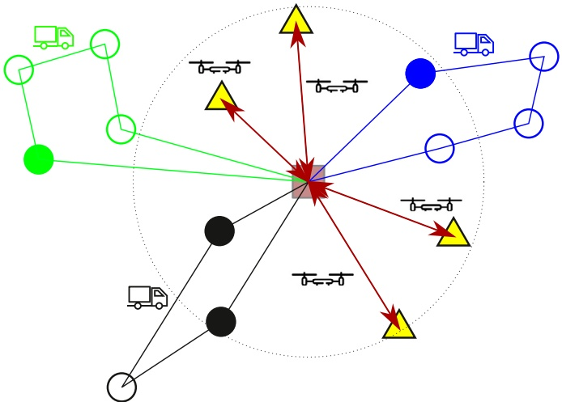

Fig. 1. An example of a PDSVRP solution.

At the depot, there is a fleet of h trucks and a flock D of m drones available for delivery tasks. The distance required for a truck to traverse from node $i \in \mathcal { N }$ to node $j \in \mathcal { N } ( j \neq i )$ is given by $d _ { i j } .$ Likewise, $d _ { i j } ^ { \prime }$ denotes the flying distance from node i to node j of a drone. Given the fact that the drones only operate backand-forth trips between the depot and a customer, let $d _ { i } ^ { \prime } = d _ { 0 i } ^ { \prime } + d _ { i 0 } ^ { \prime }$ particularly represent the total flying distance incurred by a drone to serve the customer $i \in { \mathcal { C } } _ { { \mathcal { F } } } ,$ In the same manner, $t _ { i j }$ denotes the time spent by a truck to travel on edge $( i , j ) \in { \mathcal { E } } ,$ and $t _ { i } ^ { \prime }$ is the total time incurred as a drone serves a customer $i \in \mathcal { C } _ { \mathcal { F } }$ , which can include the time for operations such as: two-way flying between the depot and the customer, loading and unloading a parcel, and swapping the battery (if any) of the drone. Let C and $C ^ { \prime }$ be the transportation costs of the truck and drone, respectively, per unit of distance. During the operation, each drone is subject to a limited flying endurance e that does not allow it to operate further without swapping or recharging the battery. A maximum capacity $Q ^ { \prime }$ is also applied to restrain each drone from carrying overweight parcels. These two constraints are basically used to define whether a customer is drone-eligible in the preprocessing step. The trucks also have to respect the capacity constraint bounded by Q. Finally, there are upper bounds T and $T ^ { \prime }$ on the maximum working time for each truck and drone, respectively. Throughout our study, we make the following assumptions:

• A drone carries only one parcel at a time and has to return to the depot after each delivery.

• Input data, for example, driving and flight times of trucks and drones, is assumed to be deterministic.

The objective of the PDSVRP is to find a set of routes for the mixed fleet of trucks and drones minimizing the total transportation cost including traveling costs incurred by all vehicles and satisfying the following constraints:

• A drone serves one customer at a time by performing back-and-forth flights within limited endurance.

• A truck carries a total load that does not exceed its capacity.

• Each vehicle (both truck and drone) is subject to a maximum working time.

## 2.2. Mathematical formulation for the PDSVRP

The formulation makes use of the following variables:

$x _ { i j } \cdot$ binary variables equal to 1 if node $j \in \mathcal { N }$ is reached from $\stackrel { \circ } { i \in \mathcal { N } } ( i \neq j )$ by the trucks, 0 otherwise;

$y _ { i } ^ { k } ;$ binary variables equal to 1 if node $i \in \mathcal { C } _ { \mathcal { F } }$ is visited - served by drone $k \in { \mathcal { D } } ,$ 0 otherwise;

$u _ { i } \in \mathbb { R } \colon$ continuous variables specifying the weight that a truck is carrying up to node $i \in \mathcal { C }$ along the truck’s path;

$z _ { i j } \in \mathbb { R } \colon$ non-negative variables representing the cumulative duration of the truck tour at node $j \in \mathcal { N }$ after passing through node $i \in \mathcal { N } ( i \neq j )$

The PDSVRP can be formulated as follows:

$$
\text {minimize} \quad C \sum_ {i \in \mathcal {V}} \sum_ {j \in \mathcal {V}} d _ {i j} x _ {i j} + C ^ {\prime} \sum_ {k \in \mathcal {D}} \sum_ {i \in \mathcal {C} _ {\mathcal {F}}} d _ {i} ^ {\prime} y _ {i} ^ {k}\tag{1}
$$

$$
\text {subject to} \quad \sum_ {i \in \mathcal {C}} x _ {0 i} \leq h \Bigg |\tag{2}
$$

$$
\sum_{\substack{i\in \mathcal{N}\\ i\neq j}}x_{ij} - \sum_{\substack{i\in \mathcal{N}\\ i\neq j}}x_{ji} = 0 \quad \forall j\in \mathcal{N}\tag{3}
$$

$$
\sum_{\substack{i\in \mathcal{N}\\ i\neq j}}x_{ij} + \sum_{k\in \mathcal{D}}y_{j}^{k} = 1\quad \forall j\in \mathcal{C}_{\mathcal{F}}\tag{4}
$$

$$
\sum_{\substack{i\in \mathcal{N}\\ i\neq j}}x_{ij} = 1\quad \forall j\in \mathcal{C}_{\mathcal{T}}\tag{5}
$$

$$
u _ {i} - u _ {j} + Q x _ {i j} \leq Q - w _ {j} \quad \forall i \in \mathcal {C}, j \in \{\mathcal {C}: j \neq i \}\tag{6}
$$

$$
\sum_ {j \in \mathbb {C} _ {\mathcal {F}}} y _ {j} ^ {k} t _ {j} ^ {\prime} \leq T ^ {\prime} \quad \forall k \in \mathcal {D}\tag{7}
$$

$$
\sum_{\substack{l\in \mathcal{N}\\ l\neq i}}z_{li} + \sum_{\substack{j\in \mathcal{N}\\ j\neq i}}t_{ij}x_{ij} = \sum_{\substack{j\in \mathcal{N}\\ j\neq i}}z_{ij}\quad \forall i\in \mathcal{C}\tag{8}
$$

$$
z _ {0 i} = t _ {0 i} x _ {0 i} \quad \forall i \in \mathcal {C}\tag{9}
$$

$$
z _ {i 0} \leq T x _ {i 0} \quad \forall i \in \mathcal {C}\tag{10}
$$

$$
x _ {i j} \in \{0, 1 \} \quad \forall i, j \in \mathcal {N}, i \neq j\tag{11}
$$

$$
y _ {i} ^ {k} \in \{0, 1 \} \quad \forall i \in \mathcal {C} _ {\mathcal {F}}, k \in \mathcal {D}\tag{12}
$$

$$
0 \leq u _ {i} \leq Q \quad \forall i \in \mathcal {C}\tag{13}
$$

$$
0 \leq z _ {i j} \leq T \quad \forall i, j \in \mathcal {N}, i \neq j\tag{14}
$$

The objective function (1) seeks to minimize the operational cost. Constraint (2) ensures the number of trucks departing from the depot is no greater than a given value. Constraints (3) are the equations of flow conservation, which ensure the continuity of a truck tour by specifying that the truck must leave a customer node after visiting for a delivery. Constraints (4) imply each mode-free customer is visited exactly once, either by a truck or by a drone. Constraints (5) guarantee the truck-only customers must be visited by the trucks. Constraints (6) impose the Miller-Tucker-Zemlin subtour elimination and capacity constraints (Kara, Laporte, & Bektas,

2004). The total operating time of each drone is restricted in constraints (7), while constraints (8)–(10), adapted from the formulation of Kara (2011), together impose and make sure that the time traveled to the depot by each truck does not exceed the predetermined value T. Finally, constraints $(11) - (14)$ specify the decision variable domains.

## 3. A slack induction by string and sweep removals for the PDSVRP

Given the complexity of the problem, using MILP solvers can only solve small-sized problem instances within an acceptable computational time. The fact that the volume of shipping parcels keeps expanding encourages us to design a method to handle large-scale instances. As a contribution of this paper, we propose a simple, yet powerful heuristic method named Slack Induction by String and Sweep Removals (SISSRs), adapted from Slack Induction by Sweep Removals (SISRs) recently introduced to efficiently solve the VRPs in Christiaens & Berghe (2020).

In what follows, we first briefly describe the basic rationale and general implementation of the SISSRs algorithm (Section 3.1), and then explain the detailed SISSRs tailored for the PDSVRP (subsections $3 . 2 { - } 3 . 4 ) .$ . Finally, we discuss modifications in the algorithm to address the min-time variant (Section 3.5).

## 3.1. The general structure of the ruin&recreate with slack induction

Our method uses the same solution strategy as the SISRs introduced in Christiaens & Berghe (2020). In brief, it applies the Slack Induction concept into the Ruin-and-Recreate method. Starting from an initial solution, the method iteratively performs the two following phases: ruin $( \mathcal { R } ^ { - } )$ phase where a part of the current solution is deconstructed by a set of ruin methods, and recreate $( \mathcal { R } ^ { + } )$ phase where the incomplete solution is fully rebuilt by a set of construction methods.

Above all, SISRs rather focuses on the $\mathcal { R } ^ { - }$ method in a new perspective. It embraces the concepts of capacity slack and spatial slack which refer to the remaining resources of a tour in terms of load and space (time, distance, etc.) that are available to accommodate new upcoming customers. While it is easy to link the capacity slack to the unoccupied space in the truck, the spatial slack can be expressed by the vehicle’s reachable area. This area appears as an elliptical region around each edge whose end points are the focus points for its corresponding ellipse. This implies that only customers inside this area can be reached and served by the truck. As visualized in Fig. $2 ( { \mathsf { a } } ) ,$ the reachable area of the tour is shaded gray, and the customers selected for removal are outlined by dashed lines. The unvisited white node cannot be inserted into the truck tour as it is outside the reachable area and the payload capacity is fully occupied. In other words, the insufficient capacity slack and spatial slack disallow the insertion of the white node into the tour. Naturally, the reachable area expands each time there are customers removed from the tour and shrinks as the tour accommodates new customers. As shown in Fig. 2(b), the slack induction obtained by the removal of the white node expands the spatial and capacity slacks of the tour. It then enables the white node to be reached by the truck.

Observations on multiple ruined states of solutions show that insufficient slack induced during $\mathcal { R } ^ { - }$ phase is the major cause for the potential failures later in $\mathcal { R } ^ { + }$ phase. Accordingly, it is important that an effective $\mathcal { R } ^ { - }$ method should introduce enough “slack”, both capacity and spatial slacks, into the solution so that the possibilities for improving the solution are greatly enhanced (Christiaens & Berghe, 2020). The general structure of SISRs guided by simulated annealing is shown in Algorithm 1.

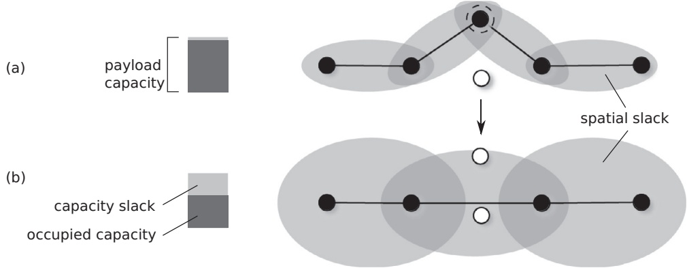

Fig. 2. An illustration of capacity slack and spatial slack in the context of truck tour.

Algorithm 1 SISRs for VRP.
Require: VRP problem instance ins
Ensure: best solution $s^{best}$
function SISRs(ins)
    $s_0 \leftarrow$ SolutionConstruction
    $s^* \leftarrow s_0, s^{best} \leftarrow s_0$
    repeat
        $s = \text{Ruin}\&amp;\text{Recreate}(s^*)$
        if $cost(s) &lt; cost(s^*) - \Delta \times \ln(U(0, 1))$ then
            $s^* \leftarrow s$
            if $cost(s^*) &lt; cost(s^{best})$ then
                $s^{best} \leftarrow s^*$
        $\Delta \leftarrow \Delta \times \epsilon$
    until Terminal condition met

We exploit the same rationale described above to develop the proposed SISSRs algorithm for the PDSVRP. Compared to the original one, the versatility of the SISSRs in this paper is pushed further to fit the context of the PDSVRP at: (i) the design of its basic building blocks of the $\mathcal { R } ^ { - }$ and $\mathcal { R } ^ { + }$ operators to consider both trucks and drones, (ii) additional improvements in terms of local search moves, and the incorporation of different acceptance criteria and perturbation mechanisms to avoid the premature convergence.

The general SISSRs algorithm, as shown in Algorithm 2, starts

Algorithm 2 SISSRs for the PDSVRP.
Require: PDSVRP problem instance ins
function SISSRs(ins)
    $s_0 \leftarrow$ SolutionConstruction
    $s^* \leftarrow s_0$, $s^{best} \leftarrow s_0$
    repeat
        $s \leftarrow$ Ruin&amp;Recreate($s^*$)
        if $cost(s) &lt; cost(s^*) \times (1 + \Delta)$ then
            $s^* \leftarrow$ LocalSearch($s$)
            if $cost(s^*) &lt; cost(s^{best})$ then
                $s^{best} \leftarrow s^*$
        if $Iter_{imp}$ iterations without improving $s^{best}$ then
            Perturbate($s^*$)
        $\Delta \leftarrow \Delta \times \epsilon$
    until Terminal condition met
    return $s^{best}$

with building the first solution $s _ { 0 }$ via the SolutionConstruction operator (line 2), then initializing the current solution $s ^ { * }$ and the best solution $s ^ { b e s t }$ (line 3). The initial solution is passed to the iterative process for improvements (lines 4–12). During each iteration, the neighbor solution s is generated from the current solution $s ^ { * }$ via Ruin&Recreate procedure (line 5). Only those neighbor solutions which satisfy the Threshold Acceptance condition (line 6) are selected into further improvement via the LocalSearch procedure (line $7 ) .$ Here, - is a coefficient initially set to a given value $\Delta _ { i n i }$ and its value is adaptively changed during the search. The resulting solution is saved as the current solution $s ^ { * }$ for the next iterations. It is saved to $s ^ { b e s t }$ if it improves the current best solution (lines 8–9). There is also a counter for the number of iterations without improving $s ^ { b e s t }$ . If the counter reaches $I t e r _ { i m p } ,$ a perturbation phase is performed on $s ^ { b e s t }$ via Perturbate $\left( \boldsymbol { S } ^ { * } \right)$ procedure (lines 10–11). Finally, the value of $\Delta$ is decreased via cooling rate  before starting the next iteration (line 12) if the stopping condition is not met. The main components of the algorithm are described in what follows.

## 3.2. Slack induction via sweep and string removals

As the PDSVRP considers both the trucks and drones, it is expected to stimulate the slack induction not only for truck tours or drone trips separately, but also for the combination of both vehicle types to enhance opportunities for promising vehicle assignment changes. We now propose two new premises to handle slack inductions adapted to the PDSVRP. These premises working alongside three proposed in Christiaens & Berghe (2020), making a total of five, serve as the basis for our $\mathcal { R } ^ { - }$ method. Based on these premises, we introduce a Sweep removal to handle slack induction for drone tours (Section 3.2.2). An extension of the adjacent string removal in Christiaens & Berghe (2020) is also presented to create slack induction for truck tours in Section 3.2.4.

## 3.2.1. The proposed premises

We now discuss several characteristics of PDSVRP solutions from which we design the proposed R− method. We characterize a PDSVRP solution s by a set of absent customers A and a set of vehicle tours $\mathcal { T } .$ Depending on the state of solution s $( \mathbf { i . e . } ,$ either partial or complete), set A and $\tau$ will vary accordingly. For example, set $\mathcal { A }$ initially contains all customers and gradually becomes empty as solution s transforms from partial to complete solution in the process to assign customers into available vehicle tours. From now on, we refer to truck nodes (and drone nodes) as the customers who are served by the trucks (and drones respectively) in a PDSVRP solution. Formally, $\mathcal { C } _ { s } ^ { t r u c k }$ and $\mathcal { C } _ { s } ^ { d r o n e }$ denote the sets of customers who are visited by the trucks and the drones, respectively.

First, a drone tour can be expressed as a set of drone-eligible nodes, indicating the set of delivery trips of the drone. As the drone performs back-and-forth trips to reload a parcel for each customer, a drone tour is only subject to a maximum endurance, which can be converted to a limited travel distance. The requirement can be represented by the drone’s reachable area given the amount of working time left. This area of a drone appears as a circular region around the depot, which is also the central point. Only drone-eligible customers $\left( c \in \mathcal { C } _ { \mathcal { F } } \right)$ that are inside this area can be reached by the drones. Illustrated as the shaded gray area in $\operatorname { F i g . } 3 ,$ the reachable area of the drone expands each time a customer is removed from a tour and shrinks as its tour accommodates new customers. From left to right, (a) given a set of trips from the depot to the gray nodes already visited by a drone, the trip to the node outlined by dashed line is chosen for removal; (b) the reachable area expands as the selected node is removed, which then enables the white node on the left to be reachable by the drone.

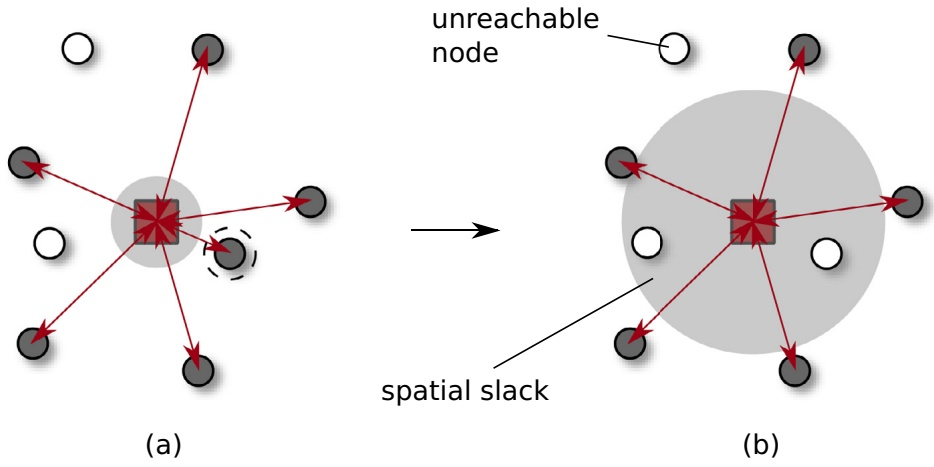

Fig. 3. An illustration of the spatial slack in the context of drone tours.

Second, the described moving pattern allows a drone to make its delivery trips to customers, independently in any order, without affecting the overall cost. In addition, the spatial distribution of visited nodes in a drone tour does not necessarily follow a distanceadjacent pattern like in the truck tour, but rather spreads out in random directions.

Exploiting the characteristics of PDSVRP solutions described above, we propose the following two new premises:

• **New premise 1** (Remove a “sufficient” number of drone customers). Removing a small number of customers may fail to introduce enough spatial slack for the drones to serve customers far from the depot. Although it could be visually clear by which vehicles the removed customers should be served, it may be impossible if the vehicles gained insufficient spatial slack.

• **New premise 2** (Sweep a cluster of drone customers). Removing drone nodes simply based on distant adjacency would fail to make contact with further nodes. Conceptually, sweeping across the plane over the node set could create significant chances for such nodes to be selected for removal. In addition, it tends to incur less extra costs to insert into truck tours a cluster of nodes, of which angular coordinates are close to each other. Therefore, one can expect to reassign nodes, which are misplaced in drone tours, into truck tours later in $\mathcal { R } ^ { + }$ phase.

On the one hand, Fig. 4 shows an example of mentioned drawbacks that the two proposed premises aim to address. In Fig. 4(a), three white nodes are selected for removal: two drone nodes and one truck node. In Fig. 4(b), the drone’s reachable area, rendered as the shaded circular area, expands after the removal of the two drone nodes. However, the additional spatial slack appears insufficient for the drone to handle the bottom left node as it stays outside the shaded area. As a result, the truck is still the only option to visit this node, which unfavorably incurs a considerable amount of cost savings.

On the other hand, Fig. 5 illustrates an example of an effective $\mathcal { R } ^ { - }$ method. A cluster of three drone nodes, which are outlined, is swept in Fig. 5(a), resulting in the ruined state of the solution in Fig. 5(b). Notice in Fig. 5(b) that the spatial slack of the drone is greatly introduced as it can now cover the entire area, including the remote customer at the bottom left. Ideally, the ruined state obtained by the $\mathcal { R } ^ { - }$ method is recreated by $\mathcal { R } ^ { + }$ in the solution illustrated in Fig. 5(c), which appears to be significantly improved.

## 3.2.2. Sweep removal

In the first removal operator, we focus on the drone customers at the beginning of the $\mathcal { R } ^ { - }$ method. The two described premises support the implementation of such an operator, named Sweep removal, which aims to induce sufficient spatial slack to drone tours via removing a set of drone customers. Its idea is straightforward: removing a cluster of drone customers that are adjacent in the polar coordinate.

Let s be a solution to be ruined. Given the set of drone customers $| \mathcal { C } _ { s } ^ { d r o n e } | > 0 ,$ the procedure works as follows (lines 2–7 in Algorithm 3). In the beginning, the number of drone nodes

Algorithm 3 Sweep removal operator.
Require: Solution $s = \{ \mathcal{T}, \mathcal{A} \}$, where $|\mathcal{C}_s^{drone}| &gt; 0$
function SWEEPREMOVAL($s$)
    $nbSwept \leftarrow U(1, \delta|\mathcal{C}_s^{drone}|)$
    $\theta_{seed} \leftarrow U(0^\circ, 360^\circ)$
    Sort($\mathcal{C}_s^{drone}, \theta_{seed}$)
    for $c \in \mathcal{C}_s^{drone}$ and $|\mathcal{A}| &lt; nbSwept$ do
        Remove $c$ from $s$
        $\mathcal{A} \leftarrow \mathcal{A} \cup \{c\}$
return Ruined solution $s$

to be removed, nbSwept, is randomly selected in the range of $( 1 , \delta \big | \mathcal { C } _ { s } ^ { d r o n e } \big | )$ where δ is a pre-defined parameter indicating the swept rate $\left( 0 < \delta < 1 \right)$ (line 2). In this removal, we assume a standard angular coordinate, in which the depot is taken as the pole and the polar axis directs to the right of the pole. A seed angle $\theta _ { s e e d } ,$ directed counter-clockwise from the polar axis, is randomly chosen from the continuous uniform distribution U(0◦, 360◦ ) (line 3). The chosen seed angle draws a directed line l from the depot. The set of drone customers $\mathcal { C } _ { s } ^ { d r o n e }$ is then sorted according to how close each node is to line l, measured by the polar angle $\varphi _ { c }$ between line l and the straight line to node c from the pole (line 4). Subsequently, the main loop (lines 5–7) iterates over the $\mathcal { C } _ { s } ^ { d r o n e }$ set, removes from the current drone tours and adds to set A the closest node, i.e., the one with the smallest $\varphi _ { c } .$ The operator sweeps through nbSwept nodes before termination. Fig. 6 illustrates an example of the sweep removal.

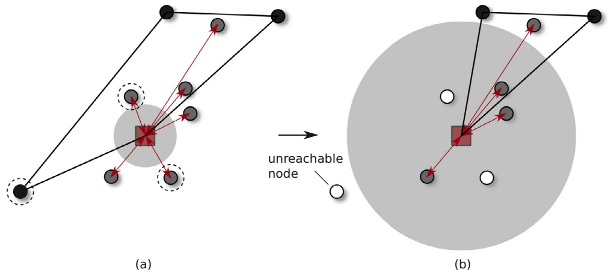

Fig. 4. An example of ruin method that introduces insufficient slack to drone tours.

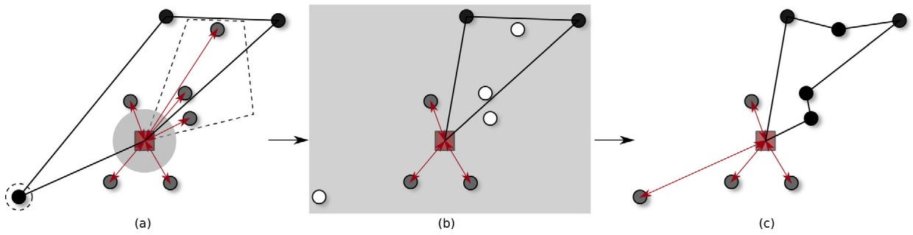

Fig. 5. An example shows the effectiveness of the sweep removal.

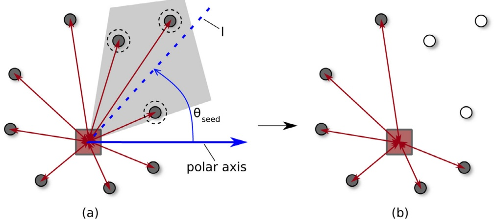

Fig. 6. An example of Sweep Removal.

## 3.2.3. Random drone-customer removal

This random removal operator simply selects q drone nodes at random and removes them from the solution. Parameter $q$ is randomly selected in the range of $( 1 , \delta \big | \mathcal { C } _ { s } ^ { d r o n e } \big | )$ where δ equals  the pre-defined swept rate used in the described sweep removal. The objective of this removal is to provide diversification to the search algorithm via diverging the structure of drone tours. As a part of the early attempt of $\mathcal { R } ^ { - }$ method, either random removal or sweep removal is randomly picked and applied to introduce slack to drone tours.

## 3.2.4. Adjacent string removal for the PDSVRP

The next progress of $\mathcal { R } ^ { - }$ method involves introducing slack to the truck tours via the Adjacent string removal for the PDSVRP, which is an extension to the original one proposed in Christiaens & Berghe (2020) for the CVRP. The extension lies in the fact that it considers removing both truck and drone nodes close to a seed node. This enables additional slack induction to drone tours and opens up opportunities for rearranging customer assignments within the area near the seed node. Algorithm 4 describes the procedural steps of the proposed removal operator.

Let s be the solution to be ruined. The numbers of removed customers and removed strings are controlled by two pre-determined parameters: the average number of removed customers $\bar { c }$ and the maximum length of each removed string $L _ { \mathrm { m a x } }$ . The procedure begins with the calculation of the number $k _ { S }$ of strings to be removed out of solution s, which is derived from equations in Christiaens & Berghe (2020). To ensure that the capacity slack and spatial slack are spread across multiple tours, it is assumed that each tour can only be ruined at most once, and removing $k _ { S }$ strings actually implies ruining $k _ { S }$ tours. Next, a random seed customer $c _ { s } ^ { s e e d }$ is selected, from which the string removal operator is initiated (line 3). The set of ruined truck tours R is initially empty (line $4 ) .$ The adjacent list containing all customers ordered by increasing distance from $c _ { s } ^ { s e e d }$ , called $a d j ( c _ { s } ^ { s e e d } )$ , is iterated until set R contains $k _ { S }$ ruined tours, implying $k _ { s }$ strings have been removed (lines $5 { - } 1 2 ) ,$ In each iteration, for each customer $c \in a d j ( c _ { s } ^ { s e e d } )$ in the PDSVRP, two cases are considered:

Algorithm 4 Adjacent string removal operator for the PDSVRP.
Require: Solution $s = \{ \mathcal{T}, \mathcal{A} \}$
function STRINGREMOVAL($s$)
    Determine the number of strings to be removed $k_s$
    $c_s^{seed} \leftarrow$ select a random customer $s$
    $R \leftarrow \emptyset$
    for $c \in adj(c_s^{seed})$ and $|R| &lt; k_s$ do
        if $c \in \mathcal{C}_s^{truck}$ and $c \notin \mathcal{A}$ and $\tau_c \notin R$ then ▷ remove strings of truck nodes close to the seed customer
            Determine the length of string $l$ to be removed in tour $\tau_c$
            $\mathcal{A} \leftarrow \mathcal{A} \cup RemovedString(\tau_c, l, c)$
            $R \leftarrow \{\tau_c\}$
    else if $c \in \mathcal{C}_s^{drone}$ and $c \notin \mathcal{A}$ then ▷ remove any drone nodes close to the seed customer
        Remove $c$ from $s$
        $\mathcal{A} \leftarrow \mathcal{A} \cup \{c\}$
return Ruined solution $s$

1. Customer c belongs to set of the truck customers $\mathcal { C } _ { s } ^ { t r u c k }$ (c ∈ $\mathcal { C } _ { s } ^ { t r u c k } ) ,$ indicating c is served by the trucks. If c has not been removed $( c \not \in A )$ and its corresponding truck tour $\tau _ { C }$ has not been ruined $( \tau _ { c } \not \in R )$ , a string of length l is removed from the tour $\tau _ { C }$ (lines $6 { - } 9 )$ . The string is removed via the “string” or “split string” procedure based on c and l. In either case, l customers are selected and removed from $\tau _ { C }$ before adding them to set A (line 8), and the tour $\tau _ { C }$ is marked as ruined and being added to set R (line 9).

2. Customer c belongs to a set of the drone customers $\mathcal { C } _ { s } ^ { d r o n e }$ (c ∈ $\mathcal { C } _ { s } ^ { d r o n e } ) ,$ indicating c is served by the drones. If c has not been removed $( c \not \in A )$ , it is removed from the solution s (lines 10–12). The global objective here is to create possibilities for customer exchanges between trucks and drones within the area around customer $c _ { s } ^ { s e e d }$

## 3.3. Recreate method - greedy insertion with blinks for the PDSVRP

In $\mathcal { R } ^ { + }$ phase, a recreate method rebuilds a ruined solution s by inserting consecutively ejected customers in set $\mathcal { A }$ into s until all customers are served. In the context of PDSVRP, each insertion requires the $\mathcal { R } ^ { + }$ method to examine all possible positions in both truck and drone tours for the cheapest option. Before going further, it is important to clarify the definition of “position” in truck and drone tours. As mentioned above, a drone can make its delivery trips to customers independently in any order without affecting the overall cost. Therefore, “position” in the context of truck literally refers to a position in a tour, whereas in the context of drone “position” it simply encapsulates to which drone the customer is assigned without considering the relative position within the tour. The proposed $\mathcal { R } ^ { + }$ for the PDSVRP works as follows (see Algorithm 5).

Algorithm 5 SISSR's Recreate Method.
Require: Ruined-solution $s = \{ \mathcal{T}, \mathcal{A} \}$
function RECREATE($s$)
    SORT($\mathcal{A}$)
    for $c \in \mathcal{A}$ do
        $pos^{best} \leftarrow \text{null}$
        for each feasible position $p_{\tau}$ in truck tour $\tau \in \mathcal{T}$ do
            if $cost(p_{\tau}) &lt; cost(pos^{best})$ and $U(0,1) &gt; 1 - \gamma$ and $pos^{best} \neq \text{null}$ then
                $pos^{best} \leftarrow p_{\tau}$
        if $c$ is drone-eligible and FITDRONE($s, c$) then
            if $cost'(c) &lt; cost(pos^{best})$ and $U(0,1) &gt; 1 - \gamma$ and $pos^{best} \neq \text{null}$ then
                $pos^{best} \leftarrow$ the drone with the largest spatial slack
        if $pos^{best} = \text{null}$ then
            $\mathcal{T} \leftarrow \mathcal{T} \cup \{\text{new tour } \tau\}$
            $pos^{best} \leftarrow$ position in $\tau$
        Insert $c$ to its best position at $pos^{best}$
        $\mathcal{A} \leftarrow \mathcal{A} \setminus \{c\}$
return Recreated-solution $s$

Given the solution $\mathcal { s } = \{ \mathcal { T } , \mathcal { A } \}$ , in line $^ { 2 , }$ the process first starts by sorting set A according to one of the criteria presented in Table 2. A weighted random selection is called to decide by which criterion set A would be sorted. The weights are initially set to $\{ w _ { 1 } , w _ { 2 } , w _ { 3 } , w _ { 4 } , w _ { 5 } \}$ for each sorting criterion. Then, following the sorted set, each customer $c \in \mathcal { A }$ is inserted into solution s at the best position, called $p o s ^ { b e s t }$ (lines 3–15). The value of $p o s ^ { b e s t }$ is initially set to null, indicating no positions in trucks and drones for c are selected (line 4).

Two insertion possibilities are considered for each customer c, to truck tours or to drone tours:

1. (**To truck tours**). All feasible positions $p o s _ { i }$ for the insertion into truck tours $\tau \in \mathcal { T }$ are iterated over (lines 5–7). There is a probability $\gamma$ representing the blink rate. Each position is evaluated with a probability of $1 - \gamma$ , otherwise position posτ is skipped as if the algorithm blinks (line 6). If a position posτ is found for which the cost of inserting c is cheaper than the current best position $p o s ^ { b e s t }$ , the position posτ becomes the new best position (lines 7).

2. (**To drone tours**). Positioning customer c into drone tours is then considered if c is a drone-eligible customer and there is sufficient time slack among the drones to serve c, tested by function FitDrone(s, c) (line 8). Again, if the algorithm does not blink $( U ( 0 , 1 ) \leq 1 - \gamma )$ and the cost to serve c by the drones is cheaper than the current best cost, it is the best option if c is served by the drones. Position $p o s ^ { b e s t }$ is updated to the drone with the largest spatial slack (lines 9–10).

Note that during each customer insertion, we must take into account the constraints related to the truck’s capacity and the working time of both vehicles. The feasibility of an insertion can be easily determined in constant time by simply comparing the extra weight and the additional travel time caused by the insertion with the remaining truck’s capacity and the vehicle’s slack times, respectively.

The blink concept from Christiaens & Berghe (2020) is applied with the aim to add randomization to the search. However, it should be noted that the algorithm only blinks if $p o s ^ { b e s t } \neq$ null to avoid it from running into extreme cases where it is unable to insert c into solution s as all feasible positions are blinked. In the case that no positions are found in existing tours, a new empty truck tour is created to serve c (lines 11–13). Finally, c is inserted into the best position and removed from A (lines 14–15).

Table 2

Five sorting criteria.

| Criteria | Description | Weight |
| --- | --- | --- |
| random | Sorting customers in an arbitrary order | w1 |
| near-dp | Sorting customers according to the rule "closest to the depot first" | w2 |
| far-dp | Sorting customers according to the rule "farthest to the depot first" | w3 |
| near-tr | Sorting customers according to the rule "closest to the nearest truck tour first" | w4 |
| far-tr | Sorting customers according to the rule "farthest to the nearest truck tour first" | w5 |

## 3.4. Other components

## 3.4.1. Initial solution

The procedure of constructing the initial solution $s _ { 0 }$ makes use of the R+ procedure followed by local search. We consider set A of absent customers to initially contain all customers, indicating no customers have been served by any tours. Following Algorithm 5, the operator repeatedly assigns each customer into tours at its best possible position until all customers are served. Local search procedure is then called to improve the overall quality the solution. The resulting solution is then used as the input to feed the main loop of the improvement stage of Algorithm 2 (lines 3–11).

## 3.4.2. Local search

A PDSVRP solution is separately comprised of a set of drone tours and truck tours. The drone’s back-and-forth moving scheme and the min-cost objective function make intra-route and interroute neighborhoods among the drone tours irrelevant to obtain any cost reductions. On the other hand, the truck tours can be explicitly improved via existing VRP local search operators. Therefore, we apply four well-known neighborhoods, namely Relocate, Swap, 2-opt and 2-opt∗, as algorithmic components to improve the quality of truck tours.

In addition, the early flaws in customer-vehicle assignments can further be improved via exchanging nodes between a truck tour and a drone tour. To explore better vehicle assignments, we use four new inter-route neighborhood structures, namely Swap’, Swap∗, Shift-t, and Shift-d:

• Swap’. The operator seeks possible cost reductions by swapping the current positions of a pair of one drone customer and one truck customer who must be drone-eligible.

• Swap∗. The neighborhood consists in taking two customers: one truck customer $\nu _ { T }$ and one drone customer $\nu _ { D }$ from truck route $r _ { T }$ and drone tour $r _ { D } ,$ respectively. $\nu _ { T }$ is then assigned to $r _ { D }$ while $\nu _ { D }$ is inserted to a position of $r _ { T }$ that incurs the cheapest cost.

• Shift-t. The neighborhood of the operator contains all solutions, in which one truck customer is removed from its truck tour and reinserted into a drone tour.

• Shift-d. In contrary to Shift-t, the neighborhood contains all solutions, in which one drone customer is removed from its tour and reinserted into a truck tour.

To efficiently search and reduce the computation time, the pruning technique in Toth & Vigo (2003) and Mester & Bräysy (2007) is adopted. Rather than trying to iteratively evaluate every move, only moves involving a fixed number of nearest neighbors $n _ { n e a r e s t }$ for each node are considered.

Each iteration of the local search evaluates every feasible move which satisfies the problem constraints. We adopt the firstimprovement fashion, i.e., immediately perform the first detected moves that lead to better solutions. The process starts again from that improved solution and repeats until the solution can no longer be improved.

## 3.4.3. Perturbation mechanisms

We also apply a perturbation procedure in the SISSRs to overcome the problem of premature convergence in local optima. The function Perturbation (line 11, Algorithm 2) is triggered after a certain number of iterations $I t e r _ { i m p }$ without any improvements. When the function Perturbation is called, the number of random swaps p is randomly selected in range $[ p _ { \mathrm { m i n } } , p _ { \mathrm { m a x } } ] .$ Then an iterative process is started by randomly picking a pair of distinct customer nodes (i, j) to perform swapping. There are three swapping possibilities:

• Truck-truck swap move: i and j are both truck nodes;

• Truck-drone swap move: i is truck node and j is drone node;

• Drone-drone swap move: i and j are both drone nodes.

We note that only feasible swap moves, which respect the capacity and route duration constraints, are allowed. The process is repeated until p swaps are executed or no feasible swap is found after a certain number of attempts.

## 3.5. SISSRs adaptation for the min-time PDSVRP

As the min-time PDSVRP variant seeks to minimize the makespan (i.e., the maximum completion time), three considerable modifications in the algorithm are required to adapt the method to the problem at hand. The first modification involves the way to compute the objective value. Considering the insertion of customer c into solution s during $\mathcal { R } ^ { + }$ procedure, the best position $p o s ^ { b e s t }$ is determined by:

$$
\text {pos} ^ {\text {best}} = \operatorname{argmin} \left(t _ {\tau} ^ {\prime} - t _ {s}\right)\tag{15}
$$

where $t _ { \tau } ^ { \prime }$ is the completion time of a tour τ (both trucks and drones) after accommodating customer c, and $t _ { s }$ is the current makespan of s before the insertion of c.

The second modification revolves around the local search operators. Unlike the min-cost variant in which the focus is on reducing the overall cost, the min-time variant pays attention on reducing the cost of the longer tours (i.e., higher completion time). Taking this characteristic into account, all local search inter-route operators described in Section 3.4.2 are slightly modified in the way they evaluate a move. In particular, suppose $t   =     \operatorname* { m a x } ( t _ { i } , t _ { j } )$ is the completion time of the longer tour, either tour i or j. A feasible move is considered improving if it leads to the neighbor in which completion time of resultant tours $t _ { i } ^ { \prime }$ and $t _ { j } ^ { \prime }$ satisfy: $( t _ { i } ^ { \prime } \leq t \wedge t _ { j } ^ { \prime } \prec$ $t ) \vee ( t _ { i } ^ { \prime } < t \wedge t _ { j } ^ { \prime } \leq t )$ . In other words, the resultant tours must have a shorter completion time compared to the current completion time of the longer one.

Finally, the third modification focuses on the acceptance criteria to accept a solution. As in the min-cost variant, the acceptance criteria tailored for the min-time variant apply Threshold Acceptance (TA) which allows “acceptable” up-hill neighborhoods. However, instead of taking the makespan as the only evaluation, the general quality of a solution, which is measured by the total of completion time of all current tours, is also considered. The idea is to consolidate the qualities of other tours besides the longest one, which might be beneficial later in the long term to lead to promising neighbors. Therefore, we add the following acceptance criterion: a solution s is accepted if its total completion time is less than that of the incumbent solution $s ^ { * } ~ ( \Gamma _ { s } < \Gamma _ { s ^ { * } } )$ . Note that this criterion only applies to solution s with makespan equal to $s ^ { * }$ $( t _ { s } = t _ { s ^ { * } } ) .$ This modification eventually results in a slight change in Algorithm 2, specifically, in lines 5–7 as follows:

Table 3

Parameter setting of SISSRs.

| Notation | Description | Value |
| --- | --- | --- |
| c | The average number of removed customers | 0.15n |
| Lmax | The maximum cardinality of the removed strings | 0.15n |
| α | The split rate | 0.5 |
| β | The split depth | 0.95 |
| δ | The swept rate | 0.3 |
| w1,w2,w3,w4,w5 | Distributed weight for biased selecting random, near-dp, far-dp, near-tr, and far-tr, respectively | {5,1,1,2,2} |
| γ | The blink rate | 0.1 |
| -ini | The initial threshold of deterioration | 0.1 |
|  | The cooling rate | 0.999975 |
| Iterimp | The number of iterations without improvement to perform perturbation | 10k |
| Itermax | The total number of iterations | 100k |
| pmin | The minimum number of swaps performed during perturbation | 3 |
| pmax | The maximum number of swaps performed during perturbation | 0.1n |
| nnearest | The size of restricted neighborhoods of each node considered in local search operators | 20 |

Note: n is the number of customers.

Algorithm 6 SISSRs: min-time adaptation.
function SISSRS-MINTIME(ins)
    ...
    if $t_s &lt; t_{s^*} \times (1 + \Delta)$ or
        $t_s = t_{s^*}$ and $\Gamma_s &lt; \Gamma_{s^*}$ then $\triangleright$ additional acceptance rule
            $s^* \leftarrow \text{LocalSearch}(s)$
            if $t_{s^*} &lt; t_{s^{best}}$ or
                $t_{s^*} = t_{s^{best}}$ and $\Gamma_{s^*} &lt; \Gamma_{s^{best}}$ then $\triangleright$ additional acceptance rule
                    $s^{best} \leftarrow s^*$
    ...

## 4. Experimental results

The goals of our computational experiments are as follows. The first experiment investigates the impact of key algorithmic components on the performance. The second experiment aims to validate the MILP formulation and to evaluate the ability of SISSRs to reach optimality over small instances. In the third experiment, we examine the capability of SISSRs in handling large-scale benchmark instances. The obtained results would be used as a reference to assess the performance of future approaches proposed to solve the PDSVRP. The fourth experiment attempts to compare the adapted SISSRs in solving the min-time PDSTSP with the state-of-the-art algorithms. Finally, we carry out a sensitivity study to analyze the effects of different problem parameters.

The parameters of our metaheuristic are chosen empirically. We have tested various parameter combinations, and the one shown in Table 3 gives the best performance in terms of both solution quality and computational time for our algorithm.

Our algorithms are implemented in C++ compiled with GCC 9.3.0. We use CPLEX 12.10 to solve the MILPs. All tests are run on a desktop operating Xubuntu 20.04, with AMD Ryzen 3700X @4.0GHz CPU, 16GB RAM. The detailed benchmark instances and results of our experiments can be found at [http://orlab.com.vn/home/download.](http://orlab.com.vn/home/download)

## 4.1. Instance set

Given no access to real-life instances and the fact that there are no benchmark instances that consider the similar model and objective function, randomly generated instances are chosen to test the proposed methods. Thus, based on various statistical data shared by logistics service providers and other reliable information sources, we will develop our own instance generator for this study. The objective is to capture as many operational scenarios as possible, which could occur in practice. Basically, we use data found in the literature or provided by companies who have introduced prototype models to set the values for the parameters of the instance generator.

First, the problem size represented by the number of customers n is successively picked from the set {30, 50} for small size, {100, 200} for medium size, and {400} for large size. The nodes representing the customers are randomly generated in a square of d × d dimension. The value of grid size d is an important factor since it determines the size of the drone-eligible customer set, hence affecting potential vehicle assignment decisions. If the grid size is too large, the customers tend to distribute far from the depot and the problem is closer to the VRP. On the other hand, if d is too small, more customers will be served by the drones as they are in general much cheaper. As a consequence, the problem can be closer to the PMS. Given the presumed battery capacity of the drones, we vary the value of d between 20 and 25 km for benchmarking purposes. Three different settings for the depot position are considered: (i) Central (c) - in the center of the grid at point ( d, d); (ii) Edge (e) - on the edges of the grid at points $\textstyle ( { \frac { d } { 2 } } , 0 ) ,   ( { \frac { d } { 2 } } , d ) ,   ( 0 ,   { \frac { d } { 2 } } )$ , and (d, d2 ); (iii) Random (r) - at a random point in the grid. Also, as proposed in Solomon (1987) and Uchoa et al. (2017) for the VRP instances, customers are distributed in the grid following three fashions: Random (r), Clustered (c), or Random-Clusterd (rc).

From the data collected by e-commerce firms and logistics providers, the customer demands are created. Amazon stated that 86% of its deliveries are associated with items under 2.27 kg (Allain, 2013). Moreover, UPS disclosed that the maximum load for a package transported in the truck is 68 kg (UPS, 2020). Following the above limits, the customer demands are randomly generated according to a uniform distribution. Let p be a random number associated with customer i in the instance $( 0 < p < 1 )$ . Then the demand (in kilograms) of customer i is given by Eq. (16).

$$
w _ {i} = \left\{ \begin{array}{l l} q \in U (0, 2. 2 7) & \text {if p <  .86} \\ q \in U (2. 2 7, 6 8) & \text {otherwise} \end{array} \right.\tag{16}
$$

Based on drone specifications gathered from DHL’s and Amazon’s website, we assume a drone can carry up to 2.27 kg and travel with an average speed of 40 km/h (Allain, 2013; DHL, 2016; Scott & Scott, 2019). In line with the same information source, we also assume that the drones can travel a maximum distance of 24 km. Thus, they can serve customers of at most 12 km from the distribution center. This assumption limits the battery endurance of the drones to a value equivalent to 0.6 h of flying.

Table 4

The problem-parameter setting for the PDSVRP instance generator.

| Parameter | Notation | Value | Reference |
| --- | --- | --- | --- |
| Truck speed | v | 30km/h | Sanchez-Diaz et al. (2020) |
| Drone speed | v | 40km/h | Allain (2013); DHL (2016); Scott &amp; Scott (2019) |
| Endurance | e | 0.6 h | See text |
| Truck payload capacity | Q | 1300kg | - |
| Drone payload capacity | Q | 2.27kg | Allain (2013); DHL (2016); Scott &amp; Scott (2019) |
| Truck cost per km | C | $0.03/km | Kim (2016); Lauryn (2019) |
| Drone cost per km | C | $1.25/km | Kim (2016); Lauryn (2019) |
| Maximum route duration | T,T | up to 3 h | - |
| Grid size | d | up to 25km | - |
| Number of customers | n | {30, 50, 100, 200, 400} | - |
| Depot location | g | {c, e, r} | - |
| Customer location | g | {r, c, rc} | - |

Next, we assume the truck fleet is a set of standard homogeneous delivery vans with a capacity limit of 1300 kg. According to the survey of Sanchez-Diaz, Palacios-Argüello, Levandi, Mardberg, & Basso (2020) on medium-duty trucks delivering in urban areas, the average speed of a vehicle during a day was between 24 and 34 km/h. Hence, we assume that the trucks operate with a constant average speed of 30 km/h. It is also assumed that there are always enough trucks available at the depot. Manhattan distances are used for the truck and Euclidean distances for the drones. For simplicity, we suppose that the time spent on loading, unloading a parcel, and swapping the battery of the drone is negligible compared to the flying time, and thus can be removed from the service time of a customer.

The maximum route duration of each vehicle type (T and T) is scaled such that the solution requires a relatively large number of vehicle routes. In general, T and $T ^ { \prime }$ are set to the same value varying from 1.5 h to 3 h. However, some instances may contain customers that are too far from the depot that no vehicle can service, possibly leading to infeasible instances. To ensure every customer is servable in such cases, the maximum truck route duration T is set to $2 \times t _ { 0 i ^ { * } }$ , where i∗ is the farthest customer. Likewise, the number of drones in instances is selected so that it is neither too large nor too small, balancing the number of customers served by the drones and the trucks in the solution. Hence, we set the number of drones to 4 for the small instances, and to 5 for the medium and large instances. These might create more complex vehicle-assignment decisions, possibly leading to more challenging instances.

Followed by the research of Deutsche Bank (Kim, 2016; Lauryn, 2019), we would set one kilometer of drone delivery cost at \$0.03 while normal trucking price would be \$1.25 for the same mileage. Several cost unit settings will be considered for system analysis later in Section 4.4.

For a given grid setting with the number of customers (n) and the fixed type of customer distribution (cd), three different grids with known customer location are generated. For each obtained grid, the depot is then added following three settings “c”, $\text{" }\mathbf{e} \text{" },$ and $\mathbf { \dot { r } } ^ { \star }$ as mentioned above. As such, for a given number of customers, the total number of generated instances is $3 \times 3 \times 3 = 2 7 .$ The instances are named as n-cd-id-dp, where id is the instance number from 0 to 2 and $d p$ is the depot position. For example, 30-r-0-c represents the first instance of the class of grid with 30 customers whose locations are randomly distributed and the depot being positioned in the center. Finally, Table 4 summarizes the problem parameters and their values.

## 4.2. Solution approach evaluation on the min-cost PDSVRP

We evaluate the proposed methods on the aforementioned generated instances. For each instance, the running time of solving

MILP by CPLEX is limited to one hour, while the metaheuristic is repeatedly run 30 times.

## 4.2.1. The impact of key SISSRs components

This part reports the sensitivity analysis on the impact of the key components of the proposed SISSRs: Local Search (LS), Threshold Acceptance (TA), Perturbation (Pert), Sweep Removal (Sweep), and Random Removal (Rand). In particular, the full-featured algorithm (i.e., **Full** configuration) and following configurations obtained by removing one chosen operator are investigated:

• **No LS** - local search operators are disabled • **No TA** - only better solutions are accepted (i.e., hill climbing moves are not allowed)

• **No Pert** - no perturbation is performed

• **No Sweep** - only random drone removals are performed during ruin stage

• **No Rand** - only sweep drone removals are performed during ruin stage

Preliminary results suggest a ceiling effect upon the small instances, in which the benchmarks are too easy so that no noticeable differences are found among all configurations of the algorithm. For a reasonable computational effort, we decide to select the collection of 54 medium instances with 100 customers and 200 customers for this experiment. Several aggregated indicators for dispersion and central tendency are reported in Table 5: the gap of best solutions (Column $g a p _ { b e s t } ) ;$ the quantiles of gaps including Q1 quantile, Q2 quantile (median), and Q3 quantile (Columns $\bar { g a p ^ { Q 1 } } ,   \bar { g a p ^ { Q 2 } }$ , and $g a p ^ { 0 3 }$ , respectively); the average gap (gap), the number of best solutions found b<u>y th</u>e configuration (# bks), and the average run time in seconds (time). Note that, to calculate the gap tolerance value, the best solution s∗ for each instance across all configurations is recorded as the reference.

The obtained results suggest that the **Full** configuration yields the best performance in terms of solution quality (shown in $g a p _ { b e s t }$ and # bks columns) and consistency (shown in gap and quantilerelated gap columns). This shows the significant contribution of all the key components to the quality of the method in overall. However, some components have much larger impact than others. This pattern appears especially clearer on 200-customer instances. The local search component has the most positive impact on the performance of the proposed method, followed by the threshold acceptance. The remaining components have the relatively similar impact.

## 4.2.2. Experiments on small instances

The objective of this part is to validate the MILP model and compare the performance of the proposed methods for the mincost PDSVRP. Because CPLEX cannot solve the medium and large instances in reasonable running time, we select a collection of 54 small instances with 30 and 50 customers for the experiment. The initial solutions, which are obtained from the first recreate phase of the SISSRs, are also taken into account to assess the ability of SISSRs compared with simple constructive heuristics.

Table 5

Sensitivity analysis on the components of SISSRs.

| Instance set 100-customer | Config no LS | gapbest(%)0.088 | gapQ1(%)1.321 | gapQ2(%)2.964 | gapQ3(%)4.505 | gap(%)3.030 | # bks20 | time (s)8.017 |
| --- | --- | --- | --- | --- | --- | --- | --- | --- |
|  | no TA no Pert no Sweep no Rand Full | 0.0260.0290.0250.0250.025 | 0.4920.1920.1910.1910.191 | 0.8130.2730.1930.1940.193 | 0.8450.4990.4380.4910.275 | 0.6170.3440.2810.2790.268 | 2424262526 | 41.83740.82840.71140.42447.730 |
| 200-customer | no LS no TA no Pert no Sweep no Rand Full | 1.1860.2780.2650.3730.2840.059 | 3.1220.9150.5670.5540.8050.541 | 4.3221.4950.9430.9680.8660.916 | 5.4232.0751.5001.0841.1761.085 | 4.4651.5571.0170.9350.9620.919 | 41518171719 | 30.311120.096118.333100.419105.721100.184 |

Table 6

Performance of the proposed methods on small instances with 30 customers.

| Instance | MILP |  |  | Init |  | SISSRs |  |  |  | # | # | # |
| --- | --- | --- | --- | --- | --- | --- | --- | --- | --- | --- | --- | --- |
|  | z | gap | time | zinit | gapinit | zbest | gapbest | gap | time | DE | D | trucks |
| 30-r-0-c | 128.67 | 0.00 | 169.06 | 217.00 | 68.65 | 128.67 | 0.00 | 0.00 | 7.19 | 23 | 13 | 3 |
| 30-r-0-e | 300.85 | 49.59 | 1817.10+ | 350.05 | 16.35 | 300.85 | 0.00 | 0.00 | 6.89 | 14 | 5 | 5 |
| 30-r-0-r | 199.76 | 32.55 | 1536.89+ | 268.07 | 34.19 | 199.76 | 0.00 | 0.00 | 6.33 | 14 | 8 | 4 |
| 30-r-1-c | 58.30 | 0.00 | 2.79 | 134.68 | 131.04 | 58.30 | 0.00 | 0.00 | 8.24 | 26 | 16 | 1 |
| 30-r-1-e | 243.11 | 38.71 | 651.71+ | 314.41 | 29.33 | 243.11 | 0.00 | 0.00 | 7.73 | 16 | 8 | 4 |
| 30-r-1-r | 164.75 | 22.79 | 2310.15+ | 206.85 | 25.55 | 164.75 | 0.00 | 0.00 | 7.20 | 21 | 11 | 3 |
| 30-r-2-c | 91.57 | 0.00 | 41.60 | 168.09 | 83.56 | 91.57 | 0.00 | 0.00 | 9.04 | 29 | 15 | 2 |
| 30-r-2-e | 235.25 | 41.34 | 956.03+ | 306.05 | 30.09 | 235.25 | 0.00 | 0.00 | 6.60 | 17 | 9 | 4 |
| 30-r-2-r | 211.26 | 41.46 | 789.46+ | 263.32 | 24.65 | 211.26 | 0.00 | 0.00 | 7.06 | 17 | 9 | 4 |
| 30-c-0-c | 82.15 | 0.00 | 38.87 | 112.27 | 36.67 | 82.15 | 0.00 | 1.17 | 9.22 | 24 | 11 | 2 |
| 30-c-0-e | 150.44 | 0.00 | 41.87 | 189.12 | 25.71 | 150.44 | 0.00 | 0.00 | 8.61 | 11 | 3 | 3 |
| 30-c-0-r | 112.72 | 0.00 | 326.63 | 135.67 | 20.36 | 112.72 | 0.00 | 0.00 | 8.22 | 21 | 5 | 3 |
| 30-c-1-c | 39.98 | 0.00 | 4.07 | 79.56 | 98.99 | 39.98 | 0.00 | 0.00 | 9.09 | 26 | 16 | 1 |
| 30-c-1-e | 172.49 | 40.75 | 3600.00 | 184.49 | 6.96 | 172.49 | 0.00 | 0.00 | 8.13 | 20 | 7 | 3 |
| 30-c-1-r | 61.28 | 0.00 | 1.11 | 117.53 | 91.78 | 61.28 | 0.00 | 0.00 | 6.61 | 24 | 13 | 1 |
| 30-c-2-c | 77.00 | 0.00 | 6.17 | 107.44 | 39.53 | 77.00 | 0.00 | 0.00 | 9.23 | 26 | 18 | 2 |
| 30-c-2-e | 166.82 | 14.95 | 3600.00 | 177.35 | 6.31 | 166.82 | 0.00 | 0.00 | 7.10 | 19 | 3 | 3 |
| 30-c-2-r | 88.81 | 0.00 | 31.42 | 128.55 | 44.74 | 88.81 | 0.00 | 0.00 | 8.54 | 25 | 10 | 2 |
| 30-rc-0-c | 81.06 | 0.00 | 15.81 | 119.70 | 47.67 | 81.06 | 0.00 | 0.00 | 8.43 | 26 | 14 | 2 |
| 30-rc-0-e | 181.89 | 20.77 | 3600.00 | 231.10 | 27.05 | 181.89 | 0.00 | 0.00 | 7.35 | 14 | 6 | 3 |
| 30-rc-0-r | 146.73 | 21.13 | 2491.38+ | 182.11 | 24.11 | 146.73 | 0.00 | 0.00 | 8.22 | 22 | 5 | 3 |
| 30-rc-1-c | 56.48 | 0.00 | 7.51 | 125.07 | 121.43 | 56.48 | 0.00 | 5.62 | 7.16 | 27 | 16 | 1 |
| 30-rc-1-e | 176.57 | 14.24 | 1280.95+ | 234.68 | 32.91 | 176.57 | 0.00 | 0.00 | 7.35 | 16 | 2 | 3 |
| 30-rc-1-r | 97.91 | 0.00 | 83.60 | 150.12 | 53.32 | 97.91 | 0.00 | 0.00 | 9.17 | 26 | 17 | 2 |
| 30-rc-2-c | 77.00 | 0.00 | 4.01 | 137.39 | 78.43 | 77.00 | 0.00 | 0.00 | 8.49 | 25 | 14 | 2 |
| 30-rc-2-e | 187.18 | 26.17 | 3600.00 | 230.92 | 23.37 | 187.18 | 0.00 | 0.00 | 6.63 | 16 | 2 | 3 |
| 30-rc-2-r | 94.21 | 0.00 | 3.70 | 134.04 | 42.28 | 94.21 | 0.00 | 0.00 | 5.93 | 17 | 14 | 2 |

Tables 6 and 7 report the obtained results for this experiment. They provide information regarding the MILP performance: the objective value of the best solutions found (Column “z”), the gap returned by CPLEX (Column “gap”), and the execution time in seconds (Column “time”). Additionally, the quality of initial solutions is reported in Columns $" \overline{Z_{init}}  \text{" }$ (the average objective value) and $" \overline{g} \overline{a p_{init}}  \text{" }$ (the average gap in percentage to the best found solution). Likewise, the performance of the SISSRs is accessed via: the objective values of the best found solutions (Column $\text{" }z_{best} \text{" }).$ , the gap of the best solutions found over 30 runs $( \mathrm { C o l u m n ~ g a p } _ { b e s t } )$ the average gap over 30 runs (Col<u>umn</u> “gap”), the average competation time in seconds (Column $\text{" } \overline{time}  \text{" }  ) ,$ . It should be noted that the gap value of heuristic solutions in this experiment is calculated as: $\begin{array} { r } { g a p = 1 0 0 ( \frac { z ^ { \prime } } { z ^ { * } } - 1 ) } \end{array}$ , where $z ^ { \prime }$ and $Z ^ { * }$ are the objective values of solutions found by heuristic methods and the best solutions found by all methods (including heuristics and MILP formulation), respectively. Finally, we also provide information to expose the characteristics of the best solutions found by all methods: the number of drone-eligible customers (Column # DE) in the instance, the number of customers served by the drones (Column # D), and the number of trucks being used (Column # trucks).

The results somewhat reveal the impact of different problem parameters on the hardness of an instance. Obviously, when the number of customers increases, the larger MILP model makes the problem harder to solve to optimality. From Table 6, we observe that CPLEX is able to find the optimal solutions for 15 over 27 instances with 30 customers in less than 3 min. As the number of customers increases to 50, Table 7 shows that CPLEX averagely takes much more time and closes the gaps for only 5 instances. In the unsuccessful cases, CPLEX is forced to terminate due to outof-memory status on 12 instances (marked as “+” in Column time) and cannot provide any feasible solution on 7 instances (marked $\mathrm { { \bf \sf { a } } { \bf \sf { S } } ^ { { \tiny ~ { a } ~ } } { \bf \sf { - } } ^ { { \tiny ~ { n } ~ } } ) } .$

In addition, the distribution of customers appears to impact the hardness of the problem as well. The significant gap differences among three distribution groups $( \mathrm { { } ^ { a } r , ~ { } ^ { a } r c , ~ { } ^ { a } c ) }$ support this observation. In particular, a number of hard instances, on which CPLEX cannot reach to optimality, tend to concentrate more in random distribution instances and less in clustered ones. Optimal solutions are more frequently found in the $\text{" } \mathbf{C} \text{" }$ instance set, become scarce in the “rc” set, and very few in the “r” set. We also observe that the ${ } ^ { \cdot \cdot } \mathbb { C } ^ { \cdot \cdot }$ instances require, in general, less running time to solve than the remaining instance sets.

Table 7

Performance of the proposed methods on small instances with 50 customers.

<table><tr><td rowspan="2">Instance</td><td colspan="3">MILP</td><td colspan="2">Init</td><td colspan="4">SISSRs</td><td>#</td><td>#</td><td>#</td></tr><tr><td>z</td><td>gap</td><td>time</td><td> $\overline{z_{init}}$ </td><td> $\overline{gap_{init}}$ </td><td> $z_{best}$ </td><td> $gap_{best}$ </td><td> $\overline{gap}$ </td><td> $\overline{time}$ </td><td>DE</td><td>D</td><td>trucks</td></tr><tr><td>50-r-0-c</td><td>161.13</td><td>0.00</td><td>169.26</td><td>287.95</td><td>78.70</td><td>161.13</td><td>0.00</td><td>0.00</td><td>15.35</td><td>41</td><td>15</td><td>3</td></tr><tr><td>50-r-0-e</td><td>-</td><td>-</td><td> $2636.25^{+}$ </td><td>435.21</td><td>40.16</td><td>310.50</td><td>0.00</td><td>0.00</td><td>14.33</td><td>22</td><td>8</td><td>5</td></tr><tr><td>50-r-0-r</td><td>-</td><td>-</td><td> $2498.11^{+}$ </td><td>353.81</td><td>43.52</td><td>246.53</td><td>0.00</td><td>0.00</td><td>13.79</td><td>29</td><td>14</td><td>4</td></tr><tr><td>50-r-1-c</td><td>177.21</td><td>9.56</td><td>3600.00</td><td>280.84</td><td>58.48</td><td>177.21</td><td>0.00</td><td>0.00</td><td>16.28</td><td>41</td><td>15</td><td>4</td></tr><tr><td>50-r-1-e</td><td>216.97</td><td>13.89</td><td>3600.00</td><td>370.02</td><td>70.54</td><td>216.97</td><td>0.00</td><td>0.00</td><td>14.59</td><td>24</td><td>10</td><td>3</td></tr><tr><td>50-r-1-r</td><td>-</td><td>-</td><td> $2572.35^{+}$ </td><td>355.04</td><td>55.64</td><td>228.11</td><td>0.00</td><td>0.00</td><td>15.3</td><td>33</td><td>13</td><td>4</td></tr><tr><td>50-r-2-c</td><td>182.09</td><td>8.60</td><td>3600.00</td><td>278.73</td><td>53.58</td><td>181.49</td><td>0.00</td><td>0.58</td><td>13.56</td><td>32</td><td>15</td><td>4</td></tr><tr><td>50-r-2-e</td><td>-</td><td>-</td><td> $2387.22^{+}$ </td><td>500.12</td><td>33.35</td><td>375.05</td><td>0.00</td><td>0.00</td><td>12.75</td><td>25</td><td>4</td><td>6</td></tr><tr><td>50-r-2-r</td><td>-</td><td>-</td><td> $2633.51^{+}$ </td><td>380.61</td><td>21.48</td><td>313.32</td><td>0.00</td><td>0.00</td><td>12.9</td><td>29</td><td>12</td><td>6</td></tr><tr><td>50-c-0-c</td><td>89.04</td><td>0.44</td><td>3600.00</td><td>151.73</td><td>70.41</td><td>89.04</td><td>0.00</td><td>0.00</td><td>16.43</td><td>44</td><td>15</td><td>2</td></tr><tr><td>50-c-0-e</td><td>183.26</td><td>32.04</td><td>3600.00</td><td>255.69</td><td>39.79</td><td>182.91</td><td>0.00</td><td>0.00</td><td>15.53</td><td>30</td><td>10</td><td>4</td></tr><tr><td>50-c-0-r</td><td>112.17</td><td>3.83</td><td> $3563.53^{+}$ </td><td>153.15</td><td>36.53</td><td>112.17</td><td>0.00</td><td>0.00</td><td>15.59</td><td>36</td><td>17</td><td>2</td></tr><tr><td>50-c-1-c</td><td>81.76</td><td>0.00</td><td>859.09</td><td>116.83</td><td>42.90</td><td>81.76</td><td>0.00</td><td>0.00</td><td>17.12</td><td>42</td><td>18</td><td>2</td></tr><tr><td>50-c-1-e</td><td>133.57</td><td>17.58</td><td>3600.00</td><td>177.55</td><td>32.92</td><td>133.57</td><td>0.00</td><td>0.00</td><td>12.94</td><td>41</td><td>6</td><td>3</td></tr><tr><td>50-c-1-r</td><td>149.24</td><td>41.45</td><td> $1512.49^{+}$ </td><td>196.76</td><td>32.18</td><td>148.86</td><td>0.00</td><td>0.00</td><td>15.92</td><td>41</td><td>17</td><td>3</td></tr><tr><td>50-c-2-c</td><td>77.16</td><td>0.00</td><td>73.52</td><td>154.70</td><td>100.50</td><td>77.16</td><td>0.00</td><td>0.00</td><td>19.45</td><td>40</td><td>15</td><td>2</td></tr><tr><td>50-c-2-e</td><td>214.25</td><td>38.75</td><td> $2684.94^{+}$ </td><td>292.78</td><td>36.65</td><td>214.25</td><td>0.00</td><td>0.00</td><td>16.97</td><td>23</td><td>13</td><td>4</td></tr><tr><td>50-c-2-r</td><td>136.60</td><td>29.48</td><td> $2288.27^{+}$ </td><td>186.17</td><td>36.38</td><td>136.51</td><td>0.00</td><td>0.00</td><td>17.37</td><td>34</td><td>15</td><td>3</td></tr><tr><td>50-rc-0-c</td><td>116.80</td><td>0.00</td><td>53.87</td><td>236.97</td><td>102.88</td><td>116.80</td><td>0.00</td><td>0.21</td><td>19.06</td><td>43</td><td>16</td><td>2</td></tr><tr><td>50-rc-0-e</td><td>-</td><td>-</td><td> $2679.98^{+}$ </td><td>345.61</td><td>42.80</td><td>242.02</td><td>0.00</td><td>0.00</td><td>14.64</td><td>32</td><td>5</td><td>4</td></tr><tr><td>50-rc-0-r</td><td>217.87</td><td>40.76</td><td>3600.00</td><td>295.49</td><td>35.63</td><td>217.87</td><td>0.00</td><td>0.00</td><td>15.63</td><td>39</td><td>18</td><td>4</td></tr><tr><td>50-rc-1-c</td><td>110.44</td><td>0.00</td><td>63.76</td><td>227.81</td><td>106.27</td><td>110.44</td><td>0.00</td><td>0.14</td><td>20.72</td><td>42</td><td>15</td><td>2</td></tr><tr><td>50-rc-1-e</td><td>201.62</td><td>27.15</td><td>3600.00</td><td>324.39</td><td>60.90</td><td>201.62</td><td>0.00</td><td>0.00</td><td>15.74</td><td>27</td><td>11</td><td>3</td></tr><tr><td>50-rc-1-r</td><td>173.16</td><td>23.59</td><td> $2907.96^{+}$ </td><td>299.11</td><td>72.73</td><td>173.16</td><td>0.00</td><td>0.00</td><td>16.69</td><td>37</td><td>14</td><td>3</td></tr><tr><td>50-rc-2-c</td><td>129.82</td><td>7.22</td><td>3600.00</td><td>229.04</td><td>76.66</td><td>129.65</td><td>0.00</td><td>0.03</td><td>18.14</td><td>41</td><td>16</td><td>3</td></tr><tr><td>50-rc-2-e</td><td>-</td><td>-</td><td> $3032.47^{+}$ </td><td>487.22</td><td>27.05</td><td>383.49</td><td>0.00</td><td>0.00</td><td>12.95</td><td>26</td><td>8</td><td>7</td></tr><tr><td>50-rc-2-r</td><td>197.20</td><td>33.36</td><td>3600.00</td><td>272.75</td><td>46.39</td><td>186.31</td><td>0.00</td><td>0.00</td><td>15.72</td><td>29</td><td>16</td><td>4</td></tr></table>

The depot position also affects the problem hardness. Given the same customer position, we observe that the computation time required by CPLEX to solve instances to optimality is longer if the depot is located on the edge or randomly in the grid. In such instances, CPLEX frequently struggles to close the gaps and suffers the out-of-memory status, or even ends up with no feasible solution. As such, the instances with the depot locations fell into the $\mathbf { e } ^ { \star }$ and $\mathbf { \ddot { r } } ^ { \bullet }$ categories tend to be harder than the $\text{" } \mathbf{C} \text{" }$ one.

Another observation is that the quality of initial solutions appears inconsistent as their gaps broadly vary from 6.31% to 131.04% across 54 instances. This partly shows the hardness and diversity of the generated instances. The SISSRs has a good performance as it can find all the optimal solutions found by CPLEX. In addition, it finds better solutions than CPLEX does on 6 instances (marked in bold in Column $z _ { b e s t } )$ . The small gap values in Column gap on most cases indicate the stability of the algorithm over multiple runs. In both tables, our metaheuristic is quite fast as its running time on average is less than 21 seconds.

Related to the characteristics of the min-cost PDSVRP solutions, we observe that depending on each instance setting, the ratio of customers served by the drones over the total drone-eligible customers varies in a wide range from 12.50% to 82.35%. This confirms again the diversity of the created instances and contributes to the perception that the allocation problem of customers to truck or drone would not be trivial to solve.

Other observations can be derived from the results. Locating the depot at the center of the grid creates the cheapest solutions while on the instances with the depot on the edge, the solutions are the most expensive. This can be explained by the fact that on the instances in which the depot is at the center, the customers are closer to the depot and the instances have more drone-eligible customers, leading to more customers being served by the drones and possibly less trucks being used. On the other hand, when the depot is located on the edges of the grid, the customers are further from the depot and more customers are served by the trucks, which are the more expensive transportation mode. As a result, the solutions in this scenario are in general more expensive. Finally, as expected, when the customers are located in clusters, the solutions are the cheapest, followed by the random-clustered and random distributions.

## 4.3. Experiments with medium and large instances

In this section, we expect to further analyze the performance of the proposed methods on a collection of medium and large instances containing 100, 200, and 400 customers. As the matter of fact, there are no other solution approaches proposed for the min-cost PDSVRP. In addition, preliminary results suggest that the MILP model is incapable of solving medium and large instances efficiently. As a result, we consider SISSRs to be the only subject of the experiment. Our main objectives of the experiment are to observe the behavior of the metaheuristic on large instances and provide comparison references for future approaches.

As in the previous experiments, we run 30 times on each instance and record multiple central tendency indicators. The obtained results are summarized inTables 8–10 in which the meaning of column headings can be derived from the previous result tables. As can be observed, the proposed method provides a consistent performance with the average gaps less than 5.59%. The consistency is also evident in the dispersion measured by the interquartile range $I Q R = g a p ^ { Q 3 } - g a p ^ { Q 1 }$ , which is less than 1% on most instances. Columns gapinit and gap show that the quality of the final solutions is substantially improved thanks to the SISSRs, compared to the corresponding initial solutions. The average gaps of the initial solutions varying from 41.51% to 206.72%, which are relatively high. Finally, the computati<u>on t</u>ime of SISSRs is acceptable when its average values in Column time never exceed 10 min on the large instances with 400 customers.

Table 8

Performance of the proposed heuristic method on 100-customer instances of the min-cost PDSVRP.

<table><tbody><tr><td rowspan="2">Instance</td><td rowspan="2">zbest</td><td rowspan="2">gapQ1(%)</td><td rowspan="2">gapQ2(%)</td><td rowspan="2">gapQ3(%)</td><td rowspan="2">gap(%)</td><td rowspan="2">gapinit(%)</td><td rowspan="2">time (s)</td><td rowspan="2">#DE</td><td rowspan="2">#D</td><td rowspan="2">#trucks</td></tr><tr></tr><tr><td>100-r-0-c</td><td>272.77</td><td>0.00</td><td>0.00</td><td>0.17</td><td>0.07</td><td>76.67</td><td>47.47</td><td>69</td><td>25</td><td>4</td></tr><tr><td>100-r-0-e</td><td>506.07</td><td>0.00</td><td>0.00</td><td>0.00</td><td>1.37</td><td>55.94</td><td>42.01</td><td>30</td><td>12</td><td>6</td></tr><tr><td>100-r-0-r</td><td>325.29</td><td>0.01</td><td>0.02</td><td>0.07</td><td>0.04</td><td>60.78</td><td>47.62</td><td>64</td><td>23</td><td>5</td></tr><tr><td>100-r-1-c</td><td>302.46</td><td>0.00</td><td>0.00</td><td>0.00</td><td>0.00</td><td>83.81</td><td>43.82</td><td>56</td><td>23</td><td>4</td></tr><tr><td>100-r-1-e</td><td>470.06</td><td>0.00</td><td>0.00</td><td>0.00</td><td>0.00</td><td>69.94</td><td>41.40</td><td>35</td><td>7</td><td>6</td></tr><tr><td>100-r-1-r</td><td>350.97</td><td>0.00</td><td>0.00</td><td>0.00</td><td>0.00</td><td>69.75</td><td>42.01</td><td>50</td><td>23</td><td>5</td></tr><tr><td>100-r-2-c</td><td>284.77</td><td>0.00</td><td>0.00</td><td>0.00</td><td>0.00</td><td>76.03</td><td>47.86</td><td>73</td><td>23</td><td>4</td></tr><tr><td>100-r-2-e</td><td>435.91</td><td>0.00</td><td>0.00</td><td>0.00</td><td>0.00</td><td>70.68</td><td>46.45</td><td>39</td><td>11</td><td>5</td></tr><tr><td>100-r-2-r</td><td>320.98</td><td>0.00</td><td>0.00</td><td>0.00</td><td>0.00</td><td>69.35</td><td>43.83</td><td>61</td><td>26</td><td>5</td></tr><tr><td>100-c-0-c</td><td>218.59</td><td>1.21</td><td>1.21</td><td>1.21</td><td>1.13</td><td>55.42</td><td>44.15</td><td>45</td><td>19</td><td>3</td></tr><tr><td>100-c-0-e</td><td>315.84</td><td>0.00</td><td>0.00</td><td>0.00</td><td>0.00</td><td>47.97</td><td>44.02</td><td>24</td><td>8</td><td>4</td></tr><tr><td>100-c-0-r</td><td>252.39</td><td>0.00</td><td>0.00</td><td>0.00</td><td>0.00</td><td>43.71</td><td>54.34</td><td>67</td><td>17</td><td>4</td></tr><tr><td>100-c-1-c</td><td>154.61</td><td>0.00</td><td>0.00</td><td>0.00</td><td>0.00</td><td>75.06</td><td>42.18</td><td>29</td><td>10</td><td>2</td></tr><tr><td>100-c-1-e</td><td>222.15</td><td>0.00</td><td>0.00</td><td>0.00</td><td>0.00</td><td>55.36</td><td>68.39</td><td>62</td><td>20</td><td>3</td></tr><tr><td>100-c-1-r</td><td>110.95</td><td>0.00</td><td>0.00</td><td>0.00</td><td>0.00</td><td>92.36</td><td>58.62</td><td>78</td><td>26</td><td>2</td></tr><tr><td>100-c-2-c</td><td>108.35</td><td>0.00</td><td>0.00</td><td>0.00</td><td>0.00</td><td>56.09</td><td>66.87</td><td>64</td><td>18</td><td>2</td></tr><tr><td>100-c-2-e</td><td>118.71</td><td>3.27</td><td>3.27</td><td>3.27</td><td>3.05</td><td>70.09</td><td>50.35</td><td>69</td><td>20</td><td>2</td></tr><tr><td>100-c-2-r</td><td>86.28</td><td>0.00</td><td>0.00</td><td>2.00</td><td>0.87</td><td>67.52</td><td>72.53</td><td>65</td><td>25</td><td>1</td></tr><tr><td>100-rc-0-c</td><td>252.37</td><td>0.00</td><td>0.03</td><td>0.03</td><td>0.02</td><td>95.51</td><td>45.62</td><td>74</td><td>25</td><td>4</td></tr><tr><td>100-rc-0-e</td><td>472.95</td><td>0.00</td><td>0.00</td><td>0.00</td><td>0.00</td><td>55.68</td><td>37.57</td><td>28</td><td>2</td><td>6</td></tr><tr><td>100-rc-0-r</td><td>337.61</td><td>0.00</td><td>0.00</td><td>0.00</td><td>0.00</td><td>61.86</td><td>39.56</td><td>54</td><td>23</td><td>5</td></tr><tr><td>100-rc-1-c</td><td>276.78</td><td>0.00</td><td>0.00</td><td>0.00</td><td>0.00</td><td>54.88</td><td>49.72</td><td>66</td><td>26</td><td>4</td></tr><tr><td>100-rc-1-e</td><td>432.44</td><td>0.00</td><td>0.00</td><td>0.00</td><td>0.00</td><td>55.75</td><td>39.55</td><td>18</td><td>2</td><td>5</td></tr><tr><td>100-rc-1-r</td><td>423.33</td><td>0.00</td><td>0.00</td><td>0.00</td><td>0.03</td><td>60.14</td><td>48.09</td><td>55</td><td>19</td><td>6</td></tr><tr><td>100-rc-2-c</td><td>260.45</td><td>0.00</td><td>0.00</td><td>0.00</td><td>0.00</td><td>82.78</td><td>41.91</td><td>63</td><td>24</td><td>4</td></tr><tr><td>100-rc-2-e</td><td>358.24</td><td>0.00</td><td>0.00</td><td>0.00</td><td>0.00</td><td>70.44</td><td>37.68</td><td>19</td><td>7</td><td>4</td></tr><tr><td>100-rc-2-r</td><td>331.97</td><td>0.00</td><td>0.00</td><td>0.00</td><td>0.00</td><td>41.51</td><td>45.08</td><td>57</td><td>21</td><td>5</td></tr></tbody></table>

Table 9

Performance of the proposed heuristic method on 200-customer instances of the min-cost PDSVRP.

<table><tbody><tr><td rowspan="2">Instance</td><td rowspan="2">zbest</td><td rowspan="2">gapQ1(%)</td><td rowspan="2">gapQ2(%)</td><td rowspan="2">gapQ3(%)</td><td rowspan="2">gap(%)</td><td rowspan="2">gapinit(%)</td><td rowspan="2">time (s)</td><td rowspan="2">#DE</td><td rowspan="2">#D</td><td rowspan="2">#trucks</td></tr><tr></tr><tr><td>200-r-0-c</td><td>430.42</td><td>0.00</td><td>0.00</td><td>0.03</td><td>0.02</td><td>106.34</td><td>99.22</td><td>117</td><td>27</td><td>6</td></tr><tr><td>200-r-0-e</td><td>728.00</td><td>0.00</td><td>0.00</td><td>0.00</td><td>0.00</td><td>87.30</td><td>95.74</td><td>62</td><td>9</td><td>9</td></tr><tr><td>200-r-0-r</td><td>528.29</td><td>5.01</td><td>5.22</td><td>5.33</td><td>4.92</td><td>92.95</td><td>96.22</td><td>77</td><td>29</td><td>6</td></tr><tr><td>200-r-1-c</td><td>434.66</td><td>0.37</td><td>1.18</td><td>4.55</td><td>2.31</td><td>110.86</td><td>99.89</td><td>124</td><td>26</td><td>6</td></tr><tr><td>200-r-1-e</td><td>601.06</td><td>0.00</td><td>0.00</td><td>0.03</td><td>0.08</td><td>73.12</td><td>98.45</td><td>67</td><td>15</td><td>7</td></tr><tr><td>200-r-1-r</td><td>481.83</td><td>0.09</td><td>0.09</td><td>0.09</td><td>0.26</td><td>113.69</td><td>100.05</td><td>89</td><td>29</td><td>6</td></tr><tr><td>200-r-2-c</td><td>446.15</td><td>2.67</td><td>2.78</td><td>2.89</td><td>2.74</td><td>105.06</td><td>97.84</td><td>120</td><td>26</td><td>6</td></tr><tr><td>200-r-2-e</td><td>606.05</td><td>0.10</td><td>0.10</td><td>0.10</td><td>0.11</td><td>91.49</td><td>92.80</td><td>60</td><td>14</td><td>7</td></tr><tr><td>200-r-2-r</td><td>497.72</td><td>0.05</td><td>0.16</td><td>0.43</td><td>0.25</td><td>93.11</td><td>98.17</td><td>102</td><td>28</td><td>7</td></tr><tr><td>200-c-0-c</td><td>234.40</td><td>0.00</td><td>0.00</td><td>0.00</td><td>0.00</td><td>127.36</td><td>92.52</td><td>130</td><td>21</td><td>4</td></tr><tr><td>200-c-0-e</td><td>442.74</td><td>0.00</td><td>0.71</td><td>0.71</td><td>0.38</td><td>52.05</td><td>85.54</td><td>67</td><td>3</td><td>6</td></tr><tr><td>200-c-0-r</td><td>270.76</td><td>0.28</td><td>0.28</td><td>0.28</td><td>0.26</td><td>57.28</td><td>104.52</td><td>94</td><td>34</td><td>4</td></tr><tr><td>200-c-1-c</td><td>225.55</td><td>0.00</td><td>0.00</td><td>0.00</td><td>0.00</td><td>92.37</td><td>124.65</td><td>129</td><td>26</td><td>3</td></tr><tr><td>200-c-1-e</td><td>461.57</td><td>0.00</td><td>0.00</td><td>0.00</td><td>0.00</td><td>51.88</td><td>88.96</td><td>93</td><td>15</td><td>6</td></tr><tr><td>200-c-1-r</td><td>239.91</td><td>0.00</td><td>0.00</td><td>0.00</td><td>0.00</td><td>106.41</td><td>108.73</td><td>122</td><td>22</td><td>4</td></tr><tr><td>200-c-2-c</td><td>263.26</td><td>0.99</td><td>0.99</td><td>0.99</td><td>0.95</td><td>108.99</td><td>96.69</td><td>120</td><td>21</td><td>4</td></tr><tr><td>200-c-2-e</td><td>486.05</td><td>0.04</td><td>7.62</td><td>7.66</td><td>5.27</td><td>74.15</td><td>104.88</td><td>79</td><td>15</td><td>6</td></tr><tr><td>200-c-2-r</td><td>322.61</td><td>0.00</td><td>0.00</td><td>0.00</td><td>0.00</td><td>69.71</td><td>98.28</td><td>113</td><td>30</td><td>5</td></tr><tr><td>200-rc-0-c</td><td>354.23</td><td>0.24</td><td>0.67</td><td>0.68</td><td>0.55</td><td>108.42</td><td>103.12</td><td>139</td><td>24</td><td>5</td></tr><tr><td>200-rc-0-e</td><td>575.94</td><td>0.00</td><td>0.00</td><td>0.00</td><td>0.21</td><td>92.28</td><td>90.85</td><td>51</td><td>8</td><td>7</td></tr><tr><td>200-rc-0-r</td><td>484.66</td><td>0.04</td><td>0.15</td><td>0.26</td><td>0.71</td><td>67.90</td><td>105.72</td><td>106</td><td>31</td><td>7</td></tr><tr><td>200-rc-1-c</td><td>370.01</td><td>0.00</td><td>0.00</td><td>0.17</td><td>0.06</td><td>99.75</td><td>94.90</td><td>86</td><td>24</td><td>5</td></tr><tr><td>200-rc-1-e</td><td>591.58</td><td>0.03</td><td>0.03</td><td>0.04</td><td>0.08</td><td>75.52</td><td>108.67</td><td>100</td><td>17</td><td>7</td></tr><tr><td>200-rc-1-r</td><td>411.34</td><td>0.00</td><td>0.00</td><td>0.00</td><td>0.02</td><td>66.50</td><td>97.83</td><td>90</td><td>32</td><td>6</td></tr><tr><td>200-rc-2-c</td><td>372.30</td><td>0.50</td><td>0.56</td><td>0.85</td><td>1.53</td><td>114.94</td><td>108.07</td><td>135</td><td>25</td><td>5</td></tr><tr><td>200-rc-2-e</td><td>534.45</td><td>0.25</td><td>0.25</td><td>0.25</td><td>0.24</td><td>111.56</td><td>110.21</td><td>77</td><td>23</td><td>6</td></tr><tr><td>200-rc-2-r</td><td>432.17</td><td>2.32</td><td>2.33</td><td>2.33</td><td>2.23</td><td>90.70</td><td>102.45</td><td>89</td><td>24</td><td>5</td></tr></tbody></table>

## 4.4. Sensitivity analysis

In this experiment, we perform a sensitivity analysis of certain problem-related parameters of interest to expose some preliminary insights into their impacts on the contributions of drones to reduce the transportation cost. Specifically, we aim to answer the following questions: (1) “which parameters have the most important influences on the cost efficiency of the system?”; and (2) “what scenarios facilitate the use of drones to create a considerable amount of cost saving?”. Answering these questions could play an important role in the decision to adopt the new truck-drone combination for delivery in practice, as well as during the investment process and system design.

## 4.4.1. Methodology

In recent research related to drone and truck routing problems, the one-factor-at-a-time (OFAT) approach has been widely used for similar sensitivity analysis due to its simplicity (Agatz et al., 2018; Ha et al., 2018; 2020; Murray & Chu, 2015; Sacramento et al., 2019). This approach varies the value of each independent variable one at a time, whereas the remaining ones are kept constant, to monitor how the considered variable affects the investigated outcome. However, this approach does not fully explore the entire value space, since it does not take into account the simultaneous variation of independent variables. This means the OFAT approach often fails to detect the presence of interactions among independent variables, hence it limits general insights.

Table 10

Performance of the proposed SISSRs on 400-customer instances of the min-cost PDSVRP.

<table><tbody><tr><td rowspan="2">Instance</td><td rowspan="2">zbest</td><td rowspan="2">gapQ1(%)</td><td rowspan="2">gapQ2(%)</td><td rowspan="2">gapQ3(%)</td><td rowspan="2">gap(%)</td><td rowspan="2">gapinit(%)</td><td rowspan="2">time (s)</td><td rowspan="2">#DE</td><td rowspan="2">#D</td><td rowspan="2">#trucks</td></tr><tr></tr><tr><td>400-r-0-c</td><td>604.94</td><td>0.18</td><td>0.36</td><td>0.43</td><td>0.34</td><td>142.17</td><td>399.70</td><td>268</td><td>33</td><td>7</td></tr><tr><td>400-r-0-e</td><td>801.45</td><td>0.02</td><td>0.09</td><td>0.18</td><td>0.12</td><td>119.78</td><td>418.55</td><td>135</td><td>28</td><td>9</td></tr><tr><td>400-r-0-r</td><td>626.46</td><td>0.33</td><td>0.45</td><td>1.30</td><td>1.08</td><td>135.85</td><td>425.18</td><td>209</td><td>38</td><td>7</td></tr><tr><td>400-r-1-c</td><td>578.77</td><td>0.22</td><td>0.38</td><td>0.54</td><td>0.39</td><td>150.89</td><td>407.54</td><td>259</td><td>37</td><td>7</td></tr><tr><td>400-r-1-e</td><td>772.30</td><td>0.06</td><td>0.22</td><td>0.46</td><td>0.39</td><td>110.50</td><td>415.05</td><td>135</td><td>22</td><td>9</td></tr><tr><td>400-r-1-r</td><td>584.07</td><td>0.84</td><td>0.99</td><td>1.28</td><td>0.96</td><td>137.24</td><td>439.87</td><td>226</td><td>38</td><td>7</td></tr><tr><td>400-r-2-c</td><td>587.88</td><td>0.25</td><td>0.32</td><td>0.50</td><td>0.37</td><td>153.58</td><td>400.80</td><td>246</td><td>35</td><td>7</td></tr><tr><td>400-r-2-e</td><td>771.16</td><td>0.68</td><td>0.82</td><td>0.89</td><td>0.78</td><td>112.80</td><td>428.22</td><td>128</td><td>23</td><td>9</td></tr><tr><td>400-r-2-r</td><td>692.91</td><td>0.82</td><td>3.89</td><td>4.45</td><td>3.04</td><td>135.09</td><td>459.51</td><td>125</td><td>34</td><td>7</td></tr><tr><td>400-c-0-c</td><td>271.82</td><td>0.13</td><td>0.17</td><td>0.40</td><td>0.60</td><td>185.27</td><td>490.44</td><td>308</td><td>32</td><td>3</td></tr><tr><td>400-c-0-e</td><td>378.98</td><td>0.08</td><td>0.12</td><td>0.14</td><td>0.11</td><td>137.50</td><td>387.45</td><td>100</td><td>27</td><td>4</td></tr><tr><td>400-c-0-r</td><td>403.85</td><td>0.17</td><td>0.18</td><td>0.22</td><td>0.18</td><td>128.48</td><td>415.42</td><td>208</td><td>26</td><td>5</td></tr><tr><td>400-c-1-c</td><td>187.20</td><td>0.09</td><td>0.11</td><td>0.18</td><td>0.14</td><td>206.72</td><td>582.43</td><td>282</td><td>27</td><td>2</td></tr><tr><td>400-c-1-e</td><td>249.01</td><td>0.10</td><td>0.10</td><td>0.29</td><td>0.20</td><td>139.74</td><td>500.52</td><td>151</td><td>36</td><td>3</td></tr><tr><td>400-c-1-r</td><td>219.23</td><td>0.00</td><td>0.05</td><td>0.17</td><td>0.09</td><td>158.18</td><td>442.16</td><td>286</td><td>27</td><td>3</td></tr><tr><td>400-c-2-c</td><td>152.79</td><td>5.65</td><td>5.82</td><td>5.87</td><td>5.59</td><td>110.05</td><td>595.08</td><td>268</td><td>34</td><td>2</td></tr><tr><td>400-c-2-e</td><td>245.54</td><td>0.04</td><td>0.06</td><td>0.09</td><td>0.07</td><td>102.34</td><td>368.10</td><td>140</td><td>18</td><td>3</td></tr><tr><td>400-c-2-r</td><td>231.89</td><td>0.01</td><td>0.02</td><td>0.05</td><td>0.03</td><td>114.09</td><td>384.89</td><td>189</td><td>24</td><td>3</td></tr><tr><td>400-rc-0-c</td><td>497.90</td><td>0.87</td><td>0.93</td><td>1.12</td><td>0.81</td><td>147.94</td><td>371.11</td><td>236</td><td>34</td><td>6</td></tr><tr><td>400-rc-0-e</td><td>700.96</td><td>0.24</td><td>0.25</td><td>0.75</td><td>0.47</td><td>96.11</td><td>356.04</td><td>117</td><td>21</td><td>8</td></tr><tr><td>400-rc-0-r</td><td>604.38</td><td>0.19</td><td>1.15</td><td>2.95</td><td>1.48</td><td>109.23</td><td>424.86</td><td>194</td><td>37</td><td>7</td></tr><tr><td>400-rc-1-c</td><td>518.40</td><td>0.12</td><td>0.14</td><td>0.92</td><td>0.42</td><td>137.35</td><td>341.52</td><td>193</td><td>35</td><td>6</td></tr><tr><td>400-rc-1-e</td><td>784.02</td><td>0.02</td><td>0.02</td><td>0.02</td><td>0.06</td><td>100.85</td><td>334.95</td><td>73</td><td>11</td><td>9</td></tr><tr><td>400-rc-1-r</td><td>531.44</td><td>2.62</td><td>2.95</td><td>2.96</td><td>2.62</td><td>120.71</td><td>399.80</td><td>216</td><td>32</td><td>6</td></tr><tr><td>400-rc-2-c</td><td>510.64</td><td>0.17</td><td>0.27</td><td>0.39</td><td>0.29</td><td>140.09</td><td>410.27</td><td>278</td><td>39</td><td>6</td></tr><tr><td>400-rc-2-e</td><td>723.63</td><td>0.15</td><td>0.17</td><td>0.33</td><td>0.22</td><td>94.64</td><td>378.33</td><td>120</td><td>27</td><td>8</td></tr><tr><td>400-rc-2-r</td><td>625.31</td><td>0.23</td><td>0.39</td><td>0.51</td><td>0.40</td><td>100.77</td><td>434.71</td><td>139</td><td>29</td><td>6</td></tr></tbody></table>

In this research, we instead apply a powerful analytical method, named Classification And Regression Trees (CART) (Breiman, Friedman, Stone, & Olshen, 1984), for our sensitivity study. Specifically, the method is able to reveal interactions among variables via building a regression model in the form of a decision-tree structure. In such a model, the problem-related parameters play the role of predictor variables (i.e., independent variables). The outcome variable (i.e, dependent variable) of the investigation is the costeffectiveness of using drones in the delivery system, which is measured by the cost saving computed as $\textstyle 1 0 0 { \frac { ( z - z ^ { \prime } ) } { z } }$ , where $z ^ { \prime }$ and z are the transportation costs of the system with and without using drones, respectively.

CART constructs a decision tree using the reduction in a statistical criterion, referred to as “impurity” $( \mathbf { i . e . } ,$ variance), as the guideline. From the root node containing the entire sample, it performs binary recursive partitions (splits) the data is set into smaller groups at each level so as to produce child nodes that are as homogeneous as possible on the dependent variable (Breiman et al., 1984; Ma, 2018). In our regression tree, the impurity of a node is measured by the Mean Squared Error (MSE). To partition a parent node into two child nodes, the model searches for the best pair of predictor variable and split value that divides the data into two groups $( S _ { 1 }$ and $S _ { 2 } )$ with the minimum overall MSE (Kuhn & Johnson, 2013):

$$
\mathrm{MSE} = \frac {1}{n _ {1}} \sum_ {i \in S _ {1}} (y _ {i} - \bar {y} _ {1}) ^ {2} + \frac {1}{n _ {2}} \sum_ {i \in S _ {2}} (y _ {i} - \bar {y} _ {2}) ^ {2}\tag{17}
$$

where $n _ { j }$ and $\bar { y } _ { j }$ are the number of samples and the mean of dependent variable of groups $S _ { j } ~ ( j = 1 , 2 )$ . The corresponding $y _ { i }$ in each group $S _ { j }$ indicates the actual value of the dependent variable for case $i ~ ( i \stackrel { \circ } { = } 1 , 2 , 3 , \ldots | S _ { j } | )$ .

The partitioning process stops when the resulting leaves are sufficiently homogeneous. A combination of useful stopping criteria $( \mathbf { i . e . } ,$ tree pruning) is necessary to avoid over-fitting (i.e., not working well on new data) and produce a readable graph for demonstration purposes. In this research, we limit the depth of the tree to 5 levels and the minimum number of samples per leaf node to 30.

Fig. 7 visualizes the overall procedure of the sensitivity analysis using the CART approach. The process starts with the selection of investigated parameters from which a number of instances are randomly generated. The generated instances are then solved by SISSRs and the results (i.e., outcome variable values) are recorded. Finally, the entire data set composed of values of the investigated parameters and corresponding results are used to build a CART decision tree. We employ DecisionTreeRegressor class in Python’s Scikit-learn library to implement the CART method.

## 4.4.2. Selected parameters and instances

In the first step, we select five important parameters for investigation: (1) the number of customers n, (2) the grid size d, (3) the number of drones m, (4) the drone’s battery endurance e, and (5) the truck-drone cost ratio r (referred to as cost ratio). To make the result more insightful, we conduct the analysis on generated instances that are capable of simulating real-life scenarios. Therefore, the selection of related parameters is based on the assumptions made in Section 4.1. The list of parameters and their values are detailed in Table 11. The instance generation begins by uniformly choosing values for five investigated parameters n, d, m, e, and r in certain ranges, then the remaining parameters are set at constant to fixed values. Following the process, 1000 random instances are generated. Notice that for each instance, two settings: with and without drones integrated in the delivery system, are then solved by SISSRs to determine how much cost saving the drones provide.

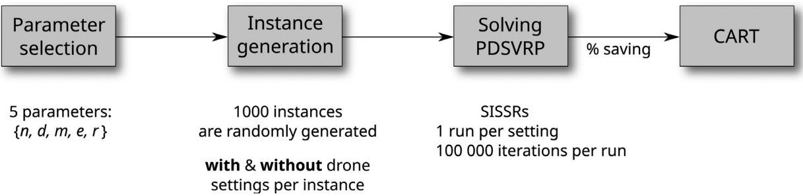

Fig. 7. The process of sensitivity analysis using CART method.

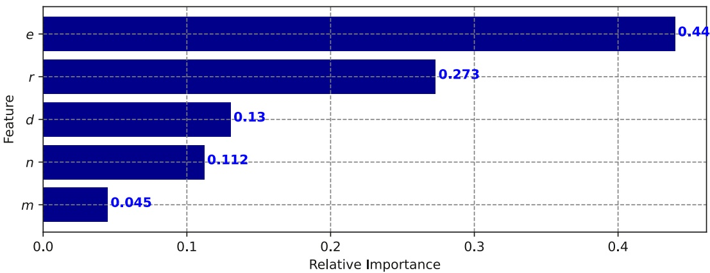

Fig. 8. Parameter importance.

Parameters controlled by the random generator.

| Indicators | Parameters | Range |
| --- | --- | --- |
| n | Number of customers | [50,500] |
| d | Grid size d (in km) | [20,40] |
| m | Number of drones | [1,20] |
| e | Drone's battery endurance (in hour) | [0.25,1.0] |
| r | Ratio of truck unit cost over drone unit cost, r = CC | [10.0,50.0] |
| constant | Truck speed (in km/h) Drone speed (in km/h) Truck payload capacity (in kg) Drone payload capacity (in kg) Drone cost unit per km (in $) Work time limit (in hour) | 304013002.270.038.0 |

## 4.4.3. Results and discussions

## Parameter importance

For each parameter, we first report the relative importance computed as the normalized total reduction of impurity across all splits (Scikit-learn, 2020). The more important parameter tends to drive the higher impact on cost saving. This metric helps to answer the first question on what parameters have the biggest impacts on predictions. Fig. 8 visualizes the ranked parameter importance of the five considered parameters.

As can be seen in the figure, battery endurance e would be the most essential parameter associated with the cost saving. A possible explanation is that a wider coverage range of the drones would offer more opportunities for vehicle assignment alternatives resulting in cost-cutting. In several worse case scenarios where the endurance of the drone is low, the drones can only operate near the depot. Substituting truck deliveries in such areas with a drone alone would not provide significant impacts to reduce the overall truck cost as the trucks still have to serve the majority of the distant customers. This is not to mention other factors (e.g., the presence of truck-only requests and low cost ratios) which could reduce the drone’s contribution within the area.

Cost ratio r follows in the second place. It is important to emphasize that the drone tends to suffer high miles-per-delivery due to its back-and-forth delivery discipline. Such a round trip would become costly if the customer is far from the depot. In this respect, a truck often requires less effort (i.e., traveled distance) to serve additional customers compared to proposing a new roundtrip by a drone. Especially when the customers are close to each other in a given area, the truck even appears to be the more favorable option. This sheds light on the profound importance of the cost ratio. For possible cost saving, it is clear that the cost ratio r should be as high as possible to outweigh the cost of back-and-forth drone trips to stimulate drone use over truck use. The two parameters, grid size d and number of customers n, have relatively equal importance and less impacts on the cost saving. Finally, the least impact factor is the number of drones m.

## Interpretation of the decision-tree and discussion

We now analyse the results based on the interpretation of the CART decision tree. From Fig. 9, we can observe important split points and interactions among parameters. This helps to answer the second question of finding the scenarios which can take advantage of the drone use to achieve a considerable amount of cost saving.

We refer to the first node at the top of the tree as the root node, which contains the information of the entire sample data. The terminal nodes at the bottom of the tree are called leaves. Every node in between is referred to as an internal node. Each node in the tree is characterized by the following parameters: (1) “mse” is the mean squared error value; (2) “samples” is the number of samples; and (3) “value” is the average cost saving of data samples. At each node, we verify a condition on a variable. The left branch of a node corresponds to the samples that satisfy the condition (True statement) and the right branch represents the samples that do not meet the condition (False statement).

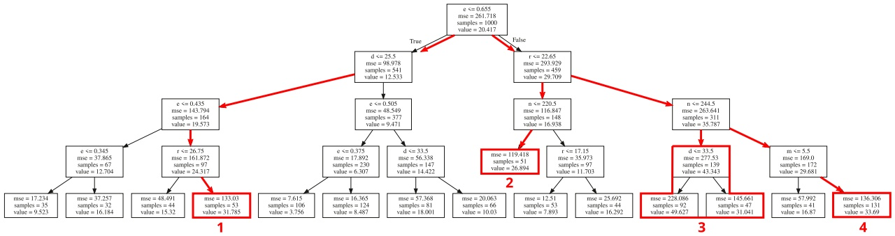

Fig. 9. Illustration of the resulting regression tree.

Overall, using drones could offer 20.42% cost saving on average over 1000 samples. Based on the results for the data range under investigation, it is clear that each parameter has different impacts in different scenarios:

• Unsurprisingly, the greatest impact among all five considered parameters, the battery endurance, is verified at the root of the tree. The results suggest that battery endurance e larger than 0.655 h is the essential criterion to secure significant cost savings, 29.709% on average compared to 12.533% of those with $e \leq 0 . 6 5 5$ . Closer look on the left branch where the battery endurance is below the essential criterion (e ≤ 0.655), further partitioning on e again emphasizes the importance of the battery capacity. For example, in the branch following Path 1, only satisfying e ≥ 0.435 can still secure an appealing cost saving. Otherwise, when $e < 0 . 4 3 5$ , the limited flying range leaves drones little room to contribute significant cost savings.

• When the battery endurance is not favorable (e.g., e ≤ 0.655 in our experiment), further partitioning on d in the left branch shows that the grid size should be the next important factor to consider. The results suggest that when e is greater than 0.505, decent cost savings of 18.001% can be obtained in cases with grid size d less than 33.5. We also observe that e should be at least 0.345 to cover efficiently a grid size d less than 22.5.

• On the other hand, when the battery endurance is favorable (e.g., e > 0.655 in our experiment), the number of customers n affects the contribution of drones. It is shown that using drones is more beneficial when less customers are served. A possible explanation is that the decrease in n could lower the customer density, which raises the insertion cost for a truck to accommodate additional customers into its current tour. In other words, dense customer distribution creates more chances to form good customer permutations for truck tours. Contrarily, drone trips tend to be unaffected by the customer density. As can be seen on the right branch, the results show a boost in cost savings (Path 2 and Path 3) of lower n compared to that of higher n.

• One could expect the higher cost ratio r provides better cost savings. In fact, the results suggest the cost ratio is particularly important when the battery endurance guarantees a sufficient flying range (e.g., e > 0.655). The cost ratio r greater than 22.65 is a favorable condition for a boost in cost saving (Path 3 and Path 4). Besides, the cost ratio still plays a relatively important role when the grid size is small. In such cases, it must reach to a given value (r > 26.75) to overshadow the truck cost which turns out to be competitive as customers are close to each other (Path 1).

• The number of drones appears important only when the drone use is encouraged (i.e., drone battery and cost ratio are favorable), and the number of customers is sufficiently large (n > 245). It is reasonable that a given number of drones are needed to fully exploit the incentive of drones for potential cost reductions. In such cases, as long as at least 6 drones are available, the system is ready to offer averagely 33.69% cost saving (Path 4), which is nearly double the cost savings achieved in cases suffering the lack of drone workforce (the branch corresponding $\mathsf { t o } m \leq 5 )$

Several examples of scenarios, in which the drones can only contribute a small amount of cost saving, are visualized in Fig. 10. Here, the dots are customer locations, the filled square in the middle is the depot, and the dashed circle indicates the drone’s flight range (equivalent to the drone’s battery endurance).

Finally, it is worth mentioning that this part does not intend to generalize the insights to a broader context. Depending on scenarios, we are aware that the results might change for different datasets. While the insights are derived from the tested instances, the majority of our data assumptions are based on real-world information. We believe the general theme might still be applied to relevant circumstances within a certain extent. In addition, the decision-tree structure is useful for practitioners to easily detect and interpret important factors for a specific case. Besides, the ability to identify split values, in which two distinct subgroups are clearly separated in terms of cost saving, is also valuable as it provides the very first intuition for the decision-making process. As a result, we encourage practitioners to adapt this analysis method to their own specific situations.

## 4.5. Performance of SISSRs on the min-time variant

In this subsection, we aim to analyze the performance of our algorithm on the min-time variant. We compare the SISSRs with other state-of-the-art algorithms on the PDSTSP instances generated in Mbiadou Saleu et al. (2018), which have been intensively used in the recent related works. It is worth mentioning again that the PDSTSP, which was originally introduced by Murray & Chu (2015), is the special case of the min-time PDSVRP where the number of trucks is set to 1 and the capacity constraints are relaxed. The PDSTSP instances introduced in Mbiadou Saleu et al. (2018) are based on classic TSPLIB instances (Reinelt, 1991) with the number of customers varying from 48 to 229. For each original TSP instance, several PDSTSP instances were generated by modifying the following parameters: the position of the depot, which is either at the center of the customers or at one corner of the customers’ region; the percentage of drone-eligible customers, ranging from 0% to 100%; the speed of the drones, which is expressed as a factor of the vehicle speed, with values ranging from 1 to 5; the number of drones, that are between 1 and 5. The tables are organized in blocks to highlight the series of tests where a single construction parameter is modified from the reference instance (in the first row). We refer the interested readers to Mbiadou Saleu et al. (2018) for the detailed description and generator of these instances.

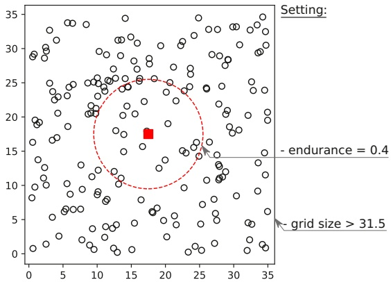

(a) Poor battery endurance with large grid size

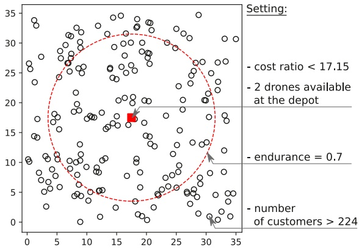

(b) Unattractive drone cost or lacking of drones available

Fig. 10. Examples of scenarios in which drones show little contribution to reduce transportation cost.

Results of the algorithms on the TSPLIB instance eil101 from Mbiadou Saleu et al. (2018).

<table><tr><td colspan="4">Instance</td><td colspan="2">MDFGQ18 DMN20</td><td colspan="3">SISSRs</td></tr><tr><td>el</td><td>sp</td><td>#</td><td>dp</td><td></td><td></td><td> $z^1$ </td><td> $z_{best}$ </td><td> $\overline{gap}(\%)$ </td></tr><tr><td>80</td><td>2</td><td>1</td><td>1</td><td>564.00</td><td>564.00</td><td>564.00</td><td>564.00</td><td>0.02</td></tr><tr><td>80</td><td>2</td><td>1</td><td>2</td><td>650.00</td><td>648.98</td><td>648.98</td><td>648.98</td><td>0.03</td></tr><tr><td>0</td><td>2</td><td>1</td><td>1</td><td>819.00</td><td>819.00</td><td>819.00</td><td>819.00</td><td>0.00</td></tr><tr><td>20</td><td>2</td><td>1</td><td>1</td><td>738.00</td><td>736.00</td><td>736.00</td><td>736.00</td><td>0.00</td></tr><tr><td>40</td><td>2</td><td>1</td><td>1</td><td>646.00</td><td>646.00</td><td>646.00</td><td>646.00</td><td>0.00</td></tr><tr><td>60</td><td>2</td><td>1</td><td>1</td><td>578.00</td><td>578.00</td><td>578.00</td><td>578.00</td><td>0.00</td></tr><tr><td>100</td><td>2</td><td>1</td><td>1</td><td>561.41</td><td>560.00</td><td>560.00</td><td>560.00</td><td>0.08</td></tr><tr><td>80</td><td>1</td><td>1</td><td>1</td><td>650.00</td><td>650.00</td><td>650.00</td><td>650.00</td><td>0.00</td></tr><tr><td>80</td><td>3</td><td>1</td><td>1</td><td>504.00</td><td>504.00</td><td> $\underline{503.19}$ </td><td> $\underline{503.19}$ </td><td>0.00</td></tr><tr><td>80</td><td>4</td><td>1</td><td>1</td><td>456.00</td><td>456.00</td><td>456.00</td><td>456.00</td><td>0.00</td></tr><tr><td>80</td><td>5</td><td>1</td><td>1</td><td>420.83</td><td>421.00</td><td>420.83</td><td>420.83</td><td>0.00</td></tr><tr><td>80</td><td>2</td><td>2</td><td>1</td><td>456.00</td><td>456.00</td><td>456.00</td><td>456.00</td><td>0.02</td></tr><tr><td>80</td><td>2</td><td>3</td><td>1</td><td>395.00</td><td>395.00</td><td>395.00</td><td>395.00</td><td>0.10</td></tr><tr><td>80</td><td>2</td><td>4</td><td>1</td><td>346.68</td><td>346.00</td><td>346.00</td><td>346.00</td><td>0.00</td></tr><tr><td>80</td><td>2</td><td>5</td><td>1</td><td>319.74</td><td>318.00</td><td>318.00</td><td>318.00</td><td>0.00</td></tr></table>

Two recent algorithms proposed in Mbiadou Saleu et al. (2018) and Dell’Amico et al. (2020) are selected for the comparison. We notice that the two referenced algorithms are tested only in a single run. In addition, they are run on an Intel core(TM) i5-6200U CPU at 2.30Ghz and an Intel(R) Xeon(R) E5-2620 v4 at 2.10GHz processors, respectively. These machines have a single-thread performance rating of approximately 1.6 times slower than our processor according to Passmark Software ([https://www.cpubenchmark.net/](https://www.cpubenchmark.net/)). Since different CPU speed conversion techniques can provide very different results, we have decided to present the raw running times, letting the readers choose their preferred approach. The maximum computation time in Mbiadou Saleu et al. (2018) and Dell’Amico et al. (2020) is limited within 300 and 1200 seconds, respectively. Therefore, to have a fair comparison, we set the algorithm to stop after 300 seconds for each run. In addition, we make another 10 runs to evaluate the stability of the algorithm. Hence, SISSRs is repeatedly run 11 times in total for each instance.

Tables 12 –15 below show the results for the instances with 101–229 customers. Because the three algorithms provide solutions with the same objective values for the instances with less than 100 customers, these instances appear to be easy for metaheuristic methods. As a result, we do not report the results for them. Each instance is characterized by several settings, namely, the percentage of drone-eligible customers over the total (el), the drone speed (sp), the number of drones (#), and the depot location (dp).

In Columns MDFGQ18 and DMN20, we report the objective value of the best solutions found by Mbiadou Saleu et al. (2018) and Dell’Amico et al. (2020), respectively. Regarding the SISSRs, we report the single-run result (Column $z ^ { 1 } ) ,$ the best result over 10-run (Column $z _ { b e s t } ) ,$ and the average gap (Column gap) over 10 runs. The better results in single-run mode of SISSRs are underlined in column $z ^ { 1 }$ , while the new best known solutions of SISSIRs in 10 executions are marked in bold in column z.

As can be observed, not only is our algorithm able to reproduce nearly all but also improve a significant amount of state-of-the-art solutions. Specifically, the single run of SISSRs finds better solutions on 26 out of 90 considered instances while providing only one worse solution (marked by italic numbers in Table 14) than the two other methods. A higher concentration of improvements is on the larger instances, especially those that need to make use of a higher number of drones for delivery. In all instances that have more than one drone in sets gr120, pr152, and gr229, our algorithm finds improved solutions.

In the 10-run test, the average gaps show that the SISSRs is able to provide consistent results as the maximum gap value is just 1.20%. Remarkably, in this test, we further improve 7 solutions previously found in the single-run test. And in total, 26 new best known solutions (numbers in bold in Column $z _ { b e s t } )$ have been found in this research. Therefore, it would be fair to conclude that the SISSRs dominates the existing metaheuristics in terms of solution quality to become the new state-of-the-art method for the PDSTSP.

## 5. Conclusions

In this paper, we have studied a new variant of the Parallel Drone Scheduling Traveling Salesman Problem (PDSTSP), named the min-cost Parallel Drone Scheduling Vehicle Routing Problem (PDSVRP). The problem seeks to minimize the total transportation costs incurred by a mixed fleet of trucks and drones embedded in a delivery system. We propose a mixed integer linear programming formulation and a simple, yet efficient ruin-and-recreate (R&R) heuristic method, called SISSRs, in an attempt to address the new problem. The SISSRs, in particular, exploits PDSVRP solution characteristics in an effective manner to address common drawbacks of regular ruin and recreate methods. By embracing the slack induction concept, the algorithm manages to introduce “sufficient” room to a solution via adjacent string removal and sweep removal during the ruin phase. It is expected to enhance the possibilities for improving solutions later in the recreate phase that greedily inserts with blinks removed customers. We also propose several adaptations of the algorithm to tackle the PDSTSP, the min-time variant of PDSVRP with a single truck.

Table 13

Results of the algorithms on the TSPLIB instance gr120 from Mbiadou Saleu et al. (2018).

<table><tr><td colspan="4">Instance</td><td rowspan="2">MDFGQ18</td><td rowspan="2">DMN20</td><td colspan="3">SISSRs</td></tr><tr><td>el</td><td>sp</td><td>#</td><td>dp</td><td> $z^1$ </td><td> $z_{best}$ </td><td> $\overline{gap}(\%)$ </td></tr><tr><td>80</td><td>2</td><td>1</td><td>1</td><td>1414.00</td><td>1420.76</td><td>1414.00</td><td>1414.00</td><td>0.00</td></tr><tr><td>80</td><td>2</td><td>1</td><td>2</td><td>1730.00</td><td>1726.00</td><td>1726.00</td><td>1726.00</td><td>0.21</td></tr><tr><td>0</td><td>2</td><td>1</td><td>1</td><td>2006.00</td><td>2006.00</td><td>2006.00</td><td>2006.00</td><td>0.00</td></tr><tr><td>20</td><td>2</td><td>1</td><td>1</td><td>1736.00</td><td>1736.00</td><td>1736.00</td><td>1736.00</td><td>0.00</td></tr><tr><td>40</td><td>2</td><td>1</td><td>1</td><td>1624.00</td><td>1624.00</td><td>1624.00</td><td>1624.00</td><td>0.01</td></tr><tr><td>60</td><td>2</td><td>1</td><td>1</td><td>1494.00</td><td>1494.00</td><td>1494.00</td><td>1494.00</td><td>0.00</td></tr><tr><td>100</td><td>2</td><td>1</td><td>1</td><td>1414.80</td><td>1416.00</td><td>1414.00</td><td>1414.00</td><td>0.00</td></tr><tr><td>80</td><td>1</td><td>1</td><td>1</td><td>1592.00</td><td>1592.00</td><td>1592.00</td><td>1592.00</td><td>0.18</td></tr><tr><td>80</td><td>3</td><td>1</td><td>1</td><td>1289.27</td><td>1291.00</td><td>1284.74</td><td>1284.74</td><td>0.00</td></tr><tr><td>80</td><td>4</td><td>1</td><td>1</td><td>1189.71</td><td>1192.00</td><td>1186.00</td><td>1186.00</td><td>0.00</td></tr><tr><td>80</td><td>5</td><td>1</td><td>1</td><td>1112.00</td><td>1114.00</td><td>1112.00</td><td>1112.00</td><td>0.00</td></tr><tr><td>80</td><td>2</td><td>2</td><td>1</td><td>1188.51</td><td>1197.00</td><td>1186.00</td><td>1186.00</td><td>0.00</td></tr><tr><td>80</td><td>2</td><td>3</td><td>1</td><td>1044.65</td><td>1050.00</td><td>1044.00</td><td>1044.00</td><td>0.00</td></tr><tr><td>80</td><td>2</td><td>4</td><td>1</td><td>946.04</td><td>946.04</td><td>943.00</td><td>943.00</td><td>0.01</td></tr><tr><td>80</td><td>2</td><td>5</td><td>1</td><td>880.00</td><td>881.00</td><td>878.70</td><td>878.69</td><td>0.00</td></tr></table>

Table 14

Results of the algorithms on the TSPLIB instance pr152 from Mbiadou Saleu et al. (2018).

<table><tr><td colspan="4">Instance</td><td rowspan="2">MDFGQ18</td><td rowspan="2">DMN20</td><td colspan="3">SISSRs</td></tr><tr><td>el</td><td>sp</td><td>#</td><td>dp</td><td> $z^1$ </td><td> $z_{best}$ </td><td> $\overline{gap}(\%)$ </td></tr><tr><td>80</td><td>2</td><td>1</td><td>1</td><td>76008.00</td><td>76008.00</td><td>76008.00</td><td>76008.00</td><td>0.00</td></tr><tr><td>80</td><td>2</td><td>1</td><td>2</td><td>76556.00</td><td>76556.00</td><td>76556.00</td><td>76556.00</td><td>0.00</td></tr><tr><td>0</td><td>2</td><td>1</td><td>1</td><td>86596.00</td><td>86596.00</td><td>86596.00</td><td>86596.00</td><td>0.00</td></tr><tr><td>20</td><td>2</td><td>1</td><td>1</td><td>82504.00</td><td>82504.00</td><td>82504.00</td><td>82504.00</td><td>0.00</td></tr><tr><td>40</td><td>2</td><td>1</td><td>1</td><td>77372.00</td><td>77316.00</td><td>77236.00</td><td>77236.00</td><td>0.00</td></tr><tr><td>60</td><td>2</td><td>1</td><td>1</td><td>76786.00</td><td>76786.00</td><td>76786.00</td><td>76758.00</td><td>0.01</td></tr><tr><td>100</td><td>2</td><td>1</td><td>1</td><td>74468.00</td><td>74302.00</td><td>74302.00</td><td>74302.00</td><td>0.00</td></tr><tr><td>80</td><td>1</td><td>1</td><td>1</td><td>80164.00</td><td>79952.00</td><td>79952.00</td><td>79952.00</td><td>0.00</td></tr><tr><td>80</td><td>3</td><td>1</td><td>1</td><td>72936.00</td><td>72936.00</td><td>72936.00</td><td>72936.00</td><td>0.00</td></tr><tr><td>80</td><td>4</td><td>1</td><td>1</td><td>70412.00</td><td>70328.00</td><td>70148.00</td><td>70148.00</td><td>0.00</td></tr><tr><td>80</td><td>5</td><td>1</td><td>1</td><td>67798.00</td><td>67798.00</td><td>67858.00</td><td>67858.00</td><td>0.00</td></tr><tr><td>80</td><td>2</td><td>2</td><td>1</td><td>70244.00</td><td>70405.45</td><td>70148.00</td><td>70148.00</td><td>0.00</td></tr><tr><td>80</td><td>2</td><td>3</td><td>1</td><td>65062.10</td><td>64720.30</td><td>64550.00</td><td>64550.00</td><td>1.20</td></tr><tr><td>80</td><td>2</td><td>4</td><td>1</td><td>60027.40</td><td>59772.00</td><td>59756.00</td><td>59756.00</td><td>0.00</td></tr><tr><td>80</td><td>2</td><td>5</td><td>1</td><td>56336.10</td><td>56262.00</td><td>56227.04</td><td>56178.00</td><td>0.08</td></tr></table>

Table 15

Results of the algorithms on the TSPLIB instance gr229 from Mbiadou Saleu et al. (2018).

<table><tr><td colspan="4">Instance</td><td rowspan="2">MDFGQ18</td><td rowspan="2">DMN20</td><td colspan="3">SISSRs</td></tr><tr><td>el</td><td>sp</td><td>#</td><td>dp</td><td> $z^1$ </td><td> $z_{best}$ </td><td> $\overline{gap}(\%)$ </td></tr><tr><td>80</td><td>2</td><td>1</td><td>1</td><td>1794.84</td><td>1785.86</td><td>1781.42</td><td>1780.86</td><td>0.10</td></tr><tr><td>80</td><td>2</td><td>1</td><td>2</td><td>1913.74</td><td>1911.58</td><td>1911.58</td><td>1911.58</td><td>0.02</td></tr><tr><td>0</td><td>2</td><td>1</td><td>1</td><td>2020.16</td><td>2017.24</td><td>2017.24</td><td>2017.24</td><td>0.01</td></tr><tr><td>20</td><td>2</td><td>1</td><td>1</td><td>1862.76</td><td>1860.14</td><td>1860.14</td><td>1860.14</td><td>0.00</td></tr><tr><td>40</td><td>2</td><td>1</td><td>1</td><td>1828.02</td><td>1827.02</td><td>1825.44</td><td>1824.80</td><td>0.04</td></tr><tr><td>60</td><td>2</td><td>1</td><td>1</td><td>1807.50</td><td>1797.37</td><td>1796.62</td><td>1796.62</td><td>0.01</td></tr><tr><td>100</td><td>2</td><td>1</td><td>1</td><td>1498.05</td><td>1496.29</td><td>1496.29</td><td>1496.29</td><td>0.03</td></tr><tr><td>80</td><td>1</td><td>1</td><td>1</td><td>1865.00</td><td>1863.12</td><td>1861.98</td><td>1861.98</td><td>0.11</td></tr><tr><td>80</td><td>3</td><td>1</td><td>1</td><td>1735.16</td><td>1725.45</td><td>1716.74</td><td>1716.74</td><td>0.02</td></tr><tr><td>80</td><td>4</td><td>1</td><td>1</td><td>1679.33</td><td>1675.82</td><td>1666.40</td><td>1664.78</td><td>0.02</td></tr><tr><td>80</td><td>5</td><td>1</td><td>1</td><td>1642.04</td><td>1629.38</td><td>1621.28</td><td>1620.24</td><td>0.07</td></tr><tr><td>80</td><td>2</td><td>2</td><td>1</td><td>1686.75</td><td>1673.72</td><td>1664.78</td><td>1664.78</td><td>0.06</td></tr><tr><td>80</td><td>2</td><td>3</td><td>1</td><td>1603.90</td><td>1592.52</td><td>1581.00</td><td>1580.88</td><td>0.00</td></tr><tr><td>80</td><td>2</td><td>4</td><td>1</td><td>1518.62</td><td>1526.92</td><td>1511.74</td><td>1511.74</td><td>0.00</td></tr><tr><td>80</td><td>2</td><td>5</td><td>1</td><td>1483.68</td><td>1467.76</td><td>1458.74</td><td>1458.74</td><td>0.01</td></tr></table>

Via multiple intensive experiments, we validate our model and demonstrate the performance of our SISSRs algorithm. Overall, the obtained results on a new set of randomly generated instances with up to 400 customers confirm that our metaheuristic can stably provide high-quality solutions in a short running time. In addition, we perform a sensitivity analysis using the Classification And Regression Trees (CART) to quantitatively understand the impact of drones on the total transportation cost of the delivery system under different scenarios. The results suggest that the battery capacity is the most important parameter for drones to guarantee attractive benefits, followed by the truck-drone cost ratio. The other three parameters, namely, the number of customers, number of drones, and grid size have less of an impact on cost savings. From the analysis, we also determine in which scenarios using drones could provide the most and the least cost savings. As for solving the min-time variant, it is indicative that the proposed algorithm dominates the state-of-the-art algorithms in terms of solution quality. More remarkably, we find 26 new best known solutions.

## Acknowledgement

The authors would like to thank the anonymous reviewers for the valuable comments and suggestions which help us greatly improve the quality of the paper. This paper is dedicated to the memory of Quang Minh Ha, who sadly passed away in 2020. His works have laid the foundation for our research direction on routing problems with drones.

## References

[Agatz, N., Bouman, P., & Schmidt, M. (2018). Optimization approaches for the traveling salesman problem with drone. Transportation Science, 52(4), 965–981.](http://refhub.elsevier.com/S0377-2217%2821%2900603-2/sbref0001)

Allain, R. (2013). Physics of the Amazon Octocopter Drone. [https://www.wired.com/2013/12/physics-of-the-amazon-prime-air-drone/.](https://www.wired.com/2013/12/physics-of-the-amazon-prime-air-drone/) Accessed 12 August 2020.

[Bouman, P., Agatz, N., & Schmidt, M. (2018). Dynamic programming approaches for the traveling salesman problem with drone. Networks, 72(4), 528–542.](http://refhub.elsevier.com/S0377-2217%2821%2900603-2/sbref0003)

[Breiman, L., Friedman, J., Stone, C. J., & Olshen, R. A. (1984). Classification and regression trees. CRC press.](http://refhub.elsevier.com/S0377-2217%2821%2900603-2/sbref0004)

[Carlsson, J. G., & Song, S. (2018). Coordinated logistics with a truck and a drone. Management Science, 64(9), 4052–4069.](http://refhub.elsevier.com/S0377-2217%2821%2900603-2/sbref0005)

[Cheng, C., Adulyasak, Y., & Rousseau, L.-M. (2020). Drone routing with energy function: Formulation and exact algorithm. Transportation Research Part B: Methodological, 139, 364–387.](http://refhub.elsevier.com/S0377-2217%2821%2900603-2/sbref0006)

[Christiaens, J., & Berghe, G. V. (2020). Slack induction by string removals for vehicle routing problems. Transportation Science, 54(2), 417–433.](http://refhub.elsevier.com/S0377-2217%2821%2900603-2/sbref0007)

[Conceição, A. (2019). Logistics challenges in a new distribution paradigm: Drone delivery. Technical Report. Instituto Superior Técnico.](http://refhub.elsevier.com/S0377-2217%2821%2900603-2/sbref0008)

[Dayarian, I., Savelsbergh, M., & Clarke, J.-P. (2020). Same-day delivery with drone resupply. Transportation Science, 54(1), 229–249.](http://refhub.elsevier.com/S0377-2217%2821%2900603-2/sbref0009)

[Dell’Amico, M., Montemanni, R., & Novellani, S. (2020). Matheuristic algorithms for the parallel drone scheduling traveling salesman problem. Annals of Operations Research, 289(2), 211–226.](http://refhub.elsevier.com/S0377-2217%2821%2900603-2/sbref0010)

DHL (2016). Successful trial integration of DHL parcelcopter into logistics chain. [https://www.dhl.com/en/press/releases/releases\_2016/all/parcel\_ecommerce/successful\_trial\_integration\_dhl\_parcelcopter\_logistics\_chain.html.](https://www.dhl.com/en/press/releases/releases_2016/all/parcel_ecommerce/successful_trial_integration_dhl_parcelcopter_logistics_chain.html) Accessed 12 August 2020.

[de Freitas, J. C., & Penna, P. H. V. (2020). A variable neighborhood search for flying sidekick traveling salesman problem. International Transactions in Operational Research, 27(1), 267–290.](http://refhub.elsevier.com/S0377-2217%2821%2900603-2/sbref0012)

[Ha, Q. M., Deville, Y., Pham, Q. D., & Hà, M. H. (2018). On the min-cost traveling salesman problem with drone. Transportation Research Part C: Emerging Technologies, 86, 597–621.](http://refhub.elsevier.com/S0377-2217%2821%2900603-2/sbref0013)

[Ha, Q. M., Deville, Y., Pham, Q. D., & Hà, M. H. (2020). A hybrid genetic algorithm for the traveling salesman problem with drone. Journal of Heuristics, 26(2), 219–247.](http://refhub.elsevier.com/S0377-2217%2821%2900603-2/sbref0014)

[Ham, A. M. (2018). Integrated scheduling of m-truck, m-drone, and m-depot constrained by time-window, drop-pickup, and m-visit using constraint programming. Transportation Research Part C: Emerging Technologies, 91, 1–14.](http://refhub.elsevier.com/S0377-2217%2821%2900603-2/sbref0015)

[Kara, I. (2011). Arc based integer programming formulations for the distance constrained vehicle routing problem. In 3rd IEEE international symposium on logistics and industrial informatics (pp. 33–38). IEEE.](http://refhub.elsevier.com/S0377-2217%2821%2900603-2/sbref0016)

[Kara, I., Laporte, G., & Bektas, T. (2004). A note on the lifted Miller–Tucker–Zemlin subtour elimination constraints for the capacitated vehicle routing problem. European Journal of Operational Research, 158(3), 793–795.](http://refhub.elsevier.com/S0377-2217%2821%2900603-2/sbref0017)

[Karak, A., & Abdelghany, K. (2019). The hybrid vehicle-drone routing problem for pick-up and delivery services. Transportation Research Part C: Emerging Technologies, 102, 427– 449.](http://refhub.elsevier.com/S0377-2217%2821%2900603-2/sbref0018)

Kim, E. (2016). The most staggering part about Amazon’s upcoming drone delivery service. [https://www.businessinsider.com/cost-savings-from-amazon-drone-deliveries-2016-6.](https://www.businessinsider.com/cost-savings-from-amazon-drone-deliveries-2016-6) Accessed 12 August 2020.

[Kim, S., & Moon, I. (2018). Traveling salesman problem with a drone station. IEEE Transactions on Systems, Man, and Cybernetics: Systems, 49(1), 42–52.](http://refhub.elsevier.com/S0377-2217%2821%2900603-2/sbref0020)

[Kuhn, M., & Johnson, K. (2013). Applied predictive modeling: 26. Springer.](http://refhub.elsevier.com/S0377-2217%2821%2900603-2/sbref0021)

Lauryn, E. (2019). Air drop - your next delivery may arrive by drone. [https://360.here.com/the-potential-impact-of-drones-on-the-supply-chain.](https://360.here.com/the-potential-impact-of-drones-on-the-supply-chain) Accessed 12 August 2020.

[Ma, X. (2018). Using classification and regression trees: A practical primer. IAP.](http://refhub.elsevier.com/S0377-2217%2821%2900603-2/sbref0023)

[Macrina, G., Pugliese, L. D. P., Guerriero, F., & Laporte, G. (2020). Drone-aided routing: A literature review. Transportation Research Part C: Emerging Technologies, 120, 102762.](http://refhub.elsevier.com/S0377-2217%2821%2900603-2/sbref0024)

[Mathew, N., Smith, S. L., & Waslander, S. L. (2015). Planning paths for package delivery in heterogeneous multirobot teams. IEEE Transactions on Automation Science and Engineering, 12(4), 1298–1308.](http://refhub.elsevier.com/S0377-2217%2821%2900603-2/sbref0025)

[Mbiadou Saleu, R. G., Deroussi, L., Feillet, D., Grangeon, N., & Quilliot, A. (2018). An iterative two-step heuristic for the parallel drone scheduling traveling salesman problem. Networks, 72(4), 459–474.](http://refhub.elsevier.com/S0377-2217%2821%2900603-2/sbref0026)

[Mester, D., & Bräysy, O. (2007). Active-guided evolution strategies for large-scale capacitated vehicle routing problems. Computers & Operations Research, 34(10), 2964–2975.](http://refhub.elsevier.com/S0377-2217%2821%2900603-2/sbref0027)

[Murray, C. C., & Chu, A. G. (2015). The flying sidekick traveling salesman problem: Optimization of drone-assisted parcel delivery. Transportation Research Part C: Emerging Technologies, 54, 86–109.](http://refhub.elsevier.com/S0377-2217%2821%2900603-2/sbref0028)

[Murray, C. C., & Raj, R. (2020). The multiple flying sidekicks traveling salesman problem: Parcel delivery with multiple drones. Transportation Research Part C: Emerging Technologies, 110, 368–398.](http://refhub.elsevier.com/S0377-2217%2821%2900603-2/sbref0029)

[Poikonen, S., & Golden, B. (2020a). The mothership and drone routing problem. IN-FORMS Journal on Computing, 32(2), 249–262.](http://refhub.elsevier.com/S0377-2217%2821%2900603-2/sbref0030)

[Poikonen, S., & Golden, B. (2020b). Multi-visit drone routing problem. Computers & Operations Research, 113, 104802.](http://refhub.elsevier.com/S0377-2217%2821%2900603-2/sbref0031)

[Poikonen, S., Golden, B., & Wasil, E. A. (2019). A branch-and-bound approach to the traveling salesman problem with a drone. INFORMS Journal on Computing, 31(2), 335–346.](http://refhub.elsevier.com/S0377-2217%2821%2900603-2/sbref0032)

Ponza, A. (2016). Optimization of drone-assisted parcel delivery. Università Niversita Di Padova Master’s thesis.. Accessed May 12th, 2021 [http://tesi.cab.unipd.it/51947/1/Andrea\_Ponza\_-\_Analisi\_e\_ottimizzazione\_nell’uso\_di\_droni\_per\_la\_consegna\_di\_prodotti.pdf](http://tesi.cab.unipd.it/51947/1/Andrea_Ponza_-_Analisi_e_ottimizzazione_nell'uso_di_droni_per_la_consegna_di_prodotti.pdf)

[Reinelt, G. (1991). TSPLIB - A traveling salesman problem library. ORSA Journal on Computing, 3(4), 376–384.](http://refhub.elsevier.com/S0377-2217%2821%2900603-2/sbref0034)

[Sacramento, D., Pisinger, D., & Ropke, S. (2019). An adaptive large neighborhood search metaheuristic for the vehicle routing problem with drones. Transportation Research Part C: Emerging Technologies, 102, 289–315.](http://refhub.elsevier.com/S0377-2217%2821%2900603-2/sbref0035)

[Sanchez-Diaz, I., Palacios-Argüello, L., Levandi, A., Mardberg, J., & Basso, R. (2020). A time-efficiency study of medium-duty trucks delivering in urban environments. Sustainability, 12(1), 425.](http://refhub.elsevier.com/S0377-2217%2821%2900603-2/sbref0036)

[Savuran, H., & Karakaya, M. (2016). Efficient route planning for an unmanned air vehicle deployed on a moving carrier. Soft Computing, 20(7), 2905–2920.](http://refhub.elsevier.com/S0377-2217%2821%2900603-2/sbref0037)

[Schermer, D., Moeini, M., & Wendt, O. (2019). The traveling salesman drone station location problem. In World congress on global optimization (pp. 1129–1138). Springer.](http://refhub.elsevier.com/S0377-2217%2821%2900603-2/sbref0038)

Scikit-learn (2020). User Guide. [https://scikit-learn.org/stable/modules/generated/sklearn.tree.DecisionTreeRegressor.html.](https://scikit-learn.org/stable/modules/generated/sklearn.tree.DecisionTreeRegressor.html) Accessed 12 August 2020.

[Scott, J. E., & Scott, C. H. (2019). Models for drone delivery of medications and other healthcare items. In Unmanned aerial vehicles: Breakthroughs in research and practice (pp. 376–392). IGI Global.](http://refhub.elsevier.com/S0377-2217%2821%2900603-2/sbref0040)

[Solomon, M. M. (1987). Algorithms for the vehicle routing and scheduling problems with time window constraints. Operations Research, 35(2), 254–265.](http://refhub.elsevier.com/S0377-2217%2821%2900603-2/sbref0041)

[Toth, P., & Vigo, D. (2003). The granular tabu search and its application to the vehicle-routing problem. INFORMS Journal on Computing, 15(4), 333–346.](http://refhub.elsevier.com/S0377-2217%2821%2900603-2/sbref0042)

[Uchoa, E., Pecin, D., Pessoa, A., Poggi, M., Vidal, T., & Subramanian, A. (2017). New benchmark instances for the capacitated vehicle routing problem. European Journal of Operational Research, 257(3), 845–858.](http://refhub.elsevier.com/S0377-2217%2821%2900603-2/sbref0043)

UPS (2020). Weight and Size. [https://www.ups.com/us/en/help-center/packaging-and-supplies/weight-size.page.](https://www.ups.com/us/en/help-center/packaging-and-supplies/weight-size.page) Accessed 12 August 2020.

[Wang, D., Hu, P., Du, J., Zhou, P., Deng, T., & Hu, M. (2019). Routing and scheduling for hybrid truck-drone collaborative parcel delivery with independent and truck-carried drones. IEEE Internet of Things Journal, 6(6), 10483–10495.](http://refhub.elsevier.com/S0377-2217%2821%2900603-2/sbref0045)