Authors are encouraged to submit new papers to INFORMS journals by means of a style file template, which includes the journal title. However, use of a template does not certify that the paper has been accepted for publication in the named journal. INFORMS journal templates are for the exclusive purpose of submitting to an INFORMS journal and should not be used to distribute the papers in print or online or to submit the papers to another publication.

# The parallel drone scheduling traveling salesman problem with collective drones

Minh Anh Nguyen, Minh Hoàng Hà ORLab, Faculty of Computer Science, Phenikaa University, Hanoi, Vietnam

In this paper, we study a new variant of the parallel drone scheduling traveling salesman problem that aims to increase the utilization of drones, particularly for heavy item deliveries. The system under consideration adopts a technology that combines multiple drones to form a collective drone (c-drone) capable of transporting heavier items. The innovative concept is expected to add further flexibility in vehicle assignment decisions. An especially difficult challenge to address is the collaboration among drones because it requires temporal synchronization between their delivery tours. To better model the reality, we also consider drone power consumption is a nonlinear function of both speed and parcel weight. We first develop a two-index mixed integer linear programming (MILP) formulation from which a simple branch-and-cut is developed to solve small-size instances to optimality. To efficiently handle larger problem instances, we propose a Ruinand-Recreate metaheuristic with problem-tailored removal and insertion operators, in which an efficient move evaluation procedure based on the topological sort is designed to deal with the complexity of the synchronization constraints. Computational experiments demonstrate the validity of the developed MILP model and the performance of the proposed metaheuristic. Sensitivity analyses based on the Classification and Regression Tree (CART) are performed to investigate the benefits of using c-drones and the important factors affecting the efficiency of the new transportation system.

Key words : Traveling salesman problem; drone parallel scheduling; collective drones; synchronization; mixed integer liner programming, ruin and recreate

## 1. Introduction

Unmanned aerial vehicles (UAVs), also known as drones, are pilot-less aircraft that have been used in a wide range of civil and military applications. Over the past few years, interest in using UAVs combined with delivery trucks in commercial delivery has gained popularity. With e-commerce companies looking for more cost-efficient methods while providing faster delivery service, drones seem to be an attractive transportation mode. A number of companies like Amazon, UPS, and

Zipline have already made prototypes of drone delivery services in the past and are working aggressively to turn this innovative idea into real-world applications Rubin (2017), Premack (2019) McNabb (2019), Sherr (2020). As a result, there are recent trends in the academic literature that are studying the performance of using drones alongside delivery trucks for parcel delivery, such as the Flying Sidekick Traveling Salesman Problem (FSTSP) and the Parallel Drone Scheduling TSP (PDSTSP). Several variants of these problems have been proposed, including multiple trucks or multiple drones and alternative objectives such as minimizing time or minimizing cost. A large body of literature have revolved around such innovative idea.

One common presumption in the literature on combined truck-drone delivery models has been the relatively small payload capacity and operating range of current drones due to limited battery capacity. For example, the maximum weight that a single drone designed by Amazon can drop off is 5 pounds within 10 miles from its fulfillment centers Boyle (2016). To utilize more of the advantages of using drones in drone-based delivery systems, an issue to be addressed is the relatively small payload capacity and operating range of current drones due to limited battery capacity. In Paczan et al. (2016), the authors introduce a novel method to deal with this issue using a so-called collective drone in which multiple drones may be coupled together to aerially transport virtually any size, weight or quantity of items. By sharing resources, such as power and operating instructions, a collective drone might outperform a single drone to operate more efficiently. In addition, the size of a coupled drone would be more visible, generate larger radar or object detection, be more detectable by ground-based radar or air traffic controllers, thereby improving safety for the drones and other aircraft. Likewise, when multiple drones are coupled to form a collective UAV, some of the UAVs may reduce the rotational speed of one or more of their motors, relying on the lifting force of the collective UAV, thereby reducing the overall energy consumed during aerial navigation (see Boyle (2016), Weisberger (2017) for more information). Figure 1 depicts a configuration of a collective drone linked by three drones.

Another assumption commonly found in the literature has been that drones have constant endurance or flight range, independent of their speed or payload. While in reality, drone power consumption is a nonlinear function of both speed and parcel weight; for example, flying at high speeds or carrying heavy weight can dramatically reduce flight ranges. Recently, Raj et al. (2021) address the tradeoffs between speed and range in a new variant of the combined truck-drone deliv ery problem in which drone speeds are treated as decision variables. The authors intuitively explain the motivation behind this which boils down to the drone power consumption, and its impacts on endurance (flight time) and range (flight distance). Given that drones have a fixed battery capacity, it is described that the drone’s range is an increasing function of speed at lower speeds, and a decreasing function at higher speed. This is important in the context of combined truck-drone delivery systems, because there may be situations in which a drone request is close enough from the launch location that flying at maximum allowable speed may result in a shorter flight time. Flying at lower speeds may increase its range sufficiently to service the further requests via drones.

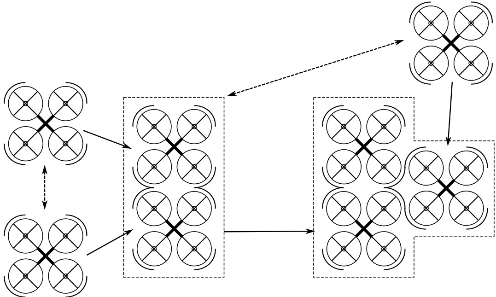

Figure 1 A top-down view of a collective drone configuration in Paczan et al. (2016)

Having the same view, we find that considering this aspect is also important in the context of collective drone. In addition, we further argue that using collective drone could equally share the parcel payload to all units, hence, reduce the power draw on each drone. This leaves greater amount of residual energy in the battery, which in turn allows drones to travel longer range and at higher speeds if needed. Given a limited battery capacity to carry a certain weight, thoroughly selecting how many drones to carry out the delivery and drone speeds is expected to significantly increase the access of drones to distant customers and improve delivery speed compared to delivering by one drone operating at a single constant speed.

This leads to novel variants of routing problems with drones in which multiple drones can be combined to service requests whose parcel weight or distance to the depot exceeds the capacity of a single drone. In this study, we investigate the benefit of using collective drones in the PDSTSP-based delivery model by solving the new problem that we call the PDSTSP with collective drones (denoted in the following as PDSTSP-c). The new problem is defined similarly to the PDSTSP, except that a large or distant request, which could only be fulfilled by the truck in the PDSTSP, can now be fulfilled by a collective drone. The new problem takes advantage of variable drone speeds and the decision on how many drones to serve a request for potential time savings.

The motivations for studying the PDSTSP-c are not only found in its potential applications in drone-based delivery systems but also in the challenges it generates for solution methods. First, the capacity expansion of drone delivery adds further flexibility and complexity in vehicle assignment decisions. In addition to a single drone and the truck, a customer can now be serviced by a cdrone. Second, in the PDSTSP-c, to make a delivery using a collective drone, a fixed number of drones must be ready at the depot to perform the coupling operation. In other words, there are synchronization constraints that exist among drones. Different from the PDSTSP defined in Murray and Chu (2015) where the order of requests serviced by a drone is not important, different orders of requests serviced by a drone can generate different solutions due to the interdependence among drones for cooperation purposes. A change in one drone tour may have effects on other tours. The synchronization constraint is the main reason why the PDSTSP-c is much more difficult than the PDSTSP. Therefore, the solution methods proposed for the PDSTSP must be carefully redesigned to handle the PDSTSP-c.

This paper contributes to the literature in the following ways:

1. We will introduce a new variant of the PDSTSP using collective drones.

2. The problem is formulated as Mixed Integer Linear Program (MILP) from which we can solve small-size instances to optimality.

3. A metaheuristic based on the idea of Ruin and Recreate (RnR) with problem-tailored operators is proposed.

4. Finally, we will introduce the first benchmark instances to investigate the difficulty of the problems and the performance of the solution methods, as well as provide other insightful conclusions related to the benefits of using the collective drones. In particular, we show that substantial performance gains, by 23.47% on average, can be achieved by using c-drones in the PDSTSP-c system compared to the PDSTSP-based system. The reduction can be up to 58.78% in some favorable scenarios.

The remainder of this paper is organized as follows. In Section 2, we describe the relevant literature of the problem. In Section 3, we present the formal problem description and propose a MILP formulation that can be used to solve the small-size problem instances. We then develop a heuristic solution approach to efficiently handle the larger-size instances in Section 4. In Section 5, we carry out numerical experiments to study the performance of the proposed MILP and heuristic algorithm in various problem instances. Section 6 is devoted to performing a sensitivity analysis to investigate the benefit of the delivery model using collective drones in comparison with the equivalent system operating conventional drones under different scenarios. Finally, we summarize our findings and conclude the paper in Section 7.

## 2. Related literature

The work of Murray and Chu (2015) has established a new research direction on routing problems in which two transportation modes (truck and drone) collaborate to make deliveries. Aside from the PDSTSP, the authors present another variant called Fly Sidekick TSP (FSTSP). The two variants are different in the way drones operate to make deliveries. The FSTSP considers only one drone working together with one truck. The drone is launched from the truck at a customer location, delivers parcels to another customer, and then returns to the truck at the location of a third customer. While the drone performs a delivery, the truck delivers parcels to other customers as long as the drone has enough battery to hover and wait for the truck. Therefore, this operation requires a synchronization between two vehicles. The FSTSP appears to attract more attention due to its intriguing concept and exquisite complexity. However, it should be noted that there are several operational challenges associated with FSTSP-based systems before they become a reality. The most critical challenge is ensuring that the truck can always reach the retrieval location on-time and recover the UAV before it runs out of battery. Thus, once companies start using UAVs for commercial delivery, they will most likely adopt a PDSTSP-like model in the beginning before switching to an FSTSP-like model (see Raj et al. (2021) for more information). There are a large number of papers studying the FSTSP-based routing variants (see Khoufi, Laouiti, and Adjih (2019), Macrina et al. (2020)). In the following paragraphs, we summarise the related works considering the PDSTSP and its variants.

In Murray and Chu (2015), a formal definition, a mathematical programming formulation, and a simple heuristic solution approach based on greedy and local search strategies are provided. The problem is also studied in Mbiadou Saleu et al. (2018) in which the authors propose an iterative twostep heuristic. The first step (or the coding step) transforms a solution into a customer sequence, and the second step (also called the decoding step) decomposes the customer sequence into a tour for the vehicle and trips for the drones. The decoding procedure is expressed as a bi-criteria shortest path problem and is carried out by dynamic programming. Dell’Amico, Montemanni, and Novellani (2020) propose a matheuristic using the same idea of coding and decoding steps as in Mbiadou Saleu et al. (2018). However, instead of dynamic programming, a MILP approach is used to handle the decoding phase.

More recently, a hybrid ant colony optimization (HACO) metaheuristic is proposed in Dinh, Do, and Hà (2021). The algorithm reuses the idea introduced in Mbiadou Saleu et al. (2018) that represents a PDSTSP solution as a permutation of all customers also-called a giant tour. However, the authors propose a new dynamic programming with a controllable amount of states while exploring wider solution space to split the giant tour into a complete PDSTSP solution. Several problem-tailored components such as local search and solution construction also play important roles in improving the performance of the algorithm. When being tested on benchmark instances from the literature, the HACO algorithm outperforms the two existing metaheuristics in terms of both running time and solution quality. The best metaheuristic for the PDSTSP is a Ruin and Recreate algorithm which is found in Nguyen et al. (2022). Exploiting PDSTSP solution characteristics in an effective manner, this metaheuristic manages to introduce “sufficient” rooms to a solution via new removal operators during the ruin phase. It is expected to enhance the possibilities for improving solutions later in the recreate phase. Also in Nguyen et al. (2022), the authors introduce a new variant of the PDSTSP in which they allow multiple trucks and consider the objective of minimizing the total transportation costs.

A more general variant of the PDSTSP in which multiple trucks are considered is presented in Raj et al. (2021). Three mixed integer linear programming (MILP) formulations are proposed. A branch-and-price (BAP) algorithm and a BAP-based heuristic are also developed. The results from extensive numerical experiments obtained on instances of up to 229 customers were reported. In addition, the impact of a drone’s power consumption which depends on both speed and payload is analyzed in the context of this problem.

While we are not aware of any existing work on the similar combined problem, both the routing problem TSP and the scheduling problem with synchronization constraints have received considerable attention individually. For example, from the perspective of scheduling with synchronization constraints, our drone scheduling sub-problem might share some aspects with the multiprocessor task scheduling problem, in particular, the variants with parallel tasks (MTSP) (Kwok and Ahmad $^ { 1 9 9 9 \mathrm { b , a , } }$ Sinnen 2007, Robert 2011, Blazewicz, Drabowski, and Weglarz 1986). One can also find that our problem can be categorized into the class of the vehicle routing problem with synchroniza tion constraints (VRPSC) (Afifi, Dang, and Moukrim 2016, Grimault, Bostel, and Lehuédé 2017, Liu, Tao, and Xie 2019, Hà et al. 2020), which is also a combination of the routing and scheduling problems. In this problem, the fleet of vehicles is classified into regular and special vehicles. Some customers require both vehicles’ services, whose service start times at the customer’s location must be synchronized. The main difference between our problem and the VRPSC is the latter considers time-window constraints and focuses on minimizing the total operating costs of all vehicles. In addition, the maximum number of vehicles required for a synchronized service is only two, and the synchronization takes place at the customer’s location, not at the depot as in the PDSTSP-c.

For drone delivery, the drone energy requirements determine the key performance metrics of range (or endurance), cost and emissions. An accurate estimation of drone energy consumption ensures feasible as well as efficient operating decisions for drone delivery systems, as well as for all drone applications including surveillances, agricultural operations, humanitarian assistance missions and others. From simplified assumptions on fixed limit on drone endurance (flight time limit) or range (flight distance limit), the transition to more realistic power consumption models can be seen in the recent literature (Poikonen and Golden 2020, Raj and Murray 2020, Raj et al. 2021). We refer reader to Zhang et al. (2021) for a comprehensive review on existing drone energy consumption models.

Liu, Sengupta, and Kurzhanskiy (2017) provide a non-linear power consumption model for multirotor drone. The model consists of three components, namely induced power, profile power, and parasite power, all of which depend both on the parcel weight and the drone speed. The work is adopted in Murray and Raj (2020) to model the flight endurance for each drone as a function of the drone’s battery size, payload, travel distance, and flight phases. Also based on the model in Liu, Sengupta, and Kurzhanskiy (2017), Raj et al. (2021) incorporate drone speeds as decision variables as they observe that drone speed can attributed to drone power consumption, and its significant impacts on endurance (flight time) and range (flight distance). The study argues that there is an energy-optimal horizontal speed for a given delivery task associated with a range and weight. This can be explained that if a drone flying at too slow horizontal speed, causes a huge energy consumption because it consumes most energy to maintain the altitude during the long delivery time. On the other hands, too fast horizontal speed increases air drag, which is proportional to the square of the horizontal speed (Chen et al. 2018)

Though we are integrating most of the energy consumption model proposed in Liu, Sengupta, and Kurzhanskiy (2017), Raj and Murray (2020), Raj et al. (2021), we improve several points fo a more practical and battery-aware power consumption model. Firstly, we adopt Peukert’s effect into our model to capture the relationship between the actual capacity and the discharge current. The faster rate the battery is discharged, the less capacity will be available compared to the same battery when it is discharged at a slower rate. Secondly, the maximum discharge current is taken into account as a threshold to maintain the battery’s lifespan. Finally, the efficiency loss of drone delivery (e.g., wind resistance effects, battery capacity degradation) affecting on the usable battery capacity is also considered. The PDSTSP-c also takes advantage of variable speeds, however, unlike Raj et al. (2021) treating drone speeds as decision variables, the speeds are pre-calculated so as to minimize the flight time while respecting battery-related constraints.

## 3. Problem description and mathematical formulation

## 3.1. Definition and assumptions

Given a complete graph $\mathcal { G } = ( \mathcal { N } , \mathcal { E } )$ with the set of vertices $\mathcal { N }   =   \{ 0 , 1 , . . . , n \}$ , where vertex 0 represents the depot and the remaining ones represent the customers (set C). Each customer i requests a delivery service to get a parcel of weight $w _ { i }$ from the depot. We are given a driver-operated delivery truck and a set D of m homogeneous drones that are stationed at the depot.

The vehicles’ mission is to fulfill all the delivery requests, each of which must be serviced only once. The truck performs its task within a single trip, beginning from the depot, traversing through all assigned requests, and returning to the depot. It is assumed that the truck has unlimited carrying capacity and operational range, allowing it to transport parcels of any weight to any location on the map at an average speed of $V _ { \mathrm { t } } .$ The drones have to perform back-and-forth trips between the depot and the customers’ locations to deliver the parcels. Each drone is powered by a battery with a capacity of $C _ { \mathrm { n o m } }$ that restricts the access of drone operations. But thanks to the new technology, multiple drones can couple with each other to carry heavier payloads. Once a group of k single drone units are assigned to fulfill together a request in the form of a collective drone (c-drone) of size k (or k-unit c-drone), the delivery operation must respect a synchronization constraint. It means all k drones involved must assemble at the depot to complete a coupling process before making the delivery. As used herein, the term “k-unit c-drone” is used to generally refer any drone configurations including either a single drone (equivalent to $k = 1 )$ or at least two coupled drones (equivalent to $k > 1 )$

It can be assumed that a c-drone can technically be used to aerially lift parcels of any weight, no larger than the carrying capacity of the largest possible c-drone formed by m drones as long as a sufficient battery capacity is provided. In practical applications, however, there are still safety regulations as well as battery-related constraints that might restrain the operation of drone delivery. We discuss this aspect in Subsection 3.3. As a consequence, not all deliveries can be handled by the drones and some must be serviced by the driver-operated truck. Denote a subset of drone-eligible requests $\mathcal { C } _ { \mathcal { F } } \subseteq \mathcal { C }$ , whose distance from the depot and parcel weight are suitable for being serviced by drones. Let $\mathcal { C } _ { \mathcal { T } }   =   \mathcal { C }   \backslash   \mathcal { C } _ { \mathcal { F } }$ represent truck-only requests that can only be serviced by the truck. We particularly denote $\mathcal { C } _ { \mathcal { F } 0 }   =   \mathcal { C } _ { \mathcal { F } } \cup \{ 0 \}$ as a set of requests that the drones are able to visit.

The time required for the truck to travel from node $i \in \mathcal { N }$ to node $j \in \mathcal { N }$ is given by $t _ { i j }$ . The drone’s service time toward request $i \in \mathcal { C } _ { \mathcal { F } }$ might differ depending on the drone configuration, characterized by the number of drone units k assigned to fulfill i in the form of c-drone. We denote $\tau _ { i } ^ { k }$ as the time required for c-drone of size k to service request $i \in \mathcal { C } _ { \mathcal { F } }$ . We discuss this aspect in Subsection 3.2.

The objective of the PDSTSP-c is to find a set of tours that minimize the makespan, i.e., the maximum completion time at which all vehicles are back at the depot after completing their services, while respecting the drone payload capacity, operational range constraints, and especially, the drone synchronization constraints. We make the following assumptions throughout our study:

• Each drone (including c-drone) can carry only one parcel at a time, therefore serving only one customer in each flight.

• If a parcel of request i is carried by a k-unit c-drone, its weight $w _ { i }$ is assumed to be distributed evenly among k units. In other words, each drone unit only have to carry a “distributed weight” $\overline { { w _ { i } } }   =   w _ { i } / k$

• Drone speeds associated with each drone (c-drone) flight are optimally chosen such that the flight time is minimized while respecting battery-related capacity and maximum allowable speed. We provide a procedure to determine such drone speeds in Subsection 3.6.2.

• Each drone has a fixed battery capacity. As mentioned above, we suppose that the power consumption of a drone depends on its speed and payload. The total power consumption of a drone during a flight (either in single-drone or c-drone form) must be no larger than its battery capacity so that it can return to the depot before running out of battery. A fully-charged battery is ready before each drone launch.

## 3.2. Drone flight time

Our energy consumption model is based on that of Raj et al. (2021) in which a flight to service request $j \in \mathcal { C } _ { \mathcal { F } }$ is divided into six phases, as described in Figure 2.

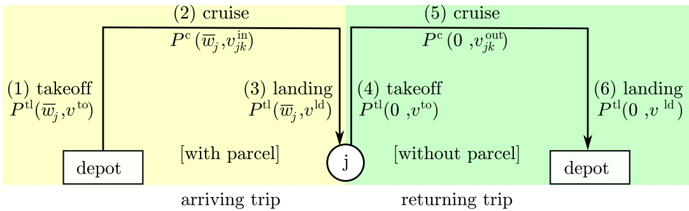

Figure 2 Different flight phases consume different powers

The Euclidean distance between the depot and the location of request $j$ is given by $d _ { 0 j }$ , and the drone cruise altitude is represented by parameter h. It is explained that the flight controllers using the MAVLink protocol do not provide options for specifying takeoff/landing speeds (Raj et al. 2021). Therefore, we can assume that the drone vertical speeds are fixed during the takeoff $( v ^ { \mathrm { t o } } )$ and landing phases $( v ^ { \mathrm { l d } } )$ . Given the cruise altitude $h ,$ we can easily determine the duration for takeoff $\begin{array} { r } { \tau ^ { \mathrm { t o } } = \frac { h } { v ^ { \mathrm { t o } } } } \end{array}$ and landing phases $\begin{array} { r } { \tau ^ { \mathrm { l d } } = \frac { h } { v ^ { \mathrm { l d } } } } \end{array}$

In contrast, cruise speeds might differ between phases, $v _ { j k } ^ { \mathrm { i n } }$ in phase 2 and $v _ { j k } ^ { \mathrm { o u t } }$ in phase $6 ,$ and also vary among different c-drone configurations (indexed by k). Given the distance $d _ { 0 j }$ , the corresponding cruise times are denoted as $\begin{array} { r } { \tau _ { j k } ^ { \mathrm { i n } } = \frac { d _ { 0 j } } { v _ { j k } ^ { \mathrm { i n } } } } \end{array}$ and $\begin{array} { r } { \tau _ { j k } ^ { \mathrm { o u t } } = \frac { d _ { 0 j } } { v _ { j k } ^ { \mathrm { o u t } } } } \end{array}$ , respectively. In Subsection 3.6.1, we provide the detailed procedure to determine the optimal values of $v _ { j k } ^ { \mathrm { i n } }$ and $v _ { j k } ^ { \mathrm { o u t } }$ . In addition, each c-drone delivery also needs extra time $t _ { C } ^ { \prime }$ to form c-drone via a coupling process. It should be noticed that $\tau _ { j } ^ { k }$ does not include $t _ { C } ^ { \prime }$ when a single drone is used to make delivery $( \mathrm { i . e . , ~ } k   =   1 )$ .

Therefore, the time required to fulfill request at $j \in \mathcal { C } _ { \mathcal { F } }$ using k-unit c-drone $( k > 1 )$ is given by:

$$
\tau_ {j} ^ {k} = t _ {C} ^ {\prime} + \underbrace {(\tau^ {\mathrm{to}} + \tau_ {j k} ^ {\mathrm{in}} + \tau^ {\mathrm{ld}})} _ {\text {arriving trip}} + \underbrace {(\tau^ {\mathrm{to}} + \tau_ {j k} ^ {\mathrm{out}} + \tau^ {\mathrm{ld}})} _ {\text {returning trip}}\tag{1}
$$

## 3.3. Drone endurance

Let’s consider a k-unit c-drone carrying a parcel of weight w. Given the assumption that weight w is distributed evenly among units, power consumption of the c-drone can boil down that of a single-drone carrying a distributed weight $\begin{array} { r } { \overline { { w } } = \frac { w } { k } } \end{array}$ . Power consumption differs among the flight phases as depicted in Figure 2. For example, $P ^ { \mathrm { t l } } ( \overline { { w } } , v _ { \mathrm { v } } )$ denotes the power consumed by each drone during vertical takeoff or landing phases, as a function of distributed parcel weight $\overline { { w } }$ and vertical speed $v _ { \mathrm { v } }$ . Similarly, $P ^ { \mathrm { c } } ( \overline { { w } } , v _ { \mathrm { h } } )$ denotes the power consumed by each drone during cruising, as a function of distributed parcel weight $\overline { { w } }$ and horizontal speed $v _ { \mathrm { h } }$ . The discharge current in flight phase i is calculated by: $\begin{array} { r } { I _ { i } = \frac { P _ { i } } { V _ { \mathrm { n o m } } } } \end{array}$ where $P _ { i }$ is the consumed power of phase i, and $V _ { \mathrm { n o m } }$ is the battery’s nominal voltage.

Firstly, the maximum discharge current $( I _ { \mathrm { m a x } } )$ , given by the battery manufacturer, is taken into account as a threshold to maintain the battery’s lifespan. As such, the discharge current during flight phase i must not exceed $I _ { \mathrm { m a x } }$

$$
\mid I _ {i} \leq I _ {\max} \quad \forall 1 \leq i \leq 6\tag{2}
$$

This constraint could prevent unrealistic decisions $( \mathrm { e . g . }$ , carrying overloaded parcels, traveling at excessive speeds), causing extremely high discharge rates.

Secondly, the battery capacity constraint has to be respected such that the drones are supplied sufficient power to finish every delivery. In practice, the actual capacity of a battery depends on the discharge current. The greater the discharge current, the less capacity will be available. We apply Peukert’s law to empirically capture the change in battery capacity at different rates of discharge current. The following equation can be used to calculate the total capacity required of each drone across flight phases (Doerffel and Sharkh 2006):

$$
C _ {\mathrm{d}} = \sum_ {i = 1} ^ {6} (I _ {\mathrm{eff}, i} \Delta t _ {i}) = \sum_ {i = 1} ^ {6} \left[ I _ {i} \left(\frac {I _ {i}}{I _ {\mathrm{nom}}}\right) ^ {p - 1} \Delta t _ {i} \right]\tag{3}
$$

where $I _ { \mathrm { e f f } , }$ i is the effective current, $I _ { \mathrm { n o m } }$ is the nominal current relating to the manufacturer supplied capacity (typically the 1C discharge rate), $p > 1$ is the Peukert exponent, and $\Delta t _ { i }$ is time duration of phase i.

The efficiency loss of drone delivery (e.g., wind resistance effects, battery capacity degradation) is expressed via parameter $\beta < 1$ (set to 0.9 in our experiments). We assume each delivery operation discharges no more than $\beta$ of $C _ { \mathrm { n o m } }$

$$
C_{\mathrm{d}} \geq \beta C_{\mathrm{nom}}\tag{4}
$$

If either constraints (2) and (4) is violated, the k-unit c-drone is incapable of transporting the considered parcel.

## 3.4. A two-index MILP formulation

A PDSTSP-c solution consists in two components: a truck (TSP) tour which can be presented as a sequence of visits, and a set of drone tours, each of which can be seen as a sequence of assigned delivery requests. To model mathematically the problem, one could come up with a three-index formulation in which two indices represent edges and one index is for drone assignment decisions. However, due to a large number of decision variables and the symmetry among identical drones which causes a poor performance of branch-and-bound frameworks, the three-index formulation has limited practical interest. Our preliminary experiment results further support this observation. We now present a two-index formulation for the PDSTSP-c using the following decision variables:

• $x _ { i j } \colon$ binary variables equal to 1 if edge $( i , j )$ is traveled by the truck $( i , j \in \mathcal { N } : i < j )$ , 0 otherwise;

• $z _ { j } ^ { k }$ : binary variables equal to 1 if request $i \in \mathcal { C } _ { \mathcal { F } }$ is serviced by k drones, 0 otherwise;

$u _ { i } ;$ binary variables equal to 1 if customer $i \in \mathcal { C }$ is served by the truck, 0 otherwise;

• $y _ { i j } \colon$ binary variables equal to 1 if the fulfillment of request i occurs before that of request $j$ within any drone schedule, 0 otherwise;

• $f _ { i j } \in \mathbb { R } ^ { + }$ : continuous variables indicating the flow of drone units from request i to request $j$ in their schedule.

$T _ { i } \in \mathbb { R } ^ { + }$ : continuous variables representing the time at which request $i \in \mathcal { C } _ { \mathcal { F } 0 }$ begins to be serviced by the drones. More precisely, it is the time right before the drones start coupling (in case of using the c-drone), swapping the battery, and loading parcels of request i at the depot.

$Z \in \mathbb { R } ^ { + }$ : continuous variable denoting the completion time all carriers come back to the depot.

The proposed formulation substitutes the redundant vehicle index, leaving decision variables $y _ { i j }$ for only sequencing drone deliveries, by introducing the continuous flow variables $f _ { i j }$ which could function the drone assignment. The flows of $f _ { i j }$ , similar to $y _ { i j }$ , originate and terminate at depot vertex. In the middle, the flows traversing through vertices indicate occurrences of deliveries.

The cost of any flow from $j$ equals to $\tau _ { j } ^ { k }$ representing the required delivery time to $j .$ As mentioned earlier, parameter $\tau _ { j } ^ { k }$ varies according to the decision on the number of drones k assigned to collaboratively fulfill request $j , \; z _ { j } ^ { k }$ with $j \in \mathcal { C } _ { \mathcal { F } }$ . Generally, index k ranges from $q _ { j }$ to $p _ { j }$ , where $q _ { j }$ and $p _ { j }$ are the minimal number of drones required and the maximal number of drones allowed (e.g., due to safety regulation) to handle request $j ,$ respectively.

The representation of a PDSTSP-c solution can be demonstrated by the graph in Figure 3. The schedule is initialized with three flows from the starting node 0 including (0, 2), (0, 1), and (0, 3), implying that three services 2, 1, and 3 start at time 0 in parallel. The flow along edge (0, 1), f01, equals 2, indicating that two drones are used for the synchronized service at node 1, while the other two nodes need single-drone delivery. The flows continue with four flows (2,4), (1,4), (1,5), and (3,5) creating two synchronized-services at nodes 4 and 5. In particular, both services 1 and 2 must finish before the beginning of service 4, both services 1 and 3 must finish before the beginning of service 5. Likewise, the last synchronized service at node 6 is presented via two flows (4,6) and (5,6). The total weight of these flows shows that the service requires three drones, two from node 5 $( f _ { 5 6 } = 2 )$ and one from node 4 $( f _ { 4 6 } = 1 )$ . Finally, the last two flows toward the ending node, (4, 0) with the weight of one $( f _ { 4 0 } = 1 )$ and (6, 0) with the weight of three $( f _ { 6 0 } = 3 )$ , imply the termination of the schedule where one drone finishes after service 4 while the other three drones finish after service 6. The makespan of this drone schedule is the latest completion time at parent nodes of the ending node 0 (i.e., nodes 4 and 6), calculated as $\operatorname* { m a x } ( 1 0 + 7 , 1 7 + 6 )   =   2 3$

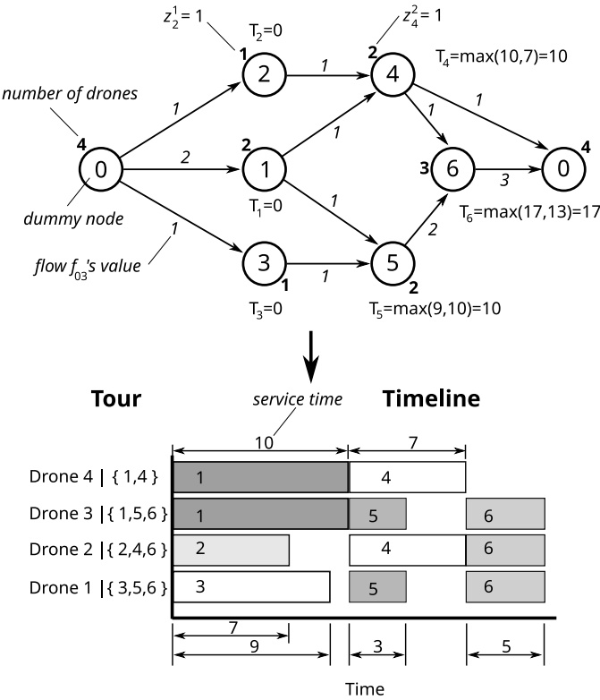

Figure 3 An graph-based representation of a drone schedule

Based on above observations, the PDSTSP-c can be formulated as:

Minimize Z

(5)

s.t.

$$
Z \geq \sum_ {i <   j} t _ {i j} x _ {i j}\tag{6}
$$

$$
Z \geq T _ {j} + \sum_ {q _ {j} \leq k \leq p _ {j}} \tau_ {j} ^ {k} z _ {j} ^ {k}
$$

$$
\forall j \in \mathcal {C} _ {\mathcal {F}}\tag{7}
$$

$$
u _ {j} + \sum_ {q _ {j} \leq k \leq p _ {j}} z _ {j} ^ {k} = 1
$$

$$
\forall j \in \mathcal {C} _ {\mathcal {F}}\tag{8}
$$

$$
u _ {j} = 1
$$

$$
\sum_ {i <   j} x _ {i j} + \sum_ {j <   k} x _ {j k} = 2 u _ {j}
$$

$$
\forall j \in \mathcal {C} _ {\mathcal {T}} \cup \{0 \}\tag{9}
$$

$$
\forall j \in \mathcal {C} _ {\mathcal {F}},\tag{10}
$$

$$
|S|\sum_{\substack{i\in S,j\in \mathcal{N}\setminus S\\ \text{or} j\in S,i\in \mathcal{N}\setminus S}}x_{ij}\geq 2\sum_{l\in S}u_{l}
$$

$$
\forall S \subseteq \mathcal {C}, | S | \geq 3\tag{11}
$$

$$
\sum_ {j \in \mathcal {C} _ {\mathcal {F}}} f _ {0 j} \leq m\tag{12}
$$

$$
\sum_{\substack{i\in \mathcal{C}_{\mathcal{F}0}\\ i\neq j}}f_{ij} = \sum_{q_{j}\leq k\leq p_{j}}kz_{j}^{k}
$$

$$
\forall j \in \mathcal {C} _ {\mathcal {F}}\tag{13}
$$

$$
\sum_{\substack{i\in \mathcal{C}_{\mathcal{F}0}\\ i\neq j}}f_{ij} = \sum_{\substack{l\in \mathcal{C}_{\mathcal{F}0}\\ l\neq j}}f_{jl}
$$

$$
\forall j \in \mathcal {C} _ {\mathcal {F} 0}\tag{14}
$$

$$
\frac {f _ {i j}}{m} \leq y _ {i j} \leq f _ {i j}
$$

$$
\forall (i, j) \in \mathcal {C} _ {\mathcal {F} _ {0}}, i \neq j\tag{15}
$$

$$
T _ {j} + \mathbf {M} (1 - y _ {i j}) \geq T _ {i} + \sum_ {q _ {j} \leq k \leq p _ {j}} \tau_ {j} ^ {k} z _ {j} ^ {k}
$$

$$
\forall i \in \mathcal {C} _ {\mathcal {F} 0}, j \in \mathcal {C} _ {\mathcal {F}}, i \neq j\tag{16}
$$

$$
0 \leq f _ {i j} \leq m
$$

$$
\forall (i, j) \in \mathcal {C} _ {\mathcal {F} ^ {0}}, i \neq j\tag{17}
$$

$$
u _ {i} \in \{0, 1 \}
$$

$$
\forall i \in \mathcal {N}\tag{18}
$$

$$
x _ {i j} \in \{0, 1 \}
$$

$$
\forall (i, j) \in \mathcal {N}, j > i\tag{19}
$$

$$
z _ {j} ^ {k} \in \{0, 1 \}
$$

$$
\forall j \in \mathcal {C} _ {\mathcal {F}}, q _ {j} \leq k \leq p _ {j}\tag{20}
$$

$$
y _ {i j} \in \{0, 1 \}
$$

$$
\forall (i, j) \in \mathcal {C} _ {\mathcal {F} 0}, i \neq j\tag{21}
$$

$$
T _ {i} \geq 0
$$

$$
\forall i \in \mathcal {C} _ {\mathcal {F} _ {0}}\tag{22}
$$

The objective function (5) seeks to minimize the makespan $Z ,$ the latest time at which all the vehicles return to the depot. Constraints (6) and (7) define variable $Z .$ Constraints (8) imply each drone-eligible customer is visited exactly once, by either the truck or drone(s). Constraints (9) guarantee the truck-only customers must be visited by the truck. Constraints (10) are degree constraints for the truck tour. They imply that if vertex $j$ is visited by the truck, there must be two edges of the truck tour linking to $j .$ The connectivity of the truck tour is guaranteed by constraints (11), which are also called the Subtour Elimination Constraints (SECs). They force the presence of at least two edges between any set $S$ and $V \setminus S$ , for every subset $S$ of $V _ { c }$ such that $S$ contains at least one vertex visited by the truck.

Constraints (12) ensure the number of drones departing from the depot is no greater than a given fleet size. Constraints (13) impose the total drone flows to a node must be equal to the number of drones assigned to service that node. Constraints (14) are the equations of drone flow conservation at each node. Constraints (15) show the relationship between variables $f _ { i j }$ and $y _ { i j }$ . They imply that: (i) if there is no flow from i to $j ,$ the variable $y _ { i j }$ must be zero; and (ii) the number of drones on any arc $( i ,   j )$ is at most $m .$ Constraints (16), which link variables $T _ { i }$ and $y _ { i j }$ , imply that if the service of request $i$ is followed by the service of request $j$ in any drones $( \mathrm { i . e . , ~ } y _ { i j }   =   1 )$ , the delivery for request $j$ cannot begin until the delivery for request i is finished. Here, M is a sufficiently large number. The relationship between $T _ { i }$ and $y _ { i j }$ in Constraints (16) ensures the synchronization constraints are respected.Finally, Constraints (17)-(22) specify the decision variable domains.

## 3.5. PDSTSP-c solution extraction procedure

While it is straightforward to obtain the truck tour from $x _ { i j }$ values of an obtained MILP solution, it is not trivial to construct the drone tours. We use the following procedure to extract the drone schedule from the values of $y _ { i j } , \: f _ { i j }$ , and $z _ { j } ^ { k }$

Algorithm 1 Drone schedule extraction from a MILP solution
Input: $(y_{ij}, f_{ij}, z_j^k)$
function DRONE SCHEDULE EXTRACTION
    Initialize set $D$ containing $m$ empty tours with $\sigma_k = 0 \quad \forall k \in D$
    $\overline{\mathcal{G}} \leftarrow$ Initialize DAG $(y_{ij}, f_{ij})$
    $O \leftarrow$ Generate a topological order of $\overline{\mathcal{G}}$
    for each node $i$ in order $O$ do
        $P_i \leftarrow$ get parent nodes of $i$ in $\overline{\mathcal{G}}$
        $D_i \leftarrow$ get drone tours that contain any parent nodes $j \in P_i$
        $t_i \leftarrow \max(\sigma_k) \quad \forall k \in D_i$
        $dc_i \leftarrow k |z_i^k = 1$
    for each drone $k$ in $D_i$ do
        Push $i$ to the back of drone tour $k$
        $\sigma_k \leftarrow t_i + \tau_j^{dc_i}$
    return $(D, t_i)$

The procedure begins with initialization set D of m empty drone tours with zero cumulative operation time $\sigma _ { k }$ (line 2). From a feasible solution $( f , z )$ , we build a graph $\overline { { \mathcal { G } } } = ( V ^ { * } , E ^ { * } )$ where set $V ^ { * }$ includes vertex i serviced by drones, and set $E ^ { * }$ contains edge $( i , j )$ with the cost equal to $f _ { i j }$ (line 3). Due to synchronization constraints (16), it is expected that $\overline { { \mathcal { G } } }$ is a Directed Acyclic Graph (DAG) in which no directed cycle is allowed. Then a topological order $O$ of $\overline { { \mathcal { G } } }$ can be determined using depth-first search based topological sort (line 4). According to the topological order, each node i is sequentially inserted into the assigned drones (lines 5-12). In particular, the assigned drones $D _ { i }$ are those containing any parent nodes $j \in P _ { i }$ of node i in graph $\overline { { \mathcal { G } } }$ (lines 6-7). In case of $j = 0$ , the assigned drone can be any currently empty ones. After extracting the start time $t _ { i }$ for delivery as the maximum of the cumulative operation time among assigned drones (line 8), node i is inserted into each of $D _ { i }$ drone tours (lines 10-12). At the end, we return the complete drone tours D along with the list of start times for each delivery request.

## 3.6. Implementation

3.6.1. Power consumption model We employ the drone power consumption non-linear model of Raj et al. (2021). Figure 2 depicts the power consumption across the flight phases of a sortie. The power consumption (in Watts) during the different flight phases are given by the following functions of distributed parcel weight (w) (i.e., the actual weight distributed over each drone), vertical drone speed $( v _ { \mathrm { v } } )$ , and horizontal drone speed $( v _ { \mathrm { h } } )$

• During vertical takeoff or landing:

$$
P ^ {\mathrm{tl}} (\overline {{w}}, v _ {\mathrm{v}}) = k _ {1} (W + \overline {{w}}) g [ \frac {v _ {\mathrm{v}}}{2} + \sqrt {(\frac {v _ {\mathrm{v}}}{2}) ^ {2} + \frac {(W + \overline {{w}}) g}{k _ {2} ^ {2}}} ] + c _ {2} ((W + \overline {{w}}) g) ^ {3 / 2}\tag{23}
$$

• During horizontal cruise:

$$
P ^ {\mathrm{c}} (\overline {{w}}, v _ {\mathrm{h}}) = (c _ {1} + c _ {2}) [ ((W + \overline {{w}}) g - c _ {5} (v _ {\mathrm{h}} \cos \alpha) ^ {2}) ^ {2} ] ^ {3 / 4} + c _ {4} v _ {\mathrm{h}} ^ {3}\tag{24}
$$

Here, $c _ { 1 } , c _ { 2 } , c _ { 4 } , c _ { 5 } , k _ { 1 }$ and $k _ { 2 }$ are model coefficients whose values are derived by Liu, Sengupta, and Kurzhanskiy (2017). W is the combined weight of drone frame and battery module, α is the forward tilt of the drone while flying horizontally (i.e., the angle of attack), and $g$ is the gravitational constant. The value of $\alpha$ satisfies the following the equilibrium equation of the external forces at steady state (Liu, Sengupta, and Kurzhanskiy 2017):

$$
\tan \alpha \left[ (W + \overline {{w}}) g - c _ {5} (v _ {\mathrm{h}} \cos \alpha) ^ {2} \right] = c _ {4} v _ {\mathrm{h}} ^ {2}\tag{25}
$$

In implementation, we use a simple iterative process to solve this equation for an approximate calculation of $\alpha .$

3.6.2. Determining optimal cruising speeds Consider a k-unit c-drone to carry a parcel of weight $w _ { i }$ from the depot to location of request $i ,$ we use an iterative process (shown in Algorithm 2) for determining the optimal pair of cruise speeds, $v _ { i k } ^ { \mathrm { i n } }$ and $v _ { i k } ^ { \mathrm { o u t } }$ , that minimizes the flight time for a given delivery.

The process starts with initializing null values the optimal speeds $( v _ { \mathrm { i n } } ^ { * } , v _ { \mathrm { o u t } } ^ { * } )$ (line 2). Given the calculated distributed weight $\overline { { w _ { i } } }$ (line 3) and vertical speeds during takeoff and landing, $v ^ { \mathrm { t o } }$ and $v ^ { \mathrm { l d } }$ , we first evaluate whether the battery can even handle the four vertical takeoff/landing phases before further considering cruising phases (lines 4-7). If any constraints described in Subsection 3.3 are found violated in function Infeasibl $. e ,$ meaning the drone configuration could not even handle landing/takeoff phases, we immediately stop and return null values. Otherwise, we proceed evaluating every pair $( v _ { \mathrm { i n } } , v _ { \mathrm { o u t } } )$ for the two cruising phases, arriving and returning, respectively, ranging in $[ v _ { \mathrm { m i n } } , v _ { \mathrm { m a x } } ]$ with 0.2 $\mathrm { m / s }$ step size (lines 8-15). If the battery power is sufficient for cruising at considered speeds which minimize the flight time, we store the found speed values into $( v _ { \mathrm { i n } } ^ { * } , v _ { \mathrm { o u t } } ^ { * } )$ (lines 14-15). Finally, we return the best $( v _ { \mathrm { i n } } ^ { * } , v _ { \mathrm { o u t } } ^ { * } )$ found if there is any. Otherwise, null values are returned.

Algorithm 2 Procedure of computing optimal cruise speeds
Input: $(k, w_i, d_{0i})$
function GETOPTIMALSPEEDS
    $(v_{\text{in}}^*, v_{\text{out}}^*) \leftarrow \text{null}$
    $\overline{w_i} = w_i / k$
    $(I_{\text{in}}^{\text{to}}, I_{\text{in}}^{\text{ld}}, I_{\text{out}}^{\text{to}}, I_{\text{out}}^{\text{ld}}) \leftarrow (\frac{P^{\text{tl}}(\overline{w_i}, v^{\text{to}})}{V_{\text{nom}}}, \frac{P^{\text{tl}}(\overline{w_i}, v^{\text{ld}})}{V_{\text{nom}}}, \frac{P^{\text{tl}}(0, v^{\text{to}})}{V_{\text{nom}}}, \frac{P^{\text{tl}}(0, v^{\text{ld}})}{V_{\text{nom}}})$
    $C_{\text{remaining}} \leftarrow C_{\text{nom}} - C_{\text{d,tl}}$
    if Infeasible($C_{\text{remaining}}, I_{\text{in}}^{\text{to}}$) then
        return null
    for $(v_{\text{in}}, v_{\text{out}})$ in range[$v_{\text{min}}, v_{\text{max}}$] with step size = 0.2 m/s do
        $(\tau_{\text{in}}, \tau_{\text{out}}, I_{\text{in}}, I_{\text{out}}) \leftarrow \left( \frac{d_{0i}}{v_{\text{in}}}, \frac{d_{0i}}{v_{\text{out}}}, \frac{P^c(\overline{w_i}, v_{\text{in}})}{V_{\text{nom}}}, \frac{P^c(0, v_{\text{out}})}{V_{\text{nom}}} \right)$
        $C_{\text{end}} \leftarrow C_{\text{remaining}} - C_{\text{d,in}} - C_{\text{d,out}}$
        if Infeasible($C_{\text{end}}, I_{\text{in}}, I_{\text{out}}$) then
            continue
        if $\frac{d_{0i}}{v_{\text{in}}} + \frac{d_{0i}}{v_{\text{out}}} &lt; \frac{d_{0i}}{v_{\text{in}}^*} + \frac{d_{0i}}{v_{\text{out}}^*}$ then
            $(v_{\text{in}}^*, v_{\text{out}}^*) \leftarrow (v_{\text{in}}, v_{\text{in}})$
        return $(v_{\text{in}}^*, v_{\text{out}}^*)$

3.6.3. Cutting plane implementation The proposed MILP formulation of PDSTSP-c is solved using a standard branch-and-cut algorithm as follows. We solve the linear programming (LP) relaxation of the formulation including constraints (5) - (22), except connectivity constraints (11). We then search for violated constraints of type (11), and the detected constraints are added to the current LP, which is then reoptimized. This process is repeated until all the constraints are satisfied. If there are fractional variables, we branch. If all the variables are integer, we explore another node in the branch-and-bound search tree.

We perform a heuristic procedure for the separation of the subtour constraints as follows. From a LP solution with the values of variables u and x equal to $u ^ { * }$ and $x ^ { * }$ obtained on a node of the search tree, we build a graph $G ^ { * }   =   \left( V ^ { * } , E ^ { * } \right)$ , where $V ^ { * }$ is the set of vertices i such that $u _ { i } ^ { * } > 0$ and $E ^ { * }$ is the set of arcs $( i , j )$ such that $x _ { i j } ^ { * } > 0$ . We follow the parametric connectivity procedure in Applegate et al. (2003) to record all relevant sets $S \subset { \mathcal { C } }$ that violate the connectivity constraints in a disjoint-set data structure. If the number of sets is at least two, each set which does not contain the depot is recorded as a set S that we need to find. For each recorded set S, a SEC (11) is generated.

## 4. Solution method

In this section, we present a Ruin-and-Recreate metaheuristic (RnR) for the PDSTSP-c. The proposed method extends the Large Neighborhood Search framework of (Shaw 1998), a heuristic approach which stems from the ruin-and-recreate principle of (Schrimpf et al. 2000). The idea is to explore large neighborhoods by iteratively destroying a part of the incumbent solution and then possibly reconstructing it in a different way. The general RnR algorithm, as shown in Algorithm $^ { 3 , }$ starts with building the first solution $s _ { 0 }$ via the SolutionConstruction operator (line 2), then initializing the current solution $s ^ { * }$ and the best solution $s ^ { b e s t }$ (line 3). The initial solution is passed to the iterative process for improvements (lines 4-11). During each iteration, the neighbor solution s is generated from the current solution $s ^ { * }$ via Ruin&Recreate procedure (line 5). In general, a number of removal and insertion operators are available. Removal (respectively, insertion) heuristics differ in the criterion used to select the requests to be removed (respectively, to be inserted). At each iteration of the algorithm, the incumbent solution s is ruined by randomly selected remova operators, and then recreated with the insertion operator. Only neighbor solutions which satisfy the Threshold Acceptance condition (line 6) are selected into further improvement via the LocalSearch procedure (line 7). Here, $\Delta$ is a coefficient initially set to a given value $\Delta _ { i n i }$ and its value is adaptively changed during the search. The $c o s t ( s )$ function for solution $s ,$ as used later on in this paper, represents the objective value of the solution. The resulting solution is saved as the current solution $s ^ { * }$ for the next iterations. It is saved to $s ^ { b e s t }$ if it improves the current best solution (lines 8-9). Finally, the value of $\Delta$ is decreased via cooling rate ϵ before starting the next iteration (line 10). The algorithm terminates (line 11) when the maximum number of iterations $i t e r _ { m a x }$ or the limit of computational time $t _ { l i m i t }$ has been reached. We now describe in detail the main components of the algorithm.

Algorithm 3 RnR for the PDSTSP-c
Input: PDSTSP-c problem instance
function RNR
    $s_0 \leftarrow$ SolutionConstruction
    $s^* \leftarrow s_0, s^{best} \leftarrow s_0$
    repeat
        $s \leftarrow$ Ruin&amp;Recreate($s^*$)
        if $cost(s) &lt; cost(s^*) \times (1 + \Delta)$ then
            $s^* \leftarrow$ LocalSearch($s$)
            if $cost(s^*) &lt; cost(s^{best})$ then
                $s^{best} \leftarrow s^*$
        $\Delta \leftarrow \Delta \times \epsilon$
    until Termination condition
return $s^{best}$

## 4.1. Removal operators

Within the context of solving the PDSTSP-c, the ruin phase typically removes both types of requests: (1) “truck requests” which refer to those assigned to the truck tour, and (2) “drone requests” which refer to those assigned to the drone tours. The set of requests $C _ { r }$ to be removed within an iteration is determined by a random pair of removal operators, one from each removal group, picked at the start of the ruin phase. The size of set $C _ { r }$ is calculated by the equation:

$$
| C _ {r} | = q _ {t} + q _ {d} = \lfloor U (1, \lambda | C _ {s} ^ {t r u c k} |) \rfloor + \lfloor U (1, \lambda | C _ {s} ^ {d r o n e} |) \rfloor\tag{26}
$$

where $q _ { t } , \: q _ { d }$ indicate the number of truck and drone requests to be removed, respectively; λ is the pre-defined maximum removal rate. Values of $q _ { t }$ and $q _ { d }$ are obtained by rounding down the randomly selected real value from the continuous uniform distribution $U ( 1 , \lambda | C _ { s } ^ { t r u c k } | )$ and $U ( 1 , \lambda | C _ { s } ^ { t r u c k } | )$ respectively. We now present six removal operators proposed for the PDSTSP-c. The first three operators manage to remove the truck requests, whereas the others manage to remove the drone requests. Both should introduce sufficient rooms for further improvements of early flaws in requestvehicle assignments via exchanging requests between the truck and drone tours. After each removal, a process is performed to update new configuration ready for the next removal.

4.1.1. Random truck-request removal This removal operator randomly selects and removes $q _ { t }$ requests while keeping the order of remaining requests in the truck tour. Its objective is to provide enough diversification to the search process via diverging the structure of the truck tour.

4.1.2. Worst removal This operator removes $q _ { t }$ requests whose insertion cost is the most expensive in the truck tour. The insertion cost of each request is computed as the difference of objective values between the solutions with and without that request.

4.1.3. String removal This operator removes a sub-string of $q _ { t }$ requests out of the truck tour. A random seed request $c _ { s } ^ { s e e d } \in C _ { s } ^ { t r u c k }$ positioned at $p ^ { s e e d }$ in the truck tour is selected. We remove the portion of the truck tour that begins at $p ^ { s e e d }$ and spans qt requests forward. However, if $q _ { t }$ $c _ { s } ^ { s e e d }$ is in position where $p ^ { s e e d } + q _ { t } > | C _ { s } ^ { t r u c k } |$ , we remove two portions of the truck tour: from $p ^ { s e e d }$ to $| C _ { s } ^ { t r u c k } |$ and from the beginning to $| C _ { s } ^ { t r u c k } | - p ^ { s e e d }$ . As such, we can always remove $q _ { t }$ requests in all cases.

4.1.4. Random drone-request removal Similar to the random truck-request removal, this counterpart for drone tours randomly selects and removes $q _ { d }$ drone requests from the solution. Whenever a request is removed, the entire structure of the drones’ schedule is updated for the next removal. This applies for all remaining drone-request removals. We explain this update procedure later in Section 4.3.

4.1.5. Sweep removal This removal operator proposed in Nguyen et al. (2022) removes a cluster of $q _ { d }$ drone requests that are adjacent in the polar coordinate. Given the set of drone requests $C _ { s } ^ { d r o n e }$ in solution $s ,$ it works as follows. We first consider a standard angular coordinate, in which the depot is taken as the pole and the polar axis directs to the right of the pole. A seed angle $\theta _ { s e e d } ,$ directed counter-clockwise from the polar axis, is randomly chosen from the continuous uniform distribution $U ( 0 ^ { \circ } , 3 6 0 ^ { \circ } )$ . The chosen seed angle draws a directed line l from the depot. The requests in set $C _ { s } ^ { d r o n e }$ are then sorted according to how close they are to line $l ,$ measured by the polar angle $\varphi _ { i }$ between line l and the straight line to request i from the pole. Subsequently, the operator iterates over the $\mathcal { C } _ { s } ^ { d r o n e }$ set, removes from the current drone tours the closest request, i.e., the one with the smallest $\varphi _ { i }$ . The operator sweeps through $q _ { d }$ requests before termination. Figure 4 illustrates an example of the sweep removal.

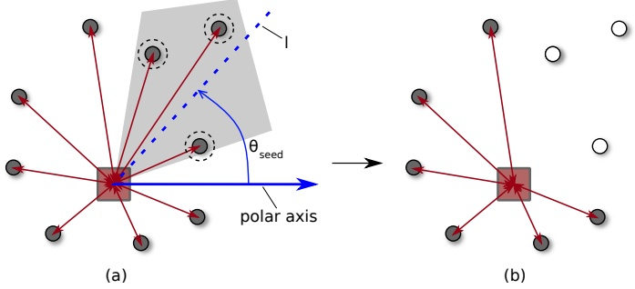

Figure 4 An example of Sweep Removal

4.1.6. Block removal Observations during preliminary experiments show that dispersed removals across the drone schedule could unintentionally end up leaving a lot of idle time, visualized as isolated blank spaces. It practically appears that there are little chances to completely refill such spaces by unserviced requests without incurring ones that might even deteriorate the solution quality. Figure 5 illustrates the disturbance of idle time after requests have been removed.

The block removal is proposed to cope with this issue. All requests in drone tours are first sorted in ascending order based on the start time of their service. A random time interval $[ t _ { s t a r t } , t _ { f i n i s h } ]$ is randomly selected such that there are at least $q _ { d }$ drone requests that have the services started within this interval. The operator then iteratively removes each ordered request, whose start time is greater or equal to $t _ { s t a r t }$ , until $q _ { d }$ requests are removed. As a result, this removal excludes a block of requests that are adjacent in schedule, reducing the occurrence of idle time in the created solution.

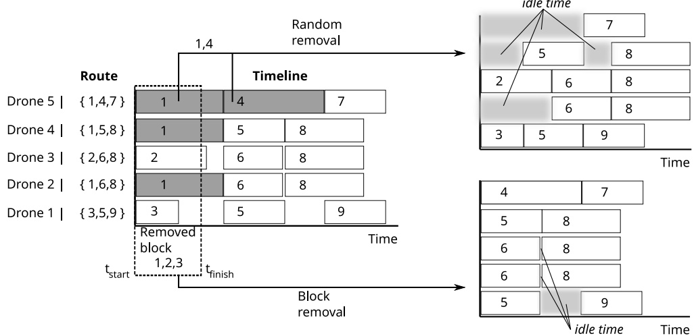

Figure 5 An illustration of Block Removal in comparison with Random Removal

## 4.2. Insertion operator

The insertion heuristic rebuilds the partial solution $s = \{ \mathcal { T } , \mathcal { A } \}$ previously destroyed by removal heuristics, where $\mathcal { T }$ is the set of current tours and A is the set of ejected requests. It consecutively inserts requests of set $\mathcal { A }$ into tours $\mathcal { T }$ until all requests are serviced. In the context of $\mathrm { P D S T S P - c } ,$ the insertion of request $i \in \mathcal { A }$ requires an examination of all possible positions in both the truck and drone tours to find the cheapest option. It is important to note that the “position” mentioned here is defined differently between the truck and drone tours. Unlike in the truck tour where a position can be easily found, the drone tours are defined by two aspects: (1) the set of drone tours to which request i is assigned, and (2) the time t at which the service of request i starts.

Algorithm 4 Insertion heuristic
Input: Partial solution $s = \{ \mathcal{T}, \mathcal{A} \}$
function INSERTIONHEURISTIC($s$)
    SHUFFLE($\mathcal{A}$)
    for $i \in \mathcal{A}$ do
        $pos^T \leftarrow$ determine the cheapest position in truck tour
        if $i$ is drone-eligible then
            $pos^D \leftarrow$ determine the cheapest position in drone tours
        if $cost(pos^D) &lt; cost(pos^T)$ then
            Insert $i$ into drone tours at $pos^D$
        else
            Insert $i$ into truck tour at $pos^T$
        $\mathcal{A} \leftarrow \mathcal{A} \setminus \{i\}$
return Recreated solution $s$

The proposed insertion operator for the PDSTSP-c works as follows (see Algorithm 4). In line 2, the process first starts by randomly shuffling requests in set A. Then, each sorted request i is sequentially inserted into solution s at the best position which incurs the cheapest cost, taking into account position $p o s ^ { T }$ in the truck tour and position $p o s ^ { D }$ in the drone tours (lines 4-6). The cost function of an insertion is defined as $\operatorname* { m a x } ( T _ { i } ^ { \prime } ) - Z ,$ where $Z$ is the current makespan, and $T ^ { \prime } i$ is the completion time of tour i after the insertion. Request i is inserted into the drone tour at $p o s ^ { D }$ if it incurs better cost (lines 7-9). Otherwise, it is inserted into the truck tour at $p o s ^ { T }$ (line 11), and is removed from set A before the next iteration (line 12). It is also worth noting that the SolutionConstruction operator mentioned earlier in Algorithm 3 is simply the insertion operator when the provided A contains all requests $( \mathrm { i . e . , } ~ \mathcal { A }   \leftarrow   \mathcal { C } )$

Given the partial solution $s = \{ \mathcal { T } , \mathcal { A } \}$ , the process starts by randomly shuffling set A. Each request in A is then sequentially inserted following the given order, described as follows.

Request $i \in { \mathcal { A } } ,$ which is out of the current partial solution, can be inserted into both the truck and drone tours if it is drone-eligible. On the one hand, inserting into the truck tour simply requires to iterate over all the positions in the truck tour to seek the best position $p o s ^ { T }$ that incurs the cheapest additional cost. On the other hand, determining the position to insert i into the drone tours requires a more complex procedure as presented in Algorithm 5.

Algorithm 5 Drone insertion
Input: Partial solution $s = \{\mathcal{T}, \mathcal{A}\}$, request $i$
function DRONEINSERTION($s, i$)
    $\mathcal{F} \leftarrow$ set of possible start times
    $k \leftarrow$ randomly selection in range $[q_i, p_i]$
    for $t \in \mathcal{F}$ do
        $K \leftarrow$ select $k$ best drones using rank-based roulette wheel selection
        $cost(t, K) \leftarrow$ move evaluation procedure
        if $cost(t, K) &lt; bestcost$ then
            $bestcost \leftarrow cost(t, K)$
            $pos^D \leftarrow (t, K)$
return the best insertion position $pos^D$

In the algorithm, we first specify set F including all possible start times, after which the service of request i could immediately start (line 2). Set F basically contains time 0 and all completion times of serviced requests. The insertion cost associated with each time $t \in \mathcal { F }$ is then evaluated (lines 3-8). Considering the insertion of request i at t, the operator selects a set K of $d _ { i }$ drones (line 4) to which request i is assigned. It is reasonable that K should include $d _ { i }$ drones that have the shortest total service time after accommodating request i. Due to the complexity of computing exactly such a service time, to accelerate the algorithm, we calculate the approximate value $T _ { k } ^ { \prime }$ of drone tour $k \in K$ as:

$$
T _ {k} ^ {\prime} = T _ {k} + \max (0, \tau_ {i} - \delta (t))\tag{27}
$$

where $T _ { k }$ is the current total service time of drone $k ,   \tau _ { i }$ is the service time of request i. If t on drone tour k is at an idle time, $\delta ( t )   =   S T ( j )   -   t   \geq   0$ implies the slack time defined as the remaining spare time from t until the start time $S T ( j )$ of the next request $j .$ However, if t on drone tour k is in the middle of a delivery l, value of $\delta ( t )   =   S T ( l ) - t   <   0$ represents the amount of extra time created by the insertion of i which delays delivery l. The two mentioned cases of slack time are depicted in Figure 6. In particular, although drone 2 has the shortest total service time, the insertion at time t would cause a serious delay for request l. Instead, inserting into drone 1 would be much cheaper thanks to the slack time despite the fact that it currently has the longest total service time.

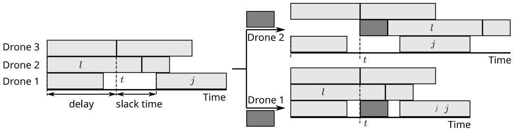

Figure 6 An illustration of δ(t) values in two insertion scenarios

It is worth mentioning that there are chances where multiple drones could obtain the same δ value. To increase the diversity of the search and avoid the premature convergence, we adopt the rank-based roulette wheel selection mechanism proposed in Whitley (1989). The insertion cost incurred by the move is exactly calculated (line 5). We will discuss in detail this move evaluation procedure in Section 4.3. The cost value records two pieces of information: the resulting makespan and the total service time of all carriers. We choose the best move based on the priority (line 6): shorter resulting makespan first and then shorter total service time of all carriers.

## 4.3. Move evaluation of drone insertion with topological sort

Due to the synchronization constraints, any removal or insertion move will likely affect the schedule of numerous subsequent drone services in not just the tour where the move is performed. This is the main source of challenges for the move evaluation in the PDSTSP-c. We visualize this obstacle in Figure 7 by considering an example in which we insert request 8 into drones 3 and 4 at time t.

As can be seen in Figure 7, the insertion directly postpones services of requests 2, 3, 4, and 5. The delays of requests 4 and 5 turn out to cause other delays to services of requests 6 and $^ { 7 , }$ and so on. In general, this single request insertion has triggered a chain of movements for successive requests, hence, the service time of requests from t forward are likely to change. This occurs in not only the tour where request 8 is assigned to but also other drone tours, such as drones 1, 2 and 5. Eventually, the resulting timeline could end up like Figure 7(b). As a consequence, the move evaluation is rather complex and cannot be handled in $\mathcal { O } ( 1 )$ time. The only positions where the insertion cost can be directly determined in constant time are after the last requests in the drone tours. In the following paragraphs, we propose an efficient method to evaluate exactly each insertion/removal move in the general case.

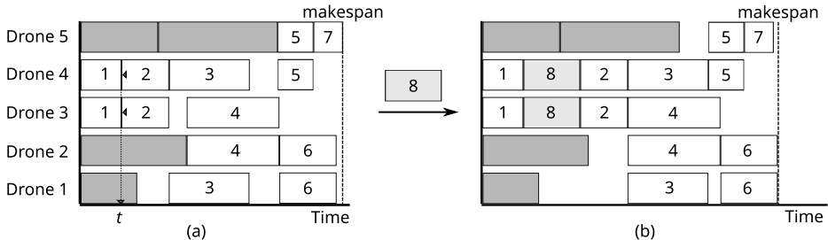

Figure 7 An example of inserting a synchronized request into the middle of a drones’ schedule

The idea takes advantage of the graph-based representation proposed in Section 3.4 to partially model feasible $\mathrm { P D S T S P \_ c }$ solutions. We initialize and maintain throughout the search, for each solution, a directed acyclic graph $\overline { { \mathcal { G } } } = ( \overline { { V } } , \overline { { A } } )$ to represent the drone schedule. Considering the insertion of request i into $d _ { i }$ drone tours of set K at time t, we denote $\overline { { \mathcal { G } ^ { \prime } } }$ is the realization of $\mathcal { G }$ after the insertion is performed. To obtain $\overline { { \mathcal { G } ^ { \prime } } }$ , we iterate over every drone tour $k \in K$ to identify the precedent and successive nodes of task $v _ { i }$ after the insertion. Let’s denote $F T ( v _ { i } )$ as the completion time of task $v _ { i }$ . On drone tour $k ,$ precedent node $v _ { j }$ and successive node $v _ { j ^ { \prime } }$ of $v _ { i }$ are the closest nodes to t that satisfy the condition $F T ( v _ { j } ) \leq t \leq F T ( v _ { j ^ { \prime } } )$ . Based on this information, we can update graph $\overline { { \mathcal { G } } }$ accordingly by removing arc $( v _ { j } , v _ { j ^ { \prime } } )$ and adding two new arcs including: inbound arc $( v _ { j } , v _ { i } )$ and outbound arc $( v _ { i } , v _ { j ^ { \prime } } )$ . However, if there is no request serviced after t on drone tour k $( \mathrm { i . e . } , \; v _ { j ^ { \prime } }$ coincides with $v _ { e } )$ , only inbound arc $( v _ { j } , v _ { i } )$ is added. In the same way, if there is no request serviced before t on k $( \mathrm { i . e . } ,   v _ { j }$ coincides with $v _ { s } )$ , only outbound arc $( v _ { i } , v _ { j ^ { \prime } } )$ is added.

Given the obtained ${ \overline { { \mathcal { G } ^ { \prime } } } } ,$ a topological order of $\overline { { \mathcal { G } ^ { \prime } } }$ is generated via topological sort in such a way that if $\overline { { \mathcal { G } ^ { \prime } } }$ contains an arc $( v _ { i } , v _ { j } )$ meaning request i is serviced before request $j ,$ then i appears before $j$ in the resulting order. As such, topological order guarantees a way to insert consecutively requests while respecting dependencies established in $\overline { { \mathcal { G } ^ { \prime } } }$ . The sorting operation is performed using a simple DFS-based algorithm with the runtime complexity $\mathcal { O } ( | \overline { { V } } | + | \overline { { A } } | )$

After updating graph $\overline { { \mathcal { G } } } ,$ we now can precisely estimate the actual insertion cost by initializing an empty schedule, then consecutively inserting requests into their assigned drone tours according to the obtained topological order. The accumulative makespan is returned after the insertions finish. An example of a move evaluation procedure is visualized in Figure 8.

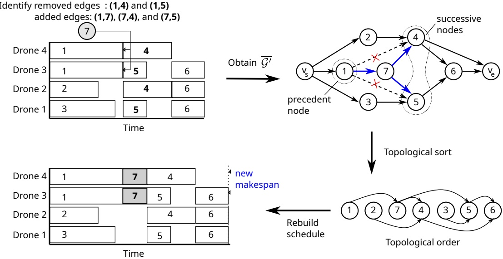

Figure 8 A demonstration of the move evaluation procedure

## 4.4. Local search

To improve the solutions generated by the RnR, we use a local search procedure based on a composite neighborhood, based on the first-improvement acceptance criterion. We apply three wellknown neighborhoods, namely Relocate, Swap, and 2-Opt, as algorithmic components to improve the quality of the truck tour. The local search is terminated when no further improvement can be achieved. Note that, because the move evaluation performed on the drone tours is expensive, we do not design local search operators to improve the drone schedule.

## 5. Analysis of the solution approach

This section demonstrates the detailed performance analysis of the proposed methods via bench marking over multiple representative instances. The first experiment aims to validate the MILP formulation and evaluate the ability of RnR to reach optimality over small instances. In the second experiment, we examine the capability of RnR in handling large instances. These results would be used as a reference to assess the performance of future approaches proposed to solve the PDSTSP-c.

A fast version of RnR, called RnR-fast, is prepared for the experiments as a reference algorithm. In particular, we avoid using the move evaluation procedure previously described in Section 4.3, which is the most expensive component of RnR. To do so, the request insertion is performed only after the last requests of drone tours. In other words, the RnR-fast is incapable of considering any insertions in the middle of drones’ schedule. In addition, the initial solutions obtained from the first round of insertions are also taken into account to quantify the ability of the removal and insertion operators to improve the solutions. Finally, for each instance, the running time of the exact method is limited to one hour, while the heuristics repeatedly run 30 times.

We determine the parameters of RnR with the irace package (López-Ibáñez et al. 2016), which automatically configures optimization algorithms by finding the most appropriate settings on a given set of instances. We use the default irace package setting using a maximum number of 1000 algorithms runs during the tuning. We decide to run the irace package on a modified set of instances, derived by the two sets of generated instances.

We generate the modified instances by perturbing by 10% values of $( x , y )$ coordinates and the parcel weight $w _ { i }$ associated with each node $i \in \mathcal { N }$ . Instances have been tested with the obtained set of parameters, which are presented in Table 1. We recall that λ and $\Delta _ { i n i }$ can take real values in the interval [0.1, 0.8], ϵ can take real values in the interval [0.99, 0.99995], and $I t e r _ { m a x }$ can take an integer value in the interval [5000, 50000].

Table 1 Parameter setting recommended by Irace and used in the experiment.

| Notation | Description | RnR-fast | RnR |
| --- | --- | --- | --- |
| λ | The maximum removal rate | 0.55403 | 0.21540 |
| ∆ini | The initial threshold of deterioration | 0.67317 | 0.39909 |
| ϵ | The cooling rate | 0.99889 | 0.99876 |
| Itermax | The total number of iterations | 45496 | 46138 |

Our algorithms are implemented in C++ compiled with GCC 9.3.0. We design the branch-and-cut algorithm around CPLEX 12.10 to solve the MILP. All tests are run on a desktop operating Kubuntu 20.04, with AMD Ryzen 3700X @4.0GHz CPU, 32GB RAM. The detailed benchmark instances and results of our experiments are available online at [http://orlab.com.vn/home/download](http://orlab.com.vn/home/download).

## 5.1. Instance generation

To evaluate the performance of the proposed methods, we follow the work of Uchoa et al. (2017) and Nguyen et al. (2022) in generating instances to produce a PDSTSP-c benchmark for this experiment. The number of requests n varies from 15 to 200. According to n, we divide instances into two sets: small-size instances for $1 5 \leq n \leq 3 0$ , and large-size instances for $5 0 \leq n \leq 2 0 0$ . Requests are randomly generated in a $1 5 \times 1 5$ square, following three manners: Random (r), Clustered (c), or Random-Clusterd (rc). Two different settings for the depot position are considered: (i) Central (c) - in the center of the grid at point $\textstyle { \big ( } { \frac { 1 5 } { 2 } } ,   { \frac { 1 5 } { 2 } } { \big ) }$ ; (ii) Eccentric (e) - in the corner of the grid at points $\left( \operatorname { m i n } _ { i \in N } x _ { i } ^ { c o o r } , \operatorname { m i n } _ { i \in N } y _ { i } ^ { c o o r } \right)$ . The number of drones m varies in range [3, 6] for the small instances, and [5, 10] for the large instances.

For each problem set, we randomly generate 30 instances characterized by unique triplet: the number of requests $n ,$ request distribution $( r d )$ , and depot position $( d p )$ . As a result, the instances are named as n-rd-dp. For example, 15-r-c represents the instance with 15 requests whose locations are randomly distributed and the depot being positioned in the center. Other parameter values related to the truck and drones are set based on the assumptions explained later in Subsection 6.2. The truck’s average speed is set at 30 km/h. The time required for the coupling process is 1 minute, while swapping the battery, loading, and unloading parcel in a drone delivery are negligible. The truck’s movement follows the Manhattan distance, while those of drones follow the Euclidean distance. The equivalent traveling times (in minutes) are rounded up to the nearest integer.

## 5.2. Experiments with small instances

The objective of this part is to investigate the performance of the proposed algorithms, including exact method, RnR-fast, and RnR, on the small-size instance set. Table 2 reports the obtained results for this experiment. They provide information regarding the performance of the exact method: the objective value of the best solutions found (Columns “Z”), the gap returned by CPLEX (Columns “gap”), and the execution time in seconds (Columns “time”). The performance of the heuristics is assessed via: the best objective value found over 30 runs (Columns “Z”), the average gap of the solutions found over 30 runs (Columns “gap”), the average gap of initial solutions (Column “gapi”), and the average runtime (Column “time”). It should be noted that the gap values of the heuristic solutions are calculated as $\textstyle 1 0 0 ( \frac { Z ^ { \prime } } { Z _ { b e s t } }   -   1 )$ , where $Z ^ { \prime }$ and $Z _ { b e s t }$ are the objective values of the solution found by the heuristic methods on each run and the best solution found over 30 runs, respectively.

Several observations can be derived about the results presented in Table 2. In term of solution quality, the exact method is competitive compared to heuristic approaches in 20 instances, in which it manages to reach to optimality on 7 instances. Meanwhile, there are 10 instances in which the exact method fails to match the best solutions of heuristics (marked as “-” in Column “Data”). Despite comparable results for the large part of the instance set, the exact method finds itself difficult to close the gaps. This partially reflects the hardness of the created instances.

Regarding heuristic methods, they can reproduce all solutions found by the exact method, including all optimal solutions and 10 better solutions (marked in bold in Columns “Z”). Such solution quality can be achieved in very short time. Our RnR algorithm has average runtime less than 6 seconds, while the runtime of its fast version is nearly negligible, under 1 second. The gap values in Columns gap are quite small, always less than 5%, partially indicating the stability of the heuristics over multiple runs. In comparison with the fast version, RnR has slightly better performance as it obtains better results on 4 instances. Slightly lower values in Columns gap obtained by RnR show that it is more stable than RnR-fast. The quality of initial solutions created at the beginning of the search appears inconsistent as their gaps broadly vary from 4.65% to 58.79%. This partially shows the hardness and diversity of the generated instances and demonstrates the efficiency of the removal and insertion operators.

Table 2 Performance of the proposed methods on small instances.

<table><tr><td rowspan="2">Data</td><td colspan="3">MILP</td><td colspan="3">RnR-fast</td><td colspan="4">RnR</td></tr><tr><td>Z</td><td>gap(%)</td><td>time(s)</td><td>Z</td><td>gap(%)</td><td>time(s)</td><td>Z</td><td>gap(%)</td><td>time(s)</td><td>gapi(%)</td></tr><tr><td>15-r-e</td><td>92</td><td>0.00</td><td>8.65</td><td>92</td><td>0.00</td><td>0.32</td><td>92</td><td>0.00</td><td>0.95</td><td>13.95</td></tr><tr><td>15-rc-c</td><td>44</td><td>38.64</td><td>3600.00</td><td>44</td><td>0.15</td><td>0.43</td><td>44</td><td>0.00</td><td>1.46</td><td>43.18</td></tr><tr><td>16-c-c</td><td>60</td><td>0.00</td><td>2.61</td><td>60</td><td>0.00</td><td>0.52</td><td>60</td><td>0.00</td><td>2.14</td><td>20.94</td></tr><tr><td>16-r-e</td><td>112</td><td>0.00</td><td>63.86</td><td>112</td><td>0.00</td><td>0.55</td><td>112</td><td>0.00</td><td>1.52</td><td>10.06</td></tr><tr><td>18-rc-c</td><td>57</td><td>50.88</td><td>3600.00</td><td>58</td><td>4.80</td><td>0.54</td><td>57</td><td>0.00</td><td>2.40</td><td>52.75</td></tr><tr><td>18-c-c</td><td>56</td><td>44.64</td><td>3600.00</td><td>56</td><td>0.00</td><td>0.42</td><td>56</td><td>0.00</td><td>1.86</td><td>48.27</td></tr><tr><td>18-r-e</td><td>96</td><td>10.42</td><td>3600.00</td><td>96</td><td>0.00</td><td>0.59</td><td>96</td><td>0.00</td><td>1.79</td><td>34.06</td></tr><tr><td>19-c-c</td><td>44</td><td>56.82</td><td>3600.00</td><td>44</td><td>0.00</td><td>0.48</td><td>44</td><td>1.36</td><td>1.81</td><td>58.79</td></tr><tr><td>20-r-c</td><td>64</td><td>15.62</td><td>3600.00</td><td>64</td><td>0.00</td><td>0.43</td><td>64</td><td>0.00</td><td>1.91</td><td>36.20</td></tr><tr><td>20-c-c-</td><td>44</td><td>41.99</td><td>3600.00</td><td>43</td><td>1.47</td><td>0.60</td><td>43</td><td>0.00</td><td>2.54</td><td>51.94</td></tr><tr><td>20-rc-e</td><td>100</td><td>0.00</td><td>88.78</td><td>100</td><td>0.00</td><td>0.46</td><td>100</td><td>0.00</td><td>1.09</td><td>11.97</td></tr><tr><td>20-rc-c</td><td>96</td><td>0.00</td><td>0.90</td><td>96</td><td>0.00</td><td>0.41</td><td>96</td><td>0.00</td><td>2.37</td><td>14.79</td></tr><tr><td>20-r-e-</td><td>88</td><td>40.59</td><td>3600.00</td><td>82</td><td>4.50</td><td>0.62</td><td>80</td><td>0.83</td><td>2.00</td><td>37.42</td></tr><tr><td>21-c-c-</td><td>64</td><td>53.12</td><td>3600.00</td><td>62</td><td>2.15</td><td>0.48</td><td>62</td><td>1.77</td><td>2.25</td><td>18.82</td></tr><tr><td>21-r-e-</td><td>100</td><td>68.00</td><td>3600.00</td><td>85</td><td>2.78</td><td>0.59</td><td>85</td><td>0.90</td><td>1.74</td><td>28.27</td></tr><tr><td>23-r-c</td><td>88</td><td>0.00</td><td>3293.16</td><td>88</td><td>0.00</td><td>0.42</td><td>88</td><td>0.04</td><td>1.83</td><td>23.18</td></tr><tr><td>23-c-e</td><td>80</td><td>37.58</td><td>3600.00</td><td>80</td><td>0.00</td><td>0.60</td><td>80</td><td>0.00</td><td>2.49</td><td>5.58</td></tr><tr><td>24-rc-c-</td><td>88</td><td>26.47</td><td>3600.00</td><td>72</td><td>1.41</td><td>0.73</td><td>71</td><td>1.27</td><td>4.06</td><td>41.88</td></tr><tr><td>24-r-e</td><td>112</td><td>23.01</td><td>3600.00</td><td>112</td><td>0.00</td><td>0.52</td><td>112</td><td>0.00</td><td>1.57</td><td>23.99</td></tr><tr><td>24-c-e</td><td>84</td><td>7.14</td><td>3600.00</td><td>84</td><td>0.00</td><td>0.79</td><td>84</td><td>0.00</td><td>2.50</td><td>25.60</td></tr><tr><td>25-rc-e-</td><td>100</td><td>49.28</td><td>3600.00</td><td>92</td><td>2.86</td><td>0.71</td><td>92</td><td>1.23</td><td>2.25</td><td>38.66</td></tr><tr><td>25-r-e-</td><td>120</td><td>57.67</td><td>3600.00</td><td>106</td><td>3.78</td><td>0.96</td><td>104</td><td>3.11</td><td>3.14</td><td>34.94</td></tr><tr><td>25-c-c</td><td>56</td><td>50.00</td><td>3600.00</td><td>56</td><td>0.00</td><td>0.60</td><td>56</td><td>0.00</td><td>2.92</td><td>42.80</td></tr><tr><td>26-r-c-</td><td>128</td><td>34.37</td><td>3600.00</td><td>103</td><td>0.78</td><td>0.53</td><td>103</td><td>0.13</td><td>2.58</td><td>32.56</td></tr><tr><td>27-c-e</td><td>68</td><td>61.76</td><td>3600.00</td><td>68</td><td>0.00</td><td>0.72</td><td>68</td><td>0.00</td><td>6.27</td><td>4.71</td></tr><tr><td>27-c-c</td><td>84</td><td>0.93</td><td>3600.00</td><td>84</td><td>0.00</td><td>0.49</td><td>84</td><td>0.00</td><td>2.18</td><td>4.92</td></tr><tr><td>27-rc-e-</td><td>100</td><td>68.00</td><td>3600.00</td><td>84</td><td>0.00</td><td>0.79</td><td>84</td><td>0.00</td><td>2.70</td><td>30.91</td></tr><tr><td>27-rc-c</td><td>100</td><td>0.00</td><td>721.25</td><td>100</td><td>0.00</td><td>0.77</td><td>100</td><td>0.00</td><td>5.30</td><td>17.13</td></tr><tr><td>29-rc-e-</td><td>124</td><td>26.91</td><td>3600.00</td><td>116</td><td>0.00</td><td>0.72</td><td>116</td><td>0.00</td><td>1.69</td><td>30.14</td></tr><tr><td>30-c-c</td><td>96</td><td>14.58</td><td>3600.00</td><td>96</td><td>0</td><td>0.65</td><td>96</td><td>0</td><td>3.76</td><td>4.65</td></tr></table>

## 5.3. Experiments with large instances

In the previous section, we observe a ceiling effect upon the small instances in which the benchmarks appear so easy that no noticeable differences are found between the two heuristics. In this section, we expect to further analyze the performance of the proposed methods on the large-size instance set containing from 50 to 200 requests. Preliminary results suggest that the exact method is incapable of solving efficiently these instances. Therefore, we consider RnR and its fast version RnR-fast as the main subjects of the experiment. Similar to the previous experiment, we run the two algorithms 30 times on each instance and record multiple performance indicators.

The obtained results are summarized in Table 3 in which the meaning of column headings can be derived from the previous result table, except Column “gap” that represents the average gaps in percentage of the best solutions found by RnR-fast to the best solutions found by all the methods over 30 runs. The results show a clear dominance of RnR over RnR-fast in terms of solution quality. On 23 over 30 instances, the best solutions are found by RnR (numbers in bold in Column “Z”). This is the reason why we do not report the values in Column “gap” for RnR. The quality of the best solutions found by RnR-fast can be accessed via the values in Column “gap” which can be as large as 14.96%. The significantly smaller values in Columns “gap” imply that the proposed RnR is also more stable than its fast version. On the large instances, the initial solutions of RnR have in general larger gaps than on the small instances, and can exceed 70% in some cases. Finally, the computation time of RnR, as shown in Column “time”, is much higher than that of RnR-fast, and can increase up to more than 6 minutes on instances with 200 requests. These results confirm again the efficiency and impact of the move evaluation on the performance of the algorithm. However, we also note that RnR-fast has an advantage in speed as its average running times never bypass 14 seconds even on the largest instances. As a result, we recommend this algorithm version in scenarios where we need to make decision quickly to meet the requirements of customers.

Table 3 Performance of the heuristic methods on large instances.

<table><tbody><tr><td rowspan="2">Data</td><td colspan="4">RnR-fast</td><td colspan="4">RnR</td></tr><tr><td>Z</td><td>gap(%)</td><td>gap(%)</td><td>time (s)</td><td>Z</td><td>gap(%)</td><td>time (s)</td><td>gapi(%)</td></tr><tr><td>50-r-e</td><td>120</td><td>3.45</td><td>7.93</td><td>2.45</td><td>116</td><td>6.21</td><td>20.00</td><td>45.89</td></tr><tr><td>53-r-e</td><td>136</td><td>3.03</td><td>6.36</td><td>2.23</td><td>132</td><td>2.45</td><td>15.17</td><td>48.31</td></tr><tr><td>66-rc-e</td><td>128</td><td>3.23</td><td>6.24</td><td>3.13</td><td>124</td><td>4.95</td><td>16.61</td><td>47.66</td></tr><tr><td>67-c-c</td><td>76</td><td>0.00</td><td>0.00</td><td>2.32</td><td>76</td><td>0.92</td><td>29.05</td><td>18.60</td></tr><tr><td>68-rc-c</td><td>79</td><td>3.95</td><td>8.99</td><td>2.12</td><td>76</td><td>0.00</td><td>20.45</td><td>79.87</td></tr><tr><td>76-c-c</td><td>52</td><td>0.00</td><td>0.00</td><td>2.15</td><td>52</td><td>0.00</td><td>10.46</td><td>11.79</td></tr><tr><td>82-c-e</td><td>64</td><td>0.00</td><td>0.00</td><td>2.63</td><td>64</td><td>0.00</td><td>18.07</td><td>6.46</td></tr><tr><td>82-rc-c</td><td>108</td><td>3.85</td><td>5.77</td><td>2.65</td><td>104</td><td>2.95</td><td>27.42</td><td>68.78</td></tr><tr><td>88-c-e</td><td>108</td><td>0.00</td><td>0.00</td><td>3.56</td><td>108</td><td>0.00</td><td>9.62</td><td>11.11</td></tr><tr><td>91-r-c</td><td>128</td><td>3.23</td><td>6.99</td><td>3.64</td><td>124</td><td>0.86</td><td>72.49</td><td>57.39</td></tr><tr><td>99-rc-c</td><td>108</td><td>8.00</td><td>11.73</td><td>3.64</td><td>100</td><td>6.13</td><td>51.21</td><td>72.67</td></tr><tr><td>101-r-c</td><td>124</td><td>3.33</td><td>7.83</td><td>3.98</td><td>120</td><td>0.89</td><td>99.71</td><td>59.58</td></tr><tr><td>103-rc-c</td><td>128</td><td>3.23</td><td>6.88</td><td>4.38</td><td>124</td><td>4.41</td><td>94.25</td><td>50.54</td></tr><tr><td>105-rc-e</td><td>124</td><td>3.33</td><td>4.81</td><td>5.78</td><td>120</td><td>1.78</td><td>62.71</td><td>53.47</td></tr><tr><td>108-rc-e</td><td>144</td><td>5.88</td><td>7.60</td><td>5.56</td><td>136</td><td>2.45</td><td>61.71</td><td>63.46</td></tr><tr><td>114-rc-c</td><td>100</td><td>4.17</td><td>9.55</td><td>4.69</td><td>96</td><td>4.31</td><td>62.73</td><td>73.68</td></tr><tr><td>121-rc-e</td><td>128</td><td>3.23</td><td>9.84</td><td>6.41</td><td>124</td><td>6.56</td><td>68.74</td><td>61.51</td></tr><tr><td>126-r-c</td><td>161</td><td>0.63</td><td>6.25</td><td>5.89</td><td>160</td><td>2.50</td><td>120.93</td><td>51.42</td></tr><tr><td>126-rc-e</td><td>148</td><td>2.78</td><td>3.59</td><td>7.38</td><td>144</td><td>1.94</td><td>71.04</td><td>51.83</td></tr><tr><td>144-rc-c</td><td>132</td><td>3.12</td><td>6.46</td><td>6.52</td><td>128</td><td>6.25</td><td>172.75</td><td>58.96</td></tr><tr><td>154-c-c</td><td>72</td><td>0.00</td><td>0.00</td><td>7.17</td><td>72</td><td>0.00</td><td>62.96</td><td>2.04</td></tr><tr><td>165-r-c</td><td>176</td><td>7.32</td><td>13.17</td><td>7.61</td><td>164</td><td>1.54</td><td>280.18</td><td>60.39</td></tr><tr><td>167-r-e</td><td>200</td><td>6.38</td><td>9.61</td><td>10.55</td><td>188</td><td>3.12</td><td>228.31</td><td>55.67</td></tr><tr><td>173-rc-c</td><td>144</td><td>8.27</td><td>11.68</td><td>9.22</td><td>133</td><td>4.59</td><td>135.20</td><td>64.36</td></tr><tr><td>173-r-c</td><td>180</td><td>9.76</td><td>14.96</td><td>8.64</td><td>164</td><td>5.45</td><td>373.43</td><td>63.35</td></tr><tr><td>181-r-e</td><td>232</td><td>3.57</td><td>8.02</td><td>11.20</td><td>224</td><td>1.90</td><td>196.09</td><td>45.85</td></tr><tr><td>185-c-c</td><td>96</td><td>0.00</td><td>0.00</td><td>11.26</td><td>96</td><td>0.00</td><td>61.53</td><td>5.97</td></tr><tr><td>187-rc-e</td><td>200</td><td>2.04</td><td>7.70</td><td>12.67</td><td>196</td><td>3.27</td><td>119.95</td><td>49.56</td></tr><tr><td>198-c-c</td><td>64</td><td>0.00</td><td>0.00</td><td>11.38</td><td>64</td><td>0.00</td><td>94.12</td><td>11.46</td></tr><tr><td>200-r-e</td><td>224</td><td>5.66</td><td>10.66</td><td>13.88</td><td>212</td><td>2.14</td><td>368.97</td><td>53.40</td></tr></tbody></table>

## 6. Analysis of the impact of the collective drones

In this section, we investigate the effects of the collective drones on the delivery system. The analysis proceeds by answering a series of questions:

1. Which requests, characterized by parcel weight and distance to the depot, can be fulfilled by c-drone delivery?

2. How competitive is a delivery system adopting c-drone technology in comparison to conventional truck-and-single-drone systems? How might it vary across scenarios?

3. How large is the depot’s coverage area that is suitable for c-drone operations?

4. Is it imperative to obtain performance boost with c-drones by adding extra drones?

5. Can improving the drone’s battery capacity significantly benefit the competitiveness of cdrones?

At the end, the analysis assists in answering the question of whether advancing the technology that enables drones to collaboratively carry heavy items is worthwhile and how it impacts under various operational scenarios. In the following, we first provide the details of our analysis method and experimental setting in Subsections 6.1 and 6.2, respectively. The aforementioned research questions are then discussed in Subsections 6.4 to 6.6.

## 6.1. Analysis method

In this research, we conduct a sensitivity study using an advanced analytical technique, called Classification And Regression Trees (CART) (Breiman, Friedman, Stone, and Olshen 1984). What distinguishes the method from the more widely used one-factor-at-a-time (OFAT) approach is its ability to intuitively reveal interactions between variables via a decision-tree structure. More details of the CART method can be found in Ma (2018).

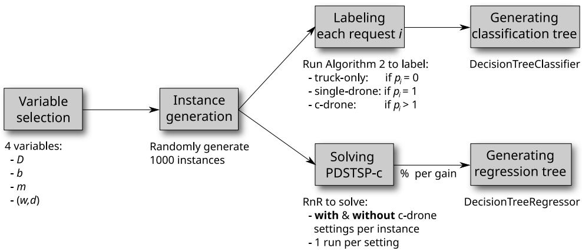

Figure 9 The process of sensitivity analysis using CART method

Applying this approach, the problem-related parameters serve as predictor variables (i.e., inde pendent variables) whereas the studied outcome serves as the outcome variable (i.e, dependent variable). Figure 9 illustrates the overall procedure of the sensitivity analysis. The process begins with the selection of predictor variables, from which a number of random instances are generated.

The following variables are considered throughout the analysis:

• $D ;$ the size of depot’s coverage area, called dimension;

• b: the battery model;

• m: the number of drones;

$( w , d )$ : the request profile characterized by the parcel weight w and distance to depot d.

In the first analysis, we investigate how various factors influence the access of a given remote or heavy request to c-drone operation for faster delivery. Viewing this as a classification problem, the energy model described in Subsection 3.6.1 is performed for labeling every request of generated instances. We then deploy DecisionTreeClassifier class in Python’s Scikit-learn library to build a CART classification tree based on the entire data set composed of values of the inves tigated parameters and corresponding labels. In the second analysis, the studied outcome is the performance competitiveness of systems with c-drones, which is measured by the performance gain computed as $\textstyle 1 0 0 { \frac { ( Z - Z ^ { \prime } ) } { Z } }$ , where $Z ^ { \prime }$ and $Z$ are the makespan of the system with c-drones and the equivalent system but without using c-drones, respectively. Therefore, as a regression problem, we solve each instance under two scenarios with and without enabling c-drone technology to obtain the performance gain. Finally, the results are used to build a CART regression tree by employing DecisionTreeRegressor class in Python’s Scikit-learn library.

## 6.2. Data used

We now describe the instance generator for this experiment. Using diverse statistical data supplied by logistic service providers and other reliable information sources, the aim is to capture as many operational scenarios as possible that might occur in practice.

6.2.1. Truck and drone parameters The drone’s cruising speeds are determined in range [4.00, 28.00] m/s using the process described in Algorithm 2. In line with the survey of mediumduty trucks delivering in urban areas, we assume that the average speed of the truck during the day is 30 km $/ \mathrm { h }$ (Sanchez-Diaz, Palacios-Argüello, Levandi, Mardberg, and Basso 2020). As mentioned before, the truck follows the Manhattan distance, while the drones follow the Euclidean distance.

In addition, as presented in Paczan et al. (2016), there are many possible implementations for the drone coupling component such as magnetic coupling, electromagnetic coupling, etc., which create ease and quickness in such attachment operation. For simplicity, we assume it would take 1 minutes for the coupling process, regardless of the required quantity of drones to form a c-drone.

We assume that the delivery systems can perform their commercial drone operations without the limitation on the number of drones and the number of remote operators in command. In real life for instance, UPS has received FAA Part 135 Standard certification, allowing them to have certain freedom (Etherington 2019). In addition, Part 135 Standard also permits the drone and cargo to exceed 25 kg (FFA 2019). However, we do not permit any drone deliveries with a combined weight of more than 25 kg due to safety concerns under the Part 107 Standard. Additionally, the size of the largest c-drone is limited to six drone units.

Table 4 Referenced LiFePO4 battery models used in the analysis.

| Model | Battery capacity | Weight | Maximum discharge current | Nominal voltage |
| --- | --- | --- | --- | --- |
| ID | (Ah) | (kg) | (A) | (V) |
| 0 | 7.5 | 1.08 | 15 | 12.8 |
| 1 | 12 | 1.55 | 24 | 12.8 |
| 2 | 20 | 2.80 | 40 | 12.8 |
| 3 | 30 | 3.44 | 45 | 12.8 |

Table 5 The list of constant parameters and their values for the analysis

| Parameter | Unit | Value |
| --- | --- | --- |
| C-drone preparation time | s | 1 |
| Maximum size of c-drone | drone unit | 6 |
| Maximum allowable combined weight | kg | 25 |
| Drone's frame weight | kg | 1.2 |
| Drone's number of propellers |  | 4 |
| Drone's rotor blade radius | m | 0.15 |
| Peukert constant |  | 1.1 |
| Drone cruise altitude | m | 100 |
| Vertical takeoff speed | m/s | 2 |
| Vertical landing speed | m/s | 2 |

To investigate the performance of the delivery system under various drone configurations, the number of drones m and drone’s battery specification are also taken into account as studied variables. As such, we vary the fleet size m between 5 and 20 drones. The drone’s battery is randomly chosen among referenced LiFePO4 battery models (Power Tech 2022) as listed in Table 4. Other related parameters are set constant and listed in Table 5.

6.2.2. Request spatial distribution We consider D as a part of investigated variables in the experiment. To simulate the spatial concentration of delivery requests in urban areas, this experiment assumes that locations of delivery requests are distributed randomly in clusters within a $D \times D -km grid$ . The number of requests of an instance is randomly chosen in range [50, 400]. Within the studied grid, the depot is located at the center with coordinates $\textstyle { \big ( } { \frac { D } { 2 } } ,   { \frac { D } { 2 } } { \big ) }$

6.2.3. Package weight distribution We also vary the package weight distribution (PWD) among tested instances as it could significantly change the additional coverage of the drone delivery and the potential request-vehicle assignment, and thus effect directly the contribution of c-drones in the system. Because data for the PWD from parcel distributors is not publicly available, several information sources are considered. First, Amazon’s CEO Jeff Bezos disclosed that 86% of parcels delivered by Amazon are 2.27 kg (5 lbs) or lighter (Guglielmo 2013). Second, we also use the Commodity Flow Survey (CFS) (U.S. Census Bureau 2015) to generate key data for our experiment. The CFS provides comprehensive data on the U.S. domestic freight flows including the commodity industries, values, weights, and so on. To fit the scope of the experiment, we restrict data to deliveries of the “Electronic shopping and mail-order houses” category, using “truck” as the transportation mode, and shipments weighing no larger than 68 kg (150 lbs).

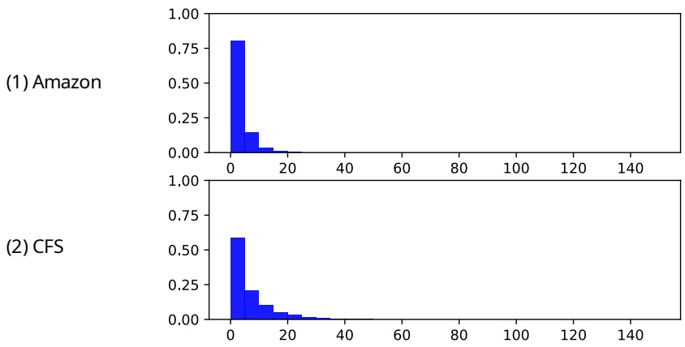

Figure 10 Visualization of the three considered package weight distributions

In line with the considered information sources, we generate two artificial PWDs called: Amazon and CFS. As visualized in Figure 10, the two PWDs are skewed right in which we have a concentration of data among the lightweight parcel deliveries and the vast majority of parcels are less than or equal to 2.27 kg. The main difference between the Amazon and CFS is that the latter has higher proportion of heavy parcels than the former.

## 6.3. Request classification

C-drone requests are those that were previously ineligible for single-drone delivery but are possible to be fulfilled by c-drone. The amount of c-drone requests is expected to play a vital role in deciding the efficacy of the technology. We investigate 186184 requests sampled in 1000 generated instances. After executing the energy model, each request falls into one of three categories: (1) truck-only , (2) single-drone (i.e., if it can be fulfilled by single-drone delivery), and (3) c-drone.

Figure 11 visualizes the obtained decision tree in classifying sampled requests. On the one hand, it is observed that single-drone deliveries are likely capable of transporting any parcels weighing less than 0.81 kg (the left branch). In particular, it is further shown that for single-drone delivery to fully cover this weight range, the battery capacity should meet the minimal requirement, recommended $C _ { \mathrm { n o m } } \geq 1 2   \mathrm { A h }$ . As can be seen in Node 3, the 7.5 Ah model shows its limitation as it appears only suitable for single-drone delivery to fulfill parcels weighing less than 0.28 kg. To carry heavier parcels by aerial transportation, c-drone-delivery is likely the only option (Node 4). Larger capacity models with $C _ { \mathrm { n o m } } \geq 1 2 \; \mathrm { A }$ h can supply sufficient power for nearly all single-drone deliveries weighing less than 0.81 kg within a flight range of 12.59 km, and even slightly beyond this range.

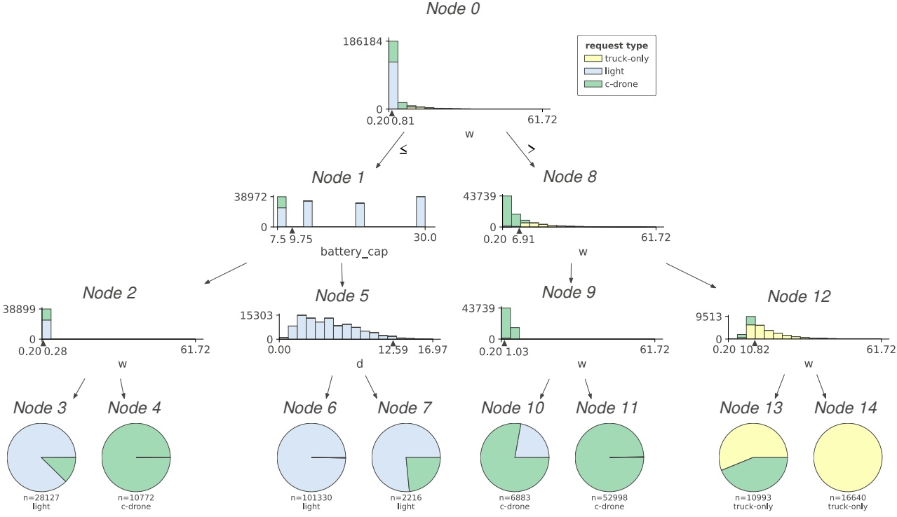

Figure 11 Request classification

On the other hand, it becomes clear that any parcels heavier than 0.81 kg are most likely not eligible for single-drone delivery. In particular, at Nodes 10 and 11 where $0 . 8 1 < w < 6 . 9 1$ kg, nearly every request is considered c-drone-eligible. Moving to the range $6 . 9 1 < w < 1 0 . 8 2 ~ \mathrm { k g } ,$ , we observe more than half of sampled requests are categorized as truck-only. Finally, any parcels with $w > 1 0 . 8 2$ kg must be fulfilled by the truck regardless the distance to the depot. In short, the eligibility of a request to c-drone heavily depends on parcel weight. Light parcels $( w < 0 . 8 1 ~ \mathrm { k g } )$ can be fulfilled by single-drone delivery if battery capacity is sufficiently good $\left( C _ { \mathrm { n o m } } \geq 1 2   \mathrm { A h } \right)$ otherwise, c-drone emerges as an alternative. The scenarios with $0 . 8 1 < w < 6 . 9 1$ kg appear to be more favorable for c-drone than single drone as c-drone can help to relief truck deliveries.

## 6.4. The overall impact of collective drones

Figure 12 plots the interpretation of the CART decision tree derived from the resulted data. The results over 1000 samples show that c-drones could offer 23.47% performance gain on average compared to the single-drone counterpart. The best leaf at which c-drones provide the best benefit shows an average of 32.33% performance gain. In several outstanding individuals, the gain could be up to 58.78%. On the other side, at the worst leaf, c-drones can still provide 10.33% performance gain. In addition, we also record the reduction of truck mileage, calculated as $\textstyle 1 0 0 ( \frac { X } { X _ { c } } - 1 )$ , where $X _ { c }$ and X are the total traveled distances of the truck in the systems with and without using cdrones, respectively. On average, systems employing c-drones can reduce truck mileage by roughly

33.21%. This significant improvement should not be overlooked from economic and environmental standpoints.

Another observation from the tree is that the number of drones appears as the most decisive factor associated with the potential performance gains. The size of depot’s coverage area and drone’s battery capacity have relatively equal impacts and are found locally in lower levels of the tree. Taking close looks into Figure 12, we can observe important split points and interactions among variables. Based on the results for the data range under investigation, it is clear that each parameter has different impacts in different scenarios. We will go into detail to analyze the impacts of each considered variable.

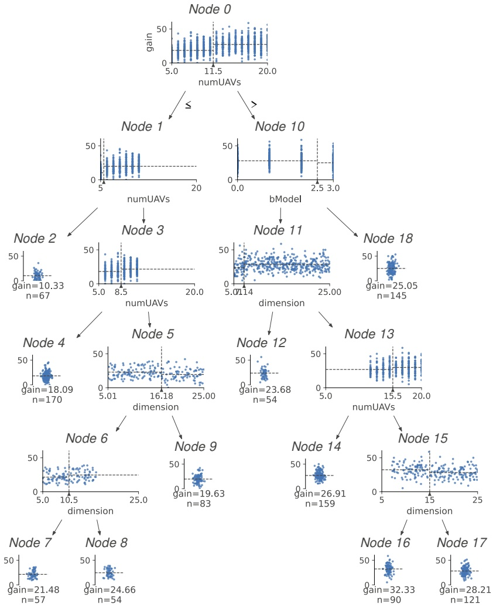

Figure 12 Visualization of the regression tree generated by dtreeviz library Terence and Prince (2020)

## 6.5. The impact of the number of drone units

It is logical that increasing the number of drone units m should provide c-drone delivery systems more advantages. Because not only does a sufficiently large fleet ensure significant request coverage in terms of flight range and payload capability, but it also allows parallel execution of c-drone deliveries, hence it will reduce the completion time effectively.

This view is correlated by the results presented in Figure 12, which demonstrate the number of drone units m has the greatest contribution on the efficacy of c-drones. It is provided by the fact that feature m is verified at the tree’s root where the entire samples are separated into two subgroups, those with $m \leq 1 1 . 5$ and those with $m > 1 1 . 5$ . It is shown that c-drones in the latte with higher m can provide 27.26% performance gain on average. This is significantly higher than 18.45% that of the former with lower m. We observe the same pattern several times at lower levels of the tree (Nodes 1, 3 and 13), which further emphasizes the critical of $m .$ . The number of drones continues holding the prime importance on the third level, the performance gain gradually increases from 18.09% to 21.58% as m increases.

These results broadly support the suggestion that a large fleet of drones is an essential condition for taking the advantage of c-drones. If the fleet size is noticeably large, recommended at least 12 units, then c-drones could deliver a drastic performance benefit. It is also surprising to see the effectiveness of c-drones partly shown in Node 2 where 10.33% performance upgrade on average can be obtained with only 5 drone units in the system.

## 6.6. The impact of battery model

Increasing the battery capacity will improve the discharge capacity and the maximum discharge rate. Then one might expect an improvement in the flying range as well as carrying capacity. However, it also results in an increase in the battery weight, thus increasing the total weight of the drone. We now investigate the effect of increasing the battery capacity of each drone unit via the battery model feature.

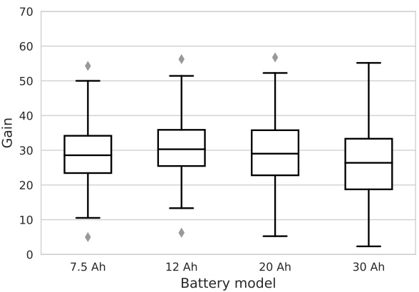

Figure 13 Boxplot of sampled data at Node 10 in Figure 12

Firstly, the result shows the importance of the battery model (featured by variable bModel) on the right branch where the number of drones is greater than 12 (Node 10). The boxplot in Figure

13 shows the transition of the aggregate performance gain from 7.5 Ah to 30 Ah model, 26.68%, 29.69%, 27.95%, and 25.05%, respectively. As can be expected, the effectiveness of c-drones obtains an immediate benefit from increasing $C _ { \mathrm { n o m } }$ from 7.5 Ah to 12 Ah as the box of the latter is higher and has less outliers than that of the former.

Interestingly, we begin observing a gradual drop toward the right from model 20 Ah. Specifically, compared to model 12 Ah, the drop is indicated via the fact that model 20 Ah has lower average performance gain and lower-whisker. The taller box and longer tails also imply the more variable in competitiveness of the 20 Ah model. Upgrading to model 30 Ah, the average performance gain continues to drop and becomes even more variable than others. These can be explained due to the significant increase in weight of additional battery cells to increase the capacity. Such additional weight added to the overall weight of the drone would also drain the batteries at higher discharge rate and may neutralize the longer battery life it intends to provide. In addition, taking the maximum combined weight constraint (25 kg in this analysis) into account, for example, if a 30-Ah battery-powered drone weighs 4.64 kg, a 4-unit c-drone can only transport a parcel weighing a maximum of 6.44 kg. Likewise, a 5-unit c-drone can carry a parcel of weight limited to 1.8 kg, and so on. Therefore, the increased overall weight can also reduce the number of requests eligible to c-drone. Considering the sampled data, from the investing cost and effectiveness perspective, the advantages of c-drone are more obvious and more consistent with 12 Ah battery model than the other three models.

## 6.7. The impact of the size of depot’s coverage area

We now investigate the size of depot’s coverage area, featured by variable $D ,$ that benefits the competitiveness of c-drones. As shown in Figure 12, D is found locally from the third level of the tree, which emphasizes the importance of D. In particular, the results in Nodes 6-8 suggest a slight positive correlation between the competitiveness of c-drones and D in the range [5.00, 16.18) km, then a steady decline is observed in the other half [16.18, 25.00] km. Here, we notice two important split points at 10.5 km and 16.18 km, which separate the results at Node 5 into three partitions: 21.48%, 24.66%, and 19.63%, respectively. The transition highlights the favorable range of D from 10.5 to 16.18 km in which c-drones benefit the most.

The similar pattern repeats in the right branch (Nodes 11 and 15) in which the favorable range of D is reported from 7.14 to 15 km. Here, the earlier split point (at 7.14 km) as well as the sharp rise in performance gain from low coverage systems $( D \leq 7 . 1 4 ~ \mathrm { k m } )$ to higher coverage ones $( D > 7 . 1 4$ km) further emphasize the benefit of having larger number of drones $( m \geq 1 2 )$ and proper battery models (model 7.5 Ah to 20 Ah). While these results again highlight the effectiveness of c-drone, the limitation of c-drones in servicing larger area with $D > 1 5$ km is partly revealed. Therefore, it is recommended the size of depot’s coverage area from 7 km to 15 km to take good advantage of c-drones.

## 7. Conclusions

In this study, we introduce a variant of the PDSTSP that aims to increase the utilization of drones, particularly for delivering distant and heavy parcels. The new problem considers a technology that combines multiple drones to form a collective drone (c-drone) capable of fulfilling requests whose parcel weight or distance to the depot exceeds the capacity of a single drone. The new problem considers variable drone speeds and the decision on how many drones to serve a request to take full advantage of the given limited battery capacity for potential time savings. We develop a mixed integer linear programming model to formulate the problem, which is based on two-index flow. A branch-and-cut algorithm is then designed to solve several small problem instances to optimality. To handle larger instances efficiently, we propose a metaheuristic approach based on the Ruinand-Recreate framework with problem-tailored removal and insertion operators. An efficient move evaluation procedure is also designed to deal with the complexity of inserting unserviced requests to partial solutions created by the synchronization constraints. Computational experiments show the validity of the MILP formulation. The performance of the metaheuristic is demonstrated via the good stability and quality of solutions on the small instances (when compared with the exact method) and on the large instances (when compared with its baseline versions).

We also perform a sensitivity analysis to investigate the impact of the c-drones as well as the impact of input parameters on the overall delivery performance. The results obtained from the CART decision tree suggest that substantial performance gains can be achieved by using c-drones in the PDSTSP-c system compared to the PDSTSP-based system. On the tested data, the number of drones in a system is considered to be the most critical factor in determining the competitiveness of c-drones. In terms of economic and environmental aspects, it is also reported that c-drones can reduce a significant amount of truck mileage, 33.21% on average.

## References

Afifi S, Dang DC, Moukrim A, 2016 Heuristic solutions for the vehicle routing problem with time windows and synchronized visits. Optimization Letters 10(3):511–525.

Applegate D, Bixby R, Chvátal V, Cook W, 2003 Implementing the dantzig-fulkerson-johnson algorithm for large traveling salesman problems. Mathematical programming 97(1):91–153.

Blazewicz J, Drabowski M, Weglarz J, 1986 Scheduling multiprocessor tasks to minimize schedule length. IEEE Transactions on Computers 35(05):389–393.

Boyle A, 2016 Amazon seeks patent for system that links up drones to create a borg for deliveries. [https://www.geekwire.com/2016/amazon-patent-collective-uav-borg-drones/](https://www.geekwire.com/2016/amazon-patent-collective-uav-borg-drones/). Accessed 30 August 2021.

Breiman L, Friedman J, Stone CJ, Olshen RA, 1984 Classification and regression trees (CRC press).

Chen Y, Baek D, Bocca A, Macii A, Macii E, Poncino M, 2018 A case for a battery-aware model of drone energy consumption. 2018 IEEE International Telecommunications Energy Conference (INTELEC), 1–8 (Torino, Italy: IEEE).

Dell’Amico M, Montemanni R, Novellani S, 2020 Matheuristic algorithms for the parallel drone scheduling traveling salesman problem. Annals of Operations Research 289(2):211–226.

Dinh QT, Do DD, Hà MH, 2021 Ants Can Solve the Parallel Drone Scheduling Traveling Salesman Problem, 14–21 (New York, NY, USA: Association for Computing Machinery), ISBN 9781450383509.

Doerffel D, Sharkh SA, 2006 A critical review of using the peukert equation for determining the remaining capacity of lead-acid and lithium-ion batteries. Journal of power sources 155(2):395–400.

Etherington D, 2019 UPS gets FAA approval to operate an entire drone delivery airline. [https://techcrunch.com/2019/10/01/ups-gets-faa-approval-to-operate-an-entire-drone-](https://techcrunch.com/2019/10/01/ups-gets-faa-approval-to-operate-an-entire-drone-)delivery-airline/. Accessed 20 August 2021.

FFA, 2019 Package delivery by drone (part 135). [https://www.faa.gov/uas/advanced\_operations/package\_delivery\_drone/](https://www.faa.gov/uas/advanced_operations/package_delivery_drone/). Accessed 20 August 2021.

Grimault A, Bostel N, Lehuédé F, 2017 An adaptive large neighborhood search for the full truckload pickup and delivery problem with resource synchronization. Computers & Operations Research 88:1–14.

Guglielmo C, 2013 Turns out amazon, touting drone delivery, does sell lots of products that weigh less than 5 pounds. [https://www.forbes.com/sites/connieguglielmo/2013/12/02/](https://www.forbes.com/sites/connieguglielmo/2013/12/02/) turns-out-amazon-touting-drone-delivery-does-sell-lots-of-products-thatweigh-less-than-5-pounds/?sh=189b914b455e. Accessed 20 August 2021.

Hà MH, Nguyen TD, Duy TN, Pham HG, Do T, Rousseau LM, 2020 A new constraint programming model and a linear programming-based adaptive large neighborhood search for the vehicle routing problem with synchronization constraints. Computers & Operations Research 124:105085.

Khoufi I, Laouiti A, Adjih C, 2019 A survey of recent extended variants of the traveling salesman and vehicle routing problems for unmanned aerial vehicles. Drones 3(3).

Kwok YK, Ahmad I, 1999a Benchmarking and comparison of the task graph scheduling algorithms. Journal of Parallel and Distributed Computing 59(3):381–422.

Kwok YK, Ahmad I, 1999b Static scheduling algorithms for allocating directed task graphs to multiprocessors. ACM Computing Surveys (CSUR) 31(4):406–471.

Liu R, Tao Y, Xie X, 2019 An adaptive large neighborhood search heuristic for the vehicle routing problem with time windows and synchronized visits. Computers & Operations Research 101:250–262.

Liu Z, Sengupta R, Kurzhanskiy A, 2017 A power consumption model for multi-rotor small unmanned aircraft systems. 2017 International Conference on Unmanned Aircraft Systems (ICUAS), 310–315 (Miami, FL, USA: IEEE).

López-Ibáñez M, Dubois-Lacoste J, Cáceres LP, Birattari M, Stützle T, 2016 The irace package: Iterated racing for automatic algorithm configuration. Operations Research Perspectives 3:43–58.

Ma X, 2018 Using classification and regression trees: A practical primer (Information Age Publishing).

Macrina G, Di Puglia Pugliese L, Guerriero F, Laporte G, 2020 Drone-aided routing: A literature review. Transportation Research Part C: Emerging Technologies 120:102762.

Mbiadou Saleu RG, Deroussi L, Feillet D, Grangeon N, Quilliot A, 2018 An iterative two-step heuristic for the parallel drone scheduling traveling salesman problem. Networks 72(4):459–474.

McNabb M, 2019 How Zipline Became a \$1.2 Billion Drone Company. [https://dronelife.com/2019/05/21/how-zipline-became-a-1-2-billion-drone-company/](https://dronelife.com/2019/05/21/how-zipline-became-a-1-2-billion-drone-company/) Accessed 18 September 2021.

Murray CC, Chu AG, 2015 The flying sidekick traveling salesman problem: Optimization of drone-assisted parcel delivery. Transportation Research Part C: Emerging Technologies 54:86–109.

Murray CC, Raj R, 2020 The multiple flying sidekicks traveling salesman problem: Parcel delivery with multiple drones. Transportation Research Part C: Emerging Technologies 110:368–398.

Nguyen MA, Dang GTH, Hà MH, Pham MT, 2022 The min-cost parallel drone scheduling vehicle routing problem. European Journal of Operational Research 299(3):910–930, URL [http://dx.doi.org/https://doi.org/10.1016/j.ejor.2021.07.008](http://dx.doi.org/https://doi.org/10.1016/j.ejor.2021.07.008).

Paczan NM, Elzinga MJ, Hsieh R, Nguyen LK, 2016 Collective unmanned aerial vehicle configurations. US Patent App. 14/626,376.

Poikonen S, Golden B, 2020 Multi-visit drone routing problem. Computers & Operations Research 113:104802.

Power Tech, 2022 12V Lithium-Ion battery pack – PowerBrick+. [https://www.powertechsystems.eu/home/products/12v-lithium-battery-pack-powerbrick/](https://www.powertechsystems.eu/home/products/12v-lithium-battery-pack-powerbrick/). Accessed 20 August 2021.

Premack R, 2019 UPS just beat out Amazon, FedEx, and Uber to make America’s first revenue-generating drone delivery. [https://www.businessinsider.com/ups-first-revenue-generating-drone-delivery-with-matternet-2019-3](https://www.businessinsider.com/%20ups-first-revenue-generating-drone-delivery-with-matternet-2019-3) Accessed 06 September 2020.

Raj R, Lee D, Lee S, Walteros J, Murray C, 2021 A branch - and - price approach for the parallel drone scheduling vehicle routing problem, URL https://ssrn.com/abstract=3879710.

Raj R, Murray C, 2020 The multiple flying sidekicks traveling salesman problem with variable drone speeds. Transportation Research Part C: Emerging Technologies 120:102813.

Robert Y, 2011 Task Graph Scheduling, 2013–2025 (Boston, MA: Springer US), ISBN 978-0-387-09766-4.

Rubin BF, 2017 Amazon Prime Air drone completes its first U.S. public delivery. [https://www.cnet.com/news/amazon-prime-air-first-drone-delivery-us-public-sunscreen-mars/](https://www.cnet.%20com/news/amazon-prime-air-first-drone-delivery-us-public-sunscreen-mars/). Accessed 06 September 2021.

Sanchez-Diaz I, Palacios-Argüello L, Levandi A, Mardberg J, Basso R, 2020 A time-efficiency study of medium-duty trucks delivering in urban environments. Sustainability 12(1):425.

Schrimpf G, Schneider J, Stamm-Wilbrandt H, Dueck G, 2000 Record breaking optimization results using the ruin and recreate principle. Journal of Computational Physics 159(2):139–171, URL [http://dx.doi.org/https://doi.org/10.1006/jcph.1999.6413](http://dx.doi.org/https://doi.org/10.1006/jcph.1999.6413).

Shaw P, 1998 Using constraint programming and local search methods to solve vehicle routing problems. Maher M, Puget JF, eds., Principles and Practice of Constraint Programming — CP98, 417–431 (Berlin, Heidelberg: Springer Berlin Heidelberg), ISBN 978-3-540-49481-2.

Sherr I, 2020 UPS, Amazon delivery drones a step closer to reality with new US rules. [https://www.cnet.com/news/ups-amazon-delivery-drones-a-step-closer-to-reality-with-new-us-rules/](https://www.cnet.com/news/ups-amazon-delivery-drones-a-step-closer-to-reality-with-new-us-rules/).Accessed 06 September 2021.

Sinnen O, 2007 Task scheduling for parallel systems, volume 60 (John Wiley & Sons).

Terence P, Prince G, 2020 How to visualize decision trees. [https://explained.ai/decision-tree-viz/](https://explained.ai/decision-tree-viz/).Accessed 03 August 2021.

Uchoa E, Pecin D, Pessoa A, Poggi M, Vidal T, Subramanian A, 2017 New benchmark instances for the capacitated vehicle routing problem. European Journal of Operational Research 257(3):845–858.

US Census Bureau, 2015 Commodity flow survey: United states: 2012. [https://www.census.gov/library/publications/2015/econ/ec12tcf-us.html](https://www.census.gov/library/publications/2015/econ/ec12tcf-us.html). Accessed 20 August 2020.

Weisberger M, 2017 Amazon’s ’mothership’: Retailer gets patent for mega-drone. [https://www.livescience.com/57416-amazon-patents-flying-mega-drone.html](https://www.livescience.com/57416-amazon-patents-flying-mega-drone.html). Accessed 30 August 2021.

Whitley D, 1989 The genitor algorithm and selection pressure: why rank-based allocation of reproductive trials is best. Proceedings of the third international conference on Genetic algorithms, 116–121 (San Francisco, CA, USA: Morgan Kaufmann Publishers Inc.).

Zhang J, Campbell JF, Sweeney II DC, Hupman AC, 2021 Energy consumption models for delivery drones: A comparison and assessment. Transportation Research Part D: Transport and Environment 90:102668, URL [http://dx.doi.org/https://doi.org/10.1016/j.trd.2020.102668](http://dx.doi.org/https://doi.org/10.1016/j.trd.2020.102668).