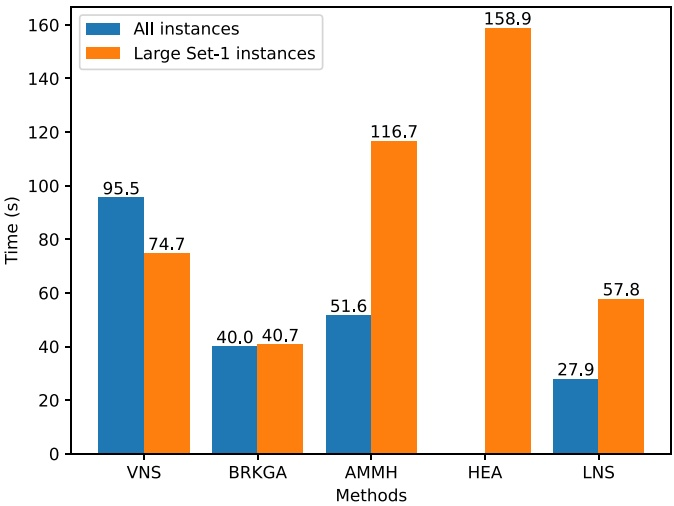
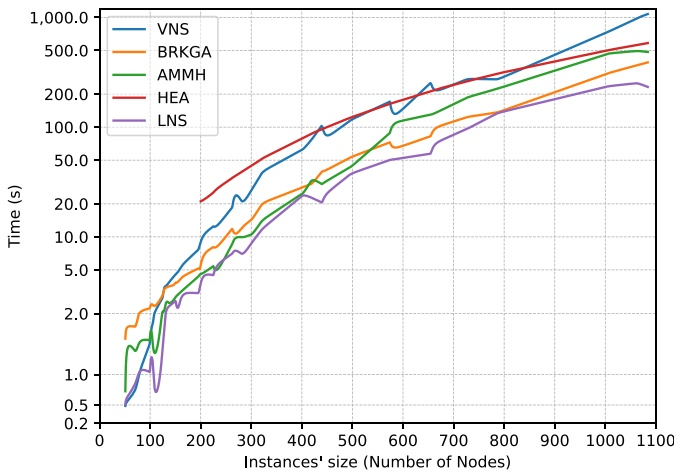

**Discrete Optimisation**

# The set team orienteering problem

**Tat Dat Nguyen a, Rafael Martinelli b, Quang Anh Pham c, Minh Hoàng Hà d,**∗

**a ORLab, Faculty of Computer Science, Phenikaa University, Hanoi, Viet Nam**

**b Departamento de Engenharia Industrial, Pontifícia Universidade Católica do Rio de Janeiro, Brazil**

**c ORLab-CADA, Faculty of Data Science and Artificial Intelligence, National Economics University, Hanoi, Viet Nam**

**d ORLab-SLSCM, Faculty of Data Science and Artificial Intelligence, National Economics University, Hanoi, Viet Nam**

## A R T I C L E I N F O

**Keywords: Vehicle routing problem with profits Set team orienteering problem Exact and heuristic methods Branch-and-price Large neighbourhood search**

## A B S T R A C T

**We introduce the Set Team Orienteering Problem (STOP), a generalised variant of the Set Orienteering Problem (SOP), in which customer locations are split into multiple clusters (or groups). Each cluster is associated with a profit that can be gained only if at least one customer from the cluster is visited. There is a fleet of homogeneous vehicles at a depot, and each vehicle has a limited travel time. The goal of the STOP is to find a set of feasible vehicle routes to collect the maximum profit. We first formulate the problem as a Mixed Integer Linear Programming (MILP) to mathematically describe it. A branch-and-price (B&P) algorithm is then developed to solve the problem to optimality. To deal with large instances, we propose a Large Neighbourhood Search (LNS), which relies on problem-tailored solution representation, removal, and insertion operators. Multiple experiments on newly generated instances confirm the performance of our approaches. Remarkably, when tested on the SOP using benchmarks available in the literature, our B&P method achieves optimality in 61.9% of these instances. This is the first time such a large number of SOP instances are solved to optimality. Our LNS outperforms existing algorithms proposed to solve the SOP in terms of solution quality. Out of 612 considered instances, it improves 40 best-known solutions.**

## 1. Introduction

**This paper studies a new extension of the Orienteering Problem (OP), which we call the Set Team Orienteering Problem (STOP), in which customers are split into multiple groups (or clusters). Each cluster is associated with a profit that can be gained only if at least one customer from the cluster is visited. There is a fleet of homogeneous vehicles at the depot, and each vehicle has a limited travel time. The goal of the STOP is to find a set of feasible vehicle routes such that the total collected profit is maximised. The OP and other variants of it are reviewed in Gunawan et al. (2016).**

**The STOP can be considered as a generalised version of the Set Orienteering Problem (SOP), which is first introduced by Archetti et al. (2018). Different from the STOP, the fleet size in the SOP is composed of one vehicle only. In Archetti et al. (2018), the authors propose a Mixed Integer Linear Programming (MILP) formulation and a matheuristic-based Tabu Search for solving the SOP. Pěnička et al. (2019) introduce an improved MILP formulation for this problem using subtour elimination constraints instead of connectivity cuts like the previous one. They also design a Variable Neighbourhood Search (VNS) and test it on the SOP instances and similar variants, such as the Dubins Orienteering Problem introduced in Pěnička et al. (2017). Carrabs** **(2021) employs a Biased Random-Key Genetic Algorithm (BRKGA), which encodes a chromosome as an array of float numbers in a range of** [0, 1] **and employs three local search procedures for intensification. A graph reduction algorithm based on the work of Gutin and Karapetyan (2009) is also re-used to reduce the problem size, thus improving the computation time of BRKGA. The latest heuristic methods proposed to solve the SOP are the Adaptive Memory Matheuristic (AMMH) in Dontas et al. (2023) and the Hybrid Evolutionary Algorithm (HEA) in Lu et al. (2024). To intensify the search, the AMMH uses several local search procedures in combination with an adaptive memory mechanism and a MILP model in a customer insertion–deletion process. The experiments show that the AMMH provides better results than previous methods on the SOP instances introduced in Archetti et al. (2018). The HEA presents a highly effective algorithm that employs a two-phase local refinement procedure, exploring both feasible and infeasible solutions. The authors report new lower bounds for 54 SOP instances, making it the state-of-the-art SOP heuristic method. Recently, Archetti et al. (2024) proposed a new branch-and-cut (B&C) algorithm for the SOP. The B&C can solve SOP instances up to 100 customers effectively, which makes it the state-of-the-art exact method for the SOP.**

<small>∗ Corresponding author.</small>

<small>E-mail address: [hoanghm@neu.edu.vn](mailto:hoanghm@neu.edu.vn) (M.H. Hà).</small>

<small>[https://doi.org/10.1016/j.ejor.2024.09.021](https://doi.org/10.1016/j.ejor.2024.09.021)</small>

<small>Received 14 September 2023; Accepted 10 September 2024</small>

<small>Available online 18 September 2024</small>

<small>0377-2217/© 2024 Elsevier B.V. All rights are reserved, including those for text and data mining, AI training, and similar technologies.</small>

**Many routing problems, similar to the STOP, deal with clusters in the literature. The Clustered Team Orienteering Problem (CTOP) studied in Yahiaoui et al. (2019) shares the customer clustering attribute with the STOP. The main difference is that the profit of a cluster in the CTOP is collected only if all of its customers are served concurrently. The CTOP also has a single-vehicle variant, which is the Clustered Orienteering Problem (COP), introduced in Angelelli et al. (2014). In addition, the Generalised Vehicle Routing Problem (GVRP) in Bektaş et al. (2011), Ghiani and Improta (2000), Hà et al. (2014) uses the term cluster to represent possible locations of a customer. A set of vehicles must serve all customers at one of their locations. The goal of the GVRP is to minimise the total travel cost of the vehicles w.r.t. capacity constraints, indicating that the total demand of customers served by a vehicle must not exceed its capacity. A variant of GVRP that has an interesting application in last-mile delivery is the Vehicle Routing** Problem with Roaming Delivery Locations (VRPRDL) (Reyes et ${ \mathrm { a l . } } ,$ **2017). It models a routing problem by providing trunk delivery service, which allows couriers to deliver goods to customers via accessing their trunks (Harbison, 2018). The VRPRDL can be considered the GVRP with time window (TW) constraints, in which TWs of locations in a cluster satisfy special attributes that mimic the itinerary of their corresponding customers. The problem has been solved by various exact methods and metaheuristics: branch-and-price (Ozbaygin et al., 2017), branch-and-price-and-cut (Tilk et al., 2021), large neighbourhood search (Dumez et al., 2021), and hybrid genetic algorithm (Pham et al., 2022).**

**Gunawan et al. (2021) introduce a variant of the STOP, known as the Set Team Orienteering Problem with Time Windows (STOPTW), in which a time window is imposed for each customer and the delivery must be done within this time period. The authors propose an Adaptive Large Neighbourhood Search algorithm to solve the problem. The preliminary results show the capability of the proposed algorithm to provide good solutions within reasonable computational times compared to the commercial solver CPLEX. More recently, Yu et al. (2024) propose a Simulated Annealing with Reinforcement Learning (SA-RL) for the STOPTW, which uses RL to learn the fitness values resulting from the SA’s neighbourhood moves. When compared to the SA, the SA-RL improves the results on most instances in shorter computation times.**

**Similar to the SOP, the STOP finds application in the mass distribution of products (Archetti et al., 2018). More precisely, we consider the case where multiple customers belong to different supply chains (or clusters) and the profit is associated with each chain rather than with each individual retailer, as in the COP. In the STOP, the carrier only has to serve one retailer belonging to each chain with the entire quantity demanded by all of its retailers. Product transportation within a chain will be performed internally. This strategy allows the carrier to reduce the transportation cost, possibly providing a better price for the chains. Another application is when customers in an area want to gather together in a group to place large quantities of orders, which may result in a lower price. In this case, a customer in each group will be selected as the delivery location and receive the entire quantity of all customers in the area. The STOP can also model routing problems in e-commerce where customers can get orders at different addresses,** $\mathbf { e . g . }$ **, home, workplace, parents’ home, and so on. As such, a cluster in this application includes different delivery locations for a customer. And the profit of a cluster can be set to the profit obtained from serving the corresponding customer.**

**The main contributions of our work are as follows:**

**• We present the STOP, which is a generalised version of several important routing problems with profits. The problem is also a more fundamental variant of the STOPTW and has multiple applications in supply chain distribution and mass distribution of products.**

**• We propose a branch-and-price (B&P) algorithm to solve the problem to optimality. The B&P uses bucket-based dynamic programming to solve its pricing subproblem and strong branching to reduce the size of the branch-and-bound tree.**

**• We introduce a metaheuristic that is based on Large Neighbourhood Search (LNS). The LNS is built from several existing and new components, adapted, and designed to efficiently deal with the problem’s characteristics.**

**• We test our proposed methods on the existing SOP instances as well as new STOP instances with up to 1084 customers and 217 clusters. The obtained results clearly show the performance of our approaches. The exact algorithm B&P can close the gap for the STOP instances containing up to 783 nodes and 157 clusters, and the LNS is able to reach optimal solutions for all of these instances. For the SOP, 61.9% of the existing instances are solved to optimality (compared with 30.4% in the current literature), and we also provide dual bounds for the first time for those instances. Our metaheuristic has a competitive performance with state-of-the-art methods. More specifically, 40 new best-known solutions are found for the first time in this study. These results are remarkable because our algorithms are designed to mainly solve the multiple-vehicle version.**

**The remainder of this paper is structured as follows: Section 2 introduces the problem definition and a MILP model. The detailed descriptions of our branch-and-price algorithm and metaheuristic are provided in Sections 3 and** $4 ,$ **re**spectively. Experimental results are **reported in Section 5. Finally, we conclude our work in Section 6.**

## 2. Problem definition

**The STOP is formally defined as follows. Let** $G ~ = ~ ( V , A )$ **be a complete directed graph in which** $V = \{ 0 \} \cup C$ **, where node 0 represents the depot, while** 𝐶 **represents the set of customers. Each arc** $( i , j ) \in A$ is associated with a travel cost $c _ { i j }$ **. These costs are assumed to satisfy the triangle inequality and to be symmetric. We also define a set** $\mathcal { S }$ **of** 𝐾 **disjoint clusters** $\mathcal { I }   =   \{ S _ { 1 } , S _ { 2 } , \ldots , S _ { K } \}$ **where** $\textstyle \bigcup _ { k = 1 } ^ { K } S _ { k } \; = \; V \backslash \{ 0 \}$ and $S _ { i }   \cap   S _ { j }   =   \emptyset , \forall i   \neq   j . \mathbf { A }$ profit $p _ { k }$ **is associated with each cluster** $S _ { k }$ **and collected only if a customer in cluster** $S _ { k }$ **is served. Note that, for convenience, we sometimes use** $S _ { i }$ **to denote the set of customers belonging to the corresponding cluster. The goal of the STOP is to find a set of at most** 𝑚 **feasible vehicle routes with maximum total profit serving each cluster at most once. A feasible route must satisfy the following requirements:**

**• A vehicle departs from and returns to the depot after serving its assigned clusters.**

**• The total travel cost of each vehicle must not exceed a budget** $T _ { m a x } .$

**To mathematically describe the problem, we formulate it as a Mixed Integer Linear Programming (MILP) using the following types of variables:**

$y _ { k } ;$ **binary variable, equal to 1 if the profit of cluster** $S _ { k } \in \mathcal { S }$ **is collected by a vehicle, 0 otherwise.**

$x _ { i j } \colon$ **binary variable, equal to 1 if arc** $( i , j ) \in A$ **is traversed by a vehicle, 0 otherwise.**

• 𝑠𝑖**: non-negative real variable, representing the total travel cost of the vehicle when visiting customer** 𝑖.

**The MILP model of the STOP can be written as follows:**

$$
\max \quad \sum_ {S _ {k} \in \mathscr {S}} p _ {k} y _ {k}\tag{1}
$$

𝑠.𝑡.

$$
\sum_ {i \in V \setminus \{j \}} x _ {i j} = \sum_ {i \in V \setminus \{j \}} x _ {j i}
$$

$$
\forall j \in V\tag{2}
$$

$$
\sum_ {i \in V \setminus S _ {k}} \sum_ {j \in S _ {k}} x _ {i j} = y _ {k}
$$

$$
\forall S _ {k} \in \mathscr {S}\tag{3}
$$

$$
\sum_ {i \in S _ {k}} \sum_ {j \in S _ {k}} x _ {i j} = 0
$$

$$
\forall S _ {k} \in \mathscr {S}\tag{4}
$$

**T.D. Nguyen et al.**

$$
s _ {j} \geq s _ {i} + c _ {i j} x _ {i j} - T _ {\max} (1 - x _ {i j}) \quad \forall (i, j) \in A, j \neq 0\tag{5}
$$

$$
s _ {i} + c _ {i 0} x _ {i 0} \leq T _ {m a x}
$$

$$
\forall i \in V\tag{6}
$$

$$
\sum_ {i \in V \setminus \{0 \}} x _ {i 0} \leq m\tag{7}
$$

$$
0 \leq s _ {i} \leq T _ {m a x}
$$

$$
\forall i \in V\tag{8}
$$

$$
x _ {i j} \in \{0, 1 \}
$$

$$
\forall (i, j) \in A\tag{9}
$$

$$
y _ {k} \in \{0, 1 \}
$$

$$
\forall S _ {k} \in \mathscr {S}\tag{10}
$$

**The objective function (1) maximises the total profit collected from all clusters visited by the vehicles. The flow conservation is satisfied by Constraints (2). Constraints (3) represent the relationship between variables** $y$ **and** $x , \mathbf { i . e . }$ **, the profit of a cluster is collected if and only if one customer in that cluster is visited from another cluster. We use Constraints (4) to strengthen the formulation to avoid unwanted cases where a vehicle visits more than one customer in a cluster. Constraints (5) compute the total travel cost of vehicles at customers’ locations. Constraints (6) ensure that the total travel cost when returning to the depot of each vehicle does not exceed budget** $T _ { m a x } ,$ The maximum num**ber of vehicles is respected by Constraint (7). Finally, the remaining constraints define the variable domains.**

## 3. Branch-and-price

**As for many vehicle routing problems, the compact formulation has a small limit on the size of instances it can solve (Baldacci et al., 2011; Martinelli et al., 2014). When pursuing the solution of larger instances, one can resort to decomposition methods that generate exponentialsized formulations. The formulation presented in this section considers the set of all feasible routes** 𝛺**. A route** 𝑟 **starts at the depot, visits a non-empty sequence of customers, and ends at the depot. Based on which nodes a route visits, we can define the binary constants** $a _ { k r } ,$ **which indicate whether the route visits cluster** $S _ { k } ,$ **and calculate its profit,** $\begin{array} { r } { p _ { r } = \sum _ { S _ { k } \in \mathcal { S } _ { r } } p _ { k } , } \end{array}$ where $\mathcal { L } _ { r }$ **is the set of clusters visited on route** 𝑟**. Given the binary variables** $\lambda _ { r } ,$ **which indicate if route** 𝑟 **is used in the solution, the formulation is presented as follows:**

max

$$
\sum_ {r \in \Omega} p _ {r} \lambda_ {r}\tag{11}
$$

𝑠.𝑡.

$$
\sum_ {r \in \Omega} \lambda_ {r} \leq m\tag{12}
$$

$$
\left| \sum_ {r \in \Omega} a _ {k r} \lambda_ {r} \leq 1 \right|
$$

$$
\forall S _ {k} \in \mathscr {S}\tag{13}
$$

$$
\lambda_ {r} \in \{0, 1 \}
$$

$$
\forall r \in \Omega\tag{14}
$$

**The objective function (11) maximises the profit obtained by visiting the clusters. Constraint (12) limits the number of vehicles used. Constraints (13) force every cluster to be visited at most once. Constraints (14) present the variable domains.**

**The above formulation has an exponential number of** 𝜆 **variables. To cope with this issue, the solution of this formulation must be obtained using Column Generation. We will detail the approach in the following sections.**

## 3.1. Pricing

**The approach initialises the set** 𝛺 **with a subset of routes (which can be empty) and generates new routes by solving a pricing sub-problem on each iteration. This sub-problem aims at finding a feasible route with the highest reduced cost value. The approach stops when no route with positive reduced costs is found. Given the dual variables** $\gamma$ **and** $\beta _ { k }$ **associated with Constraints (12) and (13), respectively, the reduced cost of a route** 𝑟 **can be defined as in Eq. (15):**

$$
\bar {c} _ {r} = \sum_ {S _ {k} \in \mathscr {S}} \left(p _ {k} - \beta_ {k}\right) a _ {k r} - \gamma\tag{15}
$$

European Journal of Operational Research xxx (xxxx) xxx

**The pricing problem is then solved by a forward dynamic programming algorithm. Each state of the algorithm is a partial path** 𝑃 **starting at the depot and ending at a given customer. All the information associated with a partial path** 𝑃 **is represented by a label** ${ \mathcal { L } } ( P ) =$ $\{ \bar { c } ( P ) , v ( P ) , t ( P ) , \varPi ( P ) \}$ , where $\bar { c } ( P )$ **is the path’s reduced cost,** $v ( P )$ **the last customer of the path,** 𝑡(𝑃 ) **the accumulated time, and** $\mathit { \Pi } ( P )$ **the set of visited clusters. The algorithm initially generates the label associated with the depot** ${ \mathcal { L } } ( P _ { 0 } ) ~ = ~ \{ - \gamma , 0 , 0 , \emptyset \}$ **, and given a label** $\mathcal { L } ( P _ { 1 } ) = \{ \bar { c } ( P _ { 1 } ) , v ( P _ { 1 } ) , t ( P _ { 1 } ) , \bar { \Pi } ( P _ { 1 } ) \}$ **performs the extension to customer** 𝑖 **generating label** $\mathcal { L } ( P _ { 2 } ) = \{ \bar { c } ( P _ { 1 } )   +   p _ { \mathcal { H } ( i ) }   -   \beta _ { \mathcal { H } ( i ) } , i , t ( P _ { 1 } )   +   c _ { v ( P _ { 1 } ) i } , \bar { \Pi } ( P _ { 1 } ) \cup$ $\{ \mathcal { H } ( i ) \} \}$ **, if** $t ( P _ { 1 } ) + c _ { v ( P _ { 1 } ) i } + c _ { i 0 } \leq T _ { m a x }$ and $\mathcal { H } ( i )$ ∉ $\mathit { \Pi } ( P _ { 1 } )$ **, where** $\mathcal { H } ( i ) = k$ $\mathrm { i f } i \in S _ { k }$ **. The algorithm stops when no further extension is possible. Next, it tests all extensions back to the depot and returns the routes with positive reduced costs.**

**In order to reduce the number of labels during the dynamic programming algorithm, we resort to the following dominance rule: Given labels** $\mathcal { L } _ { 1 } ( P _ { 1 } )$ **and** $\mathcal { L } _ { 2 } ( P _ { 2 } )$ **, we say that** $\mathcal { L } _ { 1 } ( P _ { 1 } )$ **dominates** $\mathcal { L } _ { 2 } ( P _ { 2 } ) , \mathrm { \bf ~ i . e . , ~ } \mathcal { L } _ { 1 } ( P _ { 1 } ) \preceq \mathcal { L } _ { 2 } ( P _ { 2 } ) \mathrm { \bf ~ i f ~ } \bar { c } ( P _ { 1 } ) \geq \bar { c } ( P _ { 2 } ) \wedge v ( P _ { 1 } ) = v ( P _ { 2 } ) \wedge t ( P _ { 1 } ) \leq$ $t ( P _ { 2 } ) \wedge \varPi ( P _ { 1 } ) \subseteq \varPi ( P _ { 2 } )$

**We further develop other pricing improvement techniques. The ng-route relaxation (Baldacci et al., 2011) aims to strengthen the dominance rule, allowing non-elementary routes based on memory sets** $N _ { k } , \forall S _ { k } \in \mathcal { S } .$ Given the minimum travel cost for a pair of clusters $S _ { 1 }$ **and** $S _ { 2 }$ as min $( c _ { i j } , \forall i \in S _ { i } , \forall j \in S _ { 2 } ) ,$ , the memory sets are built consider**ing the** $\varDelta _ { N } = 8$ **closest clusters of** $S _ { k }$ **. Therefore, on the extension from** label $\mathcal { L } _ { 1 } ( P _ { 1 } )$ **to label** $\mathcal { L } _ { 2 } ( P _ { 2 } ) ,   \varPi ( P _ { 2 } ) = \varPi ( P _ { 1 } ) \cap N _ { \mathcal { H } ( v ( P _ { 2 } ) ) } \cup \{ v ( P _ { 2 } ) \}$

**Another pricing improvement is to consider buckets of labels based on the minimum travel cost,** $\varkappa = \operatorname* { m i n } ( c _ { i j } , \forall ( i , j ) \in A )$ **. Thus, we create** $\lceil ( T _ { m a x } + 1 ) / \varkappa \rceil$ **buckets for each customer and only test the dominance for a pair of labels** $\mathcal { L } _ { 1 } ( P _ { 1 } )$ **and** $\mathcal { L } _ { 2 } ( P _ { 2 } )$ **when they are in the same bucket, i.e.,** $\left[ c ( P _ { 1 } ) / \varkappa \right] = \left[ c ( P _ { 2 } ) / \varkappa \right]$

## 3.2. Main formulation relaxation

**The main formulation (11)–(14) relaxation is solved iteratively, starting with a non-empty** 𝛺 **set obtained by a simple constructive heuristic and solving the pricing subproblem to obtain new routes. The initial heuristic builds a single solution by choosing on each iteration the cluster with the highest profit, which has not been visited yet, and the vehicle closest to any customer from this cluster, which would not lead to an infeasible route due to** $T _ { m a x }$ **. When all clusters are visited or no vehicle can perform any further visits, the heuristic stops and returns the solution found.**

**To aid the Column Generation convergence, we employ a simple stabilisation technique as suggested by Pessoa et al. (2010), with a stabilisation factor** $\sigma \in [ 0 , 1 ] ,$ **used to perform a convex combination of the current dual variable values** $\gamma$ **and** $\beta _ { k }$ **with the values from the last iteration. The algorithm starts with** $\sigma = 0 . 9 ~ \mathrm { a n d } ,$ **on each mispricing,** $\mathbf { i . e . } ,$ when the best route returned by the pricing is not a positive**reduced cost route, the algorithm reduces** $\sigma \gets \sigma - 0 . 1$ **until it reaches zero, concluding the stabilisation.**

**Since the exact pricing presented in Section 3.1 can be timeconsuming, on each iteration, the Column Generation first solves a heuristic pricing (Martinelli et al., 2011), which is obtained by relaxing the dominance rule,** $\begin{array} { r } { \mathcal { L } _ { 1 } ( P _ { 1 } ) \preceq \mathcal { L } _ { 2 } ( P _ { 2 } ) \mathrm { ~ i f ~ } \bar { c } ( P _ { 1 } ) \geq \bar { c } ( P _ { 2 } ) \wedge v ( P _ { 1 } ) = v ( P _ { 2 } ) , } \end{array}$ **which is tested only if the labels are in the same bucket. Thus, the heuristic pricing keeps only one label for each customer’s bucket. The Column Generation solves the exact pricing problem only when no positive-reduced cost route is found. If the exact pricing cannot find any positive-reduced cost route, the Column Generation is finished, and the main formulation relaxation is solved.**

## 3.3. Branch-and-bound

**The Column Generation algorithm presented in Section 3.2 only solves the linear relaxation of the main formulation. A Branch-and-Bound approach is used to obtain integer solutions. It solves a Column Generation with branching constraints on each node, resulting in a Branch-and-Price algorithm.**

**We use two branching rules. The first is a branch on cluster variables** $y _ { k } ,$ **and the branching constraints added in the main formulation are** in the form $\begin{array} { r } { \sum _ { r \in \varOmega _ { k } } \lambda _ { r } = 0 \mathrm { ~ o r ~ } 1 , } \end{array}$ , where $\varOmega _ { k }$ **is the set of routes that visit cluster** $S _ { k } \in { \mathcal { S } } .$ **The second branching rule is to branch on arc variables** $x _ { i j } ,$ and the branching constraints added are in the form $\textstyle \sum _ { r \in \varOmega _ { i j } } \lambda _ { r } = 0$ or 1**, where** $\varOmega _ { i j }$ **is the set of routes that traverse arc** $( i , j ) \in A .$

**To further reduce the size of the branching tree, the algorithm conducts strong branching by choosing the ten most fractional branching candidates (clusters or arcs) and evaluating their child nodes. Given the solutions of the two child nodes** $z _ { l e f t }$ **and** $z _ { r i g h t : }$ **, the strong branching chooses the node with a larger** 𝛼 ma $\mathtt { k } ( z _ { l e f t } , z _ { r i g h t } ) + ( 1 - \alpha ) \operatorname* { m i n } ( z _ { l e f t } , z _ { r i g h t } ) ,$ **where** $\alpha = 3 / 4 .$

**Including branching constraints can make the main formulation infeasible, but this result could be due to a lack of routes in set** $\Omega ,$ **an issue the following Column Generation iterations would manage. However, if the formulation result is infeasible, the Simplex algorithm cannot provide dual variable values. To cope with this issue, we include artificial variables in the constraints whenever the formulation is infeasible and perform the first phase of a Two-Phase Simplex algorithm, which uses an artificial objective function. Whenever all artificial variables are null, we remove them from the formulation, restore the original objective function, and usually carry the solution. If the Column Generation finishes with any nonzero artificial variable, the current formulation is infeasible, and the Branch-and-Bound can prune the node.**

**On each iteration of the Branch-and-Bound, the algorithm should choose a new node to be branched. We use a best-bound strategy, i.e., the node with the highest upper bound value is chosen. This strategy is tentative and aims to reduce the gap on each iteration by pushing down the worst-known upper bound.**

## 3.4. Preprocessing

**Before starting the approach, we perform preprocessing to identify incompatible nodes and clusters. Given a customer node** $i \in C _ { i }$ **if** $c _ { 0 i } + c _ { i 0 }   >   T _ { m a x } ,$ **n**ode 𝑖 is incompatible with all other nodes and can **then be removed from the problem instance. Given an arc** $(i,j), \mathrm{if} c_{0i} +$ $c _ { i j } + c _ { j 0 } > T _ { m a x } ,$ , then arc $( i , j )$ is incompatible and can also be removed. Moreover**, if** all customers of a given cluster $S _ { k }$ are incompatible, $S _ { k }$ **can be removed from the problem instance. If all arcs between a pair of clusters are incompatible, those two clusters cannot appear on the same route.**

## 4. Metaheuristic

## 4.1. Large Neighbourhood Search framework

**The B&P method may not provide good solutions for large STOP instances in a reasonable amount of time. To fill this methodology gap, we develop a metaheuristic based on the Large Neighbourhood Search (LNS) of Shaw (1998). At each iteration, LNS explores a large neighbourhood, which can rearrange a large part of the current solution, thus allowing the search to move to other promising regions of the search space. More precisely, the current solution in LNS is iteratively improved by ruining it (i.e., removing a part of it) and recreating it (i.e., reinserting the removed part in a different way). If the algorithm finds an accepted solution, it becomes the new current solution, and a new large neighbourhood is defined around it. This process is repeated** **until a stopping criterion (usually a time limit or a maximum number of iterations) is reached.**

Algorithm 1: LNS algorithm
$s \leftarrow$ InitialSolution();
$s^* \leftarrow s$;
$T \leftarrow T_0$;
while the stopping criterion is not met do
    Remove $\leftarrow$ SelectRemoval();
    Insert $\leftarrow$ SelectInsertion();
    $s' \leftarrow$ Insert(Remove(s));
    if Accept($s', s$) then
        $s \leftarrow s'$;
        if $f_{s'} &gt; f_{s^*}$ then
            $s^* \leftarrow s'$;
        end
    end
    $T \leftarrow \alpha T$;
end
return $s^*$;

**A STOP solution in our LNS is represented by** 𝑚 **vehicle routes. Each route** $i   \in   [ 1 , m ]$ **is a permutation of clusters that are visited by vehicle** 𝑖**. This solution representation is also used in Carrabs (2021), Pěnička et al. (2019). It allows us to limit the search space around the clusters instead of the customers, which are more numerous. The total profit of visited clusters,** $\mathbf { i . e . } ,$ **the value of the objective function, of a solution can be trivially computed, but we need to check the solution’s feasibility by comparing the cost of every route with the budget** $T _ { m a x }$ **As such, a dynamic programming procedure is required to provide the travel cost of each route passing explicit customers. The dynamic programming uses two vectors** $g$ **and** ℎ **to track the cost of each route. We denote** $g _ { u }$ **the minimum travel cost of the partial route from the depot to the customer** 𝑢**. Similarly,** $h _ { u }$ **is the minimum travel cost of the remaining part of the route from the customer** 𝑢 **to the depot. For every two consecutive clusters** $S _ { i }$ **an**d $S _ { j }$ in the same route $r ,$ we can **calculate** $g$ **and** ℎ **as follows:**

$$
g _ {v} = \min _ {u \in S _ {i}} (g _ {u} + c _ {u v}),
$$

$$
\forall v \in S _ {j}\tag{16}
$$

$$
h _ {u} = \min _ {v \in S _ {j}} (h _ {v} + c _ {u v}),
$$

$$
\forall u \in S _ {i}.\tag{17}
$$

**Then the travel cost of route** 𝑟 **can be calculated by:**

$$
\overline {{c o}} _ {r} = \min _ {u \in S _ {i}} (g _ {u} + h _ {u}),
$$

$$
\forall S _ {i} \in r.\tag{18}
$$

**The pseudo-code of our LNS is illustrated in Algorithm 1. The procedures** SelectRemoval **and** SelectInsertion **randomly select Removal and Insertion operators called** Remove **and** Insert **from the operator pool using the roulette wheel selection. A new solution** $s ^ { \prime }$ is then generated using these selected operators. The algorithm is stopped after $n _ { i t e r }$ iterations. We evaluate the Accept function using the Simulated Annealing (SA) framework, which allows a solution worse than the current one to be accepted. This gives the algorithm the possibility to escape local optima and explore other promising neighbourhoods. We denote $f _ { s }$ as the objective value of solution 𝑠. The probability of accepting a new solution $s ^ { \prime } ,$ which is worse than the current solution $s _ { \flat }$ **is** controlled by the temperature parameter $T ,$ **as follows:**

$$
p _ {(s ^ {\prime}, s)} = e ^ {(f _ {s ^ {\prime}} - f _ {s}) / T}\tag{19}
$$

𝑇 **is set to exponentially decrease after each iteration by the cooling rate** 𝛼 **to lower the probability of the algorithm moving to worse solutions over time. The computation of the initial temperature** $T _ { 0 }$ **is based on the objective value of the initial solution** $s _ { 0 } .$ **It is set so that a** **new solution that is** $\mu$ **factor worse than the initial solution is accepted with a probability of 50%:**

$$
T _ {0} = \frac {- \mu f _ {s _ {0}}}{\log_ {e} 0 . 5}\tag{20}
$$

**Similar to the preprocess used in the B&P, we remove all incompatible nodes and clusters in the preprocessing step before solving. The LNS is terminated after 100,000 iterations, or when all reachable clusters are served.**

## 4.2. Removal operators

**The removal operators remove a fraction of the clusters from the current solution based on different criteria. Each operator guides the algorithm to a different neighbourhood. The number of clusters to be removed** 𝑟 **is based on the size of the current problem. More specifically, it is randomly generated in the range** [4, max(4, min(𝜂𝐾, 40))]**, where** 𝜂 **is the removal control parameter. Each removal operator is associated with a priority weight and is randomly selected using the roulette wheel selection method in each LNS iteration. In this paper, we employ five removal operators, as follows:**

**Random removal. This is the simplest removal proposed in Ropke and Pisinger (2006). It first selects** 𝑟 **clusters randomly from the current solution. These clusters are then removed from the solution while keeping the order of the remaining clusters intact. The operator is mainly used to diversify the search, giving every solution a chance to be reached.**

**Worst-cost removal. The operator is adapted from Ropke and Pisinger (2006). It aims to remove clusters from the solution to reduce the travel cost as much as possible. We denote** 𝑐𝑜 **as the cost of the current solution and** $\overline { { c o } } _ { i }$ **as the cost of the solution after removing the cluster** $S _ { i } .$ The value of $\overline { { c o } } _ { i }$ **can be assessed via the vectors** 𝑔 **and** ℎ **defined above. The list of all clusters in the current solution is then sorted in the increasing order of** $\overline { { c o } } _ { i }$ **. The random priority selection process of Ropke and Pisinger (2006) is then applied to select a cluster from the list, such that the clusters at the beginning of the list will be more likely to be selected. A pre-defined parameter,** $r p > 1 ,$ **which represents the degree of randomness, is used to control the random power of the operator.**

**Worst-profit removal. The worst-profit removal prioritises removing clusters with a small profit using a similar procedure to the worst-cost removal. The difference is that instead of sorting the cluster list in the** order of $\overline { { c o } } _ { i }$ **, we sort the list in the increasing order of cluster profit** $p _ { i } .$

**Worst profit-over-cost removal. The worst profit-over-cost removal balances the impact of profit and cost on the removal process. Similar to the procedure of the worst-cost removal, it prioritises removing clusters based on profit over the cost of the solution after the removal of a cluster. More specifically, we sort the list of clusters in the decreasing order of** $A p _ { i } / \overline { { c o } } _ { i } ,$ where $\varDelta p _ { i }$ **is the profit obtained after removing** $S _ { i } .$

**Related removal. We adapt this operator from Ropke and Pisinger (2006) with some modifications to the relatedness function. Its main idea is to remove clusters that have high similarities with the expectation of shuffling them around during the insertion phase. The relatedness** $R ( i , j )$ **of two clusters** $S _ { i }$ **and** $S _ { j }$ **is given by:**

$$
R (i, j) = \phi_ {1} \frac {\sum_ {u \in S _ {i}} \sum_ {v \in S _ {j}} c _ {u v}}{c o _ {m a x} . | S _ {i} | . | S _ {j} |} + \phi_ {2} X (i, j),\tag{21}
$$

**where the value of** $X ( i , j )$ **is defined as:**

$X ( i , j ) = \left\{ \begin{aligned} & \frac { | p o s _ { i } - p o s _ { j } | } { n c _ { r } } , \\ & 1 , \end{aligned} \right.$ **if clusters** $S _ { i }$ **and** $S _ { j }$ **are both serviced in route** 𝑟 **if clusters** $S _ { i }$ **and** $S _ { j }$ **are in different routes.**

**(22)**

**Here,** $p o s _ { i }$ **is the position of cluster** $S _ { i }$ and 𝑛𝑐 **is the number of clusters in route** $r .$ The lower value of $R ( i , j )$ **is the more related** $S _ { i }$ and $S _ { j }$ **are. The first term of Eq. (21) measures the average distance for all pairs of customers’ locations from the two clusters,** $S _ { i }$ and $S _ { j } .$ **We normalise the distances by dividing the sum by the maximum possible travel cost between any two customers’ locations. The term** $X ( i , j )$ **represents the difference in the relative position of the two clusters in the current solution. If** $S _ { i }$ **and** $S _ { j }$ **are serviced by the same vehicle,** $X ( i , j )$ **is correlated with the difference in their positions** 𝑝𝑜𝑠𝑖 and $p o s _ { j }$ in the route. Otherwise, $X ( i , j )$ **is set to 1. These two terms are weighted using the pre-defined parameters** $\phi _ { 1 }$ **and** $\phi _ { 2 }$

## 4.3. Insertion operators

**Insertion operators are used to guide the algorithm to a good solution in the neighbourhoods created by the removal operators. The partial solutions are reconstructed by selecting unserved clusters and inserting them until no more clusters can be inserted. The new solution must be feasible after the process. We use the vectors** 𝑔 **and** ℎ **to quickly validate the feasibility of the solution after each insertion. The exact feasibility checking procedure is demonstrated in the following section.**

## 4.3.1. Feasibility checking

**Initially, the solution only includes routes travelling from the starting depot to the ending depot. We initialise the** 𝑔 **of the starting depot and the** ℎ **of the ending depot to 0. When we consider inserting a cluster** $S _ { i }$ **into the position after the cluster** $S _ { j }$ **and before the cluster** $S _ { k } ,$ **we can** calculate $g _ { u }$ and $h _ { u }$ (∀𝑢 ∈ $S _ { i } )$ **using Eqs. (16) and (17). The new travel cost of the route after the insertion of** $S _ { i } ,   \overline { { c o } } _ { i }$ **, can then be calculated using the following formula:**

$$
\overline {{c o}} _ {i} = \min _ {u \in S _ {i}} (g _ {u} + h _ {u}).\tag{23}
$$

**To further reduce the computational time required to check for feasibility, we use a preliminary checking procedure. We denote by** $g _ { i } ^ { \prime }$ **the minimum travel cost of the partial route from the depot to** any customer in cluster $S _ { i }$ and $h _ { i } ^ { \prime }$ **the minimum travel cost of the partial route from any customer in cluster** 𝑆𝑖 **back to the depot. We can precompute** $g ^ { \prime }$ and $h ^ { \prime }$ **using** 𝑔 **and** ℎ:

$$
g _ {i} ^ {\prime} = \min _ {u \in S _ {i}} g _ {u},
$$

$$
\forall u \in S _ {i}\tag{24}
$$

$$
h _ {j} ^ {\prime} = \min _ {v \in S _ {i}} h _ {v},
$$

$$
\forall v \in S _ {i}.\tag{25}
$$

**When reading instances, we also compute** $c _ { i j } ^ { \prime } ,   c _ { i v } ^ { 1 } ,$ **, and** $c _ { u j } ^ { 2 }$ **as follows:**

$$
c _ {i j} ^ {\prime} = \min _ {u \in S _ {i}, v \in S _ {j}} c _ {u v}\tag{26}
$$

$$
c _ {i v} ^ {1} = \min _ {u \in S _ {i}} c _ {u v}\tag{27}
$$

$$
c _ {u j} ^ {2} = \min _ {v \in S _ {J}} c _ {u v}.\tag{28}
$$

The parameters $c _ { i j } ^ { \prime }$ **represent the minimum distance between any pair of nodes from cluster** $S _ { i }$ **to cluster** $S _ { j }$ **. The parameters** $c _ { i v } ^ { 1 }$ **represent the minimum distance from any node in cluster** $S _ { i }$ **to node** $v _ { \flat }$ and $c _ { u j } ^ { 2 }$ **represent the minimum distance from node** 𝑢 **to any node in cluster** $S _ { j } .$ **When inserting a cluster** $S _ { i }$ **between** $S _ { j }$ **and** $S _ { k } ,$ **we can compute the following lower bounds for** $\overline { { c o _ { i } } } \colon$

$$
\overline {{c o}} _ {i} \geq g _ {j} ^ {\prime} + c _ {j i} ^ {\prime} + c _ {i k} ^ {\prime} + h _ {k} ^ {\prime}\tag{29}
$$

$$
\overline {{c o}} _ {i} \geq \min _ {u \in S _ {i}} (g _ {j} ^ {\prime} + c _ {j u} ^ {1} + c _ {u k} ^ {2} + h _ {k} ^ {\prime}).\tag{30}
$$

**By utilising these bounds, we avoid calculating** $g _ { u }$ **and** $h _ { u }$ **when any of these bounds are greater than** $T _ { m a x } .$ . During experiments, these prelim**inary checks reduce the computation time by an average of 75%.**

**The procedure of calculating** $\overline { { c o } } _ { i }$ **for the insertion of** $S _ { i }$ **is demonstrated in Algorithm 2. The new solution is feasible if and only if the** **calculated** $\overline { { c o } } _ { i }$ **is** less than or equal to $T _ { m a x }$ . The total complexity of this **process is** $\mathcal { O } ( \kappa ^ { 2 } ) ,$ **, where** 𝜅 **is the maximum number of customers in a cluster:**

Algorithm 2: Calculate $\overline{co}_i$ when inserting cluster $S_i$ between clusters $S_j$ and $S_k$.
$\overline{co}_i \leftarrow \infty$;
if $g'_j + c'_{ji} + c'_{ik} + h'_k \leq T_{max}$ then
    for $u \in S_i$ do
        if $g'_j + c'_ju + c'_uk^2 + h'_k &lt; \overline{co}_i$ then
            $g_u \leftarrow \infty$;
            for $v \in S_j$ do
                $g_u \leftarrow \min(g_u, g_v + c_{vu})$;
            end
            $h_u \leftarrow \infty$;
            for $v \in S_k$ do
                $h_u \leftarrow \min(h_u, h_v + c_{uv})$;
            end
            $\overline{co}_i \leftarrow \min(\overline{co}_i, g_u + h_u)$;
        end
    end
end
return $\overline{co}_i$;

$$
\kappa = \max _ {S _ {i} \in \mathcal {S}} | S _ {i} |.\tag{31}
$$

**We categorise our insertion operators into two types: predetermined-order insertion and parallel insertion. The former pre-generates a list of unserved clusters beforehand and inserts those clusters in that order. Meanwhile, the latter checks all the clusters during each insertion and determines which cluster to insert. Their detailed descriptions will be discussed in the following sections:**

## 4.3.2. Predetermined-order insertion operators

**The insertion procedure of the predetermined order operations is presented in Algorithm 3. In these operators, the order of inserted clusters is predetermined using some cluster-related criteria to define a cluster list,** $\mathcal { L } .$ **Different operators use different criteria. We consider each cluster sequentially and insert it into the best route at the best position possible. More specifically, we find the position to insert such that the increase in the travelling cost,** $\mathrm { i . e . , } \overline { { c o } } _ { i } - \overline { { c o } } _ { \star }$ **is the least. The process of calculating** $\overline { { c o } } _ { i }$ **and finding the best position is demonstrated in Algorithm 2. The complexity of finding the best insertion location for a cluster and inserting it into that position is** $\mathcal { O } ( | V | \; * \; \kappa ) .$ **Thus, the complexity of the whole process in Algorithm 3 is** $\mathcal { O } ( | V | ^ { 2 } )$ **. To prevent the search from being trapped in local optima, we employ the same randomised process as in the worst-cost removal with the power parameters** 𝑟𝑝 **to select the clusters’ order. We illustrate the criteria used to sort the clusters in each operator in the following:**

**Random order insertion. This operator is adapted from Hammami et al. (2020), in which the order of clusters in** $\mathcal { L }$ **is fully randomised. Its objective is to increase the diversity of the search.**

**Profit-based insertion. As proposed by Hammami et al. (2020), this operator sorts clusters’ orders based on their profits. Clusters with higher profits are prioritised to be inserted first.**

**Proximity-based insertion. In this new operator, we sort the order of clusters by a measure named ‘‘proximity’’. For each cluster** $S _ { i } ,$ **its proximity** $\rho _ { i }$ **is given by:**

$$
\rho_ {i} = \frac {\sum_ {u \in S _ {i}} \sum_ {v \in S _ {i}} c _ {u v}}{\left| S _ {i} \right| ^ {2}}.\tag{32}
$$

**The lower** $\rho _ { i }$ **is, the closer the customers’ locations in the cluster** $S _ { i }$ **are. The main idea of this operator is that clusters with greater** **proximity, i.e., those with distant customers, should be inserted first because they are more flexible and could easily change their locations when subsequent clusters are added to reduce the solution cost.**

Algorithm 3: Predetermined order insertion.
Input Solution $s$;
$s' \leftarrow s$;
$\mathcal{L} \leftarrow \{S_i | S_i \in \mathcal{S}, S_i \notin s'\}$;
Sort $\mathcal{L}$ by heuristic criteria;
while $\mathcal{L} \neq \emptyset$ do
    $y \leftarrow \text{Random}[0, 1), id \leftarrow \lfloor y^{rp} | \mathcal{L} \rfloor$, $S_i \leftarrow \mathcal{L}[id]$ ;
    $\mathcal{L} \leftarrow \mathcal{L} \setminus \{S_i\}, \Delta \overline{co}_i \leftarrow +\infty$ ;
    for each route $r$ in $s'$ do
        for each insertion position in $r$ do
            Calculate $\overline{co}_i$ for the insertion of $S_i$ into the selected position;
            if $\overline{co}_i \leq T_{max}$ then
                $\Delta \overline{co}_i \leftarrow \min(\Delta \overline{co}_i, \overline{co}_i - \overline{co})$;
                Update the best position for $S_i$;
            end
        end
    end
    if $\Delta \overline{co}_i &lt; +\infty$ then
        Insert $S_i$ into the best position;
    end
end
return $s'$;

## 4.3.3. Parallel insertion operators

**Instead of prefixing the order of cluster insertions, parallel insertion operators consider all clusters for insertion in each iteration. The process is demonstrated in Algorithm 4. In each iteration, we evaluate the new costs after inserting each cluster into each possible position,** $\overline { { c o } } _ { i } ,$ and calculate the minimum increased cost of each cluster, $S _ { i } ,$ **when it is inserted into the best vehicle in the best position,** 𝛥𝑐𝑜𝑖**. Thus, the complexity of each insertion operation is** $\mathcal { O } ( | V | ^ { 2 } )$ **and Algorithm 4 runs in** $\mathcal { O } ( K | V | ^ { 2 } )$ **. These insertion operators often take much more computational time than the predetermined-order ones. Therefore, they should be used less frequently. We only select which cluster to insert,** $S _ { b e s t } ,$ **after evaluating the insertion of every cluster into every position of the solution. The way we select** $S _ { b e s t }$ **depends on the different heuristic criteria we choose, as described in the following:**

**Cheapest insertion. Proposed by Ropke and Pisinger (2006), this is a simple, construction-based greedy heuristic. After the calculation of** $\varDelta \overline { { c o } } _ { i } ,$ we select the cluster $S _ { i }$ **with the smallest** $\varDelta \overline { { c o } } _ { i }$ **to insert into the position that would increase the total travel cost the least.**

**Dynamic profit-over-cost insertion. Inspired by Hammami et al. (2020), this insertion operator incorporates the profits of the clusters and the travel cost of the solution. The clusters will be selected in the order of their profit divided by the new cost obtained after inserting them into the solution,** $\mathbf { i . e . } ,$ **we choose the cluster** $S _ { i }$ **with the largest value** of $p _ { i } / \overline { { c o } } _ { i }$ **. The clusters are also inserted in the position that would increase the cost the least. This insertion helps the algorithm tackle the profit-related objective function more efficiently.**

**Regret-**𝑘 **insertion. The idea of this insertion is inspired by the regret insertion operators as suggested in Ropke and Pisinger (2006). We denote** $\varDelta \overline { { c o } } _ { i } ^ { k }$ **as the cost increases when inserting the cluster** $S _ { i }$ **into the** 𝑘**th best route. The regret-**𝑘 **cost of the cluster** $S _ { i }$ **is defined as:**

$$
R _ {i} ^ {k} = \sum_ {j = 1} ^ {k} (\Delta \overline {{c o}} _ {i} ^ {j} - \Delta \overline {{c o}} _ {i} ^ {1}).\tag{33}
$$

**The regret value estimates roughly how much the insertion cost** $\varDelta \overline { { c o } } _ { i }$ of $S _ { i }$ **will increase, or how ‘‘difficult’’ it will be if we do not insert** $S _ { i }$ **into the solution immediately. The cluster with the largest regret-**𝑘 **cost is selected to be inserted into the solution in its best position. If some cluster can only be inserted into less than** 𝑘 **routes, we will prioritise** **the cluster that can be inserted into the fewest number of routes. The regret-**𝑘 **insertion operators aim to insert the clusters that are harder to insert into the solution first.**

Algorithm 4: Parallel insertion.
Input Solution $s$;
$s' \leftarrow s$;
$\mathcal{L} \leftarrow \{S_i | S_i \in \mathcal{S}, S_i \text{ not in } s'\}$;
while $\mathcal{L} \neq \emptyset$ do
    for $S_i \in \mathcal{L}$ do
        $\Delta \overline{co} \leftarrow +\infty$;
        for each $r$ in $s'$ do
            for each insertion position in $r$ do
                Calculate $\overline{co}_i$ for the insertion of $S_i$ into the selected position of vehicle $r$;
                if $\overline{co}_i \leq T_{max}$ then
                    $\Delta \overline{co}_i \leftarrow \min(\Delta \overline{co}_i, \overline{co}_i - \overline{co})$;
                    Update the best position for $S_i$;
                end
            end
        end
    end
end
Select the best cluster $S_{best}$ based on heuristic criteria;
$\mathcal{L} \leftarrow \mathcal{L} \setminus \{S_{best}\}$;
if $\Delta \overline{co}_{best} &lt; +\infty$ then
    Insert $S_{best}$ into the best position;
end
end
return $s'$;

**Dynamic profit regret-**𝑘 **insertion. As the regret-**𝑘 **insertions do not consider the profits of clusters, we introduce the dynamic profit regret-**𝑘 **insertion operators. Instead of inserting the cluster with the largest** $R _ { i } ^ { k }$ **value, we consider the cluster with the largest product of its profit and regret-**𝑘 **cost, i.e., the cluster** $S _ { i }$ **with the largest** $p _ { i } R _ { i } ^ { k }$ **to be inserted first.**

## 5. Experimental results

## 5.1. Benchmark instances and experimental configurations

**We first carry out the experiments on the SOP instance benchmark, which is introduced in Archetti et al. (2018). The authors generate two sets of instances, called Set 1 and Set 2, by modifying the Generalised Travelling Salesman Problem (GTSP) instances of Fischetti et al. (1997). The number of clusters is kept unchanged, and the profit of each cluster is equal to the sum of its customers’ profits, which are generated by two strategies,** $g _ { 1 }$ and $g _ { 2 } .$ **In the former,** 𝑔1**, the profit of every customer is set to one, while this feature in the second strategy,** $g _ { 2 }$ **is an integer ranging from 1 to 100. The value of** $T _ { m a x }$ **in each instance is equal to** $\omega . s o l _ { G T S P }$ **where** $s o l _ { G T S P }$ **is the objective value of the GTSP best-known solution and** 𝜔 **is set to one of three values** {0.4, 0.6, 0.8}**. The number of nodes in this instance class ranges from 52 to 1084, while the number of clusters varies from 11 to 217.**

**The benchmark instances for the STOP are not available; we must generate them ourselves. Similar to Yahiaoui et al. (2019), we generate new STOP instances from the SOP instances by dividing the original time limit** $T _ { S O P }$ **by the number of vehicles, i.e.,** $\begin{array} { r l r } { \tilde { T _ { m a x } } } & { { } = } & { \left\lceil \frac { \tilde { T _ { S O P } } } { m } \right\rceil } \end{array}$ From each SOP instance in Archetti et al. (2018), we derive two new instances with the number of vehicles 𝑚 equal to two and three. We also **modified the STOPTW instances of Yu et al. (2024) to generate 174 new STOP instances. In these instances, we first removed the time windows and solved the GTSP using the cheapest insertion operator of the LNS to acquire** $s o l _ { G T S P } ,$ **the value of the objective function of the obtained solution. We then set** $\begin{array} { r } { T _ { m a x }   =   0 . 6   *   \left\lceil \frac { \bar { s o l } _ { G T S P } } { m } \right\rceil } \end{array}$ **. In these instances, the**

**Table 1**

General parameters of LNS.

| Parameter | Symbol | Value |
| --- | --- | --- |
| Number of iterations | 𝑛𝑖𝑡𝑒𝑟 | 100000 |
| Removal control | 𝜂 | 0.3 |
| Max remove | - | 40 |
| Temperature control | 𝜇 | 0.11 |
| Cooling rate | 𝛼 | 0.99994 |

**number of vehicles ranges from 1 to 4, the number of clusters from 20 to 100, and the number of nodes from 100 to 300.**

**All algorithms are implemented in the C++ programming language. We conduct the B&P experiments on an Intel Core i7-8700K @ 3.7 GHz with 64 GB of RAM and the LNS experiments on an Intel Core i7-7700HQ @ 2.8 GHz with 32 GB of RAM. The configuration package IRACE (López-Ibáñez et** $\mathrm { a l . } _ { i }$ **, 2016) is used to calibrate the parameters of our LNS. The calibration results after running 100,000 experiments of LNS on randomly sampled STOP instances are illustrated in Table 1 (for the general parameters) and Table 2 (for the weights and random degrees of the operators). The total weight of the parallel insertion operators is limited to 25% due to their slower running time. All instances and detailed results are reported in the supplementary material available at** [**http://orlab.com.vn/home/download**](http://orlab.com.vn/home/download)**.**

## 5.2. Analysis on the impact of each operator

**As mentioned above, we tune the LNS algorithm using the IRACE package on randomly sampled instances with various weight configurations, in which we allow any operator to be disabled (weight equals 0). In the top three parameter configurations, we see that all operators are enabled. We also find that a more balanced operator’s weighting often delivers better results. These demonstrate the important impact of the proposed operators. To observe more clearly the contribution of each algorithm operator, we report in Table 3 statistics over 20100 LNS runs on all 2010 instances related to its ability to improve current solutions and find new best solutions. The table includes the following details:**

**• Count: The total number of times an operator improves the current solution (column Improve) or finds a new best solution (column Best).**

**• Ratio: For all the time an operator is used, how often does that operator improve the current solution (column Improve) or find a new best solution (column Best), calculated as a ratio in percentage and per-ten-thousand, respectively.**

**From Table 3, we observe that the ratios of the predetermined-order insertions are lower than those of the parallel insertions. This matches our expectations since the parallel operators are more sophisticated and computation-intensive. The highest ratio insertion operators are the dynamic profit regrets and the dynamic profit-over-cost insertion. As expected, the random order insertion has the lowest contribution rate. Other insertions have quite similar ratios. Regarding removal operators, the random and related removals have lower contribution ratios than the three remaining ones. Despite that, the ratios of removal operators are relatively balanced.**

## 5.3. Results on the SOP instances

**In this section, we report the experimental results to assess the performance of the LNS and the B&P on the existing SOP instances proposed by Archetti et al. (2018). For the LNS, we disabled the regret insertions and dynamic profit regret insertions since they do not work on the problem with a single vehicle.**

Table 2

Parameters of the LNS operators.

| Operator | Weight | Random power (𝑟𝑝) | Others |
| --- | --- | --- | --- |
| Random removal | 0.19 | - | - |
| Worst cost removal | 0.13 | 5 | - |
| Worst profit removal | 0.38 | 10 | - |
| Worst profit-over-cost removal | 0.20 | 4 | - |
| Related removal | 0.09 | 10 | 𝜙1 = 0.24,𝜙2 = 0.76 |
| Random order insertion | 0.29 | - | - |
| Profit-based insertion | 0.36 | 4 | - |
| Proximity-based insertion | 0.12 | 6 | - |
| Cheapest insertion | 0.07 | - | - |
| Dynamic profit-over-cost insertion | 0.02 | - | - |
| Regret-2 insertion | 0.04 | - | - |
| Regret-3 insertion | 0.04 | - | - |
| Dynamic profit regret-2 | 0.03 | - | - |
| Dynamic profit regret-3 | 0.05 | - | - |

Table 3

The contribution of each operator.

<table><tbody><tr><td rowspan="2">Operator</td><td colspan="2">Improve</td><td colspan="2">Best</td></tr><tr><td>Count</td><td>Ratio (%)</td><td>Count R</td><td>atio (‱)</td></tr><tr><td>Random order insertion</td><td>22,402,493</td><td>4.84</td><td>19,835</td><td>0.43</td></tr><tr><td>Profit-based insertion</td><td>50,095,226</td><td>8.71</td><td>52,513</td><td>0.91</td></tr><tr><td>Proximity-based insertion</td><td>12,907,758</td><td>6.73</td><td>12,328</td><td>0.64</td></tr><tr><td>Cheapest insertion</td><td>11,523,898</td><td>10.30</td><td>21,363</td><td>1.91</td></tr><tr><td>Dynamic profit-over-cost insertion</td><td>4,125,585</td><td>12.93</td><td>5,985</td><td>1.88</td></tr><tr><td>Regret-2 insertion</td><td>3,743,791</td><td>9.36</td><td>5,735</td><td>1.43</td></tr><tr><td>Regret-3 insertion</td><td>1,575,040</td><td>9.41</td><td>2,201</td><td>1.31</td></tr><tr><td>Dynamic profit regret-2</td><td>3,721,024</td><td>12.42</td><td>5,190</td><td>1.73</td></tr><tr><td>Dynamic profit regret-3</td><td>2,806,736</td><td>13.41</td><td>3,753</td><td>1.79</td></tr><tr><td>Random removal</td><td>16,597,872</td><td>5.84</td><td>19,361</td><td>0.68</td></tr><tr><td>Worst cost removal</td><td>14,136,550</td><td>7.27</td><td>17,712</td><td>0.91</td></tr><tr><td>Worst profit removal</td><td>49,808,555</td><td>8.76</td><td>52,898</td><td>0.93</td></tr><tr><td>Worst profit-over-cost removal</td><td>26,219,243</td><td>8.76</td><td>31,898</td><td>1.07</td></tr><tr><td>Related removal</td><td>6,139,331</td><td>4.56</td><td>7,034</td><td>0.52</td></tr></tbody></table>

## 5.3.1. Performance of the branch-and-price algorithm

**We run the B&P with a time limit of six hours (21600 s) for each SOP instance, starting the approach with the lower bound found by the LNS, and compare the results with both exact methods available in the literature (Archetti et al., 2018, 2024). Table 4 presents the summary results for all configurations (set,** 𝑔𝑖**, and** 𝜔**). For each configuration, the first two groups of columns represent the average results for the root node and the complete B&P algorithm. Columns Gap present the average gaps against the best-known solutions, including the ones found in this work, and columns Time present the average times. The last group of columns presents the instance’s information. Column #Tot represents the total number of instances in the configuration, and columns #Sol and #LSol represent the total number of instances for which our algorithm and the literature, respectively, find a valid upper bound, i.e., they finish the root node within the time limit. Note that if an algorithm cannot find a valid upper bound for a given instance, the instance does not contribute to the average gap but still contributes to the average time. Finally, columns #Opt and #LOpt present the optimal certificates found by B&P and the literature, respectively.**

**Given the size of larger instances, which can have up to 1084 customers and 217 clusters, it is expected that our B&P algorithm would only be able to solve some of them. Nonetheless, it could obtain a valid bound and an optimality certificate for 80.2% and 61.9% of instances, respectively. This is a noteworthy difference from the 8.5% and 8.5% of Archetti et al. (2018) and from the 37.3% and 30.4% of Archetti et al. (2024). We provide complete results in the supplementary material.**

## 5.3.2. Performance of the LNS

**For each of the SOP instance, we run the LNS 10 times independently and compare its results with those of the four state-of-the-art methods: VNS (Pěnička et al., 2019), BRKGA (Carrabs, 2021),**

**AMMH (Dontas et al., 2023), and HEA (Lu et al., 2024). The detailed configurations of each method are as follows:**

**• VNS (Pěnička et al., 2019) is programmed in C++ and tested on an Intel Core i7-3770S @ 3.10 GHz CPU (2,041 single thread performance as provided by Passmark Software**<strong>1</strong>**). The results are obtained across 20 runs.**

**• BRKGA (Carrabs, 2021) is programmed in C++ and tested on an Intel Core i7-3770S @ 3.10 GHz CPU (2,041 single thread performance). The results are obtained across 10 runs.**

**• AMMH (Dontas et al., 2023) is programmed in C# and tested on an Intel Core i7-8700 @ 3.20 GHz CPU (2,644 single thread performance). The results are obtained across 5 runs.**

**• HEA (Lu et al., 2024) is programmed in C++ and tested on an Intel Xeon E5-2695 v4 @ 2.10 GHz CPU (1,876 single thread performance). The results are obtained across 20 runs.**

**• LNS (Ours) is programmed in C++ and tested on an Intel Core i7-7700HQ @ 2.80 GHz CPU (2,059 single thread performance). The results are obtained across 10 runs.**

**The four algorithms VNS, BRKGA, HEA, and LNS are implemented in C++, while the AMMH is programmed in C#. The single-thread performance of the CPU running the LNS is similar to that of the VNS and the BRKGA, while being 23% poorer than that of the AMMH and 10% better than that of the HEA, according to Passmark Software. Table 5 summarises the comparison results of 4 methods: VNS, BRKGA, AMMH, and LNS. For each method, we report the following information:**

$\overline{G};$ **The average of the** 𝑔𝑎𝑝 **values in percentage over all instances of each instance group. Here,** 𝑔𝑎𝑝 **is calculated as** $\begin{array} { r } { 1 0 0 \times \frac { L i t - B e s t } { L i t _ { \mathrm { ~ s ~ } } } , } \end{array}$ where 𝐵𝑒𝑠𝑡 and 𝐿𝑖𝑡 are the objective values of the best solution found over 10 runs and of the best-known solution in the literature, respectively.

• 𝐴**: The average** 𝑔𝑎𝑝 **values in percentage over all instances of each instance group. Here,** 𝑔𝑎𝑝 **is calculated as** 100× $\frac { L i t { - } A v g } { L i t }$ **, where** 𝐴𝑣𝑔 **is the average objective value over 10 runs.**

**• #B: The number of best solutions found by a method.**

**For the LNS, we also report in Column #O, the numbers of optimal solutions verified by B&P, and in Column #I, the numbers of new bestknown solutions found by our method. The values in bold represent the best values across all methods.**

**As shown in Table 5, our LNS outperforms the VNS and BRKGA regarding solution quality. In all groups, the** $\overline { { G } }$ **values of the LNS are less or equal to those of the VNS and BRKGA. When compared to the AMMH, the LNS outperforms this method in terms of its capability to find the best solutions. The** 𝐺 **values of LNS are better in 8 groups, equal** **in 2 groups, and worse in only 2 groups. Our LNS finds 595 best-known solutions over 612 instances, outperforming all reference algorithms. These figures for the VNS, BRKGA, and AMMH are: 456, 437, and 544, respectively. In these 595 solutions, there are 40 new best-known solutions that are provided by LNS. Furthermore, the LNS finds 378 out of the 379 optimal solutions found by the B&P. The instance where LNS cannot reach optimality is 40d198\_s2\_40\_g2. In terms of stability, we only compare the LNS to the VNS and BRKGA because the AMMH does not provide average results over multiple runs. The** 𝐴 **value of the LNS ranges from** −**0.03% to 0.13%, while these figures for the VNS and the BRKGA can increase up to 2.18% and 1.61%, respectively. This clearly shows that, compared to other methods for the SOP, the LNS can generate high-quality solutions in a more consistent manner.**

<small>1 [https://www.cpubenchmark.net/compare/2906vs897vs3099vs2846/](https://www.cpubenchmark.net/compare/2906vs897vs3099vs2846/)</small>

Table 4

Summary of B&P results on SOP instances.

<table><tr><td colspan="3">Group</td><td colspan="2">Root</td><td colspan="2">B&amp;P</td><td colspan="5">Instances</td></tr><tr><td>Set</td><td>g</td><td>ω</td><td>Gap</td><td>Time</td><td>Gap</td><td>Time</td><td>#Tot</td><td>#Sol</td><td>#Opt</td><td>#LSol</td><td>#LOpt</td></tr><tr><td rowspan="6">1</td><td rowspan="3"> $g_1$ </td><td>0.4</td><td>0.97</td><td>4088.5</td><td>0.21</td><td>5256.6</td><td>51</td><td>45</td><td>39</td><td>27</td><td>27</td></tr><tr><td>0.6</td><td>0.49</td><td>6546.5</td><td>0.03</td><td>7112.8</td><td>51</td><td>37</td><td>36</td><td>15</td><td>14</td></tr><tr><td>0.8</td><td>0.68</td><td>8311.2</td><td>0.03</td><td>9051.9</td><td>51</td><td>33</td><td>32</td><td>15</td><td>13</td></tr><tr><td rowspan="3"> $g_2$ </td><td>0.4</td><td>0.86</td><td>4377.6</td><td>0.14</td><td>5617.3</td><td>51</td><td>43</td><td>39</td><td>27</td><td>27</td></tr><tr><td>0.6</td><td>0.65</td><td>6535.1</td><td>0.04</td><td>7740.1</td><td>51</td><td>37</td><td>35</td><td>15</td><td>14</td></tr><tr><td>0.8</td><td>0.80</td><td>8430.7</td><td>0.07</td><td>9776.7</td><td>51</td><td>33</td><td>31</td><td>15</td><td>10</td></tr><tr><td rowspan="6">2</td><td rowspan="3"> $g_1$ </td><td>0.4</td><td>5.30</td><td>4140.4</td><td>2.67</td><td>12700.9</td><td>51</td><td>44</td><td>23</td><td>27</td><td>21</td></tr><tr><td>0.6</td><td>1.60</td><td>4295.5</td><td>0.99</td><td>13805.0</td><td>51</td><td>43</td><td>19</td><td>15</td><td>11</td></tr><tr><td>0.8</td><td>0.01</td><td>3978.8</td><td>0.01</td><td>4401.0</td><td>51</td><td>45</td><td>44</td><td>15</td><td>12</td></tr><tr><td rowspan="3"> $g_2$ </td><td>0.4</td><td>5.65</td><td>4001.5</td><td>2.86</td><td>13761.1</td><td>51</td><td>44</td><td>20</td><td>27</td><td>20</td></tr><tr><td>0.6</td><td>1.63</td><td>4311.0</td><td>0.98</td><td>14411.4</td><td>51</td><td>43</td><td>18</td><td>15</td><td>8</td></tr><tr><td>0.8</td><td>0.01</td><td>4024.4</td><td>0.01</td><td>4446.8</td><td>51</td><td>44</td><td>43</td><td>15</td><td>9</td></tr><tr><td colspan="3">Total/Avg.</td><td>1.55</td><td>5253.4</td><td>0.67</td><td>9006.8</td><td>612</td><td>491</td><td>379</td><td>228</td><td>186</td></tr></table>

Table 5

Summarised comparison results of different metaheuristics on the SOP instances.

<table><tr><td colspan="3">Group</td><td colspan="3">VNS</td><td colspan="3">BRKGA</td><td colspan="2">AMMH</td><td colspan="5">LNS</td></tr><tr><td>Set</td><td>g</td><td> $\omega$ </td><td> $\overline{G}$ </td><td> $\overline{A}$ </td><td>#B</td><td> $\overline{G}$ </td><td> $\overline{A}$ </td><td>#B</td><td> $\overline{G}$ </td><td>#B</td><td> $\overline{G}$ </td><td> $\overline{A}$ </td><td>#B</td><td>#I</td><td>#O</td></tr><tr><td rowspan="6">1</td><td rowspan="3"> $g_1$ </td><td>0.4</td><td>0.75</td><td>1.33</td><td>41</td><td>0.29</td><td>0.68</td><td>40</td><td>0.09</td><td>46</td><td>-0.01</td><td>0.03</td><td>51</td><td>1</td><td>39</td></tr><tr><td>0.6</td><td>1.05</td><td>2.17</td><td>35</td><td>0.46</td><td>1.07</td><td>36</td><td>0.02</td><td>47</td><td>0.00</td><td>0.06</td><td>49</td><td>2</td><td>36</td></tr><tr><td>0.8</td><td>0.73</td><td>1.31</td><td>34</td><td>0.68</td><td>1.22</td><td>35</td><td>0.05</td><td>42</td><td>0.00</td><td>0.04</td><td>49</td><td>3</td><td>33</td></tr><tr><td rowspan="3"> $g_2$ </td><td>0.4</td><td>0.82</td><td>1.56</td><td>39</td><td>0.30</td><td>0.62</td><td>39</td><td>0.02</td><td>47</td><td>-0.01</td><td>0.02</td><td>51</td><td>1</td><td>40</td></tr><tr><td>0.6</td><td>0.92</td><td>2.21</td><td>34</td><td>0.34</td><td>0.85</td><td>39</td><td>0.03</td><td>42</td><td>0.00</td><td>0.06</td><td>49</td><td>4</td><td>36</td></tr><tr><td>0.8</td><td>0.66</td><td>1.35</td><td>36</td><td>0.63</td><td>1.06</td><td>33</td><td>0.03</td><td>40</td><td>-0.02</td><td>0.04</td><td>50</td><td>6</td><td>34</td></tr><tr><td rowspan="6">2</td><td rowspan="3"> $g_1$ </td><td>0.4</td><td>0.69</td><td>1.58</td><td>33</td><td>1.04</td><td>1.61</td><td>34</td><td>0.00</td><td>47</td><td>0.01</td><td>0.13</td><td>47</td><td>4</td><td>22</td></tr><tr><td>0.6</td><td>0.48</td><td>0.99</td><td>35</td><td>0.75</td><td>1.41</td><td>31</td><td>0.00</td><td>43</td><td>-0.05</td><td>0.00</td><td>51</td><td>7</td><td>18</td></tr><tr><td>0.8</td><td>0.00</td><td>0.02</td><td>51</td><td>0.07</td><td>0.22</td><td>43</td><td>0.00</td><td>51</td><td>0.00</td><td>0.00</td><td>51</td><td>0</td><td>43</td></tr><tr><td rowspan="3"> $g_2$ </td><td>0.4</td><td>0.79</td><td>1.64</td><td>35</td><td>0.78</td><td>1.45</td><td>32</td><td>0.00</td><td>47</td><td>0.02</td><td>0.13</td><td>45</td><td>3</td><td>19</td></tr><tr><td>0.6</td><td>0.43</td><td>0.98</td><td>32</td><td>0.50</td><td>1.19</td><td>31</td><td>0.01</td><td>41</td><td>-0.04</td><td>0.02</td><td>51</td><td>9</td><td>16</td></tr><tr><td>0.8</td><td>0.00</td><td>0.02</td><td>51</td><td>0.06</td><td>0.17</td><td>44</td><td>0.00</td><td>51</td><td>0.00</td><td>0.00</td><td>51</td><td>0</td><td>42</td></tr><tr><td colspan="3">Total/Avg.</td><td>0.61</td><td>1.26</td><td>456</td><td>0.49</td><td>0.96</td><td>437</td><td>0.02</td><td>544</td><td>-0.02</td><td>0.03</td><td>595</td><td>40</td><td>378</td></tr></table>

Table 6

Summarised comparison results of different metaheuristics on large SOP instances.

<table><tr><td colspan="3">Group</td><td colspan="3">AMMH</td><td colspan="4">HEA</td><td colspan="5">LNS</td></tr><tr><td>Set</td><td>g</td><td>ω</td><td> $\overline{G}$ </td><td>T</td><td>#B</td><td> $\overline{G}$ </td><td> $\overline{A}$ </td><td>T</td><td>#B</td><td> $\overline{G}$ </td><td> $\overline{A}$ </td><td>T</td><td>#B</td><td>#I</td></tr><tr><td rowspan="6">1</td><td rowspan="3"> $g_1$ </td><td>0.4</td><td>0.19</td><td>75.10</td><td>20</td><td>0.01</td><td>0.18</td><td>157.93</td><td>22</td><td>-0.01</td><td>0.06</td><td>36.95</td><td>24</td><td>1</td></tr><tr><td>0.6</td><td>0.04</td><td>111.40</td><td>21</td><td>0.01</td><td>0.20</td><td>159.42</td><td>20</td><td>-0.01</td><td>0.13</td><td>64.37</td><td>22</td><td>2</td></tr><tr><td>0.8</td><td>0.11</td><td>148.42</td><td>16</td><td>0.00</td><td>0.21</td><td>159.13</td><td>20</td><td>0.00</td><td>0.11</td><td>74.79</td><td>22</td><td>3</td></tr><tr><td rowspan="3"> $g_2$ </td><td>0.4</td><td>0.04</td><td>77.98</td><td>20</td><td>0.00</td><td>0.21</td><td>157.93</td><td>22</td><td>-0.01</td><td>0.04</td><td>34.58</td><td>24</td><td>1</td></tr><tr><td>0.6</td><td>0.06</td><td>128.99</td><td>16</td><td>0.00</td><td>0.21</td><td>159.25</td><td>20</td><td>-0.01</td><td>0.12</td><td>65.41</td><td>22</td><td>4</td></tr><tr><td>0.8</td><td>0.07</td><td>158.39</td><td>13</td><td>0.00</td><td>0.22</td><td>159.48</td><td>18</td><td>-0.04</td><td>0.09</td><td>70.99</td><td>23</td><td>6</td></tr><tr><td colspan="3">Total/Avg.</td><td>0.09</td><td>116.71</td><td>106</td><td>0.00</td><td>0.21</td><td>158.86</td><td>122</td><td>-0.01</td><td>0.09</td><td>57.80</td><td>137</td><td>17</td></tr></table>

**Since the authors of the HEA only run their experiments on 144 large Set 1 instances (with at least 200 nodes), we conduct a separate comparison on these instances. We report the summarised comparison on these instances between the LNS, HEA, and AMMH in Table 6.**

**The LNS consistently delivers better results in every instance group, as shown in Table 6. Out of 144 instances, the LNS finds 137 bestknown solutions, while the HEA only finds 122. When compared to the best results in the literature, the LNS’s result is better in 17 instances, worse in 7 instances, and equal in 120. In every instance, the average gap of the LNS is better than or equal to the average gap of the HEA. The average solution of the LNS is only 0.09% worse than the best-known solution, which is much more stable than the HEA at 0.21%.**

**It could be fair to compare the results of the four algorithms: VNS, BRKGA, HEA, and LNS, using the same programming language and running on machines with similar performance. However, since it is hard to estimate how much C# is slower than C++, the comparison with the AMMH could not be fairly done. Despite that, we still use the raw running time of the AMMH in the comparison in an attempt to give a sense of the speed of this method. Figs. 1 and 2 compare the running times of the methods. According to Fig. 1, in terms of running time for** **each instance, the LNS consumes an average of 27.94 s, making it the best algorithm in terms of speed. In Fig.** $^ { 2 , }$ **we compare the growth of running time (on a logarithmic scale) by instance sizes. The LNS is consistently the fastest method in all instances with different sizes, according to the graph. On large instances with more than 1000 nodes, the LNS is 67% faster than the BRKGA, which is the second-fastest method.**

Fig. 1. Average running time per SOP instance of each method.

Fig. 2. Growth of running time (logarithmic scale) comparison on SOP instances.

## 5.4. Results on generated STOP instances

## 5.4.1. Performance of the branch-and-price algorithm

**We present the results for the STOP in Table 7, following almost the same style as Table 4, but including the first column with the number of vehicles and removing the Columns #LSol and #LOpt. From this table, it is possible to note that as the number of vehicles increases, the easier the instance gets, i.e., the gaps and times are smaller and the number of solved instances is larger. It is the expected behaviour since when more vehicles are available, there is a trend towards smaller routes, helping the dynamic programming algorithm used to solve the pricing subproblem.**

**Regarding the instance parameters, it is possible to note that instances from Set 2 are more challenging than those from Set 1, like the ones with larger** 𝜔**. However, surprisingly, the root node is faster to solve for some instances with a larger** $\omega ,$ **e**ven considering the time **limit for those without valid bounds.**

**The B&P algorithm successfully finds valid lower bounds for 90.2% of instances in Set 1 and 95.3% in Set 2. Additionally, 72.2% of instances in Set 1 and 84.2% in Set 2 are optimality certificates. The largest instance solved to optimality by the B&P algorithm contains 783 nodes and 157 clusters, and this result holds for different sets with 2 and 3 vehicles and specific values of** $\omega .$ **Moreover, the largest instance for obtaining a valid upper bound has 1060 nodes and 212** clusters in both Sets 1 and 2, but only with three vehicles and $\omega = 0 . 4 .$ Conversely, the smallest instance where the B&P algorithm fails to obtain a valid upper bound has 417 nodes and 84 clusters in Set 1, with two vehicles and $\omega   =   0 . 8 .$ . Detailed results are provided in the **supplementary material.**

## 5.4.2. Performance of the LNS

**Similar to the experiments on one-vehicle instances, we run the LNS 10 times on each instance and record the best and average objective values and the average running time. We compare the solutions of the LNS with the best upper bounds provided by the B&P. We report these results in Table 8. The first three columns present the characteristics of the instance groups. For each group, we report the following information:**

**• Gap: The gap (in percentage) averaged on all instances in a group between the best and average objective values of the solutions found in 10 runs by the LNS.**

$\mathbf { G a p } _ { \mathrm { U B } } \mathbf { : }$ **The average gap in percentage between the objective value of the best solution found by LNS and the best upper bound provided by B&P. In this calculation, we ignore the instances in which the B&P cannot find a valid upper bound.**

**• Time: The average running time of the LNS in seconds.**

**• #Opt: The number of optimal solutions found by the LNS, as verified by the B&P.**

**Table 8 shows that the LNS consistently produces high-quality solutions within a reasonable computational time. In 957 instances where the B&P can find optimal solutions, the LNS reaches optimality in all of them. The resultant variations between multiple runs of our metaheuristic are quite small. In more detail, the maximal objective gaps of 10 solutions over 10 runs for each instance never bypass 0.93% (for the two-vehicle instances) and 1.15% (for the three-vehicle instances). In terms of computation time, increasing the number of vehicles reduces the LNS’s running time. The average computation time decreased from 27.94 s on the one-vehicle instances to 16.80 and 9.86 s for the two-vehicle and three-vehicle instances, respectively. This is due to the decrease in** $T _ { m a x }$ **when increasing the number of vehicles, which leads to shorter vehicle routes and shorter computation times.**

## 5.5. Results on modified (Yu et al., 2024) instances

**We run the LNS and B&P with similar settings from previous sections and report results in Table 9. The results are categorised into six groups based on fleet size (Column** 𝑚**) and number of customers (Column** |𝐶|**). The remaining columns for the B&P and LNS have the same meaning as in Tables 7 and 8.**

**Following Table 9, we see that the B&P can find valid upper bounds for all instances and produce optimal solutions for 112 over 174 instances. Specifically, the B&P easily solves all instances optimally with the smallest number of customers** $( | C | = 1 0 0 )$ **within under 25 s on average. The most challenging group consists of instances with** $m = 1$ and $| C |   =   2 0 0$ **, where B&P only finds optimal solutions for 3 out of 29 instances and takes significantly more running time (over 5 h on average). For the remaining groups, the B&P proves optimality for 20 out of 29 instances in approximately two hours each.**

**Regarding the LNS, the algorithm can still find all optimal solutions obtained from the B&P as in the above section. The maximum average gap and running time are only 0.23% and 11.69 s, which again shows** **the strong performance on the STOP instances regarding stability and speed. To further validate this statement, we compare the LNS with the VNS of Pěnička et al. (2019) on the group of instances with** 𝑚 = 1 **which is the most difficult for both the LNS and the B&P based on the results in Table 9. Because the fleet size of these STOP instances is one, they can be considered SOP instances, which can be solved by the VNS. We** **chose the VNS since its source code is available online**<strong>2</strong>**. We run the VNS 10 times on the same machine for a fair comparison, increasing the number of iterations from 2000 (the default configuration) to 5000** **to match the running time of the LNS. The comparison results for each instance are shown in Table 10. We report the following columns:**

Table 7

Summary of B&P results on the STOP instances.

<table><tr><td colspan="4">Group</td><td colspan="2">Root</td><td colspan="2">B&amp;P</td><td colspan="3">Instances</td></tr><tr><td>m</td><td>Set</td><td>g</td><td>ω</td><td>Gap</td><td>Time</td><td>Gap</td><td>Time</td><td>#Tot</td><td>#Val</td><td>#Opt</td></tr><tr><td rowspan="12">2</td><td rowspan="6">1</td><td rowspan="3"> $g_1$ </td><td>0.4</td><td>0.21</td><td>1527.1</td><td>0.00</td><td>1643.3</td><td>51</td><td>48</td><td>48</td></tr><tr><td>0.6</td><td>0.45</td><td>3108.3</td><td>0.11</td><td>4790.4</td><td>51</td><td>46</td><td>42</td></tr><tr><td>0.8</td><td>1.00</td><td>4880.4</td><td>0.15</td><td>6362.3</td><td>51</td><td>41</td><td>37</td></tr><tr><td rowspan="3"> $g_2$ </td><td>0.4</td><td>0.18</td><td>1452.2</td><td>0.00</td><td>1967.4</td><td>51</td><td>48</td><td>47</td></tr><tr><td>0.6</td><td>0.47</td><td>3209.3</td><td>0.14</td><td>5181.6</td><td>51</td><td>46</td><td>39</td></tr><tr><td>0.8</td><td>0.95</td><td>4802.1</td><td>0.14</td><td>6976.3</td><td>51</td><td>41</td><td>35</td></tr><tr><td rowspan="6">2</td><td rowspan="3"> $g_1$ </td><td>0.4</td><td>2.61</td><td>1442.8</td><td>0.62</td><td>6142.8</td><td>51</td><td>48</td><td>37</td></tr><tr><td>0.6</td><td>2.10</td><td>3086.6</td><td>0.59</td><td>9605.7</td><td>51</td><td>45</td><td>31</td></tr><tr><td>0.8</td><td>0.94</td><td>2163.9</td><td>0.52</td><td>9623.1</td><td>51</td><td>48</td><td>29</td></tr><tr><td rowspan="3"> $g_2$ </td><td>0.4</td><td>2.47</td><td>1441.6</td><td>0.60</td><td>6101.2</td><td>51</td><td>48</td><td>38</td></tr><tr><td>0.6</td><td>1.99</td><td>3019.7</td><td>0.51</td><td>10755.6</td><td>51</td><td>45</td><td>29</td></tr><tr><td>0.8</td><td>0.87</td><td>2186.6</td><td>0.48</td><td>9231.3</td><td>51</td><td>48</td><td>30</td></tr><tr><td colspan="4">Total/Avg.</td><td>1.19</td><td>2693.4</td><td>0.32</td><td>6531.7</td><td>612</td><td>552</td><td>442</td></tr><tr><td rowspan="12">3</td><td rowspan="6">1</td><td rowspan="3"> $g_1$ </td><td>0.4</td><td>0.13</td><td>595.2</td><td>0.02</td><td>1274.8</td><td>51</td><td>50</td><td>48</td></tr><tr><td>0.6</td><td>0.24</td><td>1551.9</td><td>0.02</td><td>2332.5</td><td>51</td><td>48</td><td>47</td></tr><tr><td>0.8</td><td>0.34</td><td>2374.0</td><td>0.05</td><td>3904.9</td><td>51</td><td>47</td><td>43</td></tr><tr><td rowspan="3"> $g_2$ </td><td>0.4</td><td>0.13</td><td>598.0</td><td>0.02</td><td>1275.6</td><td>51</td><td>50</td><td>48</td></tr><tr><td>0.6</td><td>0.18</td><td>1531.9</td><td>0.01</td><td>2574.5</td><td>51</td><td>48</td><td>47</td></tr><tr><td>0.8</td><td>0.31</td><td>2261.6</td><td>0.10</td><td>4469.4</td><td>51</td><td>48</td><td>42</td></tr><tr><td rowspan="6">2</td><td rowspan="3"> $g_1$ </td><td>0.4</td><td>0.86</td><td>795.5</td><td>0.29</td><td>3523.6</td><td>51</td><td>50</td><td>44</td></tr><tr><td>0.6</td><td>1.55</td><td>1453.5</td><td>0.39</td><td>5761.0</td><td>51</td><td>48</td><td>39</td></tr><tr><td>0.8</td><td>0.78</td><td>2021.4</td><td>0.26</td><td>5586.6</td><td>51</td><td>48</td><td>38</td></tr><tr><td rowspan="3"> $g_2$ </td><td>0.4</td><td>0.81</td><td>862.5</td><td>0.30</td><td>3576.7</td><td>51</td><td>50</td><td>43</td></tr><tr><td>0.6</td><td>1.35</td><td>1443.2</td><td>0.34</td><td>5590.2</td><td>51</td><td>48</td><td>38</td></tr><tr><td>0.8</td><td>0.63</td><td>2001.7</td><td>0.23</td><td>5929.1</td><td>51</td><td>48</td><td>38</td></tr><tr><td colspan="4">Total/Avg.</td><td>0.61</td><td>1457.5</td><td>0.17</td><td>3816.6</td><td>612</td><td>583</td><td>515</td></tr></table>

Table 8

Performance of LNS on the STOP instances.

<table><tr><td colspan="3">Group</td><td colspan="4"> $m = 2$ </td><td colspan="4"> $m = 3$ </td></tr><tr><td>Set</td><td> $g$ </td><td> $\omega$ </td><td>Gap</td><td> $Gap_{UB}$ </td><td>Time</td><td>#Opt</td><td>Gap</td><td> $Gap_{UB}$ </td><td>Time</td><td>#Opt</td></tr><tr><td rowspan="6">1</td><td rowspan="3"> $g_1$ </td><td>0.4</td><td>0.01</td><td>0.00</td><td>7.47</td><td>48</td><td>0.00</td><td>0.02</td><td>3.54</td><td>48</td></tr><tr><td>0.6</td><td>0.03</td><td>0.11</td><td>15.23</td><td>42</td><td>0.00</td><td>0.02</td><td>7.64</td><td>47</td></tr><tr><td>0.8</td><td>0.04</td><td>0.14</td><td>22.25</td><td>37</td><td>0.02</td><td>0.05</td><td>12.48</td><td>43</td></tr><tr><td rowspan="3"> $g_2$ </td><td>0.4</td><td>0.01</td><td>0.00</td><td>7.28</td><td>47</td><td>0.00</td><td>0.02</td><td>3.26</td><td>48</td></tr><tr><td>0.6</td><td>0.05</td><td>0.14</td><td>15.46</td><td>39</td><td>0.00</td><td>0.01</td><td>8.03</td><td>47</td></tr><tr><td>0.8</td><td>0.04</td><td>0.14</td><td>24.43</td><td>35</td><td>0.01</td><td>0.10</td><td>12.13</td><td>42</td></tr><tr><td rowspan="6">2</td><td rowspan="3"> $g_1$ </td><td>0.4</td><td>0.05</td><td>0.61</td><td>16.19</td><td>37</td><td>0.03</td><td>0.29</td><td>7.25</td><td>44</td></tr><tr><td>0.6</td><td>0.06</td><td>0.58</td><td>27.13</td><td>31</td><td>0.01</td><td>0.38</td><td>13.18</td><td>39</td></tr><tr><td>0.8</td><td>0.01</td><td>0.51</td><td>12.66</td><td>29</td><td>0.01</td><td>0.25</td><td>14.95</td><td>38</td></tr><tr><td rowspan="3"> $g_2$ </td><td>0.4</td><td>0.04</td><td>0.59</td><td>14.14</td><td>38</td><td>0.01</td><td>0.29</td><td>6.94</td><td>43</td></tr><tr><td>0.6</td><td>0.05</td><td>0.50</td><td>26.29</td><td>29</td><td>0.01</td><td>0.33</td><td>12.80</td><td>38</td></tr><tr><td>0.8</td><td>0.02</td><td>0.47</td><td>13.09</td><td>30</td><td>0.03</td><td>0.23</td><td>16.10</td><td>38</td></tr><tr><td colspan="3">Total/Avg.</td><td>0.04</td><td>0.32</td><td>16.80</td><td>442</td><td>0.01</td><td>0.17</td><td>9.86</td><td>515</td></tr></table>

Table 9

LNS and B&P results on modified (Yu et al., 2024) instances.

<table><tr><td colspan="3">Group</td><td colspan="6">B&amp;P</td><td colspan="4">LNS</td></tr><tr><td>m</td><td>|C|</td><td>#Ins</td><td>#Sol</td><td>#Opt</td><td> $Gap_{root}$ </td><td> $Time_{root}$ </td><td>Gap</td><td>Time</td><td>Gap</td><td> $Gap_{UB}$ </td><td>Time</td><td>#Opt</td></tr><tr><td>1</td><td>200</td><td>29</td><td>29</td><td>3</td><td>10.50</td><td>582.16</td><td>7.23</td><td>19971.48</td><td>0.23</td><td>7.23</td><td>11.69</td><td>3</td></tr><tr><td>2</td><td>100</td><td>29</td><td>29</td><td>29</td><td>2.93</td><td>0.07</td><td>0.00</td><td>24.81</td><td>0.00</td><td>0.00</td><td>0.98</td><td>29</td></tr><tr><td>2</td><td>200</td><td>29</td><td>29</td><td>20</td><td>5.52</td><td>72.69</td><td>2.85</td><td>7153.27</td><td>0.04</td><td>2.85</td><td>8.20</td><td>20</td></tr><tr><td>3</td><td>200</td><td>29</td><td>29</td><td>20</td><td>3.32</td><td>11.52</td><td>1.53</td><td>6703.97</td><td>0.05</td><td>1.53</td><td>6.07</td><td>20</td></tr><tr><td>4</td><td>200</td><td>29</td><td>29</td><td>20</td><td>2.21</td><td>3.33</td><td>0.97</td><td>6703.68</td><td>0.00</td><td>0.97</td><td>4.20</td><td>20</td></tr><tr><td>4</td><td>300</td><td>29</td><td>29</td><td>20</td><td>2.35</td><td>5.13</td><td>0.91</td><td>6704.65</td><td>0.01</td><td>0.91</td><td>5.47</td><td>20</td></tr><tr><td colspan="2">Total/Avg.</td><td>174</td><td>174</td><td>112</td><td>4.47</td><td>112.48</td><td>2.25</td><td>7876.98</td><td>0.05</td><td>2.25</td><td>6.10</td><td>112</td></tr></table>

<small>2 [https://github.com/ctu-mrs/vns-sop](https://github.com/ctu-mrs/vns-sop)</small>

Table 10

Comparison between the VNS and LNS on modified (Yu et al., 2024) instances with $m = 1 .$

<table><tr><td rowspan="2">Instance</td><td colspan="3">VNS</td><td colspan="5">LNS</td></tr><tr><td>Best</td><td>Avg</td><td>Time</td><td>Best</td><td>Avg</td><td>Time</td><td> $Gap_{best}$ </td><td> $Gap_{avg}$ </td></tr><tr><td>c101</td><td>1480</td><td>1450.0</td><td>17.06</td><td>1540</td><td>1533.0</td><td>16.20</td><td>-4.05</td><td>-3.58</td></tr><tr><td>c102</td><td>1450</td><td>1418.0</td><td>17.26</td><td>1470</td><td>1468.0</td><td>15.17</td><td>-1.38</td><td>-1.24</td></tr><tr><td>c103</td><td>1460</td><td>1439.0</td><td>18.33</td><td>1480</td><td>1470.0</td><td>15.47</td><td>-1.37</td><td>-0.68</td></tr><tr><td>c104</td><td>1470</td><td>1430.0</td><td>15.18</td><td>1480</td><td>1473.0</td><td>15.43</td><td>-0.68</td><td>-0.20</td></tr><tr><td>c105</td><td>1380</td><td>1347.0</td><td>17.22</td><td>1430</td><td>1423.0</td><td>15.68</td><td>-3.62</td><td>-3.12</td></tr><tr><td>c106</td><td>1430</td><td>1412.0</td><td>16.09</td><td>1480</td><td>1474.0</td><td>16.73</td><td>-3.50</td><td>-3.08</td></tr><tr><td>c107</td><td>1470</td><td>1416.0</td><td>17.74</td><td>1500</td><td>1496.0</td><td>15.75</td><td>-2.04</td><td>-1.77</td></tr><tr><td>c108</td><td>1500</td><td>1475.0</td><td>17.35</td><td>1540</td><td>1540.0</td><td>16.70</td><td>-2.67</td><td>-2.67</td></tr><tr><td>c109</td><td>1410</td><td>1388.0</td><td>17.74</td><td>1460</td><td>1451.0</td><td>15.91</td><td>-3.55</td><td>-2.91</td></tr><tr><td>r101</td><td>582</td><td>560.0</td><td>10.14</td><td>606</td><td>606.0</td><td>10.12</td><td>-4.12</td><td>-4.12</td></tr><tr><td>r102</td><td>574</td><td>552.9</td><td>10.93</td><td>593</td><td>588.9</td><td>10.66</td><td>-3.31</td><td>-2.60</td></tr><tr><td>r103</td><td>566</td><td>529.4</td><td>10.34</td><td>577</td><td>577.0</td><td>13.75</td><td>-1.94</td><td>-1.94</td></tr><tr><td>r104</td><td>583</td><td>569.4</td><td>12.87</td><td>621</td><td>618.7</td><td>10.17</td><td>-6.52</td><td>-6.12</td></tr><tr><td>r105</td><td>612</td><td>589.9</td><td>12.20</td><td>648</td><td>647.8</td><td>9.11</td><td>-5.88</td><td>-5.85</td></tr><tr><td>r106</td><td>548</td><td>535.2</td><td>11.61</td><td>587</td><td>584.1</td><td>9.42</td><td>-7.12</td><td>-6.59</td></tr><tr><td>r107</td><td>590</td><td>571.2</td><td>10.71</td><td>608</td><td>608.0</td><td>10.82</td><td>-3.05</td><td>-3.05</td></tr><tr><td>r108</td><td>609</td><td>588.1</td><td>11.07</td><td>609</td><td>609.0</td><td>10.67</td><td>0.00</td><td>0.00</td></tr><tr><td>r109</td><td>656</td><td>633.5</td><td>12.91</td><td>657</td><td>657.0</td><td>11.97</td><td>-0.15</td><td>-0.15</td></tr><tr><td>r110</td><td>615</td><td>602.7</td><td>11.49</td><td>615</td><td>615.0</td><td>11.66</td><td>0.00</td><td>0.00</td></tr><tr><td>r111</td><td>645</td><td>614.9</td><td>13.70</td><td>645</td><td>643.5</td><td>10.61</td><td>0.00</td><td>0.23</td></tr><tr><td>r112</td><td>641</td><td>597.2</td><td>12.79</td><td>647</td><td>646.4</td><td>10.12</td><td>-0.94</td><td>-0.84</td></tr><tr><td>rc101</td><td>589</td><td>575.5</td><td>10.44</td><td>590</td><td>590.0</td><td>8.96</td><td>-0.17</td><td>-0.17</td></tr><tr><td>rc102</td><td>589</td><td>521.7</td><td>9.43</td><td>589</td><td>589.0</td><td>10.45</td><td>0.00</td><td>0.00</td></tr><tr><td>rc103</td><td>532</td><td>515.3</td><td>8.71</td><td>558</td><td>551.0</td><td>7.57</td><td>-4.89</td><td>-3.57</td></tr><tr><td>rc104</td><td>573</td><td>530.6</td><td>8.70</td><td>573</td><td>573.0</td><td>7.97</td><td>0.00</td><td>0.00</td></tr><tr><td>rc105</td><td>623</td><td>601.7</td><td>10.59</td><td>624</td><td>624.0</td><td>7.23</td><td>-0.16</td><td>-0.16</td></tr><tr><td>rc106</td><td>592</td><td>588.4</td><td>9.29</td><td>592</td><td>592.0</td><td>9.53</td><td>0.00</td><td>0.00</td></tr><tr><td>rc107</td><td>572</td><td>538.9</td><td>9.31</td><td>572</td><td>571.8</td><td>7.57</td><td>0.00</td><td>0.03</td></tr><tr><td>rc108</td><td>570</td><td>544.2</td><td>7.38</td><td>570</td><td>569.8</td><td>7.57</td><td>0.00</td><td>0.04</td></tr><tr><td>Avg.</td><td></td><td></td><td>12.71</td><td></td><td></td><td>11.69</td><td>-2.11</td><td>-1.87</td></tr></table>

• 𝐵𝑒𝑠𝑡**: The best solution value found by each method over 10 runs.**

• 𝐴𝑣𝑔**: The average solution value over 10 runs of each method.**

• 𝑇 𝑖𝑚𝑒**: The average computation time in seconds over 10 runs for each method.**

$\mathtt { G a p _ { b e s t } } \mathtt { : }$ **The percentage gap between the best solutions found by the VNS and LNS.**

$\mathtt { G a p _ { a v g } \cdot }$ **The percentage gap between the best solution of the VNS and the average solution of the LNS.**

**The results in Table 10 clearly show the outstanding outperformance of the LNS compared to the VNS in both the best and average cases. The value of** $\mathtt { G a p } _ { \mathtt { b e s t } }$ **is less or equal to 0 across all instances. On 22 instances, the LNS outperforms the VNS, and on 7 instances, it has the same best solution values. The mean of** $\mathbf { G a p } _ { \mathrm { a v g } }$ **values is** −**1.87% while the maximum is only 0.23% which demonstrates that the LNS can consistently produce better results than the VNS.**

## 6. Conclusions and future work

**In this paper, we study the Set Team Orienteering Problem (STOP), a multi-vehicle variant of the Set Orienteering Problem (SOP), with multiple real-world applications. To tackle the problem, we propose a branch-and-price (B&P) algorithm and a LNS-based metaheuristic. Our LNS is designed with adapted and new removal and insertion operators to efficiently deal with the profit objective function and the clustering aspect of the problem. The results achieved on benchmark instances of both the SOP and STOP show the effectiveness of our methods. We anticipate that our LNS can be utilised to address multiple problems involving profit-related objective functions and/or clustered customers. Thus, applying the LNS to problems such as the CTOP or GVRP could be an interesting research direction. The exact approach is devised by combining a bucket-based pricing algorithm and a strong branching procedure to obtain optimal solutions and valid upper bounds for large** **instances. It is able to provide optimal certificates for instances up to 783 nodes and 157 clusters. The algorithm can also be used for other prize-collecting and clustering-based routing problems.**

## CRediT authorship contribution statement

**Tat Dat Nguyen: Writing – original draft, Software, Methodology, Investigation, Formal analysis, Data curation. Rafael Martinelli: Writing – original draft, Validation, Software, Methodology, Investigation. Quang Anh Pham: Writing – review & editing, Validation, Software, Methodology, Formal analysis. Minh Hoàng Hà: Writing – review & editing, Validation, Supervision, Methodology, Investigation, Funding acquisition, Formal analysis, Conceptualization.**

## Acknowledgements

**Rafael Martinelli was partially supported by CAPES (Coordenação de Aperfeiçoamento de Pessoal de Nível Superior, Finance Code 001), CNPq (Conselho Nacional de Desenvolvimento Científico e Tecnológico, projects 315361/2020-4, 422470/2021-0 and 314420/2023-1), and by FAPERJ (Fundação Carlos Chagas Filho de Amparo à Pesquisa do Estado do Rio de Janeiro, projects E-26/201.417/2022, E-26/010.002232/2019, and E-26/210.041/2023). The manuscript of the paper was finished during the research stay of the corresponding author, Minh Hoàng Hà at the Vietnamese Institute for Advanced Studies in Mathematics (VIASM). He wishes to thank this institution for their kind hospitality and support.**

## References

[Angelelli, E., Archetti, C., & Vindigni, M. (2014). The clustered orienteering problem. European Journal of Operational Research, 238(2), 404–414.](http://refhub.elsevier.com/S0377-2217%2824%2900724-0/sb1)

[Archetti, C., Carrabs, F., & Cerulli, R. (2018). The set orienteering problem. European Journal of Operational Research, 267(1), 264–272.](http://refhub.elsevier.com/S0377-2217%2824%2900724-0/sb2)

[Archetti, C., Carrabs, F., Cerulli, R., & Laureana, F. (2024). A new formulation and a branch-and-cut algorithm for the set orienteering problem. European Journal of Operational Research, 314(2), 446–465.](http://refhub.elsevier.com/S0377-2217%2824%2900724-0/sb3)

[Baldacci, R., Mingozzi, A., & Roberti, R. (2011). New route relaxation and pricing strategies for the vehicle routing problem. Operations Research, 59(5), 1269–1283.](http://refhub.elsevier.com/S0377-2217%2824%2900724-0/sb4)

[Bektaş, T., Erdoğan, G., & Rø pke, S. (2011). Formulations and branch-and-cut algorithms for the generalized vehicle routing problem. Transportation Science, 45(3), 299–316.](http://refhub.elsevier.com/S0377-2217%2824%2900724-0/sb5)

[Carrabs, F. (2021). A biased random-key genetic algorithm for the set orienteering problem. European Journal of Operational Research, 292(3), 830–854.](http://refhub.elsevier.com/S0377-2217%2824%2900724-0/sb6)

[Dontas, M., Sideris, G., Manousakis, E. G., & Zachariadis, E. E. (2023). An adaptive memory matheuristic for the set orienteering problem. European Journal of Operational Research, 309(3), 1010–1023.](http://refhub.elsevier.com/S0377-2217%2824%2900724-0/sb7)

[Dumez, D., Tilk, C., Irnich, S., Lehuédé, F., & Péton, O. (2021). Hybridizing large neighborhood search and exact methods for generalized vehicle routing problems with time windows. EURO Journal on Transportation and Logistics, 10, Article 100040.](http://refhub.elsevier.com/S0377-2217%2824%2900724-0/sb8)

[Fischetti, M., Salazar González, J. J., & Toth, P. (1997). A branch-and-cut algorithm for the symmetric generalized traveling salesman problem. Operations Research, 45(3), 378–394.](http://refhub.elsevier.com/S0377-2217%2824%2900724-0/sb9)

[Ghiani, G., & Improta, G. (2000). An efficient transformation of the generalized vehicle routing problem. European Journal of Operational Research, 122(1), 11–17.](http://refhub.elsevier.com/S0377-2217%2824%2900724-0/sb10)

[Gunawan, A., Lau, H. C., & Vansteenwegen, P. (2016). Orienteering problem: A survey of recent variants, solution approaches and applications. European Journal of Operational Research, 255(2), 315–332.](http://refhub.elsevier.com/S0377-2217%2824%2900724-0/sb11)

[Gunawan, A., Yu, V. F., Sutanto, A. N., & Jodiawan, P. (2021). Set team orienteering problem with time windows. In D. E. Simos, P. M. Pardalos, & I. S. Kotsireas (Eds.), Learning and intelligent optimization (pp. 142–149). Cham: Springer International Publishing.](http://refhub.elsevier.com/S0377-2217%2824%2900724-0/sb12)

[Gutin, G., & Karapetyan, D. (2009). Generalized traveling salesman problem reduction algorithms. Algorithmic Operations Research, 4(2), 144–154.](http://refhub.elsevier.com/S0377-2217%2824%2900724-0/sb13)

[Hà, M. H., Bostel, N., Langevin, A., & Rousseau, L. M. (2014). An exact algorithm and a metaheuristic for the generalized vehicle routing problem with flexible fleet size. Computers & Operations Research, 43, 9–19.](http://refhub.elsevier.com/S0377-2217%2824%2900724-0/sb14)

[Hammami, F., Rekik, M., & Coelho, L. C. (2020). A hybrid adaptive large neighborhood search heuristic for the team orienteering problem. Computers & Operations Research, 123, Article 105034.](http://refhub.elsevier.com/S0377-2217%2824%2900724-0/sb15)

Harbison, C. (2018). Amazon car delivery: How to get packages delivered to your trunk with new key service. Newsweek, URL [https://www.newsweek.com/amazon-car-delivery-key-trunk-how-cities-home-kit-where-service-899644](https://www.newsweek.com/amazon-car-delivery-key-trunk-how-cities-home-kit-where-service-899644).

[López-Ibáñez, M., Dubois-Lacoste, J., Cáceres, L. P., Birattari, M., & Stützle, T. (2016). The irace package: Iterated racing for automatic algorithm configuration. Operations Research Perspectives, 3, 43–58.](http://refhub.elsevier.com/S0377-2217%2824%2900724-0/sb17)

[Lu, Y., Benlic, U., & Wu, Q. (2024). An effective hybrid evolutionary algorithm for the set orienteering problem. Information Sciences, 654, Article 119813.](http://refhub.elsevier.com/S0377-2217%2824%2900724-0/sb18)

[Martinelli, R., Pecin, D., & Poggi, M. (2014). Efficient elementary and restricted non-elementary route pricing. European Journal of Operational Research, 239(1), 102–111.](http://refhub.elsevier.com/S0377-2217%2824%2900724-0/sb19)

[Martinelli, R., Pecin, D., Poggi, M., & Longo, H. (2011). A branch-cut-and-price algorithm for the capacitated arc routing problem. In Experimental algorithms: 10th international symposium, SEA 2011, kolimpari, chania, crete, Greece, May 5-7, 2011. proceedings 10 (pp. 315–326). Springer.](http://refhub.elsevier.com/S0377-2217%2824%2900724-0/sb20)

[Ozbaygin, G., Karasan, O. E., Savelsbergh, M., & Yaman, H. (2017). A branch-and-price algorithm for the vehicle routing problem with roaming delivery locations. Transportation Research, Part B (Methodological), 100, 115–137.](http://refhub.elsevier.com/S0377-2217%2824%2900724-0/sb21)

[Pěnička, R., Faigl, J., & Saska, M. (2019). Variable neighborhood search for the set orienteering problem and its application to other orienteering problem variants. European Journal of Operational Research, 276(3), 816–825.](http://refhub.elsevier.com/S0377-2217%2824%2900724-0/sb22)

[Pěnička, R., Faigl, J., Váňa, P., & Saska, M. (2017). Dubins orienteering problem. IEEE Robotics and Automation Letters, 2(2), 1210–1217.](http://refhub.elsevier.com/S0377-2217%2824%2900724-0/sb23)

[Pessoa, A., Uchoa, E., De Aragão, M. P., & Rodrigues, R. (2010). Exact algorithm over an arc-time-indexed formulation for parallel machine scheduling problems. Mathematical Programming Computation, 2, 259–290.](http://refhub.elsevier.com/S0377-2217%2824%2900724-0/sb24)

[Pham, Q. A., Hà, M. H., Vu, D. M., & Nguyen, H. H. (2022). A hybrid genetic algorithm for the vehicle routing problem with roaming delivery locations. In Proceedings of the International Conference on Automated Planning and Scheduling (pp. 297–306).](http://refhub.elsevier.com/S0377-2217%2824%2900724-0/sb25)

[Reyes, D., Savelsbergh, M., & Toriello, A. (2017). Vehicle routing with roaming delivery locations. Transportation Research Part C (Emerging Technologies), 80, 71–91.](http://refhub.elsevier.com/S0377-2217%2824%2900724-0/sb26)

[Ropke, S., & Pisinger, D. (2006). An adaptive large neighborhood search heuristic for the pickup and delivery problem with time windows. Transportation Science, 40(4), 455–472.](http://refhub.elsevier.com/S0377-2217%2824%2900724-0/sb27)

[Shaw, P. (1998). Using constraint programming and local search methods to solve vehicle routing problems. In International conference on principles and practice of constraint programming (pp. 417–431). Springer.](http://refhub.elsevier.com/S0377-2217%2824%2900724-0/sb28)

[Tilk, C., Olkis, K., & Irnich, S. (2021). The last-mile vehicle routing problem with delivery options. OR Spectrum, 1–28.](http://refhub.elsevier.com/S0377-2217%2824%2900724-0/sb29)

[Yahiaoui, A. E., Moukrim, A., & Serairi, M. (2019). The clustered team orienteering problem. Computers & Operations Research, 111, 386–399.](http://refhub.elsevier.com/S0377-2217%2824%2900724-0/sb30)

[Yu, V. F., Salsabila, N. Y., Lin, S. W., & Gunawan, A. (2024). Simulated annealing with reinforcement learning for the set team orienteering problem with time windows. Expert Systems with Applications, 238, Article 121996.](http://refhub.elsevier.com/S0377-2217%2824%2900724-0/sb31)