# Ratio Analysis and Equity Valuation: From Research to Practice

DORON NISSIM

dn75@columbia.edu

Columbia University, Graduate School of Business, 3022 Broadway, Uris Hall 604, New York, NY 10027

STEPHEN H. PENMAN

shp38@columbia.edu

Columbia University, Graduate School of Business, 3022 Broadway, Uris Hall 612, New York, NY 10027

**Abstract.** Financial statement analysis has traditionally been seen as part of the fundamental analysis required for equity valuation. But the analysis has typically been ad hoc. Drawing on recent research on accounting-based valuation, this paper outlines a financial statement analysis for use in equity valuation. Standard profitability analysis is incorporated, and extended, and is complemented with an analysis of growth. An analysis of operating activities is distinguished from the analysis of financing activities. The perspective is one of forecasting payoffs to equities. So financial statement analysis is presented as a matter of pro forma analysis of the future, with forecasted ratios viewed as building blocks of forecasts of payoffs. The analysis of current financial statements is then seen as a matter of identifying current ratios as predictors of the future ratios that determine equity payoffs. The financial statement analysis is hierarchical, with ratios lower in the ordering identified as finer information about those higher up. To provide historical benchmarks for forecasting, typical values for ratios are documented for the period 1963–1999, along with their cross-sectional variation and correlation. And, again with a view to forecasting, the time series behavior of many of the ratios is also described and their typical “long-run, steady-state” levels are documented.

**Keywords:** Financial statement analysis, ratio analysis, equity valuation

It goes almost without saying that, in an applied discipline like accounting, the aim of research is to affect practice. Theory can be admired on a number of dimensions, but a stream of research is ultimately judged on the products it delivers, how it enhances technology. Engineering and medical research, to name just two endeavors, have this orientation. Our colleagues in finance have been successful in product development. While making major contributions to economic theory, they have also engineered such products as derivative pricing, risk measurement, hedging instruments, portfolio insurance, and asset allocation, some, to be sure, more successful than others.

In the area of equity analysis, research in finance has not been successful. Equity analysis— or fundamental analysis—was once the mainstream of finance. But, while enormous steps have been taken in pricing derivatives on the equity, techniques to value equities have not advanced much beyond applying the dividend discount model. So-called asset pricing models, like the Capital Asset Pricing Model, have been developed, but these are models of risk and the expected return, not models that instruct how to value equities. Real option analysis has been applied to equity valuation, but the measurement problems are significant. Some progress has been made by accounting researchers in what has come to be referred to as accounting-based valuation research. That is not surprising. Equity analysis is largely an analysis of information, and accountants deal with information about firms. This paper carries the recent research to the level of product design.

Traditional fundamental analysis (before modern finance) was very much grounded in the financial statements. So, for example, Graham, Dodd and Cottle’s Security Analysis (1962) is not the security analysis of modern finance texts (that involves the analysis of prices, beta estimation, and asset allocation), but rather security analysis that analyzes fundamentals through the financial statements. However, financial statement measures were linked to equity value in an ad hoc way, so little guidance was given for understanding the implications of a particular ratio—a profit margin or an inventory turnover, for example—for equity value. Nor was a comprehensive scheme advanced for “identifying, analyzing and summarizing” financial statement information in order to draw a conclusion as to what the statements, as a whole, say about equity value. Equity value is determined by “future earnings power,” it was said, but there was no explicit justification for using future earnings as a valuation attribute, nor was there explicit development of the forecasting of this earnings power.

A considerable amount of accounting research in the years since Graham, Dodd and Cottle has been involved in discovering how financial statements inform about equity value. The whole endeavor of “capital markets research” deals with the “information content” of financial statements for determining stock prices. The extensive “time-series-of-earnings” literature summarized in Brown (1993) focuses on forecasting earnings, often with valuation in mind. Papers such as Lipe (1986), Ou (1990), Ou and Penman (1989), Lev and Thiagarajan (1993) and Fairfield, Sweeney and Yohn (1996), to name just a few, have examined the role of particular financial statement components and ratios in forecasting. But it is fair to say that the research has been conducted without much structure. Nor has it produced many innovations for practice. Interesting, robust empirical correlations have been documented, but the research has not produced a convincing financial statement analysis for equity valuation. Indeed the standard textbook schemes for analyzing statements, such as the DuPont scheme, rarely appear in the research.

Drawing on recent research on accounting-based valuation, this paper ventures to produce a structural approach to financial statement analysis for equity valuation. The structure not only identifies relevant ratios, but also provides a way of organizing the analysis task. The result is a fundamental analysis that is very much grounded in the financial statements; indeed, fundamental analysis is cast as a matter of appropriate financial statement analysis. The structural approach contrasts to the purely empirical approach in Ou and Penman (1989). That paper identified ratios that predicted earnings changes in the data; no thought was given to the identification. The approach also contrasts to that in Lev and Thiagarajan (1993) who defer to “expert judgment” and identify ratios that analysts actually use in practice.

Valuation involves forecasting payoffs. Forecasting is guided by an equity valuation model that specifies what is to be forecasted. So, for example, the dividend discount model directs the analyst to forecast dividends. Because it focuses on accrual-accounting financial statements, the residual income valuation model, recently revived through the work of Ohlson (1995) and Feltham and Ohlson (1995), serves as an analytical device to organize thinking about forecasting and analyzing financial statements for forecasting. This model is a statement of how book value and forecasted earnings relate to forecasted dividends and thus to value. The ratio analysis in this paper follows from recognition of standard accounting relations that determine how components of the financial statements relate to earnings and book values.

Our focus on the residual income valuation model is not to suggest that this model is the only model, or even the best model, to value equities. Penman (1997) shows that dividend and cash-flow approaches give the same valuation as the residual income approach under certain conditions. The residual income model, based as it is on accrual accounting, is of particular help in developing an analysis of accrual-accounting financial statements. But cash flows and dividends are tied to accrual numbers by straightforward accounting relations, so building forecasts of accrual accounting numbers with the aid of analysis builds forecasts of free cash flows and dividends also, as will be seen.

The scheme is not offered as the definitive way of going about financial statement analysis. There is some judgment as to “what makes sense.” This is inevitably part of the art of design in bringing academic models to practice (Colander (1992)). As such it stands as a point of departure for those with better judgment.

The paper comes in two parts. First it identifies ratios that are useful for valuation. Second, it documents typical values of the ratios during the period 1963 to 1999.

Identification. Residual earnings valuation techniques are so-called because equity value is determined by forecasting residual income. As a matter of first order, ratio identification amounts to identifying ratios that determine—or drive—future residual income so that, by forecasting these ratios, the analyst builds a forecast of residual income. So relevant ratios are identified as the building blocks of a forecast, that is, as the attributes to be forecasted in order to build up a forecast of residual income. However, ratios are usually seen as information in current financial statements that forecasts the future. So current financial statement ratios are deemed relevant for valuation if they predict future ratios. Accordingly the identification of (future) residual income drivers is overlaid here with a distinction between “transitory” features of ratios (that bear only on the present) and “permanent” features (that forecast the future).

At the core is an analysis of profitability. Many of the standard profitability ratios are included, so many aspects of the analyses are familiar. Indeed the paper serves to integrate profitability analysis with valuation. But refined measures of operational profitability are presented and an alternative analysis of leverage is introduced. And profitability ratios are complemented with ratios that analyze growth, for both profitability and growth drive residual earnings.

Not only are relevant ratios identified, but an algebra—like the traditional DuPont analysis (which is incorporated here)—ties the ratios together in a structured way. This algebra not only explains how ratios “sum up” as building blocks of residual income but also establishes a hierarchy so that many ratios are identified as finer information about others. So the analyst identifies certain ratios as primary and considers other ratios down the hierarchy only if they provide further information. This brings an element of parsimony to practical analysis. But it also provides a structure to researchers who wish to build (parsimonious) forecasting models and accounting-based valuation models.

In residual income valuation, forecasted income must be comprehensive income, otherwise value is omitted. So the ratio analysis is based on a comprehensive income statement. This is timely because FASB Statement No. 130 now requires the reporting of comprehensive income on a more transparent basis, and other recent FASB statements, notably statements 115 and 133, have introduced new components of comprehensive income. But comprehensive income contains both permanent and transitory components of income. For forecast and valuation, these need to be distinguished.

The analysis makes a separation between operating and financing items in the financial statements. This is inspired by the Modigliani and Miller notion that it is the operating activities that generate value, and that apart from possible tax effects, the financing activities are zero net-present-value activities. The separation also arises from an appreciation that financial assets and liabilities are typically close to market value in the balance sheet (more so since FASB Statement No. 115) and thus are already valued. But not so for the operating assets and liabilities, so it is the operating activities that need to be analyzed. The distinction is a feature of the accounting-based valuation model in Feltham and Ohlson (1995) and of “economic profit” versions of the residual income model.

The distinction between operating and financing activities requires a careful separation of operating and financing items in the financial statement that leads, in the paper, to a refined measure of operating profitability to the one often advanced in texts. It also leads to better understanding of balance-sheet leverage that involves two leverage measures, one arising from financing activities, the other from operating activities. And it isolates growth as an attribute of the operating activities, not the financing activities, and develops measures of growth from the analysis of the operating activities.

Documentation. Ratio analysis usually compares ratios for individual firms against benchmarks from comparable firms—both in the past and the present—to get a sense of what is “normal” and what is “abnormal.” The paper provides a historical analysis of ratios that yields such benchmarks for the equity researcher using residual earnings techniques.

Appreciating what is typical is of assistance in developing prior beliefs for any forecasting, and particularly so in a valuation context because there is a tendency for many of the relevant ratios to revert to typical values over time, as will be seen. Further, valuation methods that involve forecasting require continuing value calculations at the end of a forecast period. These calculations require an assessment of a “steady state” for residual income and are often seen as problematical. The documentation here gives a sense of the typical steady state for the drivers of residual income and thus a sense of the typical terminal value calculations required. It shows that steady-state conditions typically occur within “reasonable” forecast horizons and their form is similar to that prescribed by residual income models. This gives a level of comfort to those applying residual income techniques.

The documentation also helps in the classification of financial statement items into “permanent” and “transitory.” This classification inevitably involves some judgment but the displays here give typical “fade rates” for the components of residual income drivers and thus an indication of which components are typically transitory.

## 1. The Residual Earnings Valuation Model

There are many ratios that can be calculated from the financial statements and the equity analyst has to identify those that are important. The residual earnings equity valuation model brings focus to the task.

The residual earnings model restates the non-controversial dividend discount model. Recognizing the (clean surplus) relation that net dividends are always equal to comprehensive income minus the change in the book value of equity, the model (with no further assumption) expresses value in terms of accounting numbers rather than forecasted dividends. The model can be applied to the valuation of any asset but the focus here is on the common equity. The model states the value of common equity at date 0 as

$$
V _ {0} ^ {E} = \mathrm{CSE} _ {0} + \sum_ {t = 1} ^ {\infty} \rho_ {E} ^ {- t} \left(\overline {{\mathrm{CNI}}} _ {t} - \left(\rho_ {E} - 1\right) \overline {{\mathrm{CSE}}} _ {t - 1}\right)\tag{1}
$$

where CSE is the book value of common equity, CNI is comprehensive (net) income available to common, $\rho _ { E }$ is one plus the required return for common equity (the equity cost of capital), and t is a counter of future years beyond the current year, year 0. $\mathrm{CNI}_{t}-(\rho_{E}-1) \mathrm{CSE}_{t-1}$ is residual earnings or residual income and we will refer to it as $\mathrm { R E } _ { t }$ . Bars over numbers indicate they are forecasted amounts. The determination of the cost of capital, though important to the valuation exercise, is not addressed here; we represent it simply as an unknown constant.

The infinite-horizon forecasting required by this model is considered impractical. $\mathrm { S o } ,$ in actual analysis, forecasts are made for a finite number of years and a “continuing value,” $\mathrm { C V } _ { T }$ , is added at the forecast horizon, T :

$$
V _ {0} ^ {E} = \mathrm{CSE} _ {0} + \sum_ {t = 1} ^ {T} \rho_ {E} ^ {- t} \overline {{\mathrm{RE}}} _ {t} + \frac {\mathrm{CV} _ {T}}{\rho_ {E} ^ {T}}.\tag{1a}
$$

As the continuing value is the value at $T$ of residual earnings beyond $T ,$ it is equal to $\bar { V } _ { T } ^ { E } \; - \; \overline { { \mathrm { C S E } } } _ { T }$ , that is, the forecasted premium at $T$ . Continuing values typically take three forms:

$$
\left| \begin{array}{l l} \mathrm{CV} _ {T} = 0 & (\text {CV1}) \\ \mathrm{CV} _ {T} = \overline {{\mathrm{RE}}} _ {T + 1} / (\rho_ {E} - 1) & (\text {CV2}) \\ \mathrm{CV} _ {T} = \overline {{\mathrm{RE}}} _ {T + 1} / (\rho_ {E} - g) & (\text {CV3}) \end{array} \right|
$$

where $g$ is one plus the rate of growth in expected residual earnings. CV1 forecasts a “steady state” of zero residual earnings after T ; CV2 forecasts non-zero but constant steady-state residual earnings after $T ;$ and CV3 forecasts perpetual growth in expected residual earnings after $T$ . CV2 is the no-growth case of CV3.

This model is well established in the academic literature (in Preinreich (1938), Kay (1976), Edwards and Bell (1961) and Ohlson (1995), for example). It has been applied in recent valuation research and financial statement analysis (in Brief and Lawson (1992), Frankel and Lee (1998), Lee, Myers and Swaminathan (1999), Penman and Sougiannis (1998), Francis, Olsson and Oswald (2000), and Abarbanell and Bernard (2000), for example), and has increasing currency in financial analysis texts and practical equity research.

To apply the model the analyst must develop forecasts of RE. He or she must also decide which version of the continuing value is appropriate and at what point in the future it is to be applied. Forecasting the “long-term” growth rate is of particular importance. The financial statement analysis in the next section gives a framework for developing RE forecasts, a way of breaking down RE into components to be forecasted, and an orderly way of assembling information to forecast these components. The documentation in Section 3 gives historical values for the components and evidence on steady state for RE and its components.

## 2. Ratio Identification

Residual earnings compares earnings to net assets employed and so is a measure of profitability. Residual earnings can be expressed in ratio form as:

$$
\mathrm{RE} _ {t} = [ \mathrm{ROCE} _ {t} - (\rho_ {E} - 1) ] \mathrm{CSE} _ {t - 1}
$$

where $\mathrm{ROCE}_{t} = \mathrm{CNI}_{t} / \mathrm{CSE}_{t-1}$ is the rate of return on common equity. So forecasting residual earnings involves forecasting ROCE and book values to be put in place to earn the forecasted ROCE. Distinguishing ROCE and book value as two separate attributes to forecast helps to compartmentalize the task. But this is not to mean that return on book values and book values are independent. Formally, while this expression holds for realized returns, it is not the case that

$$
E \left[ \mathrm{CNI} _ {t} - \left(\rho_ {E} - 1\right) \mathrm{CSE} _ {t - 1} \right] = \left[ E \left(\frac {\mathrm{CNI} _ {t}}{\mathrm{CSE} _ {t - 1}}\right) - \left(\rho_ {E} - 1\right) \right] E \left(\mathrm{CSE} _ {t - 1}\right),
$$

unless $\mathrm{CNI}_{t}/\mathrm{CSE}_{t-1}$ and $\mathrm { C S E } _ { t - 1 }$ are uncorrelated. The amount of equity investment might depend on ROCE and the accounting for book values may affect ROCE. Under conservative accounting, for example, ROCE is below its no-growth rate if investments are growing, and reducing investments generates higher ROCE, as modeled in Beaver and Ryan (2000) and Zhang (2000). Strictly, the forecast is of expected book values and expected earnings on expected book values. Accordingly, forecasting is done as a matter of scenario analysis: ROCE and book values are forecasted for alternative scenarios, producing forecasted CNI and CSE for each scenario, then averages are taken over probability-weighted scenarios. So the analysis here should be seen as one for developing forecast scenarios.1 Contingent scenarios can be incorporated so that scenarios involving “real options,” growth options and adaptation options are thus accommodated by the analysis.

## 2.1. The Drivers of Return on Common Equity (ROCE)

ROCE is the summary profitability ratio in financial statements and is “driven” by income statement line items that sum to net income in the numerator and balance sheet items that sum to the net assets in the denominator. Residual income valuation requires that forecasted income be comprehensive income, otherwise value is lost. So our income statement analysis is of all the line items that sum to comprehensive income. Our analysis also distinguishes operating profitability from the profitability identified with the financing activities. As is standard, operating activities are those involved in producing goods and services for customers. Financing activities have to do with raising cash for the operations and disposing of cash from the operations.2 A division of line items that distinguishes operating from financial activities is a starting point for analysis of ROCE

drivers:

$$
\mathrm{CNI} = \text {Comprehensive Operating Income (OI)}
$$

$$
- \text { Comprehensive Net Financial Expense (NFE)}\tag{2}
$$

$$
\text {CSE} = \text {Net Operating Assets (NOA)} - \text {Net Financial Obligations (NFO)}\tag{3}
$$

where

$$
\text {NFE} = (\text {Financial Expense - Financial Income}), \text {after tax}
$$

$$
\text {NOA} = \text {Operating Assets (OA) - Operating Liabilities (OL)}
$$

$$
\mathrm{NFO} = \text {Financial Obligations (FO) - Financial Assets (FA).}
$$

Operating liabilities are those generated by operations (like accounts payable, wages payable, pension liabilities and deferred tax liabilities), while financial liabilities are those from raising funds to finance operations. Financial assets (bonds held) are available to finance operations and effectively reduce debt to finance operations (bonds issued). Balance sheet totals are maintained; that is,

$$
\text {Total Assets} = \mathrm{OA} + \mathrm{FA},
$$

$$
\text {Total Liabilities \& Preferred Stock} = \mathrm{OL} + \mathrm{FO},
$$

so all balance sheet items are assigned to a category.

Net financial expense (NFE) is the (comprehensive) net expense flowing from net financial obligations and includes interest expense minus interest income, preferred dividends, and realized and unrealized gains and losses on financial assets and obligations; all items drawing tax or tax benefits are multiplied by (1 − marginal tax rate) unless reported on an after-tax basis. All accounting items are identified from the common shareholders’ point of view. Thus preferred dividends are a financial expense and preferred stock is a financial obligation. If a firm has net financial assets rather than net financial obligations (financial assets are greater than financial obligations) then it generates net financial income rather than net financial expense.

Operating income $\mathrm { ( O I = C N I + N F E ) }$ is the income flowing from net operating assets and, by the calculations here, is after tax.

Comparing each income statement component to its corresponding balance sheet component yields measures of operating profitability and financing profitability:

$$
\text {Return on Net Operating Assets (RNOA)} _ {t} = \frac {\mathrm{OI} _ {t}}{\mathrm{NOA} _ {t - 1}}
$$

and

$$
\text {Net Borrowing Cost (NBC)} _ {t} = \frac {\mathrm{NFE} _ {t}}{\mathrm{NFO} _ {t - 1}}.
$$

RNOA is different from the more common return on assets. Return on assets include financial assets in its base and excludes operating liabilities, so it confuses operating and financing activities. RNOA is similar to Return on Invested Capital (ROIC) but we use RNOA here to emphasize that operating liabilities reduce the net operating assets employed. If the firm is a net creditor rather than a net debtor (financial assets greater than financial obligations, so NFO is negative), NBC is return on net financial assets.

Given the accounting equation (3) and relation (2),

$$
\mathrm{ROCE} = \left[ \frac {\mathrm{NOA}}{\mathrm{CSE}} \times \mathrm{RNOA} \right] - \left[ \frac {\mathrm{NFO}}{\mathrm{CSE}} \times \mathrm{NBC} \right],
$$

that is, ROCE is a weighted average of the return on operating activities and the return on financing activities. It is understood, unless otherwise indicated, that all measures are for the same period. Income statement amounts are for the period and balance sheet amounts are for the beginning of the period. (Balance sheet amounts can also be averages for a period, as is common practice.) Rearranging terms,

$$
\mathrm{ROCE} = \mathrm{RNOA} + [ \mathrm{FLEV} \times \mathrm{SPREAD} ]\tag{4}
$$

where

$$
\mathrm{FLEV} = \frac {\mathrm{NFO}}{\mathrm{CSE}} \quad (\text {Financial Leverage})
$$

and

$$
\text {SPREAD} = \text {RNOA} - \text {NBC}.
$$

Thus ROCE is driven by the return on operations with an additional return from the leverage of financial activities. This leverage effect is determined by the amount of leverage and the spread between the return on operations and net borrowing costs. A further decomposition yields

$$
\mathrm{ROCE} = [ \mathrm{PM} \times \mathrm{ATO} ] + [ \mathrm{FLEV} \times \mathrm{SPREAD} ]\tag{4a}
$$

where

$$
\mathrm{PM} = \mathrm{OI} / \text {Sales} \quad (\text {Profit Margin})
$$

and

$$
\mathrm{ATO} = \text {Sales / NOA.} \quad (\text {Asset Turnover})
$$

This decomposition of RNOA into PM and ATO follows the standard DuPont analysis. Note that the asset turnover is different from the more common measure of sales/assets. Following that standard analysis further, PM can be broken down into the gross margin ratio and expense/sales ratios, and ATO into turnover ratios for individual operating assets and liabilities.

There are some modifications, however. Operating income includes income generated from sales, after expenses, and thus PM captures the profitability of each dollar of sales. But it also includes items not incurred to generate the reported sales—like equity share of income in a subsidiary, dividends, and gains and losses on equity investments marked to market. We refer to these items as Other Items and exclude them from a revised profit margin:

$$
\text {Sales PM} = \text {OI from Sales / Sales.}
$$

So,

$$
\text {ROCE} = [ \text {Sales PM} \times \text {ATO} ] + \frac {\text {Other Items}}{\text {NOA}} + [ \text {FLEV} \times \text {SPREAD} ].\tag{5}
$$

Both Sales PM and Other Items are after tax. Other Items/NOA has little meaning, but “profitability of sales” is identified without noise. Profit margins are typically regarded as crucial and this revised profit margin cannot be affected by acquisitions accounted for under the equity method (for example).

A further modification is required when there are minority interests in subsidiaries, for minority interests share with the common shareholders in earnings. With minority interests (MI) on the consolidated balance sheet, equation (3) is restated to

$$
\mathrm{CSE} = \mathrm{NOA} - \mathrm{NFO} - \mathrm{MI}.
$$

And return on total common equity is calculated as

$$
\text {ROTCE} = (\text {CNI} + \text {MI share of income}) / (\text {CSE} + \text {MI}).
$$

The components in (5), with FLEV redefined as $\mathrm{NFO}/(\mathrm{CSE}+\mathrm{MI})$ , aggregate to ROTCE rather than ROCE and

$$
\mathrm{ROCE} = \mathrm{ROTCE} \times \mathrm{MSR}\tag{6}
$$

where

$$
\text {Minority Sharing Ratio (MSR)} = \frac {\mathrm{CNI} / (\mathrm{CNI} + \mathrm{MI share of income})}{\mathrm{CSE} / (\mathrm{CSE} + \mathrm{MI on balance sheet})}.
$$

An additional driver of RNOA involves operating liabilities. Clearly the netting out of operating liabilities in the calculation of NOA increases RNOA through a denominator effect, and appropriately so: to the extent that a firm has “non-interest” credit from payables (for example) it levers up its RNOA. This leverage is a driver of profitability that is distinct from financial leverage, for it arises in the operations, not the financial activities.3 This leverage can be analyzed. Suppliers who advance the payables reduce the net investment required to run the operations and so lever up the operating profitability, but suppliers presumably charge implicitly for the credit in terms of higher prices. Denote io as the implicit interest charge on operating liabilities other than undiscounted deferred taxes, and calculate

$$
\text {ROOA} = \frac {(\mathrm{OI} + \mathrm{io})}{\mathrm{OA}}
$$

as the Return on Operating Assets that would be made without leverage from operating liabilities. Then

$$
\mathrm{RNOA} = \left[ \mathrm{ROOA} \times \frac {\mathrm{OA}}{\mathrm{NOA}} \right] - \left[ \frac {\mathrm{io}}{\mathrm{OL}} \times \frac {\mathrm{OL}}{\mathrm{NOA}} \right] = \mathrm{ROOA} + [ \text {OLLEV} \times \text {OLSPREAD} ]\tag{7}
$$

where

$$
\text {OLLEV} = \frac {\text {OL}}{\text {NOA}}
$$

is operating liability leverage, and

$$
\text {OLSPREAD} = \text {ROOA} - \frac {\mathrm{io}}{\mathrm{OL}}
$$

is operating liability spread. This is of the same form as the financial leverage formula in (4): RNOA is levered up by operating liability leverage and the leverage effect is determined by the operating liability leverage and the spread between ROOA and the implicit borrowing cost. The implicit borrowing cost can be estimated with the short-term borrowing rate.4 Like financial leverage, the analysis shows that operating liability leverage can be favorable or unfavorable; the leverage is favorable only if ROOA is greater than the implicit borrowing cost.

This analysis yields seven drivers of ROCE:

• Sales Profit Margin (Sales PM)

• Asset Turnover (ATO)

• Other Items/NOA

• Financial Leverage (FLEV)

• Net Borrowing Cost (NBC) which, when compared to RNOA, gives SPREAD

• Operating Liability Leverage (OLLEV)

• Minority Interest Sharing (MSR)

Forecasting ROCE involves forecasting these drivers and aggregating them according to (5) (with ROTCE substituted for ROCE), (6) and (7).

## 2.2. The Drivers of Book Value

To forecast residual income one must forecast CSE as well as ROCE. CSE can be decomposed into

$$
\text {CSE} = \text {Sales} \times \frac {\text {NOA}}{\text {Sales}} \times \frac {\text {CSE}}{\text {NOA}}
$$

and thus, when there are no minority interests,

$$
\mathrm{CSE} = \text {Sales} \times \frac {1}{\mathrm{ATO}} \times \frac {1}{1 + \mathrm{FLEV}}.\tag{8}
$$

Sales drive the net operating assets and 1/ATO is the amount of NOA that has to be put in place to generate a dollar of sales. The NOA can be financed by equity or borrowing and $1 / ( 1 + \mathrm { F L E V } )$ captures this financing decision. Accordingly, future CSE is forecasted by predicting three drivers:

• Sales

• Asset Turnover (ATO)

• Financial Leverage $( \mathrm { F L E V } ) . ^ { 5 }$

With the forecast of the drivers in (5), (6), (7) and (8), the forecasting of residual earnings is complete. The nesting of ratios within (5), (6), (7) and (8)—so that they “aggregate”— is by careful definition and accounting relations (2) and (3), and involve no economic assumptions. The relationships hold under all economic conditions and for all accounting principles provided earnings are comprehensive earnings.

## 2.3. Reducing the Analysis

Just as residual earnings can be calculated for common equity (net assets) so it can be calculated for any component of net assets. For the two (operating and financing) components identified above,

Residual Operating Income $\left( \mathrm{ReOI} \right)_t = \mathrm{OI}_t - \left( \rho_w - 1 \right) \mathrm{NOA}_{t-1}$

and

$$
\text {Residual Net Financial Expense (ReNFE)} _ {t} = \mathrm{NFE} _ {t} - (\rho_ {D} - 1) \mathrm{NFO} _ {t - 1}
$$

$\rho _ { w }$ is the required return for the operations (we use $\text{" }w \text{" }$ to donate it as the weighted-average cost of capital, as is standard) and $\rho _ { D }$ the required return on the net financial obligations (the cost of capital for debt). The value of the net operating asset component of equity is

$$
V _ {0} ^ {\mathrm{NOA}} = \mathrm{NOA} _ {0} + \sum_ {t = 1} ^ {\infty} \rho_ {w} ^ {- t} \overline {{\mathrm{ReOI}}} _ {t}.
$$

This is often referred to as the value of the firm or enterprise value. The value of the net financial obligations is

$$
\left| V _ {0} ^ {\mathrm{NFO}} = \mathrm{NFO} _ {0} + \sum_ {t = 1} ^ {\infty} \rho_ {D} ^ {- t} \overline {{\mathrm{ReNFE}}} _ {t}. \right|
$$

By the accounting equation (applied to values rather than book values),

$$
V _ {0} ^ {E} = V _ {0} ^ {\mathrm{NOA}} - V _ {0} ^ {\mathrm{NFO}}
$$

and so $V _ { 0 } ^ { E }$ as stated in (1) is equivalent $\mathbf { t o } ^ { 6 }$

$$
V _ {0} ^ {E} = \mathrm{NOA} _ {0} - \mathrm{NFO} _ {0} + \sum_ {t = 1} ^ {\infty} \rho_ {W} ^ {- t} \overline {{\mathrm{ReOI}}} _ {t} - \sum_ {t = 1} ^ {\infty} \rho_ {D} ^ {- t} \overline {{\mathrm{ReNFE}}} _ {t}.
$$

For any asset or obligation measured at market value, forecasted residual income must be equal to zero (it is forecasted to earn at the cost of capital). If NFO is measured on the balance sheet at market value such that $\mathrm { N F O } = V _ { 0 } ^ { \mathrm { N F O } }$ , then the present value of forecasted $\mathbf { R e N F E } _ { t }$ is zero (and if the present value of ReNFE is zero, then $\left[ \mathrm { N F O } = V _ { 0 } ^ { \mathrm { N O A } } \right)$ . If so, then for finite forecast horizons,

$$
V _ {0} ^ {E} = \mathrm{CSE} _ {0} + \sum_ {t = 1} ^ {T} \rho_ {W} ^ {- t} \overline {{\mathrm{ReOI}}} _ {t} + \frac {\mathrm{CV} _ {T} ^ {\mathrm{NOA}}}{\rho_ {W} ^ {T}}\tag{9}
$$

with three forms for the continuing value:

$$
\left| \begin{array}{l l} \mathrm{CV} _ {T} ^ {\mathrm{NOA}} = 0 & (\text {CV01}) \\ \mathrm{CV} _ {T} ^ {\mathrm{NOA}} = \frac {\overline {{\mathrm{ReOI}}} _ {T + 1}}{\rho_ {W} - 1} & (\text {CV02}) \\ \mathrm{CV} _ {T} ^ {\mathrm{NOA}} = \frac {\overline {{\mathrm{ReOI}}} _ {T + 1}}{\rho_ {W} - g} & (\text {CV03}) \end{array} \right|
$$

where $g$ is now one plus the forecasted growth rate in ReOI beyond $T$

Residual operating income, like residual income, can be expressed in terms of a ratio measure of profitability:

$$
\mathrm{ReOI} _ {t} = [ \mathrm{RNOA} _ {t} - (\rho_ {W} - 1) ] \mathrm{NOA} _ {t - 1}
$$

so ReOI is forecasted by predicting RNOA and the net operating assets to be put in place to earn at the forecasted RNOA. Again, operating income and NOA may not be independent so the analysis applies to scenarios. Accordingly, with a valuation based on forecasting ReOI, the number of drivers to be predicted are reduced. The drivers of RNOA are

• Sales Profit Margin (Sales PM)

• Asset Turnover (ATO)

• Other Items/NOA

• Operating Liability Leverage (OLLEV) As $\mathrm { N O A } = \mathrm { S a l e s } / \mathrm { A T O }$ , the drivers of NOA are

• Sales

• Asset Turnover (ATO)

This reduction in the forecasting task is a clear efficiency. Financial leverage considerations drop out, including leverage effects on the cost of capital. One needs only forecast the operating profitability and the NOA and forget forecasting borrowing and dividend policy. But the approach is only appropriate if financial assets and financial obligations are measured at their fair value. This is the case for many financial assets under FASB Statement No. 115. Other financial assets and liabilities are often close to market value (as a workable approximation), or their fair values are disclosed in footnotes under FASB Statement No. 107.

RNOA and NOA have a common driver (ATO). ReOI can be determined in one step that utilizes both RNOA and NOA drivers:

$$
\text {ReOI} = \text {Sales} \times \left[ \mathrm{PM} - \frac {\rho_ {\mathrm{W}} - 1}{\mathrm{ATO}} \right]\tag{10}
$$

The ratio, $( \rho _ { W } - 1 ) / \mathrm { A T O }$ compares the ATO to the required return on operations and is a measure of the efficiency of the NOA in generating sales relative to the required return on NOA.

## 2.4. The Drivers of Growth in Residual Earnings

Growth is an important aspect of valuation, particularly for the calculation of continuing values. With residual income valuation, the appropriate growth concept is growth in expected residual earnings.7 Since residual income, for a given scenario, is driven by the accounting rate of return and book value, its growth is driven by increases in the rate of return and/or increases in book value. There are simplified calculations to capture this. We deal with residual operating income, with the calculation for full residual income implicit. The growth rate is

$$
\text {Growth Rate in} \mathrm{ReOI} _ {t} = \mathrm{ReOI} _ {t} / \mathrm{ReOI} _ {t - 1} - 1 = \frac {[ \mathrm{RNOA} _ {t} - \rho_ {W} + 1 ] \mathrm{NOA} _ {t - 1}}{[ \mathrm{RNOA} _ {t - 1} - \rho_ {W} + 1 ] \mathrm{NOA} _ {t - 2}} - 1.
$$

So growth in ReOI (which can be greater or less than 0) is driven by changes in RNOA, NOA, and the cost of capital. We deal with cases where the forecasted cost of capital is constant.

## Constant RNOA

Pro forma analysis often comes to the conclusion that, in “the long-run,” profitability will converge to a permanent level. If this is such that, at a point, T , in the future, one forecasts that subsequent RNOA will equal the cost of capital, then expected ReOI is zero. But if one forecasts that RNOA will be different from the cost of capital but constant, then

$$
\text {Growth Rate in ReOI} _ {t} = \frac {\mathrm{NOA} _ {t - 1}}{\mathrm{NOA} _ {t - 2}} - 1
$$

for all $t > T$ . Growth is driven solely by increases in NOA.

A permanent level of non-zero ReOI (RNOA 	= cost of capital) may reflect permanent abnormal real profitability (in the sense that the firm can invest always in non-zero net present value projects). But it can also be induced by the accounting: conservative accounting, for example, that always keeps book values low (by expensing R&D, for example) will yield permanent positive ReOI even with zero NPV projects. This is modeled in Feltham and Ohlson (1995). Beaver and Ryan (2000) provide some empirical evidence.

## Constant RNOA, Constant PM and Constant ATO

As RNOA is driven by profit margin and turnover, a constant RNOA can be driven by a changing PM with a canceling effect of changing ATO, and by both constant PM and constant ATO. In the latter case growth in ReOI is driven solely by growth in sales. From (10), growth in ReOI can also be expressed as

$$
\text {Growth Rate in ReOI} _ {t} = \frac {\operatorname{Sales} _ {t} \times \left[ \mathrm{PM} _ {t} - \frac {\rho_ {W} - 1}{\mathrm{ATO} _ {t}} \right]}{\operatorname{Sales} _ {t - 1} \times \left[ \mathrm{PM} _ {t - 1} - \frac {\rho_ {W} - 1}{\mathrm{ATO} _ {t - 1}} \right]} - 1
$$

thus, for constant PM and ATO (and cost of capital),

$$
\text {Growth Rate in ReOI} _ {t} = \frac {\text {Sales} _ {t}}{\text {Sales} _ {t - 1}} - 1.
$$

A constant PM and ATO means constant RNOA and growth in ReOI determined only by growth in NOA. But a constant ATO means NOA grows at the same rate as sales. One need only forecast sales growth to get the growth rate.

## Varying RNOA and Constant NOA

In this case growth in ReOI is driven by changes in RNOA. One would expect it to apply in the case of declining RNOA, not increasing RNOA. RNOA and growth in NOA are presumably not independent. So, for example, increasing RNOA might generate more investment in NOA, declining RNOA less investment in NOA.

## 2.5. The Drivers of Free Cash Flow and Dividends

Comprehensive income is defined such that for a period, $t ,$

$$
\mathrm{CSE} _ {t} = \mathrm{CSE} _ {t - 1} + \mathrm{CNI} _ {t} - d _ {t}
$$

where $d _ { t }$ is net dividends (dividends + share repurchases − share issues). So, recognizing the division of comprehensive income into operating and financing components in (2) and

the accounting equation in (3),

$$
\mathrm{NOA} _ {t} - \mathrm{NFO} _ {t} = \mathrm{NOA} _ {t - 1} - \mathrm{NFO} _ {t - 1} + \mathrm{OI} _ {t} - \mathrm{NFE} _ {t} - d _ {t}.\tag{11}
$$

Free cash flo $\mathbf { v } _ { t } \equiv C _ { t } - I _ { t }$ where $C _ { t }$ is cash flow from operations and $I _ { t }$ is cash flow in investing activities. Under accrual accounting, operating income modifies free cash flow for investment and accruals:

$$
\mathrm{OI} _ {t} = C _ {t} - I _ {t} + I _ {t} + \text {Operating Accruals} _ {t},
$$

and net operating assets are recorded by placing the adjustments to free cash flow in the balance sheet:

$$
\Delta \mathrm{NOA} _ {t} = I _ {t} + \text {Operating Accruals} _ {t} = \mathrm{OI} _ {t} - (C _ {t} - I _ {t})\tag{12}
$$

where $\Delta$ indicates change (growth). As, from (11), the change in NOA is also

$$
\Delta \mathrm{NOA} _ {t} = \Delta \mathrm{NFO} _ {t} + \mathrm{OI} _ {t} - \mathrm{NFE} _ {t} - d _ {t},
$$

then

$$
\Delta \mathrm{NFO} _ {t} = d _ {t} + \mathrm{NFE} _ {t} - (C _ {t} - I _ {t}).\tag{13}
$$

Rearranging the difference equations (12) and (13),

$$
C _ {t} - I _ {t} = \mathrm{OI} _ {t} - \Delta \mathrm{NOA} _ {t} = \mathrm{NOA} _ {t - 1} \left[ \mathrm{RNOA} _ {t} - \left(\frac {\mathrm{NOA} _ {t}}{\mathrm{NOA} _ {t - 1}} - 1\right) \right]\tag{14}
$$

and

$$
d _ {t} = C _ {t} - I _ {t} - \mathrm{NFE} _ {t} + \Delta \mathrm{NFO} _ {t}.\tag{15}
$$

We have developed the ratio analysis with residual income valuation in mind. But it is clear from (14) that the same drivers that drive ReOI—RNOA and NOA growth—also drive free cash flow, so the ratio analysis also applies to discounted cash flow analysis. Forecasting free cash flows requires no additional information once RNOA and growth in NOA are forecasted, as (14) is just an accounting relation. And indeed one cannot imagine forecasting free cash flow without first forecasting profitability and the investment in NOA that drive free cash flow.8

If dividend discounting techniques are used to value equity, (15) shows that dividends are also forecasted from forecasts of free cash flow drivers, along with a forecast of financing activities: dividends are the residual of free cash flow after servicing net debt.

## 2.6. Forecasting and the Analysis of Current Financial Statements

The drivers identified generate both current and future rates of return and book values. The future drivers are the building blocks of forecasted residual earnings. Drivers are identified in current financial statements to forecast future drivers. Accordingly, the analysis of current financial statements should be guided by the “predictive ability” criterion: any enhancement that improves forecasts is an innovation.

This perspective calls for an analysis that distinguishes aspects of the drivers that will likely drive the future (“persistent” features) and those that relate only to the present (“transitory” features). And some features may persist for a short period (transitory but not pure transitory) while some may be enduring (“permanent” features). This distinction is particularly important for the analysis of comprehensive income (which is required for residual income valuation), as comprehensive income below “net income” under FASB Statement No. 130 typically includes a number of transitory items.

We will refer to items judged persistent as “core items” and those judged transitory as “unusual items.” So

$$
\mathrm{OI} = \text {Core OI} + \text {Unusual Operating Income (UOI)}
$$

and

$$
\mathrm{NFE} = \text {Core NFE} + \text {Unusual Financial Expense (UFE)}.
$$

Tax is allocated to these components unless they are reported net of tax. With this division,

$$
\begin{array}{r l} \mathrm{RNOA} & = \frac {\text {Core OI}}{\text {NOA}} + \frac {\text {UOI}}{\text {NOA}} = \text {Core RNOA} + \frac {\text {UOI}}{\text {NOA}} \\ & = \frac {\text {Core OI from Sales}}{\text {NOA}} + \frac {\text {Core other Items}}{\text {NOA}} + \frac {\text {UOI}}{\text {NOA}}. \end{array}
$$

Similarly,

$$
\mathrm{NBC} = \frac {\text {Core NFE}}{\mathrm{NFO}} + \frac {\mathrm{UFE}}{\mathrm{NFO}} = \text {Core NBC} + \frac {\mathrm{UFE}}{\mathrm{NFO}}.
$$

UFE are transitory components from realized and unrealized gains and losses on financial items and Core NBC is the borrowing cost (cost of debt capital) minus interest yield on financial assets.

The distinction between core and unusual items and sales and non-sales items can be used to further decompose ROCE. Calculate

$$
\text {Core Sales PM} = \frac {\text {Core OI from Sales}}{\text {Sales}}
$$

and substitute in (5):

$$
\begin{array}{l} \text {ROCE} = [ \text {Core Sales PM} \times \text {ATO} ] + \frac {\text {Core Other Items}}{\text {NOA}} + \frac {\text {UOI}}{\text {NOA}} \\ \qquad + \left[ \text {FLEV} \times \left(\text {Core RNOA} - \text {Core NBC} + \frac {\text {UOI}}{\text {NOA}} - \frac {\text {UFE}}{\text {NFO}}\right) \right]. \end{array}\tag{16}
$$

Core RNOA − Core NBC is the Core SPREAD. But, if one is forecasting ReOI and valuing according to (9), only the RNOA decomposition is relevant. Indeed, the dismissal of financial items from the valuation in (9) can be justified on the grounds that any deviation of current NBC from the cost of capital for debt (like gains and losses on financial items) is pure transitory and does not affect the forecast of future residual income (or expense) from financing activities.9

Expression (16) does not incorporate all the drivers that have been identified. This can be done as follows:

$$
\begin{array}{r l} \text {ROCE} = \text {MSR} \times & \left[ (\text {Core Sales PM} ^ {*} \times \text {ATO} ^ {*}) + \frac {\text {Core Other Items}}{\text {OA}} + \frac {\text {UOI}}{\text {OA}} \right. \\ & \left. + (\text {OLLEV} \times \text {OLSPREAD}) + (\text {FLEV} \times \text {SPREAD}) \right]. \end{array}
$$

where Core Sales $\mathrm { P M ^ { * } = ( C o r e \; O I }$ from Sales + io)/Sales, $\mathrm { A T O ^ { * } = S a l e s / O A }$ , FLEV ≡ NFO/(CSE + MI) and the SPREAD is decomposed as in (16). This includes the Minority Sharing Ratio (MSR) and the operating liability leverage drivers. But it revises the asset turnover to ATO∗ which excludes operating liabilities.

Focusing on ReOI and the operating activities, an item is classified as unusual if it is not expected to repeat in the future—like a one-time charge or profits from discontinued operations. But recurring items for which the expected future amount is zero are also so classified. This is typical of items that reflect fluctuations in market prices—like currency gains and losses and non-service components of pension expense that result from the quasi mark-to-market of pension liabilities. If market prices “follow a random walk” current gains and losses due to changes in prices do not predict future gains and losses.

## 2.7. Commentary

The ratio analysis that has been laid out here is a scheme for using ratios in an efficient and orderly manner in valuation analysis. It has a normative flavor to it but it is not offered as the definitive analysis. It does not suggest that a ratio not identified as an element of the decomposition here—the current ratio, for example—is not useful in forecasting future residual earnings. But it does avoid the pure empirical approach (in Ou and Penman (1989) for example) of trawling through the data without structure, and choosing ratios on the basis of whether they worked as predictors in the past.

The reader should be clear about where the analysis comes from. The only assumption is that the dividend discount model is an appropriate model for equity valuation. The residual income model is merely a restatement of that model using an accounting relation (the clean-surplus relation) between dividends, earnings and book values. The analysis builds by recognizing further accounting relations that tie components of the financial statements to earnings and book values and accounting ratios to ROCE. In short, apart from assuming the dividend discount model, the analysis is driven by the structure of the accounting, and it is the structure of accounting that ties accounting numbers to dividends in the residual earnings model.

The analysis eschews modeling of the economics. One might model how residual income behaves in different economic circumstances (under competition, monopoly, regulation, for example) but residual income is an accounting calculation. Residual income methods “work,” whatever the economic circumstances. Modigliani and Miller (economic) concepts are referred to but the analysis leaves the user with a choice as to whether to embrace those concepts.10

Economic factors, of course, determine value. We speak here of financial statement drivers, but these drivers are driven by the economics of the firm. The analysis here identifies the accounting drivers of residual earnings that attach to economic factors. Indeed, analysis of financial statements directs how to analyze business activity and to translate economic factors into terms (accounting drivers) that forecast residual earnings and lead to a valuation.

Many of the ratios are familiar and the basic structure follows the familiar DuPont scheme. But there are innovations:

• Ratio analysis is integrated with valuation analysis, giving substance to fundamental analysis.

• The analysis is of comprehensive income. Components of “other comprehensive income” and dirty-surplus income in the balance sheet in the U.S. (and items in the Statement of Recognized Gains and Losses and Reconciliation of Shareholder Funds Statements in the UK) are included in ratios. Residual earnings valuation techniques require the forecasting of comprehensive income, otherwise value is lost.

• The analysis takes a forecasting perspective. Ratio analysis is seen as an analysis of current financial statements but also as an analysis of future residual earnings. Forecasted ratios are the building blocks of forecasted residual earnings. Current ratios forecast future ratios.

• The analysis of current financial statements is guided by the principle of predictive ability. So transitory and core aspects of ratios are identified (in principle).

• The decomposition leads to parsimony in analysis. Ratios further down the hierarchy are utilized only if they provide more information than those higher up. Ratios that involve financing activities are ignored if financial items are at their fair value on the balance sheet. RNOA and growth forecasts can be simplified if components are constant, so the analyst can focus on the key drivers that will affect the forecast.

• Profitability analysis is at the heart of the analysis, but this is complemented with an analysis of growth. And growth is given explicit expression.

• There is an extended analysis of drivers of profitability beyond the standard analysis.

• Minority interest share in accounting value is accommodated.

• There is a clear distinction between operating and financing items. This is done by applying “clean-surplus” accounting, not just between the income statement and balance sheet totals, but between operating and financing totals on the income statement and balance sheet: NOA are identified in the balance sheet to match to operating income, and NFO are separated to match to net financial expense, to yield “clean” measures of operating profitability and borrowing costs.

• Financial leverage is redefined from the traditional Debt/Equity ratio.

• An operating liability leverage driver is identified and an analysis of favorable and unfavorable operating liability leverage is given.

If financing assets and liabilities are measured at market value, the analysis should focus on the operating activities to complete the valuation. The last three points are important to the discovery of operating profitability. Some calculations of operating profitability mingle operating and financing items. A common calculation is return on total assets (often referred to as return on assets, ROA):

$$
\text {ROTA} = \frac {\text {NI} + \text {Interest Expense} \times (1 - t) + \text {MI share of income}}{\text {Total Assets}}\tag{17}
$$

where t is the tax rate. This often ignores items in comprehensive income (by starting with net income) but also includes interest income in the numerator and financial assets in the denominator. Further, operating liabilities are not subtracted from the denominator. The analysis in the paper makes the appropriate separation, yielding the RNOA measure of operating profitability. The identification of operating liabilities (as distinct from financing), leads to the notion of operating liability leverage and the analysis gives an explicit expression (7) for it.

The reduced analysis of Section 2.3 aims at focusing on the aspects of the business that generate value, the operations. Clearly there is a question of definition (of operating and financing activities) but we have in mind that operations are carried out to “make money,” as distinct from the zero-residual-earnings activities (tax issues aside) involved in financing these activities. So, buying and selling bonds at market price to raise cash for an industrial firm is a financing activity, but buying and selling bonds for a bond trader is an operating activity. Knowing the business is important to the identification. The identification can only be made if operating and financing activities are separable. So, if a firm holds debt in a foreign currency to hedge against exchange rate losses from operations, the separation cannot be made. And, if disclosure is insufficient to make the distinction, the separation cannot be made. The principle of clean surplus accounting requires that operating and financing income, separately identified in the income statement, must be matched with operating and financing net assets separately identified in the balance sheet. Otherwise measures of operating profitability and net borrowing cost that involve the matching are “dirty.”

If operating and financing items cannot be identified (for lack of disclosure), the reduced analysis is not feasible and the analyst works with forecasting residual earnings, as in Section 1, rather than residual operating earnings. This requires an analysis of the financing activities, as in Sections 2.1 and 2.2. And, it involves adjustments to the cost of equity capital for continually changing forecasted leverage.

## 3. Documentation

There are two parts to the documentation, a cross-sectional analysis and a time series analysis. The cross-sectional analysis gives typical numbers for the ratios in the data. This is of particular help for ratios like RNOA, OLLEV, FLEV and the core ratios which may be unfamiliar or which are defined differently from standard texts. The time series analysis documents how ratios typically evolve over time. With the view of using current drivers as predictors of future residual earnings drivers, the time series analysis documents the transition from current drivers to future drivers.

The documentation is for firms using U.S. GAAP. It covers NYSE and AMEX firms listed on the combined COMPUSTAT (Industry and Research) files for the 37 years from 1963 to 1999. These are relatively well-established firms. Non-surviving firms are included. The appendix explains how ratios are calculated from COMPUSTAT items. Some calculations are hampered by insufficient disclosure in the financial statements, to distinguish operating and financing items and core and unusual items, for example. But our analysis is also somewhat restricted by lack of data on COMPUSTAT and these difficulties are discussed in the appendix.

Many ratios can have extreme values, usually due to very small denominators. So in most cases, median ratios are presented as representative numbers. Where means and standard deviations are reported, they exclude the upper and lower one percent of the distribution. Ratios with negative denominators are also excluded.11 Balance sheet numbers are averages of beginning and ending amounts. All income numbers are after tax, with the appropriate tax allocation at all points. For residual earnings and residual operating earnings, we set the cost of capital at the current one year treasury rate plus 6%, the conjectured equity risk premium. We do not attempt to distinguish levered and unlevered costs of capital. This reflects our uncertainty about the appropriate risk premium more than anything else; in any case our focus is on the accounting numbers, not the cost of capital.

Before providing the documentation, we should indicate that we began the empirical analysis by attempting to estimate multivariate models to forecast residual operating income, RNOA, and growth in NOA from the pooled cross-section and time-series data. With parsimony in mind, these models were estimated by including ratios in the hierarchical order of the decomposition so that ratios were only introduced if they had explanatory power beyond higher level ratios under which they nest. The analysis produced large t-statistics and reasonable R-square values in estimation, but the models performed poorly in prediction out of sample. This was the experience in Ou and Penman (1995) also. We became convinced that coefficients in these models are not stable across firms and time, lending credence to the conjecture that financial statement analysis is contextual. Accordingly the documentation here is more descriptive, designed to identify empirical regularities and provide general benchmarks as a point of departure for the contextual analysis of individual firms. As it happens, we will show that the relationship between current and future drivers is non-linear, so pooled, linear models are not likely to work well. (None of this is to imply that robust, parametric, predictive models cannot be estimated; but that estimation calls for careful econometrics and a careful partitioning of the data.)

## 3.1. Cross-sectional Analysis

## Typical Ratios

Table 1 summarizes the mean, median and other aspects of the distribution of ratios pooled over all firms and all years, 1963–1999. The first panel gives the main drivers of the ROCE component of residual earnings. The second panel gives ratios that help isolate core profitability and measures that drive the growth of residual earnings.

The minority sharing ratio (MSR) is close to one for a large section of firms, so ROCE is typically a good approximation for ROTCE. Median ROCE (12.2%) is, interestingly, close to, or perhaps a little higher than what is normally assumed as the equity cost of capital: Ibbotson and Sinquefield (1983) calculate the historical average return to equity at about 12.5% at a point about half way through our sample period, although this is often claimed to

<table><tr><td colspan="15">Panel A: Drivers of ROCE</td></tr><tr><td></td><td>ROCE</td><td>MSR</td><td>ROTCE</td><td>RNOA</td><td>ROTA</td><td>RNOA-ROTA</td><td>OLLEV</td><td>OLSPREAD</td><td>FLEV</td><td>DEBT/EQUITY</td><td>NBC</td><td>SPREAD</td><td>PM</td><td>ATO</td></tr><tr><td>Obs.</td><td>64,060</td><td>55,750</td><td>64,076</td><td>64,522</td><td>65,098</td><td>64,522</td><td>64,545</td><td>65,080</td><td>64,098</td><td>64,073</td><td>65,099</td><td>64,515</td><td>64,957</td><td>64,545</td></tr><tr><td>Mean</td><td>10.2%</td><td>1.00</td><td>10.3%</td><td>10.8%</td><td>6.6%</td><td>4.1%</td><td>0.44</td><td>3.2%</td><td>0.60</td><td>1.56</td><td>5.3%</td><td>5.3%</td><td>6.2%</td><td>2.33</td></tr><tr><td>SD</td><td>16.2%</td><td>0.02</td><td>16.0%</td><td>12.8%</td><td>6.4%</td><td>7.1%</td><td>0.35</td><td>8.4%</td><td>0.87</td><td>1.39</td><td>8.5%</td><td>20.3%</td><td>8.6%</td><td>1.83</td></tr><tr><td>95%</td><td>31.0%</td><td>1.02</td><td>30.9%</td><td>33.7%</td><td>16.7%</td><td>17.9%</td><td>1.16</td><td>17.4%</td><td>2.32</td><td>4.38</td><td>17.3%</td><td>40.9%</td><td>21.3%</td><td>6.32</td></tr><tr><td>90%</td><td>24.5%</td><td>1.01</td><td>24.5%</td><td>24.2%</td><td>13.6%</td><td>11.0%</td><td>0.81</td><td>12.1%</td><td>1.73</td><td>3.03</td><td>11.4%</td><td>25.5%</td><td>16.2%</td><td>4.48</td></tr><tr><td>75%</td><td>17.6%</td><td>1.00</td><td>17.6%</td><td>15.6%</td><td>9.9%</td><td>5.6%</td><td>0.52</td><td>6.9%</td><td>0.93</td><td>1.99</td><td>7.3%</td><td>10.3%</td><td>9.5%</td><td>2.86</td></tr><tr><td>50%</td><td>12.2%</td><td>1.00</td><td>12.2%</td><td>10.0%</td><td>6.8%</td><td>2.9%</td><td>0.35</td><td>3.4%</td><td>0.40</td><td>1.19</td><td>5.2%</td><td>3.9%</td><td>5.5%</td><td>1.94</td></tr><tr><td>25%</td><td>6.3%</td><td>1.00</td><td>6.3%</td><td>6.0%</td><td>4.3%</td><td>1.2%</td><td>0.24</td><td>0.1%</td><td>0.05</td><td>0.69</td><td>3.2%</td><td>-0.5%</td><td>2.8%</td><td>1.18</td></tr><tr><td>10%</td><td>-4.8%</td><td>1.00</td><td>-4.6%</td><td>-0.5%</td><td>0.0%</td><td>-0.6%</td><td>0.16</td><td>-5.2%</td><td>-0.23</td><td>0.39</td><td>-0.7%</td><td>-10.4%</td><td>-0.3%</td><td>0.55</td></tr><tr><td>5%</td><td>-21.5%</td><td>0.98</td><td>-21.0%</td><td>-9.9%</td><td>-5.9%</td><td>-3.9%</td><td>0.12</td><td>-11.9%</td><td>-0.42</td><td>0.27</td><td>-6.2%</td><td>-24.4%</td><td>-6.4%</td><td>0.38</td></tr></table>

Tn-1    g9  9.

Pan n  e    rs

<table><tr><td></td><td>Sales PM</td><td>Core Sales PM</td><td>Other It./NOA</td><td>UOI/NOA</td><td>Core RNOA</td><td>Core NBC</td><td>UFE/NFO</td><td>Core SPREAD</td><td>Growth in RE</td><td>Growth in ReOI</td><td>Growth in CSE</td><td>Growth in NOA</td><td>FCF/NOA</td></tr><tr><td>Obs.</td><td>64,943</td><td>64,905</td><td>64,531</td><td>64,484</td><td>64,470</td><td>12,622</td><td>12,622</td><td>12,448</td><td>31,217</td><td>24,688</td><td>59,844</td><td>60,211</td><td>64,522</td></tr><tr><td>Mean</td><td>6.0%</td><td>5.7%</td><td>0.2%</td><td>0.3%</td><td>10.5%</td><td>5.2%</td><td>0.0%</td><td>5.3%</td><td>-56.8%</td><td>-66.4%</td><td>11.3%</td><td>12.9%</td><td>-0.1%</td></tr><tr><td>SD</td><td>8.5%</td><td>7.0%</td><td>0.6%</td><td>4.0%</td><td>10.8%</td><td>7.9%</td><td>0.1%</td><td>19.6%</td><td>396.1%</td><td>422.9%</td><td>19.6%</td><td>22.2%</td><td>23.7%</td></tr><tr><td>95%</td><td>20.9%</td><td>18.5%</td><td>1.6%</td><td>6.5%</td><td>30.2%</td><td>15.6%</td><td>0.2%</td><td>40.8%</td><td>397.7%</td><td>411.8%</td><td>50.5%</td><td>59.5%</td><td>36.2%</td></tr><tr><td>90%</td><td>15.9%</td><td>14.4%</td><td>0.7%</td><td>3.5%</td><td>22.4%</td><td>10.6%</td><td>0.0%</td><td>24.6%</td><td>181.5%</td><td>178.7%</td><td>33.2%</td><td>39.8%</td><td>23.2%</td></tr><tr><td>75%</td><td>9.3%</td><td>8.6%</td><td>0.0%</td><td>1.2%</td><td>14.7%</td><td>7.0%</td><td>0.0%</td><td>10.4%</td><td>48.9%</td><td>47.8%</td><td>17.3%</td><td>20.6%</td><td>11.1%</td></tr><tr><td>50%</td><td>5.4%</td><td>5.1%</td><td>0.0%</td><td>0.3%</td><td>9.4%</td><td>5.2%</td><td>0.0%</td><td>3.8%</td><td>-11.8%</td><td>-13.5%</td><td>9.0%</td><td>8.9%</td><td>2.1%</td></tr><tr><td>25%</td><td>2.7%</td><td>2.7%</td><td>0.0%</td><td>-0.1%</td><td>5.7%</td><td>3.5%</td><td>0.0%</td><td>-1.0%</td><td>-103.9%</td><td>-111.7%</td><td>2.7%</td><td>0.8%</td><td>-8.6%</td></tr><tr><td>10%</td><td>-0.4%</td><td>0.3%</td><td>0.0%</td><td>-2.6%</td><td>0.9%</td><td>-0.2%</td><td>0.0%</td><td>-11.0%</td><td>-322.0%</td><td>-351.2%</td><td>-6.9%</td><td>-8.6%</td><td>-27.2%</td></tr><tr><td>5%</td><td>-6.5%</td><td>-4.0%</td><td>0.0%</td><td>-6.6%</td><td>-6.0%</td><td>-4.7%</td><td>-0.2%</td><td>-26.1%</td><td>-696.4%</td><td>-743.9%</td><td>-18.0%</td><td>-17.0%</td><td>-47.3%</td></tr><tr><td colspan="14">Calculations are made from data pooled over firms and over years (1963–1999). Ratios with nonpositive denominators are excluded (except NBC and Core NBC). Mean and standard deviation calculations exclude the upper and lower 1% of observations. Core NBC, UFE/NFO and Core Spread are based on data for 1994–1999 only. MSR is calculated only when</td></tr></table>

be too high because it reflects an ex post successful stock market (See Brown, Goetzmann and Ross (1995)).

RNOA is higher at the mean and median than the traditional ROTA, and has considerably higher variation. The distribution of the difference between the two demonstrates that the “clean” distinction between operating and financing items and the adjustment for operating liabilities can have a significant effect: for almost 50% of firm-years the absolute difference is greater than 3%. The median RNOA of 10.0% compares with a median ROTA of 6.8% and is closer to what we typically think of as an average business return. The numbers for ROTA (or “return on assets”) reported in texts and in the business press often seem too low and we suggest that this is due to poor measurement. Median operating liability leverage (OLLEV) and median operating liability spread (OLSPREAD) are positive (0.35 and 3.4%, respectively), so typically operating liability leverage is used favorably, contributing to the difference between RNOA and ROTA.

The distinction between operating and financing assets and liabilities changes the financial leverage measure, FLEV, from the traditional Debt/Equity ratio measured as (Total Liabilities + Preferred Stock)/Common Equity. Median FLEV is 0.40, compared to 1.19 for the Debt/Equity ratio. This is because FLEV recognizes only indebtedness from financing activities and also recognizes that debt held (as assets) effectively defeases debt owed. So for about 20% of firms financial leverage is negative; these firms are net holders of financial assets rather than net issuers.

Net borrowing costs (NBC) in the table are after tax. Adjusting the median 5.2% for tax rates (see appendix), the before-tax rate is typical of corporate borrowing rates. The variation in borrowing cost is probably due to variation in borrowing rates but also to recognition of (transitory) realized and unrealized gains and losses on financial items. The SPREAD over the net borrowing cost is positive at the median but negative for about 30% of firm-year observations. Median ROCE (12.2%) is higher than median RNOA (10.0%), indicating that typically the on-average positive leverage combines with positive spread to lever ROCE favorably.

The standard DuPont profit margin (PM) and asset turnover (ATO) which drive RNOA are given in the last two columns of Panel A of Table 1. The first eight ratios in Panel B (from Sales PM to Core SPREAD) are additional ratios that extend the standard analysis of ROCE in (4a) to that in (16). The Sales PM shifts the PM slightly lower—from 5.5% to 5.4% at the median, more so in the positive tail—because of the exclusion of Other Items from the numerator of Sales PM. Other Items/NOA is typically small; only about 20% of firms report equity earnings in subsidiaries. But the identification of unusual operating items has a larger effect, particularly away from the median. Comparison of Core Sales PM with Sales PM and of Core RNOA with RNOA reflects the effect of these unusual items. This effect is understated here since COMPUSTAT does not give enough financial statement detail to identify all unusual items. Further unusual items, such as strikes and unusual orders, can be discovered from footnotes and the management discussion and analysis. A more thorough analysis of unusual items will refine the Core RNOA further.

NBC and SPREAD in the table are presented with qualifications. Realized gains and losses on debt are not identified by COMPUSTAT and hence are not included in NBC. Unrealized gains on long-term financial assets and unrealized gains and losses on shortterm financial assets have been recognized only since FASB Statement No. 115 became effective in 1994.12 Prior to 1994 (when only unrealized losses on long-term financial assets were recognized), our measured UFE was zero for almost all firms. Thus the table presents Core NBC, UFE/NFO and Core SPREAD for 1994–1999 only. Indeed our identification of unusual financial items is a response to Statement No. 115 and the distribution here gives an indication of how accommodation of this statement affects the numbers.

The remaining columns of Panel B give growth rates and free cash flow. Continuing value calculations require growth rates for either residual earnings (RE) or residual operating income (ReOI). Panel B gives the distribution of annual growth rates during 1963–1999. If ROCE is constant, growth in residual earnings is driven by growth in CSE, and if RNOA is constant, growth in ReOI is driven by growth in NOA. So growth rates in CSE and NOA are also given. Median growth in CSE is 9.0% and median growth in NOA is 8.9%. These are, however, annual realized growth rates and the continuing value calculation requires long-run expected growth rates. So the relevant question is how growth rates “settle down” in the longrun, and we return to this issue later.13 Profitability and growth in NOA yielded a median free cash flow of 2.1% of NOA and, for about 40% of firm-years, free cash flow was negative.

Decomposition of the primary drivers is only of use if it provides more information. Table 2 gives a matrix of Spearman correlations for the ratios summarized in Table 1. We leave it for the reader’s inspection.

## Typical Ratios Over Time

The ratios in Table 1 are typical of the period. But they give no indication of the variation and trends over time that is helpful for prediction. Figures 1a–1f trace median values over the 37-year period. With forecasting in mind, one might look at these figures as a basis for projecting to the future (beyond 1999). “Permanent” trends might be extrapolated. More recent numbers might be given more weight but might also be interpreted against any historical tendency to revert to central or typical values.

Figure 1a plots median ROCE against the one-year treasury yield (the “risk-free rate”) and our estimate of the cost of equity capital (the treasury yield plus 6%). We noted in Table 1 that the grand median ROCE of 12.2% looked like the equity return and Figure 1a indicates this is consistently so; median ROCE is greater than the risk-free rate in all years except 1982 and tracks the cost of capital (somewhat surprisingly).14 But ROCE is less than the assumed cost of equity (implying negative residual earnings) in a majority of the years, suggesting that the cost of capital estimate is too high. If anything, one expects ROCE to be greater than the cost of capital because conservative accounting, that keeps book values low and ROCE high, is said to be practiced. Interestingly, Claus and Thomas (2001), O’Hanlon and Steele (1998) and Gebhardt, Lee and Swaminathan (2000) impute lower equity risk premiums than the 6% from forecasted residual earnings in the U.S. and actual residual earnings in the UK. In any case, there is a central tendency in the “economy-wide” ROCE in Figure 1a which should be noted for forecasting: it moves around its grand median and to some extent, tracks the cost of capital. Results are similar with the five-year treasury yield as the risk-free rate.

Figure 1b plots median ROCE and its two drivers, RNOA and NBC. The (after-tax) NBC can be compared with the (pre-tax) treasury yield in Figure 1a. Periods where interest rates

|  | ROCE | MSR | ROTCE | RNOA | ROTA | RNOA-ROTA | OLLEV | OLSPREAD | FLEV | DEBT/EQUITY | NBC | SPREAD | PM | ATO |
| --- | --- | --- | --- | --- | --- | --- | --- | --- | --- | --- | --- | --- | --- | --- |
| ROCE | 1.00 | 0.08 | 1.00 | 0.89 | 0.90 | 0.80 | 0.18 | 0.86 | -0.14 | -0.06 | -0.07 | 0.74 | 0.60 | 0.26 |
| MSR | 0.08 | 1.00 | 0.04 | 0.02 | 0.01 | 0.02 | 0.01 | 0.01 | 0.04 | 0.06 | 0.01 | 0.01 | 0.03 | -0.02 |
| ROTCE | 1.00 | 0.04 | 1.00 | 0.90 | 0.90 | 0.80 | 0.18 | 0.86 | -0.14 | -0.06 | -0.07 | 0.75 | 0.60 | 0.26 |
| RNOA | 0.89 | 0.02 | 0.90 | 1.00 | 0.93 | 0.94 | 0.28 | 0.93 | -0.42 | -0.27 | -0.08 | 0.79 | 0.57 | 0.38 |
| ROTA | 0.90 | 0.01 | 0.90 | 0.93 | 1.00 | 0.78 | 0.07 | 0.90 | -0.32 | -0.33 | -0.07 | 0.76 | 0.63 | 0.26 |
| RNOA-ROTA | 0.80 | 0.02 | 0.80 | 0.94 | 0.78 | 1.00 | 0.46 | 0.85 | -0.44 | -0.20 | -0.06 | 0.73 | 0.45 | 0.46 |
| OLLEV | 0.18 | 0.01 | 0.18 | 0.28 | 0.07 | 0.46 | 1.00 | 0.15 | -0.26 | 0.17 | 0.07 | 0.16 | -0.21 | 0.60 |
| OLSPREAD | 0.86 | 0.01 | 0.86 | 0.93 | 0.90 | 0.85 | 0.15 | 1.00 | -0.36 | -0.27 | -0.14 | 0.77 | 0.66 | 0.23 |
| FLEV | -0.14 | 0.04 | -0.14 | -0.42 | -0.32 | -0.44 | -0.26 | -0.36 | 1.00 | 0.81 | 0.27 | -0.38 | -0.02 | -0.39 |
| DEBT/EQUITY | -0.06 | 0.06 | -0.06 | -0.27 | -0.33 | -0.20 | 0.17 | -0.27 | 0.81 | 1.00 | 0.24 | -0.29 | -0.07 | -0.14 |
| NBC | -0.07 | 0.01 | -0.07 | -0.08 | -0.07 | -0.06 | 0.07 | -0.14 | 0.27 | 0.24 | 1.00 | -0.53 | -0.11 | 0.01 |
| SPREAD | 0.74 | 0.01 | 0.75 | 0.79 | 0.76 | 0.73 | 0.16 | 0.77 | -0.38 | -0.29 | -0.53 | 1.00 | 0.50 | 0.27 |
| PM | 0.60 | 0.03 | 0.60 | 0.57 | 0.63 | 0.45 | -0.21 | 0.66 | -0.02 | -0.07 | -0.11 | 0.50 | 1.00 | -0.41 |
| ATO | 0.26 | -0.02 | 0.26 | 0.38 | 0.26 | 0.46 | 0.60 | 0.23 | -0.39 | -0.14 | 0.01 | 0.27 | -0.41 | 1.00 |
| Sales PM | 0.61 | 0.03 | 0.61 | 0.57 | 0.63 | 0.45 | -0.21 | 0.66 | -0.02 | -0.07 | -0.12 | 0.50 | 0.99 | -0.40 |
| Core Sal. PM | 0.54 | 0.01 | 0.54 | 0.49 | 0.57 | 0.36 | -0.21 | 0.59 | 0.00 | -0.07 | -0.12 | 0.44 | 0.90 | -0.40 |
| Other/NOA | 0.07 | 0.02 | 0.07 | 0.07 | 0.07 | 0.07 | 0.04 | 0.06 | 0.01 | 0.03 | 0.03 | 0.04 | 0.09 | -0.03 |
| UOI/NOA | 0.30 | 0.04 | 0.30 | 0.34 | 0.28 | 0.36 | 0.02 | 0.32 | -0.10 | -0.05 | -0.03 | 0.27 | 0.33 | 0.00 |
| Core RNOA | 0.81 | -0.01 | 0.82 | 0.91 | 0.87 | 0.84 | 0.29 | 0.85 | -0.42 | -0.28 | -0.08 | 0.72 | 0.47 | 0.41 |
| Core NBC | -0.07 | 0.01 | -0.07 | -0.08 | -0.07 | -0.06 | 0.07 | -0.15 | 0.28 | 0.25 | 0.98 | -0.52 | -0.12 | 0.01 |
| UFE/NFO | 0.00 | -0.02 | 0.00 | 0.00 | 0.00 | 0.00 | -0.01 | 0.01 | -0.01 | 0.00 | 0.09 | -0.05 | 0.01 | 0.00 |
| Core SPREAD | 0.66 | -0.01 | 0.66 | 0.71 | 0.69 | 0.64 | 0.17 | 0.70 | -0.38 | -0.30 | -0.54 | 0.92 | 0.42 | 0.29 |
| Growth in RE | 0.67 | 0.05 | 0.67 | 0.54 | 0.56 | 0.46 | 0.08 | 0.62 | -0.09 | -0.05 | -0.07 | 0.47 | 0.34 | 0.13 |
| Growth in ReOI | 0.62 | 0.01 | 0.62 | 0.67 | 0.61 | 0.60 | 0.14 | 0.71 | -0.23 | -0.12 | -0.09 | 0.50 | 0.39 | 0.21 |
| Growth in CSE | 0.55 | 0.02 | 0.55 | 0.52 | 0.54 | 0.45 | 0.01 | 0.50 | -0.13 | -0.11 | -0.04 | 0.44 | 0.36 | 0.13 |
| Growth in NOA | 0.27 | 0.00 | 0.27 | 0.24 | 0.28 | 0.19 | -0.10 | 0.23 | -0.03 | -0.07 | -0.03 | 0.21 | 0.19 | 0.03 |
| FCF/NOA | 0.16 | 0.01 | 0.16 | 0.22 | 0.18 | 0.24 | 0.16 | 0.20 | -0.13 | -0.06 | -0.02 | 0.17 | 0.11 | 0.12 |

)  ld)

|  | Sales PM | Core Sales PM | Other NOA | UOI/NOA | Core RNOA | Core NBC | UFE/NFO | Core SPREAD | Growth in RE | Growth in ReOI | Growth in CSE | Growth in NOA | FCF/NOA |
| --- | --- | --- | --- | --- | --- | --- | --- | --- | --- | --- | --- | --- | --- |
| ROCE | 0.61 | 0.54 | 0.07 | 0.30 | 0.81 | -0.07 | 0.00 | 0.66 | 0.67 | 0.62 | 0.55 | 0.27 | 0.16 |
| MSR | 0.03 | 0.01 | 0.02 | 0.04 | -0.01 | 0.01 | -0.02 | -0.01 | 0.05 | 0.01 | 0.02 | 0.00 | 0.01 |
| ROTCE | 0.61 | 0.54 | 0.07 | 0.30 | 0.82 | -0.07 | 0.00 | 0.66 | 0.67 | 0.62 | 0.55 | 0.27 | 0.16 |
| RNOA | 0.57 | 0.49 | 0.07 | 0.34 | 0.91 | -0.08 | 0.00 | 0.71 | 0.54 | 0.67 | 0.52 | 0.24 | 0.22 |
| ROTA | 0.63 | 0.57 | 0.07 | 0.28 | 0.87 | -0.07 | 0.00 | 0.69 | 0.56 | 0.61 | 0.54 | 0.28 | 0.18 |
| RNOA-ROTA | 0.45 | 0.36 | 0.07 | 0.36 | 0.84 | -0.06 | 0.00 | 0.64 | 0.46 | 0.60 | 0.45 | 0.19 | 0.24 |
| OLLEV | -0.21 | -0.21 | 0.04 | 0.02 | 0.29 | 0.07 | -0.01 | 0.17 | 0.08 | 0.14 | 0.01 | -0.10 | 0.16 |
| OLSPREAD | 0.66 | 0.59 | 0.06 | 0.32 | 0.85 | -0.15 | 0.01 | 0.70 | 0.62 | 0.71 | 0.50 | 0.23 | 0.20 |
| FLEV | -0.02 | 0.00 | 0.01 | -0.10 | -0.42 | 0.28 | -0.01 | -0.38 | -0.09 | -0.23 | -0.13 | -0.03 | -0.13 |
| DEBT/EQUITY | -0.07 | -0.07 | 0.03 | -0.05 | -0.28 | 0.25 | 0.00 | -0.30 | -0.05 | -0.12 | -0.11 | -0.07 | -0.06 |
| NBC | -0.12 | -0.12 | 0.03 | -0.03 | -0.08 | 0.98 | 0.09 | -0.54 | -0.07 | -0.09 | -0.04 | -0.03 | -0.02 |
| SPREAD | 0.50 | 0.44 | 0.04 | 0.27 | 0.72 | -0.52 | -0.05 | 0.92 | 0.47 | 0.50 | 0.44 | 0.21 | 0.17 |
| PM | 0.99 | 0.90 | 0.09 | 0.33 | 0.47 | -0.12 | 0.01 | 0.42 | 0.34 | 0.39 | 0.36 | 0.19 | 0.11 |
| ATO | -0.40 | -0.40 | -0.03 | 0.00 | 0.41 | 0.01 | 0.00 | 0.29 | 0.13 | 0.21 | 0.13 | 0.03 | 0.12 |
| Sales PM | 1.00 | 0.91 | 0.02 | 0.33 | 0.47 | -0.12 | 0.01 | 0.42 | 0.35 | 0.39 | 0.36 | 0.19 | 0.11 |
| Core Sales PM | 0.91 | 1.00 | 0.01 | 0.08 | 0.54 | -0.12 | 0.01 | 0.48 | 0.27 | 0.32 | 0.33 | 0.19 | 0.09 |
| Other/NOA | 0.02 | 0.01 | 1.00 | 0.03 | 0.08 | 0.04 | 0.00 | 0.04 | 0.02 | 0.03 | 0.03 | 0.01 | 0.02 |
| UOI/NOA | 0.33 | 0.08 | 0.03 | 1.00 | 0.07 | -0.03 | 0.01 | 0.05 | 0.22 | 0.24 | 0.18 | 0.08 | 0.07 |
| Core RNOA | 0.47 | 0.54 | 0.08 | 0.07 | 1.00 | -0.08 | 0.00 | 0.78 | 0.47 | 0.60 | 0.49 | 0.24 | 0.20 |
| Core NBC | -0.12 | -0.12 | 0.04 | -0.03 | -0.08 | 1.00 | -0.01 | -0.55 | -0.06 | -0.10 | -0.05 | -0.03 | -0.02 |
| UFE/NFO | 0.01 | 0.01 | 0.00 | 0.01 | 0.00 | -0.01 | 1.00 | 0.01 | 0.00 | 0.00 | 0.00 | -0.01 | 0.01 |
| Core SPREAD | 0.42 | 0.48 | 0.04 | 0.05 | 0.78 | -0.55 | 0.01 | 1.00 | 0.39 | 0.44 | 0.40 | 0.20 | 0.15 |
| Growth in RE | 0.35 | 0.27 | 0.02 | 0.22 | 0.47 | -0.06 | 0.00 | 0.39 | 1.00 | 0.86 | 0.27 | 0.02 | 0.14 |
| Growth in ReOI | 0.39 | 0.32 | 0.03 | 0.24 | 0.60 | -0.10 | 0.00 | 0.44 | 0.86 | 1.00 | 0.23 | -0.05 | 0.13 |
| Growth in CSE | 0.36 | 0.33 | 0.03 | 0.18 | 0.49 | -0.05 | 0.00 | 0.40 | 0.27 | 0.23 | 1.00 | 0.56 | -0.20 |
| Growth in NOA | 0.19 | 0.19 | 0.01 | 0.08 | 0.24 | -0.03 | -0.01 | 0.20 | 0.02 | -0.05 | 0.56 | 1.00 | -0.60 |
| FCF/NOA | 0.11 | 0.09 | 0.02 | 0.07 | 0.20 | -0.02 | 0.01 | 0.15 | 0.14 | 0.13 | -0.20 | -0.60 | 1.00 |

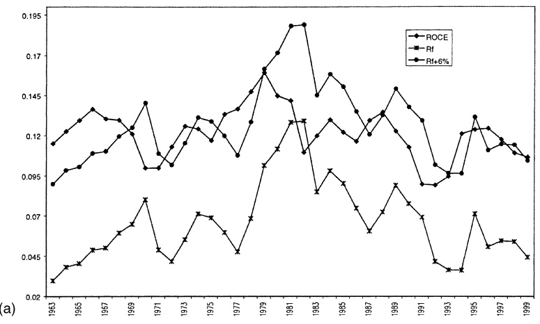

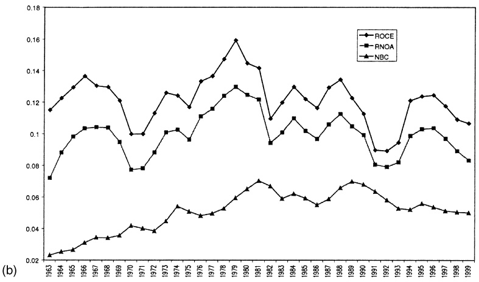

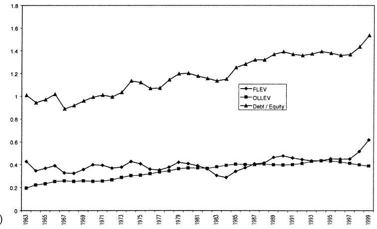

Figure 1. (a) Median ROCE, one-year treasury rate and the assumed cost of equity capital. (b) Median ROCE, RNOA and NBC over time. (c) Median FLEV, OLLEV and debt/equity over time. (d) Median ROTA and RNOA over time. (e) Median RNOA and its components over time. (f ) Median core RNOA and its components over time.

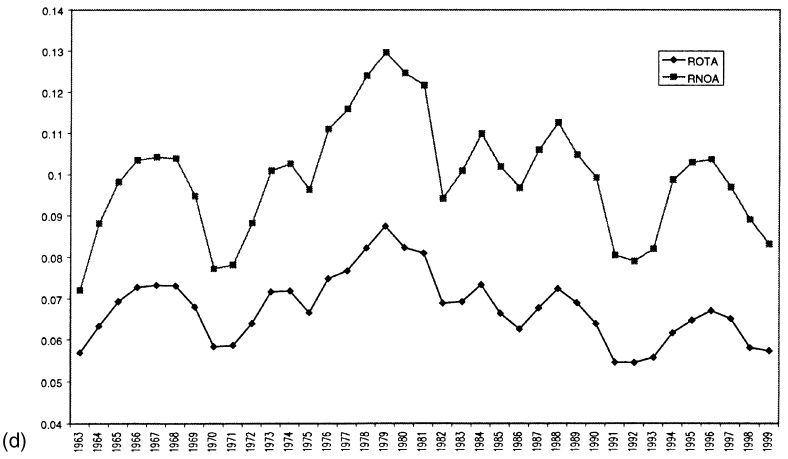

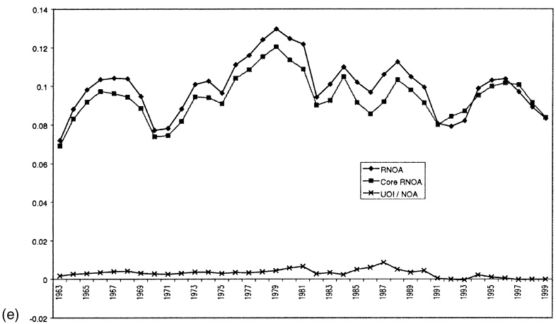

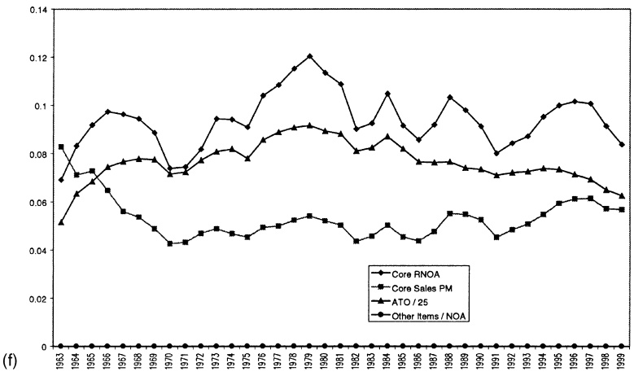

Figure 1. (Continued )

move away from NBC are those in which financial obligations are less likely to be at market value. ROCE is consistently higher than RNOA indicating a consistently favorable financial leverage effect. Median RNOA is consistently a positive spread above net borrowing cost. Figure 1c plots median FLEV that, with the SPREAD, produces the leverage effect, and contrasts it to the Debt/Equity ratio. Figure 1c also plots the OLLEV that levers the RNOA. FLEV and OLLEV are, year-to-year, quite stable. OLLEV has a slight positive trend; the recognition of employment benefit liabilities in the late 1980’s and 1990’s presumably contribute. The median Debt/Equity ratio increased more than FLEV over the years, induced by an increase in operating liabilities. The Debt/Equity ratio differs from FLEV also in the treatment of financial assets. Cash from operations can be used to buy the firm’s own debt (which affects the Debt/Equity ratio) but can also be used to buy financial assets, others’ debt (which does not affect the Debt/Equity ratio). In both cases the firm is buying debt, engaging in a financing transaction that reduces its net debt but does not affect the operations. The FLEV measure, based on a separation of financing and operating activities, captures both cases; the Debt/Equity ratio does not.

Figure 1d plots median ROTA and RNOA and Figure 1e plots core and unusual components of RNOA. ROTA consistently understates RNOA but the two do move together. Core RNOA is consistently lower than RNOA, except for some years in the 1990’s when, one conjectures, the many restructurings and accounting charges produced large negative unusual charges.

Figure 1f plots median Core RNOA again but also plots its drivers, Core Sales PM, Other Items/NOA and ATO. In the early part of the sample period, changes in economy-wide Core RNOA seem to have been driven more by changes in ATO than changes in Core Sales PM. But during the last 15 years Core Sales PM has driven the Core RNOA, with median ATO reasonably constant.

## Interaction between Ratios

The extended decomposition in (16) gives the drivers of ROCE and shows how they aggregate. But there may be interactions: a certain level of one driver may imply a certain level for another. Here we examine the data for these interactions. They are depicted in Figures 2a–2d. The figures plot joint values of median ratios for 244 three-digit SIC industry groups over 1963–1999. Plots were also made for just the more recent 1990–1999 period with similar results.15 These plots should be read in conjunction with the correlations in Table 2.

FLEV and SPREAD. Financial leverage levers ROCE relative to RNOA, as in (4), and the amount of leverage depends on both FLEV and SPREAD. As the effect of leverage (favorable or unfavorable) depends on the sign of the SPREAD, FLEV may be set by management after contemplating the SPREAD the firm will generate. One might expect a positive relationship between FLEV and SPREAD: a firm borrows more (to lever up ROCE) only if it can maintain high SPREAD which is less likely to turn unfavorable. But some argue that financing is irrelevant. Positive leverage generates higher anticipated ROCE, but increases the risk of lower profitability. So higher anticipated residual earnings from an

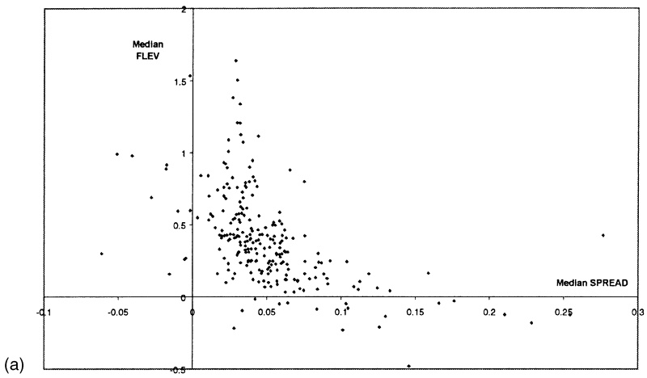

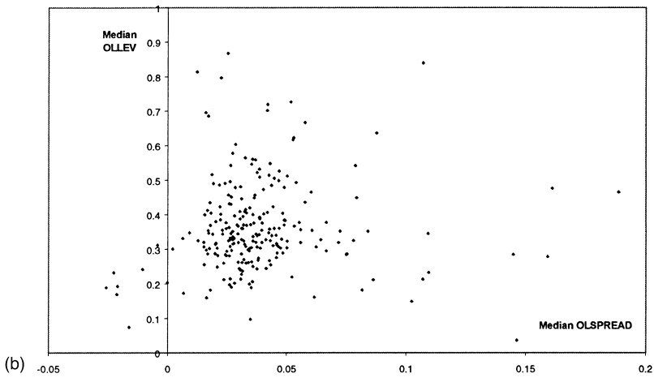

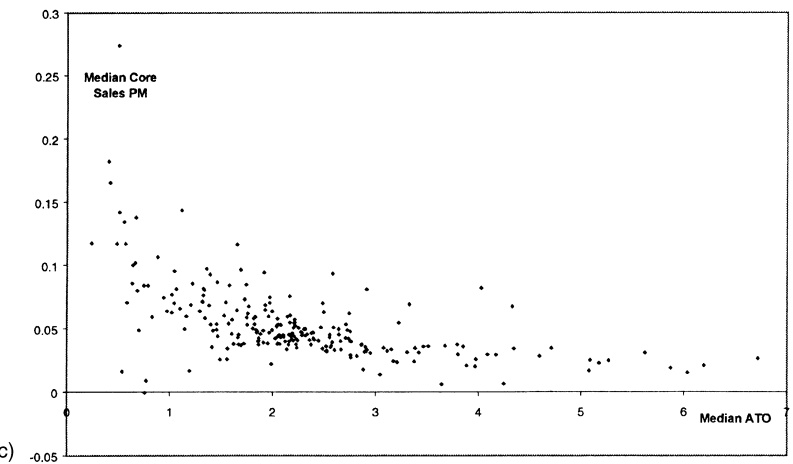

Figure 2. (a) Median FLEV on median SPREAD. (b) Median OLLEV on median OLSPREAD. (c) Median core sales PM on median ATO. (d) Median RNOA on median growth in NOA.

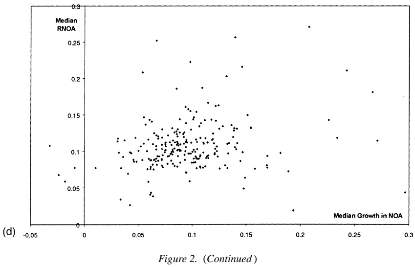

increase in anticipated ROCE are exactly offset in present value form by an increase in the cost of equity capital. Accordingly management may choose leverage for reasons other than increasing profitability of the equity.

Figure 2a plots FLEV on SPREAD. The leverage effect is given by FLEV\*SPREAD and we can think of fitting iso-leverage effect curves through the plots. The relationship is, surprisingly, negative. The Spearman rank correlation between FLEV and SPREAD is −0.38, and between FLEV and RNOA is −0.42. Perhaps a high median RNOA or SPREAD is the reward to business risk and firms with high business risk choose to have lower financing risk. Also, higher financial leverage presumably results in higher borrowing costs, reducing the SPREAD. And perhaps profitable firms generate a lot of cash which they use to reduce leverage.

OLLEV and OLSPREAD. Operating liability leverage levers RNOA relative to ROOA, as in (7), and the amount of leverage depends on both OLLEV and OLSPREAD. In a similar way to Figure 2a, Figure 2b plots the interaction between OLLEV and OLSPREAD. The rank correlation between the two is 0.15, and the rank correlation between OLLEV and RNOA is 0.28, indicating operating liability leverage works favorably, on average.

PM and ATO. The DuPont decomposition recognizes that RNOA = PM × ATO and it is commonly recognized that firms can generate the same RNOA with different combinations of margins and turnovers. Figure 2c replicates the figure in Selling and Stickney (1989) that is often displayed in texts, but the profit margin is the refined Core Sales PM and ATO here is based on NOA which incorporates operating liabilities. Iso-RNOA lines fitted through these plots are convex and downward sloping. The rank correlation between Core Sales PM and ATO is −0.40.

RNOA and Growth in NOA. RNOA and Growth in NOA combine to grow residual operating income. One might expect firms that generate higher RNOA to grow their net operating assets. But growth in NOA reduces RNOA if the accounting is conservative. Figure 2d shows that median RNOA and Growth in NOA are positively related in the sample period. The rank correlation between the two is 0.24.

The full set of correlations in Table 2 are at the firm level, not the industry level. Inspection will reveal some further relationships. For example, Core NBC is only slightly negatively correlated with RNOA (−0.08) but is positively correlated with FLEV (0.28); FLEV and OLLEV are negatively correlated (−0.26); and OLLEV is negatively correlated with Core Sales PM (without the recognition of imputed interest expense), but positively correlated with ATO, and overall OLLEV is positively correlated with RNOA.

## 3.2. Time-Series Analysis

This section documents the typical evolution of ratios over time. Ratios were identified in Section 2 as drivers of future residual earnings. With a view to forecasting, the analyst is not primarily concerned with current drivers, but with how current drivers will transition to the future. Will they persist or will they decay? If ratios decay, what will be their future level?

Of particular interest is the question of whether drivers tend to converge to typical values overtime. As with all valuation methods, a residual earnings valuation can be made from forecasts for truncated forecast horizons if attributes “settle down” to permanent levels within the horizon.16 If they do, continuing values can be calculated. Practical analysis typically makes assumptions about continuing values, as does academic research using analysts forecasts (which are typically made only for two to five years).17 Do residual earnings and their drivers typically “settle down” in the way assumed? And, if so, what is the typical form of the continuing value calculation?

We examine these issues by reference to the displays in Figures 3, 4, 5 and 6, along with simple rank correlation measures. The displays are based on ranking a given measure in a base year, year 0, forming 10 portfolios from the rankings, and then tracking median values for each portfolio for the following five years. The ranking is done seven times, in 1964, 1969, 1974, 1979, 1984, 1989 and 1994. For each of these years, portfolio medians are calculated for the ranking year and for the following five years. At end of the five years the ranking is done again for the next five years, and so on until 1994. The figures give the mean of portfolio medians over the seven sets of calculations. The patterns depicted are quite robust over the seven time periods, however. The displays are offered with one caveat. Firms in the base year that do not survive are not in the calculations in years after they drop out. Thus the expost averages may be biased estimates of exante amounts for going concerns.

The displays are to be read in conjunction with Table 3.That table gives the Spearman rank correlations between ratios and their t-lagged values $( t = 1 , 2 , \ldots , 5 )$ , calculated using all firm-year observations (1963–1999). It also gives the ratio of the variance of the portfolio measures in year $t ( t = 1 , 2 , \ldots , 5 )$ with that in the base year (year 0), as an indication (at the portfolio level) of the speed of conversion toward a common amount. The correlations are analogous to $R ^ { 2 }$ in a linear regression and the variance ratios are analogous to a slope coefficient.

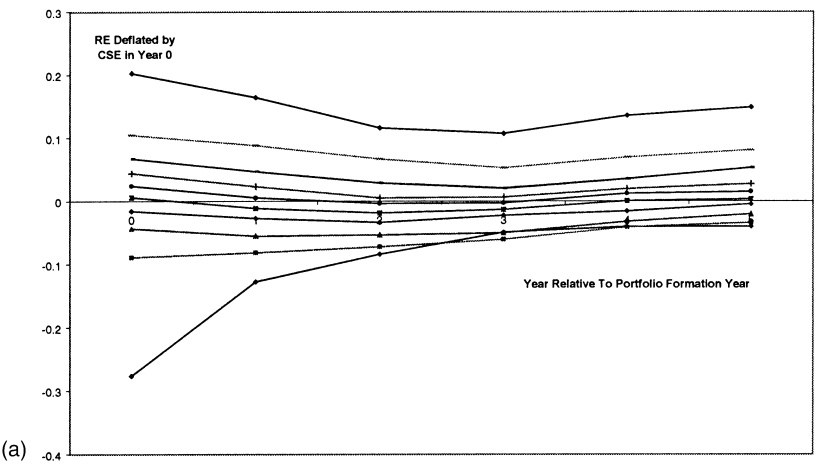

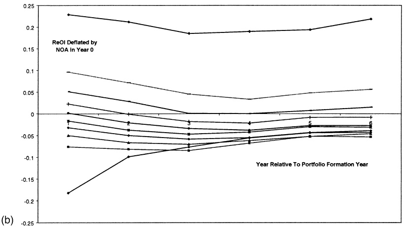

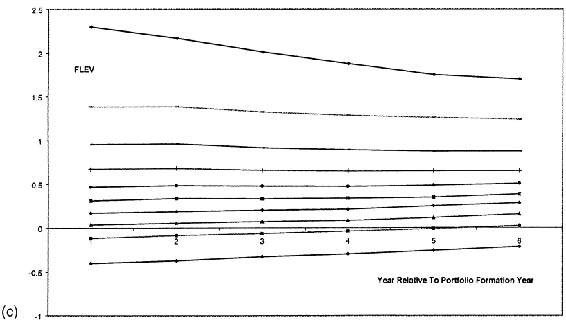

Figure 3. (a) Evolution of RE over time. (b) Evolution of ReOI over time. (c) Evolution of FLEV over time.

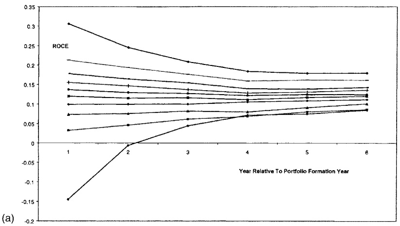

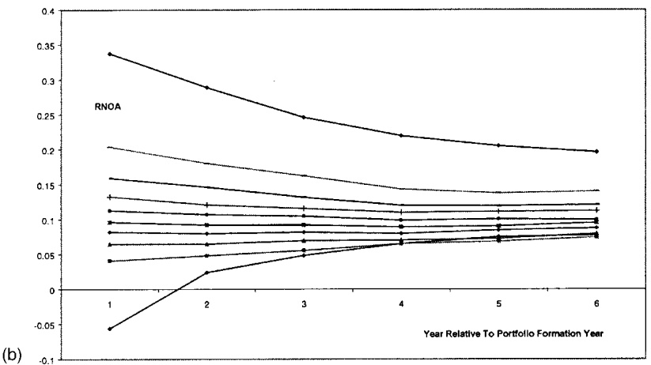

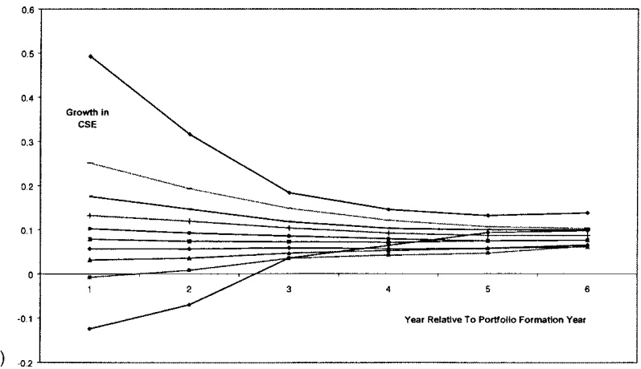

Figure 4. (a) Evolution of ROCE over time. (b) Evolution of RNOA over time. (c) Evolution of growth in CSE over time. (d) Evolution of growth in NOA over time.

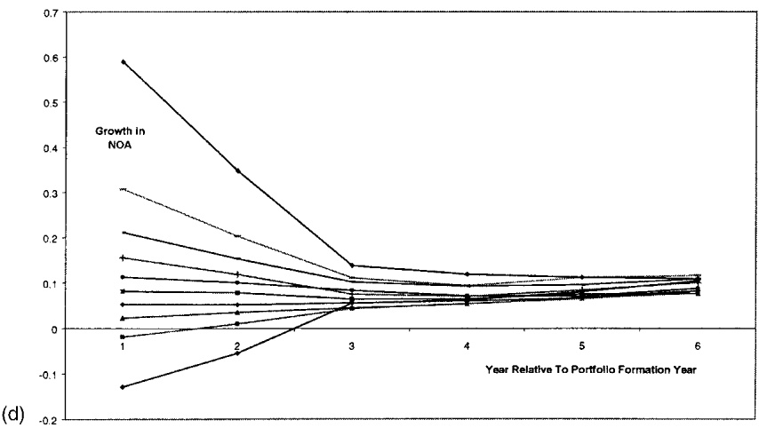

Figure 4. (Continued )

Residual Earnings (RE), Residual Operating Income (ReOI) and FLEV. Figures 3a and 3b give the average behavior of median RE and ReOI over five years from the base year. Both are per dollar of average book value (CSE and NOA respectively) in the base year. Both are calculated with a cost of capital equal to the one-year risk-free rate at the beginning of the year plus 6%, but the patterns are similar when the cost of capital for the subsequent years is the risk-free rate for the future year that is implied in the term structure at the end of the base year, plus 6%.

The following observations are made for both RE and ReOI. First, current residual earnings forecast future residual earnings, not only in the immediate future but five years ahead. High residual earnings firms (in the cross section) tend to have high residual earnings later and low residual earnings firms tend to have low residual earnings later. Indeed, the rank correlations in Table 3 between RE in year 0 and RE in years 1, 2, 3, 4 and 5 for individual firms are 0.55, 0.37, 0.25, 0.20, and 0.18, respectively. The corresponding rank correlations for ReOI are 0.65, 0.50, 0.40, 0.35, and 0.33. Second, in both the figures, the decaying rank correlations, and the decaying variance ratios indicate residual earnings tend to converge to central values, with the more extreme becoming more typical over time. But third, permanent levels are not zero for a number of portfolios. It appears that continuing values of the type CV2 and CV02 (or CV3 and CV03) are typical, not CV1 or CV01. A nonzero permanent level of residual earnings can be explained by persistent nonzero net present value investing or by conservative or liberal accounting. Fourth, long-run growth in residual earnings is slightly positive, suggesting that continuing value calculations of the type CV3 and CV03 may improve upon CV2 and CV02.

One other aspect of Figures 3a and 3b warrants mention. The majority of firms have negative RE or ReOI by the fifth year. Re and ReOI are determined in part by the cost of capital. With conservative accounting practiced on average, one expects long-run RE and ReOI to be, on average, positive and ROCE and RNOA to be greater than the cost of capital.

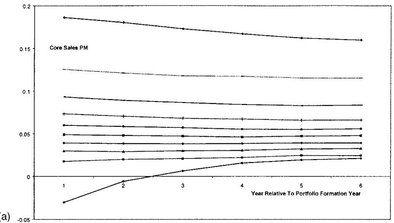

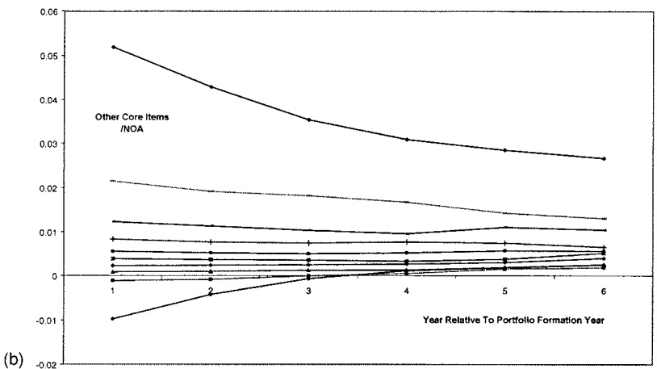

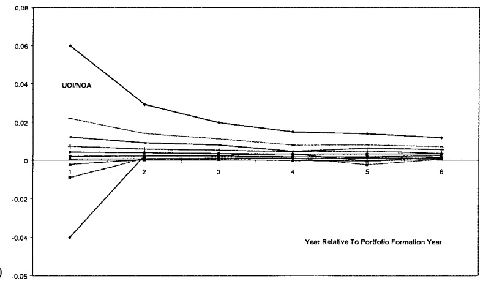

Figure 5. (a) Evolution of core sales PM over time. (b) Evolution of other core items/NOA over time. (c) Evolution of UOI/NOA over time. (d) Evolution of ATO over time.

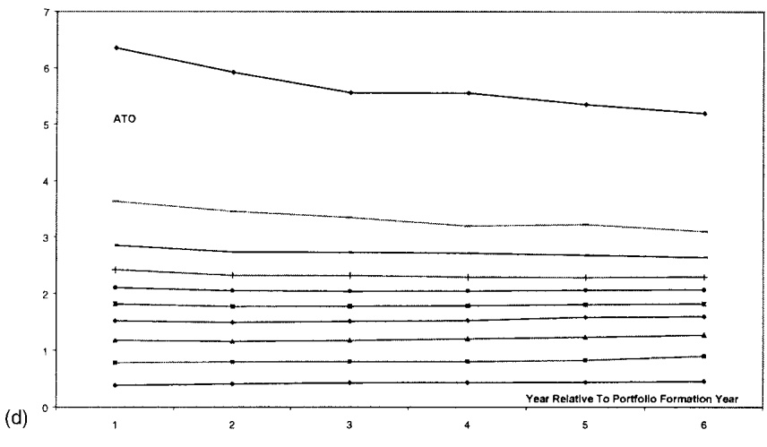

Figure 5. (Continued )

If this is the case, the displays indicate that the typically assumed equity risk premium of 6% is too high. As mentioned earlier, risk premiums estimated using the residual earnings model are less than 6%.

Financial leverage drives the difference between RE and ReOI so Figure 3c shows how FLEV changes overtime. FLEV is fairly constant for all portfolios except that with the highest FLEV. A temporarily high FLEV can produce temporarily high RE (through the leverage effect on ROCE) even when RNOA is “normal.” But mean reversion in FLEV forecasts that unusually high RE, so induced, will become more typical. Valuation by forecasting ReOI avoids these considerations and also avoids forecasting changes in discount rates due to forecasted changes in leverage.

ROCE, RNOA, Growth in CSE and Growth in NOA. Residual earnings measures are driven by rates of return and growth in book value. Figures 4a and 4b trace portfolio medians of ROCE and RNOA and Figures 4c and 4d trace portfolio medians of annual growth rates in CSE and NOA. The mean reversion in ROCE in Figure 4a is well documented (in Freeman, Ohlson and Penman (1982), Penman (1991) and Fama and French (2000)). A similar central tendency is evident for RNOA. So the mean reversion in RE and ReOI is driven in part by that in the two rates of return. However, Figures 4c and 4d indicate that growth in book value also decays toward economy-wide levels, driving RE and ReOI toward central values.18

Core Sales PM, Other Items, Unusual Operating Items and ATO. Figures 5a, b, c and d plot the drivers of RNOA, with Other Core Items and Unusual Operating Items deflated by NOA.19 The division of profitability into Core Sales PM, Other and Unusual Items distinguishes components with different persistence. Differences in Core Sales PM perpetuate. And, with the exception of the highest ATO group, asset turnovers remain fairly constant.

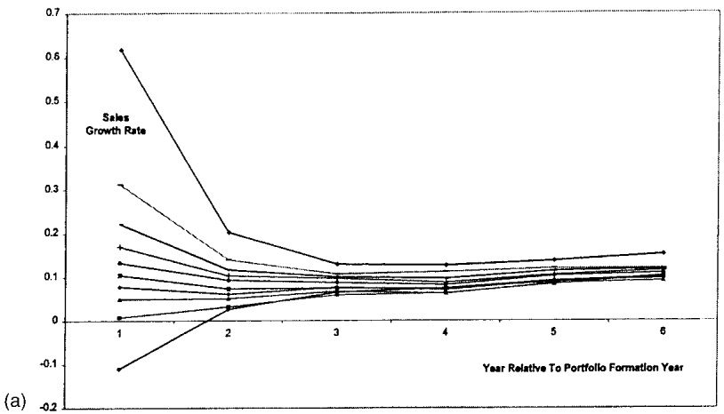

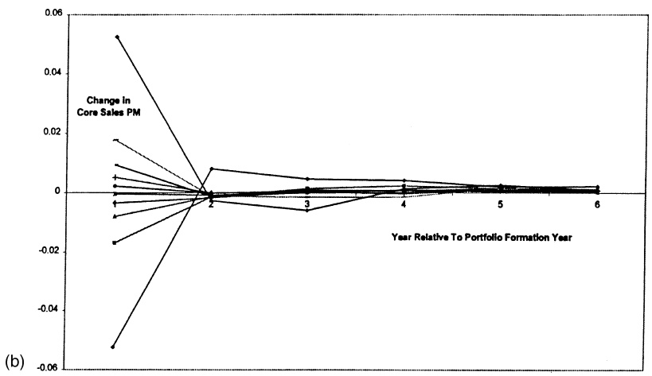

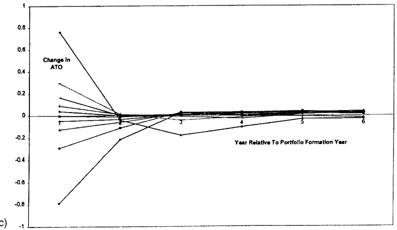

Figure 6. (a) Evolution of sales growth rate PM over time. (b) Evolution of change in core sales profit margin over time. (c) Evolution of change in ATO over time.

As indicated in Section 2.4, forecasting that profit margins and ATO will be constants simplifies the forecast of growth: the growth rate in ReOI for a continuing value calculation is then determined solely by forecasting growth in sales.

Changes in Sales, Core Sales PM and ATO. The Figure 5 graphs are for portfolios formed from the cross section. Figure 2c indicates systematic differences in profit margins and turnovers across industries, so the differences in the long-run profit margins and ATOs in Figure 5 are probably due to permanent differences in technology and cost structure across industries. So Figures 6a, b and c picture the evolution of changes in sales, Core Sales PM and ATO.

Table 3. Summary measures for the evolution of ratios.

<table><tr><td colspan="2">Year t Relative to Base Year</td><td>1</td><td>2</td><td>3</td><td>4</td><td>5</td></tr><tr><td rowspan="2">RE</td><td> $corr_t$ </td><td>0.551</td><td>0.372</td><td>0.257</td><td>0.200</td><td>0.176</td></tr><tr><td> $var_t /var_0$ </td><td>0.441</td><td>0.241</td><td>0.165</td><td>0.188</td><td>0.209</td></tr><tr><td rowspan="2">ReOI</td><td> $corr_t$ </td><td>0.653</td><td>0.496</td><td>0.397</td><td>0.349</td><td>0.327</td></tr><tr><td> $var_t /var_0$ </td><td>0.705</td><td>0.549</td><td>0.501</td><td>0.473</td><td>0.568</td></tr><tr><td rowspan="2">FLEV</td><td> $corr_t$ </td><td>0.937</td><td>0.846</td><td>0.781</td><td>0.735</td><td>0.700</td></tr><tr><td> $var_t /var_0$ </td><td>0.900</td><td>0.772</td><td>0.674</td><td>0.583</td><td>0.526</td></tr><tr><td rowspan="2">ROCE</td><td> $corr_t$ </td><td>0.618</td><td>0.425</td><td>0.311</td><td>0.253</td><td>0.230</td></tr><tr><td> $var_t /var_0$ </td><td>0.372</td><td>0.183</td><td>0.100</td><td>0.080</td><td>0.067</td></tr><tr><td rowspan="2">RNOA</td><td> $corr_t$ </td><td>0.665</td><td>0.485</td><td>0.377</td><td>0.320</td><td>0.298</td></tr><tr><td> $var_t /var_0$ </td><td>0.534</td><td>0.318</td><td>0.204</td><td>0.155</td><td>0.127</td></tr><tr><td rowspan="2">Growth in CSE</td><td> $corr_t$ </td><td>0.659</td><td>0.307</td><td>0.190</td><td>0.129</td><td>0.105</td></tr><tr><td> $var_t /var_0$ </td><td>0.408</td><td>0.088</td><td>0.038</td><td>0.024</td><td>0.020</td></tr><tr><td rowspan="2">Growth in NOA</td><td> $corr_t$ </td><td>0.584</td><td>0.165</td><td>0.074</td><td>0.051</td><td>0.051</td></tr><tr><td> $var_t /var_0$ </td><td>0.318</td><td>0.025</td><td>0.011</td><td>0.008</td><td>0.006</td></tr><tr><td rowspan="2">Core Sales PM</td><td> $corr_t$ </td><td>0.828</td><td>0.725</td><td>0.664</td><td>0.628</td><td>0.605</td></tr><tr><td> $var_t /var_0$ </td><td>0.808</td><td>0.691</td><td>0.617</td><td>0.555</td><td>0.534</td></tr><tr><td rowspan="2">Other Core Items/NOA</td><td> $corr_t$ </td><td>0.663</td><td>0.533</td><td>0.451</td><td>0.406</td><td>0.367</td></tr><tr><td> $var_t /var_0$ </td><td>0.645</td><td>0.422</td><td>0.311</td><td>0.243</td><td>0.195</td></tr><tr><td rowspan="2">Unusual Items/NOA</td><td> $corr_t$ </td><td>0.376</td><td>0.284</td><td>0.223</td><td>0.212</td><td>0.189</td></tr><tr><td> $var_t /var_0$ </td><td>0.128</td><td>0.058</td><td>0.031</td><td>0.037</td><td>0.020</td></tr><tr><td rowspan="2">ATO</td><td> $corr_t$ </td><td>0.947</td><td>0.894</td><td>0.857</td><td>0.830</td><td>0.808</td></tr><tr><td> $var_t /var_0$ </td><td>0.850</td><td>0.739</td><td>0.720</td><td>0.662</td><td>0.602</td></tr><tr><td rowspan="2">Growth in Sales</td><td> $corr_t$ </td><td>0.309</td><td>0.115</td><td>0.103</td><td>0.106</td><td>0.115</td></tr><tr><td> $var_t /var_0$ </td><td>0.073</td><td>0.012</td><td>0.011</td><td>0.008</td><td>0.007</td></tr><tr><td rowspan="2">ΔCore Sales PM</td><td> $corr_t$ </td><td>-0.039</td><td>-0.083</td><td>-0.059</td><td>-0.043</td><td>-0.012</td></tr><tr><td> $var_t /var_0$ </td><td>0.013</td><td>0.010</td><td>0.003</td><td>0.001</td><td>0.001</td></tr><tr><td rowspan="2">ΔATO</td><td> $corr_t$ </td><td>0.166</td><td>-0.100</td><td>-0.082</td><td>-0.039</td><td>-0.009</td></tr><tr><td> $var_t /var_0$ </td><td>0.031</td><td>0.024</td><td>0.010</td><td>0.003</td><td>0.003</td></tr></table>

Corrt is the Spearman rank correlation between each ratio and its t-lagged value calculated using all firm-year observations (1963–1999). The variance ratio is based on the portfolio analysis. This analysis is done by forming ten portfolios from a ranking on a ratio in a base year, and calculating the median ratio for each portfolio in the base year and each of the subsequent five years. (The base years are 1964, 1969, 1974, 1979, 1984, 1989 and 1994.) Next, means of portfolios’ medians over the seven replications are calculated (Figures 3a–6c plot these means). vart is the variance of the mean of portfolios’ medians in year t. Thus, vart /var0 measures the speed of mean reversion.

The patterns indicate that unusual charges are indeed transitory. Figure 6b also indicates that Core Sales PM can contain further transitory income (after isolating unusual items) and this is detected by looking at changes.20 Similarly, changes in ATO are mean reverting, and rapidly so.21

Table 3 and the supporting displays incorporate all firms that survive to each forward year. If the survival rate differs over the portfolios or the reason for non-survival differs, these expost representations may be biased depictions of exante patterns. Correcting for any effect of attrition is problematical. One might include expost liquidating earnings for firms that drop out but exante forecasts are usually made for going concerns (without anticipation of the effects of termination).

Panel A of Table 4 gives the average survival rates for the 10 residual earnings portfolios in Figure 3a. The numbers in the table are averages over the seven replications (1964–1969,

Table 4. Percentage survivorship rates for residual earnings portfolios.

<table><tr><td>Year t Relative to Base Year:</td><td>1</td><td>2</td><td>3</td><td>4</td><td>5</td></tr><tr><td colspan="6">Panel A: Percentage survivorship rates</td></tr><tr><td>Portfolio:</td><td></td><td></td><td></td><td></td><td></td></tr><tr><td>10 (high RE)</td><td>97.84</td><td>94.66</td><td>91.74</td><td>89.30</td><td>85.45</td></tr><tr><td>9</td><td>97.57</td><td>95.49</td><td>93.59</td><td>91.01</td><td>87.41</td></tr><tr><td>8</td><td>97.38</td><td>95.52</td><td>93.32</td><td>90.77</td><td>87.61</td></tr><tr><td>7</td><td>96.75</td><td>94.77</td><td>92.29</td><td>89.73</td><td>86.47</td></tr><tr><td>6</td><td>97.33</td><td>94.98</td><td>91.95</td><td>89.83</td><td>85.76</td></tr><tr><td>5</td><td>97.46</td><td>94.78</td><td>92.50</td><td>89.25</td><td>85.57</td></tr><tr><td>4</td><td>97.67</td><td>95.79</td><td>93.34</td><td>89.79</td><td>85.47</td></tr><tr><td>3</td><td>96.77</td><td>94.36</td><td>91.13</td><td>87.39</td><td>82.17</td></tr><tr><td>2</td><td>95.80</td><td>91.97</td><td>88.27</td><td>84.74</td><td>79.63</td></tr><tr><td>1 (low RE)</td><td>94.13</td><td>89.90</td><td>84.83</td><td>80.58</td><td>75.94</td></tr></table>

Panel B: Percentage of identified terminations that are due to merger or exchange

<table><tr><td colspan="6">Portfolio:</td></tr><tr><td>10 (high RE)</td><td>78.00</td><td>87.33</td><td>88.71</td><td>89.93</td><td>88.73</td></tr><tr><td>9</td><td>93.33</td><td>95.26</td><td>96.55</td><td>96.55</td><td>96.05</td></tr><tr><td>8</td><td>100.00</td><td>96.00</td><td>96.58</td><td>97.45</td><td>97.56</td></tr><tr><td>7</td><td>96.67</td><td>96.47</td><td>95.82</td><td>95.84</td><td>95.99</td></tr><tr><td>6</td><td>100.00</td><td>97.90</td><td>98.02</td><td>97.38</td><td>97.44</td></tr><tr><td>5</td><td>90.00</td><td>92.46</td><td>93.81</td><td>95.98</td><td>96.37</td></tr><tr><td>4</td><td>90.00</td><td>95.00</td><td>96.56</td><td>96.06</td><td>96.79</td></tr><tr><td>3</td><td>95.00</td><td>93.75</td><td>94.89</td><td>95.41</td><td>95.32</td></tr><tr><td>2</td><td>77.50</td><td>90.57</td><td>93.14</td><td>92.77</td><td>89.44</td></tr><tr><td>1 (low RE)</td><td>66.57</td><td>71.23</td><td>74.20</td><td>75.78</td><td>72.73</td></tr></table>

Panel A reports average (over the seven replications: 1964 –1969, . . . , 1994 –1999) of the percentage of firms in each of the 10 residual earnings (RE) portfolios that survived in the respective year after the base year.

The main four reasons for non-surviving are mergers, exchange of stock, liquidation and delisting. Panel B gives the percentage of non-surviving firms due to a merger or exchange out of all non-surviving firms for which the reason of non-survival is reported in CRSP.

1969–1974, . . . , 1994–1999) of the percentage of firms in each of the 10 portfolios in the base year that survived in each of the subsequent 5 years. Survivorship rates are similar across all portfolios except the bottom two (with the lowest RE). Patterns for all groups are conditional upon survival, but, for these two groups, the forecaster must be particularly concerned with forecasting survivorship as well as forecasting drivers. The main reasons for non-surviving are mergers, exchange of stock, liquidation and delisting. Panel B of Table 4 gives the percentage of terminations due to merger or exchange, as indicated by CRSP. Myers (1999) indicates that mergers and exchanges result in considerably higher payoffs than liquidation or delisting and, indeed, higher payoffs than those of surviving firms. The lower residual earnings portfolios have fewer mergers and exchanges (and more delistings and liquidations). And the “fade diagrams,” like Figure 3a, do not capture the higher payoffs to mergers and exchanges.

## 4. Conclusion

This paper has laid out a structured financial statement analysis that facilitates forecasting and valuation. The analysis involves an analysis of profitability and an analysis of growth. The analysis of profitability extends the traditional analysis, the analysis of growth complements it: profitability and growth drive equity values. The analysis is guided by the residual earnings valuation model but is appropriate for forecasting free cash flows and dividends if other valuation approaches are adopted.

Section 2.7 summarizes the major features of the scheme. The overall perspective is one of forecasting (and, from forecasts, valuation) so financial statement analysis is depicted, as a matter of first order, as an analysis of the future. Ratios are identified as drivers of future residual earnings, free cash flow and dividends. Ratios in current financial statements are then viewed as information to forecast the future drivers.

The paper documents typical values for ratios and typical patterns for ratios over time. The broad general descriptions are benchmarks that establish priors for forecasting. They are input to a more contextual analysis (of industries and firms) and a more sophisticated econometric forecasting analysis. The overall feature of the accounting data is central tendency—convergence of drivers to a common level in the cross section—which bodes well for calculating continuing values with standard valuation techniques.

The analysis does not deal with uncertainty in forecasting. This is incorporated in valuation models through the discount rate (or discounts from expected values) and one conjectures that financial statement analysis is also relevant for determining the discount rate.

Accounting research is concerned with assessing the “information content” of financial statements, presumably with a view to developing concrete products that can be used in practice. The practical significance of this paper should be obvious. But the analysis also guides future research. For forecasting research that applies the predictive ability criterion to evaluate information content, the analysis indicates what is to be forecasted if the researcher has valuation in mind. It also identifies the accounting informa tion that drives the forecast and the form it might take. The empirical analysis here is very much at the descriptive level but, with thought, may lead to more formal, parsimonious forecast modeling which brings more sophisticated econometrics to the task. Similarly, the analysis aids in the development of accounting-based valuation models that go beyond earnings and book values. And it guides the specification of “capital markets regressions” that conduct empirical tests of information content and accounting-based valuation.

## Appendix: Notation and Variables Measurement

This appendix describes how the variables are measured. Since perfect identification of operating and financing items requires data that are not available on Compustat, some of the variables are measured with error. When applicable, we discuss measurement issues below the variable’s definition.

$$
\begin{array}{c} \text {Financial Assets (FA) = cash and short term investments (Compustat \#1)} \\ \text {plus investments and advances - other (Compustat \#32).} \end{array}
$$

Companies hold cash on a regular basis partially because they cannot perfectly synchronize cash receipts and disbursements. Thus, a portion of “cash and short-term investments” is an operating asset. But we cannot separate the operating portion of cash from the total of cash and short-term investments, and we cannot separate interest income on operating cash from total interest income. So we classify all cash as a financial asset.

There are generally two types of investment securities: debt and equity. Investments in debt securities are financial assets, but investments in equity securities are usually investments in the operations of affiliated companies, and thus are operating assets. Compustat reports longterm investments in debt securities together with long-term investments in equity securities (other than those accounted for by using the equity method). Since most investments (other than those accounted for using the equity method) are in debt securities, we classify the item “investments and advances—other” (#32) as part of financial assets.

Another measurement issue is that “investments and advances—other” (#32) includes long-term receivables that are related to operating activities. However, receivables are usually carried close to their value even when they relate to operating activities (e.g., long-term lease receivables). More importantly, interest income on all receivables is included in interest income, which is classified as financial income (see below).

Operating Assets (OA) = Total Assets (TA, Compustat #6) minus Financial Assets (FA).

Financial Obligations (FO) = debt in current liabilities (#34) plus long term debt (#9) plus preferred stock (#130) minus preferred treasury stock (#227) and plus preferred dividends in arrears (#242).

Net Financial Obligations (NFO) = Financial Obligations (FO) minus Financial Assets (FA).

Common Equity (CSE) = common equity (#60) plus preferred treasury stock (#227) minus preferred dividends in arrears (#242).

Net Operating Assets (NOA) = Net Financial Obligations (NFO) plus Common Equity (CSE) and plus Minority Interest (MI, #38)

Operating Liabilities (OL) = Operating Assets (OA) minus Net Operating Assets (NOA).

Core Net Financial Expense (Core NFE) = after tax interest expense (#15 × (1 − marginal tax rate)) plus preferred dividends (#19) and minus after tax interest income (#62 × (1 − marginal tax rate)).

Unusual Financial Expense (UFE) = lag marketable securities adjustment (lag #238) minus marketable securities adjustment (#238).

Due to data problems we cannot include gain/loss on early extinguishment of debt, a component of UFE, in our measure of UFE. This item is classified as an extraordinary item and Compustat provides only the total of extraordinary items with no information on their nature. So we include all extraordinary items in operating income. In any case, our classification excludes extraordinary items from core income.

Another data issue with the measurement of UFE is that cumulative translation adjustment, a dirty surplus equity account, reflects unrealized currency translation gains and losses not only on operating items, but also on financial assets and liabilities. COMPUSTAT (and often the financial reports) does not provide enough details to separate the two. Since NOA are usually larger than NFO, we include this income item in operating income (see below).

Net Financial Expense (NFE) = Core Net Financial Expense (Core NFE) plus Unusual Financial Expense (UFE).

Clean Surplus Adjustments to net income (CSA) = marketable securities adjustment (#238) minus lag marketable securities adjustment (lag #238) plus cumulative translation adjustment (#230) and minus lag cumulative translation adjustment (lag #230).

CSA should include all items that change common equity and bypass the income statement (dirty surplus items) other than net dividends. Compustat provides information on the cumulative balance of two dirty surplus items: translation gains and losses (#230) and unrealized gains and losses on financial items (#238). Thus, CSA may be estimated as the change in these items during the year. These two items, although the more common and material dirty surplus items, are not the only ones.

An alternative approach to calculating CSA is by analyzing the change in retained earnings. That is, CSA equals the change in retained earnings minus net income and plus net dividends. There are several problems with this approach, however. The main problem is that stock dividends, share retirements and share repurchases (when accounted for using the par value method) reduce retained earnings but are not CSA.22

Comprehensive Net Income (CNI) = net income (#172) minus preferred dividends (#19) and plus Clean Surplus Adjustment to net Income (CSA).

Comprehensive Operating Income (OI) = Comprehensive Net Financial Expense (NFE) plus Comprehensive Net Income (CNI) and plus Minority Interest in Income (MII, #49).

Some parts of dirty surplus income (e.g., currency translation gains and losses) are associated with minority interests, but COMPUSTAT (and often financial reports) do not provide the details necessary to adjust minority interest income for dirty surplus items. So minority interest income, and therefore operating income, are misstated. However, since minority interest is usually very small, the effect of this misstatement is likely to be immaterial for most companies.

Unusual Operating Income (UOI) = after tax nonoperating income (expense) excluding interest and equity in earnings ((#190 − #55) × (1 − marginal tax rate)) plus after tax special items (#17 × (1 − marginal tax rate)) plus extraordinary items & discontinued operations (#48) plus cumulative translation adjustment (#230) and minus lag cumulative translation adjustment (lag #230).

Other Operating Income Items (Other Items) = Equity in earnings (#55).

Operating Income from Sales (OI from Sales) = Operating Income (OI) minus Other Operating Income Items (Other Items).

Core Operating Income from Sales (Core OI from Sales) = Operating Income from Sales (OI from Sales) minus Unusual Operating Income (UOI).

Marginal Tax Rate = the top statutory federal tax rate plus 2% average state tax rate. The top federal statutory corporate tax rate was 52% in 1963, 50% in 1964, 48% in 1965–1967, 52.8% in 1968–1969, 49.2% in 1970, 48% in 1971–1978, 46% in 1979–1986, 40% in 1987, 34% in 1988–1992 and 35% in 1993–1999.

Interest on Operating Obligations (io) = the one year risk-free rate at the beginning of the year multiplied by the difference between operating liabilities (OL) and “Deferred Taxes and Investment Tax Credit” (#35).

A more precise calculation of io would not impute implicit interest on the accrued pension cost but instead add the net interest cost on the net pension obligation (i.e., interest cost minus actual return on plan assets). However, Compustat gives details about the pension interest cost and the actual return on plan assets only starting 1991, and it does not provide the net accrued pension cost. This liability is probably included in item #75 (liabilities— other).

## Acknowledgments

The comments of Trevor Harris, Charles Lee, Jim Ohlson (and his teaching notes), Katherine Schipper and Toshi Shibano were helpful.

## Notes

1. Variation in outcomes for different scenarios also indicates risk.

2. For financial institutions, “financial” assets and liabilities are operating assets and liabilities. Financial institutions are excluded from our empirical analysis.

3. Johannson (1998) distinguishes operating and financing liabilities and the role they play in profitability analysis, but does not develop the formal analysis of operating liability leverage here.

4. Deferred taxes are not discounted (and the government does not implicitly charge interest). Net interest cost of pension liabilities is explicit in the income statement. So, with these items on the balance sheet,

io = short-term borrowing rate $\times \mathrm { O L }$ other than deferred taxes and pensions

\+ net interest cost on pension liabilities.

5. When there are minority interests, an additional driver is the ratio of minority interests to common equity. 6. For $V _ { 0 } ^ { \mathrm { N O A } }$ and $V _ { 0 } ^ { \mathrm { N F O } }$ to be added as separate values and be equivalent to (1), it is required that

$$
\rho_ {E} = \rho_ {W} + \frac {V _ {0} ^ {\mathrm{NFO}}}{V _ {0} ^ {E}} \times [ \rho_ {W} - \rho_ {D} ]
$$

(which is the same form as (4)). That is, the cost of capital for operations is

$$
\rho_ {W} = \left[ \frac {V _ {0} ^ {E}}{V _ {0} ^ {\mathrm{NOA}}} \times \rho_ {E} \right] \mathrm{x} \left[ \frac {V _ {0} ^ {\mathrm{NFO}}}{V _ {0} ^ {\mathrm{NOA}}} \times \rho_ {D} \right]
$$

as in standard finance that evokes Modigliani and Miller financing irrelevance (without consideration of tax effects from the financing). The distinction between different costs of capital for different net assets is somewhat cosmetic for the purposes of this paper, as the ratio analysis and the documentation that follows do not concern the cost of capital. The observation that different income streams have different risks (and thus different costs of capital) is standard in finance texts and we adhere to this orthodoxy largely so as to not offend the eye.

7. Growth in residual earnings translates into a $P / E$ ratio, the multiple commonly used to indicate growth. Forecasting constant RE yields a normal $P / E$ ratio (equal to $\rho _ { E } / ( \rho _ { E } - 1 ) )$ and forecasting growing RE yields a $P / E$ ratio greater than normal. See Penman (1996).

8. Free cash flow treats growth in NOA (NOA) as a negative driver (it is subtracted in (14)) whereas residual income treats investment as a positive driver. This identification is the main difference between residual income and discounted cash flow techniques.

9. Again, if minority interests exits, equation (16) is a decomposition of ROTCE, not ROCE.

10. The analysis omits effects on shareholder value of taxes on dividends and the value effects of the taxdeductibility of interest on debt, if any. GAAP omits the calculation of the cost to shareholders of employee stock options but this is a matter of recognizing an expense in comprehensive income. It does not affect the decomposition.

11. Except for the calculation of NBC and Core NBC, since firms can have negative net financial obligations (that is, net financial asset positions).

12. Some firms adopted the Statement in 1993.

13. The median growth rates for RE and ReOI in Table 1 are negative. Growth rates are calculated only for the cases of positive denominators. It will become clear in the time-series analysis that follows that these residual income measures subsequently decline, on average, for firms with positive residual income.

14. The product-moment (Pearson) correlation between median ROCE and the treasury yield is 0.32. The correlation between the lagged median ROCE and the treasury yield is 0.67. The one-year treasury yield is measured at the beginning of the year. Thus ROCE is more strongly related to the yield at the end of the year than to the yield at the beginning of the year.

15. In constructing these figures, a few extreme observations were deleted.

16. Ohlson and Zhang (1999) and Penman (1997) model finite-horizon residual earnings valuation.

17. See, for example, Frankel and Lee (1998), Lee, Myers and Swaminathan (1999), Penman and Sougiannis (1998), and Francis, Olsson and Oswald (2000).

18. Survivorship bias is a particular concern in interpreting Figures 4c and 4d, however. CSE and NOA increase through acquisitions and such growth is incorporated in the numbers here. But the negative growth of firms acquired is not.

19. Figure 5b includes only non-zero Other Core Items.

20. The pattern for the largest negative change in Core Sales PM in year 0 is particularly interesting. This portfolio has the largest (positive) changes in subsequent years. Is this “big bath” accounting that shifts income to the future?

21. The persistence of ATO changes for one period here is partly due to using average NOA in the calculation of ATO.

22. The effect of stock dividends on retained earnings is included in item #231 (Retained Earnings—Other Adjustments). This item also includes the effect of notes receivable (presumably for share issues). Both items are not income items, and thus the change in #231 should be the deducted from the change in retained earnings. The problem is that this item is available only starting 1982.

## References

Abarbanell, J. S., and V. L. Bernard. (2000). “Is the U.S. Stock Market Myopic?” Journal of Accounting Research 38, 221–243.

Beaver, W. H., and S. G. Ryan. (2000). “Biases and Lags in Book Value and their Effects on the Ability of the Book-to-Market Ratio to Predict Book Return on Equity.” Journal of Accounting Research 38, 127–148.

Brief, R. P., and R. A. Lawson. (1992). “The Role of the Accounting Rate of Return in Financial Statement Analysis.” The Accounting Review 67, 411–426.

Brown, L. D. (1993). “Earnings Forecasting Research: Its Implications for Capital Markets Research.” International Journal of Forecasting 9, 295–320.

Brown, S. J., W. N. Goetzmann, and S. A. Ross. (1995). “Survival.” Journal of Finance 50, 853–873.

Claus, J. J., and J. K. Thomas. (2001). “Equity Premium as Low as Three Percent? Evidence from Analysists Earnings Forecasts for Domestic and International Stocks” Journal of Finance. Forthcoming.

Colander, D. (1992). “Retrospectives: The Lost Art of Economics.” Journal of Economic Perspectives 6, 191–198.

Edwards, E. O., and P. W. Bell. (1961). The Theory and Measurement of Business Income. Berkeley, CA: The University of California Press.

Fairfield, P. M., R. J. Sweeney, and T. L. Yohn. (1996). “Accounting Classification and the Predictive Content of Earnings.” The Accounting Review 71, 337–355.

Fama E. F., and K. R. French. (2000). “Forecasting Profitability and Earnings.” Journal of Business 73.

Feltham, G. A., and J. A. Ohlson. (1995). “Valuation and Clean Surplus Accounting for Operating and Financial Activities.” Contemporary Accounting Research 11, 689–731.

Francis, J., P. Olsson, and D. R. Oswald. (2000). “Comparing the Accuracy and Explainability of Dividend, Free Cash Flow, and Abnormal Earnings Equity Value Estimates.” Journal of Accounting Research 38, 45–70.

Frankel, R., and C. M. C. Lee. (1998). “Accounting Valuation, Market Expectation and Cross-Sectional Stock Returns.” Journal of Accounting and Economics 25, 283–319.

Freeman, R. N., J. A. Ohlson, and S. H. Penman. (1982). “Book Rate-of-Return and Prediction of Earnings Changes: An Empirical Investigation.” Journal of Accounting Research 20, 639–653.

Gebhardt, W. R., C. M. C. Lee, and B. Swaminathan. (2000). “Toward an Implied Cost of Capital.” Journal of Accounting Research, Forthcoming.

Graham, B., D. L. Dodd, and S. Cottle. (1962). Security Analysis. New York, NY: McGraw-Hill Book Company, Inc.

Ibbotson, R., and R. Sinquefield. (1983). Stocks, bonds, bills and inflation. 1926–1982, Charlottesville, VA: Financial Analyst Research Foundation.

Johansson, S. (1998). The Profitability, Financing, and Growth of the Firm: Goals, Relationships and Measurement Methods. Lund, Sweden: Studentlitteratur.

Kay, J. A. (1976). “Accountants, too, Could be Happy in a Golden Age: The Accountants Rate of Profit and the Internal Rate of Return.” Oxford Economic Papers 17, 447–460.

Lee C. M. C., J. Myers, and B. Swaminathan. (1999). “What Is the Intrinsic Value of the Dow?” Journal of Finance 54, 1693–1741.

Lev, B., and S. R. Thiagarajan. (1993). “Fundamental Information Analysis.” Journal of Accounting Research 31, 190–215.

Lipe, R. C. (1986). “The Information Contained in the Components of Earnings.” Journal of Accounting Research 24, 37–64.

Myers, J. N. (1999). “Conservative Accounting and Finite Firm Life: Why Residual Income Valuation Estimates Understate Stock Price.” Working Paper, University of Washington.

Ohlson, J. A. (1995). “Earnings, Book Values, and Dividends in Equity Valuation.” Contemporary Accounting Research 11, 661–687.

Ohlson J. A., and X. J. Zhang. (1999). “On the Theory of the Forecast-Horizon in Equity Valuation.” Journal of Accounting Research 37, 437–449.

O’Hanlon J., and A. Steele. (1998). “Estimating the Equity Risk Premium Using Accounting Fundamentals.” Working Paper, Lancaster University.

Ou, J. A. (1990). “The Information Content of Nonearnings Accounting Numbers as Earnings Predictors.” Journal of Accounting Research 28, 144–163.

Ou, J. A., and S. H. Penman. (1989). “Financial Statement Analysis and the Prediction of Stock Returns.” Journal of Accounting and Economics 11, 295–329.

Ou, J. A., and S. H. Penman. (1995). “Financial Statement Analysis and the Evaluation of Market-to-Book Ratios.” Working Paper, University of California at Berkeley.

Penman, S. H. (1996). “The Articulation of Price-Earnings Ratios and Market-to-Book Ratios and the Evaluation of Growth.” Journal of Accounting Research 34, 235–259.

Penman, S. H. (1991). “An Evaluation of Accounting Rate-of-Return.” Journal of Accounting, Auditing, and Finance 6, 233–255.

Penman S. H. (1997). “A Synthesis of Equity Valuation Techniques and the Terminal Value Calculation of the Dividend Discount Model.” Review of Accounting Studies 2, 303–323.

Penman S. H., and T. Sougiannis. (1998). “A Comparison of Dividend, Cash Flow, and Earnings Approaches to Equity Valuation.” Contemporary Accounting Research 15, 343–383.

Preinreich, G. (1938). “Annual Survey of Economic Theory: The Theory of Depreciation.” Econometrica, 219–241.

Selling, T. I., and C. P. Stickney. (1989). “The Effects of Business Environments and Strategy on a Firm’s Rate of Return on Assets.” Financial Analysts Journal, 43–52.

Zhang, X. (2000). “Conservative Accounting and Earnings Valuation.” Journal of Accounting and Economics 29, 125–149.