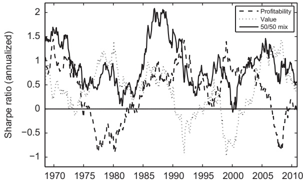
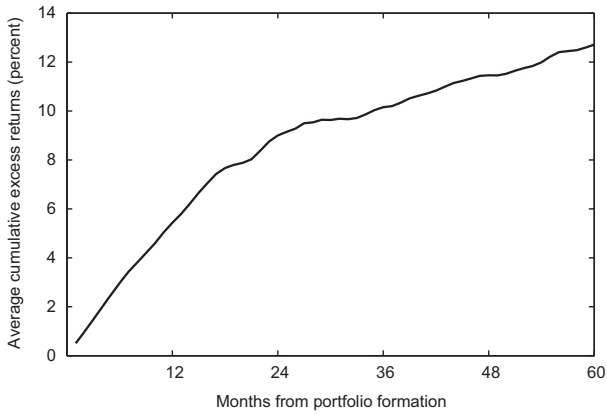

Robert Novy-Marx

Simon Graduate School of Business, University of Rochester, 500 Joseph C. Wilson Blvd., Box 270100, Rochester, NY 14627, United States

## a r t i c l e i n f o

Article history: Received 15 December 2011 Received in revised form 29 May 2012 Accepted 6 June 2012 <u>Available online 26 January 2013</u>

JEL classification: G12

Keywords: Profitability Value premium Factor models Asset pricing Quality investing

## a b s t r a c t

Profitability, measured by gross profits-to-assets, has roughly the same power as bookto-market predicting the cross section of average returns. Profitable firms generate significantly higher returns than unprofitable firms, despite having significantly higher valuation ratios. Controlling for profitability also dramatically increases the performance of value strategies, especially among the largest, most liquid stocks. These results are difficult to reconcile with popular explanations of the value premium, as profitable firms are less prone to distress, have longer cash flow durations, and have lower levels of operating leverage. Controlling for gross profitability explains most earnings related anomalies and a wide range of seemingly unrelated profitable trading strategies.

& 2013 Elsevier B.V. All rights reserved.

## 1. Introduction

Profitability, as measured by the ratio of a firm’s gross profits (revenues minus cost of goods sold) to its assets, has roughly the same power as book-to-market (B/M) predicting the cross section of average returns. Gross profits-to-assets is also complimentary to book-to-market, contributing economically significant information above that contained in valuations, even among the largest, most liquid stocks. These conclusions differ from those of earlier studies. For example, while Fama and French (2006) finds that earnings has explanatory power in Fama and MacBeth (1973) cross section regressions, Fama and French (2008, p. 1663) finds that ‘‘profitability sorts produce the weakest average hedge portfolio returns’’ among the strategies they consider and ‘‘do not provide much basis for the conclusion that, with controls for market cap and B/M, there is a positive relation between average returns and profitability.’’ Gross profitability has far more power than earnings, however, pre-dicting the cross section of returns.

Strategies based on gross profitability generate valuelike average excess returns, even though they are growth strategies that provide an excellent hedge for value. The two strategies share much in common philosophically, despite being highly dissimilar in both characteristics and covariances. While traditional value strategies finance the acquisition of inexpensive assets by selling expensive assets, profitability strategies exploit a different dimension of value, financing the acquisition of productive assets by selling unproductive assets. Because the two effects are closely related, it is useful to analyze profitability in the context of value.

Value strategies hold firms with inexpensive assets and short firms with expensive assets. When a firm’s market value is low relative to its book value, then a stock purchaser acquires a relatively large quantity of book assets for each dollar spent on the firm. When a firm’s market price is high relative to its book value the opposite is true. Value strategies were first advocated by Graham and Dodd (1934), and their profitability has been shown countless times since.

<small>\$ I thank Gene Fama, Andrea Frazzini, Toby Moskowitz, the anonymous referee, and participants of the National Bureau of Economic Research Asset Pricing and Q Group meetings.</small>

<small>E-mail address: [robert.novy-marx@simon.rochester.edu](mailto:robert.novy-marx@simon.rochester.edu)</small>

Previous work argues that the profitability of value strategies is mechanical. Firms for which investors require high rates of return (i.e., risky firms) are priced lower and, consequently, have higher book-to-markets than firms for which investors require lower returns. Because valuation ratios help identify variation in expected returns, with higher book-to-markets indicating higher required rates, value firms generate higher average returns than growth firms (Ball, 1978; Berk, 1995). While this argument is consistent with risk-based pricing, it works just as well if variation in expected returns is driven by behavioral forces. Lakonishok, Shleifer, and Vishny (1994) argue that low book-to-market stocks are on average overpriced, while the opposite is true for high book-to-market stocks, and that buying value stocks and selling growth stocks represents a crude but effective method for exploiting misvaluations in the cross section.

Similar arguments suggest that firms with productive assets should yield higher average returns than firms with unproductive assets. Productive firms that investors demand high average returns to hold should be priced similarly to less productive firms for which investors demand lower returns. Variation in productivity in this way helps identify variation in investors’ required rates of return. Because productivity helps identify this variation, with higher profitability indicating higher required rates, profitable firms generate higher average returns than unprofitable firms. Again, the argument is consistent with, but not predicated on, rational pricing.

Consistent with these predictions, portfolios sorted on gross profits-to-assets exhibit large variation in average returns, especially in sorts that control for book-to-market. More profitable firms earn significantly higher average returns than unprofitable firms. They do so despite having, on average, lower book-to-markets and higher market capitalizations. Because strategies based on profitability are growth strategies, they provide an excellent hedge for value strategies and, thus, dramatically improve a value investor’s investment opportunity set. In fact, the profitability strategy, despite generating significant returns on its own, provides insurance for value. Adding profitability on top of a value strategy reduces the strategy’s overall volatility, despite doubling its exposure to risky assets. A value investor can, thus, capture the gross profitability premium without exposing herself to any additional risk.

Profitability also underlies most earnings related anomalies, as well as a large number of seemingly unrelated anomalies. Many well known profitable trading strategies are just different expressions of three basic underlying anomalies, mixed in various proportions and dressed up in different guises. A four-factor model, employing the market and industry-adjusted value, momentum, and gross profitability factors, performs remarkably well pricing a wide range of anomalies, including (but not limited to) strategies based on return on equity, market power, default risk, net stock issuance, and organizational capital.

The remainder of the paper is organized as follows. Section 2 provides a simple theoretical framework for the prediction that gross profitability predicts the cross section of expected returns and shows that the predicted relation is strong in the data. Section 3 investigates the relation between profitability and value more closely. It shows that controlling for book-to-market significantly improves the performance of profitability strategies and that controlling for gross profits-to-assets significantly improves the performance of value strategies. Section 4 considers the performance of a four-factor model that employs the market and industry-adjusted value, momentum, and gross profitability factors, and it shows that this model performs better than standard models pricing a wide array of anomalies. Section 5 concludes.

## 2. Profitability and the cross section of expected returns

Fama and French (2006) illustrate the intuition that book-to-market and profitability are both positively related to expected returns using the dividend discount model in conjunction with clean surplus accounting. In the dividend discount model, a stock’s price equals the present value of its expected dividends. Under clean surplus accounting the change in book equity equals retained earnings. Together these imply the market value of equity (cum dividend) is

$$
M _ {t} = \sum_ {\tau = 0} ^ {\infty} \frac {\mathbf {E} _ {t} [ Y _ {t + \tau} - d B _ {t + \tau} ]}{(1 + r) ^ {\tau}},\tag{1}
$$

where $Y _ { t }$ is the time-t earnings, $d B _ { t }   \equiv   B _ { t }   -   B _ { t - 1 }$ is the change in book equity, and r is the required rate of return on expected dividends. Holding all else equal, higher valuations imply lower expected returns, and higher expected earnings imply higher expected returns. That is, value firms should outperform growth firms, and profitable firms should outperform unprofitable firms.

Fama and French (2006) test the expected relation between profitability and expected return with mixed results. Their cross sectional regressions suggest that earnings are related to average returns in the manner predicted, but their portfolio tests suggest that profitability adds little or nothing to the prediction of returns provided by size and book-to-market.

Fama and French (2006) employ current earnings as a simple proxy for future profitability, however, and gross profitability is a better proxy. Earnings in Eq. (1) represent a firm’s true economic profitability. Earnings off the income statement represent a firm’s true economic profitability reduced by any investments that are treated as expenses, such as research and development (R&D), advertising, or human capital development. Expensed investments directly reduce earnings without increasing book equity but are nevertheless associated with higher future economic profits and, therefore, higher future dividends. When considering changes to earnings in Eq. (1), it thus makes no sense to hold all else equal.

Gross profits is the cleanest accounting measure of true economic profitability. The farther down the income statement one goes, the more polluted profitability measures become, and the less related they are to true economic profitability. For example, a firm that has both lower production costs and higher sales than its competitors is unambiguously more profitable. Even so, it can easily have lower earnings than its competitors. If the firm is quickly increasing its sales though aggressive advertising or commissions to its sales force, these actions can, even if optimal, reduce its bottom line income below that of its less profitable competitors. Similarly, if the firm spends on research and development to further increase its production advantage or invests in organizational capital that helps it maintain its competitive advantage, these actions result in lower current earnings. Moreover, capital expenditures that directly increase the scale of the firm’s operations further reduce its free cash flows relative to its competitors. These facts suggest constructing the empirical proxy for productivity using gross profits.1 Scaling by a book-based measure, instead of a marketbased measure, avoids hopelessly conflating the productivity proxy with book-to-market. I scale gross profits by book assets, not book equity, because gross profits are an asset level measure of earnings. They are not reduced by interest payments and are, thus, independent of leverage.

Determining the best measure of economic productivity is, however, ultimately an empirical question. Popular media are preoccupied with earnings, the variable on which Wall Street analysts’ forecasts focus. Financial economists are generally more concerned with free cash flows, the present discounted value of which should determine a firm’s value. I, therefore, also consider profitability measures constructed using earnings and free cash flows.

## 2.1. Fama and MacBeth regressions

Table 1 shows results of Fama and MacBeth regressions of firms’ returns on gross profits-to-assets, earningsto-book equity, and free cash flow-to-book equity. Regressions include controls for book-to-market (log(B/M)), size (log(ME)), and past performance measured at horizons of one month $( r _ { 1 , 0 } )$ and 12 to two months $( r _ { 1 2 , 2 } ) . ^ { 2 }$ Time series averages of the cross sectional Spearman rank correlations between these independent variables are provided in Appendix A.1 and show that gross profitability is negatively correlated with book-to-market, with a magnitude similar to the negative correlation observed between book-to-market and size. I use Compustat data starting in 1962, the year of the American Stock Exchange (Amex) inclusion, and employ accounting data for a given fiscal year starting at the end of June of the following calendar year. Asset pricing tests consequently cover July 1963 through December 2010. The sample excludes financial firms [i.e., those with a one-digit standard industrial classification (SIC) code of six], though retaining financials has little impact on the results. Independent variables are trimmed at the 1% and 99% levels. The table also shows results employing gross profits-to-assets, earnings-to-book equity, and free cash flow-to-book equity demeaned by industry, where the industries are the Fama and French (1997) 49 industry portfolios.

The first specification of Panel A shows that gross profitability has roughly the same power as book-to-market predicting the cross section of returns. Profitable firms generate higher average returns than unprofitable firms. The second and third specifications replace gross profitability with earnings-to-book equity and free cash flow-to-book equity, respectively. These variables have much less power than gross profitability. The fourth and fifth specifications show that gross profitability subsumes these other profitability variables. The sixth specification shows that free cash flow subsumes earnings. The seventh specification shows that free cash flow has incremental power above that in gross profitability after controlling for earnings, but that gross profitability is still the stronger predictive variable.

Appendix A.2 performs similar regressions employing alternative earnings variables. In particular, it considers earnings before interest, taxes, depreciation, and amortization (EBITDA) and selling, general, and administrative expenses (XSGA), which together represent a decomposition of gross profits. These regressions show that EBITDA-to-assets and XSGA-to-assets each have significant power predicting the cross section of returns, both individually and jointly, but that gross profits-to-assets subsumes their predictive powers. It also considers regressions employing the DuPont model decomposition of gross profits-to-assets into asset turnover (sales-to-assets, an accounting measure of efficiency) and gross margins (gross profits-to-sales, a measure of market power). These variables also have power predicating the cross section of returns, both individually and jointly, but

<small>1 Several studies have found a role for individual components of the difference between gross profits and earnings. For example, Sloan (1996) and Chan, Lakonishok, and Sougiannis (2006) find that accruals predict returns, and Chan, Lakonishok, and Sougiannis (2001) argue that R&D and advertising expenditures have power in the cross section. Lakonishok, Shleifer, and Vishny (1994) also find that strategies formed on the basis of cash flow, defined as earnings plus depreciation, are more profitable than those formed on the basis of earnings alone.</small>

<small>2 Gross profits and earnings before extraordinary items are Compustat data items GP and IB, respectively. For free cash flow, I employ net income plus depreciation and amortization minus changes in working capital minus capital expenditures (NI þ DP - WCAPCH - CAPX). Gross profits is also defined as total revenue (REVT) minus cost of goods sold (COGS), where COGS represents all expenses directly related to production, including the cost of materials and direct labor, amortization of software and capital with a useful life of less than two years, license fees, lease payments, maintenance and repairs, taxes other than income taxes, and expenses related to distribution and warehousing, heat, lights, and power. Book-to-market is book equity scaled by market equity, where market equity is lagged six months to avoid taking unintentional positions in momentum. Book equity is shareholder equity, plus deferred taxes, minus preferred stock, when available. For the components of</small>

<small>(footnote continued)</small>

<small>shareholder equity, I employ tiered definitions largely consistent with those used by Fama and French (1993) to construct their high minus low factor (HML). Stockholders equity is as given in Compustat (SEQ) if available, or else common equity plus the carrying value of preferred stock (CEQþPSTX) if available, or else total assets minus total liabilities (AT - LT). Deferred taxes is deferred taxes and investment tax credits (TXDITC) if available, or else deferred taxes and/or investment tax credit (TXDB and/or ITCB). Preferred stock is redemption value (PSTKR) if available, or else liquidating value (PSTKRL) if available, or else carrying value (PSTK).</small>

## Table 1

Fama and MacBeth regressions of returns on measures of profitability.

Panel A reports results from Fama and MacBeth regressions of returns on gross profits (revenues minus cost of goods sold, REVT - COGS) scaled by assets (AT), as well as income before extraordinary items (IB) and free cash flow (net income plus amortization and depreciation minus changes in working capital and capital expenditures, NIþDP-WCAPCH-CAPX) each scaled by book equity. Panel B repeats the tests employing profitability measures demeaned by industry (Fama and French 49). Regressions include controls for book-to-market [log(B/M)], size [log(ME)], and past performance measured at horizons of one month $( r _ { 1 , 0 } )$ and 12 to two months $( r _ { 1 2 , 2 } ) .$ Independent variables are trimmed at the 1% and 99% levels. The sample excludes financial firms (those with one-digit standard industrial classification codes of six) and covers July 1963 to December 2010.

<table><tr><td></td><td colspan="7">Slope coefficients ( $\times 10^2$ ) and [test-statistics] from regressions of the form  $r_{tj} = \beta' \mathbf{x}_{tj} + \epsilon_{tj}$ </td></tr><tr><td>Independent variable</td><td>(1)</td><td>(2)</td><td>(3)</td><td>(4)</td><td>(5)</td><td>(6)</td><td>(7)</td></tr><tr><td colspan="8">Panel A: Straight profitability variables</td></tr><tr><td>Gross profitability</td><td>0.75[5.49]</td><td></td><td></td><td>0.69[5.22]</td><td>0.62[4.63]</td><td></td><td>0.61[4.59]</td></tr><tr><td>Earnings</td><td></td><td>0.22[0.84]</td><td></td><td>0.08[0.31]</td><td></td><td>-0.02[-0.06]</td><td>-0.07[-0.27]</td></tr><tr><td>Free cash flow</td><td></td><td></td><td>0.27[2.28]</td><td></td><td>0.20[1.64]</td><td>0.39[3.17]</td><td>0.33[2.67]</td></tr><tr><td>log(B/M)</td><td>0.35[5.98]</td><td>0.30[4.97]</td><td>0.26[4.59]</td><td>0.34[5.54]</td><td>0.30[5.17]</td><td>0.27[4.48]</td><td>0.31[5.05]</td></tr><tr><td>log(ME)</td><td>-0.09[-2.29]</td><td>-0.12[-3.24]</td><td>-0.13[-3.20]</td><td>-0.11[-2.78]</td><td>-0.11[-2.80]</td><td>-0.13[-3.34]</td><td>-0.11[-2.92]</td></tr><tr><td> $r_{1,0}$ </td><td>-5.57[-13.8]</td><td>-5.49[-13.7]</td><td>-5.52[-13.7]</td><td>-5.64[-14.1]</td><td>-5.66[-14.1]</td><td>-5.56[-13.9]</td><td>-5.70[-14.3]</td></tr><tr><td> $r_{12,2}$ </td><td>0.76[3.87]</td><td>0.78[4.02]</td><td>0.78[4.02]</td><td>0.74[3.80]</td><td>0.74[3.80]</td><td>0.76[3.93]</td><td>0.73[3.74]</td></tr><tr><td colspan="8">Panel B: Profitability variables demeaned by industry</td></tr><tr><td>Gross profitability</td><td>1.00[8.99]</td><td></td><td></td><td>0.94[9.75]</td><td>0.94[8.38]</td><td></td><td>0.92[8.39]</td></tr><tr><td>Earnings</td><td></td><td>0.28[1.86]</td><td></td><td>0.04[0.15]</td><td></td><td>0.09[0.51]</td><td>0.02[0.13]</td></tr><tr><td>Free cash flow</td><td></td><td></td><td>0.16[2.54]</td><td></td><td>0.09[1.23]</td><td>0.25[3.30]</td><td>0.21[2.54]</td></tr><tr><td>log(B/M)</td><td>0.35[5.57]</td><td>0.32[5.40]</td><td>0.30[5.13]</td><td>0.33[5.15]</td><td>0.34[5.33]</td><td>0.31[5.12]</td><td>0.34[5.30]</td></tr><tr><td>log(ME)</td><td>-0.09[-2.19]</td><td>-0.11[-2.65]</td><td>-0.11[-2.64]</td><td>-0.10[-2.62]</td><td>-0.10[-2.31]</td><td>-0.11[-2.69]</td><td>-0.10[-2.35]</td></tr><tr><td> $r_{1,0}$ </td><td>-5.63[-13.2]</td><td>-5.50[-13.5]</td><td>-5.52[-13.5]</td><td>-5.67[-13.4]</td><td>-5.66[-13.2]</td><td>-5.53[-13.6]</td><td>-5.67[-13.3]</td></tr><tr><td> $r_{12,2}$ </td><td>0.76[3.66]</td><td>0.78[3.98]</td><td>0.78[3.95]</td><td>0.75[3.63]</td><td>0.75[3.63]</td><td>0.77[3.92]</td><td>0.74[3.61]</td></tr></table>

gain lose their power when used in conjunction with gross profitability. The analysis does suggest, however, that high asset turnover primarily drives the high average returns of profitable firms, while high gross margins are the distinguishing characteristic of good growth stocks.

Gross profitability’s power predicting returns is not driven by accruals or R&D expenditures. While these both represent components of the wedge between earnings and gross profits, and Sloan (1996) and Chan, Lakonishok, and Sougiannis (2001) show, respectively, that these each have power in the cross section, the results of Sloan and Chan, Lakonishok, and Sougiannis cannot explain those presented here. Appendix A.3 shows that gross profits-to-assets retains power predicting returns after controlling for accruals and R&D expenditures. This is not to say that the results of Sloan and Chan, Lakonishok, and Sougiannis do not exist independently, but simply that gross profitability’s power to predict returns persists after controlling for these earlier, well documented results.

Panel B repeats the tests of Panel A, employing gross profits-to-assets, earnings-to-book equity and free cash flow-to-book equity demeaned by industry. These tests tell the same basic story, though the results here are even stronger. Gross profits-to-assets is a powerful predictor of the cross section of returns. The test-statistic on the slope coefficient on gross profits-to-assets demeaned by industry is more than one and a half times as large as that on the variable associated with value (log(B/M)) and almost two and a half times as large on the variable associated with momentum $( r _ { 1 2 , 2 } )$ . Free cash flows also has some power, though less than gross profits. Earnings convey little information regarding future performance. The use of industry-adjustment to better predict the cross section of returns is investigated in greater detail in Section 4.

Because gross profitability appears to be the measure of basic profitability with the most power predicting the cross section of expected returns, it is the measure I focus on for the remainder of the paper.

## Table 2

## Excess returns to portfolios sorted on profitability.

This table shows monthly value-weighted average excess returns to portfolios sorted on gross profits-to-assets [(REVT - COGS)/AT], employing NYSE breakpoints, and results of time series regressions of these portfolios’ returns on the Fama and French factors [the market factor (MKT), the size factor small-minus-large (SMB), and the value factor high-minus-low (HML)], with test-statistics (in square brackets). It also shows time series average portfolio characteristics [portfolio gross profits-to-assets (GP/A), book-to-market (B/M), average firm size (ME, in millions of dollars), and number of firms (n)]. Panel B provides similar results for portfolios sorted on book-to-market. The sample excludes financial firms (those with one-digit standard industrial classification codes of six) and covers July 1963 to December 2010.

<table><tr><td rowspan="2">Portfolio</td><td rowspan="2"> $r^e$ </td><td colspan="4">Alphas and three-factor loadings</td><td colspan="4">Portfolio characteristics</td></tr><tr><td>α</td><td>MKT</td><td>SMB</td><td>HML</td><td>GP/A</td><td>B/M</td><td>ME</td><td>n</td></tr><tr><td colspan="10">Panel A: Portfolios sorted on gross profits-to-assets</td></tr><tr><td>Low</td><td>0.31[1.65]</td><td>-0.18[-2.54]</td><td>0.94[57.7]</td><td>0.04[1.57]</td><td>0.15[5.87]</td><td>0.10</td><td>1.10</td><td>748</td><td>771</td></tr><tr><td>2</td><td>0.41[2.08]</td><td>-0.11[-1.65]</td><td>1.03[67.5]</td><td>-0.07[-3.13]</td><td>0.20[8.51]</td><td>0.20</td><td>0.98</td><td>1,100</td><td>598</td></tr><tr><td>3</td><td>0.52[2.60]</td><td>0.02[0.27]</td><td>1.02[69.9]</td><td>-0.00[-0.21]</td><td>0.12[5.42]</td><td>0.30</td><td>1.00</td><td>1,114</td><td>670</td></tr><tr><td>4</td><td>0.41[1.94]</td><td>0.05[0.83]</td><td>1.01[70.6]</td><td>0.04[1.90]</td><td>-0.24[-11.2]</td><td>0.42</td><td>0.53</td><td>1,114</td><td>779</td></tr><tr><td>High</td><td>0.62[3.12]</td><td>0.34[5.01]</td><td>0.92[58.3]</td><td>-0.04[-2.03]</td><td>-0.29[-12.3]</td><td>0.68</td><td>0.33</td><td>1,096</td><td>938</td></tr><tr><td>High-low</td><td>0.31[2.49]</td><td>0.52[4.49]</td><td>-0.03[-0.99]</td><td>-0.08[-2.15]</td><td>-0.44[-10.8]</td><td></td><td></td><td></td><td></td></tr><tr><td colspan="10">Panel B: Portfolios sorted on book-to-market</td></tr><tr><td>Low</td><td>0.39[1.88]</td><td>0.13[2.90]</td><td>0.98[90.1]</td><td>-0.09[-5.62]</td><td>-0.39[-23.9]</td><td>0.43</td><td>0.25</td><td>1,914</td><td>965</td></tr><tr><td>2</td><td>0.45[2.33]</td><td>-0.02[-0.29]</td><td>0.99[78.1]</td><td>0.05[2.61]</td><td>0.04[2.23]</td><td>0.31</td><td>0.54</td><td>1,145</td><td>696</td></tr><tr><td>3</td><td>0.56[2.99]</td><td>0.03[0.53]</td><td>0.96[63.5]</td><td>0.04[2.09]</td><td>0.22[9.71]</td><td>0.26</td><td>0.79</td><td>849</td><td>640</td></tr><tr><td>4</td><td>0.67[3.58]</td><td>-0.00[-0.03]</td><td>0.96[74.8]</td><td>0.10[5.66]</td><td>0.53[27.1]</td><td>0.21</td><td>1.12</td><td>641</td><td>655</td></tr><tr><td>High</td><td>0.80[3.88]</td><td>0.07[1.04]</td><td>1.01[60.7]</td><td>0.25[10.7]</td><td>0.51[20.5]</td><td>0.21</td><td>5.47</td><td>367</td><td>703</td></tr><tr><td>High-low</td><td>0.41[2.95]</td><td>-0.06[-0.71]</td><td>0.03[1.44]</td><td>0.34[12.0]</td><td>0.91[30.0]</td><td></td><td></td><td></td><td></td></tr></table>

## 2.2. Sorts on profitability

The Fama and MacBeth regressions of Table 1 suggest that profitability predicts average returns. These regressions, because they weight each observation equally, put tremendous weight on the nano- and micro-cap stocks, which make up roughly two-thirds of the market by name but less than 6% of the market by capitalization. The Fama and MacBeth regressions are also sensitive to outliers and impose a potentially misspecified parametric relation between the variables, making the economic significance of the results difficult to judge. This subsection attempts to address these issues by considering the performance of value-weighted portfolios sorted on profitability, non-parametrically testing the hypothesis that profitability predicts average returns.

Table 2 shows results of univariate sorts on gross profits-to-assets [(REVT - COGS)/AT] and, for comparison, valuation ratios (book-to-market). The Spearman rank correlation between gross profits-to-assets and book-to-market ratios is -18%, and highly significant, so strategies formed on the basis of gross profitability should be growth strategies, while value strategies should hold unprofitable firms. Portfolios are constructed using a quintile sort, based on New York Stock Exchange (NYSE) break points, and are rebalanced each year at the end of

June. The table shows the portfolios’ value-weighted average excess returns, results of the regressions of the portfolios’ returns on the three Fama and French factors, and the time series average of the portfolios’ gross profitsto-assets (GP/A), book-to-markets (B/M), and market capitalizations (ME), as well as the average number of firms in each portfolio (n). The sample excludes financial firms (those with one-digit SIC codes of six) and covers July 1963 to December 2010.3

<small>3 Firms’ revenues, costs of goods sold, and assets are available on a quarterly basis beginning in 1972 (Compustat data items REVTQ, COGSQ and ATQ, respectively), allowing for the construction of gross profitability strategies using more current public information than those presented here. These high frequency gross profitability strategies are even more profitable (see Appendix A.4). Despite these facts, I focus on gross profitability measured using annual data. I am particularly interested in the persistent power gross profitability has predicting returns and its relation to the similarly persistent value effect. While the high frequency gross profitability strategy is most profitable in the months immediately following portfolio formation, its profitability persists for more than three years. Focusing on the strategy formed using annual profitability data ensures that results are truly driven by the level of profitability, and not surprises about profitability like those that drive post earnings announcement drift. The low frequency profitability strategy also incurs lower transaction costs, turning over only once every four years, less frequently than the corresponding value strategy, and only a quarter as often as the high frequency profitability strategy.</small>

The table shows that the gross profits-to-assets portfolios’ average excess returns are generally increasing with profitability, with the most profitable firms earning 0.31% per month higher average returns than the least profitable firms, with a test-statistic of 2.49. This significant profitable minus unprofitable return spread is observed despite the fact that the strategy is a growth strategy, with a large, significant negative loading on HML (high minus low). As a result, the abnormal returns of the profitable minus unprofitable return spread relative to the Fama and French three-factor model is 0.52% per month, with a test-statistic of 4.49.4

Consistent with the observed variation in HML loadings, the portfolios sorted on gross profitability exhibit large variation in the value characteristic. Profitable firms tend to be growth firms, in the sense of having low bookto-markets, and unprofitable firms tend to be value firms, with high book-to-market. In fact, the portfolios sorted on gross profitability exhibit roughly half the variation in book-to-markets as portfolios sorted directly on book-to-market (Table 2, Panel B). Profitable firms also tend to be growth firms, in the sense that they grow faster. Gross profitability is a powerful predictor of future growth in gross profitability, earnings, free cash flow, and payouts (dividends plus repurchases) at both three- and 10-year horizons (see Appendix A.5).

While the high gross profits-to-assets stocks resemble typical growth firms in both characteristics and covariances (low book-to-markets and negative HML loadings), they are distinctly dissimilar in terms of expected returns. That is, while they appear to be typical growth firms under standard definitions, they are good growth firms, exceptional in their tendency to outperform the market despite their low book-to-markets.

Because the profitability strategy is a growth strategy, it provides a great hedge for value strategies. The monthly average returns to the profitability and value strategies presented in Table 2 are 0.31% and 0.41% per month, respectively, with standard deviations of 2.94% and 3.27%. An investor running the two strategies together would capture both strategies’ returns, 0.71% per month, but would face no additional risk. The monthly standard deviation of the joint strategy, despite having positions twice as large as those of the individual strategies, is only 2.89%, because the two strategies’ returns have a correlation of -0.57 over the sample. That is, while the 31 basis point per month gross profitability spread is somewhat modest, it is a payment an investor receives (instead of pays) for insuring a value strategy. As a result, the teststatistic on the average monthly returns to the mixed profitability and value strategy is 5.87, and its realized annual Sharpe ratio is 0.85, two and a half times the 0.34 observed on the market over the same period. The strategy is orthogonal to momentum.

Fig. 1. Performance over time of profitability and value strategies. The figure shows the trailing five-year Sharpe ratios of profitability and value strategies (dashed and dotted lines, respectively) and a 50/50 mix of the two (solid line). The strategies are long–short extreme valueweighted quintiles from sorts on gross profits-to-assets and book-to-market, respectively, and correspond to the strategies considered in Table 2. The sample excludes financial firms and covers June 1963 to December 2010.

Fig. 1 shows the performance over time of the profitability strategy presented in Table 2. The figure shows the strategy’s realized annual Sharpe ratio over the preceding five years at the end of each month between June 1968 and December 2010 (dashed line). It also shows the performance of a similarly constructed value strategy (dotted line) and a 50/50 mix of the two (solid line).

The figure shows that while both the profitability and value strategies generally performed well over the sample, both had significant periods in which they lost money. Profitability performed poorly from the mid-1970s to the early-1980s and over the middle of the 2000s, while value performed poorly over the 1990s. Profitability generally performed well in the periods when value performed poorly, while value generally performed well in the periods when profitability performed poorly. As a result, the mixed profitability-value strategy never had a losing five-year period over the sample (July 1963 to December 2010).

## 2.3. Profitability and size

The value-weighted portfolio results presented in Table 2 suggest that the power that gross profits-to-assets has predicting the cross section of average returns is economically as well as statistically significant. By analyzing portfolios double sorted on size and profitability, this subsection shows that its power is economically significant even among the largest, most liquid stocks. Portfolios are formed by independently quintile sorting on the two variables (market capitalization and gross profitsto-assets), using NYSE breaks. The sample excludes financial firms and covers July 1963 to December 2010.

Table 3 reports time series average characteristics of the size portfolios. More than half of firms are in the nano-cap portfolio, but these stocks make up less than 3% of the market by capitalization, while the large cap

<small>(footnote continued)</small>

<small>Using the annual data has the additional advantage of extending the sample 10 years.</small>

<small>4 Including financial firms reduces the profitable minus unprofitable return spread to 0.25% per month, with a test-statistic of 1.82, but increases the Fama and French alpha of the spread to 0.61% per month, with a test-statistic of 5.62. Most financial firms end up in the first portfolio, because their large asset bases result in low profits-to-assets ratios. This slightly increases the low profitability portfolio’s average returns but also significantly increases its HML loading.</small>

Size portfolio time series average characteristics.

This table reports the time series averages of the characteristics of quintile portfolios sorted on market equity. Portfolio break points are based on NYSE stocks only. The sample excludes financial firms (those with one-digit standard industrial classification codes of six) and covers July 1963 to December 2010.

| Characteristic | (Small) | (2) | (3) | (4) | (Large) |
| --- | --- | --- | --- | --- | --- |
| Number of firms | 2,427 | 749 | 484 | 384 | 335 |
| Percent of firms | 54.2 | 16.9 | 11.3 | 9.26 | 8.25 |
| Average capitalization (millions of dollars) | 39.6 | 206 | 509 | 1,272 | 9,494 |
| Total capitalization (billions of dollars) | 101 | 173 | 273 | 544 | 3,652 |
| Total capitalization (percent) | 2.43 | 3.73 | 6.13 | 12.6 | 75.1 |
| Portfolio book-to-market | 2.64 | 1.36 | 1.06 | 0.88 | 0.61 |
| Portfolio gross profits-to-assets | 0.27 | 0.28 | 0.26 | 0.25 | 0.27 |

portfolio typically contains fewer than 350 stocks but makes up roughly three-quarters of the market by capitalization. The portfolios exhibit little variation in profitability, but a great deal of variation in book-to-market, with the smaller stocks tending toward value and the larger stocks toward growth.

Table 4 reports the average returns to the portfolios sorted on size and gross profits-to-assets. It also shows the average returns of both sorts’ high minus low portfolios and results of time series regressions of these high minus low portfolios’ returns on the Fama and French factors. It also shows the average number of firms in each portfolio, and the average portfolio book-to-markets. Because the portfolios exhibit little variation in gross profits-to-assets within profitability quintiles, and little variation in size within size quintiles, these characteristics are not reported.

The table shows that the profitability spread is large and significant across size quintiles. While the spreads are decreasing across size quintiles, the Fama and French three-factor alpha is almost as large for the large-cap profitability strategy as it is for small-cap strategies, because the magnitudes of the negative HML loadings on the profitability strategies are increasing across size quintiles. That is, the predictive power of profitability is economically significant even among the largest stocks, and its incremental power above and beyond book-to-market is largely undiminished with size.

Among the largest stocks, the profitability spread of 26 basis points per month (test-statistic of 1.88) is considerably larger than the value spread of 14 basis points per month (test-statistic of 0.95, untabulated). The large cap profitability and value strategies have a negative correlation of -0.58 and, consequently, perform well together. While the two strategies’ realized annual Sharpe ratios over the period are only 0.27 and 0.14, respectively, a 50/50 mix of the two strategies had a Sharpe ratio of 0.44. While not nearly as large as the 0.85 Sharpe ratio on the 50/50 mix of the value-weighted profitability and value strategies that trade stocks of all size observed in Section 2, this Sharpe ratio still greatly exceeds the 0.34 Sharpe ratio observed on the market over the same period. It does so despite trading exclusively in the Fortune 500 universe.

## 2.4. International evidence

The international evidence also supports the hypothesis that gross profits-to-assets has roughly the same power as book-to-market predicting the cross section of expected returns. Table 5 shows results of univariate sorts on gross profits-to-assets and book-to-market, like those presented in Table 2, performed on stocks from developed markets outside the US, including those from Australia, Austria, Belgium, Canada, Denmark, Finland, France, Germany, Great Britain, Hong Kong, Italy, Japan, the Netherlands, New Zealand, Norway, Singapore, Spain, Sweden, and Switzerland. The data come from Compustat Global. The sample excludes financial firms and covers July 1990 to October 2009. The table shows that the profitability spread in international markets is significant and even larger than the international value spread.

## 3. Profitability and value

The negative correlation between profitability and book-to-market observed in Table 2 suggests that the performance of value strategies can be improved by controlling for profitability and that the performance of profitability strategies can be improved by controlling for book-to-market. A univariate sort on book-to-market yields a value portfolio polluted with unprofitable stocks and a growth portfolio polluted with profitable stocks. A value strategy that avoids holding stocks that are more unprofitable than cheap, and avoids selling stocks that are more profitable than expensive, should outperform conventional value strategies. Similarly, a profitability strategy that avoids holding stocks that are profitable but fully priced, and avoids selling stocks that are unprofitable but nevertheless cheap, should outperform conventional profitability strategies.

## 3.1. Double sorts on profitability and book-to-market

This subsection tests these predictions by analyzing the performance of portfolios double sorted on gross profits-to-assets and book-to-market. Portfolios are formed by independently quintile sorting on the two variables, using NYSE breaks. The sample excludes financial firms and covers July 1963 to December 2010. Table 6 shows the double sorted portfolios’ average returns, the average returns of both sorts’ high minus low portfolios and results of time series regressions of these high minus low portfolios’ returns on the Fama and French factors. It also shows the average number of firms in each portfolio, and the average size of firms in each portfolio.

## Table 4

Double sorts on gross profits-to-assets and market equity.

This table shows the value-weighted average excess returns to portfolios double sorted, using NYSE breakpoints, on gross profits-to-assets and market equity, and results of time series regressions of both sorts’ high minus low portfolios’ returns on the Fama and French factors [the market, size and value factors MKT, SMB (small-minus-large), and HML (high-minus-low)]. Test statistics are given in square brackets. The table also shows the average number of firms in each portfolio and each portfolios’ average book-to-market (the portfolios exhibit little gross-profits to asset variation within size quintiles and little size variation within profitability quintiles). The sample excludes financial firms (those with one-digit standard industrial classification codes of six) and covers July 1963 to December 2010.

<table><tr><td colspan="11">Panel A: Portfolio average excess returns and time series regression results</td></tr><tr><td rowspan="2"></td><td colspan="5">Gross profits-to-asset quintiles</td><td colspan="5">Profitability strategies</td></tr><tr><td>Low</td><td>2</td><td>3</td><td>4</td><td>High</td><td> $r^e$ </td><td>α</td><td> $β_{mkt}$ </td><td> $β_{smb}$ </td><td> $β_{hml}$ </td></tr><tr><td colspan="11">Size quintiles</td></tr><tr><td>Small</td><td>0.40</td><td>0.64</td><td>0.78</td><td>0.89</td><td>1.07</td><td>0.67[4.59]</td><td>0.63[4.27]</td><td>0.05[1.48]</td><td>-0.13[-2.68]</td><td>0.13[2.47]</td></tr><tr><td>2</td><td>0.37</td><td>0.71</td><td>0.71</td><td>0.73</td><td>0.90</td><td>0.53[3.97]</td><td>0.54[3.96]</td><td>0.01[0.35]</td><td>0.06[1.34]</td><td>-0.08[-1.58]</td></tr><tr><td>3</td><td>0.40</td><td>0.73</td><td>0.74</td><td>0.68</td><td>0.81</td><td>0.41[2.88]</td><td>0.38[2.71]</td><td>0.10[3.02]</td><td>0.18[4.01]</td><td>-0.15[-3.05]</td></tr><tr><td>4</td><td>0.45</td><td>0.62</td><td>0.59</td><td>0.65</td><td>0.84</td><td>0.38[2.82]</td><td>0.45[3.62]</td><td>0.03[1.00]</td><td>0.21[5.14]</td><td>-0.35[-7.95]</td></tr><tr><td>Big</td><td>0.30</td><td>0.37</td><td>0.49</td><td>0.36</td><td>0.55</td><td>0.26[1.88]</td><td>0.50[3.90]</td><td>-0.05[-1.56]</td><td>-0.05[-1.09]</td><td>-0.51[-11.3]</td></tr><tr><td colspan="11">Small-minus-big strategies</td></tr><tr><td> $r^e$ </td><td>0.10[0.39]</td><td>0.28[1.40]</td><td>0.29[1.45]</td><td>0.53[2.64]</td><td>0.51[2.37]</td><td></td><td></td><td></td><td></td><td></td></tr><tr><td>α</td><td>-0.21[-1.30]</td><td>-0.16[-1.63]</td><td>-0.13[-1.26]</td><td>-0.03[-0.31]</td><td>-0.08[-0.72]</td><td></td><td></td><td></td><td></td><td></td></tr><tr><td> $β_{mkt}$ </td><td>-0.03[-0.69]</td><td>-0.00[-0.01]</td><td>-0.01[-0.45]</td><td>0.01[0.53]</td><td>0.07[2.88]</td><td></td><td></td><td></td><td></td><td></td></tr><tr><td> $β_{smb}$ </td><td>1.54[28.9]</td><td>1.34[41.1]</td><td>1.34[38.9]</td><td>1.32[39.7]</td><td>1.45[41.9]</td><td></td><td></td><td></td><td></td><td></td></tr><tr><td> $β_{hml}$ </td><td>-0.22[-3.90]</td><td>0.20[5.56]</td><td>0.17[4.56]</td><td>0.48[13.5]</td><td>0.42[11.1]</td><td></td><td></td><td></td><td></td><td></td></tr></table>

Panel B: Portfolio average number of firms and portfolio book-to-markets Gross profits-to-asset quintiles

<table><tr><td rowspan="2"></td><td colspan="5">Number of firms</td><td colspan="5">Portfolio book-to-market</td></tr><tr><td>Low</td><td>2</td><td>3</td><td>4</td><td>High</td><td>Low</td><td>2</td><td>3</td><td>4</td><td>High</td></tr><tr><td>Size quintiles</td><td colspan="5">Number of firms</td><td colspan="5">Portfolio book-to-market</td></tr><tr><td>Small</td><td>421</td><td>282</td><td>339</td><td>416</td><td>518</td><td>4.17</td><td>4.65</td><td>2.61</td><td>1.85</td><td>1.07</td></tr><tr><td>2</td><td>124</td><td>106</td><td>123</td><td>143</td><td>162</td><td>1.49</td><td>1.94</td><td>1.87</td><td>1.14</td><td>0.69</td></tr><tr><td>3</td><td>84</td><td>76</td><td>80</td><td>89</td><td>104</td><td>1.26</td><td>1.44</td><td>1.24</td><td>0.94</td><td>0.54</td></tr><tr><td>4</td><td>77</td><td>68</td><td>66</td><td>68</td><td>78</td><td>1.15</td><td>1.07</td><td>0.98</td><td>0.73</td><td>0.43</td></tr><tr><td>Big</td><td>63</td><td>64</td><td>60</td><td>62</td><td>72</td><td>0.97</td><td>0.82</td><td>0.92</td><td>0.42</td><td>0.27</td></tr></table>

Because the portfolios exhibit little variation in gross profits-to-assets within profitability quintiles and little variation in gross book-to-market within book-to-market quintiles, these characteristics are not reported.

The table confirms the prediction that controlling for profitability improves the performance of value strategies and controlling for book-to-market improves the performance of profitability strategies. The average value spread across gross profits-to-assets quintiles is 0.68% per month and in every book-to-market quintile exceeds the 0.41% per month spread on the unconditional value strategy presented in Table 2. The average profitability spread across book-to-market quintiles is 0.54% per month and in every book-to-market quintile exceeds the 0.31% per month spread on the unconditional profitability strategy presented in Table 2.

An interesting pattern also emerges in Panel B of the table, which shows the number of firms in each portfolio and the average size of firms in the portfolios. The table shows that while more profitable growth firms tend to be larger than less profitable growth firms, more profitable value firms tend to be smaller than less profitable value firms. So while little difference exists in size between unprofitable value and growth firms, profitable growth firms are large but highly profitable value firms are small.

Appendix A.6 presents results of similar tests performed within the large and small cap universes, defined here as stocks with market capitalization above and below the NYSE median, respectively. These results are largely consistent with the all-stock results presented in Table 6.

## 3.2. Fortune 500 profitability and value strategies

Table 6 suggests that large return spreads can be achieved by trading the corners of a double sort on value

## Table 5

Excess returns to portfolios sorted on profitability, international evidence.

This table shows monthly value-weighted average excess returns to portfolios of stocks from developed markets outside North America (Australia, Austria, Belgium, Denmark, Finland, France, Germany, Great Britain, Hong Kong, Italy, Japan, the Netherlands, New Zealand, Norway, Singapore, Spain, Sweden, and Switzerland) sorted on gross profits-to-assets [(REVT - COGS)/AT], employing NYSE breakpoints, and results of time series regressions of these portfolios’ returns on the Fama and French factors [the market factor (MKT), the size factor small-minus-large (SMB), and the value factor highminus-low (HML)], with test-statistics (in square brackets). It also shows time series average portfolio characteristics [portfolio gross profits-to-assets (GP/A), book-to-market (B/M), average firm size (ME, in millions of dollars), and number of firms (n)]. The sample excludes financial firms (those with one-digit standard industrial classification codes of six) and covers July 1990 to October 2009.

<table><tr><td colspan="10">Panel A: Portfolios sorted on gross profits-to-assets</td></tr><tr><td rowspan="2"></td><td rowspan="2"> $r^e$ </td><td colspan="4">Global three-factor loadings</td><td colspan="4">Portfolio characteristics</td></tr><tr><td>α</td><td>MKT</td><td>SMB</td><td>HML</td><td>GP/A</td><td>B/M</td><td>ME</td><td>n</td></tr><tr><td>Low</td><td>-0.16[-0.37]</td><td>-0.72[-2.81]</td><td>1.23[20.8]</td><td>0.35[3.06]</td><td>0.21[1.98]</td><td>0.09</td><td>0.91</td><td>936</td><td>1,211</td></tr><tr><td>2</td><td>0.19[0.50]</td><td>-0.29[-1.65]</td><td>1.10[27.2]</td><td>0.26[3.26]</td><td>0.19[2.65]</td><td>0.20</td><td>0.79</td><td>1,530</td><td>1,211</td></tr><tr><td>3</td><td>0.29[0.76]</td><td>-0.07[-0.40]</td><td>1.12[29.7]</td><td>0.20[2.76]</td><td>-0.12[-1.76]</td><td>0.32</td><td>0.72</td><td>1,843</td><td>1,211</td></tr><tr><td>4</td><td>0.44[1.44]</td><td>0.17[1.30]</td><td>0.94[31.7]</td><td>0.06[1.05]</td><td>-0.03[-0.65]</td><td>0.54</td><td>0.95</td><td>1,946</td><td>1,211</td></tr><tr><td>High</td><td>0.60[1.95]</td><td>0.27[1.60]</td><td>0.88[22.7]</td><td>0.32[4.21]</td><td>0.11[1.58]</td><td>1.02</td><td>1.46</td><td>940</td><td>1,211</td></tr><tr><td>High-low</td><td>0.76[2.25]</td><td>0.99[2.97]</td><td>-0.35[-4.61]</td><td>-0.04[-0.24]</td><td>-0.10[-0.73]</td><td></td><td></td><td></td><td></td></tr><tr><td colspan="10">Panel B: Portfolios sorted on book-to-market</td></tr><tr><td>Low</td><td>0.09[0.25]</td><td>-0.16[-1.09]</td><td>1.05[30.6]</td><td>0.07[1.04]</td><td>-0.25[-4.11]</td><td>0.32</td><td>0.19</td><td>2,180</td><td>1,211</td></tr><tr><td>2</td><td>0.29[0.81]</td><td>-0.18[-1.16]</td><td>1.07[29.3]</td><td>0.23[3.24]</td><td>0.18[2.78]</td><td>0.29</td><td>0.46</td><td>2,041</td><td>1,211</td></tr><tr><td>3</td><td>0.29[0.85]</td><td>-0.21[-1.39]</td><td>1.06[30.9]</td><td>0.17[2.47]</td><td>0.29[4.73]</td><td>0.27</td><td>0.71</td><td>1,465</td><td>1,211</td></tr><tr><td>4</td><td>0.44[1.25]</td><td>-0.07[-0.37]</td><td>1.05[25.0]</td><td>0.28[3.49]</td><td>0.33[4.52]</td><td>0.31</td><td>1.08</td><td>941</td><td>1,211</td></tr><tr><td>High</td><td>0.61[1.79]</td><td>0.15[0.84]</td><td>1.01[24.8]</td><td>0.38[4.83]</td><td>0.28[3.88]</td><td>0.40</td><td>8.13</td><td>564</td><td>1,211</td></tr><tr><td>High-low</td><td>0.51[2.12]</td><td>0.31[1.46]</td><td>-0.03[-0.69]</td><td>0.31[3.30]</td><td>0.53[6.11]</td><td></td><td></td><td></td><td></td></tr></table>

and profitability: Profitable value firms dramatically outperform unprofitable growth firms. While Section 2.3 already shows that the Sharpe ratio on the large cap mixed value and growth strategy considered is 0.44, a third higher than that on the market, this performance is driven by the fact that the profitability strategy is an excellent hedge for value. As a result, the large cap mixed value and growth strategy has extremely low volatility (standard deviations of monthly returns of 1.59%) and, consequently, has a high Sharpe ratio despite generating relatively modest average returns (0.20% per month). This subsection shows that a simple trading strategy based on gross profits-to-assets and book-to-market generates average excess returns of almost 8% per year. It does so despite trading only infrequently, in only the largest, most liquid stocks.

The strategy I consider is constructed within the 500 largest nonfinancial stocks for which gross profits-to-assets and book-to-market are both available. Each year I rank these stocks on both their gross profits-to-assets and book-to-market ratios, from 1 (lowest) to 500 (highest). At the end of each June the strategy buys one dollar of each of the 150 stocks with the highest combined profitability and value ranks, and it shorts one dollar of each of the 150 stocks with the lowest combined ranks.5 The performance of this strategy is provided in Table 7. The table also shows, for comparison, the performance of similarly constructed strategies based on profitability and value individually.

This simple strategy, which trades only liquid large cap stocks, generates average excess returns of 0.62% per month and has a realized annual Sharpe ratio of 0.74, more than twice that observed on the market over the same period. The strategy requires little rebalancing, because both gross profits-to-assets and book-to-market are highly persistent. Only one-third of each side of the strategy turns over each year.

<small>5 Well-known firms among those with the highest combined gross profits-to-assets and book-to-market ranks at the end of the sample (July through December of 2010) are Astrazeneca, GlaxoSmithKline, JC Penney, Sears, and Nokia, and the lowest ranking firms include Ivanhoe Mines, Ultra Petroleum, Vertex Pharmaceuticals, Marriott International, Delta Airlines, Lockheed Martin, and Unilever. The largest firms held on the long side of the strategy are WalMart, Johnson & Johnson, AT&T, Intel, Verizon, Kraft, Home Depot, CVS, Eli Lilly, and Target, and the largest firms from the short side are Apple, IBM, Philip Morris, McDonald’s, Schlumberger, Disney, United Technologies, Qualcomm, Amazon, and Boeing.</small>

## Table 6

Double sorts on gross profits-to-assets and book-to-market.

This table shows the value-weighted average excess returns to portfolios double sorted, using NYSE breakpoints, on gross profits-to-assets and bookto-market, as well results of time series regressions of both sorts’ high minus low portfolios’ returns on the Fama and French factors [the market, size and value factors MKT, SMB (small-minus-large), and HML (high-minus-low)]. Test statistics are given in square brackets. The table also shows the average number of firms, and the average size of firms, in each portfolio (the portfolios exhibit little gross-profits to asset variation within book-to-market quintiles and little book-to-market variation within profitability quintiles). The sample excludes financial firms (those with one-digit standard industrial classification codes of six) and covers July 1963 to December 2010.

<table><tr><td colspan="11">Panel A: Portfolio average returns and time series regression results</td></tr><tr><td rowspan="2"></td><td colspan="5">Gross profits-to-asset quintiles</td><td colspan="5">Profitability strategies</td></tr><tr><td>Low</td><td>2</td><td>3</td><td>4</td><td>High</td><td> $r^e$ </td><td>α</td><td> $β_{mkt}$ </td><td> $β_{smb}$ </td><td> $β_{hml}$ </td></tr><tr><td colspan="11">Book-to-market quintiles</td></tr><tr><td>Low</td><td>-0.08</td><td>0.19</td><td>0.27</td><td>0.26</td><td>0.56</td><td>0.64[3.52]</td><td>0.83[4.76]</td><td>-0.24[-6.03]</td><td>-0.27[-4.81]</td><td>-0.01[-0.18]</td></tr><tr><td>2</td><td>0.19</td><td>0.30</td><td>0.40</td><td>0.70</td><td>0.90</td><td>0.70[4.13]</td><td>0.69[4.00]</td><td>-0.12[-3.05]</td><td>0.26[4.61]</td><td>0.01[0.09]</td></tr><tr><td>3</td><td>0.38</td><td>0.39</td><td>0.74</td><td>0.69</td><td>0.87</td><td>0.49[2.80]</td><td>0.27[1.64]</td><td>0.09[2.30]</td><td>0.53[9.89]</td><td>0.10[1.77]</td></tr><tr><td>4</td><td>0.50</td><td>0.60</td><td>0.94</td><td>1.04</td><td>0.93</td><td>0.43[2.47]</td><td>0.28[2.06]</td><td>0.07[-0.94]</td><td>0.65[9.40]</td><td>-0.14[-1.27]</td></tr><tr><td>High</td><td>0.65</td><td>0.83</td><td>0.96</td><td>1.09</td><td>1.08</td><td>0.44[2.38]</td><td>0.34[1.79]</td><td>-0.04[1.83]</td><td>0.51[12.6]</td><td>-0.08[-2.52]</td></tr><tr><td colspan="11">Value strategies</td></tr><tr><td> $r^e$ </td><td>0.73[3.52]</td><td>0.64[3.42]</td><td>0.69[3.76]</td><td>0.83[4.74]</td><td>0.52[2.81]</td><td></td><td></td><td></td><td></td><td></td></tr><tr><td>α</td><td>0.45[2.76]</td><td>0.27[1.65]</td><td>0.39[2.26]</td><td>0.38[2.80]</td><td>-0.03[-0.20]</td><td></td><td></td><td></td><td></td><td></td></tr><tr><td> $β_{mkt}$ </td><td>-0.18[-4.77]</td><td>-0.06[-1.44]</td><td>-0.03[-0.86]</td><td>-0.06[-1.95]</td><td>0.02[0.72]</td><td></td><td></td><td></td><td></td><td></td></tr><tr><td> $β_{smb}$ </td><td>-0.04[-0.75]</td><td>0.27[5.00]</td><td>0.32[5.57]</td><td>0.74[16.6]</td><td>0.75[16.2]</td><td></td><td></td><td></td><td></td><td></td></tr><tr><td> $β_{hml}$ </td><td>0.91[15.7]</td><td>0.81[14.1]</td><td>0.58[9.52]</td><td>0.69[14.2]</td><td>0.85[17.0]</td><td></td><td></td><td></td><td></td><td></td></tr></table>

Panel B: Portfolio average number of firms and average firm size (millions of dollars) Gross profits-to-asset quintiles

<table><tr><td rowspan="2"></td><td colspan="5">Number of firms</td><td colspan="5">Average firm size</td></tr><tr><td>Low</td><td>2</td><td>3</td><td>4</td><td>High</td><td>Low</td><td>2</td><td>3</td><td>4</td><td>High</td></tr><tr><td>B/M quintiles</td><td colspan="5">Number of firms</td><td colspan="5">Average firm size</td></tr><tr><td>Low</td><td>195</td><td>101</td><td>128</td><td>194</td><td>343</td><td>653</td><td>1,461</td><td>1,891</td><td>2,694</td><td>2,493</td></tr><tr><td>2</td><td>104</td><td>95</td><td>130</td><td>170</td><td>192</td><td>1,002</td><td>1,729</td><td>1,590</td><td>1,238</td><td>669</td></tr><tr><td>3</td><td>113</td><td>104</td><td>128</td><td>145</td><td>142</td><td>1,003</td><td>1,402</td><td>1,266</td><td>534</td><td>277</td></tr><tr><td>4</td><td>144</td><td>129</td><td>128</td><td>128</td><td>118</td><td>955</td><td>1,118</td><td>630</td><td>268</td><td>187</td></tr><tr><td>High</td><td>174</td><td>151</td><td>135</td><td>120</td><td>108</td><td>568</td><td>424</td><td>443</td><td>213</td><td>102</td></tr></table>

While the joint profitability and value strategy generates almost half its profits on the long side (0.28% per month more than the sample average for the high portfolio, as opposed to 0.34% per month less for the low portfolio), its real advantages over the straight value strategy accrues only to investors that can short. The unprofitable growth stocks, in addition to underperforming the growth stocks as a whole by 19 basis points per month, provide a better hedge for profitable value stocks than growth stocks do for value. Value minus growth strategies necessarily entail large HML loadings. The long–short strategy based jointly on profitability and value has less exposure to systematic risks and is, consequently, less volatile.

Most of these benefits do not require shorting individual unprofitable growth stocks, but can be captured by shorting the market as a whole or selling market futures. That is, the strategy of buying profitable large cap value stocks has a highly significant information ratio relative to the long side of the value strategy and the market (abnormal returns of 18 basis points per month, with a test-statistic of 3.46). The profitable value stocks, when hedged using the market, have a Sharpe ratio of 0.75 and earn excess returns of nearly 1% per month when run at market volatility.

## 3.3. Conditional value and profitability factors

Table 6 also suggests that Fama and French’s HML factor would be more profitable if it were constructed controlling for profitability. This subsection confirms this hypothesis explicitly. It also shows that a profitability factor, constructed using a similar methodology, has a larger information ratio relative to the three Fama and French factors than does UMD (up minus down), the momentum factor available from Ken French’s Data

## Table 7

Performance of large stock profitability and value strategies.

This table shows the performance of portfolios formed using only the 500 largest nonfinancial firms for which gross profits-to-assets (GP/A) and bookto-market (B/M) are both available, and results of time series regressions of these portfolios’ returns on the Fama and French factors [the market factor (MKT), the size factor small-minus-large (SMB), and the value factor high-minus-low (HML)], with test-statistics (in square brackets). Portfolios are tertile sorted on GP/A (Panel A), B/M (Panel B), and the sum of the firms’ GP/A and B/M ranks within the sample (Panel C). The table also shows time series average portfolio characteristics [portfolio GP/A, portfolio B/M, average firm size (ME, in billions of dollars), and number of firms (n)]. The sample covers July 1963 to December 2010.

<table><tr><td rowspan="2">Portfolio</td><td rowspan="2"> $r^e$ </td><td colspan="4">Alphas and three-factor loadings</td><td colspan="4">Portfolio characteristics</td></tr><tr><td>α</td><td>MKT</td><td>SMB</td><td>HML</td><td>GP/A</td><td>B/M</td><td>ME</td><td>n</td></tr><tr><td colspan="10">Panel A: Portfolios sorted on gross profits-to-assets</td></tr><tr><td>Low</td><td>0.38[1.88]</td><td>-0.15[-1.96]</td><td>1.02[55.1]</td><td>-0.04[-1.38]</td><td>0.22[7.89]</td><td>0.12</td><td>1.02</td><td>5.93</td><td>150</td></tr><tr><td>2</td><td>0.57[2.51]</td><td>0.00[0.06]</td><td>1.13[74.4]</td><td>0.11[5.08]</td><td>0.08[3.36]</td><td>0.31</td><td>0.86</td><td>7.82</td><td>200</td></tr><tr><td>High</td><td>0.65[3.03]</td><td>0.25[3.84]</td><td>1.02[68.5]</td><td>0.08[3.69]</td><td>-0.18[-7.81]</td><td>0.64</td><td>0.41</td><td>9.20</td><td>150</td></tr><tr><td>High-low</td><td>0.27[2.33]</td><td>0.40[3.75]</td><td>0.00[0.17]</td><td>0.11[3.23]</td><td>-0.40[-10.5]</td><td></td><td></td><td></td><td></td></tr><tr><td colspan="10">Panel B: Portfolios sorted on book-to-market</td></tr><tr><td>Low</td><td>0.38[1.56]</td><td>0.07[1.08]</td><td>1.10[69.5]</td><td>0.04[1.86]</td><td>-0.48[-20.2]</td><td>0.51</td><td>0.25</td><td>1.03</td><td>150</td></tr><tr><td>2</td><td>0.52[2.49]</td><td>-0.00[-0.02]</td><td>1.07[79.7]</td><td>0.07[3.56]</td><td>0.08[3.91]</td><td>0.34</td><td>0.58</td><td>7.27</td><td>200</td></tr><tr><td>High</td><td>0.70[3.60]</td><td>0.02[0.40]</td><td>1.02[73.3]</td><td>0.06[2.85]</td><td>0.52[24.9]</td><td>0.21</td><td>1.55</td><td>5.33</td><td>150</td></tr><tr><td>High-low</td><td>0.32[2.16]</td><td>-0.05[-0.64]</td><td>-0.08[-4.41]</td><td>0.01[0.56]</td><td>1.01[37.0]</td><td></td><td></td><td></td><td></td></tr><tr><td colspan="10">Panel C: Portfolios sorted on average gross profits-to-assets and book-to-market ranks</td></tr><tr><td>Low</td><td>0.19[0.79]</td><td>-0.20[-2.25]</td><td>1.12[53.2]</td><td>0.01[0.25]</td><td>-0.27[-8.51]</td><td>0.22</td><td>0.45</td><td>7.72</td><td>150</td></tr><tr><td>2</td><td>0.59[3.00]</td><td>0.10[1.95]</td><td>1.01[87.3]</td><td>0.02[1.32]</td><td>0.09[5.05]</td><td>0.38</td><td>0.68</td><td>8.83</td><td>200</td></tr><tr><td>High</td><td>0.81[3.81]</td><td>0.17[2.80]</td><td>1.08[77.0]</td><td>0.15[7.62]</td><td>0.29[13.8]</td><td>0.45</td><td>1.21</td><td>5.87</td><td>150</td></tr><tr><td>High-low</td><td>0.62[5.11]</td><td>0.37[3.67]</td><td>-0.04[-1.73]</td><td>0.14[4.30]</td><td>0.56[15.8]</td><td></td><td></td><td></td><td></td></tr></table>

Library ([http://mba.tuck.dartmouth.edu/pages/faculty/ken.french/data\_library.html](http://mba.tuck.dartmouth.edu/pages/faculty/ken.french/data_library.html)).

These conditional value and profitability factors are constructed using the same basic procedure employed in the construction of HML. HML is constructed as an equal weighted mix of large and small cap value strategies. Large and small cap are defined as firms with market capitalizations above and below the NYSE median size, respectively. Each of the value strategies is long (short) stocks in the top (bottom) tertile of book-to-market by NYSE breaks (i.e., have book-to-markets higher (lower) than 70% of NYSE stocks). The returns to these book-to-market-sorted portfolios are value-weighted and rebalanced at the end of June each year.

The conditional value and profitability factors are constructed similarly, but instead of using a tertile sort on book-to-market, they use either tertile sorts on bookto-market within gross profitability deciles or tertile sorts on gross profitability within book-to-market deciles. That is, a firm is deemed a value (growth) stock if it has a bookto-market higher (lower) than 70% of the NYSE firms in the same gross profitability decile (NYSE breaks) and is considered profitable (unprofitable) if it has a gross profits-to-assets higher (lower) than 70% of the NYSE firms in the same book-to-market decile (NYSE breaks). Table 8 shows results of time series regressions employing these HML-like factors, HML9GP (HML conditioned on gross profitability) and PMU9BM (profitable minus unprofitable conditioned on book-to-market), over the sample July 1963 to December 2010.

The first specification shows that controlling for profitability does improve the performance of HML. HML9GP generates excess average returns of 0.54% per month over the sample, with a test-statistic of 5.01. This compares favorably with the 0.40% per month, with a test-statistic of 3.25, observed on HML. The second and third specifications show that HML9GP has an extremely large information ratio relative to standard HML and the three Fama and French factors (abnormal return test-statistics exceeding 4.00). It is essentially orthogonal to momentum, so also has a large information ratio relative to the three Fama and French factors plus UMD.

The fourth specification shows that the profitability factor constructed controlling for book-to-market is equally profitable. PMU9BM generates excess average returns of 0.48% per month, with a test-statistic of 5.35. The fifth and sixth specifications show that PMU9BM has a large information ratio relative to HML or the three Fama

## Table 8

High-minus-low factor (HML) constructed conditioning on gross profitability.

This table shows the performance of HML-like factors based on book-to-market within gross profitability deciles ðHML9GPÞ and gross profitability within book-to-market deciles ðPMU9BMÞ. That is, a firm is deemed a value (growth) stock if it has a book-to-market higher (lower) than 70% of the NYSE firms in the same gross profitability decile and is considered profitable (unprofitable) if it has a gross profits-to-assets higher (lower) than 70% of the NYSE firms in the same book-to-market decile. The strategies exclude financial firms (those with one-digit standard industrial classification codes of six). The table shows the factors’ average monthly excess returns, as well as time series regression of the strategies’ returns on the Fama and French factors [the market factor (MKT), the size factor small-minus-large (SMB), and the value factor high-minus-low (HML)], with test-statistics (in square brackets). The sample covers July 1963 to December 2010.

<table><tr><td rowspan="2"></td><td colspan="10">Dependent variable</td></tr><tr><td colspan="3">HML|GP</td><td colspan="3">PMU|BM</td><td colspan="2">HML</td><td colspan="2">PMU</td></tr><tr><td>Independent variable</td><td>(1)</td><td>(2)</td><td>(3)</td><td>(4)</td><td>(5)</td><td>(6)</td><td>(7)</td><td>(8)</td><td>(9)</td><td>(10)</td></tr><tr><td>Intercept</td><td>0.54[5.01]</td><td>0.23[4.55]</td><td>0.23[4.52]</td><td>0.48[5.35]</td><td>0.48[5.23]</td><td>0.51[5.54]</td><td>0.40[3.25]</td><td>-0.07[-1.31]</td><td>0.32[3.30]</td><td>0.02[0.57]</td></tr><tr><td>MKT</td><td></td><td></td><td>-0.03[-2.37]</td><td></td><td></td><td>-0.07[-3.24]</td><td></td><td></td><td></td><td></td></tr><tr><td>SMB</td><td></td><td></td><td>0.05[2.86]</td><td></td><td></td><td>0.03[1.12]</td><td></td><td></td><td></td><td></td></tr><tr><td>HML</td><td></td><td>0.77[45.4]</td><td>0.77[43.0]</td><td></td><td>0.02[0.51]</td><td>-0.01[-0.26]</td><td></td><td></td><td></td><td></td></tr><tr><td>HML|GP</td><td></td><td></td><td></td><td></td><td></td><td></td><td></td><td>1.04[47.6]</td><td></td><td>-0.33[-22.7]</td></tr><tr><td>PMU|BM</td><td></td><td></td><td></td><td></td><td></td><td></td><td></td><td>-0.18[-6.73]</td><td></td><td>0.98[57.2]</td></tr><tr><td>Adj.  $R^2$ </td><td></td><td>78.4%</td><td>78.7%</td><td></td><td>0.0%</td><td>1.4%</td><td></td><td>79.9%</td><td></td><td>85.8%</td></tr></table>

and French factors. In fact, its information ratio relative to the three Fama and French factors exceeds that of UMD (abnormal return test-statistics of 5.54 and 5.11, respectively). It is essentially orthogonal to momentum, so has a similarly large information ratio relative to the three Fama and French factors plus UMD.

The seventh and eighth specifications show that while standard HML has a high realized Sharpe ratio over the sample, it is inside the span of HML9GP and PMU9BM. HML loads heavily on HML9GP (slope of 1.04) and garners a moderate, though highly significant, negative loading on PMU9BM (slope of -0.18). These loadings explain all of the performance of HML, which has insignificant abnormal returns relative to these two factors. Including the market and SMB as explanatory variables has essentially no impact on this result (untabulated).

The last two specifications consider an unconditional profitability factor, constructed without controlling for book-to-market. They show that this unconditional factor generates significant average returns but is much less profitable than the factor constructed controlling for book-to-market. The unconditional factor is also inside the span of HML9GP and PMU9BM. It is long real profitability, with a 0.98 loading on PMU9BM, but short real value, with a -0.33 loading on HML9GP, and these loadings completely explain its average returns.

## 4. Profitability commonalities across anomalies

This section considers how well a set of alternative factors, constructed on the basis of industry-adjusted book-to-market, past performance, and gross profitability, does pricing a wide array of anomalies. While I remain agnostic here with respect to whether these factors are associated with priced risks, they do appear to be useful in identifying underlying commonalities in seemingly disparate anomalies. The Fama and French model’s success explaining long-run reversals can be interpreted in a similar fashion. Even if one does not believe that the Fama and French factors truly represent priced risk factors, they certainly explain long-run reversals in the sense that buying long-term losers and selling long-term winners yields a portfolio long small and value firms and short large and growth firms. An investor can largely replicate the performance of strategies based on long-run past performance using the right recipe of Fama and French factors, and long-run reversals do not, consequently, represent a truly distinct anomaly.

In much the same sense, regressions employing industry-adjusted value, momentum and gross profitability factors suggest that most earnings related anomalies (e.g., strategies based on price-to-earnings, or asset turnover), and a large number of seemingly unrelated anomalies (e.g., strategies based on default risk, or net stock issuance), are just different expressions of these three basic underlying anomalies, mixed in various proportions and dressed up in different guises.

The three types of anomalies considered here are as follows.

1. Anomalies related to the construction of the factors themselves: Strategies sorted on size, book-to-market, past performance, and gross profitability;

2. Earnings-related anomalies: Strategies sorted on return on assets, earnings-to-price, asset turnover, gross margins, and standardized unexpected earnings; and

3. Anomalies considered by Chen, Novy-Marx, and Zhang (2010): Strategies sorted on the failure probability measure of Campbell, Hilscher, and Szilagyi (2008), the default risk O-score of Ohlson (1980), net stock issuance, asset growth, total accruals, and (not considered in Chen, Novy-Marx, and Zhang) the organizational capital based strategy of Eisfeldt and Papanikolaou (2011).

## 4.1. Explanatory factors

The factors employed to price these anomalies are formed on the basis of book-to-market, past performance, and gross profitability. They are constructed using the basic methodology employed in the construction of HML. Because Table 1 suggests that industry-adjusted gross profitability has more power than straight gross profitability predicting the cross section of expected returns, and the literature has shown similar results for value and momentum, the factor construction employs industry adjusted sorts, and the factors’ returns are hedged for industry exposure.6 Specifically, each of these factors is constructed as an equal weighted mix of large and small cap strategies, in which large and small are defined by the NYSE median market capitalization. The strategies are long (short) firms in the top (bottom) tertile by NYSE breaks on the primary sorting variable. For the value factor, this is log book-to-market, demeaned by industry (the Fama and French 49). For the momentum and profitability factors, it is performance over the first 11 months of the preceding year and gross profits-to-assets, both again demeaned by industry. Each stock position is hedged for industry exposure, by taking an offsetting position of equal magnitude in the corresponding stock’s value-weighted industry portfolio.7 The returns to each portfolio are value-weighted and rebalanced either at the end of June (value and profitability strategies) or the end of each month (momentum strategy).

The basic return properties of these factors–industryadjusted high minus low (HMLn), up minus down (UMDn), and profitable minus unprofitable (PMUn)–are shown in Table 9. All three factors generate highly significant average excess returns over the sample, July 1973 to

## Table 9

Alternative factor average excess returns and Fama and French factor loadings.

This table shows the returns to the factors based on book-to-market, performance over the first 11 months of the preceding year, and gross profitability scaled by book assets, in which each of these characteristics are demeaned by industry (the Fama and French 49), and the resultant factors are hedged for industry exposure [industry-adjusted highminus-low (HMLn), up-minus-down (UMDn), and profitable-minusunprofitable (PMUn)]. The table also shows results of regressions of each factor’s abnormal returns on the three Fama and French factors [the market factor (MKT), the size factor small-minus-large (SMB), and the value factor high-minus-low (HML)] and the momentum factor up-minus-down (UMD). Test-statistics are provided in square brackets. The sample covers July 1973 to December 2010.

|  |  |  | Time ser | ies regressi | on results |  |
| --- | --- | --- | --- | --- | --- | --- |
| Factor | E½re | a | MKT | SMB | HML | UMD |
| HMLn | 0.47[6.42] | 0.25[5.41] | 0.02[2.07] | 0.10[6.71] | 0.42[26.6] | 0.01[1.09] |
| UMDn | 0.58[4.17] | 0.28[6.51] | -0.06[-6.74] | -0.07[-5.27] | -0.09[-6.58] | 0.58[63.7] |
| PMUn | 0.27[4.88] | 0.35[6.90] | -0.08[-7.39] | -0.11[-6.78] | -0.08[-4.63] | 0.05[4.56] |

December 2010, with dates determined by the availability of the quarterly earnings data employed in the construction of some of the anomaly strategies considered later. In fact, all three of the industry-adjusted factors have Sharpe ratios exceeding those on any of the Fama and French factors. Table 9 also shows that while the four Fama and French factors explain roughly half of the returns generated by HMLn and UMDn, they do not significantly reduce the information ratios of any of the three factors. These factors are considered in greater detail in Appendix A.7.

## 4.2. Explaining anomalies

Table 10 shows the average returns to the 15 anomaly strategies, as well as the strategies’ abnormal returns relative to both the standard Fama and French threefactor model plus UMD (hereafter referred to as the Fama and French four-factor model), and the alternative fourfactor model employing the market and industry-adjusted value, momentum, and profitability factors (HMLn, UMDn, and PMUn, respectively). Abnormal returns relative to the model employing the four Fama and French factors plus the industry-adjusted profitability factor, and relative to the three-factor model employing just the market and industry-adjusted value and momentum factors, are provided in Appendix A.8.

The first four strategies considered in the table investigate anomalies related directly to the construction of the Fama and French factors and the profitability factor. The strategies are constructed by sorting on size (end-of-year market capitalization), book-to-market, performance over the first 11 months of the preceding year, and industry-adjusted gross profitability-to-assets. All four strategies are long–short extreme deciles of a sort on the corresponding sorting variable, using NYSE breaks. Returns are value weighted, and portfolios are rebalanced at the end of July, except for the momentum strategy,

<small>6 Cohen and Polk (1998), Asness, Porter, and Stevens (2000), and Novy-Marx (2009, 2011) all consider strategies formed on the basis of industry-adjusted book-to-market. Asness, Porter, and Stevens (2000) also consider strategies formed on industry-adjusted past performance. These papers find that strategies formed on the basis of industryadjusted book-to-market and past performance significantly outperform their conventional counterparts.</small>

<small>7 The assets employed in the construction of the strategies can be thought of simply as portfolios that hold an individual stock and take a short position of equal magnitude in the stock’s industry. In practice the long and short sides of the value, momentum, and profitability strategies are fairly well balanced with respect to industry, because the corresponding sorting characteristics are already industry-adjusted, resulting in 80% to 90% of the industry hedges netting on the two sides.</small>

## Table 10

Anomaly strategy average excess returns and abnormal performance.

This table reports the average excess returns (E½re) to strategies formed by sorting on the variables used in factor construction (market capitalization, book-to-market, performance over the first 11 months of the preceding year, and gross profits-to-assets demeaned by industry and hedged for industry exposure); earnings related-variables [return on assets, earnings-to-price, asset turnover, gross margins, standardized unexpected earnings (SUE)]; and failure probability, default risk (Ohlson’s O-score), net stock issuance, asset growth, total accruals, and organizational capital. Strategies are long–short extreme deciles from a sort on the corresponding variable, employing NYSE breaks, and returns are value-weighted. Momentum, return on assets, return on equity, SUE, failure, and default probability strategies are rebalanced monthly, while the other strategies are rebalanced annually, at the end of June. Strategies based on variables scaled by assets exclude financial firms. The table also reports abnormal returns relative to the Fama and French four-factor model ða Þ and results of time series regressions of the strategies’ returns on the alternative four-factor model employing the market and industryadjusted value, momentum and profitability factors (HMLn, UMDn, and PMUn, respectively). Test-statistics are provided in square brackets. The sample covers July 1973 through December 2010, and is determined by the availability of quarterly earnings data.

|  |  |  |  | Alternative model | abnormal returns | and factor loading | s |
| --- | --- | --- | --- | --- | --- | --- | --- |
| Sorting variable used | E½re | aFF4 | a | MKT | HMLn | UMDn | PMUn |
| in strategy construction |  |  |  |  |  |  |  |
| Market equity | 0.35[1.53] | -0.19[-1.60] | 0.38[1.54] | -0.01[-0.24] | 0.43[2.83] | 0.25[3.20] | -1.35[-6.42] |
| Book-to-market | 0.58[3.13] | 0.05[0.39] | -0.03[-0.20] | -0.05[-1.64] | 1.65[17.5] | -0.02[-0.41] | -0.43[-3.33] |
| Prior performance | 1.43[4.28] | 0.52[3.99] | -0.14[-0.92] | 0.07[2.06] | 0.47[4.93] | 2.25[45.6] | 0.08[0.61] |
| Industry-adjusted | 0.21 | 0.32 | -0.04 | -0.06 | -0.04 | 0.04 | 1.01 |
| profitability | [2.34] | [4.01] | [-0.61] | [-3.95] | [-0.86] | [1.63] | [16.8] |
| Return on assets | 0.67[2.81] | 0.84[4.63] | -0.15[-0.75] | -0.10[-2.39] | 0.06[0.49] | 0.35[5.53] | 2.33[13.6] |
| Return on equity | 1.02[4.47] | 0.82[4.23] | 0.07[0.32] | -0.13[-2.82] | 0.77[5.76] | 0.42[6.09] | 1.52[8.23] |
| Asset turnover | 0.54[2.92] | 0.47[2.45] | -0.15[-0.81] | 0.26[6.95] | 0.15[1.40] | -0.13[-2.24] | 2.05[13.5] |
| Gross margins | 0.02[0.15] | 0.42[3.33] | 0.01[0.05] | -0.01[-0.39] | -0.46[-4.97] | -0.07[-1.38] | 1.00[7.78] |
| SUE | 0.69[4.00] | 0.54[3.66] | 0.36[2.20] | 0.06[1.88] | -0.31[-3.08] | 0.62[11.9] | 0.30[2.13] |
| Failure probability | 0.76[2.09] | 0.94[4.44] | -0.26[-0.99] | -0.34[-6.41] | -0.34[-2.11] | 1.30[15.8] | 2.19[9.93] |
| Ohlson's O-score | 0.11[0.58] | 0.59[4.55] | 0.09[0.48] | -0.14[-3.62] | -0.51[-4.50] | 0.16[2.75] | 0.85[5.40] |
| Net stock issuance | 0.73[5.15] | 0.62[4.70] | 0.21[1.49] | -0.09[-3.06] | 0.64[7.31] | 0.07[1.49] | 0.81[6.71] |
| Total accruals | 0.37[2.35] | 0.37[2.32] | 0.39[2.16] | -0.13[-3.46] | 0.28[2.53] | 0.05[0.84] | -0.38[-2.54] |
| Asset growth | 0.70[4.17] | 0.30[2.12] | 0.23[1.37] | -0.11[-3.10] | 1.06[10.4] | 0.13[2.48] | -0.18[-1.26] |
| Organizational capital | 0.46[3.73] | 0.30[2.55] | 0.27[1.94] | -0.01[-0.46] | 0.06[0.71] | 0.18[4.06] | 0.25[2.11] |
| Root mean squared |  |  |  |  |  |  |  |
| pricing error | 0.67 | 0.54 | 0.22 |  |  |  |  |

which is rebalanced monthly. The profitability strategy is hedged for industry exposure. The sample covers July 1973 through December 2010.

The second column of Table 10 shows the strategies average monthly excess returns. All the strategies, with the exception of the size strategy, exhibit highly significant average excess returns over the sample. The third column shows the strategies’ abnormal returns relative to the Fama and French four-factor model. The top two lines show that the Fama and French four-factor model prices the strategies based on size and book-to-market. It struggles, however, with the extreme sort on past performance, despite the fact that this is the same variable used in the construction of UMD. This reflects, at least partly, the fact that selection into the extreme deciles of past performance are little influenced by industry performance. The standard momentum factor UMD, which is constructed using the less aggressive tertile sort, is formed more on the basis of past industry performance. It consequently exhibits more industry-driven variation in returns and looks less like the decile sorted momentum strategy. The Fama and French model hurts the pricing of the profitability based strategy, because it is a growth strategy that garners a significant negative HML loading despite generating significant positive average returns. The fourth column shows that the alternative four-factor model prices all four strategies. Unsurprisingly, it prices the momentum and profitability strategies with large significant loadings on the corresponding industry-adjusted factors. It prices the value strategy with a large significant loading on the industry-adjusted value factor and a significant negative loading on the industry-adjusted profitability factor. The conventional value strategy is, as in Table 8, long real value (HMLn) but short profitability.

The next five lines of Table 10 investigate earningsrelated anomalies. These strategies are constructed by sorting on return on assets, earnings-to-price, asset turnover, gross margins, and standardized unexpected earnings. They are again long–short extreme deciles of a sort on the corresponding sorting variable, using NYSE breaks. The return-on-assets, asset turnover, and gross margin strategies exclude financial firms (i.e., those with onedigit SIC codes of six). Returns are value weighted. The asset turnover and gross margin strategies are rebalanced at the end of June; the others are rebalanced monthly.

The second column shows the strategies’ average monthly excess returns. All of the strategies, with the exception of that based on gross margins, exhibit highly significant average excess returns over the sample. The third column shows that the standard Fama and French four-factor model performs extremely poorly pricing earnings-related anomalies. This is admittedly tautological, as the Fama and French model’s failure to price a strategy is used here as the defining characteristic of an anomaly.

The fourth column shows that the alternative fourfactor model explains the returns to all of the strategies, with the exception of post earnings announcement drift, for which the model can explain about half the excess returns. All of the strategies have large, significant loadings on PMUn, especially the return on assets, earnings-to-price, and asset turnover strategies. The fact that the model prices the return on assets strategy is especially remarkable, given that the strategy produces significant returns only when rebalanced monthly using the most recently available earnings information, while the profitability factor is rebalanced annually employing only relatively stale gross profitability information. The model also does well pricing the strategy based on gross margins, even though the high margin firms tend to be growth firms, a fact that drives the strategy’s large Fama and French alpha, because the high margin firms also tend to be profitable. The resulting large positive PMUn loading effectively offsets the pricing effect of the large negative HMLn loading.

The last six strategies in Table 10 are those considered, along with value, momentum, and post earnings announcement drift, by Chen, Novy-Marx, and Zhang (2010). These strategies are based on the failure probability measure of Campbell, Hilscher, and Szilagyi (2008), the default risk O-score of Ohlson (1980), net stock issuance, asset growth, total accruals, and (not considered in Chen, Novy-Marx, and Zhang) the Eisfeldt and Papanikolaou (2011) organizational capital-based strategy.8 All six anomalies are constructed as long–short extreme decile strategies, and portfolio returns are value-weighted. The strategies based on failure probability and Ohlson’s O-score are rebalanced monthly, while the other four strategies are rebalanced annually, at the end of June.

The second and third columns of Table 10 show the six strategies’ average monthly excess returns and their abnormal returns relative to the Fama and French fourfactor model. All of the strategies exhibit highly significant average excess returns and four-factor alphas over the sample. The fourth column shows that the four-factor model employing the market and industry-adjusted HML, UMD, and PMU explains the performance of all the strategies except for that based on total accruals. The model explains the poor performance of the failure probability and default probability firms primarily through large, significant loadings on the industry-adjusted profitability factor. Firms with low industry-adjusted gross profits-to-assets tend to be firms that both the Campbell, Hilscher, and Szilagyi (2008) and Ohlson (1980) measures predict are more likely to default, and this drives the performance of both strategies. The fact that the model performs well pricing these two strategies is again especially remarkable given that these anomalies exist only at the monthly frequency, in the sense that strategies based on the same sorting variables do not produce significant excess returns when rebalanced annually. The model explains the net stock issuance anomaly primarily through loadings on HMLn and PMUn. The low returns to net issuers are explained by the fact that issuers tend to be industry-adjusted growth stocks with low industry-adjusted profitability. The model explains the out-performance of high organizational capital firms primarily through a positive loading PMUn, suggesting that firms with large stocks of organizational capital, at least as quantified by the Eisfeldt and Papanikolaou (2011) measure, are more profitable than those with small stocks of organizational capital. Direct investigation of portfolios underlying organizational capital strategy confirms this prediction. Decile portfolios sorted on organizational capital show strong monotonic variation in gross profitability.

The alternative four-factor model also performs well in the sense that it dramatically reduces the strategies’ root mean squared pricing error. The root mean squared average excess return across the 15 anomalies is 0.67% per month. The root mean squared pricing error relative to the alternative four-factor model is only 0.22% per month, less than half the 0.54% per month root mean squared pricing errors observed relative to the standard Fama-French four-factor model. Appendix A.8 shows that roughly two-thirds of the alternative four-factor model’s improved performance relative to the standard Fama and French four-factor model is due to the inclusion of the industry-adjusted profitability factor, and one-third is due to the industry-adjustments to the value and momentum factors.

## 5. Conclusion

Gross profitability represents the other side of value. The same basic philosophy underpins strategies based on both valuation ratios and profitability. Both are designed to acquire productive capacity cheaply. Value strategies do this by financing the purchase of inexpensive assets through the sale of expensive assets, and profitability strategies achieve the same end by financing the purchase of productive assets through the sale of unproductive assets. Both strategies generate significant abnormal returns.

<small>8 Eisfeldt and Papanikolaou (2011) construct this strategy on their accounting-based measure, which accumulates selling, general, and administrative expenses (XSGA), the accounting variable most likely to include spending on the development of organizational capital. The stock of organizational capital is assumed to depreciate at a rate of 15% per year, and the initial stock is assumed to be 10 times the level of selling, general, and administrative expenses that first appear in the data, though results employing this measure are not sensitive to these choices. The trading strategy is formed by sorting on the organizational capital measure within industries.</small>

While profitability is another dimension of value, and gross profits-to-assets has roughly the same power as book-to-market predicting the cross section of average returns, profitable firms are extremely dissimilar from value firms. Profitable firms generate significantly higher average returns than unprofitable firms despite having, on average, lower book-to-markets and higher market capitalizations. That is, while trading on gross profits-to-assets exploits a value philosophy, the resulting strategy is a growth strategy as measured by either characteristics (valuation ratios) or covariances (HML loadings). Because the value and profitability strategies’ returns are negatively correlated, the two strategies work extremely well together. In fact, a value investor can capture the full profitability premium without taking on any additional risk. Adding a profitability strategy on top of an existing value strategy reduces overall portfolio volatility, despite doubling the investor’s exposure to risky assets. Value investors should consequently pay close attention to gross profitability when selecting their portfolio holdings, because controlling for profitability dramatically increases the performance of value strategies.

These facts are difficult to reconcile with the interpretation of the value premium provided by Fama and French (1993), which explicitly relates value stocks’ high average returns to their low profitabilities. In particular, they note that ‘‘low-BE/ME firms have persistently high earnings and high-BE/ME firms have persistently low earnings,’’ suggesting that ‘‘the difference between the returns on high- and low-BE/ME stocks, captures variation through time in a risk factor that is related to relative earnings performance’’ (p. 53). While a sort on book-to-market does yield a value strategy that is short profitability, a direct analysis of profitability shows that the value premium is emphatically not driven by unprofitable stocks.

My results present similar problems for the operating leverage hypothesis of Carlson, Fisher, and Giammarino (2004), which formalizes the intuition in Fama and French (1993) and drives the value premium in Zhang (2005) and Novy-Marx (2009, 2011). Under this hypothesis operating leverage magnifies firms’ exposures to economic risks, because firms’ profits look like levered claims on their revenues. In models employing this mechanism, however, operating leverage, risk, and expected returns are generally all decreasing with profitability, suggesting profitable firms should under-perform unprofitable firms. This is contrary to the relation between profitability and average returns observed in the data.

The fact that profitable firms earn significantly higher average returns than unprofitable firms also poses difficulties for the Lettau and Wachter (2007) duration-based explanation of the value premium. In their model, shortduration assets are riskier than long-duration assets. Value firms have short durations and, consequently, generate higher average returns than longer duration growth firms. In the data, however, gross profitability is associated with long run growth in profits, earnings, free cash flows, and dividends. Profitable firms, consequently, have longer durations than less profitable firms, and the Lettau and Wachter model, therefore, predicts, counterfactually, that profitable firms should under-perform unprofitable firms.

## Appendix A

A.1. Correlations between variables employed in the Fama and MacBeth regressions

Table A1 reports the time series averages of the cross sectional Spearman rank correlations between the independent variables employed in the Fama and Mac-Beth regressions of Table 1. The table shows that the earnings-related variables are, not surprisingly, all positively correlated with each other. Gross profitability and

## Table A1

Spearman rank correlations between independent variables.

This table reports the time series averages of the cross section Spearman rank correlations between the independent variables employed in the Fama and MacBeth regressions of Table 1: gross profitability $\left[ \left( \mathrm{REVT} - \mathrm{COGS} \right) / \mathrm{A} \right],$ earnings (IB/A), free cash flow $( ( { \sf N I } + { \sf D P } - { \sf W C A P C H } - { \sf C A P X } ) / { \sf A } )$ book-to-market, market equity, and past performance measured at horizons of one month $( r _ { 1 , 0 } )$ and 12 to two months $( r _ { 1 2 , 2 } ) .$ Test-statistics are provided in square brackets. The sample excludes financial firms (those with one-digit standard industrial classification codes of six) and covers 1963–2010.

| Variable | IB/A | FCF/A | B/M | ME | $r_{12,2}$ | $r_{1,0}$ |
| --- | --- | --- | --- | --- | --- | --- |
| Gross profitability (GP/A) | 0.45[58.7] | 0.31[17.9] | -0.18[-17.2] | -0.03[-2.51] | 0.09[7.00] | 0.02[1.87] |
| Earnings (IB/A) |  | 0.60[16.7] | -0.25[-8.89] | 0.36[30.4] | 0.23[14.4] | 0.07[6.27] |
| Free cash flow (FCF/A) |  |  | -0.03[-1.33] | 0.20[10.7] | 0.17[10.6] | 0.07[7.12] |
| Book-to-market (B/M) |  |  |  | -0.26[-13.1] | -0.09[-4.98] | 0.02[1.37] |
| Market equity (ME) |  |  |  |  | 0.26[11.3] | 0.13[9.20] |
| Prior year's performance ($r_{12,2}$) |  |  |  |  |  | 0.08[5.15] |

## Table A2

Fama and MacBeth regressions employing EBITDA and XSGA.

This table reports results from Fama and MacBeth regressions of firms’ returns on gross profits (revenues minus cost of goods sold, Compustat REVT - COGS), earnings before interest, taxes, depreciation, and amortization (EBITDA), and selling, general, and administrative expenses (XSGA), each scaled by assets (A). Regressions include controls for book-to-market [log(B/M)], size [log(ME)], and past performance measured at horizons of one month $( r _ { 1 , 0 } )$ and 12 to two months $( r _ { 1 2 , 2 } ) _ { \cdot }$ Independent variables are trimmed at the 1% and 99% levels. The sample excludes financial firms (those with one-digit standard industrial classification codes of six) and covers 1963–2010.

<table><tr><td></td><td colspan="6">Slope coefficients ( $\times 10^{2}$ ) and [test-statistics]from regressions of the form  $r_{ij} = \boldsymbol{\beta}'\mathbf{x}_{ij} + \epsilon_{ij}$ </td></tr><tr><td>Independent variable</td><td>(1)</td><td>(2)</td><td>(3)</td><td>(4)</td><td>(5)</td><td>(6)</td></tr><tr><td>Gross profitability</td><td>0.75[5.49]</td><td></td><td></td><td>0.53[3.76]</td><td>1.47[4.51]</td><td></td></tr><tr><td>EBITDA-to-assets</td><td></td><td>1.42[4.28]</td><td></td><td>1.07[3.03]</td><td></td><td>1.65[4.73]</td></tr><tr><td>XSGA-to-assets</td><td></td><td></td><td>0.65[4.07]</td><td></td><td>-0.69[-2.05]</td><td>0.73[4.70]</td></tr><tr><td>log(B/M)</td><td>0.35[5.98]</td><td>0.33[5.70]</td><td>0.38[6.94]</td><td>0.37[6.38]</td><td>0.38[6.49]</td><td>0.38[6.46]</td></tr><tr><td>log(ME)</td><td>-0.09[-2.29]</td><td>-0.13[-3.44]</td><td>-0.07[-1.69]</td><td>-0.11[-2.99]</td><td>-0.10[-2.65]</td><td>-0.10[-2.78]</td></tr><tr><td> $r_{12,2}$ </td><td>0.76[3.87]</td><td>0.76[3.89]</td><td>0.77[3.96]</td><td>0.72[3.74]</td><td>0.71[3.71]</td><td>0.72[3.78]</td></tr><tr><td> $r_{1,0}$ </td><td>-5.57[-13.8]</td><td>-5.57[-14.1]</td><td>-5.67[-14.0]</td><td>-5.71[-14.4]</td><td>-5.83[-14.6]</td><td>-5.85[-14.8]</td></tr></table>

earnings are also negatively correlated with book-to-market, with magnitudes similar to the negative correlation observed between book-to-market and size. Earnings and free cash flows are positively associated with size (more profitable firms have higher market values), but surprisingly the correlation between gross profitability and size is negative, though weak. These facts suggest that strategies formed on the basis of gross profits-to-assets will be growth strategies and relatively neutral with respect to size.

## A.2. Tests employing other earnings variables

Earnings before interest, taxes, depreciation, and amortization is gross profits minus operating expenses, which largely consist of selling, general, and administrative expenses. Table A2 shows results of Fama and MacBeth regressions employing gross profits-to-assets and a decomposition of gross profits-to-assets into EBITDA-to-assets and XSGA-to-assets. EBITDA-to-assets and XSGA-to-assets have time series average cross sectional Spearman rank correlations with gross profits-to-assets of 0.51 and 0.77, respectively, and are essentially uncorrelated with each other. The table shows that both variables have power explaining the cross section of average returns, either individually or jointly. The table also shows that while XSGA-to-assets has no power to predict returns in regressions that include gross profitsto-assets, EBITDA-to-assets retains incremental power after controlling for gross profitability. Because of the collinearity resulting from the fact that EBITDA-to-assets and XSGA-to-assets together make up gross profits-to-assets, all three variables cannot be used in the same regression.

Gross profitability is also driven by two dimensions, asset turnover and gross margins:

$$
\frac {\text {Gross profits}}{\text {Assets}} = \underbrace {\frac {\text {Sales}}{\text {Assets}}} _ {\text {Asset turnover}} \times \underbrace {\frac {\text {Gross profits}}{\text {Sales}}} _ {\text {Gross margins}},\tag{2}
$$

a decomposition known in the accounting literature as the Du Pont model. Asset turnover, which quantifies the ability of assets to generate sales, is often regarded as a measure of efficiency. Gross margins, which quantifies how much of each dollar of sales goes to the firm, is a measure of profitability. It relates directly, in standard oligopoly models, to firms’ market power. Asset turnover and gross margins are generally negatively related. A firm can increase sales and, thus, asset turnover, by lowering prices, but lower prices reduce gross margins. Conversely, a firm can increase gross margins by increasing prices, but this generally reduces sales and, thus, asset turnover.9

Given this simple decomposition of gross profitability into asset turnover and gross margins, it seems natural to ask which of these two dimensions of profitability, if either, drives profitability’s power to predict the cross section of returns. The results suggest that both dimensions have power, but that this power is subsumed by basic profitability. That is, it appears that the decomposition of profitability into asset turnover and gross margins does not add any incremental information beyond that

<small>\- . ,</small>

<small>9 The time series average of the Spearman rank correlation of firms’ asset turnovers and gross margins in the cross section is 0 27 in the sample spanning 1963–2010 that excludes financial firms. Both asset turnover and gross margins are strongly positively correlated with gross profitability in the cross section (time series average Spearman rank correlations of 0.67 and 0.43, respectively).</small>

## Table A3

Fama and MacBeth regressions with asset turnover and gross margins.

This table reports results from Fama and MacBeth regressions of firms’ returns on profitability [gross profits-to-assets, measured as revenues minus cost of goods sold (REVT - COGS) scaled by assets (A)], asset turnover (REVT/A), and gross margins (GP/REVT). Regressions include controls for book-to-market [log(B/M)], size [log(ME)], and past performance measured at horizons of one month $( r _ { 1 , 0 } )$ and 12 to two months $( r _ { 1 2 , 2 } ) _ { \cdot }$ Independent variables are trimmed at the 1% and 99% levels. The sample excludes financial firms (those with one-digit standard industrial classification codes of six) and covers 1963–2010.

|  |  |  | Slope coeffici from regre | ents (102) and [t ssions of the form | est-statistics] rtj ¼ b0xtjþEtj |  |  |
| --- | --- | --- | --- | --- | --- | --- | --- |
| Independent | (1) | (2) | (3) | (4) | (5) | (6) | (7) |
| variable |  |  |  |  |  |  |  |
| Profits-to-assets | 0.75[5.49] |  |  | 0.83[6.92] | 0.81[5.70] |  | 0.82[5.08] |
| Asset turnover |  | 0.13[2.59] |  | -0.04[-0.87] |  | 0.16[3.27] | -0.01[-0.28] |
| Gross margins |  |  | 0.28[2.67] |  | 0.12[0.97] | 0.37[3.31] | 0.15[0.83] |
| log(B/M) | 0.35[5.98] | 0.31[5.32] | 0.33[5.73] | 0.36[6.09] | 0.37[6.30] | 0.33[5.70] | 0.37[6.35] |
| log(ME) | -0.09[-2.29] | -0.10[-2.44] | -0.11[-2.66] | -0.10[-2.35] | -0.09[-2.29] | -0.10[-2.39] | -0.09[-2.26] |
| r12,2 | -5.57[-13.8] | -5.56[-13.8] | -5.44[-13.4] | -5.62[-14.0] | -5.59[-13.8] | -5.59[-13.9] | -5.65[-14.0] |
| r1,0 | 0.76[3.87] | 0.77[3.94] | 0.83[4.21] | 0.75[3.85] | 0.76[3.85] | 0.78[3.98] | 0.75[3.84] |

contained in gross profitability alone. The results do suggest, however, that high asset turnover is more directly associated with higher returns, and high margins are more strongly associated with good growth. That is, high sales-to-assets firms tend to outperform on an absolute basis, and firms that sell their goods at high markups tend to be growth firms that outperform their peers.

Table A3 shows results of Fama and MacBeth regressions of firms’ returns on gross profitability, asset turnover, and gross margins. These regressions include controls for book-to-market [log(B/M)], size [log(ME)], and past performance measured at horizons of one month $( r _ { 1 , 0 } )$ and 12 to two months $( r _ { 1 2 , 2 } )$ . Independent variables are trimmed at the 1% and 99% levels. The sample covers July 1963 to December 2010, and it excludes financial firms (those with one-digit SIC codes of six).

Specification 1, which employs gross profitability, is identical to the first specification in Table 1. It shows the baseline result, that gross profitability has roughly the same power as book-to-market predicting the cross section of returns. The second and third specifications replace gross profitability with asset turnover and gross margins, respectively. Each of these variables has power individually, but less power than gross profitability. The fourth and fifth specifications show that gross margins subsume either asset turnover or gross margins, but that including asset turnover increases the coefficient estimated on gross profitability and improves the precision with which it is estimated. The sixth and seventh specifications show that asset turnover and gross margins both have power when used together, but neither has power when used in conjunction with gross profitability.

Table A4 shows results of univariate sorts on asset turnover and gross margins. These tests employ the same methodology as that employed in Table 2, replacing gross profitability with asset turnover and gross margins. The table shows the portfolios’ value-weighted average excess returns, results of time series regressions of the portfolios’ returns on the three Fama and French factors, and the time series averages of the portfolios’ gross profits-to-assets $( \mathbf { G } \mathbf { P } / \mathbf { A } ) ,$ book-to-markets (B/M), and market capitalizations (ME), as well as the average number of firms in each portfolio (n).

Panel A provides results for the five portfolios sorted on asset turnover. The portfolios’ average excess returns are increasing with asset turnover but show little variation in loadings on the three Fama and French factors. As a result, the high minus low turnover strategy produces significant average excess returns that cannot be explained by the Fama and French model. The portfolios show a great deal of variation in gross profitability, with more profitable firms in the high asset turnover portfolios. They show some variation in book-to-market, with the high turnover firms commanding higher average valuation ratios, but this variation in book-to-market across portfolios is not reflected in the portfolios’ HML loadings.

Panel B provides results for the five portfolios sorted on gross margins. Here the portfolios’ average excess returns exhibit little variation across portfolios, but large variation in their loadings on SMB and especially HML, with the high margin firms covarying more with large growth firms. As a result, while the high minus low turnover strategy does not produce significant average excess returns, it produces highly significant abnormal returns relative to the Fama and French model, 0.37% per month with a test-statistic of 4.35. The portfolios show less variation in gross profitability than do the portfolios sorted on asset turnover, though the high margin firms are more profitable, on average, than the low margin

## Table A4

Excess returns to portfolios sorted on asset turnover and gross margins.

This table shows monthly value-weighted average excess returns to portfolios sorted, using NYSE breaks, on asset turnover (REVT/AT, Panel A) and gross margins [(REVT - COGS)/REVT, Panel B]. It also shows results of time series regressions of these portfolios’ returns on the Fama and French factors and time series average portfolio characteristics [portfolio gross profits-to-assets (GP/A), book-to-market (B/M), average firm size (ME, in millions of dollars), and number of firms (n)]. Test-statistics are provided in square brackets. The sample excludes financial firms (those with one-digit standard industrial classification codes of six) and covers 1963–2010.

<table><tr><td rowspan="2"></td><td rowspan="2"> $r^a$ </td><td colspan="4">Alphas and three-factor loadings</td><td colspan="4">Portfolio characteristics</td></tr><tr><td>α</td><td>MKT</td><td>SMB</td><td>HML</td><td>GP/A</td><td>B/M</td><td>ME</td><td>n</td></tr><tr><td colspan="10">Panel A: Portfolios sorted on asset turnover</td></tr><tr><td>Low</td><td>0.29[1.52]</td><td>-0.11[-1.40]</td><td>0.91[50.1]</td><td>-0.05[-2.10]</td><td>0.00[0.16]</td><td>0.16</td><td>0.93</td><td>1,004</td><td>821</td></tr><tr><td>2</td><td>0.45[2.25]</td><td>0.09[1.51]</td><td>1.00[73.1]</td><td>-0.07[-3.55]</td><td>-0.15[-7.33]</td><td>0.25</td><td>0.71</td><td>1,461</td><td>671</td></tr><tr><td>3</td><td>0.51[2.54]</td><td>0.10[1.94]</td><td>1.01[87.7]</td><td>0.00[0.01]</td><td>-0.08[-4.9]</td><td>0.34</td><td>0.79</td><td>1,336</td><td>664</td></tr><tr><td>4</td><td>0.56[2.77]</td><td>0.09[1.64]</td><td>1.01[75.8]</td><td>0.04[2.36]</td><td>0.01[0.32]</td><td>0.37</td><td>0.61</td><td>889</td><td>742</td></tr><tr><td>High</td><td>0.62[3.01]</td><td>0.15[1.81]</td><td>0.96[49.2]</td><td>0.17[6.36]</td><td>-0.00[-0.08]</td><td>0.48</td><td>0.57</td><td>623</td><td>856</td></tr><tr><td>High-low</td><td>0.34[2.51]</td><td>0.26[1.94]</td><td>0.04[1.41]</td><td>0.23[5.17]</td><td>-0.01[-0.14]</td><td></td><td></td><td></td><td></td></tr><tr><td colspan="10">Panel B: Portfolios sorted on gross margins</td></tr><tr><td>Low</td><td>0.44[2.06]</td><td>-0.17[-2.89]</td><td>1.03[74.9]</td><td>0.28[14.9]</td><td>0.18[8.48]</td><td>0.16</td><td>1.08</td><td>525</td><td>812</td></tr><tr><td>2</td><td>0.50[2.54]</td><td>-0.04[-0.56]</td><td>0.99[63.9]</td><td>0.04[1.84]</td><td>0.20[8.50]</td><td>0.26</td><td>0.87</td><td>1,119</td><td>623</td></tr><tr><td>3</td><td>0.48[2.43]</td><td>-0.03[-0.49]</td><td>1.04[85.5]</td><td>-0.02[-1.37]</td><td>0.13[7.09]</td><td>0.27</td><td>1.04</td><td>990</td><td>628</td></tr><tr><td>4</td><td>0.47[2.49]</td><td>0.05[0.95]</td><td>0.97[80.3]</td><td>-0.02[-1.45]</td><td>-0.00[-0.21]</td><td>0.29</td><td>0.68</td><td>1,017</td><td>712</td></tr><tr><td>High</td><td>0.45[2.29]</td><td>0.20[4.39]</td><td>0.94[88.6]</td><td>-0.10[-6.75]</td><td>-0.35[-21.8]</td><td>0.36</td><td>0.45</td><td>1,528</td><td>945</td></tr><tr><td>High-low</td><td>0.01[0.13]</td><td>0.37[4.35]</td><td>-0.09[-4.48]</td><td>-0.39[-13.9]</td><td>-0.52[-17.6]</td><td></td><td></td><td></td><td></td></tr></table>

firms. The portfolios sorted on gross margins exhibit far more variation in book-to-market, however, than the asset turnover portfolios, with high margin firms commanding high valuation ratios. These firms are emphatically growth firms, both possessing the defining characteristic (low book-to-markets) and garnering large negative loadings on the standard value factor. These growth firms selected on the basis of gross margins are good growth firms, however, which dramatically outperform their peers in size and book-to-market.

## A.3. Controlling for accruals and R&D

Accruals and R&D expenditures both represent components of the wedge between earnings and gross profits. Sloan (1996) shows that accruals have power predicting the cross section or returns, hypothesizing that ‘‘if investors naively fixate on earnings, then they will tend to overprice (underprice) stocks in which the accrual component is relatively high (low)y[so] a trading strategy taking a long position in the stock of firms reporting relatively low levels of accruals and a short position in the stock of firms reporting relatively high levels of accruals generates positive abnormal stock returns’’ (p. 292). Chan, Lakonishok, and Sougiannis (2001) provide a similar result for R&D expenditures, showing that ‘‘companies with high R&D to equity market value (which tend to have poor past returns) earn large excess returns’’ (p. 2431).

Table A5 confirms these results independently but shows that they are basically unrelated to the power gross profitability has predicting returns. The table pre-sents results from a series of Fama and MacBeth regressions, similar to those presented in Table 1, employing gross profits-to-assets, accruals, and R&D expendituresto-market, and controls for valuation ratios, size, and past performance. Accruals are defined, as in Sloan (1996), as the change in non-cash current assets, minus the change in current liabilities (excluding changes in debt in current liabilities and income taxes payable), minus depreciation.10 The table shows that while accruals and R&D expenditures both have power predicting returns, these variables do not explain the power gross profitability has predicting returns.

<small>10 Specifically, this is defined as the change in Compustat annual data item ACT (current assets), minus CHECH (change in cash/cash equivalents), minus the change in LCT (current liabilities), plus the change in DLC (debt included in liabilities), plus the change in TXP (income taxes payable), minus DP (depreciation and amortization). Variables are assumed to be publicly available by the end of June in the calendar year following the fiscal year with which they are associated. Following Sloan, accruals are scaled by average assets, defined as the mean of current and prior year’s total assets (Compustat data item AT).</small>

## Table A5

Fama and MacBeth regressions with accruals and research and development (R&D) expenditures.

This table reports results from Fama and MacBeth regressions of firms’ returns on gross profits (REVT - COGS) scaled by assets (AT), accruals (DACT - $\mathrm{CHECH~-~}\Delta \mathrm{LCT}+\Delta \mathrm{DCT}+\Delta \mathrm{TAP}-\mathrm{DP}$ scaled by average assets $( \mathrm{AT} / 2 + \mathrm{lg}(\mathrm{AT}) / 2 )$ , and research and development expenditures (XRD) scaled by market value. Regressions include controls for book-to-market [log(B/M)], size [log(ME)], and past performance measured at horizons of one month $( r _ { 1 , 0 } )$ and 12 to two months $( r _ { 1 2 , 2 } ) .$ Independent variables are trimmed at the 1% and 99% levels. The sample excludes financial firms (those with one-digit standard industrial classification codes of six) and covers July 1973 to December 2010, a period determined by the availability of high quality data on R&D expenditures.

|  |  |  | Slope coeffici from regre | ents (102) and [t ssions of the form | est-statistics] rtj ¼ b0xtjþEtj |  |  |
| --- | --- | --- | --- | --- | --- | --- | --- |
| Independent | (1) | (2) | (3) | (4) | (5) | (6) | (7) |
| variable |  |  |  |  |  |  |  |
| Profits-to-assets | 0.85[5.21] |  |  | 0.78[4.75] | 0.86[5.17] |  | 0.68[3.59] |
| Accruals |  | -1.35[-4.67] |  | -1.56[-5.43] |  | -1.62[-4.21] | -1.79[-4.61] |
| R&amp;D-to-market |  |  | 2.31[4.22] |  | 2.00[3.71] | 2.00[3.72] | 1.82[3.44] |
| log(B/M) | 0.36[5.37] | 0.25[4.07] | 0.30[3.85] | 0.29[4.48] | 0.34[4.27] | 0.23[3.09] | 0.26[3.29] |
| log(ME) | -0.09[-2.10] | -0.11[-2.58] | -0.11[-2.19] | -0.10[-2.31] | -0.10[-2.03] | -0.12[-2.46] | -0.11[-2.30] |
| r1,0 | -5.09[-11.0] | -5.18[-11.1] | -5.68[-12.1] | -5.29[-11.4] | -5.79[-12.5] | -5.94[-12.7] | -6.03[-13.1] |
| r12,2 | 0.61[2.79] | 0.60[2.77] | 0.59[2.64] | 0.55[2.54] | 0.54[2.45] | 0.49[2.27] | 0.44[2.08] |

## A.4. High frequency strategies

Firms’ revenues, costs of goods sold, and assets are available on a quarterly basis beginning in 1972 (Compustat data items REVTQ, COGSQ, and ATQ, respectively), allowing for the construction of gross profitability strategies using more current public information than that employed when constructing the strategies presented in Table 2. This section shows that a gross profitability strategy formed on the basis of the most recently available public information is even more profitable.

Table A6 shows results of time series regressions employing a conventional gross profitability strategy, profitable minus unprofitable (PMU), built following the Fama and French convention of rebalancing at the end of June using accounting data from the previous calendar year, and a high frequency strategy, PMUhf, rebalanced each month using the most recently released data (formed on the basis of (REVTQ - COGSQ)/ATQ, from Compustat quarterly data, employed starting at the end of the month following a firm’s report date of quarterly earnings, item RDQ).

The table shows that while the low frequency strategy generated significant excess returns over the sample (January 1972 to December 2010, determined by the availability of the quarterly data), the high frequency strategy was almost twice as profitable. The high frequency strategy generated excess returns of almost 8% per year. It also had a larger Fama and French three-factor alpha and a significant information ratio relative to the low frequency strategy.

Despite these facts, the remainder of this paper focuses on gross profitability measured using annual data. I am particularly interested in the persistent power gross profitability has predicting returns and its relation to the similarly persistent value effect. While the high frequency gross profitability strategy is most profitable in the months immediately following portfolio formation, Fig. A1 shows that its profitability persists for more than three years. Focusing on the strategy formed using annual profitability data ensures that results are truly driven by the level of profitability, and not surprises about profitability like those that drive post earnings announcement drift. The low frequency profitability strategy also incurs lower transaction costs, turning over only once every four years, less frequently than the corresponding value strategy, and only a quarter as often as the high frequency profitability strategy. Using the annual data has the additional advantage of extending the sample 10 years.

## A.5. Profitability and profitability growth

Current profitability, and in particular gross profitability, has power predicting long term growth in gross profits, earnings, free cash flows and payouts (dividends plus repurchases), all of which are important determinants of future stock prices. Gross profits-to-assets in particular is strongly associated with contemporaneous valuation ratios, so variables that forecast gross profit growth can be expected to predict future valuations and, thus, returns.

Table A7 reports results of Fama and MacBeth (1973) regressions of profitability growth on current profitability. The table considers both the three- and 10-year growth rates and employs four different measures of profitability: gross profits, earnings before extraordinary items, free cash flow, and total payouts to equity holders (dividends plus share repurchases). Gross profits, which is an assetlevel measure of profitability, is scaled by assets, while the other three measures (earnings, free cash flows, and

## Table A6

Sp i g t t pl yi g th high f q y g p fit bility t t gy. ann n es s em o n e re uenc ross ro a s ra e

Results of time series regressions employing low and high frequency gross profitable-minus-unprofitable strategies. The low frequency strategy, PMU, is rebalanced at the end of each June using the annual Compustat data for the fiscal year ending in the previous calendar year. The high frequency strategy, PMUhf, is rebalanced each month using the most recent quarterly Compustat data, which are assumed to be available at the end of the month following a firm’s report date of quarterly earnings. Both strategies are long/short extreme deciles from a sort on gross profitability, using NYSE breaks. Portfolio returns are value-weighted. Regressors include the three Fama and French factors [the market factor (MKT), the size factor small-minus-large (SMB), and the value factor high-minus-low (HML)]. Test-statistics are provided in square brackets. The sample covers January 1972 to December 2010, with the start date determined by the availability of the quarterly data.

<table><tr><td></td><td colspan="3">PMU $^{\text{hf}}$  as dependent variable</td><td colspan="3">PMU as dependent variable</td></tr><tr><td>Independent variable</td><td>(1)</td><td>(2)</td><td>(3)</td><td>(4)</td><td>(5)</td><td>(6)</td></tr><tr><td>Intercept</td><td>0.63[3.73]</td><td>0.78[4.61]</td><td>0.42[3.10]</td><td>0.33[2.06]</td><td>0.51[3.24]</td><td>-0.03[-0.23]</td></tr><tr><td>MKT</td><td></td><td>-0.14[-3.72]</td><td></td><td></td><td>-0.05[-1.40]</td><td></td></tr><tr><td>SMB</td><td></td><td>-0.14[-2.63]</td><td></td><td></td><td>-0.20[-3.93]</td><td></td></tr><tr><td>HML</td><td></td><td>-0.12[-2.12]</td><td></td><td></td><td>-0.27[-5.07]</td><td></td></tr><tr><td>PMU</td><td></td><td></td><td>0.64[16.3]</td><td></td><td></td><td></td></tr><tr><td>PMU $^{\text{hf}}$ </td><td></td><td></td><td></td><td></td><td></td><td>0.57[16.3]</td></tr><tr><td>Adj.  $R^2$ </td><td></td><td>4.7%</td><td>36.2%</td><td></td><td>6.7%</td><td>36.2%</td></tr></table>

Fig. A1. Persistence of profitability strategy performance. This figure shows the average cumulative returns to the high frequency gross profitability strategy considered in Table A6 from one to 60 months after portfolio formation. The sample excludes financial firms, and covers January 1972 to December 2010.

payouts) are scaled by book equity. Regressions include controls for valuations and size [ln(B/M) and ln(ME)], as well as prior year’s stock performance. The sample excludes financial firms (those with one-digit SIC codes of six). To avoid undue influence from outlying observations, I trim the independent variables at the 1% and 99% levels. To avoid undue influence from small firms, I exclude firms with market capitalizations under \$25 million. Test-statistics are calculated using Newey and

West standard errors, with two or nine lags. The data are annual and cover 1962–2010.

A.6. Double sorts on profitability and book-to-market split by size

Table 6 shows that profitability strategies constructed within book-to-market quintiles are more profitable than the unconditional profitability strategy, and value strategies constructed within profitability quintiles are more profitable than the unconditional value strategy. The book-to-market sort yields a great deal of variation in firm size, however, especially among the more profitable stocks, making the results more difficult to interpret. The next two tables address this by double sorting on profitability and book-to-market within the large and small cap universes, respectively, where these are defined as firms with market capitalizations above and below the NYSE median. The gross profits-to-assets and book-to-market breaks are determined using all large or small non-financial stocks (NYSE, Amex, and Nasdaq).

Table A8 shows the large cap results, which are largely consistent with the all-stock results presented in Table 6. Again, controlling for profitability improves the performance of value strategies and controlling for book-to-market improves the performance of profitability strategies. The average large cap value spread across gross profits-to-assets quintiles is 0.59% per month and, in every book-to-market quintile, exceeds the 0.30% per month spread generated by the unconditional large cap value strategy. The average large cap profitability spread across book-to-market quintiles is 0.45% per month and, in every book-to-market quintile, exceeds the 0.29% per month spread generated by the unconditional large cap profitability strategy. These results should be treated cautiously, however, as among large cap stocks there are very few profitable value firms (though there are plenty of unprofitable growth firms), and the high-high corner is consequently very thin.

Table A9 shows the small cap results, which differ somewhat from the all-stock results presented in Table 6. Here controlling for profitability has little impact on the performance of value strategies, and controlling for bookto-market has little impact on the performance of profitability strategies. The average small cap value spread across gross profits-to-assets quintiles is 0.81% per month, only slightly higher than the 0.72% per month spread generated by the unconditional small cap value strategy. The average small cap profitability spread across book-to-market quintiles is 0.54% per month, slightly less than the 0.57% per month spread generated by the unconditional small cap profitability strategy. The value effect is stronger, however, among unprofitable stocks, and the profitability effect is stronger among growth stocks.

## A.7. Factors constructed controlling for industries

Table 1 suggests that industry-adjusted gross profitability has more power than gross profitability predicting the cross section of expected returns. This fact suggests that strategies formed on the basis of industry-adjusted

## Table A7

Profitability and profitability growth.

Thi s tab le reports re s ults of Fama and M acBeth regre s s ions of three- and 1 0-year growth i n profitab i l ity, meas ured by gro s s profits -to-as s ets ( GP/A), and earni ngs before extraordi nary items ( I B ), free cas h flow ( FCF ¼ NI þ DP - WCAPCH - CAPX), and dividends plus share repurchases ( DIV ¼ DVC þ PRSTKCC ) all scaled by book equity ( BE ), on current profitability, size [ ln( ME ) ] , valuations [ ln( B/M ) ] and prior year’s stock price performance $( r _ { 1 2 , 1 } )$ . Independent variables are trimmed at the 1 % and 99% levels. Test-statistics are calculated using Newey and West standard errors, with two or nine lags. The sample excludes financial firms ( those with one-digit standard industrial clas sification codes of six) and firms with market capitalizations smaller than \$2 5 million, and uses accounting data for fi scal years ending between 1 962 and 2 0 1 0 i n c l u s ive .

<table><tr><td colspan="11">Slope coefficients and [test-statistics] from regressions of the form  $y_{t} = \beta x_{ij} + c_{ij}$ </td></tr><tr><td colspan="6">Regression prediction three-year growth</td><td colspan="5">Regressions predicting 10-year growth</td></tr><tr><td colspan="11">Panel A: Regressions predicting gross profit growth,  $y_{t} = \frac{GP_{t+e} - GP_{t}}{A_{t}}$ </td></tr><tr><td>GP/A</td><td>0.31[13.3]</td><td></td><td></td><td></td><td>0.33[13.6]</td><td>1.60[6.40]</td><td></td><td></td><td></td><td>1.80[8.08]</td></tr><tr><td>IB/BE</td><td></td><td>0.10[2.17]</td><td></td><td></td><td>0.06[1.38]</td><td>0.48[1.18]</td><td></td><td></td><td></td><td>0.15[0.36]-0.14[-0.91]-5.80[-8.62]</td></tr><tr><td>FCF/BE</td><td></td><td></td><td>-0.01[-0.73]</td><td></td><td>-0.05[-3.94]</td><td>-0.10[-0.54]</td><td></td><td></td><td></td><td>-0.14[-0.91]-5.80[-8.62]</td></tr><tr><td>DIV/BE</td><td></td><td></td><td></td><td>-0.55[-4.88]</td><td>-0.81[-5.69]</td><td>-0.33[-8.00]</td><td>-0.36[-10.4]</td><td>-0.36[-10.1]</td><td>-0.33[-10.6]</td><td>-0.26[-6.64]-0.79[-8.99]</td></tr><tr><td>ln(B/M)</td><td>-0.05[-10.7]</td><td>-0.06[-10.8]</td><td>-0.06[-10.4]</td><td>-0.05[-9.83]</td><td>-0.04[-10.9]</td><td>-0.12[-0.79]</td><td>-0.96[-9.61]</td><td>-0.99[-11.8]</td><td>-1.00[-16.6]</td><td>-0.79[-8.99]</td></tr><tr><td>ln(ME)</td><td>-0.12[-11.2]</td><td>-0.15[-10.9]</td><td>-0.16[-10.7]</td><td>-0.16[-9.96]</td><td>-0.12[-11.8]</td><td>-0.03[-0.01]</td><td>0.02[0.25]</td><td>0.02[0.26]</td><td>-0.00[-0.00]</td><td>0.02[0.26]</td></tr><tr><td> $r^{12,1}$ </td><td>0.03[3.91]</td><td>0.04[2.71]</td><td>0.05[2.93]</td><td>0.05[3.04]</td><td>0.03[3.36]</td><td></td><td></td><td></td><td></td><td></td></tr><tr><td colspan="11">Panel B: Regressions predicting earnings growth,  $y_{t} = \frac{IB_{t+e} - IB_{t}}{BE_{t}}$ </td></tr><tr><td>GP/A</td><td>0.04[1.23]</td><td></td><td></td><td></td><td>0.16[4.10]</td><td>0.60[1.57]</td><td></td><td></td><td></td><td>0.45[1.87]</td></tr><tr><td>IB/BE</td><td></td><td>-0.29[-4.75]</td><td></td><td></td><td>-0.35[-4.51]</td><td>0.63[1.37]</td><td></td><td></td><td></td><td>0.56[1.56]-0.00[-0.02]-0.36[-0.56]</td></tr><tr><td>FCF/BE</td><td></td><td></td><td>-0.11[-2.45]</td><td></td><td>0.03[-2.66]</td><td>0.16[0.66]</td><td></td><td></td><td></td><td>-0.00[-0.02]-0.36[-0.56]</td></tr><tr><td>DIV/BE</td><td></td><td></td><td></td><td>-0.26[-2.45]</td><td>-0.00[-0.04]</td><td>0.07[0.69]</td><td>0.05[0.62]</td><td>0.06[0.72]</td><td>-0.21[0.68]</td><td>0.06[0.82]</td></tr><tr><td>ln(B/M)</td><td>-0.02[-2.46]</td><td>0.00[0.22]</td><td>-0.00[-0.55]</td><td>-0.01[-1.99]</td><td>0.00[0.31]</td><td>0.02[0.01]</td><td>-0.02[-0.14]</td><td>-0.01[-0.06]</td><td>-0.03[-0.20]</td><td>0.04[0.23]-0.65[-1.19]</td></tr><tr><td>ln(ME)</td><td>-0.04[-2.54]</td><td>0.01[0.29]</td><td>0.01[0.39]</td><td>0.01[-2.52]</td><td>0.01[0.54]</td><td>-0.61[-1.25]</td><td>-0.66[-1.20]</td><td>-0.58[-1.18]</td><td>-0.59[-1.24]</td><td></td></tr><tr><td> $r^{12,1}$ </td><td>-0.09[-3.56]</td><td>-0.01[-0.32]</td><td>-0.02[-1.31]</td><td>-0.10[0.09]</td><td>0.00[0.09]</td><td></td><td></td><td></td><td></td><td></td></tr></table>

<table><tr><td colspan="9">Panel C: Regressions predicting free cash flow growth,  $y_t = \frac{FCF_{t+e}-FCF_t}{BE_t}$ </td></tr><tr><td>GP/A</td><td>0.14[2.78]</td><td></td><td></td><td>0.30[6.6]</td><td>1.10[2.78]</td><td></td><td></td><td></td></tr><tr><td>IB/BE</td><td></td><td>-0.14[-1.28]</td><td></td><td>0.08[0.95]</td><td>1.20[2.08]</td><td></td><td></td><td></td></tr><tr><td>FCF/BE</td><td></td><td></td><td>-0.36[-5.49]</td><td>-0.50[-6.82]</td><td></td><td>-0.12[-0.45]</td><td></td><td></td></tr><tr><td>DIV/BE</td><td></td><td></td><td></td><td>0.31[1.55]</td><td>0.77[3.85]</td><td></td><td></td><td>2.10[2.74]</td></tr><tr><td>ln(B/M)</td><td>0.03[3.28]</td><td>0.04[5.1]</td><td>0.05[6.33]</td><td>0.03[3.41]</td><td>0.25[2.47]</td><td>0.19[2.44]</td><td>0.21[2.17]</td><td>0.22[2.20]</td></tr><tr><td>ln(ME)</td><td>0.04[1.35]</td><td>0.07[3.49]</td><td>0.09[5.11]</td><td>0.04[1.45]</td><td>0.44[2.28]</td><td>0.29[1.61]</td><td>0.29[1.46]</td><td>0.37[1.90]</td></tr><tr><td> $T_{12,1}$ </td><td>-0.13[-4.73]</td><td>-0.05[-3.26]</td><td></td><td>-0.03[-1.84]</td><td>-0.04[-2.96]</td><td>-0.60[-1.03]</td><td>-0.74[-1.10]</td><td>-0.59[-1.03]</td></tr><tr><td colspan="9">Panel D: Regressions predicting payout growth,  $y_t = \frac{DIV_{t+e}-DIV_t}{BE_t}$ </td></tr><tr><td>GP/A</td><td>0.01[2.11]</td><td></td><td></td><td>0.02[2.73]</td><td>0.08[2.77]</td><td></td><td></td><td></td></tr><tr><td>IB/BE</td><td></td><td>0.04[2.54]</td><td></td><td>0.06[3.20]</td><td>0.11[1.27]</td><td></td><td></td><td></td></tr><tr><td>FCF/BE</td><td></td><td></td><td>0.01[2.78]</td><td>0.01[1.97]</td><td></td><td>-0.02[-0.94]</td><td></td><td></td></tr><tr><td>DIV/BE</td><td></td><td></td><td></td><td>-0.28[-5.53]</td><td>-0.36[-7.41]</td><td></td><td></td><td>-0.44[-2.72]</td></tr><tr><td>ln(B/M)</td><td>-0.00[-0.23]</td><td>-0.00[-0.26]</td><td>-0.00[-0.29]</td><td>0.00[1.95]</td><td>-0.02[-3.53]</td><td>-0.02[-4.68]</td><td>-0.01[-4.49]</td><td>-0.01[-2.52]</td></tr><tr><td>ln(ME)</td><td>-0.01[-3.47]</td><td>-0.01[-4.36]</td><td>-0.01[-5.76]</td><td>-0.02[-7.00]</td><td>-0.13[-8.21]</td><td>-0.13[-6.41]</td><td>-0.13[-6.96]</td><td>-0.15[-8.62]</td></tr><tr><td> $T_{12,1}$ </td><td>0.01[3.64]</td><td>0.01[3.91]</td><td>0.01[4.82]</td><td>0.01[3.50]</td><td>0.00[1.90]</td><td>0.01[0.48]</td><td>0.01[1.62]</td><td>-0.00[-0.07]</td></tr></table>

## Table A8

Double sorts on gross profits-to-assets and book-to-market, large stocks.

This table shows the value-weighted average excess returns to large cap portfolios double sorted on gross profits-to-assets and book-to-market, as well as results of time series regressions of both sorts’ high minus low portfolios’ returns on the Fama and French factors [the market, size and value factors MKT, SMB (small-minus-large), and HML (high-minus-low)]. Test statistics are given in square brackets. Large cap is defined as bigger than the NYSE median. The table also shows the average number of firms, and the average size of firms, in each portfolio (the portfolios exhibit little gross-profits to asset variation within book-to-market quintiles and little book-to-market variation within profitability quintiles). The sample excludes financial firms (those with one-digit standard industrial classification codes of six) and covers 1963–2010.

<table><tr><td rowspan="2"></td><td colspan="5">Gross profits-to-asset quintiles</td><td colspan="5">Profitability strategies</td></tr><tr><td>Low</td><td>2</td><td>3</td><td>4</td><td>High</td><td> $r^e$ </td><td>α</td><td> $β_{mkt}$ </td><td> $β_{smb}$ </td><td> $β_{hml}$ </td></tr><tr><td colspan="11">Book-to-market quintiles</td></tr><tr><td>Low</td><td>0.12</td><td>0.23</td><td>0.29</td><td>0.28</td><td>0.55</td><td>0.43[2.21]</td><td>0.59[3.11]</td><td>-0.27[-6.14]</td><td>-0.14[-2.33]</td><td>0.00[0.00]</td></tr><tr><td>2</td><td>0.23</td><td>0.31</td><td>0.41</td><td>0.69</td><td>0.87</td><td>0.64[3.53]</td><td>0.65[3.52]</td><td>-0.14[-3.16]</td><td>0.2[3.39]</td><td>-0.00[-0.05]</td></tr><tr><td>3</td><td>0.38</td><td>0.39</td><td>0.74</td><td>0.62</td><td>0.76</td><td>0.38[1.94]</td><td>0.19[0.99]</td><td>0.07[1.59]</td><td>0.42[6.79]</td><td>0.10[1.56]</td></tr><tr><td>4</td><td>0.47</td><td>0.58</td><td>0.91</td><td>1.07</td><td>0.81</td><td>0.34[1.51]</td><td>0.25[1.15]</td><td>0.08[1.54]</td><td>0.39[5.47]</td><td>-0.14[-1.81]</td></tr><tr><td>High</td><td>0.61</td><td>0.78</td><td>0.89</td><td>1.07</td><td>1.04</td><td>0.48[1.70]</td><td>0.48[1.69]</td><td>-0.03[-0.41]</td><td>0.20[2.11]</td><td>-0.13[-1.24]</td></tr><tr><td colspan="11">Value strategies</td></tr><tr><td> $r^e$ </td><td>0.49[2.19]</td><td>0.55[2.72]</td><td>0.60[2.99]</td><td>0.79[3.47]</td><td>0.51[1.83]</td><td></td><td></td><td></td><td></td><td></td></tr><tr><td>α</td><td>0.23[1.21]</td><td>0.19[1.05]</td><td>0.34[1.73]</td><td>0.40[1.91]</td><td>0.10[0.38]</td><td></td><td></td><td></td><td></td><td></td></tr><tr><td> $β_{mkt}$ </td><td>-0.22[-4.98]</td><td>-0.04[-1.02]</td><td>-0.02[-0.45]</td><td>-0.06[-1.17]</td><td>0.03[0.44]</td><td></td><td></td><td></td><td></td><td></td></tr><tr><td> $β_{smb}$ </td><td>0.01[0.17]</td><td>0.22[3.78]</td><td>0.24[3.76]</td><td>0.63[9.14]</td><td>0.35[4.04]</td><td></td><td></td><td></td><td></td><td></td></tr><tr><td> $β_{hml}$ </td><td>0.89[13.5]</td><td>0.79[12.4]</td><td>0.52[7.52]</td><td>0.61[8.13]</td><td>0.76[8.02]</td><td></td><td></td><td></td><td></td><td></td></tr></table>

Panel B: Portfolio average number of firms and average firm size (millions of dollars) Gross profits-to-asset quintiles

Gross profits-to-asset quintiles

<table><tr><td rowspan="2"></td><td colspan="5">Number of firms</td><td colspan="5">Average firm size</td></tr><tr><td>Low</td><td>2</td><td>3</td><td>4</td><td>High</td><td>Low</td><td>2</td><td>3</td><td>4</td><td>High</td></tr><tr><td>B/M quintiles</td><td colspan="5">Number of firms</td><td colspan="5">Average firm size</td></tr><tr><td>Low</td><td>32</td><td>34</td><td>47</td><td>78</td><td>140</td><td>3,145</td><td>3,313</td><td>3,958</td><td>5,542</td><td>5,611</td></tr><tr><td>2</td><td>33</td><td>40</td><td>52</td><td>60</td><td>49</td><td>3,377</td><td>3,529</td><td>3,450</td><td>3,114</td><td>2,117</td></tr><tr><td>3</td><td>42</td><td>43</td><td>43</td><td>32</td><td>22</td><td>2,570</td><td>3,094</td><td>3,320</td><td>2,101</td><td>1,264</td></tr><tr><td>4</td><td>56</td><td>44</td><td>26</td><td>14</td><td>8</td><td>2,340</td><td>3,045</td><td>2,666</td><td>1,737</td><td>1,578</td></tr><tr><td>High</td><td>38</td><td>26</td><td>14</td><td>8</td><td>4</td><td>2,338</td><td>2,108</td><td>2,697</td><td>1,256</td><td>1,057</td></tr></table>

characteristics should outperform similar strategies constructed on the basis of unadjusted characteristics. If this is true, then the industry-adjusted strategies might explain the performance of conventional strategies, in the sense that the conventional strategies might not generate abnormal returns relative to the industryadjusted strategies, while the conventional strategies have no hope of explaining the performance of the industry-adjusted strategies.

Cohen and Polk (1998), Asness, Porter, and Stevens (2000), and Novy-Marx (2009, 2011) all consider strategies formed on the basis of industry-adjusted book-to-market. Asness, Porter, and Stevens (2000) also consider strategies formed on industry-adjusted past performance. These papers find that strategies formed on the basis of industry-adjusted book-to-market and past performance outperform their conventional counterparts. These industry-adjusted strategies do not, however, generate higher average returns. Their improved performance is driven by a reduction in the strategies’ volatilities. While this is undeniably an important determinant of performance, it raises questions regarding whether the industry-adjusted characteristics are more strongly associated with expected returns. Strategies formed on the basis of industry-adjusted characteristics are much more balanced across industries. The improved performance of industry-adjusted value and momentum strategies could come simply from reducing the strategies’ exposure to industry related-volatility unrelated to average returns.

While I consider strategies formed on the basis of industry-adjusted characteristics, I also consider an alternative adjustment for industry exposure. This alternative adjustment simply involves hedging away the industry exposure from strategies formed on the basis of conventional characteristics. That is, these strategies are formed by assigning stocks to the portfolios on the basis of

## Table A9

Double sorts on gross profits-to-assets and book-to-market, small stocks.

This table shows the value-weighted average excess returns to small cap portfolios double sorted on gross profits-to-assets and book-to-market, as well as results of time series regressions of both sorts’ high minus low portfolios’ returns on the Fama and French factors [the market, size and value factors MKT, SMB (small-minus-large), and HML (high-minus-low)]. Test statistics are given in square brackets. Small cap is defined as smaller than the NYSE median. The table also shows the average number of firms, and the average size of firms, in each portfolio (the portfolios exhibit little gross-profits to asset variation within book-to-market quintiles and little book-to-market variation within profitability quintiles). The sample excludes financial firms (those with one-digit standard industrial classification codes of six) and covers 1963 to 2010.

Panel A: Portfolio average returns and time series regression results

<table><tr><td colspan="11">Panel A: Portfolio average returns and time series regression results</td></tr><tr><td rowspan="2"></td><td colspan="5">Gross profits-to-asset quintiles</td><td colspan="5">Profitability strategies</td></tr><tr><td>Low</td><td>2</td><td>3</td><td>4</td><td>High</td><td> $r^e$ </td><td>α</td><td> $β_{mkt}$ </td><td> $β_{smb}$ </td><td> $β_{hml}$ </td></tr><tr><td colspan="11">Book-to-market quintiles</td></tr><tr><td>Low</td><td>-0.20</td><td>-0.10</td><td>0.28</td><td>0.37</td><td>0.74</td><td>0.94[4.82]</td><td>0.98[5.01]</td><td>-0.02[-0.52]</td><td>-0.24[-3.68]</td><td>0.08[1.11]</td></tr><tr><td>2</td><td>0.41</td><td>0.67</td><td>0.67</td><td>0.75</td><td>1.02</td><td>0.61[2.79]</td><td>0.50[2.29]</td><td>0.07[1.37]</td><td>-0.17[-2.35]</td><td>0.30[3.90]</td></tr><tr><td>3</td><td>0.60</td><td>0.69</td><td>0.72</td><td>0.97</td><td>1.09</td><td>0.49[2.99]</td><td>0.37[2.19]</td><td>0.12[3.01]</td><td>0.08[1.42]</td><td>0.14[2.32]</td></tr><tr><td>4</td><td>0.75</td><td>0.86</td><td>0.99</td><td>1.07</td><td>1.12</td><td>0.37[2.42]</td><td>0.21[1.38]</td><td>0.08[2.29]</td><td>0.32[6.45]</td><td>0.11[2.00]</td></tr><tr><td>High</td><td>0.77</td><td>1.00</td><td>1.13</td><td>1.16</td><td>1.08</td><td>0.31[2.01]</td><td>0.36[2.32]</td><td>-0.14[-3.80]</td><td>0.21[4.12]</td><td>-0.11[-1.98]</td></tr><tr><td colspan="11">Value strategies</td></tr><tr><td> $r^e$ </td><td>0.98[3.95]</td><td>1.10[4.99]</td><td>0.84[4.10]</td><td>0.79[4.57]</td><td>0.35[1.91]</td><td></td><td></td><td></td><td></td><td></td></tr><tr><td>α</td><td>0.68[3.73]</td><td>0.82[4.51]</td><td>0.65[4.14]</td><td>0.60[4.44]</td><td>0.05[0.42]</td><td></td><td></td><td></td><td></td><td></td></tr><tr><td> $β_{mkt}$ </td><td>-0.02[-0.47]</td><td>-0.08[-1.77]</td><td>-0.18[-4.75]</td><td>-0.13[-4.09]</td><td>-0.13[-4.37]</td><td></td><td></td><td></td><td></td><td></td></tr><tr><td> $β_{smb}$ </td><td>-0.54[-9.00]</td><td>-0.22[-3.73]</td><td>-0.28[-5.48]</td><td>-0.19[-4.26]</td><td>-0.09[-2.21]</td><td></td><td></td><td></td><td></td><td></td></tr><tr><td> $β_{hml}$ </td><td>1.13[17.5]</td><td>0.92[14.3]</td><td>0.87[15.6]</td><td>0.74[15.5]</td><td>0.94[20.5]</td><td></td><td></td><td></td><td></td><td></td></tr></table>

Panel B: Portfolio average number of firms and average firm size (millions of dollars) Gross profits-to-asset quintiles

Gross profits-to-asset quintiles

<table><tr><td rowspan="2"></td><td colspan="5">Number of firms</td><td colspan="5">Average firm size</td></tr><tr><td>Low</td><td>2</td><td>3</td><td>4</td><td>High</td><td>Low</td><td>2</td><td>3</td><td>4</td><td>High</td></tr><tr><td>B/M quintiles</td><td colspan="5">Number of firms</td><td colspan="5">Average firm size</td></tr><tr><td>Low</td><td>163</td><td>67</td><td>81</td><td>117</td><td>203</td><td>85</td><td>95</td><td>108</td><td>119</td><td>113</td></tr><tr><td>2</td><td>71</td><td>55</td><td>78</td><td>110</td><td>143</td><td>89</td><td>120</td><td>118</td><td>116</td><td>101</td></tr><tr><td>3</td><td>71</td><td>62</td><td>84</td><td>112</td><td>120</td><td>99</td><td>122</td><td>115</td><td>102</td><td>85</td></tr><tr><td>4</td><td>88</td><td>85</td><td>102</td><td>114</td><td>110</td><td>98</td><td>103</td><td>89</td><td>75</td><td>63</td></tr><tr><td>High</td><td>136</td><td>126</td><td>121</td><td>112</td><td>105</td><td>68</td><td>73</td><td>66</td><td>57</td><td>48</td></tr></table>

unadjusted characteristics and holding offsetting positions of equal magnitudes in each stocks’ industry (i.e., the Fama and French 49 value-weighted industry portfolios). This helps identify the true importance of industryadjusting characteristics, by quantifying the extent to which performance can be improved by simply reducing industry driven volatility unrelated to expected returns. The strategies hedged of industry exposure and the hedge portfolios also represent a clean decomposition of the conventional strategies’ returns into intra-industry and industry components, which makes it simple to quantify how much of the conventional strategies’ variation is due to industry exposure.

Table A10 presents the performance of strategies formed on the basis of unadjusted characteristics, strategies formed on the basis of unadjusted characteristics but hedged for industry exposure, the previous strategies industry-hedges, strategies formed on the basis of characteristics demeaned by industry, strategies formed on the basis of the mean industry characteristics, and strategies formed on the basis of characteristics demeaned by industry and hedged for industry exposure. All strategies are formed using the procedure employed in the construction of HML or UMD. Panel A employs bookto-market as the primary sorting characteristic. Panel B employs performance over the first 11 months of the preceding year. Panel C employs gross profits-to-assets and, because the strategies are constructed employing industry adjustments, includes financial firms.

The first column of Table A10 shows the average excess returns to HML-like factors constructed on the basis of unadjusted book-to-market, past performance, and gross profitability. That is, it shows the performance of the standard Fama and French factors HML and UMD, as well as a profitable minus unprofitable factor, PMU. Over the sample, which covers July 1963 to December

## Table A10

Factors constructed with industry controls.

This table reports the average excess returns (with test-statistics in square brackets) to industry-adjusted factors, constructed employing the HML (high-minus-low) construction methodology and the results of regressions of the standard factors on these alternative factors’ returns. Panels A, B, and C show results for strategies formed on the basis of book-to-market, performance over the first 11 months of the preceding year, and gross profits-to-assets. These strategies are denoted HML (high-minus-low), UMD (up-minus-down), and PMU (profitable-minus-unprofitable), respectively. The first column presents the standard strategies (i.e., no industry adjustments). The second column shows strategies hedged for industry exposure, in which each stock position is offset with an opposite position in the firm’s industry (Fama and French 49, value-weighted). The third column shows the industry hedge. The fourth and fifth columns show strategies constructed using a tertile sort on the primary sorting characteristic demeaned by industry, and sorted on the industry characteristic, respectively. The sixth column shows strategies constructed by sorting on the characteristic demeaned by industry and hedged for industry exposure. The sample covers July 1963 to December 2010.

Methodology used in factor construction

<table><tr><td></td><td>Standard</td><td>Hedged for industry exposure</td><td>The industry hedge</td><td>Sorted on industry-adjusted characteristic</td><td>Sorted on industry characteristic</td><td>Sorted on industry-adjusted characteristic and hedged for industry exposure</td></tr><tr><td colspan="7">Panel A: Alternative HML returns, and results from regressions of HML on these alternatives</td></tr><tr><td> $E[r^e]$ </td><td>0.40[3.25]</td><td>0.36[6.09]</td><td>0.04[0.65]</td><td>0.38[5.03]</td><td>0.07[0.51]</td><td>0.42[6.67]</td></tr><tr><td>Intercept</td><td></td><td>-0.20[-2.52]</td><td>0.33[6.11]</td><td>-0.03[-0.36]</td><td>0.35[5.14]</td><td>-0.24[-2.95]</td></tr><tr><td>Slope</td><td></td><td>1.64[31.1]</td><td>1.68[49.3]</td><td>1.14[23.3]</td><td>0.75[36.5]</td><td>1.53[29.4]</td></tr><tr><td>Adj.  $R^2$ </td><td></td><td>62.9%</td><td>81.0%</td><td>48.8%</td><td>70.0%</td><td>60.3%</td></tr><tr><td colspan="7">Panel B: Alternative UMD returns, and results from regressions of UMD on these alternatives</td></tr><tr><td> $E[r^e]$ </td><td>0.72[3.94]</td><td>0.62[5.42]</td><td>0.17[2.37]</td><td>0.62[5.17]</td><td>0.54[3.50]</td><td>0.61[5.28]</td></tr><tr><td>Intercept</td><td></td><td>-0.21[-3.17]</td><td>0.34[3.76]</td><td>-0.13[-1.56]</td><td>0.21[1.89]</td><td>-0.19[-3.19]</td></tr><tr><td>Slope</td><td></td><td>1.49[63.8]</td><td>2.23[41.8]</td><td>1.36[48.5]</td><td>0.93[31.2]</td><td>1.49[69.8]</td></tr><tr><td>Adj.  $R^2$ </td><td></td><td>87.7%</td><td>75.4%</td><td>80.5%</td><td>63.0%</td><td>89.5%</td></tr><tr><td colspan="7">Panel C: Alternative PMU returns, and results from regressions of PMU on these alternatives</td></tr><tr><td> $E[r^e]$ </td><td>0.23[2.41]</td><td>0.15[3.56]</td><td>0.08[0.84]</td><td>0.27[4.42]</td><td>0.12[1.05]</td><td>0.26[5.43]</td></tr><tr><td>Intercept</td><td></td><td>0.14[1.50]</td><td>0.16[3.77]</td><td>0.11[1.14]</td><td>0.15[2.58]</td><td>0.03[0.35]</td></tr><tr><td>Slope</td><td></td><td>0.60[6.60]</td><td>0.92[48.9]</td><td>0.47[7.33]</td><td>0.65[30.9]</td><td>0.76[9.86]</td></tr><tr><td>Adj.  $R^2$ </td><td></td><td>7.0%</td><td>80.8%</td><td>8.5%</td><td>62.6%</td><td>14.5%</td></tr></table>

2010, HML generates average excess returns of 0.40% per month, with a test-statistic equal to 3.25, and has a realized annual Sharpe ratio of 0.47. UMU generates average excess returns of 0.72% per month, with a teststatistic of 3.94, and has a realized annual Sharpe ratio of 0.57. PMU generates average excess returns of 0.23% per month, with a test-statistic equal to 2.41, and has a realized annual Sharpe ratio of 0.35.

The second column shows the performance of the strategies hedged of industry exposure. Hedging the strategies decreases the average returns generated by all three strategies but increases all three strategies’ Sharpe ratios. While hedged HML, UMD and PMU generate excess average returns over the sample of only 0.36%, 0.62%, and 0.15% per month, respectively, the strategies’ realized annual Sharpe ratios are 0.88, 0.79, and 0.52, far in excess of their conventional counterparts. In all three cases, the strategies either price or over-price their conventional counterparts. HML and UMD have significant negative abnormal returns relative to the hedged strategies, while

PMU has statistically insignificant returns relative to the hedged strategy.

The third column shows the performance of the hedges. The results here contrast strongly with those presented in the second column. Only the momentum strategy generates significant excess average returns, and these are relatively modest. That is, while there is some momentum at the industry level, industry average bookto-market and industry average profitability appear totally unrelated to expected returns. Even so, the industryrelated components contribute most of the volatility of HML and PMU. While contributing only 10% (0.04/0.40) of HML’s average excess returns, industry exposure drives 80% of the factor’s variation. Similarly, industry exposure contributes only 34% (0.08/0.23) of PMU’s average excess returns but, again, drives more than 80% of its variation.

The fourth and fifth columns show the performance of the strategies constructed on the basis of characteristics demeaned by industry and industry average characteristics, respectively. Column four shows that sorting on industry-adjusted characteristics improves the performance of all three strategies. For the value and momentum strategies this improvement is slightly less pronounced, however, than that achieved by simply hedging for industry exposure. This suggests that much of the benefit realized by forming strategies on the basis of industry-adjusted book-to-market and past performance comes simply from reducing the strategies’ industry exposures. With gross profitability the situation is very different. Industry-adjusting gross profitability reduces the volatility of the associated factor while simultaneously increasing its average returns, suggesting that industry-adjusted profitability is truly more strongly associated with average excess returns. The strategy formed on the basis of industry adjusted gross profitability generates excess average returns a third higher than the unadjusted strategy, 0.27% per year with a test-statistic of 4.42, and has a higher Sharpe ratio of 0.64.

The sixth column shows that hedging the remaining industry exposure of the strategies formed on the basis of the industry-adjusted characteristics further improves the strategies’ performances. This is especially true for PMU and, to a lesser extent, HML. The average annual Sharpe ratios of the strategies formed on the basis of industryadjusted book-to-market, past performance, and gross profitability, and hedged for industry exposure, are 0.97, 0.77, and 0.79, respectively, much higher than the 0.47, 0.57, and 0.35 achieved by their conventional counterparts. The performance of these strategies suggests that it is worthwhile investigating whether they have any power to explain anomalies.

## Table A11

Anomaly strategy abnormal returns relative to alternative models.

This table reports the average excess returns (E½re) to strategies formed by sorting on the variables used in factor construction (market capitalization, book-to-market, performance over the first 11 months of the preceding year, and gross profits-to-assets demeaned by industry and hedged for industry exposure); earnings related-variables [return on assets, earnings-to-price, asset turnover, gross margins, standardized unexpected earnings (SUE)]; and failure probability, default risk (Ohlson’s O-score), net stock issuance, asset growth, total accruals, and organizational capital. Strategies are long–short extreme deciles from a sort on the corresponding variable, employing NYSE breaks, and returns are value-weighted. Momentum, return on assets, return on equity, SUE, failure, and default probability strategies are rebalanced monthly, while the other strategies are rebalanced annually, at the end of June. Strategies based on variables scaled by assets exclude financial firms. The table also reports abnormal returns relative to the Fama and French four-factor model, the Fama and French four-factor model plus the industry-adjusted profitability factor (PMUn), the three-factor model employing the market and industry-adjusted value and momentum factors (HMLn and UMDn), and the four-factor model employing the market and industry-adjusted value, momentum, and profitability factors. Test-statistics are provided in square brackets. The sample covers July 1973 through December 2010, and is determined by the availability of quarterly earnings data.

<table><tr><td rowspan="2">Sorting variable used in strategy construction</td><td rowspan="2"> $\mathbf{E}[r^e]$ </td><td colspan="4">Abnormal returns relative to the model employing the factors:</td></tr><tr><td>MKT, SMB, HML, UMD</td><td>MKT, SMB, HML, UMD, PMU*</td><td>MKT, HML*, UMD*</td><td>MKT, HML*, UMD*, PMU*</td></tr><tr><td>Market equity</td><td>0.35[1.53]</td><td>-0.19[-1.60]</td><td>-0.02[-0.14]</td><td>-0.13[-0.52]</td><td>0.38[1.54]</td></tr><tr><td>Book-to-market</td><td>0.58[3.13]</td><td>0.05[0.39]</td><td>0.27[1.92]</td><td>-0.20[-1.32]</td><td>-0.03[-0.20]</td></tr><tr><td>Prior performance</td><td>1.43[4.28]</td><td>0.52[3.99]</td><td>0.53[3.89]</td><td>-0.11[-0.76]</td><td>-0.14[-0.92]</td></tr><tr><td>Industry-adjusted profitability</td><td>0.21[2.34]</td><td>0.32[4.01]</td><td>-0.02[-0.23]</td><td>0.34[3.95]</td><td>-0.04[-0.61]</td></tr><tr><td>Return on assets</td><td>0.67[2.81]</td><td>0.84[4.63]</td><td>0.20[1.20]</td><td>0.73[3.19]</td><td>-0.15[-0.75]</td></tr><tr><td>Return on equity</td><td>1.02[4.47]</td><td>0.82[4.23]</td><td>0.41[2.13]</td><td>0.64[2.91]</td><td>0.07[0.32]</td></tr><tr><td>Asset turnover</td><td>0.54[2.92]</td><td>0.47[2.45]</td><td>-0.32[-1.96]</td><td>0.63[3.12]</td><td>-0.15[-0.81]</td></tr><tr><td>Gross margins</td><td>0.02[0.15]</td><td>0.42[3.33]</td><td>0.16[1.28]</td><td>0.39[2.52]</td><td>0.01[0.05]</td></tr><tr><td>SUE</td><td>0.69[4.00]</td><td>0.54[3.66]</td><td>0.45[2.94]</td><td>0.48[3.03]</td><td>0.36[2.20]</td></tr><tr><td>Failure probability</td><td>0.76[2.09]</td><td>0.94[4.44]</td><td>0.40[1.94]</td><td>0.57[2.09]</td><td>-0.26[-0.99]</td></tr><tr><td>Ohlson&#x27;s O-score</td><td>0.11[0.58]</td><td>0.59[4.55]</td><td>0.47[3.47]</td><td>0.41[2.26]</td><td>0.09[0.48]</td></tr><tr><td>Net stock issuance</td><td>0.73[5.15]</td><td>0.62[4.70]</td><td>0.38[2.86]</td><td>0.52[3.66]</td><td>0.21[1.49]</td></tr><tr><td>Total accruals</td><td>0.37[2.35]</td><td>0.37[2.32]</td><td>0.60[3.69]</td><td>0.24[1.41]</td><td>0.39[2.16]</td></tr><tr><td>Asset growth</td><td>0.70[4.17]</td><td>0.30[2.12]</td><td>0.36[2.41]</td><td>0.16[1.02]</td><td>0.23[1.37]</td></tr><tr><td>Organizational capital</td><td>0.46[3.73]</td><td>0.30[2.55]</td><td>0.14[1.15]</td><td>0.36[2.75]</td><td>0.27[1.94]</td></tr><tr><td>Root mean squared pricing error</td><td>0.67</td><td>0.54</td><td>0.36</td><td>0.44</td><td>0.22</td></tr></table>

## A.8. Anomaly performance relative to alternative models

Table 10 shows the excess returns to 15 test strategies, these strategies’ abnormal returns relative to the standard four-factor Fama and French model, and the alternative four-factor model employing the market and industryadjusted value, momentum, and profitability factors. That table shows that the root mean squared pricing error across the 15 anomalies is much lower for the alternative four-factor model than for the standard four-factor model, 0.22% per month compared with 0.54% per month. This section investigates how much of this improved performance comes from the inclusion of a profitability factor and how much comes from industry-adjusting the value and momentum factors.

The second column of Table A11 again shows the 15 strategies’ excess returns. The third column shows the strategies’ abnormal returns relative to the Fama and French four-factor model, and the last column shows the abnormal returns relative to the alternative four-factor model. The fourth and fifth columns show the performance of two intermediate models: the five-factor model formed by augmenting the standard four-factor model with the industry-adjusted profitability factor, and the three-factor model composed of the market and industryadjusted value and momentum factors. The root mean squared pricing errors of the 15 anomaly strategies relative to these two models are 0.36% and 0.44%, respectively. This suggests that almost two-thirds of the improved performance of the alternative four-factor model is due to the inclusion of the profitability factor, and only roughly one third is due to the industryadjustments to the value and momentum factors.

## References

Asness, C.S., Porter, R.B., Stevens, R., 2000. Predicting stock returns using industry-relative firm characteristics. Unpublished working paper. AQR Capital Management, Greenwich, CT.

Ball, R., 1978. Anomalies in relationships between securities’ yields and yield-surrogates. Journal of Financial Economics 3, 103–126.

Berk, J.B., 1995. A critique of size-related anomalies. Review of Financial Studies 8, 275–286.

Campbell, J.Y., Hilscher, J., Szilagyi, J., 2008. In search of distress risk. Journal of Finance 63, 2899–2939.

Carlson, M., Fisher, A., Giammarino, R., 2004. Corporate investment and asset pricing dynamics: implications for the cross section of returns. Journal of Finance 56, 2577–2603.

Chan, K., Chan, L.K.C., Jegadeesh, N., Lakonishok, J., 2006. Earnings quality and stock returns. Journal of Business 79, 1041–1082.

Chan, L.K.C., Lakonishok, J., Sougiannis, T., 2001. The stock market valuation of research and development expenditures. Journal of Finance 56, 2431–2456.

Chen, L., Novy-Marx, R., Zhang, L., 2010. An alternative three–factor model. Unpublished working paper.

Cohen, R.B., Polk, C.K., 1998. The impact of industry factors in assetpricing tests. Unpublished working paper.

Eisfeldt, A.L., Papanikolaou, D., 2011. Organization capital and the cross section of expected returns. Unpublished working paper.

Fama, E.F., French, K.R., 1993. Common risk factors in the returns on stocks and bonds. Journal of Financial Economics 33, 3–56.

Fama, E.F., French, K.R., 1997. Industry costs of equity. Journal of Financial Economics 43, 153–193.

Fama, E.F., French, K.R., 2006. Profitability, investment and average returns. Journal of Financial Economics 82, 491–518.

Fama, E.F., French, K.R., 2008. Dissecting anomalies. Journal of Finance 63, 1653–1678.

Fama, E.F., MacBeth, J.D., 1973. Risk, return, and equilibrium: empirical tests. Journal of Political Economy 81, 607–636.

Graham, B., Dodd, D., 1934. Security Analysis. McGraw-Hill, New York.

Lakonishok, J., Shleifer, A., Vishny, R., 1994. Contrarian investment, extrapolation, and risk. Journal of Finance 49, 1541–1578.

Lettau, M., Wachter, J.A., 2007. Why is long-horizon equity less risky? A duration-based explanation of the value premium. Journal of Finance 62, 55–92.

Novy-Marx, R., 2009. Competition, productivity, organization and the cross section of expected returns. Unpublished working paper.

Novy-Marx, R., 2011. Operating leverage. Review of Finance 15, 103–134.

Ohlson, J.A., 1980. Financial ratios and the probabilistic prediction of bankruptcy. Journal of Accounting Research 18, 109–131.

Sloan, R.G., 1996. Do stock prices fully reflect information in accruals and cash flows about future earnings? Accounting Review 71, 289–315.

Zhang, L., 2005. The value premium. Journal of Finance 60, 67–103.