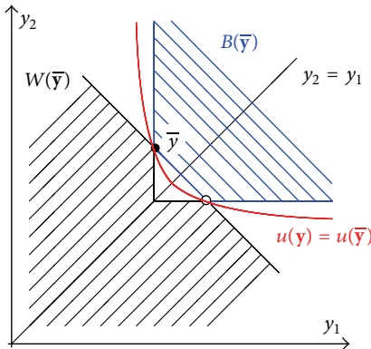
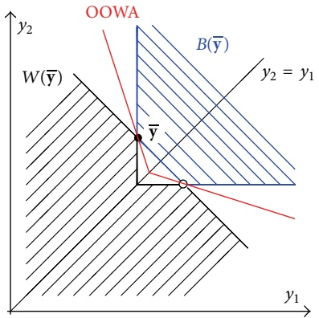
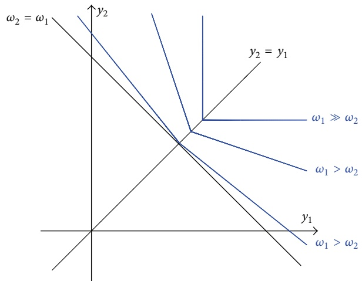
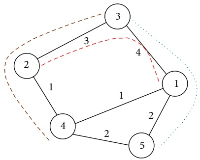
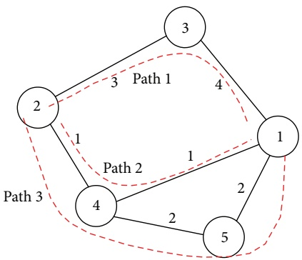
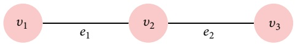
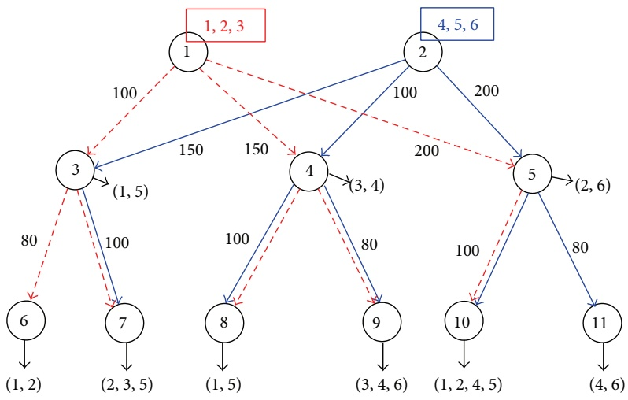
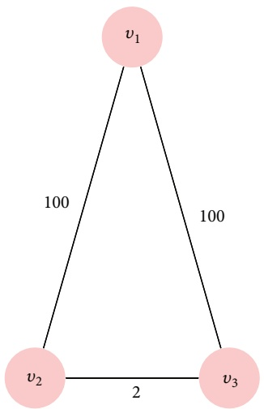
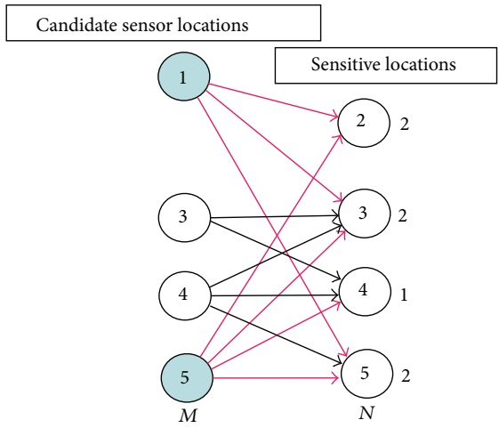

Review Article

# Fair Optimization and Networks: A Survey

**Wlodzimierz Ogryczak,**<strong>1</strong> **Hanan Luss,**<strong>2</strong> **MichaB Pióro,**<strong>3,4</strong> **Dritan Nace,**<strong>5</strong> **and Artur Tomaszewski**<strong>4</strong>

1 Institute of Control and Computation Engineering, Warsaw University of Technology, 00-665 Warsaw, Poland 2 Department of Industrial Engineering and Operations Research, Columbia University, New York, NY 10027, USA 3 Department of Electrical and Information Technology, Lund University, 22100 Lund, Sweden 4 Institute of Telecommunications, Warsaw University of Technology, 00-665 Warsaw, Poland 5 Laboratoire Heudiasyc, Universite de Technologie de Compi ´ egne, 60203 Compi \` egne, France \`

Correspondence should be addressed to Wlodzimierz Ogryczak; w.ogryczak@elka.pw.edu.pl

Received 7 March 2014; Revised 3 August 2014; Accepted 6 August 2014; Published 3 September 2014

Academic Editor: Yuri N. Sotskov

Copyright © 2014 Wlodzimierz Ogryczak et al. This is an open access article distributed under the Creative Commons Attribution License, which permits unrestricted use, distribution, and reproduction in any medium, provided the original work is properly cited.

Optimization models related to designing and operating complex systems are mainly focused on some efficiency metrics such as response time, queue length, throughput, and cost. However, in systems which serve many entities there is also a need for respecting fairness: each system entity ought to be provided with an adequate share of the system’s services. Still, due to system operationsdependant constraints, fair treatment of the entities does not directly imply that each of them is assigned equal amount of the services. That leads to concepts of fair optimization expressed by the equitable models that represent inequality averse optimization rather than strict inequality minimization; a particular widely applied example of that concept is the so-called lexicographic maximin optimization (max-min fairness). The fair optimization methodology delivers a variety of techniques to generate fair and efficient solutions. This paper reviews fair optimization models and methods applied to systems that are based on some kind of network of connections and dependencies, especially, fair optimization methods for the location problems and for the resource allocation problems in communication networks.

## 1. Introduction

System design and optimization often lead to diverse allocation problems where limited means must be assigned to competing agents or activities so as to achieve the best overall system performance. Depending on the context, the allocation decisions may pertain to costs, tasks, goods, or other resources that can be assigned to one or several agents (actually most allocation problems can be interpreted as resource allocation problems). Such problems arise in numerous applications of considerable complexity with system components being users, stakeholders and their coalition systems, economic and governmental institutions, policy systems, environmental systems [1, 2], and so forth. Very often complex systems that involve resource allocation can essentially be treated as systems of systems [3, 4].

The generic resource allocation problem may be stated as follows. Each activity is measured by an individual performance function that depends on the resource levels assigned to that activity. A larger function value is considered better, like in the case when the performance is measured in terms of assigned system capacity, quality of service level, service amount available, and so forth. In practical applications, one can distinguish different variants of the general allocation problem depending on whether the resource is divisible or not. In particular, one-to-one allocation of indivisible resources lead to the well-known assignment problem, while many-to-many allocation problems arise in task scheduling where a task can be assigned in parallel to several agents with each agent being potentially in charge of several tasks.

Most approaches to allocation problems are focused on efficiency-based objectives. However, the maximization of either total or average results across all relevant agents may require compromising individual agents for the good of others, as long as everyone’s good is taken impartially into account. Thus, with the increasing awareness of system inequity resulting from solely pursuing efficiency, a number of fairness or equity oriented approaches have been developed: a particular example is models of resource allocation that try to achieve some form of fairness in resource allocation patterns [5]. In general, the models relate to the optimization of systems which serve many users and the quality of service provided to every individual user defines the optimization criteria. That pattern applies among others to telecommunication and Internet networks: in those networks it is important to allocate network resources, such as available bandwidth, so as to provide equitable performance to all services and all origin-destination pairs of nodes [6, 7]. Still, there are many other pressing examples of systems where fair distribution of resources is required. Problems of efficient and fair resource allocation arise in complex systems of systems when the system combines a number of component systems such as resource supply systems, utilization systems at demand sites or users, stakeholders and their coalition systems, economic and governmental institutions, policy systems, and environmental systems. Actually, addressing fairness in particular types of systems of systems has become a great challenge of the 21 century [8] as fairly dividing limited natural resources (such as the fossil fuels, the clean water, and the environments capacity to absorb greenhouse gases) is perceived as being of utmost importance.

Essentially, fairness is an abstract sociopolitical concept that implies impartiality, justice and equity. In order to ensure fairness in a given system, all system entities have to be equally well provided with the system’s services. For example, the issue of equity is widely recognized in the analysis of locating public services, where the clients of a system are entitled to fair treatment according to community regulations. In that context, the decisions often concern the placement of service centers or other facilities at such positions that all users are treated in an equitable way with respect to certain criteria [9]. In particular, location of the facilities pertaining to public services, such as police and fire departments, and emergency medical facilities, should provide fair response time to all demand locations within a metropolitan area. Similarly, water resources should be allocated fairly [10].

As far as technical systems are concerned, the importance of fairness was early recognized with respect to problems of allocation of bandwidth in telecommunication networks [11, 12] (resulting in many models and methods of fair optimization [7]), flight scheduling [13], and allocation of takeoff and landing “slots” at airports [14]. In such areas as allocation of resources in high-tech manufacturing and optimal allocation of water and energy resources, the context of fair resource allocation was additionally enriched by considering possible substitutions among the resources; models with such substitutions are presented in [5, Ch. 4] and [15–17].

In general, complex systems require mathematical programming models in order to describe the dependencies and to enable system optimization. Many such models are based on some kind of network of connections and dependencies. In particular, wide range of system models are related to some kind of network flows that express realizations of competing activities [18]. This applies to telecommunication systems, power distribution systems, transportation systems, logistics systems, and so forth. The discrete location problems can also be viewed in terms of such network system [19, 20].

The general purpose of this paper is to review fair optimization models and algorithms supporting efficient and fair resource allocation in problems related to such network models. The particular focus is on location-allocation problems and allocation problems related to communication networks since in those areas the fair optimization concepts have been extensively developed and widely applied.

The paper is organized as follows. In the next section we present methodological foundations of fair optimization models. In Section 3, the most important models and methods of fair optimization in communication networks are reviewed. Section 4 aims at reviewing applications of fairness optimization in location and allocation problems. The computational complexity issues are addressed in Section 5. The paper is concluded by addressing the most important directions of the development of fair optimization methodology for network systems.

## 2. Fairness, Equity, and Fair Optimization

2.1. Efficiency and Equity. The generic allocation problem deals with a system comprising a set 𝐼 of 𝑚 services (activities, agents) and a given set 𝑄 of allocation patterns (allocation decisions). For each service 𝑖 ∈ $I , \mathrm { a }$ function $f _ { i } ( \mathbf { x } )$ of the allocation pattern x $\in Q$ is defined. This function measures the outcome (effect) $y _ { i } = f _ { i } ( \mathbf { x } )$ of allocation pattern x for service 𝑖. In applications we consider this measure that usually expresses the service quality. In general, outcomes can be measured (modeled) as service time, service costs, and service delays as well as in a more subjective way. In typical formulations a larger value of the outcome means a better effect (higher service quality or client satisfaction). Otherwise, the outcomes can be replaced with their complements to some large number. Therefore, without loss of generality, we can assume that each individual outcome $y _ { i }$ is to be maximized which allows us to view the generic resource allocation problem as a vector maximization model. Consider

$$
\max \left\{\mathbf {f} (\mathbf {x}): \mathbf {x} \in Q \right\},\tag{1}
$$

where $\mathbf { f } ( \mathbf { x } )$ is a vector-function that maps the decision space $\boldsymbol { X } = \boldsymbol { R } ^ { n }$ into the criterion space $\boldsymbol { Y } = \boldsymbol { R } ^ { \hat { m } }$ and $Q \subset X$ denotes the feasible set. We consider complex systems represented by mathematical programming models and specifically models based on some network of connections and dependencies.

An outcome vector y is attainable if it expresses outcomes of a feasible solution x $\mathbf{i} \in Q (\mathrm{i.e.,} \mathbf{y} = \mathbf{f}(\mathbf{x}))$ . The set of all the attainable outcome vectors is denoted by 𝐴. Note that, in general, convexity of the feasible set 𝑄 and concavity of the outcome function f do not guarantee convexity of the corresponding attainable set 𝐴. Nevertheless, the multiple criteria maximization model (1) can be rewritten in the equivalent form

$$
\max \left\{\mathbf {y}: y _ {i} \leq f _ {i} (\mathbf {x}) \forall i, \mathbf {x} \in Q \right\},\tag{2}
$$

where the attainable set 𝐴 is convex whenever 𝑄 is convex and functions $f _ { i }$ are concave.

Model (1) only specifies that we are interested in maximization of all objective functions $f _ { i }$ for $i \in I = \{ 1 , 2 , \ldots , m \}$

In order to make it operational, one needs to assume some solution concept specifying what it means to maximize multi-ple objective functions. The solution concepts may be defined by properties of the corresponding preference model [21]. The commonly used concept of the Pareto-optimal solutions, as feasible solutions for which one cannot improve any criterion without worsening another, depends on the rational dominance which may be expressed in terms of the vector inequality.

Simple solution concepts for multiple criteria problems are defined by aggregation (or utility) functions $g : Y   \rightarrow   R$ to be maximized. Thus, the multiple criteria problem (1) is replaced with the maximization problem. Consider

$$
\max \left\{g \left(\mathbf {f} \left(\mathbf {x}\right)\right): \mathbf {x} \in Q \right\},\tag{3}
$$

In order to guarantee the consistency of the aggregated problem (3) with the maximization of all individual objective functions in the original multiple criteria problem (or Paretooptimality of the solution), the aggregation function must be strictly increasing with respect to every coordinate.

The simplest aggregation functions commonly used for the multiple criteria problem (1) are defined as the total outcome $\begin{array} { r } { \hat { T } ( \mathbf { y } )   =   \sum _ { i = 1 } ^ { m } \hat { y _ { i } } , } \end{array}$ equivalently as the mean (average) outcome $\mu ( \mathbf { \dot { y } } ) = T ( \mathbf { \dot { y } } ) / m = ( 1 / m ) \textstyle \sum _ { i = 1 } ^ { m } y _ { i }$ or alternatively as the worst outcome $\begin{array} { r c l } { M ( \mathbf { y } ) } & { = } & { \operatorname* { m i n } _ { i = 1 , \ldots , m } y _ { i } } \end{array}$ . The mean (total) outcome maximization is primarily concerned with the overall system efficiency. As based on averaging, it often provides a solution where some services are discriminated in terms of performance. On the other hand, the worst outcome maximization, that is, the so-called max-min solution concept,

$$
\max \left\{\min _ {i = 1, \dots , m} f _ {i} (\mathbf {x}): \mathbf {x} \in Q \right\},\tag{4}
$$

is regarded as maintaining equity. Indeed, in the case of a simplified resource allocation problem with knapsack constraints, the max-min solution,

$$
\max \left\{\min _ {i = 1, \dots , m} y _ {i}: \sum_ {i = 1} ^ {m} a _ {i} y _ {i} \leq b \right\},\tag{5}
$$

takes the form $\textstyle { \overline { { y } } } _ { i } = b / \sum _ { i = 1 } ^ { m } a _ { i }$ for all $i \in I ,$ thus, meeting the perfect equity requirement ${ \overline { { y } } } _ { 1 } = { \overline { { y } } } _ { 2 } = \cdots = { \overline { { y } } } _ { m } .$ In the general case, with possible more complex feasible set structure, this property is not fulfilled [22, 23]. Nevertheless, if there exists a Pareto-optimal vector y ∈ f(𝑄) satisfying the perfect equity requirement $\overline { { y } } _ { 1 } = \overline { { y } } _ { 2 } = \cdots = \overline { { y } } _ { m } ,$ then y is the unique optimal solution of the max-min problem (4) [24].

Actually, the distribution of outcomes may make the maxmin criterion partially passive when one specific outcome is relatively very small for all the solutions. For instance, while allocating clients to service facilities, such a situation may be caused by existence of an isolated client located at a considerable distance from all the facilities. Maximization of the worst service performances is then reduced to maximization of the service performances for that single isolated client leaving other allocation decisions unoptimized. For instance, having four outcome vectors (1, 1, 1), (8, 1, 1), (1, 8, 1), and (8,

8, 1) available, they are all optimal in the corresponding maxmin optimization, as the third outcome cannot be better than 1. Maximization of the first and the second outcome is then not supported the max-min solution concept, allowing one to select (1, 1, 1) as the optimal solution. This is a clear case of inefficient solution where one may still improve other outcomes while maintaining fairness by leaving at its best possible value the worst outcome. The max-min solution may be then regularized according to the Rawlsian principle of justice. Rawls [25, 26] considers the problem of ranking different “social states” which are different ways in which a society might be organized taking into account the welfare of each individual in each society, measured on a single numerical scale. Applying the Rawlsian approach, any two states should be ranked according to the accessibility levels of the least well-off individuals in those states; if the comparison yields a tie, the accessibility levels of the next-least well-off individuals should be considered, and so on. Formalization of this concept leads us to the lexicographic maximin optimization model or the so-called max-min fairness where the largest feasible performance function value for activities with the smallest $( \mathrm { i . e . } ,$ worst) performance function value (this is the maximin solution) are followed by the largest feasible performance function value for activities with the second smallest (i.e., second worst) performance function value, without decreasing the smallest value, and so forth. The lexicographic maximin solution is known in the game theory as the nucleolus of a matrix game. It originates from an idea, pre-sented by Dresher [27], to select from the optimal (max-min) strategy set of a player a subset of optimal strategies which exploit mistakes of the opponent optimally. It has been later refined to the formal nucleolus definition [28] and generalized to an arbitrary number of objective functions [29]. The concept was early considered in the Tschebyscheff approximation [30] as a refinement taking into account the second largest deviation, the third one and further to be hierarchically minimized. Actually, the so-called strict approximation problem on compact ordered sets is resolved by introducing sequential optimization of the norms on subspaces. Luss and Smith [31] published the first paper on lexicographic maximin approach for resource allocation problems with continuous variables and multiple resource constraints. Within the communications or network applications the lexicographic maximin approach has appeared already in [11, 12] and now under the name max-min fair (MMF) is treated as one of the standard fairness concepts [7]. The lexicographic maximin has been used for general linear programming multiple criteria problems [32–34], as well as for specialized problems related to multiperiod resource allocation with and without substitutions [5, Ch. 5] and [35–39].

In discrete optimization it has been considered for various problems [40, 41] including the location-allocation ones [42]. Luss [43] presented an expository paper on equitable resource allocations using a lexicographic minimax (or lexicographic maximin) approach while [44] provides wide discussion of various models and solution algorithms in connection with communication networks. The recent book by Luss [5] brings together much of the equitable resource allocation research from the past thirty years and provides current state of art in models and algorithm within wide gamut of applications.

Actually, the original introduction of the MMF in networking characterized the MMF optimal solution by the lack of a possibility to increase of any outcome without decreasing of some smaller outcome [12]. In the case of convex attainable set (as considered in [12]) such a characterization represents also lexicographic maximin solution. In nonconvex case as pointed out in [45] such strictly defined MMF solution may not exist while the lexicographic maximin always exists and it covers the former if it exists (see [46] for wider discussion). Therefore, the MMF is commonly identified with the lexicographic maximin while the classical MMF definition is considered rather as an algorithmic approach which is applicable only for convex models. We follow this in the remainder of the paper. Indeed, while for convex problems it is relatively easy to form sequential algorithms to execute lexicographic maximin by recursive max-min optimization with fixed smallest outcomes (see [5, 31–33, 43, 44, 46, 47]), for nonconvex problems the sequential algorithms must be built with the use of some artificial criteria (see [24, 40, 42, 44, 48] and [5, Ch. 7]). Some more discussion is provided in Section 2.4.

2.2. From Equity to Fair Optimization. The concept of fairness has been studied in various areas beginning from political economics problems of fair allocation of consumption bundles [25, 49–52] to abstract mathematical formulation [53, 54]. Fairness is, essentially, an abstract sociopolitical concept of distributive justice that implies impartiality and equity in distribution of goods. In order to ensure fairness in a system, all system entities have to be equally well provided with the system’s services. Therefore, in systems analysis and operational research fairness was usually quantified with the so-called inequality measures to be minimized [55–60] or fairness indices [61, 62]. Typical inequality measures are some deviation type dispersion characteristics. They are inequality relevant which means that they are equal to 0 in the case of perfectly equal outcomes while taking positive values for unequal ones. The simplest inequality measures are based on the absolute measurement of the spread of outcomes or deviations from the mean, like the mean absolute difference, maximum absolute difference, standard deviation (variance), mean absolute deviation, and so forth. Relative inequality measures are frequently used. For instance, measures are normalizezd by mean outcome like the Gini coefficient, which is the relative mean difference.

Complex systems require usually mathematical programming models in order to describe the dependencies and to make possible system optimization. Many such models are based on some network of connections and dependencies. A wide range of systems models is related to some flows within a network expressing realizations of competing activities [18]. This applies to communication systems, power distribution systems, transportation systems, logistics systems, and so forth. Among others the discrete location problems can be viewed in terms of such network system [19, 20]. Typically fairness is considered in relation to division of a given amount (the cake division problem) imposing a consistency requirement, the reference points must sum to the total amount available to the agents. A methodology capable to model and solve fair allocation problems in the context of system optimization must take into account possible increase of the amount. Unfortunately, direct minimization of typical inequality measures contradicts the maximization of individual outcomes and it may lead to inferior decisions. The max-min fairness represented by lexicographic maximin optimization meets such needs. This specific concept may be generalized to concepts of fairness expressed by the equitable optimization [9, 24, 43, 63–65] representing inequality averse optimization rather than inequality minimization. Since the term equitable optimization or equitable resource allocation is frequently used as limited to the lexicographic maximin optimization (see [5]), we use the term fair optimization to express wider class of equitable approaches.

The concept of fair optimization is a specific refinement of the Pareto-optimality taking into account the inequality minimization according to the Pigou-Dalton approach. First of all, the fairness requires impartiality of evaluation, thus, focusing on the distribution of outcome values while ignoring their ordering. That means that, in the multiple criteria problem (1), we are interested in a set of outcome values without taking into account which outcome is taking a specific value. Hence, we assume that the preference model is impartial (anonymous, symmetric). In terms of the preference relation it may be written as the following axiom:

$$
\begin{array}{c} \left(y _ {\pi (1)}, y _ {\pi (2)}, \ldots , y _ {\pi (m)}\right) \cong \left(y _ {1}, y _ {2}, \ldots , y _ {m}\right) \\ \text {for any permutation \pi of I,} \end{array}\tag{6}
$$

which means that any permuted outcome vector is indifferent in terms of the preference relation. Further, fairness requires equitability of outcomes which causes that the preference model should satisfy the (Pigou-Dalton) principle of transfers. The principle of transfers states that a transfer of any small amount from an outcome to any other relatively worseoff outcome results in a more preferred outcome vector. As a property of the preference relation, the principle of transfers takes the form of the following axiom:

$$
\begin{array}{c} y _ {i ^ {\prime}} > y _ {i ^ {\prime \prime}} \Longrightarrow \mathbf {y} - \varepsilon \mathbf {e} _ {i ^ {\prime}} + \varepsilon \mathbf {e} _ {i ^ {\prime \prime}} > \mathbf {y} \\ \text {for} 0 <   \varepsilon <   y _ {i ^ {\prime}} - y _ {i ^ {\prime \prime}}. \end{array}\tag{7}
$$

The rational preference relations satisfying additionally axioms (6) and (7) are called hereafterfair (equitable) rational preference relations. We say that outcome vector $\mathbf { y } ^ { \prime }$ fairly (equitably) dominates $\mathbf { y } ^ { \prime \prime }$ , if and only $\mathrm { i f }   \mathbf { y } ^ { \prime }$ is preferred to $\dot { \bf \nabla _ { i } \bf y } ^ { \prime \prime }$ for all fair rational preference relations. In other words, $\mathbf { y } ^ { \prime }$ fairly dominates $\mathbf { y } ^ { \prime \prime }$ , if there exists a finite sequence of vectors $\mathbf{y}^{j} (j = 1,2,\ldots,s)$ such that $\mathbf{y}^{1} = \mathbf{y}^{\prime \prime}, \hat{\mathbf{y}^{s}} = \mathbf{y}^{\prime}$ and $\mathbf { y } ^ { j }$ is constructed from $\mathbf { y } ^ { j - 1 }$ by application of either permutation of coordinates, equitable transfer, or increase of a coordinate. An allocation pattern x ∈ 𝑄 is called fairly (equitably) efficient or simply fair i $\mathbf { f } _ { \mathbf { y } } = \mathbf { f } ( \mathbf { x } )$ is fairly nondominated. Note that each fairly efficient solution is also Pareto-optimal but not vice verse.

In order to guarantee fairness of the solution concept (3), additional requirements on aggregation (utility) functions need to be introduced. The aggregation function must be symmetric, that is, for any permutation 𝜋 of $I ,$ $g(y_{\pi(1)}, y_{\pi(2)}, \ldots, y_{\pi(m)}) = g(y_1, y_2, \ldots, y_m)$ as well as being equitable (to satisfy the principle of transfers) $g ( y _ { 1 } , \ldots , y _ { i ^ { \prime } } -$ $\varepsilon , \ldots , y _ { i ^ { \prime \prime } } \quad + \quad \varepsilon , \ldots , y _ { m } ) \quad > \quad g ( y _ { 1 } , y _ { 2 } , \ldots , y _ { m } )$ for any $0 \quad <$ $\varepsilon \; < \; y _ { i ^ { \prime } } \: - \: y _ { i ^ { \prime \prime } }$ . Such functions were referred to as (strictly) Schur-concave [66]. In the case of a strictly increasing and strictly Schur-concave function, every optimal solution to the aggregated optimization problem (3) defines some fairly efficient solution of allocation problem (1) [64].

Both simplest aggregation functions, the mean and the minimum, are symmetric although they do not satisfy strictly the equitability requirement. For any strictly concave and strictly increasing utility function $\begin{array} { r c l r c l } { { u } } & { { : } } & { { R } } & { { \rightarrow } } & { { R , } } \end{array}$ the aggregation function $\begin{array} { r } { g ( \mathbf { y } \dot { ) } = \sum _ { i = 1 } ^ { m } u ( y _ { i } ) } \end{array}$ is a strictly monotonic and equitable, thus, defining a family of the fair aggregations [64]. Consider

$$
\left| \max \left\{\sum_ {i = 1} ^ {m} u \left(f _ {i} (\mathbf {x})\right): \mathbf {x} \in Q \right\}. \right.\tag{8}
$$

Various concave utility functions 𝑢 can be used to define the fair aggregations (8) and the resulting fair solution concepts. In the case of the outcomes restricted to positive values, one may use logarithmic function, thus, resulting in the proportional fairness (PF) solution concept [67, 68]. Actually, it corresponds to the so-called Nash criterion [69] which maximizes the product of additional utilities compared to the status quo. Again, in the case of a simplified resource allocation problem with knapsack constraints, the PF solution,

$$
\left| \max \left\{\sum_ {i = 1} ^ {m} \log \left(y _ {i}\right): \sum_ {i = 1} ^ {m} a _ {i} y _ {i} \leq b \right\}, \right.\tag{9}
$$

takes the form $\overline { { y } } _ { i } \; = \; b / a _ { i }$ for all $i \in I ,$ thus, allocating the resource inversely proportional to the consumption of particular activities.

For positive outcomes a parametric class of utility functions,

$$
u \left(y _ {i}, \alpha\right) = \left\{ \begin{array}{l l} \frac {y _ {i} ^ {1 - \alpha}}{(1 - \alpha)}, & \text {if} \alpha \neq 1, \\ \log \left(y _ {i}\right), & \text {if} \alpha = 1, \end{array} \right.\tag{10}
$$

may be used to generate various fair solution concepts for $\alpha \; > \; 0 \; [ 7 0 ]$ . The corresponding solution concept (8), called 𝛼-fairness, represents the PF approach for $\alpha = 1$ , while with 𝛼 tending to the infinity it converges to the MMF. For large enough 𝛼 one gets generally an approximation to the MMF while for discrete problems large enough 𝛼 guarantee the exact MMF solution. Such a way to identify the MMF solution was considered in location problems [40, 42] as well as to content distribution networking problems [71, 72]. However, every such approach requires to build (or to guess) a utility function prior to the analysis and later it gives only one possible compromise solution. For a common case of upper bounded outcomes $\begin{array} { r c l } { y _ { i } } & { \leq } & { u ^ { * } } \end{array}$ one may maximize power functions $\begin{array} { r } { - \sum _ { i = 1 } ^ { m } ( \boldsymbol { u } ^ { * } - \overset { \leftrightarrow } { y _ { i } } ) ^ { p } } \end{array}$ for $1 < p <$ ∞ which is equivalent to minimization of the corresponding 𝑝-norm distances from the common upper bound $u ^ { \overset { \ast } { \ast } } \left[ 6 4 \right]$

Figure 1: The fair dominance structures $W ( { \overline { { \mathbf { y } } } } ) ;$ the set of outcomes fairly dominated by y and 𝐵(y): the set of outcomes fairly dominating y.

Figure 1 shows the structure of fair dominance for twodimensional outcome space. For any outcome vector $\overline { { \mathbf { y } } } ,$ the fair dominance relation distinguishes set $W ( \overline { { \mathbf { y } } } )$ of dominated outcomes (obviously worse for all fair rational preferences) and set $B ( \overline { { \mathbf { y } } } )$ of dominating outcomes (obviously better for all fair rational preferences). Some outcome vectors remain neither dominated nor dominating (in white areas) and they can be differently classified by various specific fair solution concepts. The lexicographic maximin assigns the entire interior of the inner white triangle to the set of pre-ferred outcomes while classifying the interior of the external open triangles as worse outcomes. Isolines of various utility functions split the white areas in different ways. For instance, there is no fair dominance between vectors (1, 100) and (2, 2) and the MMF considers the latter as better while the proportional fairness points out the former. On the other hand, vector (2, 99) fairly dominates (1, 100) and all fairness models (including MMF and PF) prefer the former. One may notice that the set $W ( \mathbf { \bar { y } } )$ of directions leading to outcome vectors being dominated by a given y is, in general, not a cone and it is not convex. Although, when we consider the set 𝐵(y) of directions leading to outcome vectors dominating given y we get a convex set.

Certainly, any fair solution concept usually leads to some deterioration of the system efficiency when comparing to the sole efficiency optimization. This is referred to as the price of fairness and it was quantified as the relative difference with respect to a fully efficient solution that maximizes the sum of all performance functions (total outcome) [73], that is, the price of fairness concept 𝐹 on the attainable set 𝐴 is defined as

$$
\mathrm{POF} (F, A) = \frac {\left(\sum_ {i = 1} ^ {m} y _ {i} ^ {T} - \sum_ {i = 1} ^ {m} y _ {i} ^ {F}\right)}{\sum_ {i = 1} ^ {m} y _ {i} ^ {T}},\tag{11}
$$

where $\mathbf { y } ^ { T }$ is the outcome vector maximizing the total outcome 𝑇(y) on 𝐴 while $\mathbf { y } ^ { F }$ denotes the outcome vector maximizing the fair optimization concept $F ( \mathbf { y } )$ on 𝐴. Formula (11) is applicable only to the problems with a positive total outcome— this, however, is a common case for attainable sets of models based on some network of connections and dependencies. Bertsimas et al. [73] examined the price of fairness for a broad family of problems, focusing on PF and MMF models. They shown that for any compact and convex attainable sets 𝐴 with equal maximum achievable outcome, which are greater than 0, the price of proportional fairness is bounded by

$$
\mathrm{POF} (\mathrm{PF}, A) \leq 1 - \frac {2 \sqrt {m}}{m},\tag{12}
$$

and the price of max-min fairness is bounded by

$$
\mathrm{POF} \left(\mathrm{MMF}, A\right) \leq 1 - \frac {4 m}{(m + 1) ^ {2}}.\tag{13}
$$

Moreover, the bound under PF is tight if $\sqrt { m }$ is integer, and the bound under MMF is tight for all 𝑚. Similar analysis for the 𝛼-fairness [74] shows that the price of 𝛼-fairness is bounded by

$$
\begin{array}{c} \text {POF} (\alpha F, A) \leq 1 - \min _ {\eta \in [ 1, m ]} \frac {\eta^ {1 + 1 / \alpha} + m - \eta}{\eta^ {1 + 1 / \alpha} + (m - \eta) \eta} \\ \cong 1 - O \left(m ^ {- \alpha / (\alpha + 1)}\right). \end{array}\tag{14}
$$

The price of fairness strongly depends on the attainable set structure. One can easily construct problems where any fair solution is also maximal with respect to the total outcome (no price of fairness occurs). In [75], the 𝛼-fairness concept for network flow problems was analyzed and a class of networks was generated with the property that a fairer allocation is always more efficient. In particular, it implies that max-min fairness may achieve higher total throughput than proportional fairness.

2.3. Multicriteria Models. The relation of fair dominance can be expressed as a vector inequality on the cumulative ordered outcomes [63]. The latter can be formalized as follows. First, we introduce the ordering map $\Theta \quad : \quad R ^ { m } \quad \rightarrow \quad R ^ { m }$ such that $\Theta ( \mathbf { y } ) = ( \theta _ { 1 } ( \mathbf { y } ) , \theta _ { 2 } ( \mathbf { y } ) , \cdots , \widetilde { \theta _ { m } ( \mathbf { y } ) } )$ , where $\theta _ { 1 } ( \mathbf { y } ) \leq \theta _ { 2 } ( \mathbf { y } ) \leq \cdots \leq$ $\theta _ { m } ( \mathbf { y } )$ and there exists a permutation 𝜋 of set 𝐼 such that $\theta _ { i } ( \mathbf { y } )   =   y _ { \pi ( i ) } \; { \mathrm { f o r } } \; i   =   1 , \cdots , m .$ . Next, we apply cumulation to the ordered outcome vectors to get the following quantities:

$$
\overline {{\theta}} _ {i} (\mathbf {y}) = \sum_ {j = 1} ^ {i} \theta_ {j} (\mathbf {y}) \quad \text {for} i = 1, \dots , m\tag{15}
$$

expressing, respectively, the worst outcome, the total of the two worst outcomes, and the total of the three worst outcomes. Pointwise comparison of the cumulative ordered outcomes $\overline { { \Theta } } ( \mathbf { y } )$ for vectors with equal means was extensively analyzed within the theory of equity [76] or the mathematical theory of majorization [66], where it is called the relation of Lorenz dominance or weak majorization, respectively. It includes the classical results allowing to express an improvement in terms of the Lorenz dominance as a finite sequence of Pigou-Dalton equitable transfers. It can be generalized to vectors with various means, which allows one to justify the following statement [63, 77]. Outcome vector $\dot { \textbf { y } ^ { \prime } \in Y }$ fairly dominates $\mathbf { y } ^ { \prime \prime } \in Y ,$ if and only if $\overline { { \theta } } _ { i } ( \mathbf { y } ^ { \prime } ) \geq \overline { { \theta } } _ { i } ( \mathbf { y } ^ { \prime \prime } )$ for all $i \in I$ where at least one strict inequality holds.

Fair solutions to problem (1) can be expressed as Paretooptimal solutions for the multiple criteria problem with objectives Θ(f(x)). Consider

$$
\max \left\{\left(\overline {{\theta}} _ {1} (\mathbf {f} (\mathbf {x})), \overline {{\theta}} _ {2} (\mathbf {f} (\mathbf {x})), \dots , \overline {{\theta}} _ {m} (\mathbf {f} (\mathbf {x}))\right): \mathbf {x} \in Q \right\}.\tag{16}
$$

Hence, the multiple criteria problem (16) may serve as a source of fair solution concepts. Note that the aggregation maximizing the mean outcome corresponds to maximization of the last objective $\overline { { \theta } } _ { m } ( \mathbf { f } ( \mathbf { x } ) )$ in problem (16). Similarly, the max-min corresponds to maximization of the first objective $\overline { { \theta } } _ { 1 } ( \mathbf { f } ( \mathbf { x } ) )$ . As limited to a single criterion they do not guarantee the fairness of the optimal solution. On the other hand, when applying the lexicographic optimization to problem (16),

$$
\operatorname{lex} \max \left\{\left(\overline {{\theta}} _ {1} (\mathbf {f} (\mathbf {x})), \overline {{\theta}} _ {2} (\mathbf {f} (\mathbf {x})), \dots , \overline {{\theta}} _ {m} (\mathbf {f} (\mathbf {x}))\right): \mathbf {x} \in Q \right\},\tag{17}
$$

one gets the lexicographic maximin solution concept, that is, the classical equitable optimization model [5] representing the MMF.

For modeling various fair preferences one may use some combinations of the criteria in problem (16). In particular, for the weighted sum aggregation on gets $\textstyle \sum _ { i = 1 } ^ { m } s _ { i } { \overline { { \theta } } } _ { i } ( \mathbf { y } )$ , which can be expressed with weights $\omega_{i} \; = \; \textstyle \sum_{j = i}^{m} s_{j} \; (i \; = \; 1, \ldots, m)$ allocated to coordinates of the ordered outcome vector, that is, as the so-called ordered weighted average (OWA) [78, 79]:

$$
\left| \max \left\{\sum_ {i = 1} ^ {m} \omega_ {i} \theta_ {i} \left(\mathbf {f} \left(\mathbf {x}\right)\right) : \mathbf {x} \in Q \right\}. \right.\tag{18}
$$

If weights $\omega _ { i }$ are strictly decreasing and positive, that is, $\omega _ { 1 } >$ $\omega _ { 2 } > \cdots > \omega _ { m - 1 } > \omega _ { m } > 0$ , then each optimal solution of the OWA problem (18) is a fairly efficient solution of (1). Such OWA aggregations are sometimes called ordered ordered weighted averages (OOWA) [80]. When looking at the structure of fair dominance (Figure 1), the piece-wise linear isolines of the OOWA split the white areas of outcome vectors remaining neither dominated nor dominating (cf. Figure 2).

When differences between weights tend to infinity, the OWA model becomes the lexicographic maximin [81]. On the other hand, with the differences between subsequent monotonic weights approaching 0, the OWA model tends to the mean outcome maximization while still preserving fair optimizations properties (cf. Figure 3).

To the best of our knowledge, the price of fairness related to the fair OWA models has not been studied till now. The OWA aggregation may model various preferences from the max to the min. Yager [78] introduced a well appealing concept of the andness measure to characterize the OWA operators. The degree of andness associated with the OWA operator is defined as

Figure 2: The fair dominance structure and the ordered OWA optimization.

Figure 3: Variety of fair OWA aggregations.

$$
\text {andness} (\omega) = \frac {\sum_ {i = 1} ^ {m} \left((m - i) / (m - 1)\right) \omega_ {i}}{\sum_ {i = 1} ^ {m} \omega_ {i}}.\tag{19}
$$

For the min aggregation representing the OWA operator with weights $\omega = ( 1 , 0 , \ldots , 0 )$ one gets andness $( \omega ) \quad = \quad 1$ while for the max aggregation representing the OWA operator with weights $\omega = ( 0 , \dots , 0 , 1 )$ one has andness $( \omega ) = 0$ . For the total (mean) outcome one gets andness $( ( 1 / m , 1 / m , \ldots , 1 / m ) ) =$ 1/2. OWA aggregations with andness greater than 1/2 are considered fair, and fairer when andness gets closer to 1. $\mathrm { A }$ given andness level does not define a unique set of weights 𝜔. Various monotonic sets of weights with a given andness measure may be generated (cf., [82, 83] and references therein).

The definition of quantities $\overline { { \theta } } _ { k } ( \mathbf { y } )$ is complicated as requiring ordering. Nevertheless, the quantities themselves can be modeled with simple auxiliary variables and linear constraints. Although, maximization of the 𝑘th smallest outcome is a hard (combinatorial) problem. The maximization of the sum of 𝑘 smallest outcomes is a linear programming (LP) problem as $\overline { { \theta } } _ { k } ( \mathbf { y } ) = \operatorname* { m a x } _ { t } ( k t - \sum _ { i = 1 } ^ { m } \operatorname* { m a x } \{ t - y _ { i } , 0 \} )$ where 𝑡 is an unrestricted variable [84, 85]. This allows one to implement the OWA optimization quite effectively as an extension of the original constraints and criteria with simple linear inequalities [86] (without binary variables used in the classical OWA optimization models [87]) as well as to define sequential methods for lexicographic maximin optimization of discrete and nonconvex models [48]. Various fairly efficient solutions of (1) may be generated as Pareto-optimal solutions to multicriteria problem:

$$
\max \quad \left(\eta_ {1}, \eta_ {2}, \dots , \eta_ {m}\right)\tag{20a}
$$

$$
\begin{array}{c c} \text {s.t.} & \mathbf {x} \in Q, \end{array}\tag{20b}
$$

$$
\eta_ {k} = k t _ {k} - \sum_ {i = 1} ^ {m} d _ {i k},\tag{20c}
$$

$$
\left| \begin{array}{c} k = 1, \dots , m, \\ t _ {k} - d _ {i k} \leq f _ {i} (\mathbf {x}), \quad d _ {i k} \geq 0, \\ i, k = 1, \dots , m. \end{array} \right|\tag{20d}
$$

Recently, the duality relation between the generalized Lorenz function and the second order cumulative distribution function has been shown [88]. The latter can also be presented as mean shortfalls (mean below-target deviations) to outcome targets 𝜏:

$$
\delta_ {\tau} (\mathbf {y}) = \frac {1}{m} \sum_ {i = 1} ^ {m} \left(\tau - y _ {i}\right) _ {+}.\tag{21}
$$

It follows from the duality theory [88] that one may completely characterize the fair dominance by the pointwise comparison of the mean shortfalls for all possible targets. Outcome vector $\mathbf { y } ^ { \prime }$ fairly dominates $\mathbf { y } ^ { \prime \prime }$ , if and only $\mathrm { i f }   \delta _ { \tau } ( \tilde { \mathbf { y } ^ { \prime } } ) \leq$ $\delta _ { \tau } ( \boldsymbol { \mathbf { y } } ^ { \prime \prime } )$ for all $\tau \in R$ where at least one strict inequality holds. In other words, the fair dominance is equivalent to the increasing concave order more commonly known as the Second Stochastic Dominance (SSD) relation [89].

For 𝑚-dimensional outcome vectors we consider, all the shortfall values are completely defined by the shortfalls for at most 𝑚 different targets representing values of several outcomes $y _ { i }$ while the remaining shortfall values follow from the linear interpolation. Nevertheless, these target values are dependent on specific outcome vectors and one cannot define any universal grid of targets allowing to compare all possible outcome vectors. In order to take advantages of the multiple criteria methodology one needs to focus on a finite set of target values. Let $\tau _ { 1 } < \tau _ { 2 } < \cdots < \tau _ { r }$ denote the all attainable outcomes. Fair solutions to problem (1) can be expressed as Pareto-optimal solutions for the multiple criteria problem with objectives $\delta _ { \tau _ { j } } ( \mathbf { f } ( \mathbf { x } ) )$ . Consider

$$
\min \left\{\left(\delta_ {\tau_ {1}} (\mathbf {f} (\mathbf {x})), \delta_ {\tau_ {2}} (\mathbf {f} (\mathbf {x})), \dots , \delta_ {\tau_ {r}} (\mathbf {f} (\mathbf {x}))\right): \mathbf {x} \in Q \right\}.\tag{22}
$$

Hence, the multiple criteria problem (22) may serve as a source of fair solution concepts. When applying the lexicographic minimization to problem (22) one gets the lexicographic maximin solution concept, that is, the classical equitable optimization model [5] representing the MMF. However, for the lexicographic maximin solution concept one simply performs lexicographic minimization of functions counting outcomes not exceeding several targets [42, 48].

Certainly in many practical resource allocation problems one cannot consider target values covering all attainable outcomes. Reducing the number of criteria we restrict opportunities to generate all possible fair allocations. Nevertheless, one may still generate reasonable compromise solutions [24]. In order to get a computational procedure one needs either to aggregate mean shortages for infinite number of targets or to focus analysis on arbitrarily preselected finite grid of targets. The former turns out to lead us to the mean utility optimization models (8). Indeed, classical results of majorization the ory [66] relate the mean utility comparison to the comparison of the weighted mean shortages. Actually, the maximization of a concave and increasing utility function 𝑢 is equivalent to minimization of the weighted aggregation with positive weights $w ( \xi ) = - u ^ { \prime \prime } ( \xi )$ (due to concavity of 𝑢 the second derivative is negative).

2.4. Methodologies for Solving Lexicographic Maximin Problems. Consider the following resource allocation problem:

$$
\operatorname{lex} \max _ {\mathbf {x}} \overline {{\Theta}} (\mathbf {f} (\mathbf {x})) = \left(f _ {i _ {1}} \left(x _ {i _ {1}}\right), f _ {i _ {2}} \left(x _ {i _ {2}}\right), \dots , f _ {i _ {m}} \left(x _ {i _ {m}}\right)\right)\tag{23a}
$$

$$
\text {s.t.} \quad f _ {i _ {1}} \left(x _ {i _ {1}}\right) \leq f _ {i _ {2}} \left(x _ {i _ {2}}\right) \leq \dots \leq f _ {i _ {m}} \left(x _ {i _ {m}}\right),\tag{23b}
$$

$$
\sum_ {i \in I} a _ {i j} x _ {i} \leq b _ {j}, \quad \forall j \in J,\tag{23c}
$$

$$
l _ {i} \leq x _ {i} \leq u _ {i}, \quad \forall i \in I,\tag{23d}
$$

where the performance functions are strictly increasing and continuous, and $a _ { i j } \geq 0 ,$ for all 𝑖 and 𝑗. The lexicographic maximization objective function, jointly with the ordering constraints, defines the lexicographic maximin objective function (this is equivalent to defining the objective function using the ordering mapping Θ). Consider Figure 4 which presents a network that serves point-to-point demands between nodes 1 and 2, nodes 3 and 4, and nodes 3 and 5. The numbers on the links are the link capacities, for example, 4 Gbs on links (1, 3). Suppose demand between a nodepair can be routed only on a single path, where this path is given as part of the input; for example, the path selected between nodes 1 and 2 uses links (1, 3) and (3, 2). The problem of finding the lexicographic maximin solution of demand throughputs between various node-pairs subject to link capacity constraints (which serve as the resource constraints) can be formulated by (23a)–(23d).

It turns out that for various performance functions, such as linear functions and exponential functions, the lexicographic maximin solution of (23a)–(23d) is obtained by simple algebraic manipulations of closed-form expressions and the computational effort is polynomial. This facilitates solving very large problems in negligible computing time. For other functions, where the solution cannot be derived using closed-form expressions, somewhat more computations are required, in particular, function evaluations complemented by a one-dimensional numerical search are employed (see [5, Ch. 3] and [31, 90, 91]). Algorithms for problem (23a)–(23d) serve as building blocks for more complex problems such as for problems with substitutable resources, for multiperiod problems, and for content distribution problems (see [5, Chs. 4–6]).

Figure 4: A single path for each demand.

Figure 5: Multiple path for demand between nodes 1 and 2.

Now, consider the cases of performance functions that are nonseparable, where each of the functions $f _ { i } ( x _ { i } )$ in (23a) and (23b) is replaced by $f _ { i } ( \mathbf { x } )$ , thus, depending on multiple decision variables. Consider Figure 5 which shows three possible paths for the demand between nodes 1 and 2. The throughput between this node-pair is simply the sum of flows along these three paths.

Even for linear performance functions (e.g., throughputs in communication networks) the computational effort is significantly larger as the algorithm for finding the lexicographic maximin solution requires solving repeatedly linear programming problems (see [5, Chs. 3.4, and 6.2], [7, Ch. 8], and [32, 33, 44, 92]).

Next, consider the case of a nonconvex feasible region, for example, with discrete decision variables. For example, consider a communication network (as in Figure 5) where the demand between any node-pair can flow along multiple paths, but only one of these paths may be selected (here the selected path for each demand is a decision variable). The resulting formulation includes 0-1 decision variables [7]. Again, the objective is to find the lexicographic maximin solution of the throughputs where each demand uses only one path. All the solution methods above do not apply. If the number of possible distinct outcomes $\tau _ { 1 } ^ { } < \tau _ { 2 } ^ { } < \cdots < \tau _ { r } ^ { }$ is small, one can construct counting functions, where the 𝑘th counting function value is the number of times the 𝑘th distinct worst outcome appears in the solution. That means that one introduces functions $\begin{array} { r l r } { \overline { { h } } _ { k } ( \mathbf { y } ) } & { { } = } & { \sum _ { l = 1 } ^ { k } h _ { l } ( \mathbf { y } ) } \end{array}$ with $h _ { k } ( \mathbf { y } )$ expressing the number of values $\tau _ { k }$ in the outcome vector y. The lexicographic maximin optimization problem is then replaced by lexicographic minimization of the counting functions $\overline { { h } } _ { k } ( \mathbf { y } )$ which is solved by repeatedly solving minimization problems with discrete variables:

Figure 6: A network example illustrating fairness issues.

$$
\text {lex min} \quad \left(\sum_ {i = 1} ^ {m} z _ {1 i}, \sum_ {i = 1} ^ {m} z _ {2 i}, \dots , \sum_ {i = 1} ^ {m} z _ {r - 1, i}\right)\tag{24a}
$$

subject to x ∈ 𝑄,

(24b)

$$
\left| \begin{array}{l l} \tau_ {k + 1} - f _ {i} (\mathbf {x}) \leq M z _ {k i}, & z _ {k i} \in \{0, 1 \}, \\ & i \in I, k <   r, \end{array} \right|\tag{24c}
$$

where 𝑀 is a sufficiently large constant (see [5, Ch. 7.2] and [44, 48, 93]). Moreover, in general, binary variables may be eliminated if large numbers of auxiliary continuous variables and constrains are added leading to the formulation based on (22) (see [5, Ch. 7.2] and [44, 48, 93, 94]).

When the number of distinct outcomes is large, we can solve the lexicographic maximin problem by solving lexicographic maximization problems in the format of problems (20a)–(20d) (see [5, Ch. 7.3] and [44, 48, 64, 94–96]). Again, the solution method adds many auxiliary variables and constraints to the formulation.

## 3. Fairness in Communication Networks

3.1. Fairness and Traffic Efficiency. Fairness issues in communication networks become most profound when dealing with traffic handling. Roughly speaking, whenever the capacity of network resources such as links and nodes is not sufficient to carry the entire offered traffic, a part of the traffic must be rejected. Then a natural question arises: how the total carried traffic traffic should be shared between the network users in a fair way, at the same time assuring acceptable overall traffic carrying efficiency. This kind of problems arise, for example, in the Internet for elastic traffic sources which, from mathematical point of view, can be treated as generating infinite traffic. Thus, the total traffic that can eventually be carried by the network should be fairly split into the traffic flows assigned to individual demands. This issue is illustrated by the following example [7].

Example 1. Consider a simple network composed of two links in series depicted in Figure 6. There are three nodes $( \nu _ { 1 } , \nu _ { 2 } , \nu _ { 3 } )$ , two links $( e _ { 1 } , e _ { 2 } )$ , and three demand pairs $( d _ { 1 } =$ $\{ \nu _ { 1 } , \nu _ { 2 } \} , \quad d _ { 2 } \quad = \quad \{ \nu _ { 2 } , \nu _ { 3 } \} , \quad d _ { 3 } \quad = \quad \{ \nu _ { 1 } , \nu _ { 3 } \} )$ . The demands generate elastic traffic, that is, each of them can consume any bandwidth assigned to its path. Suppose that the capacity of the links is the same and equal to $1.5\ \left(c_{1}\right.\ =\ \left.\begin{aligned}c_{2}\end{aligned}\right.\ =$ 1.5). Let $X = (X_1, X_2, X_3)$ be the path-flows (bandwidth) assigned to demands $d _ { 1 } , d _ { 2 } , d _ { 3 } ,$ respectively. Clearly, such a flow assignment is feasible if and only if $\begin{array}{l}\overrightarrow{X_{1}}, \overrightarrow{X_{2}}, \overrightarrow{X_{3}} \geq 0\end{array}$ and $X_{1} + X_{3} \leq c_{1}, X_{2} + X_{3} \leq c_{2}$ . For the three basic traffic objectives the solutions are as follows:

(i) max-min fairness (lex max $\Theta ( X _ { 1 } , X _ { 2 } , X _ { 3 } ) ) : X _ { 1 } =$ 𝑋2 = 𝑋3 = 0.75 (𝑇(𝑋) = 2.25),

(ii) proportional fairness (max log $X_{1} + \log X_{2} + \log X_{3}$ 𝑋1 = 𝑋2 = 1, 𝑋3 = 0.5 (𝑇(𝑋) = 2.5), and

$$
\begin{array}{c} \text {(iii) throughput maximization (\max X_{1} + X_{2} + X_{3}):X_{1} =} \\ X _ {2} = 1. 5, X _ {3} = 0 (T (X) = 3). \end{array}
$$

Above 𝑇(𝑋) denotes the throughput, that is, 𝑇(𝑋) = $X _ { 1 }   +   X _ { 2 }   +   X _ { 3 }$ . Clearly, the MMF solution is perfectly fair from the demand viewpoint but at the same the worst in terms of throughput. This is because the “long” demand $d _ { 3 } ,$ consuming bandwidth on both links, gets the same flow as the “short” demands $d _ { 1 } ,   d _ { 2 } ,$ each consuming bandwidth on its direct link. The PF solution increase the flow of short demands at the expense of the long demand. This is acceptably fair for the demands and increases the throughput. Finally, the 𝑇(𝑋) maximization solution is unfair (the long demand gets nothing) but, by assumption, maximizes the throughput.

Note that in this example the price of max-min fairness calculated according to formula (11) is 1/4 which is equal to the upper bound (13). Similarly, the price of proportional fairness 1/6 is close to its upper bound (12). However, the price of fairness strongly depends on the network topology. In [75], the authors demonstrate a class of networks such that an 𝛼- fair allocation with higher 𝛼 is always more efficient in terms of total throughput. In particular, this implies that max-min fairness may achieve higher throughput than proportional fairness.

In the networking literature related to fairness, the above MMF and PF objectives are the most popular. The throughput maximization objective is rarely used, as totally unfair. Instead, a reasonable modification consisting in lexicographical maximization of the two ordered criteria (min(𝑋), 𝑇(𝑋)) is used, where min(𝑋) denotes the minimal element of the demand vector 𝑋.

Considering MMF, besides optimization objectives directly related to traffic handling, objectives related to link loads, are commonly considered in communication network optimization. In this case, the traffic volumes of demands to be realized are fixed. We shall come back to this issue later on.

3.2. Generic Optimization Models. The considered network is modeled with a graph $\mathcal { G } ( \mathcal { V } , \mathcal { E } )$ , undirected or directed, composed of the set of nodes $\mathcal { V }$ and the set of links E. Thus, each link $e \in { \mathcal { E } }$ represents an unordered pair {V, 𝑤} (undirected graphs) or an ordered pair $( \nu , w )$ (directed graphs) of nodes $\nu , w \in \mathcal { V }$ and is assigned the nonnegative unit capacity cost $\xi _ { e }$ which is a parameter and the maximum capacity 𝑐(𝑒) which is a given constant (possibly equal to +∞). When link capacities are subject to optimization, they become optimization variables denoted by $y _ { e } , \; e \in \mathcal { E } .$ The cost of the network is given by the quantity $\begin{array} { r } { \dot { C }   =   \sum _ { e \in \mathcal { E } } \xi _ { e } y _ { e } } \end{array}$ . The traffic demands are represented by the set D. Each demand $d \in \mathcal { D }$ is characterized by a directed pair $( o ( d ) , t ( d ) )$ , composed of the originating node $o ( d )$ and the terminating node 𝑡(𝑑), and a minimum value ℎ(𝑑) (a parameter, possibly equal to 0) of the traffic volume that has to be carried from $o ( d )$ to $t ( d )$ Demand volumes and link capacities are expressed in the same units.

Each demand 𝑑 has a specified set of admissible paths $\mathcal { P } ( d )$ (called the path-list) composed of selected elementary paths from 𝑜(𝑑) to 𝑡(𝑑) in graph G. (Recall that an elementary path does not traverse any node more than once). Paths in $\overline { { \mathcal { P } } } ( d )$ , used to realize the demand (traffic) volumes, are assigned flows $x _ { p } , \; p   \in   \mathcal { P } ( d )$ , which are optimization variables. Each value $x _ { p }$ specifies the reference capacity (expressed in the same units as link capacity and demand volume) reserved on path $p \in \mathcal { P } ( d )$ . The set of all admissible paths is denoted by $\begin{array} { r l } { \hat { \mathcal { P } } ^ { \mathrm { ~   ~ } } : = } & { { } \bigcup _ { d \in \mathcal { D } } \mathcal { P } ( d ) } \end{array}$ . The maximum path-lists, that is, path-lists $\mathcal { P } ( d )$ containing all elementary paths from $o ( d )$ to $t ( d )$ , will be denoted by $\widehat { \mathcal { P } } ( d ) ,   d \in \mathcal { D } ,$ with $\begin{array} { r } { \widehat { \mathcal { P } } \; : = \; \bigcup _ { d \in \mathcal { D } } \widehat { \mathcal { P } } ( d ) } \end{array}$ . The set of all paths in $\mathcal { P }$ traversin a simple network composed of two links in series depicted in Figure 6. There are three nodes $( \nu _ { 1 } , \nu _ { 2 } , \nu _ { 3 } )$ , two links $( e _ { 1 } , e _ { 2 } )$ and three demand pairs $\left( d _ { 1 } = \left\{ \nu _ { 1 } , \nu _ { 2 } \right\} , d _ { 2 } = \left\{ \nu _ { 2 } , \nu _ { 3 } \right\} \right.$ $\begin{array} { r l r } { d _ { 3 } } & { { } = } & { \{ \nu _ { 1 } , \nu _ { 3 } \} ) } \end{array}$ . The demands generate elastic traffic, that is, each of them can consume any bandwidth assigned to its path. Suppose that the capacity of the links is the same and equal to $1.5 (c_1 = c_2 = 1.5)$ . Let $X \; = \; ( X _ { 1 } , X _ { 2 } , X _ { 3 } )$ be the path-flows (bandwidth) assigned to demands $d _ { 1 } , d _ { 2 } , d _ { 3 } ,$ respectively. $\textit { g a }$ given link $e \in \mathcal { E }$ will be denoted by $\mathcal { Q } ( e )$ Note that in an undirected graph the links can be traversed by paths in both directions while in a directed graph—only in the direction of the link.

Let $\begin{array} { r } { X _ { d } = \sum _ { p \in \mathcal { P } ( d ) } x _ { p } } \end{array}$ denote the total flow assigned to demand 𝑑 $\in \mathcal { D }$ , that is, traffic of demand 𝑑 carried in the network, and let $X = ( X _ { d } : d \in { \mathcal { D } } )$ . Besides, let $Y _ { e } ^ { \mathrm { ~   ~ } } =$ $\textstyle \sum _ { p \in { \mathcal { Q } } ( e ) } x _ { p }$ be the link load induced by the path-flows. Then, the generic feasibility set (optimization space) of a traffic allocation problem (TAP) can be specified as follows:

$$
\sum_ {p \in \mathscr {P} (d)} x _ {p} = X _ {d}, \quad d \in \mathscr {D},\tag{25a}
$$

$$
X _ {d} \geq h (d), \quad d \in \mathscr {D},
$$

$$
\sum_ {p \in \mathcal {Q} (e)} x _ {p} = Y _ {e}, \quad e \in \mathcal {E},\tag{25b}
$$

(25c)

$$
Y _ {e} \leq c (e), \quad e \in \mathcal {E},\tag{25d}
$$

$$
x _ {p} \in \mathcal {X}, \quad p \in \mathscr {P}.\tag{25e}
$$

The set $\mathcal { X }$ specifies the domain of a path-flow variable and is problem-dependent. Two typical cases are ${ \mathcal { X } } = \mathbb { R } .$ + and $\mathcal { X } ^ { ^ { 2 } } = \mathbb { Z } _ { + }$ . Note that in the undirected graph the path-flows through a link sum up to the link load no matter in which direction they traverse the link.

The three cases of TAP considered in Example 1 above can be now formulated as follows:

(i) TAP/MMF: lex max Θ(𝑋) subject to (25a)–(25e),

(ii) TAP/PF: max $\textstyle L ( X )   =   \sum _ { d \in { \mathcal { D } } } \log X _ { d }$ subject to (25a)– (25e), and

(iii) TAP/TM: lex max $(M(X) \quad = \quad \min_{d \in \mathcal{D}} X_d, T(X) \quad =$ $\textstyle \sum _ { d \in \mathcal { D } } X _ { d } )$ subject to (25a)–(25e).

Observe that the third case above is actually different from the third case considered in Example 1 as now throughput maximization is the secondary objective in lexicographical maximization.

When $\mathcal { X } \; = \; \mathbb { R } _ { + } ,$ , all the three problems are convex and as such can be approached effectively by means of the algorithms described in [7, 44, 46]. For the TAP/PF version see [67]. In fact, TAP/TM is a two level linear program possibly combined to a single LP [23], and TAP/MMF can be solved as a series of linear programs [32, 33, 44, 97]. Optimization approaches to TAP/PF are presented in [67].

Certainly, the feasible set (25a)–(25e) can be further constrained to consider more restricted routing strategies. The most common restriction is imposed by the single-path requirement that each $X _ { d }$ is carried entirely on one selected path. Then the feasibility set must be augmented by the following constraints:

$$
\sum_ {p \in \mathscr {P} (d)} u _ {p} = 1, \quad d \in \mathscr {D},\tag{26a}
$$

$$
x _ {p} \leq M u _ {p}, \quad p \in \mathscr {P},\tag{26b}
$$

$$
u _ {p} \in \{0, 1 \}, \quad p \in \mathcal {P}.\tag{26c}
$$

In $(26a)-(26c), u_{p},p \in \mathcal{P}$ are additional binary routing variables, and 𝑀 is $\mathrm { {  ~ a ~ } } ^ { \mathrm {  ~  ~ } } \mathrm { b i g } \; M ^ { \mathrm {  ~  ~ } }$ constant. In this setting the above defined TAP problems become essentially mixedinteger programming problems (FTP/PF after a piece-wise approximation of the logarithmic function), and in the case of MMF must be treated by the general approach described in Section 2.3 as problem (20a)–(20d) (see also [44, 48, 64, 94–96] and [5, Ch. 7.3]).

We note that when the routing paths are fixed, that is, when $\begin{array} { r c l r c l } { | \mathcal { P } ( d ) | } & { = } & { 1 , d } & { \in } & { \mathcal { D } } \end{array}$ , then TAP/MMF becomes the classical fair allocation (equitable resource allocation) problem considered in Section 2.4 (see [12, Sec. 6.5.2] and [5, Ch. 6.1]). This version of the problem can be efficiently solved in polynomial time by the so called water-filling algorithm based on the bottleneck link characterization of the problem (see [45] and Section 3.7). In fact, the bottleneck characterization of this TAP/MMF problem can be directly formulated as an integer programming problem (with binary variables) as demonstrated in [92]. The modular flow version of the problem is considered in [98].

An interesting version of the single-path TAP/MMF problem is considered in [99] that uses the bottleneck formulation of [92]. In that problem, the routes are optimized so to achieve the maximum traffic throughput while maintaining the MMF demand traffic assignment.

The above specified problems use the noncompact linkpath formulation where the optimization variables are related to the routing paths. Hence, when we wish to consider all possible elementary paths then the number of variables $x _ { p } , p \in$ $\widehat { \mathcal { P } }$ becomes exponential with the size of the network. In this case path generation algorithm should be applied (this is easy in the case of linear programs) or the problems should be reformulated in the node-link notation using link-flow variables instead of the path-flow variables used in (25a)–(25e).

3.3. Selected Specific Models. In this section we will discuss several specific network optimization models related to various aspects of fairness. An interesting case arise when the traffic demands ℎ(𝑑), 𝑑 ∈ D are considered as given and the design objective is to balance the load of the links, aiming at minimizing the average packet delay in the network. The commonly known formulation of such load balancing is as follows:

min 𝑟

(27a)

$$
\sum_ {p \in \mathscr {P} (d)} x _ {p} = h (d), \quad d \in \mathscr {D},\tag{27b}
$$

$$
\sum_ {p \in \mathcal {Q} (e)} x _ {p} \leq c (e) r, \quad e \in \mathcal {E},\tag{27c}
$$

$$
r \in \mathbb {R}, \quad x _ {p} \in \mathcal {X}, p \in \mathcal {P}.\tag{27d}
$$

Using the MMF notion it is easy to define a load balancing problem, that is stronger than problem (27a)–(27d) which in fact find the maximum element of the MMF vector $R = \left( r _ { e } \right.$ $e \in { \mathcal { E } } )$ expressing the relative link loads:

lex min Θ (𝑅)

(28a)

$$
\sum_ {p \in \mathscr {P} (d)} x _ {p} = h (d), \quad d \in \mathscr {D},\tag{28b}
$$

$$
\sum_ {p \in \mathcal {Q} (e)} x _ {p} \leq c (e) r _ {e}, \quad e \in \mathcal {E},\tag{28c}
$$

$$
\begin{array}{l} r _ {e} \in \mathbb {R}, \quad e \in \mathscr {E}, \\ x _ {p} \in \mathcal {X}, \quad p \in \mathscr {P}. \end{array}\tag{28d}
$$

Some variants of the problem given by (28a)–(28d) were studied in [100, 101].

Another version of the MMF load balancing problem (28a)–(28d) maximizes the unused link capacity $\overline { { \overline { { Y } } } } ^ { - } = \; ( \overline { { \overline { { Y } } } } _ { e }$ $e \in { \mathcal { E } } )$ in a fair way, relevant to circuit switching:

lex max Θ (𝑌)

(29a)

$$
\sum_ {p \in \mathscr {P} (d)} x _ {p} = h (d), \quad d \in \mathscr {D},\tag{29b}
$$

$$
\sum_ {p \in \mathcal {Q} (e)} x _ {p} = Y _ {e}, \quad e \in \mathcal {E},\tag{29c}
$$

$$
Y _ {e} \leq c (e), \quad e \in \mathcal {E},\tag{29d}
$$

$$
\overline {{Y}} _ {e} = c (e) - Y _ {e}, \quad e \in \mathcal {E},\tag{29e}
$$

$$
x _ {p} \in \mathcal {X}, \quad p \in \mathcal {P}.\tag{29f}
$$

Above we have considered flow allocation problems assuming given link capacity. When the link capacity is subject to optimization, that $\mathrm { i s } ,$ when we simultaneously optimize path-flows and link capacities, then we deal with dimensioning problems. An example of such a problem (with a budget constraint) is as follows:

lex max Θ (𝑋)

$$
\sum_ {p \in \mathscr {P} (d)} x _ {p} = X _ {d}, \quad d \in \mathscr {D},\tag{30a}
$$

(30b)

$$
\sum_ {p \in \mathcal {Q} (e)} x _ {p} = Y _ {e}, \quad e \in \mathcal {E},\tag{30c}
$$

$$
\sum_ {e \in \mathcal {E}} \xi (e) Y _ {e} \leq B, \quad e \in \mathcal {E},\tag{30d}
$$

$$
x _ {p} \in \mathcal {X}, \quad p \in \mathscr {P},\tag{30e}
$$

where $B \; > \; 0$ is a given budget for the total link cost. Note that we have skipped constraint (25b) which has established a lower bound on the demand traffic allocation in formulation (25a)–(25e). If no additional constraints are enforced (as (25b)) then the optimal solution of (30a)–(30e) is trivial. For each demand 𝑑 $\in { \mathcal { D } } ,$ the optimal traffic $\boldsymbol { X } _ { d } = \boldsymbol { X } ^ { * }$ is the same and realized on the cheapest path $p ( d ) \in \widehat { \mathcal { P } } _ { d }$ with respect to the cost $\begin{array} { r } { \kappa ( d ) = \sum _ { e \in p ( d ) } \hat { \xi ( e ) } } \end{array}$ . Clearly

$$
X ^ {*} = \frac {B}{\sum_ {d \in \mathscr {D}} \kappa (d)}.\tag{31}
$$

When the PF objective,

$$
\min \sum_ {d \in \mathcal {D}} \log X _ {d},\tag{32}
$$

instead of the MMF objective (30a) is considered, then the optimal solution is as follows (see [7, 68, 102]):

$$
X _ {d} ^ {*} = \frac {B}{\kappa (d) | \mathscr {D} |}, \quad d \in \mathscr {D},\tag{33}
$$

so the total optimal flow $X _ { d } ^ { * }$ allocated to demand 𝑑 is inversely proportional to the cost of its shortest path (and allocated to this path).

More complicated optimization problems including link dimensioning were treated in [7, Ch. 13] (see also $[ 1 0 3 , 1 0 4 ] )$ For the MMF optimization problems related to wireless networks (in particular, to Wireless Mesh Networks) the reader can refer to [105].

3.4. Extended Fairness Objectives. While the MMF and PF objectives are the most popular in the networking literature related to fairness, there are also attempts to find various fair solutions taking advantages of the multicriteria fair optimization models presented in Section 2.3. In particular, the OWA aggregation (18) was applied to the network dimensioning problem for elastic traffic [95] as well as to the flow optimization in wireless mesh networks [106].

Example 2. Consider the simple network from Example 1 composed of two links in series depicted in Figure 6. There are three demand pairs $(d_{1} = \{ \nu_{1}, \nu_{2} \},   d_{2} = \{ \nu_{2}, \nu_{3} \},   d_{3} =$ $\{ \nu _ { 1 } , \nu _ { 3 } \} )$ generating elastic traffic, where $\boldsymbol{X} = \left( X_{1}, X_{2}, X_{3} \right)$ are the path-flows (bandwidth) assigned to demands $d _ { 1 } , d _ { 2 } , d _ { 3 } ,$ respectively. Note that the ordered OWA maximization with decreasing weights $\omega = ( 0 . 4 , 0 . 3 5 , 0 . 2 5 )$ results in bandwidth allocation $X_{1} = 1.5, X_{2} = 1.5, X_{3} = 0,$ thus, representing the maximum throughput. Ordered OWA maximization with decreasing weights $\omega \; = \; ( 0 . 6 , 0 . 3 , 0 . 1 )$ results in bandwidth allocation $X_{1} = 0.75, \quad X_{2} = 0.75, \quad X_{3} = 0.75$ which is the MMF solution.

It was demonstrated that allocations representing the classical fairness concepts (MMF and PF) were easy to achieve [95]. On the other hand, in order to find a larger variety of new compromise solutions it was necessary to incorporate some scaling techniques originating from the reference point methodology. Actually it is a common flaw of the weighting approaches that they provide poor controllability of the preference modeling process and in the case of multi-criteria problems with discrete (or more general nonconvex) feasible sets, they may fail to identify several compromise efficient solutions. In standard multicriteria optimization, good controllability can be achieved with the direct use of the reference point methodology [107] based on reservation and aspiration levels for each of the activities. The reservation levels are the required activity levels, whereas the aspiration levels are the desired levels, commonly referred to as reference points. The reference point methodology applied to the cumulated ordered outcomes (16) was tested on the problem of network dimensioning with elastic traffic [96, 108]. The tests confirmed the theoretical advantages of the method. Various (compromise) fair solutions for both continuous and modular problems could be easily generated.

Multiple criteria model of the mean shortfalls to all possible targets (22) when applied to network dimensioning problem for elastic traffic results in a model with criteria that measure actual network throughput for various levels (targets) of flows [109]. Thereby, the criteria can easily be introduced into the model. Experiments with the reference point methodology applied to the multiple target throughput model confirmed the theoretical advantages of the method. Various (compromise) fair solutions were easily generated despite the fact that the single path problem (discrete one) was analyzed.

Both the multiple criteria models with the lexicographic optimization of directly defined artificial criteria introduced with some auxiliary variables and linear inequalities provides corresponding implementations for the MMF optimization independently from the problem structure. The approaches guarantee the exact MMF solution for a complete set of criteria and their applicability is limited to rather small networks. In [94] there were developed some simplified sequential approaches with reduced number of criteria, thus, generating effectively approximations to the MMF solutions. Computational analysis on the MMF single-path network dimensioning problems showed the approximated models allowed to solve within a minute problems for networks with 30 nodes and 50 links providing very small approximation errors, thus, suggesting possible usage in many practical applications.

3.5. Fairness on the Session Level. One of the major challenges of the Internet is to provide high performance of data transport. Basically, the problem is how to obtain high utilization of network resources and to ensure required quality of communications services. Those two goals result in a potential trade-off as when the amount of data sent through the network is too high, links become overloaded and the quality of service deteriorates.

The overload occurs when the amount of data loading the outgoing link of the Internet router is higher than the one that can actually be carried. When that happens the link’s queue of packets becomes longer, and potentially the queue’s buffer finally overflows. That causes the increase of packet delay and delay variations and may also cause packet loss. Both phenomena are perceived by the pair of communicating Internet applications as low quality of data transport.

Let $\mathcal { S }$ be the set of Internet sessions, which are packet flows between pairs of Internet applications. Let function $l : { \mathcal { S } } \mapsto \mathbb { R } .$ + define the average packet length of the session expressed in bits, and for each $s \in { \mathcal { S } } ,$ let variable $x _ { s }$ denote the packet rate of session $s .$ Then, for each $s \in \mathcal { S } ,   x _ { s } l ( s )$ is an average bit-rate of session 𝑠.

Let $\mathcal { E }$ be the set of network links, and for each $s \in { \mathcal { S } } ,$ let $\mathcal { E } ( s )$ denote the set of links that are used by session $s _ { z }$ and for each $e \in { \mathcal { E } } _ { 1 }$ let $\mathcal { S } ( e )$ denote the set of sessions that use link $e .$ Then the load of link $e \in \mathcal { E }$ is equal to $\textstyle \sum _ { s \in \mathcal { S } ( e ) } x _ { s } l ( s )$ . Let function $c : { \mathcal { E } } \mapsto \mathbb { R } _ { \perp }$ denote the capacity (the bit-rate) of the link. The following constraint expresses the fact that the total load of any link cannot be greater than the link’s capacity. Consider

$$
\sum_ {s \in \mathcal {S} (e)} x _ {s} l (s) \leq c (e), \quad e \in \mathcal {E}.\tag{34}
$$

The overload of the Internet’s link is a very common situation. The links can become overloaded for a number of reasons: when the amount of traffic entering the network becomes significantly larger, when links lose some capacity due to failures, or when they fail completely and the packet flows must be rerouted to some other links that do not have sufficient capacity. Thus, solving the trade-off between utilization and quality of service requires effective mechanisms of handling overload. That is, the place when the concept of fairness is used.

The data between a pair of applications in the Internet can be conveyed using one of two transport protocols, user datagram protocol (UDP) and transport control protocol (TCP). While the UDP is a connectionless data transport protocol, where each data packet is sent individually and there is no interaction between the sending and the receiving application, the TCP protocol is connection-oriented, which means that packets are sent within a connection that must be organized between the sending and the receiving application before the data can be sent, and can be torn down only after the last packet has been delivered. Due to the connectionoriented character of the TCP flows there is an association between the two applications which allows them to control the packet rate.

With the flow control mechanisms of the TCP protocol the rate at which packets are sent is adapted to network conditions: if the amount of available bandwidth is large, packet rate is being increased, and when the links become overloaded the rate is decreased, thus, reducing the overload. The packet rate of the TCP session increases every time the sender application receives an acknowledgement that a packet has reached the destination, and the rate is decreased every time a packet is lost. While the increase is linear, the decrease is geometrical, which helps to ease congestion quickly. In a reactive scenario, the packet is lost when the packet buffer is saturated. In the proactive scenario, to avoid uncontrolled congestion, the random early discard (RED) mechanism of the router can be activated that discards randomly selected packets. However, in both cases a random packet is lost and a randomly selected session is affected.

Arguably, the higher the packet rate of a session the higher the probability that packets of the session will be dropped and the packet rate of the session will be reduced. Thus, if a number of sessions have their packet rate reduced due to congestion of a given link, none of the sessions is supposed to generate packets at an average rate higher than the other sessions. For each $$e \in \mathcal { E } ,$$ , let variable $y _ { e }$ denote the maximum packet rate on link $^ { e , }$ Noticeably, there is some maximum rate at which a particular application can generate packets; let function $r : { \mathcal { S } } \mapsto \mathbb { R } ,$ + define the maximum achievable packet rate of the session. Thus, the packet rate of the session must, potentially, satisfy the following condition:

$$
x _ {s} = \min \left\{r (s), y _ {e} \right\}, \quad e \in \mathscr {E}, s \in \mathscr {S} (e).\tag{35}
$$

Due to (35) the bandwidth of a single link is shared in a fair way. If a link is saturated, every session 𝑠 attains the same packet rate $y _ { e 1 }$ , unless that rate is higher than the maximum achievable rate $r ( s )$ of that session. Thus, the session cannot have packet rate higher than any other session unless the other session’s maximum achievable rate is lower than $y _ { e } .$ And only if a link is not saturated, every session attains its maximum achievable packet rate. However, since in general sessions use multiple network links, on a given link a session can in fact have a lower packet rate than other sessions that use that particular link. That results from the fact that the packet rate of the session can be reduced even more due to congestion on some other link. Thus, condition (35) must actually be replaced with the following one:

$$
x _ {s} = \min \left\{r (s), \min _ {e \in \mathcal {E} (s)} y _ {e} \right\}, \quad s \in \mathcal {S}.\tag{36}
$$

That condition can be interpreted as follows. For any session $s \in { \mathcal { S } }$ the session’s packet rate $x _ { s }$ attempts to approach the maximum achievable packet rate $r ( s )$ . However, on any link $e \in { \mathcal { E } } ( s )$ , that is, used by session $s _ { z }$ the value of $x _ { s }$ cannot exceed the maximal packet rate $y _ { e ^ { \flat } }$ that is, attained by the sessions that use that particular link. Thus, the session’s packet rate $x _ { s }$ can only attain the minimal of those rates min $_ { e \in \mathcal { E } ( s ) } \mathcal { Y } _ { e }$ unless that minimal rate is still higher than $r ( s )$ , in that case the packet rate of 𝑠 just approaches $r ( s )$

Considering conditions (34) and (36), it can now be seen that the flow control mechanism of the TCP protocol maximizes the vector of the packet rates of individual sessions $\overline { { x } } \equiv ( x _ { s } : s \in \mathcal { S } )$ in a fair way.Consider

lex max Θ (𝑥) ,

(37a)

$$
x _ {s} \leq r (s), \quad s \in \mathcal {S},\tag{37b}
$$

$$
\sum_ {s \in \mathscr {S} (e)} x _ {s} l (s) \leq c (e), \quad e \in \mathscr {E},\tag{37c}
$$

$$
x _ {s} \in \mathbb {R} _ {+}, \quad s \in \mathcal {S}.\tag{37d}
$$

The max-min fairness property of the packet rates vector means that the packet rates of the data sessions are increased up to their maximum values unless links become overloaded, and in the case of a link overload, the data sessions on the link decrease their rate to the common highest feasible value. This type of behaviour appears to have far reaching consequences for solving the problem of packet network design that carry elastic traffic when the aim of the design is controlling the quality of services when the capacity of links changes [110].

3.6. Content Distribution Networks. Bandwidth allocation for content distribution through networks composed of multiple tree topologies with directed links and a server at the root of each tree is another problem of fair network optimization [111, 112] and [5, Ch. 6]. Content distribution over networks has become increasingly popular. It may be related, for instance, to a video-on-demand application where multiple programs can be broadcasted from each server. Each server broadcasts along a tree topology, where these trees may share links and each link has a limited bandwidth capacity. Figure 7 presents a network with two trees and servers at the root nodes 1 and 2. The server at node 1 can broadcast programs 1, 2, and 3 and the server at node 2 can broadcast programs 4, 5, and 6. The numbers adjacent to the links are the link capacities and the numbers adjacent to the nodes are the programs requested; for example, links (1, 3) have a capacity of 100 Gbs and programs 2, 3, and 5 are requested at node 7.

These models are fundamentally different from multi-commodity network flow models since they do not have flow conservation constraints as each link carries at most one copy of a program. On the other hand, the models have treelike ordering constraints for each program as the allocated bandwidth for a given program cannot be increased when moving farther away from the broadcasting server. For each requested program at any node there is associated a performance function that represents satisfaction from the videoon-demand service and depends on the bandwidth available for that program on the incoming link to the node. Fair optimization with respect to all nodes and programs requested performance values is needed. In [111] the MMF model is introduced and a lexicographic max-min algorithm is pre-sented. As shown in [113] the algorithm can be implemented in a distributed mode where most of the computations are done independently and in parallel at all nodes, while some information is exchanged among the nodes. More complex content distribution models and corresponding algorithms are discussed in [114–116].

Figure 7: Content distribution from two servers.

3.7. Fairness Issues in the IP Traffic. In its beginnings, the Internet suffered from severe deficiencies due to congestion. The answer came from new features added to TCP, namely, employing control admission and additive increase/multi-plicative decrease algorithms that led to congestion avoidance and fair rate allocation. The main idea behind was putting the control traffic mechanisms at the end-nodes and combining both packet scheduling with admission control which will lead to fair bandwidth sharing. Plenty of studies have been done on the behavior of the network when such congestion avoidance algorithms are employed. They have shown that this leads to some kind of max-min fair sharing in very simplified networks [117] and to proportional fairness for large networks ([67] etc). This difference is mainly due to end-to-end delays which can be significantly different in large scale networks. At this point, an important topic is how to get close to maximal throughput while keeping a high level of fairness. In [118] there are investigated the performances of networks handling elastic flows (in contrast to stream flows they adjust their rate to the available bandwidth). It is shown that in linear networks under random traffic patterns, ensuring max-min fairness results in better throughput performances comparing to proportional fairness while the converse holds for persistent flows. All these works are situated at the session level and refer to traffic demand as the product of the flow arrival rate with the average flow size. At this stage, a more global solution would come by combining session level decisions (see Section 3.5) with higher level decisions as routing and load balancing. Hence, relations of rate adaptation and congestion control in TCP networks with routing and network design have been the subject of several works over the last decade. Among them, some work has been devoted to the static routing case (connections and corresponding routing paths are given) where source rates are subject to changes. In [12] there is presented the water-filling algorithm for achieving a MMF distribution of resources to connections for the fixed single path routing case (where each connection is associated with a particular fixed path). The main idea behind the algorithm is to uniformly increase the individual allocations of connections until one or more link becomes congested. Then the connections that cannot be improved are removed from the network together with the capacities they occupy; the process continues until all connections are removed. In [119], the problem of MMF bandwidth-sharing among elastic traffic connections when routing is not fixed has been considered in an offline context. The proposed iterative algorithm can be seen as an extension of the water-filling algorithm given in [12] except that the routing is not fixed and at each iteration a new routing is computed while the previously saturated links and the corresponding fair sharing remain fixed until the end of the algorithm.

Load balancing is in a way a problem dual to MMF routing (see TAP/MMF in Section 3.2) as one focuses on minmax fair load sharing instead of max-min fair bandwidth allocation to demands. Achieving load-balancing in a given network consists in distributing the demand traffic (load) fairly among the network links while satisfying a given set of traffic constraints. Fair load sharing means that not only the maximal load among links is minimized, but rather that the sorted (in the nonincreasing order) vector of link loads is minimized lexicographically like in formulation (28a)– (28d). In contrast to the max-min fair routing problem like TAP/MMF, the link load-balancing problem assures fairness in the min-max sense. The problem arises in communication networks when the operator needs to define routing with respect to a given traffic demand matrix such that the network load is fairly distributed among the network links. The problem can be easily modeled and solved by conventional methods in LP using MMF properties for linear link loads. This approach can be applied to more general link load functions (especially nonlinear, frequently used in telecommunications). In practice the load/delay functions considered by network operators are usually nonlinear. A well-known load/delay function, called the Kleinrock function, is given by $f _ { e } / ( \dot { C _ { e } } - f _ { e } )$ . It can be shown that any routing achieving min-max fairness for the relative load function $\widetilde { ( \mathrm { i . e . , } f _ { e } / C _ { e } ) }$ achieves also min-max fair load for the Kleinrock function. This idea is generalized for general link load functions as ${ ( \alpha - 1 ) } ^ { - 1 } { ( 1 - f _ { e } / C _ { e } ) } ^ { 1 - \alpha }$ and $( \alpha - 1 ) ^ { - 1 } ( f _ { e } - C _ { e } ) ^ { 1 - \alpha }$ , where $f _ { e }$ and $C _ { e }$ give, respectively, the flow and capacity on link 𝑒 and 𝛼 is a given constant, see [120] for further details.

The problem of fairness is more complex when dealing with wireless networks and has been addressed in a number of papers during the last decade. A range of problems can be distinguished depending on the network characteristics, from wireless mesh networks, ad-hoc networks, sensor networks, random-access networks, opportunistic ones, and so forth. As for conventional wired networks, a fundamental problem in wireless networks is to estimate their throughput capacity and then to develop protocols to utilize the network close to this capacity without causing congestion in the network and unfairness. Then the first idea that comes in mind to address the fairness problem in wireless networks is the classic approach to manage congestion inherited from wired networks. Then, nodes/flows will have preassigned fair shares and applying admission control would allow ensuring fair sharing. In wireless networks this cannot be applied because of interference, which constrains the set of links that can transmit simultaneously, while in ad-hoc networks nodes and routers mobility renders the problem even more complicated. In WSN (wireless sensor networks) the fairness problem becomes on one hand closely connected to fair data gathering, that is, serving the sources equitably, and on the other hand it is connected to ensuring aware energy consuming because of the reduced energy capacity of nodes in such networks. Then the main constraint that one has to deal with is the so-called MAC (medium access control) constraint. Let us recall briefly what MAC constraint is; we start by its definition. Two basic definitions can be distinguished: the protocol and the physical one. The protocol definition of interference assumes that two links, which are less than 𝑘 (generally 𝑘 is taken 2) hops away from each other, interfere potentially and cannot be scheduled in the same time slot. The indicated number of hops refers to the number of hops between the sender nodes of these links. On the other hand, the physical definition is based on the signal-to-interference and noise ratio (SINR) constraint where the transmission links that do not satisfy the SINR constraint cannot be scheduled simultaneously. Hence, this constraint leads to new connected problems namely synchronization and scheduling. Given the above, most of the work related to these strategies is dedicated to scheduling. The basic version of a time slot allocation problem aims to find a slot allocation for all nodes in the network with minimal number of slots such that 𝑘 hops neighboring nodes are not allocated to the same time slot. The respective optimization problem is the chromatic graph one which aims to minimize the number of colors for coloring the nodes such that two neighbor elements do not use the same color. The problem becomes more difficult if one desires to achieve fairness between connections or sources. All this yields the max-min fair scheduling. In [121] the authors consider scheduling policies for max-min fair allocation of bandwidth in wireless ad-hoc networks. They formalize the maxmin fair objective under wireless scheduling constraints and propose a fair scheduling which assigns dynamic weights to the flows such that the weights depend on the congestion in the neighborhood and schedule the flows which constitute a maximum weighted matching. While in [122], the authors propose a quite different alternative. Their method is inspired from per-flow queuing in wired networks and consists of a probabilistic packet scheduling scheme achieving max-min fairness without changing the existing IEEE 802.11 medium access control protocol. When a wireless node is ready to send a packet, the packet scheduler of the node is likely to select the queue whose number of packets sent in a certain time is the smallest and when no packet is available, the transmission is delayed by a fixed duration. In [123] the authors investigate simple queuing models for random traffic and discuss their interest for both wired and wireless transmissions.

With respect to WSN, the rate allocation problem for data aggregation in wireless sensor networks can be posed with two objectives: the first is maximizing the minimum (maxmin) lifetime of an aggregation cluster and the second achieving fairness among all data sources. The two objectives cannot be maximized simultaneously and an approach would be to solve recursively first the max-min lifetime for the aggregation cluster, and next the fairness problem. In [124] the authors use this approach and formulate the problem of maximizing fairness among all data sources under a given maxmin lifetime, as a convex optimization problem. Next, they compute the optimal rate allocations iteratively by a lexicographic method. In a recent paper [125], the authors address the problem of scheduling MMF link transmissions in wireless sensor networks, jointly with transmission power assignment. Given a set of concurrently transmitting links, the considered optimization problem seeks for transmission power levels at the nodes so that the SINR values of active links satisfy the max-min fairness property. By guaranteeing a fair transmission medium (in terms of SINR), other network requirements, such as the scheduling length, the throughput (directly dependent on the number of concurrent links in a time slot), and the energy savings (no collisions and retransmissions), can be directly controlled.

## 4. Location and Allocation Problems

4.1. Inequality Measures. The spatial distribution of public goods and services is influenced by facility location decisions and the issue of equity (or fairness) is important in many location decisions. In particular, various public facilities (or public service delivery systems) like schools, libraries, and health-service centers, require some spatial equity while making location-allocation decisions [126, 127]

The generic discrete location problem may be stated as follows. There is given a set of 𝑚 clients (service recipients). Each client is represented by a specific point. There is also given a set of 𝑛 potential locations for the facilities and the number (or the maximal number) $p$ of facilities to be located is given $\left( p   \leq   n \right)$ . This means discrete location problems or network location problems with possible locations restricted to some subsets of the network vertices [128]. The main decisions to be made can be described with the binary variables $x_{j} (j = 1,2,\ldots,n)$ equal to 1 if location $j$ is to be used and equal to 0 otherwise. To meet the problem requirements, the decision variables $x _ { j }$ have to satisfy the following constraints:

$$
\sum_ {j = 1} ^ {n} x _ {j} = p, \quad x _ {j} \in \{0, 1 \}, \text {for} j = 1, \dots , n.\tag{38}
$$

where the equation is replaced with the inequality $( \leq )$ i f $p$ specifies the maximal number of facilities to be located. Further the allocation decisions are represented by the additional variables $x_{ij}^{\prime} (i = 1,2,\cdots,m; j = 1,2,\cdots,n)$ equal to 1 if location $j$ is used to service client 𝑖 and equal to 0 otherwise. The allocation variables have to satisfy the following constraints:

$$
\begin{array}{c} \sum_ {j = 1} ^ {n} x _ {i j} ^ {\prime} = 1, \quad \text {for} i = 1, \ldots , m. \\ x _ {i j} ^ {\prime} \leq x _ {j}, \quad \text {for} i = 1, \ldots , m, j = 1, \ldots , n. \\ x _ {i j} ^ {\prime} \in \{0, 1 \}, \quad \text {for} i = 1, \ldots , m, j = 1, \ldots , n. \end{array}\tag{39}
$$

In the capacitated location problem the capacities of the potential facilities are given which implies some additional constraints.

Let $d_{ij} \; \geq \; 0 \; (i \; = \; 1,2,\cdots,m; j \; = \; 1,2,\cdots,n)$ denote the distance between client 𝑖 and location 𝑗 (travel effort or other effect of allocation client 𝑖 to location 𝑗). For the standard uncapacitated location problem it is assumed that all the potential facilities provide the same type of service and each client is serviced by the nearest located facility. The individual objective functions then can be expressed in the linear form:

$$
f _ {i} \left(\mathbf {x}\right) = \sum_ {j = 1} ^ {n} d _ {i j} x _ {i j} ^ {\prime}, \quad \text {for} i = 1, \dots , m.\tag{40}
$$

These linear functions of the allocation variables are applicable for the uncapacitated as well as for the capacitated facility location problems. In the case of location of desirable facilities a smaller value of the individual objective function means a better effect (smaller distance). This remains valid for location of obnoxious facilities if the distance coefficients are replaced with their complements to some large number: $d _ { i j } ^ { \prime } = \dot { \hat { d } } - d _ { i j }$ where $d ~ > ~ d _ { i j }$ for all $i = 1,2,\ldots,m$ and $j = 1 , 2 , \ldots , n .$ Generally, replacing the distances with their utility values or so-called proximity measures, for example, $u _ { i j } = \exp   \left( - \beta d _ { i j } \right)$ [129]. Therefore, we can assume that each function $f _ { i }$ is to be minimized as stated in the multiple criteria problem [130].

Further, some additional client weights $\begin{array} { r l r } { w _ { i } } & { { } > } & { 0 } \end{array}$ are included into location model to represent the service demand (or clients importance). Integer weights can be interpreted as numbers of unweighted clients located at exactly the same place. The normalized client weights $\textstyle { \overline { { w } } } _ { i } = w _ { i } / \sum _ { i = 1 } ^ { m } w _ { i }$ for $i =$ $1 , \ldots , m$ rather than the original quantities $w _ { i } .$ In the case of unweighted problem (all $w _ { i } = 1 )$ , all the normalized weights are given as $\overline { { w } } _ { i } = 1 / m$

Note that constraints (38) take a very simple form of the binary knapsack problem with all the constraint coefficients equal to 1 [131]. Indeed, the location problem may be viewed as a resource allocation problem on network. It may be considered as capacities allocation to links from an artificial source to potential locations nodes while flows are routed from the source to all client nodes through the the potential location nodes [19, 20].

Equity is usually quantified with the so-called inequality measures to be minimized. Inequality measures were primarily studied in economics [57, 76]. The simplest inequality measures are based on the absolute measurement of the spread of outcomes. Variance is the most commonly used inequality measure of this type and it was also widely analyzed within various location models [132, 133]. However, many various measures have been proposed in the literature to gauge the level of equity in facility location alternatives [58], like the mean absolute difference also called the Gini’s mean difference [9, 59]. Consider

$$
D \left(\mathbf {y}\right) = \frac {1}{2} \sum_ {i = 1} ^ {m} \sum_ {j = 1} ^ {m} \left| y _ {i} - y _ {j} \right| \overline {{w}} _ {i} \overline {{w}} _ {j},\tag{41}
$$

or like the mean absolute deviation

$$
\mathrm{MAD} \left(\mathbf {y}\right) = \sum_ {i = 1} ^ {m} \left| y _ {i} - \mu \left(\mathbf {y}\right) \right| \overline {{w}} _ {i}.\tag{42}
$$

In economics one usually considers relative inequal ity measures normalized by mean outcome. Among many inequality measures perhaps the most commonly accepted is the Gini index (Lorenz measure), $D ( \mathbf { y } ) / \mu ( \mathbf { y } )$ a relative measure of the mean absolute difference, which has been also analyzed in the location context [134–136]. One can easily notice that a direct minimization of typical inequality measures (especially relative ones) contradicts the minimization of individual outcomes. As noticed by Erkut [134], it is rather a common flaw of all the relative inequality measures that while moving away from the clients to be serviced one gets better values of the measure as the relative distances become closer to one-another. As an extreme, one may consider an unconstrained continuous (single-facility) location problem and find that the facility located at (or near) infinity will provide (almost) perfectly equal service (in fact, rather lack of service) to all the clients. Unfortunately, the same applies to all dispersion type inequality measures, including the upper semideviations. This can be illustrated by a simple example of location problem on network.

Figure 8: A network location problem for Example 3.

Example 3. Consider a single facility location on a (triangular) network of 3 nodes: two nodes $\nu _ { 1 }$ and $\nu _ { 2 }$ are close one to the other $d _ { 1 2 }   =   2 ,$ and one remote node $\nu _ { 3 }$ with $d _ { 1 3 } = d _ { 2 3 } =$ 100 (see Figure 8). Most of the demand is equally distributed in $\nu _ { 1 }$ and $\nu _ { 2 } .$ That means the normalized values of weights take values $\overline { { \overline { { w } } } } _ { 1 } = \overline { { w } } _ { 2 } = ( 1 - \varepsilon ) / 2$ and $\overline { { w } } _ { 3 } = \varepsilon$ with a very small positive value 𝜀. While locating facility at node $\nu _ { 1 } \left( \mathrm { o r } \; \nu _ { 2 } \right)$ one gets distance 0 for $( 1 - \varepsilon ) / 2$ demand, distance 2 for $( 1 - \varepsilon ) / 2$ demand, and large distance 100 for only 𝜀 demand. However, $\mu ( \nu _ { 1 } ) = 1   +   9 9 \tilde { \varepsilon }$ and M $\mathrm{IMD}(\nu_1) \; = \; (1 - \varepsilon)(1 + 99\varepsilon)$ and in terms of MAD minimization it is beaten by remote location $\nu _ { 3 } .$ Indeed, locating facility at node $\nu _ { 3 }$ one gets distance 0 for only 𝜀 demand while getting large distance 100 for $( 1   -   \varepsilon )$ demand, thus, much worser than for $\nu _ { 1 }$ . Nevertheless, $\mu ( \nu _ { 3 } ) =$ 100(1−𝜀) and M $\mathrm{AD}(\nu_{3}) = 200\varepsilon(1 - \varepsilon)$ . Hence, for small values of 𝜀: $\mathrm { M A D } ( \nu _ { 3 } ) \; < \; \mathrm { M A D } ( \nu _ { 1 } )$ . Actually, for sufficiently small values $\varepsilon   (e.g.,   0   <   \varepsilon   <   1/200)$ location $\nu _ { 3 }$ is a global MAD minimizer on the entire network (when allowing location on edges in addition to the nodes).

For typical inequality measures a simplified bicriteria mean-equity model is computationally very attractive since both the criteria are well defined directly for the weighted location problem without necessity of its disaggregation but it may result in solutions which are inefficient. It turns out that, under the assumption of bounded trade-offs, the bicriteria mean-equity approaches for selected absolute inequality measures (maximum upper deviation, mean semideviation or mean absolute difference) comply with the rules of equitable (fair) optimization [9, 137]. In other words, several inequality measures can be combined with the mean itself into the optimization criteria generalizing the concept of the worst outcome and generating equitably consistent underachievement measures. Simple sufficient conditions for inequality measures to keep this consistency property have been introduced in [137].

This applies, in particular, to the mean absolute difference (41) generating a proper fair solution concept:

$$
\begin{array}{l} M _ {\alpha D} \left(\mathbf {y}\right) = \mu \left(\mathbf {y}\right) + \alpha D \left(\mathbf {y}\right) \\ \qquad = (1 - \alpha) \sum_ {i = 1} ^ {m} y _ {i} \overline {{w}} _ {i} \\ \qquad + \alpha \sum_ {i = 1} ^ {m} \sum_ {j = 1} ^ {m} \max \left\{y _ {i}, y _ {j} \right\} \overline {{w}} _ {i} \overline {{w}} _ {j}, \end{array}\tag{43}
$$

for any $0 < \alpha \leq 1$ . Similar result is valid for the mean absolute deviation (42) but not for the variance [24, 137].

4.2. Lexicographic Minimax and Ordered Medians. Although minimization of the inequality measures contradicts the minimization of individual outcomes, the inequality minimization itself can be consistently incorporated into locational models. The notion of equitable multiple criteria optimization [63] introduces the preference structure that complies with both the outcomes minimization and with the inequality minimization rules [57, 76]. The equitable optimization is well suited for the locational analysis [9, 137, 138]. The equitably (fair) efficiency models presented in Section 2.3 apply also to the minimized outcomes, as commonly considered in location-allocation problems. The equitable minimization can be modeled with the standard multiple criteria optimization applied to the cumulative ordered outcomes, expressing, respectively, the worst outcome, the total of the two worst outcomes, the total of the three worst outcomes, and so forth. However, in the case of minimization the worst outcome means the largest rather than the smallest. Hence, the corresponding model takes form

$$
\min \left\{\left(\widehat {\theta} _ {1} \left(\mathbf {f} (\mathbf {x})\right), \widehat {\theta} _ {2} \left(\mathbf {f} (\mathbf {x})\right), \dots , \widehat {\theta} _ {m} \left(\mathbf {f} (\mathbf {x})\right)\right): \mathbf {x} \in Q \right\},\tag{44}
$$

where $\begin{array} { r } { \widehat { \theta } _ { i } ( \mathbf { y } ) = \sum _ { j = m - i + 1 } ^ { m } \theta _ { j } ( \mathbf { y } ) } \end{array}$ . The minimax, called the center solution concept, represents only the first criterion, while the total outcome criterion, called the median solution concept, is focused on the last criterion. Several cent-dian solution concepts combining these two criteria have been considered (see [139] and references therein). For unweighted location problems, a compromise solution concept was introduced by Slater [140] as the so-called 𝑘-centrum where the sum of the 𝑘 largest distances is minimized. Consistently with typical distribution characteristics, The 𝑘-centrum concept is restricted to unweighted problems. Although some weights are used to scale the specific distances [141] (which may be considered as a definition of distance dependent outcomes), the demand weights as defining the distribution of clients are not considered. Ogryczak and Zawadzki [142] introduced a parametric generalization of the $k \cdot$ centrum concept applied to weighted problems by taking into account the portion of demand related to the largest outcomes (distances) rather than the specific number of worst outcomes. Namely, for a specified portion $\beta$ of demand the entire $\beta$ portion (quantile) of the largest outcomes is taken into account and their average is considered as the (worst) conditional $\beta -$ mean outcome.

According to this definition the concept of conditional median is based on averaging restricted to the portion of the worst outcomes. For the unweighted location problems and $\beta   =   k / m$ , the conditional $\beta _ { 1 }$ -mean represents the average of the 𝑘 largest outcomes, thus, modeling the 𝑘-centrum solution concept.

However, in order to guarantee the equitable efficiency of a selected location pattern one needs to take into account all the ordered outcomes (all the criteria in (44). The entire multiple criteria ordered model is rich with various equitably efficient solution concepts [64, 142, 143]. For the weighted sum aggregation one gets the OWA aggregation $\textstyle \sum _ { i = 1 } ^ { m } \tilde { \omega _ { i } } \theta _ { i } ( \mathbf { y } )$ (18), called the ordered median solution concept [144]. If the OWA weights are strictly increasing and positive, that is $0 < \omega _ { 1 } < \omega _ { 2 } < \cdots < \omega _ { m - 1 } < \omega _ { m }$ , then each optimal solution of the OWA problem (18) is an equitably (fairly) efficient location pattern. Although the cumulated ordered outcomes can be expressed with linear programming models [85], these approaches requires the disaggregation of location problem with the demand weights which usually dramatically increases the problem size.

When applying the lexicographic optimization to problem (44),

$$
\operatorname{lex} \min \left\{\left(\widehat {\theta} _ {1} (\mathbf {f} (\mathbf {x})), \widehat {\theta} _ {2} (\mathbf {f} (\mathbf {x})), \dots , \widehat {\theta} _ {m} (\mathbf {f} (\mathbf {x}))\right): \mathbf {x} \in Q \right\},\tag{45}
$$

one gets the lexicographic minimax solution concept, called also lexicographic center [42] as a lexicographic refinement of the center solution concept. The lexicographic minimax location may be converted to a lexicographic minimization objective by constructing counting functions that count, for each possible distinct outcome, the number of occurrences of the specified outcome. It is quite simple to construct such counting functions for the discrete location problem (see [42, 48] or [5, Ch. 7.2]).

The lexicographic maximin approach can be applied to various location problems. The sensor location problem is an extension of the equitable facility location problem [5, Ch. 7.3] and [145]. Consider a set $N$ of nodes that need to be monitored as protection against undesired intrusion and a set 𝑀 of nodes where sensors can be placed. Let $I _ { j }$ be the subset of nodes in 𝑀 that can monitor node $j \in { } ^ { \prime } N$ , and let 𝐾 be the number of available sensors that can be placed among nodes in 𝑀. The protection level provided to node 𝑗 is represented by the number of sensors that monitor node 𝑗. The sought after solution is the lexicographic maximin solution with respect to the number of sensors that protects nodes $j \in N$ . Figure 9 presents a problem with four locations that need to be monitored $( N ~ = ~ \{ 2 , 3 , 4 , 5 \} )$ and four locations where sensors can be placed $( M = \{ 1 , 3 , 4 , 5 \} )$ . The links that connect the nodes represent subsets $I _ { i } .$ Two sensors can be placed among the nodes in 𝑀 (𝐾 = 2).

Figure 9: The sensor location problem.

The formulation of this problem is as follows:

$$
\text {lex} \max \overline {{\Theta}} (X) = \left(X _ {j _ {1}}, X _ {j _ {2}}, \dots , X _ {j _ {n}}\right)\tag{46a}
$$

$$
\begin{array}{l} \text {s.t.} X _ {j _ {1}} \leq X _ {j _ {2}} \leq \dots \leq X _ {j _ {n}}, \end{array}
$$

$$
X _ {j} = \sum_ {i \in I _ {j}} x _ {i}, \quad \forall j \in N,\tag{46b}
$$

(46c)

$$
\left| \sum_ {i \in M} x _ {i} = K, \right|\tag{46d}
$$

$$
x _ {i} \in \{0, 1 \}, \quad \forall i \in M.\tag{46e}
$$

In Figure 9, a unique optimal solution has sensors at nodes 1 and 5 implying that nodes 2, 3, and 5 are monitored by both sensors while node 4 is monitored by only one sensor. Note that, in general, there may be multiple optimal solution. This problem can be solved by constructing counting functions as described in Section 2.4. However, whereas for the equitable facility location problem [42] the counting function for each location $j$ is represented by a single constraint, here the representation of counting functions adds a large number of variables and constraints into the problem. Now, suppose that the probability of detecting an intruder at node $j$ from a sensor at node 𝑖 is $p _ { i j } \; > \; 0$ for $i \in I _ { i }$ . Then the protection level provided to $j$ is the probability that an intruder will be detected at node $j$ by at least one sensor from among those placed in the set $I _ { j } .$ Although the formulation of this case is similar to the formulation above, the number of possible distinct outcomes can be much larger. As discussed in Section 2.4, this would necessitate employing a different solution method that is not based on counting functions (see [145]).

## 5. Complexity Issues

Essentially, fair optimization models are based on concave piecewise linear criteria possibly replacing a linear criterion of the total output maximization. Such criteria, implementable with auxiliary linear inequalities, in most cases do not significantly affect the complexity of the original optimization problems. In particular, problems represented by linear programming remain linear programs in their fair optimization versions (single LP problem in the case of fair OWA aggregations, or a sequence of LP problems for the MMF models). Certainly, some specialized algorithms taking into account the structure of the problem in hand can be more efficient than the general linear programming techniques. Consider resource allocation problem (23a)– (23d) in Section 2.4 which have a lexicographic maximin objective. For certain performance functions (e.g., linear and exponential functions) a lexicographic maximin solution is obtained by manipulations of closed-form expressions in a polynomial time. As presented in [5, Ch. 3.3], depending on the algorithm employed, the computational effort for solving (23a)–(23d) is 𝑂(𝑚𝑛) or $O ( m ^ { 2 } n )$ where 𝑚 is the number of activities in the set 𝐼 and 𝑛 is the number of resources in the set 𝐽. Moreover, the same complexity is achieved for some content distribution problems in tree networks described in Section 3.6. With respect to communication networks applications, a well-known example of such a specialized algorithm is the already mentioned water-filling algorithm (see Section 3.2). Another example is a special case of the single source traffic allocation problem (also see Section 3.2), for which Megiddo [146] introduced a polynomial-time MMF algorithm which applies to splittable (fractional) flows. As presented in Section 2.4, there exist simple polynomial time techniques for solving general convex MMF problems. Thus, when applied to networks problems, the algorithms do not depend on any specific traffic routing problem formulation and is sufficiently general to be applied to a broad class of traffic routing and capacity allocation problems.

Generally, MMF optimization problems on convex attainable sets are characterized by polynomial complexity [92]. Polynomial algorithms may be developed for various specific forms of load balancing problems. For instance, in [147] a polynomial algorithm to determine the MMF optimal bandwidth allocation in order to satisfy the communication needs between two private networks. The algorithm is guaranteed to converge in finite number of steps, and for linear costs its complexity is $O ( | \mathcal { V } | ^ { 5 } )$ .

Nonconvex attainable sets usually results in 𝑁𝑃-hard complexity of the corresponding fair optimization problems. In the network environment this is the case of singlepath flows (unsplittable flows). In particular, a single-source multiple-sink demand MMF optimization of single-path flows in a directed network was proven 𝑁𝑃-hard in [148]. Nilsson [149] generalized this result showing that general MMF unsplittable-flow problems on undirected networks are 𝑁𝑃-hard. This applies to the case when each demand may use any path as well as to the case when each demand may use one path from a predefined list. Actually, it is proven there that in both cases obtaining just the first entry of the sorted allocation vector (the standard maximin) is 𝑁𝑃-hard in itself. Observe that this shows that all corresponding fairness optimization models are 𝑁𝑃-hard as they must take into account that criterion. Single-path optimization problems remain 𝑁𝑃-hard also when fairness is implemented as a constraint rather than a criterion. Amaldi et al. [150] showed that the Max-Throughput Single-Path Network Routing subject to MMF flow allocation is 𝑁𝑃-hard even with equal (unit) capacities for all links. Nilsson [149] has also shown than nonconvexity introduced by modular flows (granular) causes that even splittable traffic allocation problems become 𝑁𝑃-hard. Therefore, there is an emerging need to develop approximate or heuristic algorithms for such problems. Early results in this area show that several communication network problems with PF or OWA fairness criteria can be effectively handled by meta-heuristic approaches [80, 106, 151].

In location and allocation problems the general fairness (equitable) models may be viewed as the so-called ordered median solution concepts, corresponding to the OWA criterion with monotonic weights. Such a criterion may be implemented with simple auxiliary linear inequalities. Nevertheless, even standard (median or center) multifacility location problems on general networks are usually 𝑁𝑃-hard and the same remains valid for the ordered median problems. For tree networks, however, polynomial time algorithms exist. Dynamic programming algorithm for the ordered median problem presented in [152] has time complexity of $O ( p m ^ { 8 } )$ for the general problem, and just $O ( p m ^ { \bar { 4 } } )$ for the node restricted problem. Polynomial algorithms exist also for the single facility location ordered median problems [153] with complexity $O ( m ^ { 3 } \log ^ { 2 } m )$ for trees and $O ( | \mathcal { E } | m ^ { 3 } \mathrm { l o g } ^ { 2 } m )$ for general networks.

In this survey we have not discussed in detail fair optimization in connection to problems which can be related to abstract networks or analyzed with some networks. An important wide group of such problems is related to job-shop scheduling. Most approaches for the job-shop scheduling problem deal with the makespan criterion, that is, the maximum completion time of all jobs. Still, there are various criteria that consider the due dates of jobs, and aim at minimizing the tardiness of jobs or the fact that jobs are late, that is, not completed before their due dates. Actually, simple aggregations of a number of such uniform criteria are commonly applied. Each single criterion applies to one scheduling object like job or affected agent, and a need for aggregations providing fairness arises. Note that any fair aggregation is strictly increasing, thus, satisfying the condition of the socalled regular scheduling criterion (i.e., it is an increasing function of the completion times of the jobs, i.e., it is always optimal to start and complete jobs as early as possible). The job-shop scheduling problems with regular criteria are well studied. For the nonpreemptive two machine job-shop scheduling problem with a fixed number of jobs any regular criterion can be solved in polynomial time [154]. Generally, the 𝑛-job 𝑚-machine job-shop problem belongs to the class of 𝑁𝑃-hard problems [155–157] though there are exceptions for specific problems. Nevertheless, generic efficient approaches are available for approximate solving the job-shop scheduling problem with regular criteria [158]. Importance of fairness issues has been recently recognized in just-in time sequencing problems [13] in apportionment concepts [76, 159]. Very few fair optimization approaches have been presented to job-shop scheduling, although already in 1989 such approaches were considered in [160]. Specifically, a lexicographic minimax objective was analyzed for the production smoothness of multiple feeder shops that produce components for custommade products assembled at a final assembly shop. Finally, we mention that the fair dominance rules were used in a multiobjective method to solve reentrant hybrid flow shop scheduling problem [161].

## 6. Concluding Remarks

In systems which serve many entities there is a need to respect some fairness rules. Extensive progress in fair optimization methodology, made in the last three decades, resulted in a variety of techniques enabling to generate fair and efficient solutions. In particular, allocation problems related to communication networks and location-allocation problems are the areas where the fair optimization concepts are extensively developed and widely applied. Within the networking applications the lexicographic maximin approach (or the related max-min fairness approach) is the most widely used. The recent book by Luss [5] exhibits a variety of models with a lexicographic maximin objective and the corresponding algorithms in the context of resource allocation. Many of these models apply to communication network and location problems. Since this approach may lead to significant losses in the overall efficiency (e.g., throughput of the network), the proportional fairness or other utility based approaches (like 𝛼-fairness) are also applied. In location-allocation problems the fairness understood as equity is usually quantified with inequality measures to be minimized or treated with minimax optimization, called center solution concept. The latter is applied especially for emergency facilities location and recently is considered with a lexicographically regularized criterion to lexicographic minimax. The inequality measures are scalar indices based on some measurement of the spread of outcomes. Direct minimization of the inequality measures contradicts the optimization of individual outcomes, but several inequality measures can be combined with the mean outcome into the equitable criteria, thus, allowing to generate various fair solutions.

A wide variety of fair optimization models and algorithms supporting efficient and fair allocation in complex systems has been introduced and studied in the literature. In most cases, they can be effectively used to generate various fair allocation schemes while taking into account the problem specificities. Nevertheless, problems with discrete structure lead to massive computations questioning possibility to achieve any fair solution in a reasonable time. Therefore, there is a need to develop approximate or heuristic algorithms for such problems.

Frequently, one may be interested in putting into allocation models some additional service importance weights. The importance weights are easily incorporated into the scalar inequality measures [59, 137, 162] or the Jain fairness index [163] as well as in proportional fairness [7]. There are also possibilities to introduce importance weights into the general fair preferences [164] and fair optimization models. In particular, the OWA aggregations (18) may be extended to the corresponding Weighted OWA (WOWA) aggregations [165, 166] which still remain LP computable [167, 168], while metaheuristic may be also applied [169]. The performance functions in a lexicographic minimax objective function may also include demand weights, cf. [31, 43, 170], and [5, Ch. 1].

Vector fair optimization approaches taking into account multiattribute outcomes are still underexplored. In resource allocation context this relates to problems with multiple types of resources where the users request different ratios of different resources. A typical example is datacenters processing jobs with heterogeneous resource requirements on CPU, memory, network bandwidth, and so forth. Recently proposed (vector) fairness measure [171], called dominant resource fairness, allocates resources according to max-min fairness on dominant resource shares. Koppen et al. [ ¨ 172] have extended the Jain fairness index [61] to the multiattribute case. By means of a leximin procedure, an allocation can be selected where the smallest among the Jain fairness indexes takes the largest value. This extends the notion of an allocation where fairness is achieved only for a single allocation metric. A unifying framework addressing the fairnessefficiency tradeoff in the light of multiple types of resources has been developed in [173].

Another still underexplored area of fair network optimization is related to distributed optimization process and related models [174]. In some equitable optimization problems, as shown in [113], the optimization algorithm can be implemented in a distributed mode where most of the computations are done independently and in parallel at the nodes. However, in most cases the distributed approaches to fairness must be based on game theory rather than on direct optimization [175–177].

## Conflict of Interests

The authors declare that there is no conflict of interests regarding the publication of this paper.

## Acknowledgment

Research conducted by W. Ogryczak, M. Pioro, and A. ´ Tomaszewski was supported by the National Science Centre (Poland) under Grant 2011/01/B/ST7/02967 “Integer programming models for joint optimization of link capacity assignment, transmission scheduling, and routing in fair multicommodity flow networks.”

## References

[1] T. Ibaraki and N. Katoh, Resource Allocation Problems: Algorithmic Approaches, MIT Press, Cambridge, Mass, USA, 1988.

[2] N. Katoh and T. Ibaraki, “Resource allocation problems,” in Handbook of Combinatorial Optimization, D.-Z. Du and P. M. Pardalos, Eds., pp. 159–260, Kluwer Academic, Dordrecht, The Netherlands, 1998.

[3] A. P. Sage and C. D. Cuppan, “On the systems engineering and management of systems of systems and federations of systems,” Information, Knowledge, and System Management, vol. 2, pp. 325–345, 2001.

[4] L. Wang, L. Fang, and K. W. Hipel, “Fairness in resource allocation in a system of systems,” in Proceedings of the IEEE International Conference on System of Systems Engineering (SoSE’07), pp. 1–6, San Antonio, Tex, USA, April 2007.

[5] H. Luss, Equitable Resource Allocation: Models, Algorithms, and Applications, John Wiley & Sons, Hoboken, NJ, USA, 2012.

[6] R. Denda, A. Banchs, and W. Effelsberg, “The fairness challenge in computer networks,” in Quality of Future Internet Services, vol. 1922 of Lecture Notes in Computer Science, pp. 208–220, 2000.

[7] M. Pioro and D. Medhi, ´ Routing, Flow and Capacity Design in Communication and Computer Networks, Morgan Kaufmann, San Francisco, Calif, USA, 2004.

[8] A. D. Procaccia, “Cake cutting: not just child’s play,” Communications of the ACM, vol. 56, no. 7, pp. 78–87, 2013.

[9] W. Ogryczak, “Inequality measures and equitable approaches to location problems,” European Journal of Operational Research, vol. 122, no. 2, pp. 374–391, 2000.

[10] L. Wang, L. Fang, and K. W. Hipel, “Basin-wide cooperative water resources allocation,” European Journal of Operational Research, vol. 190, no. 3, pp. 798–817, 2008.

[11] J. Jaffe, “Bottleneck ow control,” IEEE Transactions on Communications, vol. 7, pp. 207–237, 1980.

[12] D. Bertsekas and R. Gallager, Data Networks, Prentice Hall, Englewood Cliffs, NJ, USA, 1987.

[13] W. Kubiak, Proportional Optimization and Fairness, Springer, New York, NY, USA, 2009.

[14] D. Bertsimas, G. Lulli, and A. Odoni, “An integer optimization approach to large-scale air traffic flow management,” Operations Research, vol. 59, no. 1, pp. 211–227, 2011.

[15] R. S. Klein and H. Luss, “Minimax resource allocation with tree structured substitutable resources,” Operations Research, vol. 39, pp. 285–295, 1991.

[16] R. S. Klein, H. Luss, and U. G. Rothblum, “Minimax resource allocation problems with resource-substitutions represented by graphs,” Operations Research, vol. 41, no. 5, pp. 959–971, 1993.

[17] J. Pang and C. S. Yu, “A min-max resource allocation problem with substitutions,” European Journal of Operational Research, vol. 41, no. 2, pp. 218–223, 1989.

[18] R. K. Ahuja, T. L. Magnanti, and J. B. Orlin, Network Flows: Theory, Algorithms, and Applications, Prentice Hall, Englewood Cliffs, NJ, USA, 1993.

[19] J. Malczewski and W. Ogryczak, “The multiple criteria location problem: 1. A generalized network model and the set of efficient solutions,” Environment & Planning A, vol. 27, no. 12, pp. 1931–1960, 1995.

[20] W. Ogryczak, K. Studzinski, and K. Zorychta, “A solver for the ´ multi-objective transshipment problem with facility location,” European Journal of Operational Research, vol. 43, no. 1, pp. 53–64, 1989.

[21] M. Koppen, “Relational optimization and its application: from ¨ bottleneck flow control to wireless channel allocation,” Infor matica, vol. 24, no. 3, pp. 413–433, 2013.

[22] W. Ogryczak, “Comments on properties of the minmax solutions in goal programming,” European Journal of Operational Research, vol. 132, no. 1, pp. 17–21, 2001.

[23] W. Ogryczak, “On goal programming formulations of the reference point method,” Journal of the Operational Research Society, vol. 52, no. 6, pp. 691–698, 2001.

[24] W. Ogryczak, “Multicriteria models for fair resource allocation,” Control and Cybernetics, vol. 36, no. 2, pp. 303–332, 2007.

[25] J. Rawls, “Justice as fairness,” Philosophical Review, pp. 164–194, 1958.

[26] J. Rawls, The Theory of Justice, Harvard University Press, Cambridge, Mass, USA, 1971.

[27] M. Dresher, Games of Strategy: Theory and Applications, Prentice-Hall, Englewood Cliffs, NJ, USA, 1961.

[28] D. Schmeidler, “The nucleolus of a characteristic function game,” SIAM Journal on Applied Mathematics, vol. 17, pp. 1163–1170, 1969.

[29] J. A. M. Potters and S. H. Tijs, “The nucleolus of a matrix game and other nucleoli,” Mathematics of Operations Research, vol. 17, no. 1, pp. 164–174, 1992.

[30] J. R. Rice, “Tchebycheff approximation in a compact metric space,” Bulletin of the American Mathematical Society, vol. 68, pp. 405–410, 1962.

[31] H. Luss and D. R. Smith, “Resource allocation among competing activities: a lexicographic minimax approach,” Operations Research Letters, vol. 5, no. 5, pp. 227–231, 1986.

[32] F. A. Behringer, “A simplex based algorithm for the lexicographically extended linear maxmin problem,” European Journal of Operational Research, vol. 7, no. 3, pp. 274–283, 1981.

[33] E. Marchi and J. A. Oviedo, “Lexicographic optimality in the multiple objective linear programming: the nucleolar solution,” European Journal of Operational Research, vol. 57, no. 3, pp. 355–359, 1992.

[34] J. Lesca and P. Perny, “LP solvable models for multiagent fair allocation problems,” in Proceedings of the 19th European Conference on Artificial Intelligence, vol. 215, pp. 393–398, IOS Press, Lisbon, Portugal, 2010.

[35] L. M. Betts, J. R. Brown, and H. Luss, “Minimax resource allocation problems with ordering constraints,” Naval Research Logistics, vol. 41, no. 6, pp. 719–738, 1994.

[36] J. H. King, “Allocation of scarce resources in manufacturing facilities,” AT&T Technical Journal, vol. 68, no. 3, pp. 103–113, 1989.

[37] R. S. Klein, H. Luss, and D. R. Smith, “A lexicographic minimax algorithm for multiperiod resource allocation,” Mathematical Programming, vol. 55, no. 2, pp. 213–234, 1992.

[38] R. S. Klein, H. Luss, and U. G. Rothblum, “Multiperiod allocation of substitutable resources,” European Journal of Operational Research, vol. 85, no. 3, pp. 488–503, 1995.

[39] Q. C. Nguyen and R. E. Stone, “A multiperiod minimax resource allocation problem with substitutable resources,” Management Science, vol. 39, pp. 964–974, 1993.

[40] R. E. Burkard and F. Rendl, “Lexicographic bottleneck problems,” Operations Research Letters, vol. 10, no. 5, pp. 303–308, 1991.

[41] F. Della Croce, V. T. Paschos, and A. Tsoukias, “An improved general procedure for lexicographic bottleneck problems,” Operations Research Letters, vol. 24, no. 4, pp. 187–194, 1999.

[42] W. Ogryczak, “On the lexicographic minimax approach to location problems,” European Journal of Operational Research, vol. 100, no. 3, pp. 566–585, 1997.

[43] H. Luss, “On equitable resource allocation problems: a lexicographic minimax approach,” Operations Research, vol. 47, no. 3, pp. 361–378, 1999.

[44] W. Ogryczak, M. Pioro, and A. Tomaszewski, “Telecommunications network design and max-min optimization problem,” Journal of Telecommunications and Information Technology, vol. 2005, no. 3, pp. 43–56, 2005.

[45] B. Radunovic and J.-Y. Le Boudec, “A unified framework for ´ max-min and min-max fairness with applications,” IEEE/ACM Transactions on Networking, vol. 15, no. 5, pp. 1073–1083, 2007.

[46] D. Nace and M. Pioro, “Max-min fairness and its applications ´ to routing and load-balancing in communication networks: a tutorial,” IEEE Communications Surveys and Tutorials, vol. 10, no. 4, pp. 5–17, 2008.

[47] R. M. Salles and J. A. Barria, “Lexicographic maximin optimisation for fair bandwidth allocation in computer networks,” European Journal of Operational Research, vol. 185, no. 2, pp. 778–794, 2008.

[48] W. Ogryczak and T. Sliwi ´ nski, “On direct methods for lexico- ´ graphic min-max optimization,” in Computational Science and Its Applications—ICCSA 2006, vol. 3982 of Lecture Notes in Computer Science, pp. 802–811, 2006.

[49] H. Dalton, “The measurement of the inequality of income,” The Measurement of the Inequality of Income, vol. 30, pp. 348–361, 1920.

[50] A. C. Pigou, Wealth and Welfare, Macmillan, London, UK, 1912.

[51] J. Konow, “A positive theory of economic fairness,” Journal of Economic Behavior and Organization, vol. 31, no. 1, pp. 13–35, 1996.

[52] J. Konow, “Which is the fairest one of all? A positive analysis of justice theories,” Journal of Economic Literature, vol. 41, no. 4, pp. 1188–1239, 2003.

[53] S. J. Brams and A. D. Taylor, Fair Division: From Cake Cutting to Dispute Resolution, Cambridge University Press, New York, NY, USA, 1996.

[54] H. Steinhaus, “Sur la division pragmatique,” Econometrica, vol. 17, pp. 315–319, 1949.

[55] A. B. Atkinson, “On the measurement of inequality,” Journal of Economic Theory, vol. 2, pp. 244–263, 1970.

[56] M. Rothschild and J. E. Stiglitz, “Some further results on the measurement of inequality,” Journal of Economic Theory, vol. 6, no. 2, pp. 188–204, 1973.

[57] A. Sen, On Economic Inequality, Clarendon Press, Oxford, UK, 1973.

[58] M. T. Marsh and D. A. Schilling, “Equity measurement in facility location analysis: a review and framework,” European Journal of Operational Research, vol. 74, no. 1, pp. 1–17, 1994.

[59] M. C. Lopez-de-los-Mozos and J. A. Mesa, “The sum of absolute ´ differences on a network: algorithm and comparison with other equality measures,” INFOR Journal, vol. 41, no. 2, pp. 195–210, 2003.

[60] J. A. Mesa, J. Puerto, and A. Tamir, “Improved algorithms for several network location problems with equality measures,” Discrete Applied Mathematics, vol. 130, no. 3, pp. 437–448, 2003.

[61] R. Jain, D. Chiu, and W. Hawe, “A quantitative measure of fairness and discrimination for resource allocation in shared computer system,” Tech. Rep., Eastern Research Laboratory, Digital Equipment Corp., 1984.

[62] T. Lan, D. Kao, M. Chiang, and A. Sabharwal, “An axiomatic theory of fairness in network resource allocation,” in Proceedings of the IEEE International Conference on Computer Communications (INFOCOM ’10), pp. 1–9, IEEE, San Diego, Calif, USA, March 2010.

[63] M. M. Kostreva and W. Ogryczak, “Linear optimization with multiple equitable criteria,” RAIRO Operations Research, vol. 33, no. 3, pp. 275–297, 1999.

[64] M. M. Kostreva, W. Ogryczak, and A. Wierzbicki, “Equitable aggregations and multiple criteria analysis,” European Journal of Operational Research, vol. 158, no. 2, pp. 362–377, 2004.

[65] W. Ogryczak, “Fair optimization: methodological foundations of fairness in network resource allocation,” in Proceedings of the IEEE 38th Annual Computer Software and Applications Conference Workshops (COMPSACW ’14), pp. 43–48, IEEE, 2014.

[66] A. W. Marshall and I. Olkin, Inequalities: Theory of Majorization and its Applications, vol. 143 of Mathematics in Science and Engineering, Academic Press, New York, NY, USA, 1979.

[67] F. P. Kelly, A. K. Maulloo, and D. Tan, “Rate control for communication networks: Shadow prices, proportional fairness and stability,” Journal of the Operational Research Society, vol. 49, no. 3, pp. 206–217, 1997.

[68] M. Pioro, G. Malicsko, and G. Fodor, “Optimal link capacity ´ dimensioning in proportionally fair networks,” in NETWORK-ING 2002: Networking Technologies, Services, and Protocols; Performance of Computer and Communication Networks; Mobile and Wireless Communications, vol. 2345 of Lecture Notes in Computer Science, pp. 277–288, Springer, Berlin, Germany, 2002.

[69] J. Nash, “The bargaining problem,” Econometrica, vol. 18, pp. 155–162, 1950.

[70] J. Mo and J. Walrand, “Fair end-to-end window-based congestion control,” IEEE/ACM Transactions on Networking, vol. 8, no. 5, pp. 556–567, 2000.

[71] C. Y. Lee and H. K. Cho, “Discrete bandwidth allocation considering fairness and transmission load in multicast networks,” Computers and Operations Research, vol. 34, no. 3, pp. 884–899, 2007.

[72] C. Y. Lee, Y. P. Moon, and Y. J. Cho, “A lexicographically fair allocation of discrete bandwidth for multirate multicast traffics,” Computers & Operations Research, vol. 31, no. 14, pp. 2349–2363, 2004.

[73] D. Bertsimas, V. F. Farias, and N. Trichakis, “The price of fairness,” Operations Research, vol. 59, no. 1, pp. 17–31, 2011.

[74] D. Bertsimas, V. F. Farias, and N. Trichakis, “On the efficiencyfairness trade-off,” Management Science, vol. 58, no. 12, pp. 2234–2250, 2012.

[75] A. Tang, J. Wang, and S. H. Low, “Is fair allocation always inefficient,” in Proceedings of the Annual Joint Conference of the IEEE Computer and Communications Societies (INFOCOM ’04), pp. 35–45, Hong Kong, China, 2004.

[76] H. P. Young, Equity in Theory and Practice, Princeton University Press, Princeton, NJ, USA, 1994.

[77] H. Moulin, Axioms of Cooperative Decision Making, Cambridge University Press, New York, NY, USA, 1988.

[78] R. R. Yager, “On ordered weighted averaging aggregation operators in multicriteria decisionmaking,” IEEE Transactions on Systems, Man, and Cybernetics, vol. 18, no. 1, pp. 183–190, 1988.

[79] R. R. Yager and D. P. Filev, Essentials of Fuzzy Modeling and Control, Wiley, New York, NY, USA, 1994.

[80] M. Koppen, K. Yoshida, R. Verschae, M. Tsuru, and Y. Oie, ¨ “Comparative study on meta-heuristics for achieving parabolic fairness in wireless channel allocation,” in Proceedings of the IEEE/IPSJ 12th International Symposium on Applications and the Internet (SAINT ’12), pp. 302–307, IEEE, July 2012.

[81] R. R. Yager, “On the analytic representation of the Leximin ordering and its application to flexible constraint propagation,” European Journal of Operational Research, vol. 102, no. 1, pp. 176–192, 1997.

[82] M. Majdan and W. Ogryczak, “Determining OWA operator weights by mean absolute deviation minimization,” in Artificial Intelligence and Soft Computing, vol. 7267 of Lecture Notes in Computer Science, pp. 283–291, Springer, 2012.

[83] Z. Xu, “An overview of methods for determining OWA weights,” International Journal of Intelligent Systems, vol. 20, no. 8, pp. 843–865, 2005.

[84] W. Ogryczak, “Tail mean and related robust solution concepts,” International Journal of Systems Science: Principles and Applica tions of Systems and Integration, vol. 45, no. 1, pp. 29–38, 2014.

[85] W. Ogryczak and A. Tamir, “Minimizing the sum of the 𝑘 largest functions in linear time,” Information Processing Letters, vol. 85, no. 3, pp. 117–122, 2003.

[86] W. Ogryczak and T. Sliwi ´ nski, “On solving linear programs with ´ the ordered weighted averaging objective,” European Journal of Operational Research, vol. 148, no. 1, pp. 80–91, 2003.

[87] R. R. Yager, “Constrained OWA aggregation,” Fuzzy Sets and Systems, vol. 81, no. 1, pp. 89–101, 1996.

[88] W. Ogryczak and A. Ruszczynski, “Dual stochastic dominance and related mean-risk models,” SIAM Journal on Optimization, vol. 13, no. 1, pp. 60–78, 2002.

[89] A. Muller and D. Stoyan, ¨ Comparison Methods for Stochastic Models and Risks, John Wiley & Sons, Chichester, UK, 2002.

[90] H. Luss, “An algorithm for separable nonlinear minimax problems,” Operations Research Letters, vol. 6, no. 4, pp. 159–162, 1987.

[91] H. Luss, “A nonlinear minimax allocation problem with multi-ple knapsack constraints,” Operations Research Letters, vol. 10, no. 4, pp. 183–187, 1991.

[92] A. Tomaszewski, “A polynomial algorithm for solving a general max-min fairness problem,” European Transactions on Telecommunications, vol. 16, no. 3, pp. 233–240, 2005.

[93] W. Ogryczak and T. Sliwi ´ nski, “Sequential algorithms for max- ´ min fair bandwidth allocation,” in Proceedings of the European Computing Conference, V. Mastorakis, V. Mladenov, and V. T. Kontargyri, Eds., vol. 27 of Lecture Notes in Electrical Engineering, pp. 511–522, Springer, New York, NY, USA, 2009.

[94] W. Ogryczak and T. Sliwi ´ nski, “Sequential algorithms for exact ´ and approximate max-min fair bandwidth allocation,” in Proceedings of the 15th International Telecommunications Network Strategy and Planning Symposium (NETWORKS ’12), pp. 1–6, Rome, Italy, October 2012.

[95] W. Ogryczak, T. Sliwinski, and A. Wierzbicki, “Fair resource allocation schemes and network dimensioning problems,” Journal of Telecommunications and Information Technology, vol. 2003, no. 3, pp. 34–42, 2003.

[96] W. Ogryczak, A. Wierzbicki, and M. Milewski, “A multi-criteria approach to fair and efficient bandwidth allocation,” Omega, vol. 36, no. 3, pp. 451–463, 2008.

[97] D. Nace and J. B. Orlin, “Lexicographically minimum and maximum load linear programming problems,” Operations Research, vol. 55, no. 1, pp. 182–187, 2007.

[98] P. Nilsson and M. Pioro, “Max-min fair distribution of mod- ´ ular network flows on fixed paths,” in Proceedings of the 5th International IFIP-TC6 Networking Conference, vol. 3976 of Lecture Notes in Computer Science, pp. 916–927, Springer, Berlin, Germany, 2006.

[99] E. Amaldi, A. Capone, S. Coniglio, and L. G. Gianoli, “Network optimization problems subject to max-min fair flow allocation,” IEEE Communications Letters, vol. 17, no. 7, pp. 1463–1466, 2013.

[100] D. Santos, A. de Sousa, F. Alvelos, M. Dzida, and M. Pioro, ´ “Optimization of link load balancing in multiple spanning tree routing networks,” Telecommunication Systems, vol. 48, no. 1-2, pp. 109–124, 2011.

[101] D. Santos, A. de Sousa, F. Alvelos, and M. Pioro, “Optimizing ´ network load balancing: an hybridization approach of metaheuristics with column generation,” Telecommunication Systems, vol. 52, no. 2, pp. 959–968, 2013.

[102] P. A. Nilsson and M. Pi ˚ oro, “Solving dimensioning tasks for pro- ´ portionally fair networks carrying elastic traffic,” Performance Evaluation, vol. 49, no. 1–4, pp. 371–386, 2002.

[103] E. Kubilinskas, P. Nilsson, and M. Pioro, “Design models ´ for robust multi-layer next generation Internet core networks carrying elastic traffic,” Journal of Network and Systems Management, vol. 13, no. 1, pp. 57–76, 2005.

[104] M. Pioro, E. Kubilinskas, and P. Nilsson, “Resilient dimension- ´ ing of proportionally fair networks,” European Transactions on Telecommunications, vol. 16, no. 3, pp. 241–251, 2005.

[105] M. Pioro, M. ´ Zotkiewicz, B. Staehle, D. Staehle, and D. Yuan, ˙ “On max-min fair flow optimization in wireless mesh networks,” Ad Hoc Networks, vol. 13, pp. 134–152, 2014.

[106] J. Hurkala and T. Sliwi ´ nski, “Fair flow optimization with ´ advanced aggregation operators in Wireless Mesh Networks,” in Proceedings of the Federated Conference on Computer Science and Information Systems (FedCSIS ’12), pp. 415–421, IEEE, September 2012.

[107] A. P. Wierzbicki, M. Makowski, and J. Wessels, Eds., Model Based Decision Support Methodology with Environmental Applications, Kluwer Academic Publishers, Dordrecht, The Netherlands, 2000.

[108] W. Ogryczak and A. Wierzbicki, “On multi-criteria approaches to bandwidth allocation,” Control and Cybernetics, vol. 33, no. 3, pp. 427–448, 2004.

[109] W. Ogryczak, M. Milewski, and A. Wierzbicki, “On fair and efficient bandwidth allocation by the multiple target approach,” in Proceedings of the 2nd Conference on Next Generation Internet Design and Engineering (NGI ’06), pp. 48–55, IEEE, April 2006.

[110] A. Tomaszewski, “Design of optical wireless networks with fair traffic flows,” Journal of Applied Mathematics, vol. 2014, Article ID 938483, 5 pages, 2014.

[111] H. Luss, “Equitable bandwidth allocation in content distribution networks,” Naval Research Logistics, vol. 57, no. 3, pp. 266–278, 2010.

[112] S. Sarkar and L. Tassiulas, “Distributed algorithms for computation of fair rates in multirate multicast trees,” in Proceedings of the 19th Annual Joint Conference of the IEEE Computer and Communications Societies (IEEE INFOCOM ’00), pp. 52–61, March 2000.

[113] H. Luss, “A distributed algorithm for equitable bandwidth allocation for content distribution in a tree network,” Journal of the Operational Research Society, vol. 63, no. 4, pp. 460–469, 2012.

[114] H. Luss, “An equitable bandwidth allocation model for videoon-demand networks,” Networks and Spatial Economics, vol. 8, no. 1, pp. 23–41, 2008.

[115] S. Sarkar and L. Tassiulas, “Fair allocation of utilities in multirate multicast networks: a framework for unifying diverse fairness objectives,” IEEE Transactions on Automatic Control, vol. 47, no. 6, pp. 931–944, 2002.

[116] S. Sarkar and L. Tassiulas, “Fair bandwidth allocation for multi-casting in networks with discrete feasible set,” IEEE Transactions on Computers, vol. 53, no. 7, pp. 785–797, 2004.

[117] D. Chiu and R. Jain, “Analysis of the increase and decrease algorithms for congestion avoidance in computer networks,” Computer Networks and ISDN Systems, vol. 17, no. 1, pp. 1–14, 1989.

[118] L. Massoulie and J. W. Roberts, “Bandwidth sharing and admis- ´ sion control for elastic traffic,” Telecommunication Systems, vol. 15, no. 1-2, pp. 185–201, 2000.

[119] D. Nace, N. Doan, E. Gourdin, and B. Liau, “Computing optimal max-min fair resource allocation for elastic flows,” IEEE/ACM Transactions on Networking, vol. 14, no. 6, pp. 1272–1281, 2006.

[120] D. Nace, L. Nhat Doan, O. Klopfenstein, and A. Bashllari, “Max-min fairness in multi-commodity flows,” Computers and Operations Research, vol. 35, no. 2, pp. 557–573, 2008.

[121] L. Tassiulas and S. Sarkar, “Maxmin fair scheduling in wireless ad hoc networks,” IEEE Journal on Selected Areas in Communications, vol. 23, no. 1, pp. 163–173, 2005.

[122] K. Wakuda, S. Kasahara, Y. Takahashi, Y. Kure, and E. Itakura, “A packet scheduling algorithm for max-min fairness in multihop wireless LANs,” Computer Communications, vol. 32, no. 13-14, pp. 1437–1444, 2009.

[123] T. Bonald and J. Roberts, “Scheduling network traffic, SIGMET-RICS perform,” Evaluation Review, vol. 34, no. 4, pp. 29–35, 2007.

[124] S. Lai and B. Ravindran, “Achieving max-min lifetime and fairness with rate allocation for data aggregation in sensor networks,” Ad Hoc Networks, vol. 9, no. 5, pp. 821–834, 2011.

[125] A. Gogu, D. Nace, S. Chatterjea, and A. Dilo, “Max-min fair link quality in WSN based on SINR,” Journal of Applied Mathematics, vol. 2014, Article ID 693212, 11 pages, 2014.

[126] P. B. Coulter, “Measuring the inequality of urban public services: a methodological discussion with applications,” Policy Studies Journal, vol. 8, pp. 693–698, 1980.

[127] L. D. Mayhew and G. Leonardi, “Equity, efficiency, and accessibility in urban and regional health-care systems,” Environment and Planning A, vol. 14, pp. 1479–1507, 1982.

[128] M. Labbe, D. Peeters, and J.-F. Thisse, “Location on networks,” in Handbook in Operations Research and Management Science: Network Routing, M. O. Ball, T. L. Magnanti, C. L. Monma, and G. L. Nemhauser, Eds., pp. 551–624, North-Holland, Amsterdam, The Netherlands, 1996.

[129] J. Malczewski and W. Ogryczak, “An interactive approach to the central facility location problem: locating pediatric hospitals in Warsaw,” Geographical Analysis, vol. 22, no. 3, pp. 244–258, 1990.

[130] W. Ogryczak, “On the distribution approach to location problems,” Computers and Industrial Engineering, vol. 37, no. 3, pp. 595–612, 1999.

[131] M. M. Kostreva, W. Ogryczak, and D. W. Tonkyn, “Relocation problems arising in conservation biology,” Computers and Mathematics with Applications, vol. 37, no. 4-5, pp. 135–150, 1999.

[132] O. Berman, “Mean-variance location problems,” Transportation Science, vol. 24, no. 4, pp. 287–293, 1990.

[133] O. Maimon, “The variance equity measure in locational decision theory,” Annals of Operations Research, vol. 6, no. 5, pp. 147–160, 1986.

[134] E. Erkut, “Inequality measures for location problems,” Location Science, vol. 1, pp. 199–217, 1993.

[135] O. Maimon, “An algorithm for the Lorenz measure in locational decisions on trees,” Journal of Algorithms, vol. 9, no. 4, pp. 583–596, 1988.

[136] M. B. Mandell, “Modelling effectiveness-equity trade-offs in public service delivery systems,” Management Science, vol. 37, no. 4, pp. 467–482, 1991.

[137] W. Ogryczak, “Inequality measures and equitable locations,” Annals of Operations Research, vol. 167, pp. 61–86, 2009.

[138] M. M. Kostreva and W. Ogryczak, “Equitable approaches to location problems,” in Spatial Multicriteria Decision Making and Analysis: A Geographic Informatio Sciences Approach, J .C. Thill, Ed., pp. 103–126, Ashgate, London, UK, 1999.

[139] W. Ogryczak, “On cent-dians of general networks,” Location Science, vol. 5, no. 1, pp. 15–28, 1997.

[140] P. J. Slater, “Centers to centroids in graphs,” Journal of Graph Theory, vol. 2, no. 3, pp. 209–222, 1978.

[141] A. Tamir, “The 𝑘-centrum multi-facility location problem,” Discrete Applied Mathematics, vol. 109, no. 3, pp. 293–307, 2001.

[142] W. Ogryczak and M. Zawadzki, “Conditional median: a parametric solution concept for location problems,” Annals of Operations Research, vol. 110, pp. 167–181, 2002.

[143] W. Ogryczak and T. Sliwinski, “On equitable approaches to resource allocation problems: the conditional minimax solution,” Journal of Telecommunications and Information Technology, vol. 2002, no. 3, pp. 40–48, 2002.

[144] S. Nickel and J. Puerto, Location Theory: A Unified Approach, Springer, Berlin, Germany, 2005.

[145] A. Neidhardt, H. Luss, and K. R. Krishnan, “Data fusion and optimal placement of fixed and mobile sensors,” in Proceedings of the 3rd IEEE Sensors Applications Symposium (SAS ’08), pp. 128–133, Atlanta, Ga, USA, February 2008.

[146] N. Megiddo, “Optimal flows in networks with multiple sources and sinks,” Mathematical Programming, vol. 7, no. 1, pp. 97–107, 1974.

[147] L. Georgiadis, P. Georgatsos, K. Floros, and S. Sartzetakis, “Lexicographically optimal balanced networks,” in Proceedings of the 20th Annual Joint Conference of the IEEE Computer and Communications Societies (INFOCOM ’01), vol. 2, pp. 689–698, Anchorage, AK, USA, April 2001.

[148] J. Kleinberg, Y. Rabani, and E. Tardos, “Fairness in routing and load balancing,” Journal of Computer and System Sciences, vol. 63, no. 1, pp. 2–21, 2001.

[149] P. Nilsson, Fairness in communication and computer network design [Ph.D. thesis], Lund University, Lund, Sweden, 2006.

[150] E. Amaldi, S. Coniglio, L. G. Gianoli, and C. U. Ileri, “On singlepath network routing subject to max-min fair flow allocation,” Electronic Notes in Discrete Mathematics, vol. 41, no. 5, pp. 543–550, 2013.

[151] M. Koppen, K. Yoshida, K. Ohnishi, and M. Tsuru, “Meta- ¨ heuristic approach to proportional fairness,” Evolutionary Intelligence, vol. 5, no. 4, pp. 231–244, 2012.

[152] J. Kalcsics, “Improved complexity results for several multifacility location problems on trees,” Annals of Operations Research, vol. 191, pp. 23–36, 2011.

[153] J. Kalcsics, S. Nickel, J. Puerto, and A. Tamir, “Algorithmic results for ordered median problems,” Operations Research Letters, vol. 30, no. 3, pp. 149–158, 2002.

[154] P. Brucker, S. A. Kravchenko, and Y. N. Sotskov, “On the complexity of two machine job-shop scheduling with regular objective functions,” OR Spektrum, vol. 19, no. 1, pp. 5–10, 1997.

[155] P. Brucker, Y. N. Sotskov, and F. Werner, “Complexity of shopscheduling problems with fixed number of jobs: a survey,” Mathematical Methods of Operations Research, vol. 65, no. 3, pp. 461–481, 2007.

[156] M. R. Garey, D. S. Johnson, and R. Sethi, “The complexity of flowshop and jobshop scheduling,” Mathematics of Operations Research, vol. 1, no. 2, pp. 117–129, 1976.

[157] N. V. Shakhlevich, Y. N. Sotskov, and F. Werner, “Complexity of mixed shop scheduling problems: a survey,” European Journal of Operational Research, vol. 120, no. 2, pp. 343–351, 2000.

[158] Y. Mati, S. Dauzere-P \` er´ es, and C. Lahlou, “A general approach \` for optimizing regular criteria in the job-shop scheduling problem,” European Journal of Operational Research, vol. 212, no. 1, pp. 33–42, 2011.

[159] M. L. Balinski and H. P. Young, Fair Representation: Meeting the Ideal of One Man, Yale University Press, New Haven, Conn, USA, 1982.

[160] H. Groeflin, H. Luss, M. B. Rosenwein, and E. T. Wahls, “Final assembly sequencing for just-in-time manufacturing,” International Journal of Production Research, vol. 27, no. 2, pp. 199–213, 1989.

[161] F. Dugardin, F. Yalaoui, and L. Amodeo, “New multi-objective method to solve reentrant hybrid flow shop scheduling problem,” European Journal of Operational Research, vol. 203, no. 1, pp. 22–31, 2010.

[162] M. C. Lopez-de-los-Mozos, J. A. Mesa, and J. Puerto, “A general- ´ ized model of equality measures in network location problems,” Computers and Operations Research, vol. 35, no. 3, pp. 651–660, 2008.

[163] Z. Chen, “A modified resource distribution fairness measure,” Journal of Mathematics, vol. 2013, Article ID 956039, 6 pages, 2013.

[164] W. Ogryczak, “On principles of fair resource allocation for importance weighted agents,” in Proceedings of the International Workshop on Social Informatics (SOCINFO ’09), pp. 57–62, Warsaw, Poland, June 2009.

[165] V. Torra, “The weighted OWA operator,” International Journal of Intelligent Systems, vol. 12, no. 2, pp. 153–166, 1997.

[166] V. Torra and Y. Narukawa, Modeling Decisions Information Fusion and Aggregation Operators, Springer, Berlin, Germany, 2007.

[167] W. Ogryczak and T. Sliwi ´ nski, “On Optimization of the ´ importance weighted OWA aggregation of multiple criteria,” in Computational Science and Its Applications—ICCSA 2007, vol. 4705 of Lecture Notes in Computer Science, pp. 804–817, 2007.

[168] W. Ogryczak and T. Sliwi ´ nski, “On efficient WOWA optimiza- ´ tion for decision support under risk,” International Journal of Approximate Reasoning, vol. 50, no. 6, pp. 915–928, 2009.

[169] J. Hurkała and T. Sliwi ´ nski, “Threshold accepting heuristic for ´ fair flow optimization in wireless mesh networks,” Journal of Applied Mathematics, vol. 2014, Article ID 108673, 11 pages, 2014.

[170] L’. Buzna, M. Kohani, and J. Jan ´ ácek, “An approximation ˇ aLgorithm for the facility location problem with lexicographic minimax objective,” Journal of Applied Mathematics, vol. 2014, Article ID 562373, 12 pages, 2014.

[171] A. Ghodsi, M. Zaharia, B. Hindman, A. Konwinski, S. Shenker, and I. Stoica, “Dominant resource fairness: fair allocation of multiple resource types,” in Proceedings of the 8th USENIX Conference on Networked Systems Design and Implementation, pp. 24–37, USENIX Association, 2011.

[172] M. Koppen, K. Ohnishi, and M. Tsuru, “Multi-Jain fairness ¨ index of per-entity allocation features for fair and efficient allocation of network resources,” in Proceedings of the 5th International Conference on Intelligent Networking and Collaborative Systems (INCoS ’13), pp. 841–846, Xi’an, China, 2013.

[173] C. Joe-Wong, S. Sen, T. Lan, and M. Chiang, “Multi-resource allocation: fairness-efficiency tradeoffs in a unifying framework,” in Proceedings of the IEEE Conference on Computer Communications (INFOCOM ’12), pp. 1206–1214, March 2012.

[174] A. Wierzbicki, Trust and Fairness in Open, Distributed Systems, Springer, Berlin, Germany, 2010.

[175] S. Hsu and A. S. Tsai, “A game-theoretic analysis of bandwidth allocation under a user-grouping constraint,” Journal of Applied Mathematics, vol. 2013, Article ID 480962, 9 pages, 2013.

[176] N. Nisam, T. Roughgarden, E. Tardos, and V. V. Vazirani, Eds., Algorithmic Game Theory, Cambridge University Press, Cambridge, UK, 2007.

[177] K. Rzadca, D. Trystram, and A. Wierzbicki, “Fair game-theoretic resource management in dedicated grids,” in Proceedings of the 7th IEEE International Symposium on Cluster Computing and the Grid (CCGrid ’07), pp. 343–350, May 2007.