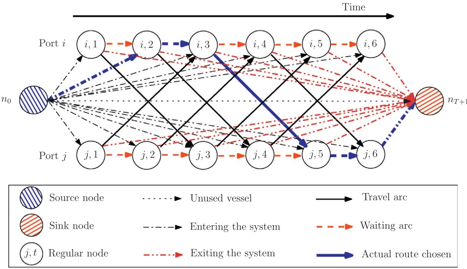
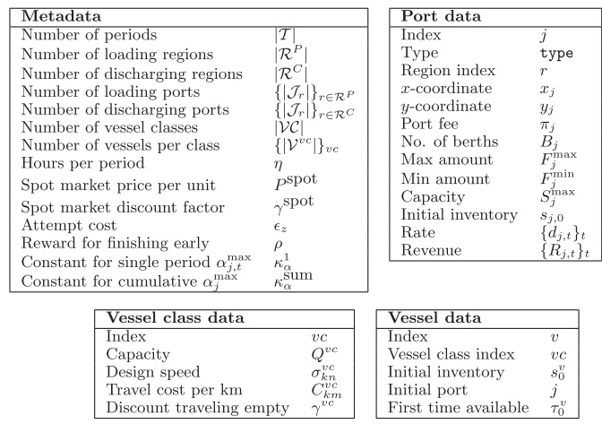

# MIRPLib – A library of maritime inventory routing problem instances: Survey, core model, and benchmark results

Dimitri J. Papageorgiou a,⇑, George L. Nemhauser b, Joel Sokol b, Myun-Seok Cheon a, Ahmet B. Keha a

a Corporate Strategic Research, ExxonMobil Research and Engineering Company, 1545 Route 22 East, Annandale, NJ 08801, United States b H. Milton Stewart School of Industrial and Systems Engineering, Georgia Institute of Technology, 765 Ferst Drive NW, Atlanta, GA 30332, United States

## a r t i c l e i n f o

Article history: Available online 18 December 2013

Keywords: Benchmark library Inventory routing Lot-sizing Maritime transportation and logistics Mixed-integer linear programming Survey

## a b s t r a c t

This paper presents a detailed description of a particular class of deterministic single product Maritime Inventory Routing Problems (MIRPs), which we call deep-sea MIRPs with inventory tracking at every port. This class involves vessel travel times between ports that are significantly longer than the time spent in port and require inventory levels at all ports to be monitored throughout the planning horizon. After providing a comprehensive literature survey of this class, we introduce a core model for it cast as a mixed-integer linear program. This formulation is quite general and incorporates assumptions and families of constraints that are most prevalent in practice. We also discuss other modeling features commonly found in the literature and how they can be incorporated into the core model. We then offer a unified discussion of some of the most common advanced techniques used for improving the bounds of these problems. Finally, we present a library, called MIRPLib, of publicly available test problem instances for MIRPs with inventory tracking at every port. Despite a growing interest in combined routing and inventory management problems in a maritime setting, no data sets are publicly available, which represents a significant ‘‘barrier to entry’’ for those interested in related research. Our main goal for MIRP-Lib is to help maritime inventory routing gain maturity as an important and interesting class of planning problems. As a means to this end, we (1) make available benchmark instances for this particular class of MIRPs; (2) provide the mixed-integer linear programming community with a set of optimization problem instances from the maritime transportation domain in LP and MPS format; and (3) provide a template for other researchers when specifying characteristics of MIRPs arising in other settings. Best known computational results are reported for each instance.

\- 2013 Elsevier B.V. All rights reserved.

## 1. Introduction

In 2011, the international shipping industry handled over 80% of the volume of world trade, of which bulk goods were a primary component. Indeed, of the nearly 9 billion tons of goods in international seaborne commerce traded in 2011, bulk goods such as coal, crude oil, iron ore, and liquefied natural gas accounted for well over 50% of this quantity and easily represented several hundreds of billions of US dollars in value (UNCTAD, 2012). With such colossal figures expected to grow over future decades, effective maritime transportation is of utmost importance. In this paper, we study a particular maritime transportation planning problem known as the Maritime Inventory Routing Problem (MIRP), which plays an integral role in global bulk shipping.

Inventory routing problems (IRPs) involve the integration and coordination of two components of the logistics value chain: inventory management and vehicle routing. Maritime inventory routing problems are a special class of IRPs that arise in a maritime setting. IRPs have come to prominence because they are an integral component in vendor managed inventory (VMI), a policy in which a central decision maker coordinates both the inventory and its distribution within a supply chain (Campbell, Clarke, Kleywegt, & Savelsbergh, 1998). The survey paper on combined inventory management and vehicle routing problems by Andersson, Hoff, Christiansen, Hasle, and Løkketangen (2010) provides a summary of research on IRPs in road and maritime settings. Coelho, Cordeau, and Laporte (in press) also review IRPs with more focus given to methodological aspects. The book chapter by Christiansen, Fagerholt, Nygreen, and Ronen (2007) provides an overview of maritime transportation along with many references.

Despite the importance of maritime transportation, the application of operations research (OR) techniques within this area has not yet gained widespread acceptance. There are three primary indicators of this underdevelopment. First, in industry, there are only a handful of publicly reported OR-based decision support systems being used for maritime applications compared with dozens used in road-based ones. Second, compared to other modes of transportation, there are very few special-interest groups in major OR societies devoted to the maritime industry. Third, in academia, there are no publicly available benchmark instances on which researchers can test their algorithms (Christiansen, Fagerholt, Nygreen, & Ronen, 2013). One possible explanation for the latter issue as it pertains to maritime inventory routing is that there is no single well-defined problem definition for a MIRP. Instead, there are many variants that address particular aspects of a specific industrial application (Andersson, Hoff, et al., 2010). Christiansen et al. (2013) define a MIRP as ‘‘a planning problem where an actor has the responsibility for both the inventory management at one or both ends of the maritime transportation legs, and for the ships’ routing and scheduling.’’ While this definition is both reasonable and concise, it leaves ample room for interpretation and variation.

<small>⇑ Corresponding author. Tel.: +1 908 730 2338.</small>

<small>E-mail addresses: [dimitri.j.papageorgiou@exxonmobil.com](mailto:dimitri.j.papageorgiou@exxonmobil.com) (D.J. Papageorgiou), [gnemhaus@isye.gatech.edu](mailto:gnemhaus@isye.gatech.edu) (G.L. Nemhauser), [jsokol@isye.gatech.edu](mailto:jsokol@isye.gatech.edu) (J. Sokol), [myun-seok.cheon@exxonmobil.com](mailto:myun-seok.cheon@exxonmobil.com) (M.-S. Cheon), [ahmet.b.keha@exxonmobil.com](mailto:ahmet.b.keha@exxonmobil.com) (A.B. Keha).</small>

In recent years, there have been several appeals to create a set of benchmark instances for maritime transportation problems for the research community. Andersson, Hoff, et al. (2010) urge authors, in collaboration with industrial partners, to make their data available along with a full and rich description of the model so that other can reproduce it. Similarly, Christiansen and Fagerholt Christiansen and Fagerholt (2011) write ‘‘. . . there are still not any published sets of benchmark problems for maritime transportation problems, while there are numerous in land-based transport.’’ A primary goal of this paper is to help fill this void by introducing a set (or ‘‘library’’) of benchmark instances for a particular class of single product MIRPs. By doing so, we hope to help maritime inventory routing gain maturity as an important and interesting class of planning problems and to spur the development of better mathematical models and more advanced algorithms. We call this library MIRPLib in the spirit of other libraries in the OR community such as TSPLib (Reinelt, 1991), MIPLib (Koch et al., 2011), ORLib (Beasley, 1990), MineLib (Espinoza, Goycoolea, Moreno, & Newman, 2013), and LINER-LIB (Brouer, Alvarez, Plum, Pisinger, & Sigurd, in press), which have been used for the traveling salesman problem, mixed-integer linear programming (MILP), OR, open-pit mining, and liner shipping network design, respectively.

In order to create the first publicly available library of MIRP instances, we scoped the problem to be interesting and accessible. We study a core model that involves the distribution of a single product and requires that inventory levels at all loading and discharging ports must stay within prespecified bounds during every time period throughout the entire planning horizon. It is assumed that vessel travel times between ports are significantly longer than the time spent in port so that port operations need not be explicitly modeled. We refer to this class of problems as deep-sea MIRPs with inventory tracking at every port. We believe that this class of problems is a suitable starting point for a library since it most closely resembles the traditional concept of VMI in which a central entity is tasked with maintaining inventory levels at all suppliers and customers, while simultaneously managing the distribution of the inventory.

Our emphasis on a core model is in line with what Christiansen and Fagerholt (2011) describe as ‘‘a need to direct the research on maritime transportation towards more basic research.’’ By focusing on a core model that lies at the intersection of many of the models seen in the literature, we believe that researchers can compare their algorithms in a meaningful way without having to understand a detailed variant of this base model. Meanwhile, this does not discount the importance of rich models. We hope researchers can use this library as a template before making their data available to the community.

The single product MIRP that we study as our core model is best described in terms of its main components: ports and vessels. Each port is classified as a loading port, where product is produced and loaded onto vessels, or as a discharging port, where product is consumed, typically after being discharged from vessels or from an alternative source (e.g., a pipeline). Product can be stored in inventory at both types of ports. Each port has: exactly one classification type, ‘‘loading’’ or ‘‘discharging’’; a variable inventory capacity; a fixed number of berths limiting the number of vessels that can simultaneously load or discharge in a given time period; lower and upper bounds on the amount of product that can be loaded or discharged in a period; and deterministic, but possibly non-constant, per-period bounds on the rate of production or consumption. If the bounds in a single period coincide, then the rate is fixed. Each discharging port has a deterministic, but possibly non-constant, per-period unit price for the quantity discharged. Port operations, such as time to berth and time to set up equipment for loading or discharging, are not explicitly modeled.

To transport the product, the planners control or charter a fleet of heterogeneous vessels. Each vessel belongs to a particular vessel class and has a fixed capacity, a cruising speed, and a travel cost. Vessels make voyages between ports by picking up inventory at one or more ports and delivering inventory to one or more ports. Vessels may partially load and discharge so that two or more ports of the same type (loading or discharging) may be visited in succession. In general, a vessel will fully discharge before loading at another port, but this is not required in the model. A berth is only occupied by a vessel when loading or discharging. Thus, there can be more vessels at a port than there are berths. Using the nomenclature of Andersson, Hoff, et al. (2010), this core MIRP model can be classified as a deterministic, finite-horizon, split-pickup and split-delivery problem. The solution of this planning problem specifies routes, i.e., the sequence and times of ports visited, for each vessel as well as the quantity of product loaded or discharged in each time period by each vessel.

Having discussed the basic characteristics of a MIRP, we now attempt to distinguish this problem from the class of road-based IRPs, which have received far more attention in the literature. MIR-Ps possess several noteworthy idiosyncrasies that differentiate them from an IRP typically encountered in road-based applications (see, e.g., Andersson, Hoff, et al., 2010). First, the classical IRP assumes that a fleet of vehicles are located at a central depot (a single supplier) and are dispatched to customers to satisfy demand before returning to the depot in the same period. In a maritime setting, the notion of a single central depot is conspicuously absent. Likewise, vessels are typically traveling long distances and around the clock making the time dimension of the problem very important. Second, the planning horizon is typically longer in a maritime setting due to time-consuming port operations and long travel times. On the other hand, with shorter planning horizons, models for road-based applications typically require finer granularity. Third, in a maritime setting, vessels typically visit relatively few (3 or fewer) ports in succession when loading or discharging, whereas traditional IRPs may involve tens of customers to visit with a small quantity (relative to vehicle capacity) being loaded at each visit. A notable exception to this difference is in the fuel distribution problem where it is a common assumption that trucks should not visit more than 2 or 3 gas stations (see, e.g., Cornillier, Boctor, Laporte, & Renaud, 2008).

It is also important to distinguish maritime inventory routing problems from a closely related class of problems known as cargo routing problems. As discussed in Al-Khayyal and Hwang (2007), cargo routing problems are mainly constrained by the cargo, which is usually defined by the loading and discharging ports, and by time windows for loading and discharging. Inventory routing problems are constrained by inventory requirements such that the inventory level of products at ports should be maintained. In general, cargo routing is performed under more restrictive constraints since the time windows to load and discharge are usually narrow and the quantities to be loaded and discharged are known in advance. In contrast, in a MIRP, the number of calls (i.e., visits) at a given port over the planning horizon, the quantity to be loaded or discharged at each port call, as well as the port pickup and delivery pairings are not specified in the data. Thus, due to the larger solution space, it can be argued that maritime inventory routing is often more challenging computationally than traditional cargo routing.

Even within the class of MIRPs, such problems are typically classified along several axes. The first axis concerns the type of planning: strategic, tactical, and/or operational. In a maritime setting, strategic planning involves decisions over a long time horizon of one to twenty years. Tactical planning usually involves several months, possibly up to a year, of vessel routing and product distribution decisions. Operational planning requires the finest granularity and typically focuses on a planning horizon of several weeks or a few months. The second axis is the type of shipping environment: industrial, tramp, or liner (Lawrence, 1972; Ronen, 1993). Industrial operators own or control both the vessels and cargo to be transported, and focus on minimizing their transport costs. Tramp shipping is analogous to a taxi service, as the vessels go after cargoes that become available in the market. Liner shipping, for which there are virtually no MIRP applications in the literature, resembles bus line operations since the vessels follow published itineraries and schedules. In practice, MIRP applications may involve elements from both industrial and tramp shipping (see, e.g., Andersson, 2011). The third axis distinguishes between deep-sea and short-sea shipping. Deep-sea shipping pertains to intercontinental trips through deep seas in which travel times are much longer than the time required to load and discharge at ports. Short-sea shipping typically refers to short regional trips having travel times that are likely to be shorter than the time requirements at a port, and therefore port operations and service constraints are necessary to adequately model reality.

To reiterate, in this paper, we focus exclusively on strategic and tactical deep-sea MIRPs in which inventory levels at all loading and discharging ports must stay within prespecified bounds during every time period throughout the entire planning horizon. MIRPs with explicit time windows constraints in place of constraints on inventory levels are not considered. Of course, there are other interesting types of MIRPs that have been studied. For example, in the liquefied natural gas (LNG) industry, it is sometimes the case (see, e.g., Section 4 in Andersson, Christiansen, & Fagerholt (2010)) that a producer is responsible for ensuring that inventory bounds are strictly enforced at a liquefaction plant while fulfilling a set of long-term customer contracts. This problem is a MIRP. However, since inventory level constraints are not stated in every time period for the customers, we do not include it here. Similarly, Christiansen (1999) discusses a real-world problem faced by a company that trades ammonia with internal and external customers (ports). Although inventory bounds are explicitly stated for each internal port in every time period, load and discharge amounts with external ports are based on negotiations and are, therefore, specified with time windows. Once again, since inventory constraints are not stated in every time period for all customers, this problem is an extension of the core model pre-sented here. Note that, as long as time window constraints are not included as a proxy for inventory level constraints, we allow for lower and upper inventory bounds at some ports to be ignored as this is equivalent to setting these bounds to -1 and þ1, respectively.

The outline of this paper is as follows. In Section 2, we review the literature on MIRPs with inventory tracking at all ports. In Section 3, we present an arc-flow MILP formulation of a core MIRP along with extensions to handle other features frequently encountered in the literature. In Section 4, we discuss how to use the library. Finally, we provide best known results for the instances currently in the library in Section 5.

## 2. Literature review

In this section, we present a review of the papers and solution methods for MIRPs with inventory tracking at all ports. A survey of applications, problems, and algorithms in maritime routing and scheduling can be found in Christiansen et al. (2013). Table 1 attempts to categorize the papers discussed below.

Before surveying the literature, it is important to define two concepts that appear frequently. Mathematical programming formulations for MIRPs are usually classified along at least two dimensions: discrete-time vs. continuous-time formulations and arc-flow vs. path-flow formulations. Discrete-time models discretize the planning horizon and assume that events (e.g., loading product onto vessels) may only take place at fixed points in time. In contrast, continuous-time models treat time as a continuum and do not restrict events to take place at fixed time points. Continuous-time models appear to be more commonly used when production and consumption rates change infrequently over the planning horizon. Hybrid models with both continuous- and discrete-time components are also possible (see, e.g., Agra, Christiansen, & Delgado, 2013). Meanwhile, whereas arc-flow formulations include decision variables to model the movement of vessels between ports, path-flow formulations include decision variables representing the entire sequence of ports visited by each vessel. In some models, a more detailed definition of a path is used to capture additional information, e.g., the amount of product loaded or discharged at each port visit.

As mentioned in Section 1, Christiansen (1999) studies a single product MIRP from the ammonia industry. Although the problem that she considers does not satisfy the strict definition of our core MIRP model, it is important to mention this work as it is one of the most cited papers in maritime routing and scheduling, and its model provides the basis of several other models seen in subsequent papers. A company owns both production and consumption facilities and must route a fleet of vessels so that inventory bounds are never breached. Continuous-time arc- and path-flow models are formulated and a branch-and-price algorithm is developed.

Extending the model of Christiansen (1999) and Al-Khayyal and Hwang (2007) study an arc-flow model in which multiple liquid bulk products are shipped by heterogeneous vessels, each of which has a dedicated compartment for a subset of the products; each compartment is dedicated to the same product throughout the planning horizon. Computational experiments reveal that the time required to solve their model directly using a commercial solver increases exponentially in the number of vessels and time periods considered. Li, Karimi, and Srinivasan (2010) study a MILP model similar to that of Christiansen (1999) and Al-Khayyal and Hwang (2007), but at an operational level with finer granularity. For example, they ensure that inventory bounds are satisfied at every moment in time, rather than just at the beginning and end of each loading and discharging event (or time period in our core model). Like Christiansen (1999), their model involves internal and external ports. However, unlike Christiansen, external sites act solely as external suppliers of raw materials that no other site produces, inventory levels at external sites are ignored, and no time windows are specified. Whereas Al-Khayyal and Hwang (2007) and Li et al. (2010) assume that compartments are dedicated for certain products, i.e., it is not permissible to assign a product to a compartment that has been used previously by other products, Siswanto, Essam, and Sarker (2011) relax this assumption and study a MIRP with undedicated compartments. Multiple heuristics are applied to generate feasible solutions.

Summary of relevant MIRP papers. Affiliation(s) = primary affiliation(s) of the authors (Aveiro = University of Aviero, Portugal; BIT = Blekinge Institute of Technology, Sweden; CUPB = Chinese University of Petroleum – Beijing, China; DEU = Dokuz Eylul University, Turkey; GT = Georgia Tech; Molde = Molde University College, Norway; NUS = National University of Singapore; NTNU = Norwegian University of Science and Technology; PBR = Petrobras; UMSL = University of Missouri-St. Louis, USA; UNSW = University of New South Wales; XOM = ExxonMobil); App = primary application motivating the paper or the computational instances (‘‘L. bulk’’ = ‘‘liquid bulk’’; LNG = Liquefied natural gas; VGO = Vacuum gas oil); Plan Level = primary planning level considered; Time = continuous-time (C) and/or discrete-time (D) model; Model(s) = arc- and/or path-flow model(s); Method(s) = solution method(s) applied (ADP = Approximate Dynamic Programming; BC = Branch-and-Cut; BP = Branch-and-Price; BPC = Branch-Price-and-Cut; BPGS = Branchand-Price Guided Search; CG = Column Generation, and in contrast to Branch-and-Price, includes only a priori generated columns, i.e., a pricing problem is never solved; Lagrangian = Lagrangian relaxation); B stands for ‘‘Branching’’ and denotes whether any special branching procedures are discussed; C stands for ‘‘Cuts’’ or ‘‘Constraints’’ and denotes whether any valid inequalities were derived to improve the model; jVj = number of vessels; jJ j = number of ports; $| \mathcal { I } ^ { P } | \; ( | \mathcal { I } ^ { C } | )$ number of loading (discharging) ports; jT j = number of time periods for discrete-time models or the length of the planning horizon in time units for continuous-time models; Unit = time unit (‘‘d’’ = days, ‘‘m’’ = months, ‘‘⁄h’’ = ⁄-hour time intervals); jKj = number of products. In the rightmost seven columns (excluding the Unit column), the largest value reported for each parameter is shown, although an instance with these values may not exist.

| Author(s) | Affiliation(s) | App | Plan level | Time | Model(s) |
| --- | --- | --- | --- | --- | --- |
| Agra, Andersson, et al. (2013) | Aviero,NTNU | L. bulk | Tactical | D | Arc |
| Agra, Christiansen, et al. (2013) | Aviero,NTNU | Fuel Oil | Operational | C, D | Arc |
| Al-Khayyal and Hwang (2007) | GT | L. bulk | Tactical | C | Arc |
| Andersson (2011) | NTNU | Pulp | Tactical | D | Path |
| Andersson, Christiansen, et al. | NTNU | LNG | Tactical | D | Path |
| (2010) |  |  |  |  |  |
| Bilgen and Ozkarahan (2007) | DEU | Wheat | Strategic | D | Path |
| Christiansen (1999) | NTNU | Ammonia | Tactical | C | Arc, Path |
| Christiansen and Fagerholt (2009) | NTNU | General | Tactical | C | Arc |
| Christiansen et al. (2011) | NTNU | Cement | Tactical | - | - |
| Christiansen et al. (2007) | NTNU | General | Tactical | C, D | Arc, Path |
| Dauzère-Pérès et al. (2007) | Molde | Slurry | Tactical | D | Arc |
| Engineer et al. (2012) | GT,XOM | VGO | Tactical | D | Path |
| Fodstad et al. (2010) | SINTEF | LNG | Tactical | D | Arc |
| Furman et al. (2011) | XOM | VGO | Tactical | D | Arc |
| Goel et al. (2012) | XOM | LNG | Strategic | D | Arc |
| Grønhaug and Christiansen (2009) | NTNU | LNG | Tactical | D | Arc, Path |
| Grønhaug et al. (2010) | NTNU | LNG | Tactical | D | Path |
| Hewitt, Nemhauser, Savelsbergh, | GT,XOM | VGO | Tactical | D | Arc |
| and Song (2013) |  |  |  |  |  |
| Li et al. (2010) | NUS | L. bulk | Operational | C | Arc |
| Papageorgiou, Cheon, et al. | GT,XOM | L. bulk | Strategic | D | Arc |
| (submitted for publication) |  |  |  |  |  |
| Papageorgiou, Keha, et al. | GT,XOM | L. bulk | Tactical | D | Arc |
| (submitted for publication) |  |  |  |  |  |
| Persson and Göthe-Lundgren | BIT | Bitumen | Tactical | D | Arc, Path |
| (2005) |  |  |  |  |  |
| Rocha et al. (2013) | PBR | Crude | Tactical | D | Arc |
| Ronen, 2002 | UMSL | L. bulk | Tactical | D | Arc |
| Shao et al. (submitted for | XOM | LNG | Strategic | D | Arc |
| publication) |  |  |  |  |  |
| Shen et al. (2011) | CUPB | Crude | Strategic | D | Path |
| Siswanto et al. (2011) | UNSW | L. bulk | Operational | C | Arc |
| Song and Furman (2013) | XOM | VGO | Tactical | D | Arc |
| Uggen et al. (2013) | SINTEF | LNG | Tactical | D | Arc |

Ronen (2002) addresses a multi-product MIRP faced by producers of liquid bulk products in which each product must be stored and shipped in separate compartments of a vessel. Vessels are chartered to make voyages that visit a single loading port and a single discharging port, while possibly carrying multiple products. A simple heuristic is suggested. Agra, Andersson, Christiansen, and Wolsey (2013) study a general MIRP and propose two discretetime formulations to solve it: an arc-flow formulation and a fixed-charge network flow formulation. They show that the latter formulation is much tighter than the arc-flow formulation. In addition to their alternative formulation, their main contributions are several types of valid inequalities, which can further strengthen the models, and the use of priority branching to accelerate the solution process. All valid inequalities are generated before the branch-and-cut algorithm is launched, although some of these cuts are added to a cut pool rather than going directly into the constraint matrix. Papageorgiou, Keha, Nemhauser, and Sokol (submitted for publication) consider instances involving company-owned and time-chartered vessels and apply a two-stage decomposition algorithm, similar in spirit to Benders decomposition for MILP, in which vessels are first routed between regions and then intra-regional loading/discharging and routing decisions are made. While the first-stage master problem provides useful bounds, an effective construction heuristic to generate good solutions quickly is pre-sented along with extensions to the local search neighborhoods presented in Hewitt, Nemhauser, Savelsbergh, and Song (2013). Whereas Papageorgiou, Keha, et al. (submitted for publication) attempts to find good primal and dual solutions to tactical planning problems of up to 60 periods (days), Papageorgiou, Cheon, Nemhauser, and Sokol (submitted for publication) focus exclusively on finding good primal solutions using approximate dynamic programming to a class of planning problems of up to 360 periods in a short amount of time (i.e., minutes).

| Method(s) | B | C | jVj | jJj | jJPj | jJCj | jTj | Unit | jKj |
| --- | --- | --- | --- | --- | --- | --- | --- | --- | --- |
| BC | U | U | 5 | 6 | - | - | 60 | 12 h | 1 |
| BC | U | U | 4 | 7 | - | - | 12 | d | 4 |
| Default |  | U | 4 | 4 | - | - | 10 | d | 3 |
| solver |  |  |  |  |  |  |  |  |  |
| BP |  |  | 3+ | 27 | 4 | 23 | 147 | 8 h | 30 |
| Model |  |  | - | - | - | - | - | - | - |
| only |  |  |  |  |  |  |  |  |  |
| Default |  |  | - | 6 | 4 | 2 | 3 | m | 8 |
| solver |  |  |  |  |  |  |  |  |  |
| BP |  |  | 5 | 16 | - | - | 36 | d | 1 |
| Model |  |  | - | - | - | - | - | - | - |
| only |  |  |  |  |  |  |  |  |  |
| Genetic |  |  | 5 | 61 | 12 | 49 | 28 | d | 11 |
| alg |  |  |  |  |  |  |  |  |  |
| Model |  |  | - | - | - | - | - | - | - |
| only |  |  |  |  |  |  |  |  |  |
| Memetic |  |  | 17 | 11 | 1 | 10 | 84 | d | 16 |
| alg |  |  |  |  |  |  |  |  |  |
| BPC | U | U | 6 | 10 | 6 | 4 | 60 | d | 1 |
| Default |  |  | 8 | 7 | 4 | 6 | 181 | d | 1 |
| solver |  |  |  |  |  |  |  |  |  |
| Model |  |  | - | - | - | - | - | d | 1 |
| only |  |  |  |  |  |  |  |  |  |
| MILP- |  |  | 69 | 11 | 1 | 10 | 365 | d | 1 |
| based LS |  |  |  |  |  |  |  |  |  |
| Default |  |  | 5 | 6 | 3 | 3 | 60 | d | 1 |
| solver |  |  |  |  |  |  |  |  |  |
| BP | U | U | 5 | 6 | 3 | 3 | 75 | d | 1 |
| BPGS |  |  | 6 | 10 | 6 | 4 | 60 | d | 1 |
| Default |  |  | 5 | 8 | - | - | 80 | d | 2 |
| solver |  |  |  |  |  |  |  |  |  |
| ADP |  |  | 70 | 13 | 1 | 12 | 360 | d | 1 |
| Benders- | U | U | 17 | 13 | 4 | 9 | 60 | d | 1 |
| like |  |  |  |  |  |  |  |  |  |
| CG; | U | U | 3 | 18 | 15 | 3 | 42 | 6 h | 4 |
| Heuristic |  |  |  |  |  |  |  |  |  |
| Default |  | U | - | 11 | 9 | 2 | 30 | d | 1 |
| solver |  |  |  |  |  |  |  |  |  |
| Default |  |  | - | 7 | 2 | 5 | 30 | d | 5 |
| solver |  |  |  |  |  |  |  |  |  |
| MILP- |  |  | 69 | 11 | 1 | 10 | 365 | d | 1 |
| based LS |  |  |  |  |  |  |  |  |  |
| Lagrangian |  |  | - | 11 | 1 | 10 | 12 | m | 1 |
| Heuristic |  |  | 3 | 4 | - | - | 15 | d | 2 |
| MILP- | U | U | 6 | 8 | 4 | 4 | 60 | d | 1 |
| based LS |  |  |  |  |  |  |  |  |  |
| Fix-and- |  |  | 8 | 10 | - | - | 181 | d | 1 |
| relax |  |  |  |  |  |  |  |  |  |

Several case studies also appear in the literature. Dauzère-Pérès et al. (2007) describe a case study in VMI involving a Norwegian supplier of calcium carbonate slurry, a product used in paper manufacturing. The supplier is responsible for routing a fleet of heterogeneous vessels and for maintaining sufficient inventory levels of up to sixteen products at ten tank farms in Northern Europe. Ensuring that inventory remains within bounds at both the supply point and the tank farms is imperative; moreover, these bounds are rather tight. While vessel voyages are relatively simple (each vessel travels from the supply point to a single tank farm before fully discharging), the decision of which vessel to use and how much of each product to load on the chosen vessel is challenging. A memetic algorithm, a population-based approach that combines local search heuristics with crossover operators, is used to generate solutions within the decision support tool. Note that even though inventory bounds are not enforced at the supplier, we consider this problem to be a MIRP with inventory tracking since the lower and upper inventory bounds at the supply port can be considered -1 and þ1, respectively. Christiansen et al. (2011) present a MIRP encountered by a major cement producer involving bulk ships with multiple compartments that transport multiple non-mixable cement products. While a mathematical programming formulation is not provided, a construction heuristic embedded in a genetic algorithmic framework is used as a solution method. Andersson (2011) studies a maritime inventory routing subcomponent of the supply chain of Södra Cell AB, one of the largest producers of pulp in the world. The problem is complicated by the availability of several modes of transportation for distributing the pulp. Along with trucks, trains, and barges, a fleet of long-term time-chartered vessels are used, but additional vessels can also be chartered on the spot market. A path-flow model is formulated and solved using a branch-and-price methodology. Bilgen and Ozkarahan (2007) present a MILP model for a multi-product bulk grain blending and shipping problem faced by a company that manages a wheat supply chain. The salient characteristic of their model that differentiates it from other models listed here is the ability to blend multiple products to meet customer demand requirements. Although their routing decisions may be slightly complicated by the presence of split pickups, they include a simplifying assumption that all voyages begun in a period (a month) end in the same period.

Another stream of research emerged from a class of tactical planning problems within vacuum gas oil (VGO) transportation. This class of single product MIRPs is a tramp shipping application involving voyage chartered vessels or spot charters, i.e., vessels that are chartered for a single voyage from a loading region to a discharging region. Furman, Song, Kocis, McDonald, and Warrick (2011) present a rich arc-flow MILP model embedded in a decision support tool used to aid decision-makers in the routing and inventory management of VGO at ExxonMobil. This case study describes many real-world constraints and techniques for modeling vessels with a complicated cost structure. Driven by a need to generate good solutions quickly to models similar to those described in Furman et al. (2011), Song and Furman (2013) apply a large neighborhood search to an arc-flow model that extends the ideas introduced in Savelsbergh and Song (2008). In particular, after an initial solution is generated, a local search procedure, akin to a 2- opt procedure, is applied in which the decision variables associated with all but two vessels are fixed and an exact optimization algorithm is called to locally optimize the decisions for these two vessels. This procedure is applied for up to jVj-  iterations, where jVj is the number of vessels and vessel pairs are chosen randomly in each iteration. We refer to this type of algorithmic approach as MILP-based local search as a small MILP model is solved during each local search phase. Working off of a simpler problem than the one considered in Furman et al. (2011) and Song and Furman (2013), Engineer, Furman, Nemhauser, Savelsbergh, and Song (2012) formulate a path-flow model and apply a branch-cut-and-price approach for solving the problem. Three types of valid inequalities are suggested that generalize valid inequalities presented in previous work. Hewitt, Nemhauser, Savelsbergh, and Song (2013) also attempt to generate good solutions quickly for the instances considered in Engineer et al. (2012) with branch-and-price guided search (BPGS) (Hewitt, Nemhauser, & Savelsbergh, 2013), a technique that systematically searches restricted neighborhoods of a MILP using information from an extended formulation in the master problem. They consider a much richer set of local search neighborhoods than previously studied and show that, after parallelizing their code on four processors, BPGS is quite effective at finding high-quality solution in 30 min for the MIRP instances considered.

Persson and Göthe-Lundgren (2005) also consider a multi-product MIRP for an oil refinery company in Sweden. They formulate both arc- and path-flow models on a time–space network. To solve the problem, they suggest a heuristic that uses column generation and variable fixing within a partial branch-and-bound search. Shen, Chu, and Chen (2011) devise a Lagrangian relaxation approach to solve a crude oil transportation problem involving chartered vessels and pipelines that are used to transport product from a central supplier to a number of customers. Agra, Christiansen, et al. (2013) investigate a short-sea fuel oil distribution problem in the archipelago of Cape Verde with a short-term planning horizon of 12 days. This operational problem involves multiple products and includes time window constraints for loading and discharging since ports have restricted opening hours. Time spent in port is a crucial aspect of the problem and is modeled in detail. Dedicated and undedicated tanks on vessels are considered. Several MILP formulations are introduced and bound tightening, extended formulations, and valid inequalities are discussed. Rocha, Grossmann, and de Aragão (2013) describe a crude oil distribution problem in which a single type of crude oil is shipped from platforms to terminals. The problem studied is described as a subproblem in a petroleum supply chain planning problem at Petrobras, a vertically integrated petroleum company. The routing component is relatively simple as the authors assume an unlimited number of tankers are available in each vessel class and vessels always make direct deliveries with full loads from a platform to a terminal. On the other hand, inventory tracking at platforms and terminals is important to avoid hitting capacity limits on platforms and stocking out at terminals. The main contribution is a reformulation of the original model to provide tighter dual bounds by exploiting the discrete lot-sizing structure that emerges from the inventory balance constraints when coupled with the ‘‘full load’’ assumption.

Inventory tracking models have also been studied for MIRPs arising in the distribution of LNG, sometimes referred to as LNG-IRPs. Grønhaug and Christiansen (2009) are the first to study an LNG-IRP and introduce arc- and path-flow models that also include features idiosyncratic to LNG shipping, e.g., boil-off and cargo tanks. Because larger instances of the arc- and path-flow models are difficult to solve with a commercial solver,

Grønhaug, Christiansen, Desaulniers, and Desrosiers (2010) introduce a branch-and-price method where the master problem handles the inventory management and the port capacity constraints, while the subproblems generate the ship route columns. Different accelerating strategies are implemented. Andersson, Christiansen, et al. (2010) present a path-flow formulation of a planning problem faced by a vertically integrated LNG company. The company is responsible for the inventory management at all liquefaction plants and regasification terminals in addition to the transportation between these plants; no computational experiments are performed. Fodstad, Uggen, Rømo, Lium, and Stremersch (2010) study arguably the richest version of an LNG-IRP discussed in the literature as it involves contract management and spot market trading. To solve their LNG-IRP model, Fodstad et al. (2010) solve a MILP directly, while Uggen, Fodstad, and Nørstebø (2013) present a fix-and-relax heuristic. Goel, Furman, Song, and El-Bakry (2012) study an arc-flow model of a similar LNG-IRP with a singlepickup and single-delivery assumption. They present a construction heuristic and adapt the local search procedure of Song and Furman (2013) to generate solutions to instances with 365 time periods. Their main algorithmic contribution is to show how vessel pairs should be chosen to improve solution quality and reduce total solution time. Shao, Furman, and Goel (submitted for publication) extend this work by introducing more advanced construction heuristics and neighborhood searches. They claim that the combination of multiple computationally inexpensive heuristics is an effective strategy for generating good solutions to this class of LNG-IRPs.

Table 1 summarizes those papers in the literature whose focus is on modeling or solving a MIRP with inventory tracking at all ports. The final six columns roughly describe the size of the largest instance in each paper, where the size is measured coarsely in terms of the number jVj of vessels, the number $| \mathcal { I } |$ of ports, the number of loading and discharging ports $( | \mathcal { I } ^ { P } |$ and $| \mathcal { I } ^ { C } |$ , respectively), the number jT j of time periods for discrete-time models or the length of the planning horizon in time units for continuous-time models, and the number jKj of products. Note that the largest value reported for each parameter is shown, but there may not be an instance corresponding to the values shown. For example, Grønhaug et al. (2010) consider instances with up to 75 time periods, but they do not have an instance with the parameters shown in the table. Not all papers include a computational study.

Table 1 reveals that over two-thirds of the papers on MIRPs with inventory tracking at all ports are affiliated with Norwegian research at the Norwegian University of Science and Technology (NTNU), the Norwegian Foundation for Scientific and Industrial Research (SINTEF), and/or the Norwegian Marine Technology Research Institute (MARINTEK); or with ExxonMobil (XOM) and Georgia Tech (GT). We also see that the motivating applications are rather diverse as are the solution techniques to solve the models. More than half of the papers have some connection to the petrochemical industry as they were inspired by the distribution of crude, fuel oil, bitumen, VGO, or LNG. It appears that arc-flow models are far more common than path-flow models, which we attribute (at least partially) to the fact that the number of routes per vessel that are often generated is extremely large since there are no time windows, as there are in cargo routing problems, to drastically reduce the number of routes to consider. Most instances considered in the literature involve fewer than 5 vessels and no more than 10 ports. (Recall that Table 1 shows only the maximum number of vessels, ports, and time periods considered over all instances.) Roughly one-third of the applications involve multiple products. Other commonalities pertaining to branching strategies (column B) and valid inequalities (column C) are discussed in Section 3, after we present our core model.

## 3. A core maritime inventory routing problem

In this section, we provide an arc-flow MILP formulation of our core MIRP. This model, or a close variant, has been considered in Agra, Andersson, et al. (2013), Furman et al. (2011), Grønhaug and Christiansen (2009), Papageorgiou, Keha, et al. (submitted for publication), and Song and Furman (2013). The model is a discrete-time model involving an underlying time–space network. Its primary purpose is to identify optimal routing decisions for a fleet of heterogeneous vessels and optimal loading and discharging amounts by each vessel in each time period to ensure that inventory remains within prespecified bounds.

It is worth contrasting this model with other prominent models that appear in the literature. In their introduction to maritime inventory routing, Christiansen and Fagerholt (2009) describe a continuous-time arc-flow model for a single product MIRP, which they call a ‘‘basic ship inventory routing problem,’’ with constant production and consumption rates. Their model also takes place on a network, but it is quite different from the one presented below. Although arc-flow formulations are more prevalent, path-flow models are also studied (see column Model of Table 1 for references). Grønhaug et al. (2010) claim: ‘‘The advantages of path-based models are that . . . intricate and nonlinear constraints and costs can easily be incorporated when generating the paths.’’

## 3.1. An arc-flow mixed-integer linear programming model

Some of the sets, parameters, and decision variables introduced below are not used in the standard formulation, but will be used later, so we include them here for ease of reference. Sets are represented using capital letters in a calligraphic font, such as T and V. Where possible, parameters are denoted with capital letters in italic font or with Greek characters; however, some deviations are made to express constraints more easily, e.g., inventory balance constraints. Decision variables are always lower case.

<table><tr><td colspan="2">Indices and sets</td></tr><tr><td> $t \in \mathcal{T}$ </td><td>set of time periods with  $T = |\mathcal{T}|$ </td></tr><tr><td> $v \in \mathcal{V} (vc \in \mathcal{VC})$ </td><td>set of vessels (vessel classes)</td></tr><tr><td> $j \in \mathcal{J}^{P} (r \in \mathcal{R}^{P})$ </td><td>set of production, a.k.a. loading, ports (regions)</td></tr><tr><td> $j \in \mathcal{J}^{C} (r \in \mathcal{R}^{C})$ </td><td>set of consumption, a.k.a. discharging, ports (regions)</td></tr><tr><td> $j \in \mathcal{J} (r \in \mathcal{R})$ </td><td>set of all ports (regions):  $\mathcal{J} = \mathcal{J}^{P} \cup \mathcal{J}^{C}$  and  $\mathcal{R} = \mathcal{R}^{P} \cup \mathcal{R}^{C}$ </td></tr><tr><td> $n \in \mathcal{N}$ </td><td>set of regular nodes or port-time pairs: $\mathcal{N} = \{n = (j, t) : j \in \mathcal{J}, t \in \mathcal{T}\}$ </td></tr><tr><td> $n \in \mathcal{N}_{0,T+1}$ </td><td>set of all nodes (including a source node  $n_{0}$  and a sink node  $n_{T+1}$ )</td></tr><tr><td> $a \in \mathcal{A}$ </td><td>set of all arcs</td></tr><tr><td> $a \in \mathcal{A}^{v}$ </td><td>set of arcs associated with vessel  $v \in \mathcal{V}$ </td></tr><tr><td> $a \in \mathcal{FS}_{n}^{v}$ </td><td>forward star associated with node  $n = (j, t) \in \mathcal{N}_{0,T+1}$  and vessel  $v \in \mathcal{V}$ </td></tr><tr><td> $a \in \mathcal{RS}_{n}^{v}$ </td><td>reverse star associated with node  $n = (j, t) \in \mathcal{N}_{0,T+1}$  and vessel  $v \in \mathcal{V}$ </td></tr><tr><td colspan="2">Data</td></tr><tr><td> $B_{j}$ </td><td>number of berths (berth limit) at port  $j \in \mathcal{J}$ </td></tr><tr><td> $C_{a}^{v}$ </td><td>cost for vessel  $v \in \mathcal{V}$  to traverse arc  $a = ((j_{1}, t_{1}), (j_{2}, t_{2})) \in \mathcal{A}^{v}$ </td></tr><tr><td> $D_{j,t}^{\min} (D_{j,t}^{\max})$ </td><td>minimum (maximum) number of units that can be produced/consumed at port  $j \in \mathcal{J}$  in period  $t \in \mathcal{T}$ </td></tr></table>

(continued on next page)

$A _ { j }$ an indicator parameter taking value +1 if $j \in \mathcal { I } ^ { P } \mathrm { ~ a n d ~ } - 1 \mathrm { ~ i f ~ } j \in \mathcal { I } ^ { C }$ $F _ { j , t } ^ { \mathrm { m i n } } ~ ( F _ { j , t } ^ { \mathrm { m a x } } )$ minimum (maximum) amount of product that can be loaded/discharged at port j from a single vessel in time period $t \in \mathcal { T }$ $Q ^ { v }$ capacity of vessel $\nu \in \mathcal { V }$ $R _ { j , t }$ the unit sales revenue for product discharged at port $j \in \mathcal { T }$ in time period $t \in \mathcal { T }$ $S _ { j , t } ^ { \mathrm { m i n } } \left( S _ { j , t } ^ { \mathrm { m a x } } \right)$ lower bound (capacity) at $\operatorname { \mathsf { p o r t } } j \in { \mathcal { I } }$ in time period $t \in \mathcal { T }$ $s _ { j , 0 }$ initial inventory at port $j \in \mathcal { T }$ $s _ { 0 } ^ { \nu }$ initial inventory on vessel $\nu \in \mathcal { V }$

## Decision variables

$d _ { j , t }$ (continuous) amount to produce/consume at $\operatorname { \mathsf { p o r t } } j \in { \mathcal { I } }$ in period $t \in \mathcal { T }$ $f _ { j , t } ^ { v }$ (continuous) amount loaded/discharged at port $j \in \mathcal { T }$ in period $t \in \mathcal { T }$ from vessel $\nu \in \mathcal { V }$ $s _ { j , t }$ (continuous) number of units of inventory at port $j \in \mathcal { T }$ available at the end of period $t \in \mathcal { T }$ $S _ { t } ^ { \nu }$ (continuous) number of units of inventory on vessel $\nu \in \mathcal { V }$ available at the end of period $t \in \mathcal { T }$ $x _ { a } ^ { \nu }$ (binary) takes value 1 if vessel $\nu \in \mathcal { V }$ uses arc a incident to node $\pmb { n } = ( \pmb { j } , \pmb { t } ) \in \mathcal { N }$ $z _ { j , t } ^ { \nu }$ (binary) takes value 1 if vessel $\nu \in \mathcal { V }$ can load or discharge product at node $\pmb { n } = ( \pmb { j } , t ) \in \mathcal { N }$

Network

The core model takes place on an underlying time–space network first introduced in Song and Furman (2013). The network has a set $\mathcal { N } _ { 0 , T + 1 }$ of nodes and a set A of directed arcs. The node set is shared by all vessels, while each vessel has its own arc set ${ \mathcal { A } } ^ { \nu } .$ The set $\mathcal { N } _ { 0 , T + 1 }$ of nodes consists of ‘‘regular’’ nodes or port-time pairs, which represent a potential visit by one or more vessels to port $j \in \mathcal { T }$ in time period $t \in \mathcal { T }$ , as well as a source node $n _ { 0 }$ and a sink node $n _ { T + 1 }$

Associated with each vessel v is a set $\mathcal { A } ^ { \nu }$ of arcs, which can be subdivided further as shown in Fig. 1. An arc from the source to the sink node denotes that the vessel is not used in the solution. A source arc from the source node to a regular node represents the arrival of a vessel to its initial destination. Since a vessel may not be available at all ports from the outset of the planning horizon (e.g., a vessel may be en route to a port), not all source arcs shown in Fig. 1 may exist in the network. A sink arc from a regular node to the sink node conveys that a vessel is no longer being used and has exited the system. A waiting arc from a port j in time period t to the same port in time period t þ 1 represents that a vessel stays at the same port in two consecutive time periods. Finally, a travel arc from a regular node $n _ { 1 } = ( j _ { 1 } , t _ { 1 } )$ to a regular node $\boldsymbol { n } _ { 2 } = ( \boldsymbol { j } _ { 2 } , t _ { 2 } )$ with $j _ { 1 } \neq j _ { 2 }$ represents travel between two distinct ports. The set of incoming and outgoing arcs associated with vessel $\nu \in \mathcal { V }$ at node $n \in \mathcal { N } _ { 0 , T + 1 }$ are denoted by $\mathcal { R } S _ { n } ^ { \nu }$ (for reverse star) and $| \mathcal { F } S _ { n } ^ { \nu } |$ (for forward star), respectively.

The network structure affords great flexibility in modeling and embeds a significant amount of data in it. First, note that the travel duration between two distinct ports on a travel arc is given by the length $( t _ { 2 } - t _ { 1 } )$ of the arc and this duration may be time-dependent, e.g., it may take longer to travel from China to Europe during a particular season. Second, in some applications, all vessels may not be able to visit all ports because of physical restrictions at the port. Such vessel-port incompatibilities can easily be handled in this network by simply not including arcs in the respective sets. For example, if vessel v cannot visit port $j ,$ then the sets $\mathcal { F } S _ { n } ^ { \nu }$ and RSvare empty for all $\pmb { n } = ( \pmb { j } , t )$ and $t \in { \mathcal { T } } .$

Core model

$$
\max \sum_ {n = (j, t) \in \mathcal {N}} \sum_ {v \in \mathcal {V}} R _ {j, t} f _ {j, t} ^ {v} - \sum_ {v \in \mathcal {V} a \in \mathcal {A} ^ {v}} C _ {a} ^ {v} x _ {a} ^ {v},\tag{1a}
$$

$$
\text {s.t.} \quad \sum_ {a \in \mathcal {F S} _ {n} ^ {\nu}} x _ {a} ^ {\nu} - \sum_ {a \in \mathcal {R S} _ {n} ^ {\nu}} x _ {a} ^ {\nu} = \left\{ \begin{array}{l l} + 1 & \text {if} n = n _ {0}, \\ - 1 & \text {if} n = n _ {T + 1}, \forall n \in \mathcal {N} _ {0, T + 1}, \forall \nu \in \mathcal {V}, \\ 0 & \text {if} n \in \mathcal {N}, \end{array} \right.\tag{1b}
$$

$$
\left| s _ {j, t} = s _ {j, t - 1} + \varDelta_ {j} d _ {j, t} - \sum_ {v \in \mathcal {V}} \varDelta_ {j} f _ {j, t} ^ {v}, \forall n = (j, t) \in \mathcal {N}, \right.\tag{1c}
$$

$$
s _ {t} ^ {v} = s _ {t - 1} ^ {v} + \sum_ {\{n = (j, t) \in \mathcal {N} \}} \Delta_ {j} f _ {j, t} ^ {v}, \forall t \in \mathcal {T}, \forall v \in \mathcal {V},\tag{1d}
$$

$$
\sum_ {\nu \in \mathcal {V}} z _ {j, t} ^ {\nu} \leqslant B _ {j}, \forall n = (j, t) \in \mathcal {N},
$$

$$
z _ {j, t} ^ {v} \leqslant \sum_ {a \in \mathcal {R} \times \mathbb {S} _ {n} ^ {v}} x _ {a} ^ {v}, \forall n = (j, t) \in \mathcal {N}, \forall v \in \mathcal {V},\tag{1e}
$$

(1f)

Fig. 1. Example of time–space network structure for a single vessel.

$$
F _ {j, t} ^ {\min} z _ {j, t} \leqslant f _ {j, t} \leqslant F _ {j, t} ^ {\max} z _ {j, t}, \forall n = (j, t) \in \mathcal {N}, \forall v \in \mathcal {V},\tag{1g}
$$

$$
D _ {j, t} ^ {\min} \leqslant d _ {j, t} \leqslant D _ {j, t} ^ {\max}, \forall n = (j, t) \in \mathcal {N},\tag{1h}
$$

$$
\mathsf {S} _ {j, t} ^ {\min} \leqslant s _ {j, t} \leqslant \mathsf {S} _ {j, t} ^ {\max}, \forall n = (j, t) \in \mathcal {N},\tag{1i}
$$

$$
0 \leqslant_ {t} ^ {\nu} \leqslant Q ^ {\nu}, \forall \nu \in \mathcal {V}, \forall t \in \mathcal {T},\tag{1j}
$$

$$
x _ {a} ^ {\nu} \in \{0, 1 \}, \forall \nu \in \mathcal {V}, \forall a \in \mathcal {A} ^ {\nu},
$$

$$
\mathsf {z} _ {j, t} ^ {\nu} \in \{0, 1 \}, \forall n = (j, t) \in \mathcal {N}, \forall \nu \in \mathcal {V}.\tag{1k}
$$

(1l)

The objective function is stated in the form of a profit maximization where revenue is earned at the time product is delivered to a port. However, the objective function appears in many different forms. Some authors prefer to count revenue as being earned at the time product is consumed, e.g., (Andersson, Christiansen, et al., 2010; Grønhaug et al., 2010) replace the terms $\begin{array} { r } { \sum _ { n = ( j , t ) \in \mathcal { N } } \sum _ { \nu \in \mathcal { V } } R _ { j , t } f _ { j , t } ^ { \nu } } \end{array}$ with $\begin{array} { r } { \sum _ { n = ( j , t ) \in \mathcal { N } } R _ { j , t } d _ { j , t } . } \end{array}$ Other authors, e.g., (Agra, Andersson, et al., 2013; Al-Khayyal and Hwang, 2007; Engineer et al., 2012; Uggen et al., 2013), prefer to omit the revenue component and simply minimize transportation costs and the loading/discharge costs, which include port operations, duties, etc. We assume that these costs are all captured in the parameter $C _ { a } ^ { v } .$ . The costs incorporated in source and sink arcs can also vary, but we use the calculations provided in Table 2. Still other authors, e.g., (Goel et al., 2012; Papageorgiou, Keha, et al., submitted for publication; Ronen, 2002), include penalty terms for violating inventory bounds at ports. Inventory costs are not included in the objective function because we assume that the shipper owns both the production and consumption sites.

Constraints (1b) require flow balance for every vessel, that $\mathbf { i } \mathbf { \mathfrak { s } } ,$ if a vessel enters node n 2 N , it must also exit node $n \in \mathcal { N } .$ Constraints (1c) are inventory balance constraints at the end of each time period at loading and discharging ports. Constraints (1d) maintain inventory balance at the end of each time period on each vessel. Constraints (1e) limit the number of vessels that can attempt to load/discharge at a port in a given time period. Constraints (1f) ensure that a vessel does not attempt to load/ discharge at a node unless the vessel is actually at that node. Constraints (1g) state that if a vessel attempts to load/discharge at node $\pmb { n } = ( \pmb { j } , t ) ,$ then the actual amount loaded/discharged is within predetermined port-specific bounds $[ F _ { j , t } ^ { \mathrm { m i n } } , F _ { j , t } ^ { \dot { \mathrm { m a x } } } ]$ . Constraints (1h) ensure that the amount produced or consumed in each period is within prespecified bounds. Constraints (1i) require ending inventory in each time period at each port to be within prespecified bounds.

Regarding the timing of operations, inventory levels on vessels and at ports are only monitored at the end of each period as is typical in strategic and tactical discrete-time planning models. Since this could lead to ambiguities, we assume that, in a given time period, production occurs before loading takes place and consumption occurs after discharging takes place. Consequently, in a single time period, it may be possible for a vessel to load or discharge more inventory than a port’s capacity. For example, suppose a discharging port j consumes 25 units of product per period and has a constant capacity of 250 units. Then, 275 units could be discharged in a single period. This could occur if port j has 0 inventory at the end of period $t , \mathrm { i . e . , } s _ { j , t } = 0 ,$ and a vessel carrying at least 275 units of inventory arrives in period t þ 1 and discharges 275 units, 25 of which satisfy demand in period t þ 1 while the remaining 250 units are stored in inventory. This example also shows the coarseness of a discrete-time formulation since inventory bounds are only required to be satisfied at the end of each period.

In a number of models used for tactical or operational planning, the decision variables $d _ { j , t }$ , which denotes the production and consumption rates at each port over the planning horizon, are deterministic inputs to the model, rather than decision variables. In this case, we have that $D _ { j , t } ^ { \mathrm { m i n } } = D _ { j , t } ^ { \mathrm { m a x } }$ . Since some models used for vertically integrated supply chains may wish to determine production and consumption rates, $\mathbf { e . g . }$ , (Goel et al., 2012; Grønhaug & Christiansen, 2009), we model $d _ { j , t }$ as decision variables.

It is also worth noting some not-so-obvious features and constraints that are not stated (implicitly or explicitly) in the Core Model (1). First, although the notion of a region is not mentioned, in our library of instances, we assume that each port belongs to a prespecified region of the same type, i.e., loading or discharging. Deep-sea shipping problems typically involve multiple regions and it may be possible to exploit this additional problem structure. On the other hand, if regional information is not specified in the problem, one can create an artificial region for each port. Second, it is assumed that if a vessel travels from port i to port j, the vessel will attempt to load/discharge at port j (and, therefore, incurs a port fee). This will always happen in an optimal solution because the data for the instances of interest all satisfy the triangle inequality, i.e., it is cheaper to travel from port a to port c than to travel from a to b and then b to c. Note that the port fee is paid only once. That is, if a vessel attempts to load at port j in period t, remains at port j in period t þ 1 (but, perhaps, abandons the berth in this period), and then attempts to load again at port j in period t þ 2, only one port fee is incurred.

## 3.2. Common side constraints and additional model features

## 3.2.1. ‘‘Travel at capacity’’ constraints

Many authors include constraints that require a vessel to travel at capacity from a loading region to a discharging region and empty from a discharging region to a loading region (Goel et al., 2012; Grønhaug and Christiansen, 2009; Grønhaug et al., 2010; Papageorgiou, Keha, et al., submitted for publication; Papageorgiou, Cheon, et al., submitted for publication; Rocha et al., 2013):

$$
\begin{array}{l} s _ {t} ^ {v} \geqslant Q ^ {v} x _ {a} ^ {v}, \quad \forall v \in \mathcal {V},   \forall a = ((j _ {1}, t), (j _ {2}, t ^ {\prime})) \in \mathcal {A} ^ {v}: j _ {1} \in \mathcal {J} ^ {p}, \\ j _ {2} \in \mathcal {J} ^ {C} \cup \{n _ {T + 1} \}, \end{array}\tag{2a}
$$

$$
\begin{array}{l} s _ {t} ^ {v} \leqslant Q ^ {v} (1 - x _ {a} ^ {v}), \quad \forall v \in \mathcal {V},   \forall a = ((j _ {1}, t), (j _ {2}, t ^ {\prime})) \in \mathcal {A} ^ {v}: j _ {1} \in \mathcal {J} ^ {C}, \\ j _ {2} \in \mathcal {J} ^ {P} \cup \{n _ {T + 1} \}. \end{array}\tag{2b}
$$

Although these ‘‘travel full’’ constraints (2a) are usually justified on the basis that vessel capacity is a scarce resource and therefore a vessel’s capacity should always be fully utilized when making long voyages, there are applications in which it has been shown that such an assumption may not always be optimal (see, e.g., Fodstad et al., 2010). On the other hand, in virtually all MIRPs discussed in the literature, vessels fully discharge before reloading. This is in contrast to what occurs in liner shipping where vessels load and discharge containers regularly without ever fully discharging. Finally, note that constraints (2a) and (2b) require vessels to leave the system empty or full.

## 3.2.2. Differentiating among similar solutions

It may be useful to include several features into the Core Model (1) in order to give slight preference to some solutions over what would otherwise be considered almost identical solutions.

When a vessel visits a port, there may be multiple time periods in which it can load or discharge product. In reality, we prefer a vessel to load or discharge as few times as possible to minimize the duration and cost of port operations associated with that vessel. In addition, we prefer a vessel to load or discharge as soon as it arrives at a port, assuming the port has a berth available and enough inventory or capacity to do so. To accommodate these secondary goals without affecting the primary goals of managing inventory and routing vessels, we may choose to associate a negligible cost t-z with each binary decision variable $Z _ { j , t 1 } ^ { v }$ where -z is a small nonnegative parameter representing the cost to load or discharge and t is the time period. If a nonzero $\epsilon _ { Z }$ parameter is specified, the objective function in the Core Model (1) should include the additional term

$$
\bigg | \sum_ {v \in \mathcal {V}} \sum_ {j \in \mathcal {J}} \sum_ {t \in \mathcal {T}} - (t \epsilon_ {z}) z _ {j, t} ^ {v}.\tag{3}
$$

Note that by using the coefficient $- ( t \epsilon _ { z } )$ instead $\mathbf { o f } - \epsilon _ { z } ,$ solutions in which a vessel attempts to load or discharge sooner rather than later are preferred.

Because the Core Model (1) is a finite-horizon model, a second useful modeling feature is to give a small value to vessels for ‘‘exiting the system’’ as soon as they are no longer needed. In terms of the Core Model (1), this means that we would like vessels to take a sink arc once it is no longer necessary or profitable for them to engage in other activities. Without such a feature, a solution in which vessel v discharges all of its product at port j in time period t and remains empty at that same port until the end of the planning horizon is valued as highly as a nearly identical solution in which vessel v fully discharges at port j in period t and then exits the system immediately by taking the sink arc from node $( j , t )$ to the sink node. Indeed, we prefer the latter solution since vessel v will be available sooner for service at the start of the next planning horizon. To accomplish this, we introduce a reward $\rho$ per unit time for a vessel that finishes early. This reward is built into the cost of a sink arc, which is discussed in Section 4.3, so that the Core Model (1) remains the same.

## 3.2.3. Soft inventory bounds and a simplified spot market representation

In certain strategic and tactical planning models, the inventory bound constraints (1i) at ports may be considered soft, i.e., they should ideally be satisfied, but are permitted to be violated with a penalty. There are several reasons why this ‘‘soft’’ interpretation may be beneficial or necessary from a modeling standpoint. First, the inventory bounds in constraints (1i) may be overly conservative in order to make the solution more robust by preventing ports from running out of inventory or exceeding capacity due to uncertainty in the data (Dauzère-Pérès et al., 2007; Furman et al., 2011). In this case, it may be acceptable to penalize a small bound violation if it is impossible or unfavorable for a vessel to reach the port before the violation occurs. Second, soft constraints may help mitigate unwanted effects of the time discretization used in the planning model. For example, suppose that it takes a vessel 9.5 days to travel from port i to port j, but that a daily time discretization is used requiring the travel time to be modeled as 10 days. Then, while in reality it might be possible for the vessel to arrive a half-day early at port j just in time to prevent a stockout, a daily time discretization may necessitate that a partial stockout take place. Third, in some planning models, it may be interesting to experiment with different fleet compositions in which case the proper mix of vessels may not be available to meet all inventory requirements in every period Goel et al. (2012).

To account for these possibilities, it is convenient to incorporate a simplified spot market representation into the model. Mathematically, let $\alpha _ { j , t }$ be a nonnegative decision variable representing the amount of product that port j purchases from $( \mathrm { w h e n }   \bar { j } \in \mathcal { I } ^ { C } )$ or sells to (when $j \in \mathcal { I } ^ { P } )$ the spot market in time period t. Then, we can rewrite the port inventory balance constraints (1c) as

$$
s _ {j, t} = s _ {j, t - 1} + \varDelta_ {j} \left(d _ {j, t} - \sum_ {v \in \mathcal {V}} f _ {j, t} ^ {v} - \alpha_ {j, t}\right), \quad \forall n = (j, t) \in \mathcal {N}.\tag{4}
$$

Note that with the addition of a simplified spot market, there is no backlogging of inventory. Rather, inventory bounds at ports are satisfied at the end of each time period t. For example, Goel et al. (2012) and Papageorgiou, Keha, et al. (submitted for publication)

use constraints (4) in place of constraints (1c). The objective function in the Core Model (1) should also be amended to penalize the use of the a decision variables.

If $\alpha _ { j , t }$ variables are included in the model, then we may include other side constraints as well:

$$
\begin{array}{l} \alpha_ {j, t} \leqslant \alpha_ {j, t} ^ {\max}, \quad \forall j \in \mathcal {J}, \forall t \in \mathcal {T}, \\ \sum_ {t \in \mathcal {T}} \alpha_ {j, t} \leqslant \alpha_ {j} ^ {\max}, \quad \forall j \in \mathcal {J}. \end{array}\tag{5a}
$$

(5b)

Constraints $( 5 \mathrm { a } )$ bound the amount of violation that may occur in a single period by a constant $\alpha _ { j , t } ^ { \tt m i x }$ . Constraints (5b) limit the amount of cumulative violation that may occur at each port over the entire planning horizon by a constant amax.

## 3.2.4. Draft limits

The draft of a vessel is the distance between the waterline and the bottom of the vessel and is a function of the load onboard. Draft limit constraints are sometimes necessary to ensure that larger vessels can only enter, reside in, or exit certain harbors if they are not fully loaded (Christiansen et al., 2011; Furman et $\mathrm { a l . } ,$ 2011; Song & Furman, 2013). Such constraints may also affect the sequence of port visits made by a vessel. Assuming we can compute the draft associated with a certain inventory level on a vessel, we can write draft limit constraints as

$$
\begin{array}{l} s _ {t - 1} ^ {v} \leqslant \mathrm{DRAFT} _ {j} ^ {v, \text {in}} + (Q ^ {v} - \mathrm{DRAFT} _ {j} ^ {v, \text {in}}) (1 - z _ {j, t} ^ {v}), \quad \forall v \in \mathcal {V},   \forall j \in \mathcal {J}, \\ \forall t \in \mathcal {T}, \end{array}\tag{6a}
$$

$$
\begin{array}{l} s _ {t} ^ {v} \leqslant \mathrm{DRAFT} _ {j} ^ {v, \text {out}} + (Q ^ {v} - \mathrm{DRAFT} _ {j} ^ {v, \text {out}}) (1 - z _ {j, t} ^ {v}), \quad \forall v \in \mathcal {V},   \forall j \in \mathcal {J}, \\ \forall t \in \mathcal {T}, \end{array}\tag{6b}
$$

where $\mathrm { D R A F T } _ { j } ^ { v , \mathrm { i n } }$ and $\mathsf { D R A F T } _ { j } ^ { v , \mathrm { o u t } }$ denote the maximum permissible draft for vessel v when entering and exiting port $j .$ These constraints are enforced both before (port inlet) and after (port outlet) loading has been completed and before discharge has begun. Draft limits often apply to port-vessel combinations.

## 3.2.5. Cruising speed as a decision variable

Depending on the age of a vessel, fuel costs typically constitute 15–20% of a vessel’s total annual cost (Stopford, 2008) and as much as 60% of a vessel’s daily cost (Ronen, 1993). To date, virtually all maritime inventory routing research has assumed that vessels travel at a single speed, presumably because most models have been at the strategic or tactical level, not an operational one. Today, with a growing interest to reduce greenhouse gases and to better utilize an existing fleet of vessels, making cruising speed a decision variable in planning models has received attention.

When a vessel is designed, naval architects optimize the hull and power plant to a prescribed design speed (Stopford, 2008). This is the speed typically assumed in planning models. In reality, vessels are capable of traveling at various speeds in order to meet deadlines and to satisfy customer service levels. With the choice in speed comes a tradeoff. Faster speeds result in shorter travel times allowing vessels to make more trips over the planning horizon, but at the expense of increased fuel consumption and a larger environmental impact. On the other hand, slower speeds are more environmentally friendly as they result in reduced fuel usage and costs, but lead to longer travel times and usually increase operating costs as the crew is sailing for a longer period time. Relevant papers addressing emissions issues include (Bektas- & Laporte, 2011 & Fagerholt et al., Fagerholt, Laporte, & Norstad, 2010).

A common, but coarse approximation is to assume that fuel consumption is a quadratic or cubic function of a vessel’s cruising speed. With this assumption, Ronen (1993) points out that reducing a vessel’s cruising speed by 20% can reduce the daily fuel consumption by 50%. For a more detailed analysis of the tradeoff between speed, cost, and emissions, Lindstad, Asbjørnslett, and Jullumstrø (2013) present an assessment that accounts for vessel engine power and sea conditions (e.g., wave height and wind) among other things.

One way of handling this added flexibility in the Core Model (1) is to include additional inter-port travel arcs into the network. Specifically, in addition to a design speed, vessels have lower and upper limits on the cruising speed that can be achieved. Thus, given a minimum and maximum speed for each vessel, we can compute upper and lower bounds $( \tau _ { i j } ^ { \mathrm { m a x } }$ and $\tau _ { i j } ^ { \mathrm { m i n } }$ , respectively) on the time required to travel between two distinct ports i and j. These assumptions were recently used in a liner shipping network design problem (Brouer et al., in press). Since time is discretized in the Core Model (1), for each time period in the time interval $[ \tau _ { i j } ^ { \mathrm { m i n } } , \tau _ { i j } ^ { \mathrm { m a x } } ]$ , we can compute the optimal average cruising speed that minimizes fuel cost while allowing the vessel to arrive in the desired period; the fuel cost associated with this speed is used when computing the cost of this arc. With these additional arcs, the Core Model (1) can be solved ‘‘as-is’’ and an optimal solution will specify the arcs taken by each vessel, and, therefore, the average speed of the vessel between each pair of ports.

## 3.2.6. Multiple products

It is easy to extend the Core Model (1) to handle multiple products. For simplicity, here we discuss a particular setting in which we assume that three parameters are enforced at the aggregate level, rather than on each product: (i) bounds on amounts loaded or discharged at a port, (ii) inventory bounds at ports, and (iii) inventory bounds on vessels. In other words, constraints (1g), (1i), and (1j) still hold without being modified to apply to each specific product. A general classification of multi-compartment delivery problems is proposed in Coelho and Laporte (submitted for publication). See (Agra, Christiansen, et al., 2013; Al-Khayyal & Hwang, 2007; Christiansen et al., 2011) for maritime inventory routing models when dedicated compartments are needed. Other relevant bulk shipping papers dealing with multiple compartments are Fagerholt and Christiansen (2000) and Hvattum, Fagerholt, and Armentano (2009).

Let K denote the set of products. Let $D _ { j , t , k } ^ { \operatorname* { m i n } }$ and $D _ { j , t , k } ^ { \mathrm { m a x } }$ denote lower and upper bounds on the amount of product k produced or consumed at port j in period t. Let $R _ { j , t , k }$ be the unit sales revenue for product k discharged at port $j \in \mathcal { T } ^ { C }$ in period t. We retain all of the decision variables currently in the model, but include additional ones to keep track of product-specific decisions. Namely, define decision variables $d _ { j , t , k } , f _ { j , t , k } ^ { v } , s _ { j , t , k } ,$ and $s _ { t , k } ^ { v }$ to correspond to the original variables $d _ { j , t } , f _ { j , t } ^ { v } , s _ { j , t } ,$ and $S _ { t } ^ { v } ,$ but now they are specific to product k. Constraints (1c), (1d), and (1h) can be modified to

$$
s _ {j, t, k} = s _ {j, t - 1, k} + \Delta_ {j} d _ {j, t, k} - \sum_ {v \in \mathcal {V}} \Delta_ {j} f _ {j, t, k} ^ {v}, \quad \forall n = (j, t) \in \mathcal {N}, \forall k \in \mathcal {K},\tag{7a}
$$

$$
s _ {t, k} ^ {v} = s _ {t - 1, k} ^ {v} + \sum_ {\{n = (j, t) \in \mathcal {N} \}} \Delta_ {i j} f _ {j, t, k} ^ {v}, \quad \forall t \in \mathcal {T}, \forall v \in \mathcal {V}, \forall k \in \mathcal {K},\tag{7b}
$$

$$
D _ {j, t, k} ^ {\mathrm{min}} \leqslant d _ {j, t, k} \leqslant D _ {j, t, k} ^ {\mathrm{max}}, \quad \forall (j, t) \in \mathcal {N}, \forall k \in \mathcal {K}.\tag{7c}
$$

Several constraints to link the variables are needed:

$$
f _ {j, t} ^ {v} = \sum_ {k \in \mathcal {K}} f _ {j, t, k} ^ {v}, \quad s _ {j, t} = \sum_ {k \in \mathcal {K}} s _ {j, t, k}, \quad s _ {t} ^ {v} = \sum_ {k \in \mathcal {K}} s _ {t, k} ^ {v}, \quad \forall (j, t) \in \mathcal {N},
$$

$$
\forall \boldsymbol {v} \in \mathcal {V}, \forall k \in \mathcal {K}.\tag{8}
$$

Finally, the term $\begin{array} { r } { \sum _ { n = ( j , t ) \in \mathcal { N } } \sum _ { \nu \in \mathcal { V } } R _ { j , t } f _ { j , t } ^ { \nu } } \end{array}$ in the objective function of the Core Model (1) becomes

$$
\sum_ {n = (j, t) \in \mathcal {N}} \sum_ {\nu \in \mathcal {V}} \sum_ {k \in \mathcal {K}} R _ {j, t, k} f _ {j, t, k} ^ {v}
$$

## 3.3. Common modeling enhancements

Having introduced a basic model, our next goal is to summarize two modeling enhancements that can be used to tighten it. These techniques have been used in previous papers, but, with the exception of $\operatorname { A g r a } ,$ Andersson, et al. (2013) and $\mathsf { A g r a } ,$ Christiansen, et al. (2013), have not been described in a uniform manner or have not been identified as a common strategy. Our aim here is to unify our understanding of these enhancements.

## 3.3.1. Advanced branching techniques

Column B of Table 1 lists the authors that have used some form of advanced branching strategy to improve algorithmic efficiency. It appears that this technique was first applied to a MIRP in Christiansen and Nygreen (1998). In its current form, the Core Model (1) contains two types of binary decision variables: x variables representing the flow of a particular vessel along a particular arc and z variables representing an attempt to load or discharge at a particular port and time by a particular vessel. After solving the LP relaxation at a node of the branch-and-cut tree, a MILP solver will branch on a binary decision variable that takes a fractional value in the LP relaxation. Unfortunately, branching on the existing binary decision variables in the model can have little impact due to the symmetry of many solutions. For example, if vessel v is not allowed to travel along an arc beginning in time period t due to a branching decision made by the solver, it may be able to delay starting its travel until the subsequent time period $t + 1$ . Thus, the solver may just shift a fractional value to different variables in time without ever improving the bound. The motivation behind advanced branching strategies is to overcome this ineffectual branching by branching on more significant decisions.

Priority branching relies on the fact that certain decisions are more influential than others. The problem is that some higher priority decisions may not be explicitly modeled in the existing formulation. Some examples of high-level decisions not modeled as decision variables in the Core Model (1) are: (i) the number of vessels that visit a particular port in a specific time interval (Grønhaug et al., 2010; Papageorgiou, Keha, et al., submitted for publication); (ii) the number of times a particular vessel visits a particular port (Agra, Andersson, et al., 2013; Agra, Christiansen, et al., 2013); and (iii) the number of voyages from a particular loading port/region to a particular discharging port/region in a specific time interval. It can be argued that determining the number of vessels that visit a particular port over the entire planning horizon is more important than knowing the precise times of the visits.

Advanced branching can usually be accomplished in at least two ways. We use item (i) stated above when illustrating these procedures. A first approach, which is straightforward to implement, is to include auxiliary decision variables in the Core Model (1) that represent the number of visits summed over all vessels to port j over the entire planning horizon. All of the leading commercial MILP solvers allow the user to assign a higher branching priority to these variables first so that if one of these variables takes a fractional value in the LP relaxation at a node in the branch-and-cut tree, the solver will choose to branch on one of these variables before all other decision variables taking a fractional value. Alternatively, instead of including additional integer variables into the model, a second approach is to implement a callback that effectively accomplishes the same task, but without increasing the number of decision variables in the model. In this approach, one writes a callback to check if the number of visits to a particular port is fractional. If so, a port is identified and two local cuts are written with respect to the original decision variables. This approach requires more effort from the user, but may yield additional efficiency.

## 3.3.2. Lot-sizing based constraints

The LP relaxation of the Core Model (1) can be weak and often results in many binary variables taking fractional values so as to incur only a fraction of the fixed costs. Using the language of maritime inventory routing, this means that only a fraction of a vessel may travel along an arc and/or only a fractional attempt to load/discharge is made at a port. One way to obtain better bounds can be achieved if the problem is reformulated as a single commodity fixed charge network flow problem that includes f variables on the arcs instead of the nodes (Agra, Christiansen, et al., 2013). Another way of overcoming this deficiency is to include additional constraints involving the binary variables to ensure, for example, that ports are visited with a minimum and maximum frequency. This can be at least partially accomplished using lot-sizing relaxations based on the standard lot-sizing model which we briefly review here for sake of completeness. Table 1 column C lists the authors that have used some form of valid inequalities that can be derived from the standard lotsizing model.

Consider the standard capacitated lot-sizing set (see, $\mathbf { e . g . } ,$ Pochet & Wolsey (2006), whose notation we use here) in which one must decide in what periods to produce an item and how much to produce, given demand data $d _ { t } ,$ initial inventory $s _ { 0 } ,$ constant storage capacity $\mathsf { S ^ { m a x } }$ , and capacities Ct on production in period t of a finite planning horizon T :

$$
s _ {t - 1} + x _ {t} = d _ {t} + s _ {t}, \quad \forall t \in \mathcal {T},\tag{9a}
$$

$$
\begin{array}{l} 0 \leqslant x _ {t} \leqslant C _ {t} y _ {t}, \quad \forall t \in \mathcal {T}, \end{array}\tag{9b}
$$

$$
y _ {t} \in \{0, 1 \}, \quad \forall t \in \mathcal {T},\tag{9c}
$$

$$
\begin{array}{l} 0 \leqslant s _ {t} \leqslant s ^ {\max}, \quad \forall t \in \mathcal {T}. \end{array}\tag{9d}
$$

The decision variables are: $S _ { t } ,$ the stock (inventory) in period $t ;   x _ { t } ,$ the amount produced in period $t ;$ and $y _ { t } ,$ a binary decision variable taking value 1 if production takes place in period t and 0 otherwise. For any time interval $[ t _ { 1 } , t _ { 2 } ] ,$ we can sum over constraints (9a) and apply inequalities (9b) and (9d) to obtain the lot-sizing relaxation

$$
s _ {t _ {1} - 1} + \sum_ {u = t _ {1}} ^ {t _ {2}} C _ {u} y _ {u} \geqslant d _ {[ t _ {1}, t _ {2} ]}, \quad \forall 1 \leqslant t _ {1} \leqslant t _ {2} \leqslant T,\tag{10a}
$$

$$
y _ {t} \in \{0, 1 \}, \quad \forall t \in \mathcal {T},\tag{10b}
$$

$$
0 \leqslant s _ {t} \leqslant s ^ {\max}, \quad \forall t \in \mathcal {T},\tag{10c}
$$

where $\begin{array} { r } { d _ { [ t _ { 1 } , t _ { 2 } ] } = { \sum } _ { u = t _ { 1 } } ^ { t _ { 2 } } d _ { u } } \end{array}$ is the demand in the time interval.

Before describing valid inequalities that can be applied directly to set (10), we give an example of how the capacitated lot-sizing set (9) naturally arises in the Core Model (1). Consider a discharging port $j \in \mathcal { T } ^ { C }$ and suppose that $d_{j,t} = D_{j,t}^{\min} = D_{j,t}^{\max}, F_{j,t}^{\min} = S_{j,t}^{\min} = 0, F_{j,t}^{\max} = F_{t}^{\max}$ constant), and $S _ { j , t } ^ { \mathrm { m a x } } = \hat { S } ^ { \mathrm { m a x } }$ (a constant) for all $t \in \hat { T }$ . Let $\begin{array} { r } { f _ { j , t } = \sum _ { \nu \in \mathcal { V } } f _ { j , t } ^ { \nu } } \end{array}$ be the total amount of product discharged in time period $\begin{array} { r } { t , z _ { j , t } \stackrel { \mathcal { V } } { = } \sum _ { \nu \in \mathcal { V } } z _ { j , t } ^ { \nu } } \end{array}$ be the number of vessels attempting to discharge in time period t, and assume that port j has exactly one berth so that $z _ { j , t }$ is binary. Coupling these assumptions with constraints (1c) and (1g), and omitting the subscript $j ,$ we obtain the set

$$
s _ {t - 1} + f _ {t} = d _ {t} + s _ {t}, \quad \forall t \in \mathcal {T},
$$

$$
0 \leqslant f _ {t} \leqslant F _ {t} ^ {\max} z _ {t}, \quad \forall t \in \mathcal {T},
$$

$$
z _ {t} \in \{0, 1 \}, \quad \forall t \in \mathcal {T},
$$

$$
0 \leqslant s _ {t} \leqslant S ^ {\max}, \forall t \in \mathcal {T},
$$

which is identical to the capacitated lot-sizing set (9). An analogous set can be derived for each loading port $\bar { \boldsymbol { j } } \in \mathcal { I } ^ { P }$ after making a change of variable commonly used in lot-sizing problems.

From the mixed-binary set (10), it is possible to generate several types of valid inequalities.

 Option 1: After ignoring the upper bound constraint $s _ { t } \leqslant s ^ { \mathrm { m a x } }$ in set (10) and fixing $t _ { 1 }$ and t2, we obtain the continuous 0–1 knapsack set $\left\{ ( s , \pmb { y } ) \in \mathbb { R } _ { + } ^ { 1 } \times \{ \pmb { 0 } , 1 \} ^ { n } : \sum _ { j = 1 } ^ { n } a _ { j } y _ { j } \leqslant \pmb { b } + s \right\}$ , for which several families of strong valid inequalities are known (see, e.g., Pochet & Wolsey, 2006). Specifically, we obtain the set $\left\{ ( \mathcal { S } , \bar { \mathbf { y } } ) \in \mathbb { R } _ { + } ^ { 1 } \times \{ \mathbf { 0 } , 1 \} ^ { t _ { 2 } - t _ { 1 } + 1 } : \textstyle \sum _ { u = t _ { 1 } } ^ { t _ { 2 } } C _ { u } \bar { y } _ { u } \leqslant \pmb { b } + \pmb { s } \right\}$ where $\bar { y } _ { u } = ( 1 - y _ { u } )$ for $\begin{array} { r } { \boldsymbol { u } \in [ t _ { 1 } , t _ { 2 } ] , \boldsymbol { b } = \sum _ { u = t _ { 1 } } ^ { t _ { 2 } } C _ { u } - \boldsymbol { d } _ { [ t _ { 1 } , t _ { 2 } ] } , } \end{array}$ and $\begin{array} { r } { \mathcal { S } = \mathcal { S } _ { t _ { 1 } - 1 } . } \end{array}$ To our knowledge, no attempt at applying valid inequalities for the continuous 0–1 knapsack set has been reported. On the other hand, if a MILP solver is able to detect this structure, then it has several cuts (e.g., mixed-integer rounding cuts, flow cover cuts, and potentially flow path cuts) that it may use to tighten the formulation during the branch-and-cut process.

 Option 2: Here we describe the most typical valid inequalities that appear in the MIRP literature. Until recently (Agra, Andersson, et al., 2013; Agra et al., 2013; Papageorgiou, Keha, et al., submitted for publication; Rocha et al., 2013), these inequalities were not derived from lot-sizing arguments, but instead based on logic deductions (Engineer et al., 2012; Grønhaug et al., 2010; Persson & Göthe-Lundgren, 2005). Replacing $s _ { t }$ with its upper bound, we obtain the pure binary set

$$
\begin{array}{l} \sum_ {u = t _ {1}} ^ {t _ {2}} C _ {u} y _ {u} \geqslant d _ {[ t _ {1}, t _ {2} ]} - s _ {t _ {1} - 1} ^ {\max}, \quad \forall 1 \leqslant t _ {1} \leqslant t _ {2} \leqslant T, \\ y _ {t} \in \{0, 1 \}, \quad \forall t \in \mathcal {T}, \end{array}
$$

where $\mathcal { S } _ { 0 } ^ { \mathrm { m a x } } = \mathcal { S } _ { 0 }$ and $\mathsf { s } _ { t } ^ { \mathrm { m a x } } = \mathsf { s } ^ { \mathrm { m a x } }$ for all $t \in \mathcal { T }$ . Replacing the coefficients $C _ { u }$ with an upper bound $C _ { [ t _ { 1 } , t _ { 2 } ] } ^ { \tt m i x }$ in each interval $[ t _ { 1 } , t _ { 2 } ]$ leads to the set of valid inequalities

$$
\sum_ {u = t _ {1}} ^ {t _ {2}} y _ {u} \geqslant \left\lceil \frac {d _ {[ t _ {1} , t _ {2} ]} - s _ {t _ {1} - 1} ^ {\max}}{C _ {[ t _ {1} , t _ {2} ]} ^ {\max}} \right\rceil , \quad \forall 1 \leqslant t _ {1} \leqslant t _ {2} \leqslant T.\tag{11}
$$

In the context of the Core Model (1), these valid inequalities have a nice interpretation: They require a minimum number of attempts to load or discharge at a port during a set of time intervals. More generally, one can consider a variety of coefficients $C _ { [ t _ { 1 } , t _ { 2 } ] } > 0$ and perform the Chvátal-Gomory procedure to obtain valid inqualities

$$
\sum_ {u = t _ {1}} ^ {t _ {2}} \left\lceil \frac {C _ {u}}{C _ {[ t _ {1} , t _ {2} ]}} \right\rceil y _ {u} \geqslant \left\lceil \frac {d _ {[ t _ {1} , t _ {2} ]} - s _ {t _ {1} - 1} ^ {\max}}{C _ {[ t _ {1} , t _ {2} ]}} \right\rceil , \quad \forall 1 \leqslant t _ {1} \leqslant t _ {2} \leqslant T.\tag{12}
$$

For example, replacing the coefficients $C _ { u }$ with $F _ { u } ^ { \tt m a x } .$ , Agra, Andersson, et al. (2013) use the different vessel capacities $Q ^ { \nu }$ in place of the coefficients $C _ { [ t _ { 1 } , t _ { 2 } ] }$ to generate valid inequalities for their problem prior to invoking the solver.

 Option 3: Whereas constraints (11) and (12) are stated solely in terms of binary variables and were derived from the set (10) by relaxing the continuous decision variables $s _ { t }$ to their upper bounds smaxt , it is also possible to derive a potentially stronger set of valid inequalities by applying another relaxation to the set (10). This approach does not relax each $s _ { t }$ variable to its upper bound $S _ { t } ^ { \tt m i n X }$ , but instead keeps the continuous variables in the model and replaces the coefficients $C _ { u }$ by a constant upper bound C.

Before describing this relaxation, we need to define the mixing set, the facets of which are useful for capacitated lot-sizing models. Consider the mixing set defined by K inequalities:

$$
X _ {K} ^ {M I X} = \left\{\left(s, \mathbf {y}\right) \in \mathbb {R} _ {+} \times \mathbb {Z} ^ {K}: s + y _ {k} \geqslant b _ {k}, \forall k = 1, \dots , K \right\}.\tag{13}
$$

It is well known that the K simple mixed-integer rounding (SMIR) inequalities

$$
s + f _ {b _ {k}} y _ {k} \geqslant f _ {b _ {k}} \lceil b _ {k} \rceil , \quad \forall k = 1, \dots , K,\tag{14}
$$

where $f _ { b _ { k } } = b _ { k } - \lfloor b _ { k } \rfloor$ is the fractional part of $b _ { k } ,$ are valid and facetdefining for $X _ { K } ^ { M N }$ . However, they do not suffice to give the convex hull of $\dot { [ } \dot { X } _ { K } ^ { M \bar { M } }$ when $K > 1$ . In this case, we need the mixing inequalities (see Proposition 8.4 and Theorem 8.5 of Pochet & Wolsey (2006)).

Returning to our derivation, consider a variant of set (10), known as the constant capacitated lot-sizing relaxation, in which each $C _ { t }$ is replaced by a constant C so that constraints (10a) become

$$
s _ {t _ {1} - 1} + \sum_ {u = t _ {1}} ^ {t _ {2}} C y _ {u} \geqslant d _ {[ t _ {1}, t _ {2} ]}, \quad \forall 1 \leqslant t _ {1} \leqslant t _ {2} \leqslant T.
$$

Letting $\bar { s } _ { t } = \frac { s _ { t } } { C } , \bar { d } _ { [ t _ { 1 } , t _ { 2 } ] } = \frac { d _ { [ t _ { 1 } , t _ { 2 } ] } } { C } ,$ and $\begin{array} { r } { y _ { [ t _ { 1 } , t _ { 2 } ] } = { \sum } _ { u = t _ { 1 } } ^ { t _ { 2 } } y _ { u } } \end{array}$ , the constant capacity version of set (10) can be rewritten as

$$
\bar {s} _ {t _ {1} - 1} + y _ {[ t _ {1}, t _ {2} ]} \geqslant \bar {d} _ {[ t _ {1}, t _ {2} ]}, \quad \forall 1 \leqslant t _ {1} \leqslant t _ {2} \leqslant T,\tag{15a}
$$

$$
0 \leqslant y _ {[ t _ {1}, t _ {2} ]} - y _ {[ t _ {1}, t _ {2} - 1 ]} \leqslant 1, \quad \forall t _ {1} \in \mathcal {T}, \forall t _ {2} = t _ {1} + 1, \dots , T,\tag{15b}
$$

$$
y _ {[ t, t ]} \leqslant 1, \quad \forall t \in \mathcal {T},\tag{15c}
$$

$$
y _ {[ t _ {1}, t _ {2} ]} \in \mathbb {Z} _ {+}, \quad \forall 1 \leqslant t _ {1} \leqslant t _ {2} \leqslant T,\tag{15d}
$$

$$
\bar {s} _ {t} \geqslant 0, \quad \forall t \in \mathcal {T}.\tag{15e}
$$

This is an instance of a mixing set (13) in which additional side constraints appear,but are of the form By 6 d with B the arc-node incidence matrix of a digraph (network) and where d is an integral vector. Thus, all nontrivial facets of the convex hull of solutions to the constant capacitated lot-sizing relaxation are the mixing inequalities (see p. 280 of Pochet & Wolsey (2006)). Engineer et al. (2012) applied a subset of the SMIR inequalities, which they called ‘‘port capacity cuts,’’ to a model similar to the Core Model (1) and found that these inequalities tightened the relaxation and improved the bound. To our knowledge, no attempt at applying the mixing inequalities has been made.

Finally, note that if the capacitated lot-sizing set (9) also includes constraints $C_{t}^{\min} y_{t} \leq x_{t}$ for all $t \in { \mathcal { T } } ,$ i.e., forcing a minimum amount to produce if production takes place, then applying the same arguments as above, analogous sets and valid inequalities can be derived. For example, analogous to constraints (11), one can bound the maximum number of attempts to load or discharge at a port in different time intervals. Another possible way to generate valid inequalities is to simultaneously consider lot-sizing relaxations involving not just one, but a subset of ports. This approach is used in Papageorgiou, Keha, et al. (submitted for publication).

## 4. Using MIRPLib

Instances and results for each instance are maintained at mirplib.scl.gatech.edu/. The current instances are inspired by characteristics of real-world MIRPs, but do not represent any particular real-world data set. Since our focus is on a core model that lies at the intersection of many real-world models, we believe this choice is justified. We hope to include additional instances and results as they become available.

As mentioned from the outset, our major goals with this library are: (1) to present benchmark instances for a particular class of MIRPs; (2) to provide the mixed-integer linear programming community with a set of optimization problem instances from the maritime transportation domain; (3) to provide a template for other researchers when specifying characteristics of MIRPs arising in other settings; and (4) to accelerate the development of advanced algorithms. In this section, we describe the information provided in a data instance and, in so doing, address goals (1), (2), and (3). This information helps explain many of the major details of a maritime inventory routing problem.

Each instance is given in three formats: a ‘‘data only’’ format, LP format, and MPS format. LP and MPS file formats are standard in the MILP computational community as they provide a common format for reading LP and MILP models. Although LP and MPS formats are useful for comparing solver performance, they are somewhat limiting as they impose a specific MILP model on the user, a model which may not be ideal for generating good solutions or bounds. Since other models and techniques may be superior, we also provide instance data in a ‘‘data only’’ format. As shown in Fig. $^ { 2 , }$ each data set consists of four data objects: metadata, port data, vessel class data, and vessel data. When an instance is stated in ‘‘data only’’ format, five files are provided corresponding to each of the aforementioned data objects, but with port data further broken down into loading port data and discharging port data. A discussion of each data object is provided below.

Several notes are needed. The basic unit in which inventory and capacities are measured is kilotons. The basic unit of the objective function coefficients is US \$1000. Note that all data on the MIRPLib website start indexing from 0, not 1. Consequently, a 60- period instance with 10 ports means that $\mathcal { T } = \{ 0 , \dots , 5 9 \}$ and $\mathcal { I } = \{ 0 , \dots , 9 \}$ . The data type, e.g., int, double, string, etc., associated with each entry in Fig. 2 is given on the website.

## 4.1. Metadata

Metadata includes high-level information for an instance. Most of the parameters are self-explanatory, but we describe each for the sake of completeness. In all instances, g ¼ 24 hours per period.

The number of periods jT j refers to the maximum number of periods for which the instance is defined. That is, a data file may state that $| \mathcal { T } | = 3 6 0$ implying that data, e.g., production and consumption rates, are specified for at most 360 periods. We only use the first 45 or 60 periods worth of data to solve a 45- or 60-period problem. However, users may be interested in solving longer horizon problems.

As previously mentioned, ports belong to regions. Thus, in addition to specifying the number of loading regions jRPj and discharging regions $| \mathcal { R } ^ { C } | ,$ we also provide the number of ports in each region. In particular, if the number of loading regions $\left\lceil \mathcal { R } ^ { P } \right\rceil$ is 2, then the data $\{ | \mathcal { I } _ { r } | \} _ { r \in \mathcal { R } ^ { P } }$ following ‘‘Number of loading ports’’ is a list of two positive integers denoting the number of loading ports in each of the two loading regions. The same is true for ‘‘Number of discharging ports.’’ The number of vessel classes and vessels per vessel class is listed next. For example, if there are 3 vessel classes, then the number of vessels per vessel class will be a sequence of

<table><tr><td colspan="2">Metadata</td></tr><tr><td>Number of periods</td><td> $|\mathcal{T}|$ </td></tr><tr><td>Number of loading regions</td><td> $|\mathcal{R}^{P}|$ </td></tr><tr><td>Number of discharging regions</td><td> $|\mathcal{R}^{C}|$ </td></tr><tr><td>Number of loading ports</td><td> $\{| \mathcal{J}_{r} | \}_{r \in \mathcal{R}^{P}}$ </td></tr><tr><td>Number of discharging ports</td><td> $\{| \mathcal{J}_{r} | \}_{r \in \mathcal{R}^{C}}$ </td></tr><tr><td>Number of vessel classes</td><td> $|\mathcal{V}\mathcal{C}|$ </td></tr><tr><td>Number of vessels per class</td><td> $\{| \mathcal{V}^{vc} | \}_{vc}$ </td></tr><tr><td>Hours per period</td><td> $\eta$ </td></tr><tr><td>Spot market price per unit</td><td> $P^{\text{spot}}$ </td></tr><tr><td>Spot market discount factor</td><td> $\gamma^{\text{spot}}$ </td></tr><tr><td>Attempt cost</td><td> $\epsilon_{z}$ </td></tr><tr><td>Reward for finishing early</td><td> $\rho$ </td></tr><tr><td>Constant for single period  $\alpha_{j,t}^{\max}$ </td><td> $\kappa_{\alpha}^{1}$ </td></tr><tr><td>Constant for cumulative  $\alpha_{j}^{\max}$ </td><td> $\kappa_{\alpha}^{\text{sum}}$ </td></tr></table>

<table><tr><td colspan="2">Port data</td></tr><tr><td>Index</td><td>j</td></tr><tr><td>Type</td><td>type</td></tr><tr><td>Region index</td><td>r</td></tr><tr><td>x-coordinate</td><td> $x_j$ </td></tr><tr><td>y-coordinate</td><td> $y_j$ </td></tr><tr><td>Port fee</td><td> $\pi_j$ </td></tr><tr><td>No. of berths</td><td> $B_j$ </td></tr><tr><td>Max amount</td><td> $F_j^{\max}$ </td></tr><tr><td>Min amount</td><td> $F_{j}^{\min}$ </td></tr><tr><td>Capacity</td><td> $S_j^{\max}$ </td></tr><tr><td>Initial inventory</td><td> $s_{j,0}$ </td></tr><tr><td>Rate</td><td> $\{d_{j,t}\}_{t}$ </td></tr><tr><td>Revenue</td><td> $\{R_{j,t}\}_{t}$ </td></tr></table>

Fig. 2. Data objects.

3 positive integers, $e.g. , 234$ , implying that there are $2$ vessels in the first vessel class, 3 in the second, and 4 in the third.

A spot market price per unit and discount factor are also included. The purpose of the spot market discount factor $\gamma ^ { \mathsf { s p o t } }$ is to delay the use of the spot market until the last possible time period in which it is needed. Specifically, if $\alpha _ { j , t }$ decision variables are included in the model (see Constraints $( 4 ) ) ,$ then we also include the following additional penalty term $\begin{array} { r } { \cdot { \sum } _ { j } { \sum } _ { t } P _ { t } \alpha _ { j , t } } \end{array}$ into the model, where $P _ { t } = { ( \gamma ^ { \mathsf { s p o t } } ) } ^ { t } P ^ { \mathsf { s p o t } }$ for all $t \in \mathcal { T }$ . Notice that if the spot market discount factor $\gamma ^ { \mathsf { s p o t } } \in ( 0 , 1 )$ and $P ^ { \mathrm { s p o t } } > 0 ,$ then $\{ P _ { t } \} _ { t \in \mathcal { T } }$ is a decreasing sequence, meaning that it is always cheaper to purchase from the spot market as late as possible. A similar idea was used in Goel et al. (2012).

As discussed in Section 3.2.2, negligible positive parameters $\epsilon _ { Z }$ and $\rho$ are included in some instances to give vessels an incentive to load or discharge as few times as possible and to exit the system as soon as it is no longer necessary or profitable for them to engage in service. The precise use of $\epsilon _ { Z }$ is shown in Eq. (3). Table 2 shows how $\rho$ is incorporated into the sink arc cost.

The final parameters provided in the metadata are nonnegative parameters $\kappa _ { \infty } ^ { 1 }$ and $\kappa _ { \alpha } ^ { \mathrm { s u m } }$ and are associated with the right hand side values of Constraints (5a) and (5b), discussed in Section $3 . 2 . 3 ,$ when a simplified spot market representation is used. If the decision variables $\alpha _ { j , t }$ should be included in the model, then they should include a variable upper bound, i.e., Constraints $( 5 \mathrm { a } )$ should be used with $\alpha _ { j , t } ^ { \mathrm { m a x } } = \kappa _ { \alpha } ^ { 1 } d _ { j , t }$ t for all $j \in \mathcal { T }$ and t 2 T . If Constraints (5b) are included in the model, then $\alpha _ { j } ^ { \mathrm { m a x } } = \kappa _ { \alpha } ^ { \mathrm { s u m } } d _ { j , 0 }$ for all $j \in { \mathcal { T } } .$ We use $d _ { j , 0 }$ since, for the current instances, it is approximately equal to the average of the $d _ { j , t }$ variables over most planning horizons starting at time 0. For example, $\kappa _ { \alpha } ^ { 1 } = 0 . 5$ means that, in any period, the amount of product bought from or sold to the spot market is at most one-half of the amount produced/consumed in that period, and $\kappa _ { \mathfrak { L } } ^ { \mathrm { s u m } } = 1$ implies that the cumulative amount of product bought from or sold to the spot market over the entire planning horizon may not exceed (roughly) the average amount produced/ consumed in any one period.

We now describe how to use the constants $\kappa _ { \alpha } ^ { 1 }$ and $\kappa _ { \alpha } ^ { \mathrm { s u m } }$ . First, if either parameter is not listed, assume it is 0. Second, they work in tandem. The rules, expressed in pseudocode, for using these parameters are: If $\kappa _ { \alpha } ^ { 1 } \leqslant 0 ,$ then the decision variables $\alpha _ { j , t }$ should not be included in the model; else if $\kappa _ { \alpha } ^ { 1 } > 0$ and $\kappa _ { \mathfrak { L } } ^ { \mathrm { s u m } } \stackrel { \cdots } { \leqslant } 0 ,$ then the decision variables $\alpha _ { j , t }$ should be included in the model, but Constraints (5b) should not be included; else $( \mathrm { i . e . , ~ } \kappa _ { \mathfrak { a } } ^ { 1 } > 0$ and $\kappa _ { \mathfrak { x } } ^ { \mathrm { s u m } } > 0 ) ,$ then the $\alpha _ { j , t }$ variables with Constraints (5a) and (5b) should be included in the model.

## 4.2. Port data

Each port is defined by the following information: Each port has an integer index ${ \pmb j } \in \{ { \pmb 0 } , \dots , | { \pmb { \mathcal { J } } } | - { \pmb 1 } \}$ and a type ‘Loading’ or ’Discharging’. Since ports belong to regions, each port is assigned a region index (an integer $\pmb { r } \in \{ \pmb { 0 } , \dots , | \mathcal { R } | - \pmb { 1 } \} )$ . Each region is classified as a loading region or a discharging region, but not both. All ports within a region have the same classification as the region.

Each port j is given x and y coordinates on a two-dimensional plane. The distance $\delta _ { i j }$ between two distinct ports i and j is the Euclidean distance between the two ports calculated using the x and y coordinates provided. The travel time between two distinct ports depends on the vessel class and is discussed below.

Each port has a port fee $\pi _ { j } \in \{ 1 0 , \ldots , 1 0 0 \}$ , which is incurred every time a port is visited, not every time an attempt to load or discharge is made. For example, if a vessel arrives at port j in time period 1, attempts to load in time period 2, waits outside the port in period 3 and then departs for another port, the port fee is incurred just once. On the other hand, if a vessel arrives at port j in period 1, then visits port k in the same region, and then returns to port j before departing from the region, then three port fees are incurred: $\pi _ { j } + \pi _ { k } + \pi _ { j }$ . See the travel cost calculation in Table 2. Whereas discharging ports always have a berth limit of $B _ { j } = 1$ loading ports may have multiple berths. In reality, discharging ports may also have multiple berths, but having fewer berths typically results in more challenging instances.

Rather than varying the port inventory capacity $S _ { j , t } ^ { \mathrm { m a x } }$ and the minimum and maximum loading/discharging amounts per period, $F _ { j } ^ { \operatorname* { m i n } }$ and $F _ { j } ^ { \mathrm { m a x } }$ , these values are fixed to a single value throughout the planning horizon. Values for these parameters were chosen so that $F _ { i } ^ { \operatorname* { m i n } }$ was roughly 50 units at discharging ports, but sometimes higher at loading ports, and $F _ { j } ^ { \tt m i x }$ was almost always greater than one-half of the largest vessel class’s capacity. Note that it is possible for $F _ { j } ^ { \tt m i x }$ to be larger than $S _ { j } ^ { \tt m i x }$ . At a discharging port with zero inventory in the beginning of a period, this might allow larger vessels to discharge the amount consumed in that period plus the amount $S _ { j } ^ { \mathrm { m a x } }$ needed to bring the inventory up to capacity in the end of the period. The minimum inventory level $S _ { j } ^ { \mathrm { m i n } }$ at all ports is zero.

Initial inventory levels at each port are given and were selected in connection with the starting position of vessels. Although the production and consumption rates may be constant in some instances, a list $\{ d _ { j , t } \} _ { t \in \mathcal { T } }$ is specified for each port $i j .$ Likewise, a list of revenues $\left\{ R _ { j , t } \right\} _ { t \in \mathcal { T } }$ is given for each discharging port $j \in \mathcal { T } ^ { C }$ . For instances with two loading regions, production and consumption rates were chosen so that solutions in which the same subset of discharging regions is served by a single loading region is avoided. In other words, we tried to avoid instances in which the problem could be decomposed with the same vessels always returning to the same loading region.

The port capacity-to-rate ratio $S _ { j } ^ { \mathrm { m a x } } / \bar { d } _ { j }$ , where $\bar { d } _ { j }$ is the average rate at port j, is one of the factors that determines how tightly constrained an instance is since smaller ratios require a port to be visited more frequently. Production and consumption rates and capacities at individual ports were generated so that the capacity-to-rate ratios of ports within a region are typically distinct integer values. This makes it less likely to encounter optimal solutions in which two ports are repeatedly visited in a periodic manner. For example, suppose ports i and j belong to the same region, are close to one another, have low inventory capacities relative to that of most vessel classes, and have identical capacity-to-rate ratios, respectively. Then it seems reasonable to expect solutions in which these vessels are visited by a single vessel during each visit to the region. On the other hand, if the capacity-to-rate ratios are distinct, then it seems less likely that these two ports will always be visited by the same vessel during a visit to the region.

## 4.3. Vessel class data

Each vessel belongs to a particular vessel class $\nu c \in \mathcal { V } _ { \mathrm { t } }$ which has a fixed capacity $Q ^ { v c } ,$ a design cruising speed $\sigma _ { k n } ^ { v c }$ in knots, a travel cost $C _ { k m } ^ { \nu c }$ per km, and a discount parameter $\gamma ^ { v c }$ for traveling empty. The meaning of each parameter is given below. As previously mentioned, we use the term vessel class to refer to vessels with the same aforementioned parameters. Thus, two Panamax vessels may be in different vessel classes if their parameters are different.

The travel time $\tau _ { i j } ^ { v c }$ between two distinct ports i and j using a vessel in vessel class vc is calculated as $\tau _ { i j } ^ { v c } = \lceil \eta \delta _ { i j } / \sigma _ { k m / h } ^ { v c } \rceil$ , where $\delta _ { i j }$ is the Euclidean distance between ports i and $j$ and $\sigma _ { k m / h } ^ { \nu c } = ( 1 . 8 5 2 ) \sigma _ { k n } ^ { \nu c }$ is the design speed in kilometers per hour of a vessel in vessel class vc.

The formulas for calculating arc costs for each vessel class are shown in Table 2. Stopford (2008) partitions the cost of operating a vessel into five components: operating costs, e.g., day-to-day crew costs and daily vessel maintenance costs; periodic maintenance costs when a vessel is dry-docked for major repairs; voyage costs, e.g., fuel costs, port fees, and canal dues; capital costs; and cargo-handling cost, e.g., the cost of loading, stowing, and discharging cargo. Here we consider a much simpler cost structure, which does not include period maintenance costs, capital costs, canal dues, or cargo-handling costs. Instead, we assume that the parameter $C _ { k m } ^ { \nu c }$ captures the fuel cost and operating costs per kilometer associated with a nearly full vessel. In addition, we assume that a port fee $\pi _ { j }$ is incurred if port j is visited, independent of whether or not an attempt to load or discharge at that port is made. Thus, as shown in Table 2, the cost of traveling from a loading port $j _ { 1 }$ to a discharging port $j _ { 2 }$ is the total fuel and operating costs $C _ { k m } ^ { \nu c } \delta _ { j _ { 1 } , j _ { 2 } }$ over the entire voyage plus the port fee $\pi _ { j _ { 2 } }$ at the destination port $i j _ { 2 } .$ Although a vessel may not be near capacity when traveling between two loading or discharging ports, the same calculation is used. On the other hand, since vessels almost always travel empty from a discharging port to a loading port, we assume that a vessel will save fuel on such a voyage; hence, we discount the total fuel and operating costs $C _ { k m } ^ { \nu c } \delta _ { j _ { 1 } , j _ { 2 } }$ by the factor $( 1 - \gamma ^ { v c } ) .$ For example, $\mathrm { i f } \; \gamma ^ { \nu c } = 0 . 2 ,$ , then the travel component of the arc cost is discounted by 20%.

Table 2

Arc cost calculations for each vessel class vc.

| Arc type | Example arc a | Cost Cvac |
| --- | --- | --- |
| Source | a ¼ ðn0;ðj;tÞÞ | pj |
| Sink | a ¼ ððj;tÞ;nTþ1Þ | -ðjTj - tÞq |
| Waiting | a ¼ ððj;tÞ;ðj;t þ 1ÞÞ | 0 |
| Inter-port | a ¼ ððj1;t1Þ;ðj2;t2ÞÞ | Cvkmc dj1;j2ð1 - cvcÞ þ pj2 ifj1 2 JC;j2 2 JP Cvkmc dj1;j2 þ pj2 otherwise |

A vessel cruising at an average speed of 15 knots travels approximately 667 km per day. Assuming an average operating cost of US \$50,000 per day, this implies that the travel cost per km is roughly

US \$75. Using these figures as a starting point, we created other vessel classes.

## 4.4. Vessel data

As mentioned above, each vessel $\nu \in \mathcal { V }$ belongs to a particular vessel class $\nu c \in \mathcal { V } .$ In addition, a vessel has an initial inventory on board $S _ { 0 } ^ { v } .$ Since these instances involve company owned or long-term time-chartered vessels, the starting port j and the first time $\tau _ { 0 } ^ { v }$ the vessel is available to attempt to load or discharge is also specified. Note that $\tau _ { 0 } ^ { \nu } > 0$ means the vessel is en route to its starting port at the outset of the planning problem. Vessels originating in loading regions initially have zero inventory, while those beginning in discharging regions start full (at capacity).

Voyage chartered vessels are not considered in the current set of instances. However, these instances would not specify the starting port and time available. Instead, we might place bounds on the number of vessels that can be chartered in a given time interval.

## 5. Current instances and best known results

There are two sets of instances, called Group 1 and Group 2 instances. Group 1 instances involve a 45- or 60-period planning horizon for a tactical MIRP studied in Papageorgiou, Keha, et al. (submitted for publication). Group 2 instances, treated in Papageorgiou, Cheon, et al. (submitted for publication), involve a 120-, 180-, and 360-period planning horizon for a strategic MIRP with a single loading port and multiple discharging ports, each of which belongs to a distinct region. For the results provided, it is assumed that a vessel will only travel from a loading region to a discharging region and vice versa; a vessel will never visit two regions of the same type in succession. Thus, for Group 2 instances, vessels only make out-and-back trips from the loading port to a discharging port. All instances are solved as

Best known results for Group 1 instances with a 45- and 60-period planning horizon.

Table 3

| Instance | Periods | Objval | Bound | Rel. Gap (%) | Abs. Gap |
| --- | --- | --- | --- | --- | --- |
| LR1_1_DR1_3_VC1_V7a | 45 | -13,272 | -14,410 | 8.57 | 1138 |
| LR1_1_DR1_4_VC3_V11a | 45 | -11,239 | -12,994 | 15.61 | 1755 |
| LR1_1_DR1_4_VC3_V12a | 45 | -10,732 | -12,329 | 14.89 | 1598 |
| LR1_1_DR1_4_VC3_V12b | 45 | -9069 | -9578 | 5.62 | 509 |
| LR1_1_DR1_4_VC3_V8a | 45 | -5106 | -6153 | 20.51 | 1047 |
| LR1_1_DR1_4_VC3_V9a | 45 | -6891 | -8242 | 19.60 | 1351 |
| LR1_2_DR1_3_VC2_V6a | 45 | -11,134 | -12,763 | 14.63 | 1629 |
| LR1_2_DR1_3_VC3_V8a | 45 | -12,010 | -13,625 | 13.45 | 1615 |
| LR2_11_DR2_22_VC3_V6a | 45 | -9718 | -10,802 | 11.16 | 1084 |
| LR2_11_DR2_33_VC4_V11a | 45 | -14,017 | -16,445 | 17.32 | 2428 |
| LR2_11_DR2_33_VC5_V12a | 45 | -18,423 | -20,668 | 12.18 | 2245 |
| LR2_22_DR2_22_VC3_V10a | 45 | -24,789 | -27,803 | 12.16 | 3014 |
| LR2_22_DR3_333_VC4_V14a | 45 | -21,952 | -27,216 | 23.98 | 5264 |
| LR2_22_DR3_333_VC4_V17a | 45 | -21,286 | -27,628 | 29.79 | 6342 |
| LR1_1_DR1_3_VC1_V7a | 60 | -16,675 | -17,847 | 7.03 | 1172 |
| LR1_1_DR1_4_VC3_V11a | 60 | -13,257 | -15,020 | 13.30 | 1763 |
| LR1_1_DR1_4_VC3_V12a | 60 | -11,040 | -12,832 | 16.23 | 1792 |
| LR1_1_DR1_4_VC3_V12b | 60 | -10,053 | -11,287 | 12.27 | 1234 |
| LR1_1_DR1_4_VC3_V8a | 60 | -5191 | -6691 | 28.90 | 1500 |
| LR1_1_DR1_4_VC3_V9a | 60 | -7552 | -9383 | 24.25 | 1831 |
| LR1_2_DR1_3_VC2_V6a | 60 | -13,532 | -15,841 | 17.06 | 2309 |
| LR1_2_DR1_3_VC3_V8a | 60 | -14,652 | -17,379 | 18.61 | 2727 |
| LR2_11_DR2_22_VC3_V6a | 60 | -12,655 | -14,198 | 12.19 | 1543 |
| LR2_11_DR2_33_VC4_V11a | 60 | -15,387 | -19,565 | 27.15 | 4178 |
| LR2_11_DR2_33_VC5_V12a | 60 | -22,730 | -25,988 | 14.33 | 3258 |
| LR2_22_DR2_22_VC3_V10a | 60 | -32,627 | -35,873 | 9.95 | 3246 |
| LR2_22_DR3_333_VC4_V14a | 60 | -26,873 | -33,503 | 24.67 | 6630 |
| LR2_22_DR3_333_VC4_V17a | 60 | -27,000 | -33,909 | 25.59 | 6909 |

Best known results for Group 2 instances solved with a 120-, 180-, and 360-period planning horizon.

| Instance | Periods | Objval | Bound | Rel. Gap (%) | Abs. Gap |
| --- | --- | --- | --- | --- | --- |
| LR1_DR02_VC01_V6a | 120 | 33,809 | 33,809 | 0.00 | 0 |
| LR1_DR02_VC02_V6a | 120 | 74,982 | 74,982 | 0.00 | 0 |
| LR1_DR02_VC03_V7a | 120 | 40,446 | 38,482 | 4.86 | 1964 |
| LR1_DR02_VC03_V8a | 120 | 43,721 | 43,717 | 0.01 | 4 |
| LR1_DR02_VC04_V8a | 120 | 41,657 | 41,277 | 0.91 | 380 |
| LR1_DR02_VC05_V8a | 120 | 36,659 | 36,077 | 1.59 | 582 |
| LR1_DR03_VC03_V10b | 120 | 92,941 | 77,436 | 16.68 | 15,505 |
| LR1_DR03_VC03_V13b | 120 | 124,921 | 118,706 | 4.98 | 6215 |
| LR1_DR03_VC03_V16a | 120 | 82,837 | 71,605 | 13.56 | 11,232 |
| LR1_DR04_VC03_V15a | 120 | 73,743 | 71,985 | 2.38 | 1758 |
| LR1_DR04_VC03_V15b | 120 | 117,812 | 102,019 | 13.41 | 15,793 |
| LR1_DR04_VC05_V17a | 120 | 72,876 | 71,343 | 2.10 | 1533 |
| LR1_DR04_VC05_V17b | 120 | 108,061 | 84,602 | 21.71 | 23,459 |
| LR1_DR05_VC05_V25a | 120 | 105,328 | 102,755 | 2.44 | 2573 |
| LR1_DR05_VC05_V25b | 120 | 137,107 | 123,723 | 9.76 | 13,384 |
| LR1_DR08_VC05_V38a | 120 | 166,615 | 158,423 | 4.92 | 8192 |
| LR1_DR08_VC05_V40a | 120 | 180,903 | 171,236 | 5.34 | 9667 |
| LR1_DR08_VC05_V40b | 120 | 200,746 | 188,570 | 6.07 | 12,176 |
| LR1_DR08_VC10_V40a | 120 | 185,538 | 180,098 | 2.93 | 5440 |
| LR1_DR08_VC10_V40b | 120 | 206,315 | 195,480 | 5.25 | 10,835 |
| LR1_DR12_VC05_V70a | 120 | 279,526 | 267,587 | 4.27 | 11,939 |
| LR1_DR12_VC05_V70b | 120 | 308,555 | 293,753 | 4.80 | 14,802 |
| LR1_DR12_VC10_V70a | 120 | 283,511 | 273,938 | 3.38 | 9573 |
| LR1_DR12_VC10_V70b | 120 | 295,126 | 284,884 | 3.47 | 10,242 |
| LR1_DR02_VC01_V6a | 180 | 52,167 | 50,749 | 2.72 | 1418 |
| LR1_DR02_VC02_V6a | 180 | 129,372 | 116,332 | 10.08 | 13,040 |
| LR1_DR02_VC03_V7a | 180 | 64,148 | 58,692 | 8.51 | 5456 |
| LR1_DR02_VC03_V8a | 180 | 69,115 | 65,639 | 5.03 | 3476 |
| LR1_DR02_VC04_V8a | 180 | 66,144 | 65,233 | 1.38 | 911 |
| LR1_DR02_VC05_V8a | 180 | 59,445 | 57,203 | 3.77 | 2242 |
| LR1_DR03_VC03_V10b | 180 | 125,953 | 97,810 | 22.34 | 28,143 |
| LR1_DR03_VC03_V13b | 180 | 165,764 | 130,684 | 21.16 | 35,080 |
| LR1_DR03_VC03_V16a | 180 | 159,435 | 120,195 | 24.61 | 39,240 |
| LR1_DR04_VC03_V15a | 180 | 119,027 | 116,125 | 2.44 | 2902 |
| LR1_DR04_VC03_V15b | 180 | 189,989 | 153,903 | 18.99 | 36,086 |
| LR1_DR04_VC05_V17a | 180 | 119,005 | 115,275 | 3.13 | 3730 |
| LR1_DR04_VC05_V17b | 180 | 159,670 | 124,004 | 22.34 | 35,666 |
| LR1_DR05_VC05_V25a | 180 | 171,620 | 167,592 | 2.35 | 4028 |
| LR1_DR05_VC05_V25b | 180 | 205,368 | 184,379 | 10.22 | 20,989 |
| LR1_DR08_VC05_V38a | 180 | 274,244 | 261,036 | 4.82 | 13,208 |
| LR1_DR08_VC05_V40a | 180 | 296,760 | 283,528 | 4.46 | 13,232 |
| LR1_DR08_VC05_V40b | 180 | 337,559 | 293,243 | 13.13 | 44,316 |
| LR1_DR08_VC10_V40a | 180 | 304,261 | 297,136 | 2.34 | 7125 |
| LR1_DR08_VC10_V40b | 180 | 331,775 | 303,887 | 8.41 | 27,888 |
| LR1_DR12_VC05_V70a | 180 | 460,566 | 443,276 | 3.75 | 17,290 |
| LR1_DR12_VC05_V70b | 180 | 491,160 | 460,880 | 6.16 | 30,280 |
| LR1_DR12_VC10_V70a | 180 | 466,975 | 453,782 | 2.83 | 13,193 |
| LR1_DR12_VC10_V70b | 180 | 470,172 | 454,337 | 3.37 | 15,835 |
| LR1_DR02_VC01_V6a | 360 | 108,141 | 106,901 | 1.15 | 1240 |
| LR1_DR02_VC02_V6a | 360 | 283,031 | 268,194 | 5.24 | 14,837 |
| LR1_DR02_VC03_V7a | 360 | 134,058 | 120,216 | 10.33 | 13,842 |
| LR1_DR02_VC03_V8a | 360 | 165,354 | 138,758 | 16.08 | 26,596 |
| LR1_DR02_VC04_V8a | 360 | 139,562 | 137,415 | 1.54 | 2147 |
| LR1_DR02_VC05_V8a | 360 | 123,336 | 120,923 | 1.96 | 2413 |
| LR1_DR03_VC03_V10b | 360 | 261,970 | 187,202 | 28.54 | 74,768 |
| LR1_DR03_VC03_V13b | 360 | 318,517 | 234,742 | 26.30 | 83,775 |
| LR1_DR03_VC03_V16a | 360 | 354,632 | 267,593 | 24.54 | 87,039 |
| LR1_DR04_VC03_V15a | 360 | 255,834 | 248,524 | 2.86 | 7310 |
| LR1_DR04_VC03_V15b | 360 | 358,323 | 277,477 | 22.56 | 80,846 |
| LR1_DR04_VC05_V17a | 360 | 252,894 | 247,725 | 2.04 | 5169 |
| LR1_DR04_VC05_V17b | 360 | 320,943 | 249,665 | 22.21 | 71,278 |
| LR1_DR05_VC05_V25a | 360 | 368,628 | 362,894 | 1.56 | 5734 |
| LR1_DR05_VC05_V25b | 360 | 420,868 | 376,275 | 10.60 | 44,593 |
| LR1_DR08_VC05_V38a | 360 | 596,969 | 575,369 | 3.62 | 21,600 |
| LR1_DR08_VC05_V40a | 360 | 652,380 | 623,686 | 4.40 | 28,694 |
| LR1_DR08_VC05_V40b | 360 | 709,713 | 629,944 | 11.24 | 79,769 |
| LR1_DR08_VC10_V40a | 360 | 663,245 | 649,885 | 2.01 | 13,360 |
| LR1_DR08_VC10_V40b | 360 | 724,513 | 651,195 | 10.12 | 73,318 |
| LR1_DR12_VC05_V70a | 360 | 1,021,389 | 982,619 | 3.80 | 38,770 |
| LR1_DR12_VC05_V70b | 360 | 1,093,013 | 980,410 | 10.30 | 112,603 |
| LR1_DR12_VC10_V70a | 360 | 1,024,399 | 1,002,624 | 2.13 | 21,775 |
| LR1_DR12_VC10_V70b | 360 | 1,001,541 | 985,670 | 1.58 | 15,871 |

minimization problems, i.e., we minimize the negative of the objective function in the Core Model (1), so dual bounds refer to lower bounds. In all instances, it is assumed that vessels must travel at capacity from a loading port to a discharging port and empty from a discharging port to a loading port; that is, constraints (2a) and (2b) are enforced. Moreover, all instances include soft inventory constraints (5) and constraints (4) in lieu of constraints (1i). Whereas in Group 1 instances, the amount of cumulative violation $\alpha _ { j } ^ { \mathrm { m a x } }$ allowed is small making feasibility an issue, in Group 2, the amount of cumulative violation allowed is infinite making it simple to find feasible solutions. In Group 2 instances, revenues $R _ { j , t }$ are zero making the goal to minimize travel costs and spot market usage.

Our convention for naming instances is based on the number of loading and discharging regions, the number of ports, the number of vessel classes, and the number of vessels. This convention is best understood with an example. Consider an instance named LR2\_12\_DR3\_123\_VC4\_V14c. LR2 means that there are two loading regions. 12 means that there is one port in the first loading region and two ports in the second loading region. If no numbers are included immediately after LR\*, then each loading region has exactly one port. DR3 means that there are three discharging regions. 123 means that there is one port in the first discharging region, two in the second, and three in the third. If no numbers are included immediately after DR\*, then each discharging region has exactly one port. VC4 means that there are four vessel classes. V14 means that there are a total of 14 vessels (with at least one vessel belonging to each vessel class). Finally, if a letter is included at the end, this is to distinguish this instance from other instances.

Tables 3 and 4 show the current best known objective function value, bound, relative optimality gap (Rel. Gap %), and absolute optimality gap (Abs. Gap) for each instance. The relative optimality gap is computed as $( z - z ^ { B o u n d } ) / z$ (and is then expressed as a percentage), where z is the best known objective function value and zBound is the best known lower bound. The objective function values in Table 3 were computed using the Zoom algorithm described in Papageorgiou, Keha, et al. (submitted for publication), while those in Table 4 were computed running Gurobi 5.0 for 24 hours with emphasis on feasibility after warmstarting the solution procedure with the best solution found using the approach described in Papageorgiou, Cheon, et al. (submitted for publication). The best bounds for all instances, which are currently rather weak and, therefore, open to improvement, were computed running Gurobi 5.0 for 24 hours with default emphasis using the Core Model (1). The solutions corresponding to the best known objective function value are available on the website. Results will be updated on the website as best known solutions and bounds are improved.

It is worth mentioning two experiments that we conducted on the 60-period Group 1 instances in Table 3 in order to give potential users a barometer of current solver capabilities. All computations were carried out on a Linux machine with kernel 2.6.18 running on a 64-bit x86 processor equipped with two Intel Xeon E5520 chips, which run at 2.27 gigahertz, and 48 gigabytes of RAM. In the first experiment, we loaded the MPS file for each Group 1 instance into Gurobi 5.0 with default emphasis and let the solver work for 24 hours. Gurobi could not find a feasible solution to any instances in this time limit. In a second experiment, we modified the model to allow an unlimited amount of spot market to be purchased (as in Group 2 instances), but with a high penalty if the cumulative amount of spot market purchased violated the bounds set in the data. This time, Gurobi found truly feasible solutions to five of the instances, while the others had more units purchased from the spot market than is permitted. The purpose of reporting these experiments is to highlight the fact that using the Core Model (1) to generate solutions and bounds to large instances may not be ideal. Indeed, we hope that better models and solution methods are developed in the future.

## 6. Future research and extensions

There are many opportunities for future research in maritime inventory routing as it is still a growing field. In terms of future research on the core problem presented here, an obvious experiment that might shed light on how best to approach MIRPs is a comparison of arc- and path-flow models. Path-flow models are more prominent in cargo routing problems in which narrow time windows for when cargo must be loaded or discharged greatly reduce the number of paths that need to be considered. However, as shown in Table 1, arc-flow models are more prevalent in inventory routing problems as the flexibility in loading and discharging times gives rise to an astronomical number of paths. Comparing these algorithmic approaches and determining when one approach is better than another would be beneficial. Second, there is also a need for techniques that can produce better bounds. In compiling results for this paper, we have focused primarily on generating good primal solutions, even though dual solutions are also useful in quantifying the degree of suboptimality. Third, it would be interesting to study instances involving time- and voyage-chartered vessels, time-dependent travel times, multiple products, and other details discussed in Section 3. We hope that others can use our format as a template for such extensions.

As far as future research for maritime inventory routing as a component of decision support systems is concerned, there are at least two pressing needs: modeling end effects and generating robust solutions. Although the model presented here is a finitehorizon problem with a definitive ending period, most real-world applications have no ending period as operations are expected to continue indefinitely. Nevertheless, several successful case studies have proven that finite-horizon models are still valuable. The challenge is to formulate a model that is detailed enough to generate good solutions that are not disturbed by end effects, but that can still be solved in a reasonable amount of time.

Robustness is another challenge. As with most planning problems encountered in real-world applications, the data is rarely known with certainty. In maritime applications, two primary sources of uncertainty are in demand rates at consumption sites and in travel times for vessels from port to port. There is a need to develop solutions that are immune to small and large perturbations in the data. Both stochastic programming and robust optimization approaches are worthy of consideration. Incorporating vessel speed decisions in the model may be useful since disruptions are random events that appear dynamically and one way to overcome small disruptions is to have vessels travel faster or slower on particular voyages.

## Acknowledgments

Lots of thanks (pun intended) to Laurence Wolsey for suggesting an investigation of well known lot-sizing inequalities during his visit to Georgia Tech in Spring 2011. The first author would like to thank Prof. Kjetil Fagerholt for useful discussions while the paper was in preparation, and Berit Brouer for a thorough review and helpful suggestions on a preliminary version of this paper. We are grateful to two anonymous referees for their incisive comments that helped improve the quality of the paper. We wish to thank ExxonMobil Research and Engineering Company for financial support of this research.

## References

[Agra, A., Andersson, H., Christiansen, M., & Wolsey, L. (2013). A maritime inventory routing problem: Discrete time formulations and valid inequalities. Networks, 62(4), 297–314](http://refhub.elsevier.com/S0377-2217%2813%2900988-0/h0040).

[Agra, A., Christiansen, M., & Delgado, A. (2013). Mixed integer formulations for a short sea fuel oil distribution problem. Transportation Science, 47(1), 108–124](http://refhub.elsevier.com/S0377-2217%2813%2900988-0/h0045).

[Al-Khayyal, F., & Hwang, S. (2007). Inventory constrained maritime routing and scheduling for multi-commodity liquid bulk, part I: Applications and model. European Journal of Operational Research, 176(1), 106–130](http://refhub.elsevier.com/S0377-2217%2813%2900988-0/h0050).

[Andersson, H. (2011). A maritime pulp distribution problem. INFOR, 49(2), 125–138](http://refhub.elsevier.com/S0377-2217%2813%2900988-0/h0055).

[Andersson, H., Christiansen, M., & Fagerholt, K. (2010). Transportation planning and inventory management in the LNG supply chain. In Energy. Natural resources and environmental economics (pp. 427–439). Springer](http://refhub.elsevier.com/S0377-2217%2813%2900988-0/h0060).

[Andersson, H., Hoff, A., Christiansen, M., Hasle, G., & Løkketangen, A. (2010). Industrial aspects and literature survey: Combined inventory management and routing. Computers & Operations Research, 37(9), 1515–1536](http://refhub.elsevier.com/S0377-2217%2813%2900988-0/h0065).

[Beasley, J. E. (1990). OR-Library: Distributing test problems by electronic mail. Journal of the Operational Research Society, 41(11), 1069–1072](http://refhub.elsevier.com/S0377-2217%2813%2900988-0/h0070).

[Bekta](http://refhub.elsevier.com/S0377-2217%2813%2900988-0/h0075)s-[, T., & Laporte, G. (2011). The pollution-routing problem. Transportation Research Part B: Methodological, 45(8), 1232–1250](http://refhub.elsevier.com/S0377-2217%2813%2900988-0/h0075).

[Bilgen, B., & Ozkarahan, I. (2007). A mixed-integer linear programming model for bulk grain blending and shipping. International Journal of Production Economics, 107(2), 555–571](http://refhub.elsevier.com/S0377-2217%2813%2900988-0/h0080).

Brouer, B. D., Alvarez, J. F., Plum, C. E. M., Pisinger, D., & Sigurd, M. M. (in press). A base integer programming model and benchmark suite for liner-shipping network design. Transportation Science (2012). [http://dx.doi.org/10.1287/trsc.2013.0471](http://dx.doi.org/10.1287/trsc.2013.0471).

[Campbell, A., Clarke, L., Kleywegt, A., & Savelsbergh, M. W. P. (1998). The inventory routing problem. In T. G. Crainic & G. Laporte (Eds.), Fleet management and logistics (pp. 95–113). Kluwer](http://refhub.elsevier.com/S0377-2217%2813%2900988-0/h0085).

[Christiansen, M. (1999). Decomposition of a combined inventory and time constrained ship routing problem. Transportation Science, 33(1), 3–16](http://refhub.elsevier.com/S0377-2217%2813%2900988-0/h0090).

[Christiansen, M., & Fagerholt, K. (2009). Maritime inventory routing problems. In C. A. Floudas & P. M. Pardalos (Eds.), Encyclopedia of optimization (2nd ed., pp. 1947–1955). Springer-Verlag](http://refhub.elsevier.com/S0377-2217%2813%2900988-0/h0095).

[Christiansen, M., & Fagerholt, K. (2011). Some thoughts on research directions for the future: Introduction to the special issue in maritime transportation. INFOR, 49(2), 75–77](http://refhub.elsevier.com/S0377-2217%2813%2900988-0/h0100).

[Christiansen, M., Fagerholt, K., Flatberg, T., Haugen, O., Kloster, O., & Lund, E. H. (2011). Maritime inventory routing with multiple products: A case study from the cement industry. European Journal of Operational Research, 208(1), 86–94](http://refhub.elsevier.com/S0377-2217%2813%2900988-0/h0105).

[Christiansen, M., Fagerholt, K., Nygreen, B., & Ronen, D. (2007). Maritime transportation. In C. Barnhart & G. Laporte (Eds.), Transportation. Handbooks in operations research and management science (Vol. 14, pp. 189–284). Elsevier](http://refhub.elsevier.com/S0377-2217%2813%2900988-0/h0110).

[Christiansen, M., Fagerholt, K., Nygreen, B., & Ronen, D. (2013). Ship routing and scheduling in the new millennium. European Journal of Operational Research, 228(3), 467–483](http://refhub.elsevier.com/S0377-2217%2813%2900988-0/h0115).

[Christiansen, M., & Nygreen, B. (1998). A method for solving ship routing problems with inventory constraints. Annals of Operations Research, 81(0), 357–378](http://refhub.elsevier.com/S0377-2217%2813%2900988-0/h0120).

Coelho, L. C., & Laporte, G. (submitted for publication). Classification, models and exact algorithms for multi-compartment delivery problems (2013).

Coelho, L. C., Cordeau, J.-F., & Laporte, G. (in press). Thirty years of inventory routing. Transportation Science (2013). [http://dx.doi.org/10.1287/trsc.2013.0472](http://dx.doi.org/10.1287/trsc.2013.0472).

[Cornillier, F., Boctor, F. F., Laporte, G., & Renaud, J. (2008). A heuristic for the multi-period petrol station replenishment problem. European Journal of Operational Research, 191(2), 295–305](http://refhub.elsevier.com/S0377-2217%2813%2900988-0/h0125).

[Dauzère-Pérès, S., Nordli, A., Olstad, A., Haugen, K., Koester, U., Myrstad, P. O., et al. (2007). Omya hustadmarmor optimizes its supply chain for delivering calcium carbonate slurry to european paper manufacturers. Interfaces, 37(1), 39–51](http://refhub.elsevier.com/S0377-2217%2813%2900988-0/h0130).

[Engineer, F. G., Furman, K. C., Nemhauser, G. L., Savelsbergh, M. W. P., & Song, J.-H. (2012). A Branch-Price-And-Cut algorithm for single product maritime inventory routing. Operations Research, 60(1), 106–122](http://refhub.elsevier.com/S0377-2217%2813%2900988-0/h0135).

[Espinoza, D., Goycoolea, M., Moreno, E., & Newman, A. (2013). MineLib: A library of open pit mining problems. Annals of Operations Research, 206(1), 93–114](http://refhub.elsevier.com/S0377-2217%2813%2900988-0/h0140).

[Fagerholt, K., & Christiansen, M. (2000). A travelling salesman problem with allocation, time window and precedence constraints – An application to ship scheduling. International Transactions in Operational Research, 7(3), 231–244](http://refhub.elsevier.com/S0377-2217%2813%2900988-0/h0145).

[Fagerholt, K., Laporte, G., & Norstad, I. (2010). Reducing fuel emissions by optimizing speed on shipping routes. Journal of The Operational Research Society, 61(3), 523–529](http://refhub.elsevier.com/S0377-2217%2813%2900988-0/h0150).

[Fodstad, M., Uggen, K. T., Rømo, F., Lium, A., & Stremersch, G. (2010). LNGScheduler: A rich model for coordinating vessel routing, inventories and trade in the liquefied natural gas supply chain. Journal of Energy Markets, 3(4), 31–64](http://refhub.elsevier.com/S0377-2217%2813%2900988-0/h0155).

[Furman, K. C., Song, J., Kocis, G. R., McDonald, M. K., & Warrick, P. H. (2011). Feedstock routing in the ExxonMobil downstream sector. Interfaces, 41(2), 149–163](http://refhub.elsevier.com/S0377-2217%2813%2900988-0/h0160).

[Goel, V., Furman, K. C., Song, J.-H., & El-Bakry, A. S. (2012). Large neighborhood search for LNG inventory routing. Journal of Heuristics, 18(6), 821–848](http://refhub.elsevier.com/S0377-2217%2813%2900988-0/h0165).

[Grønhaug, R., & Christiansen, M. (2009). Supply chain optimization for the liquefied natural gas business. Innovations in Distribution Logistics, Lecture Notes in Economics and Mathematical Systems, 619, 195–218](http://refhub.elsevier.com/S0377-2217%2813%2900988-0/h0170).

[Grønhaug, R., Christiansen, M., Desaulniers, G., & Desrosiers, J. (2010). A Branchand-Price method for a liquefied natural gas inventory routing problem. Transportation Science, 44(3), 400–415](http://refhub.elsevier.com/S0377-2217%2813%2900988-0/h0175).

[Hewitt, M., Nemhauser, G. L., & Savelsbergh, M. W. P. (2013). Branch-and-price guided search for integer programs with an application to the multicommodity fixed-charge network flow problem. INFORMS Journal on Computing, 25(2), 302–316](http://refhub.elsevier.com/S0377-2217%2813%2900988-0/h0180).

[Hewitt, M., Nemhauser, G. L., Savelsbergh, M. W. P., & Song, J.-H. (2013). A Branchand-Price guided search approach to maritime inventory routing. Computers & Operations Research, 40(5), 1410–1419](http://refhub.elsevier.com/S0377-2217%2813%2900988-0/h0185).

[Hvattum, L. M., Fagerholt, K., & Armentano, V. A. (2009). Tank allocation problems in maritime bulk shipping. Computers & Operations Research, 36(11), 3051–3060](http://refhub.elsevier.com/S0377-2217%2813%2900988-0/h0190).

[Koch, T., Achterberg, T., Andersen, E., Bastert, O., Berthold, T., Bixby, R., et al. (2011). MIP Lib 2010. Mathematical Programming Computation, 3(2), 103–163](http://refhub.elsevier.com/S0377-2217%2813%2900988-0/h0195).

[Lawrence, S. A. (1972). International sea transport: The years ahead. Lexington, MA: Lexington Books](http://refhub.elsevier.com/S0377-2217%2813%2900988-0/h0200).

[Li, J., Karimi, I., & Srinivasan, R. (2010). Efficient bulk maritime logistics for the supply and delivery of multiple chemicals. Computers & Chemical Engineering, 34(12), 2118–2128](http://refhub.elsevier.com/S0377-2217%2813%2900988-0/h0205).

[Lindstad, H., Asbjørnslett, B. E., & Jullumstrø, E. (2013). Assessment of profit, cost and emissions by varying speed as a function of sea conditions and freight market. Transportation Research Part D: Transport and Environment, 19(0), 5–12](http://refhub.elsevier.com/S0377-2217%2813%2900988-0/h0210).

Papageorgiou, D. J., Cheon, M.-S., Nemhauser, G. L., & Sokol, J. (submitted for publication). Approximate dynamic programming for a class of long-horizon maritime inventory routing problems (2013).

Papageorgiou, D. J., Keha, A. B., Nemhauser, G. L., & Sokol, J. (submitted for publication). A two-stage decomposition algorithm for single product maritime inventory routing (2013).

[Persson, J. A., & Göthe-Lundgren, M. (2005). Shipment planning at oil refineries using column generation and valid inequalities. European Journal of Operational Research, 163(3), 631–652](http://refhub.elsevier.com/S0377-2217%2813%2900988-0/h0215).

[Pochet, Y., & Wolsey, L. A. (2006). Production planning by mixed integer programming. Springer series in operations research and financial engineering. Springer](http://refhub.elsevier.com/S0377-2217%2813%2900988-0/h0220).

[Reinelt, G. (1991). TSP Lib – A traveling salesman problem library. ORSA Journal on Computing, 3(4), 376–384](http://refhub.elsevier.com/S0377-2217%2813%2900988-0/h0225).

[Rocha, R., Grossmann, I. E., & de Aragão, M. V. P. (2013). Cascading knapsack inequalities: reformulation of a crude oil distribution problem. Annals of Operations Research, 203(1), 1–18](http://refhub.elsevier.com/S0377-2217%2813%2900988-0/h0230).

[Ronen, D. (1993). Ship scheduling: The last decade. European Journal of Operational Research, 71(3), 325–333](http://refhub.elsevier.com/S0377-2217%2813%2900988-0/h0235).

[Ronen, D. (2002). Marine inventory routing: Shipments planning. Journal of the Operational Research Society, 53(1), 108–114](http://refhub.elsevier.com/S0377-2217%2813%2900988-0/h0240).

[Savelsbergh, M. W. P., & Song, J. (2008). An optimization algorithm for the inventory routing problem with continuous moves. Computers & Operations Research, 35(7), 2266–2282](http://refhub.elsevier.com/S0377-2217%2813%2900988-0/h0245).

Shao, Y., Furman, K. C., & Goel, V. (submitted for publication). Improved large neighborhood search for LNG inventory routing (2013).

[Shen, Q., Chu, F., & Chen, H. (2011). A Lagrangian relaxation approach for a multi-mode inventory routing problem with transshipment in crude oil transportation. Computers & Chemical Engineering, 35(10), 2113–2123](http://refhub.elsevier.com/S0377-2217%2813%2900988-0/h0250).

[Siswanto, N., Essam, D., & Sarker, R. (2011). Solving the ship inventory routing and scheduling problem with undedicated compartments. Computers & Industrial Engineering, 61(2), 289–299](http://refhub.elsevier.com/S0377-2217%2813%2900988-0/h0255).

[Song, J.-H., & Furman, K. C. (2013). A maritime inventory routing problem: Practical approach. Computers & Operations Research, 40(3), 657–665](http://refhub.elsevier.com/S0377-2217%2813%2900988-0/h0260).

St f d, M 2008 M iti i 3 d d N Y k, NY T l & F i op or . ( ). ar me econom cs ( r e .). ew or : ay or ranc s.

[Uggen, K., Fodstad, M., & Nørstebø, V. (2013). Using and extending fix-and-relax to solve maritime inventory routing problems. TOP, 21(2), 355–377](http://refhub.elsevier.com/S0377-2217%2813%2900988-0/h0270).

UNCTAD (2012). Review of maritime transport. United Nations, New York and Geneva.