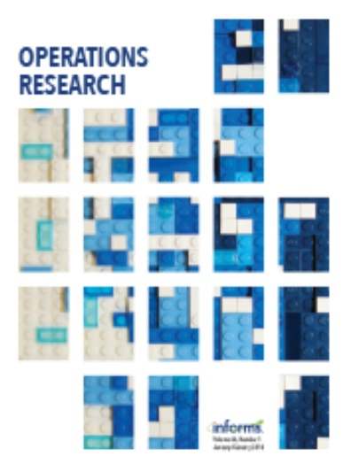
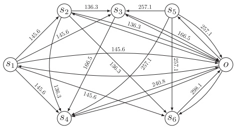

# VU Research Portal

**An exact solution framework for multitrip vehicle-routing problems with time windows** Paradiso, Rosario; Roberti, Roberto; Lagana, Demetrio; Dullaert, Wout

**published in** Operations Research 2020

**DOI (link to publisher)** [10.1287/OPRE.2019.1874](https://doi.org/10.1287/OPRE.2019.1874)

**document version** Publisher's PDF, also known as Version of record

**document license** Article 25fa Dutch Copyright Act

[**Link to publication in VU Research Portal**](https://research.vu.nl/en/publications/e1a3027f-e7fb-4a58-b3f7-53a12df75b81)

**citation for published version (APA)** Paradiso, R., Roberti, R., Lagana, D., & Dullaert, W. (2020). An exact solution framework for multitrip vehiclerouting problems with time windows. Operations Research, 68(1), 180-198. [https://doi.org/10.1287/OPRE.2019.1874](https://doi.org/10.1287/OPRE.2019.1874)

## General rights

Copyright and moral rights for the publications made accessible in the public portal are retained by the authors and/or other copyright owners and it is a condition of accessing publications that users recognise and abide by the legal requirements associated with these rights.

• Users may download and print one copy of any publication from the public portal for the purpose of private study or research.

• You may not further distribute the material or use it for any profit-making activity or commercial gain

• You may freely distribute the URL identifying the publication in the public portal ?

## Take down policy

If you believe that this document breaches copyright please contact us providing details, and we will remove access to the work immediately and investigate your claim.

**E-mail address: vuresearchportal.ub@vu.nl**

# Operations Research

Publication details, including instructions for authors and subscription information: [http://pubsonline.informs.org](http://pubsonline.informs.org)

# An Exact Solution Framework for Multitrip Vehicle-Routing Problems with Time Windows

Rosario Paradiso, Roberto Roberti, Demetrio Laganá, Wout Dullaert

**To cite this article:**

Rosario Paradiso, Roberto Roberti, Demetrio Laganá, Wout Dullaert (2020) An Exact Solution Framework for Multitrip Vehicle-Routing Problems with Time Windows. Operations Research 68(1):180-198. [https://doi.org/10.1287/opre.2019.1874](https://doi.org/10.1287/opre.2019.1874)

**Full terms and conditions of use:** [**https://pubsonline.informs.org/Publications/Librarians-Portal/PubsOnLine-Terms-and-Conditions**](https://pubsonline.informs.org/Publications/Librarians-Portal/PubsOnLine-Terms-and-Conditions)

This article may be used only for the purposes of research, teaching, and/or private study. Commercial use or systematic downloading (by robots or other automatic processes) is prohibited without explicit Publisher approval, unless otherwise noted. For more information, contact permissions@informs.org.

The Publisher does not warrant or guarantee the article’s accuracy, completeness, merchantability, fitness for a particular purpose, or non-infringement. Descriptions of, or references to, products or publications, or inclusion of an advertisement in this article, neither constitutes nor implies a guarantee, endorsement, or support of claims made of that product, publication, or service.

Copyright © 2020, INFORMS

**Please scroll down for article—it is on subsequent pages**

## inferms

With 12,500 members from nearly 90 countries, INFORMS is the largest international association of operations research (O.R.) and analytics professionals and students. INFORMS provides unique networking and learning opportunities for individual professionals, and organizations of all types and sizes, to better understand and use O.R. and analytics tools and methods to transform strategic visions and achieve better outcomes. For more information on INFORMS, its publications, membership, or meetings visit [http://www.informs.org](http://www.informs.org)

Contextual Areas

# An Exact Solution Framework for Multitrip Vehicle-Routing Problems with Time Windows

Rosario Paradiso,a Roberto Roberti,b Demetrio Lagana, ´ c Wout Dullaertb

a Department of Mathematics and Computer Science, University of Calabria, 87036 Arcavacata di Rende CS, Italy; b Department of Supply Chain Analytics, Vrije Universiteit Amsterdam, 1081 HV Amsterdam, Netherlands; c Department of Mechanical, Energy and Management Engineering, University of Calabria, 87036 Arcavacata di Rende CS, Italy

Contact: [rosario.paradiso@unical.it](mailto:rosario.paradiso@unical.it) (RP); [r.roberti@vu.nl](mailto:r.roberti@vu.nl), [https://orcid.org/0000-0002-2987-1593](https://orcid.org/0000-0002-2987-1593) (RR); [demetrio.lagana@unical.it](mailto:demetrio.lagana@unical.it), [https://orcid.org/0000-0003-2618-6715](https://orcid.org/0000-0003-2618-6715) (DL); [wout.dullaert@vu.nl](mailto:wout.dullaert@vu.nl) (WD)

Received: December 20, 2018 Revised: March 20, 2019 Accepted: April 3, 2019 Published Online in Articles in Advance: January 2, 2020

Subject Classifications: programming: integer: algorithms: branch-and-bound; programming: integer: applications; transportation: vehicle routing Area of Review: Transportation

[https://doi.org/10.1287/opre.2019.1874](https://doi.org/10.1287/opre.2019.1874)

Copyright: © 2020 INFORMS

Abstract. Multitrip vehicle-routing problems (MTVRPs) generalize the well-known VRP by allowing vehicles to perform multiple trips per day. MTVRPs have received a lot of attention lately because of their relevance in real-life applications—for example, in city logistics and last-mile delivery. Several variants of the MTVRP have been investigated in the literature, and a number of exact methods have been proposed. Nevertheless, the computational results currently available suggest that MTVRPs with different side constraints require ad hoc formulations and solution methods to be solved. Moreover, solving instances with just 25 customers can be out of reach for such solution methods. In this paper, we proposed an exact solution framework to address four different MTVRPs proposed in the literature. The exact solution framework is based on a novel formulation that has an exponential number of variables and constraints. It relies on column generation, column enumeration, and cutting plane. We show that this solution framework can solve instances with up to 50 customers of four MTVRP variants and outperforms the state-of-the-art methods from the literature.

Supplemental Material: The online appendix is available at [https://doi.org/10.1287/opre.2019.1874](https://doi.org/10.1287/opre.2019.1874).

Keywords: multitrip vehicle routing • time windows • column generation • exact methods • dynamic programming

## 1. Introduction

Most of the literature on the vehicle-routing problem (VRP) addresses problems where each vehicle is limited to perform at most one trip per day. The first attempt to investigate VRPs where vehicles are allowed to perform multiple trips dates back to Fleischmann (1990). Since then, many contributions on multitrip vehicle-routing problems (MTVRPs) have been published, especially in the last decade, as observed in the recent survey of Cattaruzza et al. (2016b). Such an increasing interest in MTVRPs is due, for example, to the need of new practices in city logistics and last-mile delivery. The demand of limiting noise and pollution in city centers requires the usage of small vans, electric vehicles, and/or unmanned aerial vehicles (commonly known as drones) and forbids heavy large trucks from entering city centers. The limited capacity and autonomy of these small vehicles force them to perform multiple trips and to return to the depot to reload multiple times over the day.

In the literature, MTVRPs with different features are addressed in different papers, and a wide range of solution methods (both exact and heuristic) have been proposed. Nevertheless, we can identify a common underlying problem, the capacitated MTVRP with time windows (CMTVRPTW), that is a special case of the problems investigated in many papers, such as Hernandez et al. (2014, 2016), Cattaruzza et al. (2016a), and Cheng et al. (2018). The features of this CMTVRPTW are the following: (a) The goal is to minimize the routing costs; (b) all customers must be served; (c) multiple homogeneous vehicles are available; (d) vehicles are capacitated; and (e) time window constraints are imposed on the customer visits. Yet different papers consider additional side constraints on top of the CMTVRPTW, such as loading times to reload the vehicles at the depot (Hernandez et al. 2014, 2016), limited trip duration (Hernandez et al. 2014), release date on the availability of the goods to deliver (Cattaruzza et al. 2016a), drone battery capacity, and load-dependent battery consumption (Cheng et al. 2018). These four side constraints give rise to four different problems—namely, the CMTVRPTW with loading times(CMTVRPTW-LT), the CMTVRPTW with limited trip duration (CMTVRPTW-LD), the CMTVRPTW with release dates (CMTVRPTW-R), and the drone-routing problem (DRP), respectively. For the sake of brevity, in the following, we will refer to these four problems as “the four variants of the CMTVRPTW.”

The exact methods currently available for these four variants of the CMTVRPTW are based on several different mathematical formulations, which makes it unclear which formulation is most suitable to solve a CMTVRPTW. Moreover, in spite of the effort devoted to develop exact solution methods for CMTVRPTWs, the literature indicates that small instances with 25 customers cannot be consistently solved, and it could take a few hours of computing time to solve them.

With this paper, we aim at closing part of this research gap. We propose an exact solution framework (hereafter referred to as ESF) based on a novel mathematical model that can solve medium-sized instances with up to 50 customers of the four variants of the CMTVRPTW, significantly outperforming the state-of-the-art exact methods tailored for the single variants. We describe the ESF by focusing on the CMTVRPTW, and we show later how it can be tailored to solve the four variants by simply adapting one of its steps. The main contributions of this paper are the following: (a) We propose a novel mathematical model with an exponential number of variables and constraints that is valid for the CMTVRPTW and its four variants; (b) we describe two relaxations of this mathematical model that provide good lower bounds and can be efficiently computed; (c) we describe a seven-step ESF for the CMTVRPTW based on these two lower bounds and on a branch-and-cut algorithm, with an embedded branch-and-price to separate violated inequalities, to close the gap; (d) we illustrate how the ESF can be applied to solve each of the four variants of the CMTVRPTW by simply specializing one of the seven steps; and (e) we provide a computational proof that the ESF can solve instances with up to 50 customers and outperforms the state-of-the-art exact methods for the four individual variants of the CMTVRPTW.

The paper is organized as follows. Section 2 reviews the main contributions from the literature on exact methods for MTVRP with time windows. Section 3 formally introduces the CMTVRPTW and presents two column-generation-based formulations from the literature. Section 4 describes the novel formulation for the CMTVRPTW and its variants. Section 5 presents two lower bounds derived from the novel formulation. Section 6 provides an outline of the ESF and describes how to apply it to solve the CMTVRPTW. Section 7 describes the steps of the ESF in detail. Section 8 illustrates how the ESF can be tailored to solve each of the four variants of the CMTVRPTW. A computational analysis to show the effectiveness of the ESF and a comparison of its performance with the literature is provided in Section 9. Finally, conclusions are drawn in Section 10.

## 2. Literature Review

This section reviews the main exact methods proposed for MTVRPs with time windows. For the sake of brevity, we omit contributions on exact methods for MTVRPs without time windows and on heuristic methods. For a recent overview of the literature on these two topics, the reader is referred to Cattaruzza et al. (2016b).

In the remainder of the paper, we refer to a structure as a sequence of customers that can be visited consecutively by a vehicle between two visits at the depot, such that capacity constraints (and possibly other side constraints) are fulfilled and a departure time from the depot can be scheduled in such a way that all time windows are satisfied. Moreover, following the convention of Cattaruzza et al. (2016b), we refer to a trip as a structure with a fixed departure time from the depot, and we refer to a journey as a sequence of nonoverlapping trips assigned to the same vehicle. It is worth mentioning that, as stated in Cattaruzza et al. (2016b), different authors use different terms to refer to trips and journeys.

Azi et al. (2007) study a single-vehicle variant of the CMTVRPTW where it is not mandatory to serve all customers and the objective function is first to maximize the number of customers served and second to minimize the routing cost. Moreover, a limited trip-duration constraint (called deadline constraint) on the maximum time that the goods can stay on board before they are delivered at customers and a setup time to load the vehicle are considered. They propose a two-phase exact algorithm. In the first phase, all feasible nondominated trips are generated by complete enumeration, which is possible when time windows and limited trip-duration constraints are tight. In the second phase, feasible routes are generated by combining the trips generated in the first phase. The algorithm is tested on a set of instances adapted from the well-known Solomon instances for the VRPTW (Solomon 1987) with up to 100 customers. The results show that the algorithm is very sensitive to the limited trip-duration constraint. Indeed, if this constraint is not tight, it is impossible to enumerate all feasible trips in the first phase.

Azi et al. (2010) investigate the multivehicle version of the problem considered in Azi et al. (2007). The authors propose a branch-and-price algorithm based on a set-packing formulation, where each column represents a feasible journey. The pricing problem corresponds to an elementary shortest-path problem with resource constraints (ESPPRC). The algorithm is tested on instances with 25 and 40 customers derived from the Solomon VRPTW instances. The results show that instances with 25 customers can be routinely solved, but the complexity of the problem strongly depends on the tightness of limited trip-duration constraints.

Macedo et al. (2011) study the same problem of Azi et al. (2010). They propose an iterative two-phase algorithm. In the first phase, all feasible trips are generated. The second phase corresponds to a pseudopolynomial network flow model where nodes represent time instants and arcs represent feasible vehicle trips and is solved using a commercial solver. To create the network, a time discretization is needed. The model is iteratively solved until the current discretization provides a feasible solution. Computational results show that the proposed algorithm outperforms the two-phase method of Azi et al. (2010).

Hernandez et al. (2014) address the CMTVRPTW-LD, which differs from the problem considered in Azi et al. (2010) and Macedo et al. (2011) in that all customers must be served and the objective function aims at minimizing the total routing cost. They propose a two-phase exact algorithm. In the first phase, all feasible structures are enumerated by considering resource constraints. The second phase is a branchand-price algorithm based on a set covering formulation with side constraints, where columns represent trips and side constraints guarantee that each vehicle is assigned nonoverlapping trips. The pricing problem can be solved in pseudo-polynomial time. The algorithm is tested on instances with 25 and 40 customers as in Azi et al. (2010) and Macedo et al. (2011). The computational results show that the algorithm of Hernandez et al. (2014) performs, on average, better than the method of Azi et al. (2010) and, on some instances, better than the method of Macedo et al. (2011).

The problem studied in Hernandez et al. (2016) differs from the problem of Hernandez et al. (2014) in that limited trip duration is not considered. Two branch-and-price exact algorithms are proposed, both based on a set covering formulation. In the first formulation, each column represents a journey, and the pricing problem is an ESPPRC, which can be solved by dynamic programming. In the second formulation, each column represents a trip, and additional side constraints guarantee the feasibility of the solutions; the pricing problem can again be solved by dynamic programming, where the concepts of group of labels and representative labels are exploited. Computational results on 25-customer instances show that the second branch-and-price, based on the tripformulation, performs better than the first.

Recent contributions in the literature investigate the usage of truck–drone tandem systems and droneonly systems to deliver parcels. In particular, drones can perform multiple trips to deliver parcels by flying from/to trucks and depots where they can recharge their battery and pick up packages to deliver. The first significant contribution devoted to exact methods for drone-routing problems is owed to Cheng et al. (2018). They propose two mathematical formulations to solve the (multitrip) drone-routing problem. The objective function also takes energy consumption into account in the routing cost. The first formulation is based on drone-index variables, whereas the second formulation does not use such a drone index. Both formulations are strengthened by valid inequalities. The authors develop two branch-and-cut algorithms that are able to solve new benchmark instances with up to 50 customers. Their computational study shows that the formulation without the drone index outperforms the one with the drone index in terms of number of instances solved to optimality and computing time.

## 3. Description of the CMTVRPTW and Formulations from the Literature

In this section, we formally introduce the CMTVRPTW, which is used in the following sections to describe the ESF, and describe the two column-generation-based formulations from the literature.

The CMTVRPTW can be represented on a directed graph $G = \left( V , A \right)$ . The vertex set $V = \{ 0 \} \cup N$ consists of n + 1 vertices, where 0 represents the depot and $N = \{ 1 , 2 , \cdots , n \}$ represents a set of n customers to serve. For each customer $i \in N ,$ the demand $q _ { i } ,$ the service time $s t _ { i } ,$ and a (hard) time window $[ a _ { i } , \hat { b } _ { i } ]$ are given. A time window $[ a _ { 0 } , b _ { 0 } ]$ is associated with the depot. For the depot, we assume that $q _ { 0 } = 0$ and $s t _ { 0 } = 0$ . The arc set A is defined as $A = \{ ( i , \stackrel { \leftrightarrow } { j ) } \vert   i , j \in V :$ $a _ { i } + t _ { i j } + s t _ { i } \leq b _ { j } \}$ , where $t _ { i j }$ is the travel time from vertex i to vertex j—without loss of generality, we assume that $t _ { i j } \leq t _ { i k } + s t _ { k } + t _ { k j } ,$ for all $i , j , k \in V$ such that $i \neq j \neq k .$ . A travel cost $c _ { i j }$ is also associated with each arc $( i , j ) \in A$ . Customers can be served by using a fleet of m vehicles, each one of capacity $\overline { { q } } ,$ that are located at the depot.

A trip h is represented as $h = ( 0 , i _ { 1 } , i _ { 2 } , \cdots , i _ { \mu _ { h } } , 0 ) ,$ where $\mu _ { h }$ is the number of visited customers. A journey r is represented as a sequence of nonoverlapping trips $\boldsymbol{r} = \left( 0, i_1, i_2, \cdots, i_{\mu_{r_1}}, 0, i_1, i_2, \cdots, i_{\mu_{r_2}}, 0, \cdots, 0 \right)$

The goal of the CMTVRPTW is to find a set of at most m journeys of minimum total cost such that each customer is visited exactly once.

In the literature, two formulations with an exponential number of variables have been proposed: a trip-based formulation (see Hernandez et al. 2016) and a journey-based formulation (see Hernandez et al. 2014, 2016).

Let \* be the set of all feasible trips, and let $c _ { h }$ be the cost of trip $h \in \mathcal { H }$ given by the sum of the traversed arcs. A trip $h \in \mathcal { H }$ is described by coefficients $\alpha _ { i h }$ indicating the number of times trip h visits customer $i \in$ N and by binary coefficients $\tau _ { t h }$ that are equal to 1 if trip h is active at time $t \in [ a _ { 0 } , b _ { 0 } ]$ , where active means that the vehicle performing trip h is either traveling between two vertices or serving/waiting at a customer. Let $x _ { h } \in \{ 0 , 1 \}$ be a binary variable equal to 1 if trip $h \in \mathcal { H }$ is selected (0 otherwise). The trip-based formulation, $\operatorname { F } _ { \mathcal { H } } ,$ is the following:

$$
z (\mathrm{F} _ {\mathcal {H}}) = \min \sum_ {h \in \mathcal {H}} c _ {h} x _ {h},\tag{1a}
$$

$$
\text {s.t.} \sum_ {h \in \mathcal {H}} \alpha_ {i h} x _ {h} = 1 \quad \quad \quad i \in N,\tag{1b}
$$

$$
\sum_ {h \in \mathcal {H}} \tau_ {t h} x _ {h} \leq m \quad t \in [ a _ {0}, b _ {0} ],\tag{1c}
$$

$$
x _ {h} \in \{0, 1 \} \quad h \in \mathcal {H}.\tag{1d}
$$

The objective function (1a) aims at minimizing the cost of the selected trips. Constraints (1b) ensure that each customer is visited exactly once. Constraints (1c) guarantee that at most, m trips are active at any point in time. Constraints (1d) are integrality constraints.

Let 5 be the set of all feasible journeys. Moreover, let $c _ { r }$ be the cost of journey $r \in \mathcal { R }$ given by the sum of the costs of its individual trips, and let $\alpha _ { i r }$ be a co-efficient indicating the number of times journey $r \in \mathfrak { R }$ visits customer $i \in N .$ Let $x _ { r } \in \{ 0 , 1 \}$ be a binary variable equal to 1 if journey $r \in \mathcal { R }$ is selected (0 otherwise). The journey-based formulation, $\mathrm { F } _ { \mathcal { R } }$ , is the following:

$$
z (\mathrm{F} _ {\mathcal {R}}) = \min \sum_ {r \in \mathcal {R}} c _ {r} x _ {r},\tag{2a}
$$

$$
\text {s.t.} \sum_ {r \in \mathcal {R}} \alpha_ {i r} x _ {r} = 1 \quad i \in N,\tag{2b}
$$

$$
\sum_ {r \in \mathscr {R}} x _ {r} \leq m,\tag{2c}
$$

$$
x _ {r} \in \{0, 1 \} \quad r \in \mathcal {R}.\tag{2d}
$$

The objective function (2a) aims at minimizing the cost of the selected journeys. Constraints (2b) ensure that each customer is visited exactly once. Constraint (2c) guarantees that at most m journeys are selected. Constraints (2d) are integrality constraints.

Both formulations $\mathrm { F } \mathcal { H }$ and $\mathrm { F } _ { \mathcal { R } }$ have an exponential number of variables that cannot be enumerated a priori, even for small instances. Therefore, both formulations can be used to solve the CMTVRPTW only if a column-generation framework is applied. Earlier contributions from the literature (see, e.g., Azi et al. 2010 and Hernandez et al. 2014, 2016) show that the lower bound provided by the linear relaxation of both formulations is of high quality. Nevertheless, solving the pricing problem of both formulations is particularly challenging, so it could take hours of computing time to find an optimal solution, even for instances with only 25 customers.

4. The Novel Structure-Based Formulation Because of the computational complexity of using formulations $\mathrm { F } \mathcal { H }$ and $\operatorname { F } _ { \mathcal { D } _ { i } }$ , we introduce a novel structurebased formulation that has an exponential number of variables and constraints, but involves much fewer variables than both $\mathrm { F } \mathcal { H }$ and $\mathrm { F } _ { \mathcal { R } }$

Let a structure $s = \left( 0 , i _ { 1 } , i _ { 2 } , \cdots , i _ { \mu _ { s } } , 0 \right)$ be an ordered set of $\mu _ { s }$ customers that can be visited by a vehicle in between two visits at the depot and can start from the depot within a time interval $[ e _ { s } , \ell _ { s } ] _ { , }$ , such that: $\mathrm { ( i ) } ~ \mathrm { C a } \cdot$ pacity constraints are satisfied; (ii) the duration $d _ { s }$ and the cost $c _ { s }$ are constant for each departure time from the depot within $[ e _ { s } , \ell _ { s } ] ;$ and (iii) the duration $d _ { s }$ is the minimum duration to serve the set of customers in the given order. Let $\mathcal { P }$ be the set of all feasible structures, and let $\alpha _ { i s }$ be a coefficient equal to the number of times customer $i \in N$ is served by structure $s \in \mathcal { P }$ . Let $x _ { s }$ ∈ $\{ 0 , 1 \}$ be a binary variable equal to 1 if structure s ∈ $\mathcal { P }$ is selected (0 otherwise). The structure-based formulation, $\mathrm { F } _ { \mathcal { P } } ,$ is the following:

$$
z (\mathrm{F} _ {\mathcal {S}}) = \min \sum_ {s \in \mathcal {S}} c _ {s} x _ {s},\tag{3a}
$$

$$
\text {s.t.} \sum_ {s \in \mathscr {S}} \alpha_ {i s} x _ {s} = 1 \quad \quad \quad i \in N,\tag{3b}
$$

$$
\sum_ {s \in \widehat {\mathscr {S}}} x _ {s} \leq \eta_ {m} (\widehat {\mathscr {S}}) \quad \widehat {\mathscr {S}} \subseteq \mathscr {S},\tag{3c}
$$

$$
x _ {s} \in \{0, 1 \} \quad s \in \mathscr {S},\tag{3d}
$$

where $\eta _ { m } ( \widehat { \mathcal { G } } )$ is the maximum number of structures of the set $\widehat { \mathcal { I } }$ that can be simultaneously in a solution ̂given the number of vehicles $m .$

The objective function (3a) aims at minimizing the cost of the selected structures. Constraints (3b) ensure that each customer is visited exactly once. Constraints (3c) (hereafter called structure feasibility constraints (SFCs)) guarantee that the set of selected structures can be performed by the m vehicles. Constraints (3d) are integrality constraints.

Notice that the number of variables of $\mathrm { F } _ { \mathcal { P } }$ can be significantly lower than the number of variables of F\* and, in turn, of $\mathrm { F } _ { \mathcal { R } }$ . Indeed, formulation $\mathrm { F } \mathcal { H }$ has a binary variable for each structure $s \in \mathcal { P }$ and each instant of time $t \in [ e _ { s } , \ell _ { s } ]$ . Moreover, each feasible solution of $\mathrm { F } _ { \mathcal { P } }$ can correspond to multiple (possibly an infinite number of) solutions of formulation $\mathrm { F } \mathcal { H }$ . Indeed, given the set of structures of a feasible solution of $\operatorname { F } _ { \mathcal { P } } ,$ it is possible to obtain a feasible solution of $\mathrm { F } \mathcal { H }$ by fixing the departure time from the depot of each of these structures within the corresponding time interval $[ e _ { s } , \ell _ { s } ]$

## 5. Lower Bounds Based on the Structure-Based Formulation

In this section, we describe two lower bounds derived from formulation $\mathrm { F } _ { \mathcal { P } }$ that are used by the ESF and are described in the following sections. The first lower bound is based on a continuous relaxation of $\mathrm { F } _ { \mathcal { P } }$ that ignores SFC and therefore provides a lower bound for the CVRPTW without the multitrip feature. The second lower bound is based on a relaxed version of SFC that can be enumerated by inspection.

## 5.1. First Lower Bound: CVRPTW Lower Bound

The first lower bound, which we call CVRPTW-LB in the following, corresponds to the optimal solution of the linear relaxation of formulation $\mathrm { F } _ { \mathcal { P } }$ without SFC—that is, it corresponds to the optimal value $z ( \mathrm { P 1 } _ { \mathcal { G } } )$ of the following problem $\mathrm { P 1 } _ { \mathcal { G } } \mathrm { : }$

$$
z (\mathrm{P1} _ {\mathscr {S}}) = \min \sum_ {s \in \mathscr {S}} c _ {s} x _ {s},\tag{4a}
$$

$$
\text {s.t.} \sum_ {s \in \mathscr {F}} \alpha_ {i s} x _ {s} = 1 \quad i \in N,\tag{4b}
$$

$$
x _ {s} \in \mathbb {R} _ {+} \quad s \in \mathcal {S}.\tag{4c}
$$

As $\mathrm { P 1 } _ { \mathcal { F } }$ is the continuous relaxation of a set-partitioning problem that does not consider SFC, it provides a lower bound to a VRP with capacity and time window constraints.

## 5.2. Second Lower Bound: Relaxed SFC Lower Bound

The second lower bound, which we call RSFC-LB in the following, is obtained from $\mathrm { F } _ { \mathcal { P } }$ by replacing SFC with a relaxed version and by adding a set of valid inequalities as follows.

Let $\tau _ { h s } \in \{ 0 , 1 \}$ be a binary coefficient defined for each structure $s \in \mathcal { P }$ and each instant of time $h \in [ a _ { 0 } , b _ { 0 } ]$ as follows:

$$
\tau_ {h s} = \left\{ \begin{array}{l l} 1 & \text {if} \ell_ {s} <   h <   e _ {s} + d _ {s} \\ 0 & \text {otherwise;} \end{array} \right.
$$

that is, $\tau _ { h s }$ is equal to 1 if structure $s \in \mathcal { P }$ is active at time h for any possible departure time from the depot. $\mathrm { A }$ relaxed version of SFC (hereafter referred to as relaxed SFC, or, in short, RSFC) is therefore given by

$$
\text {(RSFC)} \quad \sum_ {s \in \mathcal {S}} \tau_ {h s} x _ {s} \leq m \quad h \in [ a _ {0}, b _ {0} ],\tag{5}
$$

which indicate that, at any point in time, at most m structures (and thus vehicles) can be active.

To better explain constraints (5), let us consider two structures $s _ { 1 } , s _ { 2 } \in \mathcal { F }$ with the following features: $[ e _ { s _ { 1 } } , \ell _ { s _ { 1 } } ] = [ 1 0 , 2 0 ] ,   d _ { s _ { 1 } } = 1 5 ,   [ e _ { s _ { 2 } } , \ell _ { s _ { 2 } } ] = [ 1 8 , 2 2 \bar { ] } ,   d _ { s _ { 2 } } = 1 0 .$ The only coefficients $\tau _ { h s }$ equal to 1, for structure s1, are $\tau _ { 2 1 , s _ { 1 } } ,   \tau _ { 2 2 , s _ { 1 } } ,$ and $\tau _ { 2 3 , s _ { 1 } } ,   \tau _ { 2 4 , s _ { 1 } } ,$ and, for structure $s _ { 2 } ~ \tau _ { 2 3 , s _ { 2 } } ,$ $\tau _ { 2 4 , s _ { 2 } } , ~ \tau _ { 2 5 , s _ { 2 } } , ~ \tau _ { 2 6 , s _ { 2 } } ,$ and $\tau _ { 2 7 , s _ { 2 } }$ . Therefore, of all constraints (5) with $h \in [ 2 1 , 2 7 ]$ , the tightest constraints are those with $h = 2 3 , 2 4$ that are $x _ { s _ { 1 } } + x _ { s _ { 2 } } \leq m$

RSFC-LB also uses a subset of the well-known subset-row (SR) inequalities, introduced by Jepsen et al. (2008) for the VRPTW. In particular, for each triplet of customers $\{ i , j , k \} \in N$ and for each structure $s \in { \mathcal { G } } ,$ let $\beta _ { i j k s }$ be a binary coefficient defined as

$$
\beta_ {i j k s} = \left\{ \begin{array}{l l} 1 & \text {if} \alpha_ {i s} + \alpha_ {j s} + \alpha_ {k s} \geq 2 \\ 0 & \text {otherwise,} \end{array} \right.
$$

which is, $\beta _ { i j k s }$ is equal to 1 if at least two of the customers of the set $\{ i , j , k \}$ are visited by structure s (0 otherwise). SR inequalities are defined as

$$
\sum_ {s \in \mathcal {S}} \beta_ {i j k s} x _ {s} \leq 1 \quad \{i, j, k \} \in N.\tag{6}
$$

RSFC-LB corresponds to the optimal value $z ( \mathrm { P } 2 \mathcal { g } )$ of the following problem $\mathrm { P } 2 { \scriptstyle { \mathcal { G } } } \mathrm { : }$

$$
z (\mathrm{P2} _ {\mathcal {S}}) = \min \sum_ {s \in \mathcal {S}} c _ {s} x _ {s},\tag{7a}
$$

$$
\text {s.t.} \sum_ {s \in \mathscr {S}} \alpha_ {i s} x _ {s} = 1 \quad \quad \quad \quad i \in N,\tag{7b}
$$

$$
\sum_ {s \in \mathcal {G}} \tau_ {h s} x _ {s} \leq m \qquad h \in [ a _ {0}, b _ {0} ],\tag{7c}
$$

$$
\sum_ {s \in \mathcal {G}} \beta_ {i j k s} x _ {s} \leq 1 \quad \{i, j, k \} \in N,\tag{7d}
$$

$$
x _ {s} \in \mathbb {R} _ {+} \quad s \in \mathcal {S}.\tag{7e}
$$

## 6. Outline of the ESF

This section provides an outline of the ESF described for the CMTVRPTW. We assume that a feasible solution of the CMTVRPTW exists. The algorithm uses the following notation:

${ u b } ^ { * }$ is the best upper bound (if any) found;

• $u b _ { g u e s s }$ is a guess upper bound on the value of the optimal solution cost;

$g a p _ { g u e s s }$ is a guess on the gap in percentage between the optimal CMTVRPTW solution cost and CVRPTW-LB;

$g a p _ { g u e s s } ^ { 0 }$ is the initial value of $g a p _ { g u e s s } ;$

$g a p _ { s t e p }$ is the increase, at each iteration, of $g a p _ { g u e s s } ;$

• status is the status of the solution process, which can take one of the following three values: optimal $( \mathrm { i . e . } ,$ an optimal solution of cost ${ u b } ^ { * }$ was found), feasible (i.e., a feasible solution of cost ${ u b } ^ { * }$ was found, but it may not be optimal), and nil (i.e., no solution has been found yet).

The algorithm consists of the following seven steps: 1. Initialization: Set status  nil and $g a p _ { g u e s s } =$ $g a p _ { g u e s s } ^ { 0 } .$

2. CVRPTW-LB Computation (see Section 5.1 for an overview and Section 7.1 for the details): Solve problem $\mathrm { P 1 } _ { \mathcal { P } }$ by column generation and compute its optimal solution cost $z ( \mathrm { P 1 } _ { \mathcal { I } } ) ;$ set $u b _ { g u e s s } = z ( \mathrm { P 1 } _ { \mathcal { G } } ) *$ $( 1+gap_{gures} );$

3. Structure Enumeration (see Section 7.2 for the details): Enumerate the set $\mathcal { P } _ { 1 }$ of all the structures having reduced costs not greater than $u b _ { g u e s s } - z ( \mathrm { P 1 } _ { \mathcal { G } } )$ with respect to the dual solution corresponding to lower bound $z ( \mathrm { P 1 } _ { \mathcal { G } } ) ;$

4. RSFC-LB Computation (see Section 5.2 for an overview and Section 7.3 for the details): Solve problem $\mathrm { P 2 } \mathcal { g } _ { 1 }$ obtained from $\mathrm { P 2 } \mathcal { g }$ by replacing the set of structures $\mathcal { P }$ with its subset $\mathcal { P } _ { 1 }$ . Let $\left[ z ( \mathrm { P } 2 \varphi _ { \mathrm { _ 1 } } \right)$ be the optimal cost of $\mathrm { P 2 } _ { \mathcal { G } }$

5. Structure Reduction (see Section $7 . 4 )$ : Compute the set of structures $\mathcal { P } _ { 2 } \subseteq \mathcal { P } _ { 1 }$ obtained from $\mathcal { P } _ { 1 }$ by removing all the structures having reduced cost greater than $u b _ { g u e s s } - z ( \mathrm { P 2 } _ { \mathcal { G } _ { 1 } } )$ with respect to the dual solution of cost $z ( \mathrm { P 2 } _ { \mathcal { G } _ { 1 } } )$ of problem $\mathrm { P 2 } _ { \mathcal { G } _ { 1 } }$

6. Branch-and-Cut to Close the Gap (see Section 7.5): By using a branch-and-cut method, solve problem $\mathrm { F } \mathcal { g } _ { 2 }$ obtained from $\mathrm { F } _ { \mathcal { P } }$ by replacing the set of structures $\mathcal { P }$ with its subset $\mathcal { P } _ { 2 }$ . If $\mathbb { F } _ { \mathcal { P } _ { 2 } }$ contains feasible solutions, let $z ( \mathrm { F } _ { \mathcal { G } _ { 2 } } )$ be the cost of an optimal solution.

7. Iterative Step: There are three possible cases:

(a) A feasible solution of $\mathrm { F } \mathcal { g } _ { 2 }$ exists

(a1) $If $z ( \mathbb { F } _ { \mathcal { G } _ { 2 } } ) \leq u b _ { g u e s s } \colon$$ such a solution is an optimal CMTVRPTW solution; set status  optimal, $\boldsymbol { u } \dot { \boldsymbol { b } } ^ { * } = \boldsymbol { z } ( \mathrm { F } _ { \mathcal { G } _ { 2 } } )$ , and terminate;

(a2) $\operatorname { I f } z ( \mathbb { F } _ { \mathcal { G } _ { 2 } } )   >   u b _ { g u e s s } \colon$ such a solution is a valid upper bound to the CMTVRPTW; set status  feasible, $u \widehat { \boldsymbol { b } ^ { * } } = z ( \mathrm { F } _ { \mathcal { G } _ { 2 } } ) ,   u b _ { g u e s s } = z ( \mathrm { F } _ { \mathcal { G } _ { 2 } } )$ , and go to Step 3;

(b) $\mathbb { F } _ { \mathcal { P } _ { 2 } }$ does not have any feasible solution: set $g a p _ { g u e s s }   =   g a p _ { g u e s s }   +   g a p _ { s t e p } ,   u b _ { g u e s s }   =   z ( \mathrm { P 1 } _ { \mathcal { G } } )   *   ( 1   +   g a p _ { g u e s s } ) ,$ and go to Step 3.

## 7. Detailed Description of Steps 2–6 of the ESF

## 7.1. Step 2: CVRPTW-LB Computation

Step 2 of the ESF requires solving problem $\mathrm { P 1 } _ { \mathcal { F } }$ to compute its optimal value $z ( \mathrm { P 1 } _ { \mathcal { G } } )$ . As the set of structures $\mathcal { P }$ increases exponentially with the number of customers, problem $\bar { \mathrm { P i } } _ { \mathcal { F } }$ must be solved via column generation. The column-generation procedure we propose initializes the master problem with the singlecustomer structures and solves it via a general-purpose solver. At each iteration, at most col iter (where col iter is a parameter) negative reduced-cost structures are added to the master problem. Such negative reducedcost structures are priced out by using dynamic programming as follows.

Let $u _ { i } \in \mathbb { R }$ be the dual variable associated with constraint (4b) of customer $i \in N . \operatorname { L e t } \tilde { c } _ { i j }$ be the reduced cost of arc $( i , j ) \in A$ with respect to $\stackrel { \cdot } { u \in \mathbb { R } ^ { n } }$ defined as

$$
\tilde {c} _ {i j} = \left\{ \begin{array}{l l} c _ {i j} - \frac {1}{2} (u _ {i} + u _ {j}) & \text {if} i \neq 0 \text {and} j \neq 0 \\ c _ {i j} - \frac {1}{2} u _ {j} & \text {if} i = 0 \\ c _ {i j} - \frac {1}{2} u _ {i} & \text {otherwise (i.e., if} j = 0). \end{array} \right.\tag{8}
$$

Let $f = ( 0 , i _ { 1 } , \cdots , i _ { \mu _ { f } } = i ^ { f } )$ be an elementary forward path that starts from the depot at time $a _ { 0 } ,$ visits the set of customers $N ^ { f } = \{ i _ { 1 } , \cdots , i ^ { f } \}$ each within its time window, ends at customer $i ^ { f }$ at time $t ^ { f } ,$ such that the total demand $q ^ { f }$ of the visited customers does not exceed the vehicle capacity. Let $\tilde { c } ^ { f }$ be the reduced cost of path $f ,$ defined as the sum of the reduced costs of the traversed arcs.

We associate a label $L ^ { f } = ( N ^ { f } , q ^ { f } , t ^ { f } , i ^ { f } , \tilde { c } ^ { f } )$ with each path $f = ( 0 , i _ { 1 } , \cdots , i ^ { f } )$ . Because of capacity and time window constraints, a label $L ^ { f } = ( \dot { N } ^ { f } , q ^ { f } , t ^ { f } , i ^ { f } , \tilde { c } ^ { f } )$ is feasible only if $N ^ { f } \subseteq N , \quad q ^ { f } \leq \overline { { { q } } } , \quad t ^ { f } \in \dot { [ } a _ { i ^ { f } } , b _ { i ^ { f } } ] ,$ , and $i ^ { f } \in N ^ { f }$ . Clearly, each path $f = ( 0 , i _ { 1 } , \cdots , i ^ { f } )$ such that $i ^ { f } = 0$ and $\dot { c ^ { f } } < 0$ corresponds to a negative reducedcost structure.

To generate such structures, the following initialization and extension are needed:

Initialization: $\mathrm { A }$ single label $L ^ { f } = ( N ^ { f } , q ^ { f } , t ^ { f } , i ^ { f } , \tilde { c } ^ { f } )$ is generated, where $N ^ { f } = \emptyset , \; q ^ { f } = 0 , \; t ^ { f } = a _ { 0 } , \; i ^ { f } = 0 ,$ and $\tilde { \tilde { c } } ^ { f } = 0$

Extension: Extend each label $L ^ { f } = ( N ^ { f } , q ^ { f } , t ^ { f } , i ^ { f } , \tilde { c } ^ { f } )$ such that either $( \mathsf { a } ) i ^ { f } \in N { \mathrm { o r } } ( \mathsf { b } ) i ^ { f } = 0$ and $N ^ { f } = \emptyset$ toward any vertex $j \in V \setminus N ^ { f }$ and generate label $L ^ { f ^ { \prime } } = ( N ^ { f ^ { \prime } } , \tilde { q ^ { f ^ { \prime } } } , t ^ { f ^ { \prime } } , i ^ { f ^ { \prime } } , \tilde { c } ^ { \tilde { f ^ { \prime } } } )$ , where

$$
\left\{ \begin{array}{l} N ^ {f ^ {\prime}} = N ^ {f} \cup \{j \} (\text {if} j \in N) \text {or} N ^ {f ^ {\prime}} = N ^ {f} (\text {if} j = 0) \\ q ^ {f ^ {\prime}} = q ^ {f} + q _ {j} \\ t ^ {f ^ {\prime}} = \max \{a _ {j}, t ^ {f} + s t _ {i f} + t _ {i f j} \} \\ i ^ {f ^ {\prime}} = j \\ \tilde {c} ^ {f ^ {\prime}} = \tilde {c} ^ {f} + \tilde {c} _ {i f j}. \end{array} \right.
$$

To speed up the solution process and limit the number of labels to generate, the following dominance rule can be applied: Given two labels $L ^ { f _ { 1 } } = ( N ^ { f _ { 1 } } , q ^ { f _ { 1 } } , t ^ { f _ { 1 } } , i ^ { f _ { 1 } } , \tilde { c } ^ { f _ { 1 } } )$ and $L ^ { f _ { 2 } } = ( N ^ { f _ { 2 } } , q ^ { f _ { 2 } } , t ^ { f _ { 2 } } , i ^ { f _ { 2 } } , \tilde { c } ^ { f _ { 2 } } ) ,$ $L ^ { f _ { 2 } }$ is dominated if $N ^ { f _ { 1 } } \subseteq N ^ { f _ { 2 } } ,   q ^ { f _ { 1 } } \leq q ^ { \dot { f _ { 2 } } } ,   t ^ { f _ { 1 } } \stackrel { \prime } { \leq } t ^ { f _ { 2 } } ,   i ^ { f _ { 1 } } = i ^ { \dot { f _ { 2 } } } ,$ and $\tilde { c } ^ { f _ { 1 } } \leq \tilde { c } ^ { f _ { 2 } }$ . Moreover, we also apply two other wellknown techniques—that $\mathrm { i s } ,$ ng-path relaxation (see Baldacci et al. 2011) and completion bounds (see Baldacci et al. 2012)—to further limit the number of labels to generate. For the sake of brevity, we omit the details on this matter.

Let $\boldsymbol { u } ^ { 1 } = ( u _ { 1 } ^ { 1 } , u _ { 2 } ^ { 1 } , \cdots , u _ { n } ^ { 1 } )$ be the optimal dual solution of cost $z ( \mathrm { P 1 } _ { \mathcal { G } } )$ achieved by Step 2.

## 7.2. Step 3: Structure Enumeration

Step 3 requires enumerating the set $\mathcal { P } _ { 1 }$ all the structures having reduced costs not greater than $u b _ { g u e s s } -$ $z ( \mathrm { P 1 } _ { \mathcal { G } } )$ with respect to the dual solution $u ^ { 1 }$ of cost $z ( \mathrm { P 1 } _ { \mathcal { G } } )$ . The set $\bar { \mathcal { P } } _ { 1 }$ can be generated with the following dynamic programming recursion, which is similar to the recursions proposed by Hernandez et al. (2014, 2016), and Tilk and Irnich (2017).

Let $b = ( 0 , i _ { 1 } , \cdots , i _ { \mu _ { b } } = i ^ { b } )$ be an elementary backward path that can start from the depot not earlier than $g ^ { b } )$ , visits the set of customers $N ^ { b }$ each within its time window, ends at customer $i ^ { b }$ not later than $\ell ^ { b } ,$ has a duration equal to $d ^ { b } ,$ and such that the total demand of the visited customers is equal to $q ^ { b }$ . Let $\tilde { c } ^ { b }$ be the reduced cost of path $b$ with respect of the dual solution $\boldsymbol { u } ^ { 1 } ,$ , given by the sum of the reduced costs of the traversed arcs computed as in (8).

With each path $b = ( 0 , i _ { 1 } , \cdots , i ^ { b } ) ,$ , we associate a label $L ^ { b } = ( N ^ { b } , q ^ { b } , \dot { \ell } ^ { b } , g ^ { b } , d ^ { b } , i ^ { \dot { b } } , \tilde { c } ^ { \dot { b } } )$ . A label $L ^ { b } = ( N ^ { b } , q ^ { b } , \ell ^ { b } , g ^ { b } ,$ $\dot { d ^ { b } } , \dot { i ^ { b } } , \widetilde { c } ^ { b } )$ is feasible if the following conditions hold:

$$
\left\{ \begin{array}{l} N ^ {b} \subseteq N \\ q ^ {b} \leq \overline {{q}} \\ a _ {i ^ {b}} \leq \ell^ {b} \leq b _ {i ^ {b}} \\ a _ {0} \leq g ^ {b} \leq b _ {0} \\ i ^ {b} \in N ^ {b}. \end{array} \right.\tag{9}
$$

A structure $s \in \mathcal { P }$ corresponds to an elementary backward path $b = ( 0 , i _ { 1 } , \cdots , i ^ { b } )$ (and the corresponding label $L ^ { b } = ( N ^ { b } , q ^ { b } , \ell ^ { b } , g ^ { b } , d ^ { b } , i ^ { b } , \tilde { c } ^ { b } ) )$ , such that $i ^ { b } = 0 ,$ and where $\begin{array} { r } { \dot { \ell _ { s } = \ell ^ { b } } , \dot { e _ { s } } = \widetilde { g ^ { b } } - d ^ { b } , \dot { d _ { s } = d ^ { b } } , c _ { s } = \widetilde { c } ^ { b } + \sum _ { i \in N ^ { b } } u _ { i } ^ { 1 }   , } \end{array}$ and $\alpha _ { i s } = 1 ,   \forall i \in N ^ { b } \; \mathrm { \bar { ( } } 0 \mathrm { ~ i f ~ } i \in N \setminus N ^ { b } \mathrm { ) }$

To generate the set of structures $\mathcal { P } _ { 1 } ,$ the following initialization and extension are needed:

Initialization: A single label $L ^ { b } = ( N ^ { b } , q ^ { b } , \ell ^ { b } , g ^ { b } , d ^ { b } ,$ $i ^ { b } , \tilde { c } ^ { b } )$ is generated, where $N ^ { b } = \emptyset , \quad q ^ { b } = \dot { 0 } , \quad \ell ^ { b } = b _ { 0 } ,$ $g ^ { b } = \overset { \cdot } { a } _ { 0 } ,   d ^ { b } = 0 ,   i ^ { b } = 0 ,$ , and $\tilde { c } ^ { b } = 0$

Extension: Extend each label $L ^ { b } = ( N ^ { b } , q ^ { b } , \ell ^ { b } , g ^ { b } , d ^ { b } )$ $i ^ { b } , \tilde { c } ^ { b } )$ such that either $( a ) i ^ { b } \in N$ or $( b ) \quad i ^ { \dot { b } } \quad = \quad 0$ and $N ^ { b } \; = \; \emptyset$ toward any vertex $j \in V \setminus N ^ { b }$ to generate label $L ^ { b ^ { \prime } } = ( N ^ { b ^ { \prime } } , q ^ { b ^ { \prime } } , \ell ^ { \check { b ^ { \prime } } } , g ^ { b ^ { \prime } } , d ^ { b ^ { \prime } } , i ^ { \check { b ^ { \prime } } } , \tilde { c } ^ { b ^ { \prime } } )$ , where

$$
\left\{ \begin{array}{l} N ^ {b ^ {\prime}} = N ^ {b} \cup \{j \} (\text {if} j \in N) \text {or} N ^ {b ^ {\prime}} = N ^ {b} (\text {if} j = 0) \\ q ^ {b ^ {\prime}} = q ^ {b} + q _ {j} \\ \ell^ {b ^ {\prime}} = \min \{b _ {j}, \ell^ {b} - t _ {j i ^ {b}} - s t _ {j} \} \\ g ^ {b ^ {\prime}} = \max \{a _ {j} + d ^ {b} + t _ {j i ^ {b}} + s t _ {j}, g ^ {b} \} \\ d ^ {b ^ {\prime}} = \max \{d ^ {b} + t _ {j i ^ {b}} + s t _ {j}, g ^ {b} - b _ {j} \} \\ i ^ {b ^ {\prime}} = j \\ \tilde {c} ^ {b ^ {\prime}} = \tilde {c} ^ {b} + \tilde {c} _ {j i ^ {b}}. \end{array} \right.\tag{10}
$$

To speed up the enumeration phase and limit the number of generated labels, the following dominance rule can be applied: Given two labels $L ^ { b _ { 1 } }   =   \left( N ^ { b _ { 1 } } , q ^ { b _ { 1 } } , \ell ^ { b _ { 1 } } , g ^ { b _ { 1 } } , d ^ { b _ { 1 } } , i ^ { b _ { 1 } } , \tilde { c } ^ { b _ { 1 } } \right)$ and $L ^ { b _ { 2 } } = ( N ^ { b _ { 2 } } , q ^ { b _ { 2 } } , \ell ^ { b _ { 2 } } ,$ $g ^ { b _ { 2 } } , d ^ { b _ { 2 } } , i ^ { b _ { 2 } } , \tilde { c } ^ { b _ { 2 } } ) ,$ $L ^ { b _ { 2 } }$ is dominated if $N ^ { b _ { 1 } } = N ^ { b _ { 2 } }$ (and thus $\stackrel { \cdot } { q ^ { b _ { 1 } } = q ^ { b _ { 2 } } ) } , \; \ell ^ { b _ { 1 } } \geq \ell ^ { b _ { 2 } } , \; g ^ { b _ { 1 } } \leq g ^ { b _ { 2 } } , \; d ^ { b _ { 1 } } \leq d ^ { b _ { 2 } } , \; i ^ { b _ { 1 } } \stackrel { \cdot } { = } i ^ { b _ { 2 } } ,$ and $\tilde { c } ^ { b _ { 1 } } \leq \tilde { c } ^ { b _ { 2 } }$

The number of labels can further be limited by using completion bounds based on the ng-path relaxation, as described in Baldacci et al. (2011, 2012).

## 7.3. Step 4: RSFC-LB Computation

In Step $4 ,$ problem $\mathrm { P 2 } _ { \mathcal { G } _ { 1 } }$ is solved to compute its optimal solution value $z ( \mathrm { P 2 } \boldsymbol { \mathscr { g } } _ { 1 } )$ . Problem $\mathrm { P 2 } _ { \mathcal { G } _ { 1 } }$ is obtained from $\mathrm { P 2 } \mathcal { g }$ by replacing the set of structures $\mathcal { P }$ with its subset $\mathcal { P } _ { 1 }$ generated in Step 3. As the set of columns is known, no column generation is needed. At the beginning of Step 4, problem $\mathrm { P 2 } \mathcal { g } _ { 1 }$ is solved with a linearprogramming solver without imposing constraints $( 7 c )$ and (7d). These constraints are subsequently iteratively added in a cutting-plane fashion.

The separation of both $( 7 c )$ and (7d) can easily be done by inspection, given the current optimal solution $\tilde { x } .$ Let $\tilde { \mathcal { F } } = \{ s \in \mathcal { F }   |   \tilde { x } _ { s } > 0 \}$ be the set of structures in the solution x˜. The violation of $( 7 c )$ is checked only for instants of times $h \in [ a _ { 0 } , b _ { 0 } ]$ for which it exists $\dot { s } \in \tilde { \mathcal { I } }$ such that $h = \ell _ { s } ,$ whereas the violation of constraints (7d) is checked simply for all triplets of customers $\{ i , j , k \} \in N$

At the end of Step $4 ,$ an optimal dual solution $( u ^ { 2 } , v ^ { 2 } , w ^ { 2 } )$ of $\mathrm { P 2 } \varsigma _ { 1 }$ of cost $z ( \mathrm { P 2 } \varsigma _ { \mathrm { _ 1 } } )$ is available, where $u ^ { 2 } ,$ $v ^ { 2 } ,$ and $w ^ { 2 }$ are the vectors of dual variables associated with constraints (7b), (7c), and (7d), respectively.

## 7.4. Step 5: Structure Reduction

Step 5 aims at deriving the set of structures $\mathcal { P } _ { 2 } \subseteq \mathcal { P } _ { 1 }$ that is obtained from $\mathcal { P } _ { 1 }$ by removing all structures with a reduced cost greater than $u b _ { g u e s s } - z ( \mathrm { P 2 } _ { \mathcal { G } _ { 1 } } )$ with respect to the dual solution $( u ^ { 2 } , v ^ { 2 } , \stackrel { \circ } { w } \vphantom { w ^ { 2 } } ^ { 2 } )$ of cost $z ( \mathrm { P 2 } \mathscr { g } _ { 1 } )$ of problem $\mathrm { P 2 } _ { \mathcal { G } _ { 1 } }$ achieved at Step 4. The set $\mathcal { P } _ { 2 }$ is easily derived by inspection of the set $\mathcal { P } _ { 1 }$

## 7 5 St 6 B h d C t t Cl th G . . ep : ranc -an - u o ose e ap

Step 6 attempts to find an optimal CMTVRPTW solution by applying a branch-and-cut method. In Steps 4 and 5, a limited set of structures $\mathcal { P } _ { 2 }$ has been generated. This set contains optimal CMTVRPTW solutions under the assumption that $u b _ { g u e s s }$ is a valid upper bound to the CMTVRPTW. Step 6 solves problem $\mathrm { F } \mathscr { g } _ { 2 }$ obtained from $\mathrm { F } _ { \mathcal { P } }$ by replacing the set of structures $\mathcal { P }$ with its subset $\mathcal { P } _ { 2 }$ . It applies a branch-and-cut algorithm because all columns of $\mathrm { F } \mathcal { g } _ { 2 }$ are known, so only SFC constraints (3c) may be missing. The SFC constraints are added in a cutting-plane fashion as follows. Notice that as the separation problem is NP-hard; it is performed on integer solutions only.

Let us assume that we have an integer solution x˜ of $\mathrm { F } \mathscr { g } _ { 2 } ,$ , and we want to check its feasibility by separating violated SFC constraints. Let $\tilde { \mathcal { G } } \subseteq \mathcal { G } _ { 2 }$ be the subset of structures in a solution $( \mathrm { i . e . } , \tilde { \mathcal { G } } = \{ s \in \mathcal { G } _ { 2 }   |   \tilde { x } _ { s } = 1 \} )$ . The right-hand side of constraint (7c) corresponding to the set $\tilde { \mathcal { P } }$ is equal to the maximum number of structures of the set $\tilde { \mathcal { P } }$ that can be simultaneously in solution. The separation problem of determining if the structures of the set $\tilde { \mathcal { L } }$ represent a feasible CMTVRPTW solution can be then formulated as a team orienteering problem with time windows (TOPTW) (see, e.g., Vansteenwegen et al. 2009 and Archetti et al. 2014), where (a) each node is a structure to assign to a vehicle; (b) m vehicles are available; (c) each structure has a unit profit and a time window $[ e _ { s } , \ell _ { s } ] )$ and (d) the goal is to maximize the number of structures that can be assigned to the m vehicles, which is achieved by maximizing the profit of the TOPTW.

Therefore, the separation problem of SFC on the set $\tilde { \mathcal { P } }$ can be formulated on a support graph $\tilde { G } = \big ( \tilde { V } , \tilde { A } \big )$ defined as follows. The vertex set $\tilde { V }$ contains a node for each structure of $\tilde { \mathcal { P } }$ plus a dummy node $\textit { o } \left( \mathrm { i . e . } , \right.$ $\tilde { V } = \{ o \} \cup \tilde { \mathcal { G } } )$ . The arc set $\tilde { A }$ is defined as $\tilde { A }   =   \{ ( o , s ) |   s   \in$ $\tilde { \mathcal { J } } \} \cup \{ ( s _ { 1 } , s _ { 2 } ) | s _ { 1 } , s _ { 2 } \in \tilde { \mathcal { J } } , s _ { 1 } \neq s _ { 2 } , e _ { s _ { 1 } } + d _ { s _ { 1 } } \leq \ell _ { s _ { 2 } } \} \cup \{ ( s , o ) | s \in \tilde { \mathcal { J } } \}$ With each arc $( s _ { 1 } , s _ { 2 } )   \in   \tilde { A }$ , we associate a travel time $\tilde { t } _ { s _ { 1 } s _ { 2 } }$ defined as $\tilde { t } _ { s _ { 1 } s _ { 2 } }   =   d _ { s _ { 1 } }$ if $s _ { 1 } \neq o ,$ and $\tilde { t } _ { s _ { 1 } , s _ { 2 } }   =   0 \mathrm { ~ i f ~ } s _ { 1 }   =   o .$ For example, let us assume that $\tilde { S }   =   \{ s _ { 1 } , s _ { 2 } ,$ s3,s4,s5,s5,s6} and $\bar { e } _ { s _ { 1 } } = \ell _ { s _ { 1 } } = 1 1 9 . 7 , d _ { s _ { 1 } } = 1 4 5 . 6 ; e _ { s _ { 2 } } = 2 6 4 ,$ $\ell _ { s _ { 2 } } = 2 7 6 ,$ $d _ { s _ { 2 } } = 1 3 6 . 3 ; e _ { s _ { 3 } } = \ell _ { s _ { 3 } } = 4 1 5 . 5 , d _ { s _ { 3 } } = 1 6 6 . 5 ; e _ { s _ { 4 } } = \ell _ { s _ { 4 } } = 6 0 7 . 4 ,$ $d_{s_{4}} = 240.8; e_{s_{5}} = \ell_{s_{5}} = 142.1, d_{s_{5}} = 257.1; e_{s_{6}} = \ell_{s_{6}} = 437.9,$ $d _ { s _ { 6 } } = 2 9 8 . 1$ . The corresponding support graph $\tilde { G }$ is represented in Figure 1.

Let 5˜ be the set of all elementary journeys of graph $\tilde { G }$ that start and end at node o and such that the sequence of visited nodes/structures can be assigned to the same vehicle. For each journey $r = ( s _ { 1 } , s _ { 2 } , \cdots ,$ $s _ { \mu _ { r } } ) \in \tilde { \mathcal { R } }$ , let $\alpha _ { s r }$ be a binary coefficient equal to 1 if structure $s \in \tilde { \mathcal { I } }$ is assigned to journey r. Moreover, let $y _ { r } \in \{ 0 , 1 \}$ be a binary variable equal to 1 if journey $r \in$ $\tilde { \mathcal { R } }$ is selected (0 otherwise). The separation problem of SFC can be formulated as

$$
\eta_ {m} (\tilde {\mathcal {S}}) = \max \sum_ {r \in \tilde {\mathcal {R}}} \left(\sum_ {s \in \tilde {\mathcal {S}}} \alpha_ {s r}\right) y _ {r},\tag{11a}
$$

$$
\text {s.t.} \sum_ {r \in \tilde {\mathcal {R}}} \alpha_ {s r} y _ {r} \leq 1 \quad \quad s \in \tilde {\mathscr {S}},\tag{11b}
$$

$$
\sum_ {r \in \mathfrak {R}} y _ {r} \leq m,\tag{11c}
$$

$$
y _ {r} \in \{0, 1 \} \quad r \in \widetilde {\mathcal {R}}.\tag{11d}
$$

The objective function (11a) aims at maximizing the number of structures used in the selected journeys. Constraints (11b) ensure that each structure is not assigned more than once. Constraint (11c) guarantees that at most m journeys are selected. Constraints (11d) are integrality constraints.

The cardinality of the set $\tilde { \mathcal { R } }$ clearly increases exponentially with the number of structures of the set $\tilde { \mathcal { P } } _ { \lambda }$ so problem (11a)–(11d) can be solved by using column generation. The master problem corresponds to the linear relaxation of (11a)–(11d). The pricing problem corresponds to finding journeys of the set 5˜ having negative reduced cost with respect to the dual solution $( u , v )$ of the master problem, where $\pmb { u } \in \mathbb { R } _ { + } ^ { | \tilde { \mathcal { G } } | }$ and $v \in \mathbb { R } _ { + }$ are the dual variables associated with constraints (11b) and (11c), respectively.

7.5.1. Solving the Pricing Problem. The pricing problem can be solved by using dynamic programming as follows. $\mathrm{Let} f = (o, s_1, \cdots, s_{\mu_f} = s^f)$ be an elementary forward path of graph $\tilde { G }$ that starts from node o, visits the set of nodes $\tilde { S } ^ { f } = \{ s _ { 1 } , \cdots , s ^ { f } \}$ , and ends at node $s ^ { f }$ at time $\tilde { e } ^ { f }$ . Let $\tilde { c } ^ { f }$ be the reduced cost of path $f$ with respect to the dual solution $( u , v )$ . We associate a label $\tilde { L ^ { f } } = ( \tilde { S } ^ { f } , s ^ { f } , \tilde { e } ^ { f } , \tilde { c } ^ { f } )$ with each path $f = ( o , s _ { 1 } , \cdots , s ^ { f } )$ A label $L ^ { f } = \widetilde { \left( \tilde { S } ^ { f } , s ^ { f } , \tilde { e } ^ { f } , \tilde { c } ^ { f } \right) }$ is feasible if $\tilde { S } ^ { f } \subseteq \tilde { V } ,   s ^ { f } \in \tilde { S } ^ { \tilde { f } } ,$ and $\tilde { e } ^ { f } \in [ e _ { s ^ { f } } , \ell _ { s ^ { f } } ] .$ . Each label $L ^ { f } = \big ( \tilde { S } ^ { f } , s ^ { f } , \tilde { e } ^ { f } , \tilde { c } ^ { f } \big )$ with $s ^ { f } = o$ and $\tilde { c } ^ { f }   <   0$ corresponds to a negative reducedcost journey.

Figure 1. Example of a Support Graph $\tilde { G } = \big ( \tilde { V } , \tilde { A } \big )$ with Six Structures

To generate such negative reduced-cost journeys, the following initialization and extension are needed: Initialization: A label $L ^ { f } = \big ( \tilde { S } ^ { f } , s ^ { f } , \tilde { e } ^ { f } , \tilde { c } ^ { f } \big )$ is generated, where $\tilde { S } ^ { f } = \emptyset ,   s ^ { f } = o ,   \tilde { e } ^ { f } = a _ { 0 } ,   \tilde { c } ^ { f } = - v .$

Extension: Each label $\vec { L ^ { f } } = ( \tilde { S } ^ { f } , s ^ { f } , \tilde { e } ^ { f } , \tilde { c } ^ { f } )$ , for which either $(a) s^{f} \in \tilde{\mathcal{F}}  or  (b) s^{f} = o$ and $\tilde { S } ^ { f } = \emptyset$ is extended toward any node $\Gamma _ { s \in \tilde { V } } \setminus \tilde { S } ^ { f }$ and generates label $L ^ { f ^ { \prime } } = ( \tilde { S } ^ { f ^ { \prime } } , s ^ { f ^ { \prime } } , \tilde { e } ^ { f ^ { \prime } } , \tilde { c } ^ { f ^ { \prime } } )$ , where

$$
\begin{array}{l} \bullet \tilde {S} ^ {f ^ {\prime}} = \tilde {S} ^ {f} \cup \{s \}, \\ \bullet s ^ {f ^ {\prime}} = s, \\ \bullet \tilde {e} ^ {f ^ {\prime}} = \max \{\tilde {e} ^ {f} + \tilde {t} _ {s f s}, e _ {s} \}, \end{array}
$$

$$
\bullet \tilde {c} ^ {f ^ {\prime}} = \tilde {c} ^ {f} + 1 - u _ {s} (\text {if} s \in \tilde {\mathcal {F}}) \text {or} \tilde {c} ^ {f ^ {\prime}} = \tilde {c} ^ {f} (\text {if} s = o).
$$

To speed up the solution process and limit the number of labels to generate, the following dominance rule can be applied: Given two labels $\boldsymbol { L } ^ { f _ { 1 } } = \big ( \tilde { S } ^ { f _ { 1 } } , s ^ { f _ { 1 } } , \tilde { e } ^ { f _ { 1 } } , \tilde { c } ^ { f _ { 1 } } \big )$ and $L ^ { f _ { 2 } } = \big ( \tilde { S } ^ { f _ { 2 } } , s ^ { f _ { 2 } } , \tilde { e } ^ { f _ { 2 } } , \tilde { c } ^ { f _ { 2 } } \big )$ , Lf2 is dominated if $\tilde { S } ^ { f _ { 1 } } = \tilde { S } ^ { f _ { 2 } } ,   s ^ { f _ { 1 } } = s ^ { f _ { 2 } }$ $\tilde { e } ^ { f _ { 1 } } \leq \tilde { e } ^ { f _ { 1 } }$ , and $\tilde { c } ^ { f _ { 1 } } \leq \tilde { c } ^ { f _ { 1 } }$

7.5.2. Branching Scheme. Given a fractional solution ỹ of problem (11a)–(11d) three types of branching are performed in a hierarchical way to find an integer solution.

Branching on Structures: A binary branching is performed on the structure s	 that is closest to be used 0.5 times—that is, $\begin{array} { r } { s ^ { \prime } = \arg \operatorname* { m i n } _ { s \in \tilde { \mathcal { G } } ( \tilde { y } ) } \{ | \sum _ { r \in \tilde { \mathcal { R } } } \alpha _ { s r } \tilde { y } _ { r } - 0 . 5 | \} } \end{array}$ where $\begin{array} { r } { \tilde { \mathcal { J } } ( \tilde { \boldsymbol { y } } ) = \{ s \in \tilde { \mathcal { J } }   |   0   <   \sum _ { r \in \tilde { \mathcal { R } } } \alpha _ { s r } \tilde { \tilde { y } } _ { r }   <   1 \} } \end{array}$ . In the first branch, structure s	 must be used—that is, $\begin{array} { r } { \sum _ { r \in \tilde { \mathcal { R } } } \alpha _ { s ^ { \prime } r } \tilde { y } _ { r }   =   1 } \end{array}$ In the second branch, structure $s ^ { \prime }$ cannot used—that is, $\begin{array} { r } { \sum _ { r \in \tilde { \mathcal { R } } } \alpha _ { s ^ { \prime } r } \tilde { y } _ { r }   =   0 ; } \end{array}$

Branching on Arcs: A binary branching is performed on the arc $\bar { \left( s , s ^ { \prime } \right) } \in \tilde { A }$ that is closest to be traversed 0.5 times by the journeys in solution ỹ—that is, $\left( s , s ^ { \prime } \right) =$ arg $\begin{array} { r } { \operatorname* { m i n } _ { ( s _ { 1 } , s _ { 2 } ) \in \tilde { A } ( \tilde { y } ) } \{ | \sum _ { r \in \tilde { \mathcal { R } } } \gamma _ { s _ { 1 } s _ { 2 } r } \tilde { y } _ { r } - 0 . 5 | \} } \end{array}$ , where $\tilde { A } ( \tilde { y } ) =$ $\{ ( s _ { 1 } , s _ { 2 } ) \in \tilde { A }   |   0   <   \textstyle \sum _ { r \in \tilde { \mathcal { R } } } \gamma _ { s _ { 1 } s _ { 2 } r } \tilde { y } _ { r \atop r }   <   1 \}$ and $\gamma _ { s _ { 1 } s _ { 2 } r }$ is the number of times arc $\left( s _ { 1 } , s _ { 2 } \right) \in \tilde { A }$ is traversed by journey $r \in \tilde { \mathcal { R } }$ . In the first branch, arc $( s , s ^ { \prime } )$ is removed from the arc set $\tilde { A }$ . In the second branch, arc $( s , s ^ { \prime } )$ is forced to be in solution if structures s and $s ^ { \prime }$ are visited, which is achieved by removing $( a )$ all arcs $\{ ( s _ { 1 } , s ^ { \prime } ) \in \tilde { A }   |   s _ { 1 } \neq$ s} and $\{ ( s , s _ { 2 } ) \stackrel { \circ } { \in } \tilde { A }   |   s _ { 2 } \neq s ^ { \prime } \} \stackrel { \circ } { \mathrm { i f } } \tilde { s } , s ^ { \prime } \in \tilde { \mathcal { G } } ,   ( \stackrel { \circ } { b } )$ all arcs $\left\{ \left( s _ { 1 } , s ^ { \prime } \right) \right.$ )∈ $\tilde { A }   \lfloor s _ { 1 } \neq o \} \mathrm { ~ i f ~ } s = o ,$ and (c) all arcs $\{ ( s , s _ { 2 } ) \in \tilde { A }   |   s _ { 2 } \neq o \}$ $s ^ { \prime } = o .$

Branching on the Number of Vehicles: A binary branching is performed on the number of selected journeys— that is, on $\textstyle \sum _ { r \in \tilde { \mathcal { R } } } \tilde { y } _ { r }$ . In the first branch, constraint $\begin{array} { r } { \sum _ { r \in \tilde { \mathcal { R } } } y _ { r } \leq \Big \lfloor \sum _ { r \in \tilde { \mathcal { R } } } \tilde { y } _ { r } \Big \rfloor } \end{array}$ is added. In the second branch, constraint $\begin{array} { r } { \sum _ { r \in \tilde { \mathcal { R } } } y _ { r } \geq \Big [ \sum _ { r \in \tilde { \mathcal { R } } } \tilde { y } _ { r } \Big ] } \end{array}$ is added.

In the search tree, the best-bound-first policy is applied to identify the next node to branch on.

7.5.3. Acceleration Techniques. To speed up the solution process, we embed three more features in the branch-and-price to solve problem (11a)–(11d):

• Relaxed SFC inequalities (7c) are added in a cutting-plane fashion and separated both on integer and fractional solutions as described in Section $7 . { \bar { 3 } } .$

• The pricing problem is relaxed by dropping resource $\tilde { S } ^ { f } ,$ so nonelementary journeys are allowed.

• The computation of $\eta _ { m } ( \tilde { \mathcal { G } } )$ is stopped as soon as the highest upper bound (let us call this upper bound $\widetilde { \eta _ { m } ( \mathcal { G } ) ) }$ of all unexplored nodes in the search tree is strictly less than |6˜ |. Indeed, this condition is sufficient to add constraint $\begin{array} { r } { \sum _ { s \in \tilde { \mathcal { G } } } x _ { s } \leq \lfloor \overline { { \eta } } _ { m } ( \tilde { \mathcal { G } } ) \rfloor } \end{array}$ , which cuts off the integer solution x˜.

## 8. Tailoring the ESF to Solve the Four Variants of the CMTVRPTW

As mentioned in Section 1, the CMTVRPTW can be specialized by adding side constraints that determine the feasibility of the structures and therefore define the set $\mathcal { L } .$ Notice that CVRPTW-LB remains a valid lower bound, even if these side constraints are added. Notice also that, once the set of structures $\mathcal { P } _ { 1 }$ is enumerated in Step 3, the remaining steps are not affected by the constraints that define the feasibility of a structure, but just rely on having the set of feasible structures $\mathcal { P } _ { 1 }$ . Therefore, the ESF can be tailored to solve the four variants of the CMTVRPTW by simply modifying the dynamic programming recursion of Step 3 to enumerate the structures in the gap $\bar { u b _ { g u e s s } - z ( \mathrm { P 1 } _ { \mathcal { G } } ) }$ . In the following sections, we describe how Step 3 (described in Section 7.2 for the CMTVRPTW) can be modified to tackle each of the four variants.

8.1. Structure Enumeration for the CMTVRPTW-LT The CMTVRPTW-LT proposed by Hernandez et al. (2016) considers the time to load the vehicle before it can depart from the depot. In particular, given the loading time $l t _ { i }$ for the goods requested by customer $i \in N ,$ the total loading time of a vehicle performing a given structure is equal to the sum of the individual loading times of the customers in the structure. For each label $L ^ { b } = ( N ^ { b } , q ^ { b } , \ell ^ { b } , g ^ { b } , d ^ { b } , i ^ { b } , \tilde { c } ^ { b } )$ , let us define its total loading time $l t ^ { \dot { b } }$ as $\begin{array} { r } { \tilde { l t ^ { b } } = \sum _ { i \in N ^ { b } } l t _ { i } . } \end{array}$

The structure enumeration for the CMTVRPTW-LT requires just two changes with respect to the one for the CMTVRPTW. The first change is in the feasibility of a label, and the second change is in the extension of a label to the depot.

A label $L ^ { b } = ( N ^ { \hat { b } } , q ^ { b } , \ell ^ { b } , g ^ { b } , d ^ { b } , i ^ { b } , \tilde { c } ^ { b } )$ with $i ^ { b } \neq 0$ is feasible if conditions (9) are satisfied and the following condition holds:

$$
\ell^ {b} - t _ {0 | i ^ {b}} - l t ^ {b} \geq a _ {0}.\tag{12}
$$

Indeed, condition (12) ensures that there is enough time to close the path by returning to the depot and to reload the vehicle.

When a label $L ^ { b } = ( N ^ { b } , q ^ { b } , \ell ^ { b } , g ^ { b } , d ^ { b } , i ^ { b } , \tilde { c } ^ { b } )$ is extended to a customer, extension functions (10) are still valid. Whereas when a label $L ^ { b }   =   ( N ^ { b } , \overset { \cdot } { q } { } ^ { b } , \ell ^ { b } , g ^ { b } , d ^ { b } , i ^ { b } , \tilde { c } ^ { b } )$ is extended to the depot to generate label $L ^ { \widetilde { b } ^ { \prime } }   =   \left( N ^ { b ^ { \prime } } , q ^ { b ^ { \prime } } \right)$ $\ell ^ { b ^ { \prime } } , g ^ { b ^ { \prime } } , d ^ { b ^ { \prime } } , i ^ { b ^ { \prime } } , \tilde { c } ^ { b ^ { \prime } } )$ , functions (10) are replaced with the following functions

$$
\left\{ \begin{array}{l} N ^ {b ^ {\prime}} = N ^ {b} \\ q ^ {b ^ {\prime}} = q ^ {b} \\ \ell^ {b ^ {\prime}} = \ell^ {b} - t _ {0 i ^ {b}} - l t ^ {b} \\ g ^ {b ^ {\prime}} = \max \{a _ {0} + d ^ {b} + t _ {0 i ^ {b}} + l t ^ {b}, g ^ {b} \} \\ d ^ {b ^ {\prime}} = \max \{d ^ {b} + t _ {0 i ^ {b}} + l t ^ {b}, g ^ {b} - b _ {0} \} \\ i ^ {b ^ {\prime}} = 0 \\ \tilde {c} ^ {b ^ {\prime}} = \tilde {c} ^ {b} + \tilde {c} _ {0 i ^ {b}}, \end{array} \right.
$$

which take into account the total loading time of a structure in computing the time to leave from the depot, return to the depot, and in the total duration.

8.2. Structure Enumeration for the CMTVRPTW-LD In the CMTVRPTW-LD studied by Hernandez et al. (2014), a limited trip duration d is considered, which represents a maximum limit on the time that goods can be on board the vehicle before being delivered. This does not include loading times, the service time of the last customer of a structure, or the travel time to return to the depot. We accept the definition of limited trip duration given by Hernandez et al. (2014), even though we believe it is misleading and it should be called differently, for example, maximum goods travel time; indeed, we think it is more intuitive to call limited trip duration the maximum amount of time that the vehicle can be traveling in each trip from the departure from the depot to the return to it.

The structure enumeration of the CMTVRPTW-LD differs from the one for the CMTVRPTW because an additional resource is necessary, and feasibility conditions and dominance rules must take the limited trip duration into account.

With each backward path $b = ( 0 , i _ { 1 } , \cdots , i ^ { b } ) ,$ , we associate a label $L ^ { b } = ( N ^ { b } , \overset { \mathbf { 1 } } { q ^ { b } } , \ell ^ { b } , g ^ { b } , d ^ { \widetilde { b } } , i ^ { b } , i _ { 1 } ^ { b } , \widetilde { c ^ { b } } )$ , where $i _ { 1 } ^ { b }$ represents the first customer visited by the backward path. Let $d g ^ { b }$ be the goods travel time computed as $\stackrel { \bullet } { d } g ^ { b } = d ^ { b } - \stackrel { \circ } { t _ { 0 i _ { 1 } } } - s t _ { i _ { 1 } } - \stackrel { \circ } { l t } \stackrel { \circ } { b }$ . A label is feasible if it satisfies conditions (9) and (12) and the additional condition $d g ^ { b } \leq { \overline { { d } } }$

Moreover, dominance rules need to be adjusted as follows. Given two labels $L ^ { b _ { 1 } } = ( N ^ { b _ { 1 } } , q ^ { b _ { 1 } } , \ell ^ { b _ { 1 } } , g ^ { \acute { b } _ { 1 } } , d ^ { b _ { 1 } } , i ^ { b _ { 1 } }$ $i _ { 1 } ^ { b _ { 1 } } , \tilde { c } ^ { b _ { 1 } } )$ and $L ^ { b _ { 2 } } = ( N ^ { b _ { 2 } } , q ^ { b _ { 2 } } , \ell ^ { b _ { 2 } } , g ^ { \dot { b _ { 2 } } } , d ^ { \dot { b _ { 2 } } } , \dot { i } ^ { b _ { 2 } } , \dot { i } _ { 1 } ^ { b _ { 2 } } , \widetilde { \widetilde { c } } ^ { b _ { 2 } } ) , \: L ^ { \dot { b } _ { 2 } }$ is dominated if $N ^ { b _ { 1 } } = N ^ { b }$ 2 (and thus $q ^ { b _ { 1 } } = q ^ { b _ { 2 } } ) ,   \ell ^ { b _ { 1 } } \geq \ell ^ { b _ { 2 } }$ $g ^ { b _ { 1 } } \leq g ^ { b _ { 2 } } ,   d ^ { b _ { 1 } } \leq d ^ { b _ { 2 } } ,   i ^ { b _ { 1 } } = i ^ { \dot { b } _ { 2 } } ,   i _ { 1 } ^ { b _ { 1 } } = i _ { 1 } ^ { b _ { 2 } }$ , and $\dot { \tilde { c } } ^ { b _ { 1 } } \leq \tilde { c } ^ { b _ { 2 } }$

8.3. Structure Enumeration for the CMTVRPTW-R Cattaruzza et al. (2016a) introduce the concept of release dates in the CMTVRPTW and study the CMTVRPTW-R. Each customer $i \in N$ has an associated release date $r d _ { i }$ that indicates the instant of time when the goods to deliver to customer i become available at the depot; therefore, the vehicle that serves customer i cannot depart from the depot before rdi.

Similar to the case of the CMTVRPTW-LT, the structure enumeration for the CMTVRPTW-R requires two changes with respect to the one for the CMTVRPTW: the first in the feasibility conditions of a label and the second change in the extension of a label to the depot.

Let us indicate with $r d ^ { b }$ the maximum release date of the customers serve by a backward path $b =$ $( 0 , i _ { 1 } , \cdots , i ^ { b } )$ —that is, $r d ^ { b } = \max _ { i \in N ^ { b } } \{ r d _ { i } \}$ . The label $\dot { L } ^ { b } = ( N ^ { b } , q ^ { \dot { b } } , \ell ^ { b } , g ^ { b } , d ^ { b } , i ^ { b } , \tilde { c } ^ { b } )$ associated with path $b =$ $( 0 , i _ { 1 } , \cdots , i ^ { \dot { b } } )$ is feasible if it satisfies the following conditions

$$
\left\{ \begin{array}{l} N ^ {b} \subseteq N \\ q ^ {b} \leq \overline {{q}} \\ a _ {i ^ {b}} \leq \ell^ {b} \leq b _ {i ^ {b}} \\ r d ^ {b} \leq g ^ {b} \leq b _ {0} \\ i ^ {b} \in N ^ {b}. \end{array} \right.
$$

When a label $L ^ { b } = ( N ^ { b } , q ^ { b } , \ell ^ { b } , g ^ { b } , d ^ { b } , i ^ { b } , \tilde { c } ^ { b } )$ is extended to the depot to generate label $\widetilde { L ^ { b ^ { \prime } } } = ( \widetilde { N ^ { b ^ { \prime } } } , \widetilde { q ^ { b ^ { \prime } } } , \ell ^ { b ^ { \prime } } , g ^ { b ^ { \prime } } , d ^ { b ^ { \prime } } )$ $i ^ { b ^ { \prime } } , \tilde { c } ^ { b ^ { \prime } } )$ , functions (10) are replaced with the following extension functions:

$$
\left\{ \begin{array}{l} N ^ {b ^ {\prime}} = N ^ {b} \\ q ^ {b ^ {\prime}} = q ^ {b} \\ \ell^ {b ^ {\prime}} = \ell^ {b} - t _ {0 i ^ {b}} \\ g ^ {b ^ {\prime}} = \max \{\max \{r d ^ {b ^ {\prime}}, a _ {0} \} + d ^ {b} + t _ {0 i ^ {b}}, g ^ {b} \} \\ d ^ {b ^ {\prime}} = \max \{d ^ {b} + t _ {0 i ^ {b}}, g ^ {b} - b _ {0} \} \\ i ^ {b ^ {\prime}} = 0 \\ \tilde {c} ^ {b ^ {\prime}} = \tilde {c} ^ {b} + \tilde {c} _ {0 i ^ {b}}. \end{array} \right.
$$

## 8.4. Structure Enumeration for the DRP

The drone-routing problem studied by Cheng et al. (2018) can be seen as a generalization of the CMTVRPTW, where vehicles are drones and specific features of the drones must be taken into account. In particular, unlike standard vehicles, drones have a limited battery capacity whose consumption depends on the load carried. Therefore, energy consumption and energy cost should be considered when optimizing drone-based distribution systems.

The energy consumed by a drone to traverse arc $( i , j ) \in$ A depends both on the distance traveled and the weight transported while traversing the arc. Let $e n _ { i j q }$ and $c e _ { i j q }$ be the energy consumption and the energy costs, respectively, associated with $( i , j ) \in A$ when the drone is carrying weight q. Each drone has to return to the depot before running out of battery. Let us call en the drone battery capacity. Moreover, following Cheng et al. (2018), let us also assume that each drone starts each trip equipped with a fully charged battery.

Let us associate with each backward path $b =$ $( 0 , i _ { 1 } , \cdots , i ^ { b } )$ a label $L ^ { b } = ( N ^ { b } , q ^ { b } , \ell ^ { b } , g ^ { b } , d ^ { b } , i ^ { \hat { b } } , e n ^ { b } , \tilde { c } ^ { b } ) ,$ where $e n ^ { b }$ is the energy consumption of path $b . \mathrm { ~ A ~ }$ label $L ^ { b } = ( N ^ { b } , q ^ { b } , \ell ^ { b } , g ^ { b } , \stackrel { O J } { d ^ { b } } , i ^ { b } , e n ^ { b } , \stackrel { 1 } { \tilde { c } ^ { b } } )$ is feasible if the following conditions hold:

$$
\left\{ \begin{array}{l} N ^ {b} \subseteq N \\ q ^ {b} \leq \overline {{q}} \\ a _ {i ^ {b}} \leq \ell^ {b} \leq b _ {i ^ {b}} \\ a _ {0} \leq g ^ {b} \leq b _ {0} \\ e n ^ {b} \leq \overline {{e n}} \\ i ^ {b} \in N ^ {b}. \end{array} \right.
$$

The enumeration is initialized with a single label $L ^ { b } = ( N ^ { b } , q ^ { b } , \ell ^ { b } , g ^ { b } , d ^ { b } , i ^ { b } , e n ^ { b } , \tilde { c } ^ { b } )$ , where $N ^ { b } = \widetilde { \varnothing } , q ^ { b } = 0 ,$ $\ell ^ { b } = b _ { 0 } ,   g ^ { b ^ { \prime } } = a _ { 0 } ,   \widetilde { d ^ { b } } = 0 ,   e n ^ { b } = 0 ,$ and $\tilde { c } ^ { b } = 0$ . Each label $L ^ { b } = ( N ^ { \widetilde { b } } , q ^ { b } , \ell ^ { b } , g ^ { b } , d ^ { b } , i ^ { b } , \tilde { c } ^ { b } )$ for which either (a) $i ^ { b } \in$ N or (b) $i ^ { b } = \stackrel { - } { 0 }$ and $N ^ { b } = \emptyset$ is extended toward any vertex $j \in V \setminus N ^ { b }$ to generate label $L ^ { b ^ { \prime } } = ( N ^ { b ^ { \prime } } , q ^ { b ^ { \prime } } , \ell ^ { b ^ { \prime } } ,$ $\vec { g ^ { b ^ { \prime } } , d ^ { b ^ { \prime } } , i ^ { b ^ { \prime } } , e n ^ { b ^ { \prime } } , \tilde { c } ^ { b ^ { \prime } } } )$ , where

$$
\left\{ \begin{array}{l} N ^ {b ^ {\prime}} = N ^ {b} \cup \{j \} (\text {if} j \in N) \text {or} N ^ {b ^ {\prime}} = N ^ {b} (\text {if} j = 0) \\ q ^ {b ^ {\prime}} = q ^ {b} + q _ {j} \\ \ell^ {b ^ {\prime}} = \min \{b _ {j}, \ell^ {b} - t _ {j i ^ {b}} - s t _ {j} \} \\ g ^ {b ^ {\prime}} = \max \{a _ {j} + d ^ {b} + t _ {j i ^ {b}} + s t _ {j}, g ^ {b} \} \\ d ^ {b ^ {\prime}} = \max \{d ^ {b} + t _ {j i ^ {b}} + s t _ {j}, g ^ {b} - b _ {j} \} \\ e n ^ {b ^ {\prime}} = e n ^ {b} + e n _ {j i ^ {b} q ^ {b}} \\ i ^ {b ^ {\prime}} = j \\ \tilde {c} ^ {b ^ {\prime}} = \tilde {c} ^ {b} + c _ {j i ^ {b}} + c e _ {j i ^ {b} q ^ {b}} - u _ {j} ^ {1} (\text {if} j \in N) \text {or} \\ \tilde {c} ^ {b ^ {\prime}} = \tilde {c} ^ {b} + c _ {j i ^ {b}} + c e _ {j i ^ {b} q ^ {b}} (\text {if} j = 0). \end{array} \right.
$$

Finally, dominance rules should be adjusted as follows. Given two labels $L ^ { b _ { 1 } } = ( N ^ { b _ { 1 } } , q ^ { b _ { 1 } } , \acute { \ell } ^ { b _ { 1 } } , g ^ { b _ { 1 } } , d ^ { b _ { 1 } } , i ^ { b _ { 1 } } )$ $e n ^ { b _ { 1 } } , \tilde { c } ^ { b _ { 1 } } )$ and $L ^ { b _ { 2 } } = ( N ^ { b _ { 2 } } , q ^ { b _ { 2 } } , \ell ^ { b _ { 2 } } , \tilde { g } ^ { b _ { 2 } } , \tilde { d } ^ { b _ { 2 } } , i ^ { b _ { 2 } } , e n ^ { b _ { 2 } } , \tilde { c } ^ { b _ { 2 } } ) , L ^ { b _ { 2 } }$ is dominated if $N ^ { b _ { 1 } ^ { ' } } = N ^ { \dot { b } _ { 2 } } ,   i ^ { b _ { 1 } } \stackrel { \sim } { = } i ^ { b _ { 2 } } ,   \ell ^ { b _ { 1 } } \geq \ell ^ { b _ { 2 } } ,   g ^ { b _ { 1 } } \stackrel { \cdot } { \leq } g ^ { b _ { 2 } }$ $d ^ { b _ { 1 } } \leq d ^ { b _ { 2 } } ,   e n ^ { b _ { 1 } } \leq e n ^ { b _ { 2 } } ,$ , and $\tilde { c } ^ { b _ { 1 } } \leq \tilde { c } ^ { b _ { 2 } }$

## 9. Computational Results

In this section, we report a summary of the computational results achieved by the ESF on the CMTV-RPTW and its four variants, and, when available, we compare its performance with the state-of-the-art exact methods. Detailed computational results are reported in the online appendix. The ESF is coded in C and compiled with Microsoft Visual C++ compiler. Cplex 12.8 is used to solve the master problem in Step 2, in Step 4, and for the branch-and-cut in Step 6. For Step 2 and Step 4, we set Cplex to use the primal and the dual simplex method, respectively; for all the other parameters, we use the default setting. For Step 6, we disable the presolve phase and the cuttingplane generation is embedded in the callback of the solver; all the other parameters are set to the default setting of Cplex. The tests are performed, in singlethread mode, on a Windows server equipped with six virtual CPUs running at 2.59 GHz and with 16 GB of RAM. A time limit of 3 hours per instance is set. All computing times are in seconds. The same parameter setting is used in all tests—namely, col iter  100, $\stackrel { \sim } { g a p _ { g u e s s } ^ { 0 } } = 0 . 0 5 ,$ , and $g a p _ { s t e p } = 0 . 0 5$

The first five subsections are devoted to the CMTVRPTW, CMTVRPTW-LD, CMTVRPTW-LT, CMTVRPTW-R, and DRP, respectively. In each subsection, we describe the instances first and then provide the results achieved by our solution method. The following subsections are devoted to the comparison with the literature. Finally, the impact of time windows’ width on the performance of ESF is investigated in Section 9.7.

Tables 1–6 summarize the results by group of instances, and the following information is indicated: group of instances (Group), number of customers (n), number of instances (Inst), number of instances solved (Solved), average gap between $z ( \mathrm { P 1 } _ { \mathcal { G } } )$ and the optimal solution cost $( \mathrm { P 1 } _ { \mathcal { F } } \% )$ , average time to compute $z ( \mathrm { P 1 } _ { \mathcal { I } } ) ~ ( \mathrm { T } _ { \mathrm { P 1 } } )$ , average cardinality of the set $\mathcal { P } _ { 1 }$ $( | \mathcal { P } _ { 1 } | )$ , average gap between $z ( \mathrm { P 2 } _ { \mathcal { G } _ { 1 } } )$ and the optimal solution cost $( \mathrm { P 2 } \mathscr { g } _ { 1 } \% )$ , average cardinality of the set $\mathcal { G } _ { 2 } \: ( | \mathcal { G } _ { 2 } | )$ , average gap between the root node relaxation of $z ( \mathrm { F } \boldsymbol { \mathscr { g } } _ { 2 } )$ and the optimal solution cost $( \mathrm { L F } \mathscr { g } \% ) ,$ average number of SFC added $( \mathrm { n S F C } ) ,$ , average number of nodes explored (Nds), average time spent to execute Step 6 $( \Gamma _ { \mathrm { B } \& \mathrm { C } } )$ , and average total computing time $( \mathrm { T _ { t o t } } ) .$ Notice that, as Steps $3 { \stackrel { \leftrightarrow } { - 7 } }$ may be iterated because of the conditions in Step 7, all information about Steps 3–7 refer to the last iteration. Table 3 has an additional column $( \bar { d } )$ reporting the maximum trip duration, and Table 4 has an additional column (κ) indicating the type of release date (κ). The last row of each table indicates the total number of instances, the total number of instances solved, and the average values of each column computed over the instances solved only.

In the literature, different authors use different ways to compute travel times and costs, even when solving the same set of instances. Indeed, travel times and costs are either truncated or rounded to the first, second, or another decimal digit. The computational results in the literature show that this does not affect the complexity of the problem. Therefore, in the experiments reported in Tables 1–6, travel time and costs are truncated to one decimal digit, as done in Solomon (1987), who introduced the test instances used (or extended) by most papers on vehicle routing.

All test instances used in this section are available in the online appendix.

## 9.1. Computational Results on the CMTVRPTW

The benchmark set consists of 81 instances, derived from the type 2 Solomon instances by using a procedure similar to Hernandez et al. (2014, 2016). We consider type 2 instances only because the short planning horizon and the tight time windows of instances of type 1 prevent the vehicles from performing multiple trips. There are three groups of instances (C, R, and RC) differing in the customer distribution (i.e., clustered, random, and randomly clustered, respectively). We consider instances with 25, 40, and 50 customers by selecting the first customers from the original Solomon instances. Instances with 25 customers feature two vehicles, whereas instances with

Table 1. Summary of the Computational Results for the CMTVRPTW

| Group | n | Instance | Solved | $P1_{\mathcal{F}}\%$ | $T_{P1}$ | $\|\mathcal{S}_1\|$ | $P2_{\mathcal{S}_1}\%$ | $\|\mathcal{S}_2\|$ | $LF_{\mathcal{F}}\%$ | nSFC | Nds | $T_{B\&C}$ | $T_{tot}$ |
| --- | --- | --- | --- | --- | --- | --- | --- | --- | --- | --- | --- | --- | --- |
| C | 25 | 8 | 8 | 2.37 | 11.1 | 75,662 | 0.94 | 6,075 | 0.69 | 0 | 88 | 1.0 | 16.1 |
| C | 40 | 8 | 6 | 2.71 | 22.0 | 1,054,466 | 1.73 | 207,049 | 1.71 | 0 | 22,257 | 1,589.5 | 2,589.9 |
| C | 50 | 8 | 2 | 3.50 | 21.0 | 1,820,115 | 0.95 | 75,645 | 0.99 | 0 | 1,190 | 90.3 | 1,601.1 |
| R | 25 | 11 | 11 | 7.76 | 9.4 | 1,338,633 | 1.24 | 5,018 | 0.77 | 1 | 35 | 1.3 | 83.1 |
| R | 40 | 11 | 10 | 2.53 | 21.1 | 2,777,514 | 0.36 | 31,561 | 0.42 | 0 | 17 | 2.7 | 377.7 |
| R | 50 | 11 | 0 |  |  |  |  |  |  |  |  |  |  |
| RC | 25 | 8 | 8 | 12.88 | 4.0 | 124,067 | 2.14 | 4,143 | 1.75 | 5,695 | 4,036 | 70.9 | 175.7 |
| RC | 40 | 8 | 8 | 11.95 | 9.4 | 3,935,229 | 0.45 | 97,816 | 0.66 | 304 | 4,241 | 479.7 | 1,223.7 |
| RC | 50 | 8 | 7 | 5.95 | 23.3 | 1,966,892 | 0.61 | 14,038 | 0.61 | 1,011 | 9,886 | 279.8 | 647.6 |
| All |  | 81 | 60 | 6.55 | 14.1 | 1,655,251 | 1.03 | 45,449 | 0.90 | 918 | 4,543 | 268.8 | 654.9 |

Table 2. Summary of the Computational Results for the CMTVRPTW-LT

| Group | n | Instance | Solved | $P1_{\mathcal{F}}\%$ | $T_{P1}$ | $\|\mathcal{S}_1\|$ | $P2_{\mathcal{S}_1}\%$ | $\|\mathcal{S}_2\|$ | $LF_{\mathcal{F}}\%$ | nSFC | Nds | $T_{B\&C}$ | $T_{tot}$ |
| --- | --- | --- | --- | --- | --- | --- | --- | --- | --- | --- | --- | --- | --- |
| C | 25 | 8 | 8 | 3.08 | 13.3 | 73,298 | 1.35 | 5,575 | 0.73 | 1 | 71 | 1.0 | 19.0 |
| C | 40 | 8 | 7 | 2.71 | 29.4 | 1,323,350 | 1.55 | 190,787 | 1.51 | 0 | 10,877 | 933.9 | 2,170.0 |
| C | 50 | 8 | 3 | 3.99 | 35.0 | 2,429,725 | 1.35 | 78,585 | 1.41 | 3 | 5,980 | 494.7 | 3,576.6 |
| R | 25 | 11 | 11 | 8.00 | 11.2 | 1,483,675 | 0.91 | 2,992 | 0.78 | 2 | 27 | 0.8 | 114.8 |
| R | 40 | 11 | 10 | 2.74 | 22.5 | 2,821,178 | 0.31 | 27,430 | 0.41 | 0 | 7 | 2.6 | 417.9 |
| R | 50 | 11 | 0 |  |  |  |  |  |  |  |  |  |  |
| RC | 25 | 8 | 8 | 13.39 | 4.7 | 117,308 | 2.30 | 4,658 | 1.91 | 7,614 | 10,379 | 733.9 | 879.7 |
| RC | 40 | 8 | 8 | 12.04 | 9.5 | 3,677,170 | 0.46 | 73,755 | 0.83 | 299 | 2,745 | 186.3 | 871.9 |
| RC | 50 | 8 | 7 | 6.37 | 17.6 | 1,965,379 | 0.60 | 7,269 | 0.59 | 843 | 2,936 | 26.5 | 311.7 |
| All |  | 81 | 62 | 6.76 | 16.2 | 1,706,204 | 1.05 | 41,956 | 0.96 | 1,117 | 3,557 | 251.8 | 769.5 |

40 and 50 customers feature four vehicles. The vehicle capacity is set equal to 100.

Table 1 summarizes computational results on the CMTVRPTW. It shows that the ESF can solve all 25- customer instances and all but three 40-customer instances. Instances with 50 customers represent the limit of the ESF, as only 9 out of 27 instances are solved. Overall, 60 of the 81 instances are solved in an average computing time of 11 minutes.

9.2. Computational Results on the CMTVRPTW-LT Hernandez et al. (2016) introduce 27 instances of the CMTVRPTW-LT, generated by considering the first 25 customers of the Solomon instances of type 2. The fleet size is equal to two, and vehicle capacity equals 100. The loading time of each customer i ∈ N is computed as $l t _ { i } \stackrel { \rightharpoonup } { = } 0 . 2 s t _ { i } .$ . Following the procedure of Hernandez et al. (2016), we introduce 54 additional instances with 40 and 50 customers. We set capacity and loading times as in Hernandez et al. (2016), but we set the fleet size equal to four.

Table 2 summarizes the results on the 81 CMTVRPTW-LT instances. The ESF can solve all original 25-customer instances and all but two 40-customer instances. Ten of the 27 50-customer instances can be solved. All in all, the computational behaviour of the ESF is similar to that observed on the CMTVRPTW in Table 1.

9.3. Computational Results on the CMTVRPTW-LD For the CMTVRPTW-LD, we use a set of instances based on the Solomon instances, with 25, 40, and 50 customers of groups C2, R2, and RC2, considering a short limited trip duration $( \overline { { d } } = \overline { { d } } _ { \mathrm { s h o r t } } )$ and a long limited trip duration $( \overline { { d } } = \overline { { d } } _ { \mathrm { l o n g } } ) ,$ , for a total of 162 instances. As done in Azi et al. (2010), we set $\overline{d}_{ short } = 75   and   \overline{d}_{ long } = 100$ for instances of type R2 and $\mathrm { R C } 2 ,$ , and we set $\overline { { d } } _ { \mathrm { s h o r t } } = 2 2 0$ and $\overline { { d } } _ { \mathrm { l o n g } } = 2 5 0$ for instances of type C2. Travel time, distances, fleet size, and loading times are set as in the CMTVRPTW-LT instances of Table 2.

Table 3 shows that the ESF can solve all 162 instances of the data set with an average computing time of 16.8 seconds.

Table 3. Summary of the Computational Results for the CMTVRPTW-LD

| Group | n | $\overline{d}$ | Instance | Solved | P1$_{\mathcal{F}}\%$ | $T_{P1}$ | $\|\mathcal{S}_{1}\|$ | P2$_{\mathcal{S}_{1}}\%$ | $\|\mathcal{S}_{2}\|$ | $LF_{\mathcal{F}}\%$ | nSFC | Nds | $T_{B\&C}$ | $T_{tot}$ |
| --- | --- | --- | --- | --- | --- | --- | --- | --- | --- | --- | --- | --- | --- | --- |
| C | 25 | 220 | 8 | 8 | 5.43 | 11.2 | 454 | 1.47 | 179 | 0.11 | 0 | 0 | 0.1 | 11.4 |
| C | 25 | 250 | 8 | 8 | 2.06 | 16.3 | 1,842 | 0.42 | 528 | 0.65 | 1 | 45 | 0.2 | 16.6 |
| C | 40 | 220 | 8 | 8 | 4.16 | 25.6 | 1,161 | 0.15 | 397 | 0.02 | 0 | 1 | 2.1 | 27.9 |
| C | 40 | 250 | 8 | 8 | 1.24 | 41.0 | 5,325 | 0.50 | 3,042 | 0.36 | 0 | 1,422 | 2.8 | 44.1 |
| C | 50 | 220 | 8 | 8 | 4.38 | 40.0 | 1,859 | 0.51 | 1,120 | 0.07 | 0 | 0 | 9.8 | 50.0 |
| C | 50 | 250 | 8 | 8 | 1.27 | 65.7 | 8,977 | 0.50 | 5,632 | 0.37 | 0 | 1,224 | 6.9 | 73.1 |
| R | 25 | 75 | 11 | 11 | 3.15 | 1.7 | 609 | 0.10 | 91 | 0.32 | 0 | 0 | 0.0 | 1.8 |
| R | 25 | 100 | 11 | 11 | 6.11 | 2.7 | 2,886 | 0.23 | 273 | 0.18 | 0 | 0 | 0.0 | 2.9 |
| R | 40 | 75 | 11 | 11 | 4.70 | 4.0 | 3,412 | 0.50 | 794 | 0.16 | 0 | 1 | 0.2 | 4.3 |
| R | 40 | 100 | 11 | 11 | 5.94 | 8.1 | 26,682 | 0.36 | 2,972 | 0.35 | 0 | 36 | 0.1 | 8.8 |
| R | 50 | 75 | 11 | 11 | 5.06 | 6.0 | 5,393 | 0.44 | 1,900 | 0.20 | 4 | 42 | 1.8 | 8.1 |
| R | 50 | 100 | 11 | 11 | 6.22 | 12.7 | 52,811 | 0.24 | 7,940 | 0.24 | 335 | 1,507 | 16.0 | 31.8 |
| RC | 25 | 75 | 8 | 8 | 15.70 | 1.4 | 507 | 4.52 | 222 | 0.22 | 16 | 31 | 0.1 | 1.8 |
| RC | 25 | 100 | 8 | 8 | 18.93 | 2.5 | 2,733 | 0.69 | 553 | 0.75 | 15 | 16 | 0.1 | 3.0 |
| RC | 40 | 75 | 8 | 8 | 11.86 | 2.6 | 631 | 3.28 | 356 | 0.42 | 0 | 1 | 0.7 | 3.6 |
| RC | 40 | 100 | 8 | 8 | 18.02 | 6.5 | 3,614 | 0.65 | 1,263 | 0.18 | 1 | 8 | 0.1 | 7.1 |
| RC | 50 | 75 | 8 | 8 | 11.04 | 4.2 | 1,295 | 2.64 | 774 | 0.47 | 163 | 406 | 5.7 | 10.1 |
| RC | 50 | 100 | 8 | 8 | 18.20 | 10.4 | 10,795 | 1.74 | 5,074 | 0.08 | 0 | 1 | 0.4 | 12.3 |
| All |  |  | 162 | 162 | 7.66 | 13.6 | 8,168 | 0.97 | 1,894 | 0.28 | 33 | 263 | 2.67 | 16.8 |

Table 4. Summary of the Computational Results for CMTVRPTW-R

| Group | n | $\kappa$ | Instance | Solved | P1$_{\mathcal{F}}\%$ | $T_{P1}$ | $\| \mathcal{G}_{1}\|$ | $P2_{\mathcal{G}_{1}}\%$ | $\| \mathcal{G}_{2}\|$ | $LF_{\mathcal{F}}\%$ | nSFC | Nds | $T_{B\&C}$ | $T_{tot}$ |
| --- | --- | --- | --- | --- | --- | --- | --- | --- | --- | --- | --- | --- | --- | --- |
| C | 25 | 0.25 | 8 | 8 | 9.24 | 8.6 | 740,684 | 2.69 | 6,722 | 0.64 | 16 | 216 | 3.6 | 30.4 |
| C | 25 | 0.5 | 8 | 8 | 9.25 | 9.0 | 752,587 | 2.70 | 6,515 | 0.64 | 25 | 463 | 7.3 | 35.1 |
| C | 25 | 0.75 | 8 | 8 | 9.35 | 8.9 | 677,542 | 2.74 | 6,666 | 0.67 | 20 | 629 | 9.6 | 39.3 |
| C | 40 | 0.25 | 8 | 6 | 4.33 | 20.3 | 586,585 | 1.00 | 23,165 | 0.89 | 0 | 921 | 13.9 | 75.3 |
| C | 40 | 0.5 | 8 | 6 | 5.39 | 20.3 | 541,465 | 1.12 | 21,346 | 0.96 | 0 | 1,417 | 13.3 | 72.3 |
| C | 40 | 0.75 | 8 | 6 | 7.05 | 18.4 | 595,428 | 0.92 | 27,052 | 0.64 | 0 | 593 | 11.3 | 73.9 |
| C | 50 | 0.25 | 8 | 5 | 4.49 | 34.8 | 459,779 | 0.72 | 3,024 | 0.56 | 0 | 975 | 1.8 | 59.7 |
| C | 50 | 0.5 | 8 | 5 | 4.86 | 35.9 | 534,103 | 0.61 | 13,925 | 0.44 | 0 | 361 | 1.8 | 104.3 |
| C | 50 | 0.75 | 8 | 5 | 7.13 | 35.1 | 729,090 | 0.26 | 2,129 | 0.22 | 0 | 4 | 0.2 | 86.2 |
| R | 25 | 0.25 | 11 | 9 | 10.77 | 7.0 | 1,379,650 | 0.15 | 96 | 0.19 | 0 | 0 | 0.0 | 18.4 |
| R | 25 | 0.5 | 11 | 9 | 11.42 | 6.7 | 1,602,670 | 0.13 | 518 | 0.33 | 0 | 0 | 0.0 | 20.8 |
| R | 25 | 0.75 | 11 | 8 | 13.82 | 5.6 | 1,042,126 | 0.14 | 443 | 0.06 | 0 | 0 | 0.0 | 25.5 |
| R | 40 | 0.25 | 11 | 4 | 7.64 | 12.8 | 5,238,404 | 0.02 | 2,761 | 0.14 | 0 | 0 | 0.1 | 105.1 |
| R | 40 | 0.5 | 11 | 4 | 7.87 | 13.4 | 3,924,628 | 0.04 | 1,049 | 0.21 | 0 | 0 | 0.0 | 78.1 |
| R | 40 | 0.75 | 11 | 2 | 11.37 | 10.3 | 2,280,014 | 0.00 | 1,400 | 0.04 | 0 | 0 | 0.0 | 48.0 |
| R | 50 | 0.25 | 11 | 0 |  |  |  |  |  |  |  |  |  |  |
| R | 50 | 0.5 | 11 | 0 |  |  |  |  |  |  |  |  |  |  |
| R | 50 | 0.75 | 11 | 0 |  |  |  |  |  |  |  |  |  |  |
| RC | 25 | 0.25 | 8 | 8 | 16.12 | 3.3 | 120,983 | 1.28 | 3,915 | 0.98 | 496 | 192 | 1.0 | 12.1 |
| RC | 25 | 0.5 | 8 | 8 | 16.19 | 3.1 | 118,613 | 1.18 | 4,287 | 0.91 | 443 | 258 | 0.9 | 10.8 |
| RC | 25 | 0.75 | 8 | 8 | 19.92 | 2.7 | 112,202 | 0.41 | 1,148 | 0.25 | 4 | 4 | 0.1 | 5.7 |
| RC | 40 | 0.25 | 8 | 7 | 16.34 | 8.2 | 1,750,114 | 0.44 | 19,208 | 0.65 | 13 | 9,115 | 108.1 | 217.5 |
| RC | 40 | 0.5 | 8 | 7 | 16.41 | 7.3 | 1,547,847 | 0.21 | 13,625 | 0.43 | 336 | 2,118 | 42.4 | 141.6 |
| RC | 40 | 0.75 | 8 | 7 | 21.24 | 6.9 | 1,096,531 | 0.46 | 2,898 | 0.47 | 0 | 935 | 1.4 | 59.7 |
| RC | 50 | 0.25 | 8 | 6 | 10.65 | 18.3 | 1,720,962 | 0.95 | 9,708 | 0.64 | 6,983 | 16,660 | 1,038.5 | 1,221.4 |
| RC | 50 | 0.5 | 8 | 5 | 13.25 | 17.0 | 1,768,256 | 0.43 | 9,591 | 0.20 | 1 | 5 | 0.6 | 173.4 |
| RC | 50 | 0.75 | 8 | 5 | 16.53 | 16.0 | 1,875,569 | 0.59 | 15,468 | 0.32 | 34 | 155 | 6.1 | 271.4 |
| All |  |  | 210 | 154 | 11.21 | 13.4 | 1,409,377 | 0.74 | 7,581 | 0.45 | 319 | 1334 | 48.1 | 118.0 |

## 9.4. Computational Results on the CMTVRPTW-R

The only CMTVRPTW-R instances available in the literature are provided by Cattaruzza et al. (2016a), who generated a test bed based on the Solomon instances. In particular, for each instance, they consider four types of release date (for details, see Cattaruzza et al. 2016a) and set the capacity equal to half of the original value. Nonetheless, all instances of this test bed feature 100 customers, which is out of reach for our method. Therefore, we generate a set of 210 instances starting from the instances of Cattaruzza et al. (2016a) by considering the first 25, 40, and 50 customers only and by considering three types of tighter and tighter release dates (0.25, 0.5, and 0.75). As for the CMTVRPTW, instances with 25 customers feature two vehicles, and instances with 40 and 50 customers four vehicles.

Table 5. Summary of the Computational Results for the DRP (Type A Instances)

| Group | n | Instance | Solved | $P1_{\mathcal{F}}\%$ | $T_{P1}$ | $\|\mathcal{S}_1\|$ | $P2_{\mathcal{S}_1}\%$ | $\|\mathcal{S}_2\|$ | $LF_{\mathcal{S}}\%$ | nSFC | Nds | $T_{B\&C}$ | $T_{tot}$ |
| --- | --- | --- | --- | --- | --- | --- | --- | --- | --- | --- | --- | --- | --- |
| A1 | 10 | 5 | 5 | 11.07 | 0.2 | 105 | 3.43 | 52 | 0.59 | 6 | 4 | 0.1 | 0.5 |
| A1 | 15 | 5 | 5 | 13.06 | 0.5 | 887 | 2.17 | 175 | 1.26 | 3 | 110 | 0.1 | 0.9 |
| A1 | 20 | 5 | 5 | 8.69 | 0.5 | 930 | 1.05 | 229 | 0.60 | 58 | 163 | 1.2 | 1.9 |
| A1 | 25 | 5 | 5 | 9.32 | 1.2 | 3,355 | 1.53 | 413 | 1.02 | 92 | 333 | 1.7 | 3.8 |
| A1 | 30 | 5 | 5 | 8.25 | 1.3 | 9,884 | 0.83 | 1,091 | 0.77 | 140 | 323 | 1.5 | 4.4 |
| A1 | 35 | 5 | 5 | 8.53 | 2.5 | 19,224 | 0.59 | 6,725 | 0.57 | 7 | 1,231 | 15.4 | 18.7 |
| A1 | 40 | 5 | 5 | 8.07 | 2.8 | 16,630 | 0.35 | 1,525 | 0.26 | 71 | 174 | 4.3 | 7.5 |
| A1 | 45 | 5 | 5 | 8.29 | 5.6 | 58,018 | 0.52 | 4,139 | 0.43 | 90 | 421 | 10.1 | 18.9 |
| A2 | 10 | 5 | 5 | 11.15 | 0.1 | 54 | 1.92 | 22 | 0.21 | 3 | 0 | 0.0 | 0.4 |
| A2 | 15 | 5 | 5 | 13.22 | 0.2 | 120 | 2.02 | 50 | 1.30 | 42 | 25 | 0.5 | 1.6 |
| A2 | 20 | 5 | 5 | 11.28 | 0.4 | 432 | 1.72 | 125 | 1.12 | 73 | 120 | 1.2 | 2.0 |
| A2 | 25 | 5 | 5 | 9.74 | 0.7 | 498 | 0.91 | 110 | 1.06 | 63 | 123 | 1.6 | 2.5 |
| A2 | 30 | 5 | 5 | 10.48 | 1.6 | 1,798 | 0.73 | 578 | 0.26 | 25 | 45 | 1.0 | 2.9 |
| A2 | 35 | 5 | 5 | 10.18 | 2.3 | 2,759 | 0.65 | 1,089 | 0.32 | 5 | 5 | 1.4 | 4.1 |
| A2 | 40 | 5 | 5 | 9.17 | 3.3 | 3,648 | 0.51 | 1,279 | 0.25 | 89 | 163 | 5.8 | 9.4 |
| A2 | 45 | 5 | 5 | 9.23 | 3.3 | 6,654 | 0.45 | 787 | 0.29 | 40 | 85 | 4.2 | 7.8 |
| A2 | 50 | 5 | 5 | 8.82 | 5.8 | 6,706 | 0.53 | 1,905 | 0.34 | 239 | 573 | 48.8 | 54.9 |
| All |  | 85 | 85 | 9.91 | 1.9 | 7,747 | 1.17 | 1,194 | 0.63 | 62 | 229 | 5.8 | 8.4 |

Table 6. Summary of the Computational Results for DRP (Type B Instances)

| Group | n | Instance | Solved | $P1_{\mathcal{F}}\%$ | $T_{P1}$ | $\|\mathcal{S}_1\|$ | $P2_{\mathcal{S}_1}\%$ | $\|\mathcal{S}_2\|$ | $LF_{\mathcal{F}}\%$ | nSFC | Nds | $T_{B\&C}$ | $T_{tot}$ |
| --- | --- | --- | --- | --- | --- | --- | --- | --- | --- | --- | --- | --- | --- |
| C | 25 | 8 | 8 | 8.97 | 0.5 | 10,377 | 1.98 | 577 | 1.32 | 0 | 568 | 0.4 | 1.2 |
| C | 40 | 8 | 8 | 7.54 | 1.4 | 63,146 | 0.77 | 6,989 | 0.44 | 3 | 203 | 1.7 | 4.9 |
| R | 25 | 11 | 11 | 7.11 | 0.3 | 5,305 | 0.02 | 200 | 0.13 | 0 | 0 | 0.0 | 0.5 |
| R | 40 | 11 | 11 | 7.04 | 0.8 | 43,020 | 0.03 | 2,889 | 0.03 | 0 | 0 | 0.5 | 1.9 |
| RC | 25 | 8 | 8 | 12.46 | 0.1 | 1,232 | 2.20 | 356 | 0.07 | 7 | 17 | 0.1 | 0.5 |
| RC | 40 | 8 | 8 | 10.51 | 0.5 | 2,105 | 1.39 | 1,503 | 0.14 | 200 | 538 | 3.4 | 4.2 |
| All |  | 54 | 54 | 8.73 | 0.6 | 21,231 | 0.95 | 2,026 | 0.32 | 31 | 196 | 0.9 | 2.1 |

Table 4 summarizes the results by instance group, number of customers, and type of release date. The ESF can solve 154 of the 210 instances. The complexity of the problem clearly increases with the number of customers. Instances of type R are more challenging than instances of types C and RC. The bottleneck of the ESF is clearly Step 3—that is, the structure enumeration. Indeed, instances cannot be solved when it is impossible to enumerate all structures, whereas instances can be solved, on average, in less than 2 minutes when all structures can be enumerated.

## 9.5. Computational Results on the DRP

We tested the ESF on the two sets (i.e., A and B) of DRP instances proposed by Cheng et al. (2018). Set A is created according to the framework presented in Solomon (1987) and Dorling et al. (2017); set B extends the Solomon instances to take into account the features of the drones. Type A instances consists of 85 instances divided in two groups (A1 and A2), which differ in the depot location; each group contains five instances with 10, 15, etc., up to 50 customers. Type B instances are generated by considering the first 25 and 40 customers of the type 2 (C2, R2, and RC2) Solomon instances, for a total of 54 instances. For further details about the instances, we refer the reader to Cheng et al. (2018).

Table 5 summarizes the results on DRP instances of type A. Results are grouped by instance group and number of customers. Table 5 shows that all 85 instances can be solved with an average computing time of 8.4 seconds.

Table 6 summarizes the results on the DRP instances of Type B. Results are grouped by customer distribution (C, R, and RC) and number of customers (25 and 40). Table 6 shows that all 54 can be solved, with an average computing time of 2.1 seconds.

## 9.6. Comparison with the Literature

In this section, we compare the performance of the ESF with the state-of-the-art exact methods from the literature. In particular, we compare the ESF with the methods of Hernandez et al. (2016) (hereafter Hern16) on the CMTVRPTW-LT, of Hernandez et al. (2014) (hereafter Hern14) on the CMTVRPTW-LD, and of Cheng et al. (2018) (hereafter Cheng18) on the DRP. Notice that these three methods have been designed and tailored on the problem at hand and have not been generalized to several CMTVRPTWs as our proposed ESF.

9.6.1. Comparison with Hernandez et al. (2016) on the CMTVRPTW-LT. Table 7 compares the performance of EFS and Hern16 on the 27 25-customer CMTVRPTW-LT instances proposed by Hernandez et al. (2016). In particular, as Hernandez et al. (2016) propose two exact branch-and-price algorithms, the comparison is done with the better of the two, which relies on a tripbased formulation. The branch-and-price of Hernandez et al. (2016) is run on an Intel Core i7 2670QM with 8 GB of RAM. A dash indicates that the instance was not solved.

Instances are grouped by customer distribution (C2, R2, and RC2). For each instance, we report the instance number (Inst); the best-known upper bound (UB); for ESF, the gap (Gap) between $\mathrm { L F } \mathscr { g }$ and the optimal solution cost, and the total computing time (Time); and for Hern16, the gap (Gap) between the linear relaxation of the corresponding trip-based formulation and the optimal solution cost, and the total computing time (Time).

Table 7 shows that the ESF can solve all 27 instances, whereas Hern16 cannot solve instances RC204 and RC208. Moreover, the ESF is on average several times faster than Hern16, mainly because of the smaller gaps provided by the lower bounding procedure.

9.6.2. Comparison with Hernandez et al. (2014) on the CMTVRPTW-LD. Tables 8 and 9 compare the results achieved by the ESF and by the branch-and-price of Hernandez et al. (2014) on the instances having a feasible solution used by Hernandez et al. (2014) and introduced in Azi et al. (2010). The branch-and-price of Hernandez et al. (2014) was run on an Intel Core 2 Duo 2.10 GHz with 2 GB of RAM. Table 8 reports the results on 27 instances with 25 customers, each one solved with a short and a long limited trip duration.

Table7.ComparisonwithHernandezetal.(2016)ontheCMTVRPTW-LT

<table><tr><td colspan="6">C2</td><td colspan="6">R2</td><td colspan="6">RC2</td></tr><tr><td rowspan="2">Instance</td><td rowspan="2">Upper bound</td><td colspan="2">ESF</td><td colspan="2">Hern16</td><td rowspan="2">Instance</td><td rowspan="2">Upper bound</td><td colspan="2">ESF</td><td colspan="2">Hern16</td><td rowspan="2">Instance</td><td rowspan="2">Upper bound</td><td colspan="2">ESF</td><td colspan="2">Hern16</td></tr><tr><td>Gap</td><td>Time</td><td>Gap</td><td>Time</td><td>Gap</td><td>Time</td><td>Gap</td><td>Time</td><td>Gap</td><td>Time</td><td>Gap</td><td>Time</td></tr><tr><td>1</td><td>380.8</td><td>0.45</td><td>8.7</td><td>3.46</td><td>7.2</td><td>1</td><td>554.6</td><td>0.71</td><td>154.0</td><td>3.19</td><td>13.8</td><td>1</td><td>660.0</td><td>0.19</td><td>11.0</td><td>3.52</td><td>5.9</td></tr><tr><td>2</td><td>368.6</td><td>0.11</td><td>19.2</td><td>1.71</td><td>245.7</td><td>2</td><td>485.0</td><td>0.81</td><td>482.1</td><td>2.49</td><td>53.2</td><td>2</td><td>596.8</td><td>9.91</td><td>6,891.4</td><td>8.98</td><td>19,737.7</td></tr><tr><td>3</td><td>361.7</td><td>0.48</td><td>23.7</td><td>0.55</td><td>37.6</td><td>3</td><td>444.2</td><td>0.10</td><td>108.9</td><td>2.00</td><td>198.2</td><td>3</td><td>530.1</td><td>1.82</td><td>66.0</td><td>7.16</td><td>11,904.5</td></tr><tr><td>4</td><td>358.8</td><td>0.11</td><td>45.0</td><td>0.76</td><td>180.7</td><td>4</td><td>407.5</td><td>2.02</td><td>158.9</td><td>4.70</td><td>2,242.8</td><td>4</td><td>518.0</td><td>1.34</td><td>12.0</td><td>—</td><td>—</td></tr><tr><td>5</td><td>377.2</td><td>2.84</td><td>11.2</td><td>4.60</td><td>65.4</td><td>5</td><td>448.4</td><td>0.00</td><td>37.1</td><td>1.19</td><td>13.3</td><td>5</td><td>605.3</td><td>0.02</td><td>22.7</td><td>3.84</td><td>86.3</td></tr><tr><td>6</td><td>367.2</td><td>1.53</td><td>13.1</td><td>2.87</td><td>56.7</td><td>6</td><td>413.9</td><td>0.00</td><td>43.3</td><td>0.44</td><td>69.7</td><td>6</td><td>575.1</td><td>0.78</td><td>13.7</td><td>5.41</td><td>526.4</td></tr><tr><td>7</td><td>359.1</td><td>0.04</td><td>17.6</td><td>1.76</td><td>154.4</td><td>7</td><td>400.1</td><td>2.62</td><td>18.4</td><td>2.53</td><td>842.4</td><td>7</td><td>528.2</td><td>1.13</td><td>12.3</td><td>3.54</td><td>7,764.0</td></tr><tr><td>8</td><td>360.9</td><td>0.27</td><td>13.7</td><td>2.20</td><td>112.6</td><td>8</td><td>394.3</td><td>0.09</td><td>21.5</td><td>3.47</td><td>1,049.0</td><td>8</td><td>506.4</td><td>0.07</td><td>8.2</td><td>—</td><td>—</td></tr><tr><td></td><td></td><td></td><td></td><td></td><td></td><td>9</td><td>418.3</td><td>1.26</td><td>48.6</td><td>1.54</td><td>62.0</td><td></td><td></td><td></td><td></td><td></td><td></td></tr><tr><td></td><td></td><td></td><td></td><td></td><td></td><td>10</td><td>448.3</td><td>0.07</td><td>124.2</td><td>1.83</td><td>79.2</td><td></td><td></td><td></td><td></td><td></td><td></td></tr><tr><td></td><td></td><td></td><td></td><td></td><td></td><td>11</td><td>400.1</td><td>0.94</td><td>65.6</td><td>3.14</td><td>2,481.7</td><td></td><td></td><td></td><td></td><td></td><td></td></tr><tr><td rowspan="2">Average</td><td rowspan="2">8 instances</td><td rowspan="2">0.73</td><td>19.0</td><td rowspan="2">2.24</td><td>107.5</td><td rowspan="2"></td><td></td><td>0.78</td><td>114.8</td><td>2.41</td><td>645.9</td><td rowspan="2"></td><td></td><td>1.91</td><td>1,169.5</td><td>5.41</td><td>6,670.8</td></tr><tr><td>Solved: 8</td><td>Solved: 8</td><td>11 instances</td><td></td><td>Solved: 11</td><td></td><td>Solved: 11</td><td>8 inst.</td><td></td><td>Solved: 8</td><td></td><td>Solved: 6</td></tr></table>

Table 9 reports the results on 18 instances with 40 customers, each one solved with a short and a long limited trip duration. Columns of these two tables have the same meaning of the columns of Table 7.

Table 8 shows that the ESF can solve all 25-customer instances, whereas Hern14 cannot solve five of them. Moreover, the ESF is, on average, much faster than Hern14 on both instances with short and long limited duration, in particular on the latter ones.

Table 9 indicates that the ESF can solve all 35 instances, which is 10 more than Hern14. The ESF is more efficient in particular on instances with a long limited duration. Also, in terms of computing time, the ESF is clearly superior.

9.6.3. Comparison with Cheng et al. (2018) on the DRP. Table 10 compares the results achieved by the ESF and by the branch-and-cut of Cheng et al. (2018) based on the mathematical formulation without a drone index, referred to as $( R + E ) _ { e } | n k$ in Cheng et al. (2018). The branch-and-cut of Cheng et al. (2018) is run on a cluster of Intel Xeon X5650 CPUs with 2.67 GHz and 24 GB of RAM under Linux 6.3.

For each instance type (Type), we report the instance group (Group), the number of customers (n), and the number of instances (Inst). Columns under heading ESF report the number of instances solved (Solved), the average gap (Gap) between LF6% and the optimal solution cost, and the average computing time (Time) of the ESF. Columns under heading Cheng18 report the number of instances solved (Solved), the gap (Gap) between the root node relaxation of $( R + E ) _ { e } | n$ k and the optimal solution cost, and the average computing time (Time) of Cheng18. The average values reported in columns Gap and Time are computed over the instances solved only.

Table 10 shows that the ESF can solve all 139 instances, whereas Cheng18 can solve 45 instances only. Moreover, the ESF is on average much faster than Cheng18, thanks to the smaller gaps provided by the lower bounding procedure.

## 9.7. Impact of the Width of the Time Windows

In this section, we investigate the impact of the time window’s width on the performance of ESF. We test ESF on the CMTVRPTW instances studied in Section 9.1 by enlarging the original time windows. For each of the 81 instances, we consider three additional instances: the first featuring time windows that are 50% larger, the second featuring time windows twice as large as the initial one, and the third without time windows. In particula $\mathbf { \boldsymbol { \mathrm { ~ r ~ } } } ,$ time windows $[ a _ { i } ^ { \prime } , b _ { i } ^ { \prime } ] , \: i \in N ,$ of these new instances are defined as

$$
\begin{array}{l l}a _ {i} ^ {\prime} = \left\lceil \max \{a _ {0} + t _ {0 i}, a _ {i} - (b _ {i} - a _ {i}) \delta \} \right\rceil&i \in N\\b _ {i} ^ {\prime} = \left\lfloor \min \{b _ {0} - t _ {i 0} - s t _ {i}, b _ {i} + (b _ {i} - a _ {i}) \delta \} \right\rfloor&i \in N,\end{array}
$$

Table 8. Comparison with Hernandez et al. (2014) on the CMTVRPTW-LD (Instances with 25 Customers)

<table><tr><td rowspan="3">Inst</td><td colspan="5">Short limited duration</td><td colspan="5">Long limited duration</td></tr><tr><td rowspan="2">Upper bound</td><td colspan="2">ESF</td><td colspan="2">Hern14</td><td rowspan="2">Upper bound</td><td colspan="2">ESF</td><td colspan="2">Hern14</td></tr><tr><td>Gap</td><td>Time</td><td>Gap</td><td>Time</td><td>Gap</td><td>Time</td><td>Gap</td><td>Time</td></tr><tr><td>C201</td><td>659.02</td><td>0.00</td><td>5.3</td><td>1.90</td><td>1.3</td><td>540.90</td><td>0.00</td><td>3.6</td><td>0.00</td><td>0.1</td></tr><tr><td>C202</td><td>653.37</td><td>0.00</td><td>14.2</td><td>2.85</td><td>49.3</td><td>533.43</td><td>0.00</td><td>18.6</td><td>1.54</td><td>51.4</td></tr><tr><td>C203</td><td>646.40</td><td>0.22</td><td>20.1</td><td>3.15</td><td>265</td><td>532.77</td><td>0.21</td><td>25.6</td><td>1.70</td><td>335.7</td></tr><tr><td>C204</td><td>602.46</td><td>0.01</td><td>28.7</td><td>1.73</td><td>248</td><td>525.46</td><td>0.86</td><td>35.6</td><td>2.29</td><td>4734.4</td></tr><tr><td>C205</td><td>636.39</td><td>0.00</td><td>7.5</td><td>4.48</td><td>38.1</td><td>529.94</td><td>1.49</td><td>9.4</td><td>1.49</td><td>0.9</td></tr><tr><td>C206</td><td>636.39</td><td>0.00</td><td>8.3</td><td>5.19</td><td>692.4</td><td>527.84</td><td>0.04</td><td>12.7</td><td>2.21</td><td>123.9</td></tr><tr><td>C207</td><td>603.22</td><td>0.00</td><td>10.2</td><td>2.39</td><td>104.7</td><td>525.46</td><td>1.86</td><td>18.4</td><td>1.86</td><td>31.1</td></tr><tr><td>C208</td><td>613.20</td><td>0.00</td><td>9.6</td><td>2.59</td><td>41.4</td><td>525.46</td><td>1.86</td><td>14.6</td><td>1.86</td><td>4.7</td></tr><tr><td>R201</td><td>762.43</td><td>0.61</td><td>1.2</td><td>0.61</td><td>0.1</td><td>698.18</td><td>0.00</td><td>1.3</td><td>0.99</td><td>0.8</td></tr><tr><td>R202</td><td>645.78</td><td>0.00</td><td>1.6</td><td>0.00</td><td>0.6</td><td>617.53</td><td>0.00</td><td>2.9</td><td>0.14</td><td>4.1</td></tr><tr><td>R203</td><td>621.97</td><td>0.29</td><td>2.4</td><td>0.16</td><td>2.0</td><td>577.74</td><td>0.00</td><td>4.6</td><td>0.11</td><td>11.6</td></tr><tr><td>R204</td><td>579.68</td><td>0.32</td><td>2.9</td><td>0.70</td><td>4.9</td><td>483.3</td><td>0.00</td><td>4.0</td><td>0.54</td><td>33.6</td></tr><tr><td>R205</td><td>634.09</td><td>1.12</td><td>1.2</td><td>1.20</td><td>1.0</td><td>559.14</td><td>0.03</td><td>2.2</td><td>0.64</td><td>3.7</td></tr><tr><td>R206</td><td>596.74</td><td>0.00</td><td>1.9</td><td>0.00</td><td>0.8</td><td>523.64</td><td>0.00</td><td>3.3</td><td>0.00</td><td>5.7</td></tr><tr><td>R207</td><td>585.74</td><td>0.00</td><td>2.7</td><td>0.34</td><td>3.5</td><td>512</td><td>0.73</td><td>4.1</td><td>2.85</td><td>418.9</td></tr><tr><td>R208</td><td>579.68</td><td>0.32</td><td>3.0</td><td>0.70</td><td>7.2</td><td>483.3</td><td>0.49</td><td>4.2</td><td>1.30</td><td>97.8</td></tr><tr><td>R209</td><td>602.39</td><td>0.62</td><td>1.7</td><td>0.71</td><td>1.7</td><td>517.69</td><td>0.00</td><td>2.9</td><td>1.11</td><td>14.1</td></tr><tr><td>R210</td><td>636.15</td><td>0.00</td><td>1.6</td><td>2.49</td><td>8.5</td><td>547.23</td><td>0.00</td><td>2.8</td><td>0.00</td><td>2.6</td></tr><tr><td>R211</td><td>575.91</td><td>0.23</td><td>2.0</td><td>1.28</td><td>27.6</td><td>474.49</td><td>0.00</td><td>4.1</td><td>0.93</td><td>80.4</td></tr><tr><td>RC201</td><td>988.05</td><td>0.15</td><td>1.2</td><td>0.37</td><td>0.9</td><td>849.33</td><td>2.79</td><td>14.3</td><td>4.15</td><td>3.6</td></tr><tr><td>RC202</td><td>881.49</td><td>0.00</td><td>2.2</td><td>4.98</td><td>24.5</td><td>679.86</td><td>0.00</td><td>3.0</td><td>0.00</td><td>3.6</td></tr><tr><td>RC203</td><td>749.15</td><td>0.00</td><td>2.3</td><td>5.87</td><td>62.3</td><td>593.56</td><td>0.07</td><td>4.5</td><td>0.10</td><td>13.1</td></tr><tr><td>RC204</td><td>744.72</td><td>0.00</td><td>3.2</td><td>—</td><td>—</td><td>587.22</td><td>0.01</td><td>5.0</td><td>—</td><td>—</td></tr><tr><td>RC205</td><td>840.35</td><td>0.45</td><td>2.0</td><td>3.78</td><td>3.7</td><td>702.49</td><td>0.54</td><td>2.5</td><td>0.54</td><td>2.6</td></tr><tr><td>RC206</td><td>761.03</td><td>0.08</td><td>1.5</td><td>4.59</td><td>35.7</td><td>604.12</td><td>0.00</td><td>1.9</td><td>0.65</td><td>2.9</td></tr><tr><td>RC207</td><td>738.87</td><td>0.35</td><td>2.1</td><td>—</td><td>—</td><td>514.81</td><td>0.00</td><td>3.2</td><td>0.84</td><td>45.5</td></tr><tr><td>RC208</td><td>727.99</td><td>5.85</td><td>2.8</td><td>—</td><td>—</td><td>502.18</td><td>0.00</td><td>4.6</td><td>—</td><td>—</td></tr><tr><td>Average</td><td></td><td>0.39</td><td>5.3</td><td>2.17</td><td>67.7</td><td></td><td>0.41</td><td>7.9</td><td>1.11</td><td>241.1</td></tr><tr><td></td><td>27 instances</td><td></td><td>Solved: 27</td><td></td><td>Solved: 24</td><td>27 instances</td><td></td><td>Solved: 27</td><td></td><td>Solved: 25</td></tr></table>

and parameter δ is set equal to 0.25, 0.5, and ∞ to obtain the three instances. Notice that the time window of the depot remains unchanged.

Table 11 compares the results of ESF on the original instances (i.e., with $\delta = 0 )$ with the results on the instances obtained by setting $\delta = 0 . 2 5 ,   0 . 5 0 ,$ , and ∞. We report the instances group (Group), the number of customers (n), and the number of instances (Inst). For each value of δ, we indicate the number of instances solved (Solved), the average gaps between the lower bounds and the optimal solution costs $\left(  P1 _{ 乙 }\%,  P2 _{ 乙 }\%,  LF _{ 乙 }\% \right)$ , and the average total computing time $( \mathrm { T _ { t o t } } )$

Table 11 shows that the performance of ESF does not deteriorate when time windows are enlarged. Indeed, ESF can solve 73 instances with δ  0.25, 71 with $\delta = 0 . 5 ,$ and 70 instances with $\delta = \infty ,$ , whereas 60 instances were solved with $\delta = 0 .$ Therefore, we cannot conclude that the width of the time windows has a consistent impact on the performance of ESF.

Nevertheless, we can observe a general trend in the quality of the three lower bounds: By increasing the width of the time windows, the three lower bounds are often on average better. This is probably why instances with larger time windows are not always more difficult to solve in spite of the larger number of feasible structures involved and the higher complexity of the pricing problems and enumeration phase.

## 10. Conclusions

We have presented an exact solution framework for multitrip vehicle-routing problems with time windows. The ESF relies on a novel mathematical model with an exponential number of variables and constraints. Unlike the other mathematical models from the literature, the proposed model is based on the concept of structure. The novel formulation is used to derive two lower bounds that can be efficiently computed. These lower bounds are exploited in the ESF to generate a reduced set of columns containing any optimal MTVRP solution, which is then found by using a branch-and-cut. The computational results show that the ESF can efficiently solve instances, with up to 50 customers of the CMTVRPTW significantly outperforming the state-of-the-art exact methods. We have also shown that the ESF can easily be adapted to solve four generalizations of the CMTVRPTW, and the corresponding computational results are significantly better than those achieved by the best exact methods from the literature.

Table 9. Comparison with Hernandez et al. (2014) on the CMTVRPTW-LD (Instances with 40 Customers)

<table><tbody><tr><td rowspan="2"></td><td></td><td>S</td><td colspan="3">hort limited duration</td><td></td><td>Long</td><td colspan="3">limited duration</td></tr><tr><td></td><td></td><td>ESF</td><td>H</td><td>ern14</td><td></td><td></td><td>ESF</td><td>Her</td><td>n14</td></tr><tr><td>Instance</td><td>Upper bound</td><td>Gap</td><td>Time</td><td>Gap</td><td>Time</td><td>Upper bound</td><td>Gap</td><td>Time</td><td>Gap</td><td>Time</td></tr><tr><td>C201</td><td>1,168.83</td><td>1.95</td><td>1,068.5</td><td>3.79</td><td>31.3</td><td>966.70</td><td>2.38</td><td>194.9</td><td>3.32</td><td>90.4</td></tr><tr><td>C202</td><td>1,111.15</td><td>0.10</td><td>218.1</td><td>1.19</td><td>67.4</td><td>919.85</td><td>0.00</td><td>50.3</td><td>0.63</td><td>84.2</td></tr><tr><td>C203</td><td>1,088.55</td><td>0.00</td><td>43.0</td><td>1.04</td><td>186.5</td><td>915.04</td><td>1.27</td><td>81.1</td><td>-</td><td>-</td></tr><tr><td>C204</td><td>1,039.16</td><td>0.00</td><td>59.9</td><td>0.45</td><td>145.3</td><td>908.24</td><td>1.13</td><td>115.9</td><td>-</td><td>-</td></tr><tr><td>C205</td><td>1,083.81</td><td>0.00</td><td>14.0</td><td>0.64</td><td>34.1</td><td>921.19</td><td>0.00</td><td>19.6</td><td>1.02</td><td>66.3</td></tr><tr><td>C206</td><td>1,081.37</td><td>0.00</td><td>16.2</td><td>0.67</td><td>184</td><td>919.05</td><td>0.25</td><td>131.3</td><td>0.87</td><td>1,539.1</td></tr><tr><td>C207</td><td>1,055.04</td><td>0.12</td><td>307.3</td><td>1.16</td><td>1,491.5</td><td>910.43</td><td>0.54</td><td>46.3</td><td>-</td><td>-</td></tr><tr><td>C208</td><td>1,071.99</td><td>0.00</td><td>22.3</td><td>0.75</td><td>52.6</td><td>915.41</td><td>0.00</td><td>31.0</td><td>0.73</td><td>2,673.7</td></tr><tr><td>R202</td><td></td><td></td><td></td><td>Infeasible</td><td>961.33</td><td>0.38</td><td>17.0</td><td>-</td><td>-</td><td></td></tr><tr><td>R203</td><td>962.22</td><td>0.49</td><td>7.0</td><td>-</td><td>-</td><td>816.51</td><td>0.34</td><td>67.9</td><td>1.07</td><td>15.5</td></tr><tr><td>R204</td><td>858.22</td><td>0.00</td><td>6.7</td><td>2.14</td><td>4,049.2</td><td>708.98</td><td>0.76</td><td>13.9</td><td>-</td><td>-</td></tr><tr><td>R205</td><td>1,017.84</td><td>2.98</td><td>684.3</td><td>2.48</td><td>1,193.4</td><td>873.22</td><td>3.68</td><td>2313</td><td>2.25</td><td>2,429.0</td></tr><tr><td>R206</td><td>927.22</td><td>1.05</td><td>12.3</td><td>0.28</td><td>171.5</td><td>812.31</td><td>0.46</td><td>14.5</td><td>1.11</td><td>926.4</td></tr><tr><td>R207</td><td>886.22</td><td>0.00</td><td>5.6</td><td>0.39</td><td>68.9</td><td>764.39</td><td>0.27</td><td>11.5</td><td>-</td><td>-</td></tr><tr><td>R208</td><td>858.22</td><td>0.66</td><td>6.7</td><td>2.14</td><td>4,954.8</td><td>708.01</td><td>0.95</td><td>14.5</td><td>-</td><td>-</td></tr><tr><td>R209</td><td>935.81</td><td>0.02</td><td>4.0</td><td>1.00</td><td>198.2</td><td>768.84</td><td>0.44</td><td>15.3</td><td>1.12</td><td>1,511.4</td></tr><tr><td>R210</td><td>952.92</td><td>0.83</td><td>272.3</td><td>0.98</td><td>246.5</td><td>822.78</td><td>1.50</td><td>115.5</td><td>-</td><td>-</td></tr><tr><td>R211</td><td>869.75</td><td>2.32</td><td>54.5</td><td>2.18</td><td>5,093.9</td><td>728.94</td><td>3.06</td><td>549.0</td><td>-</td><td>-</td></tr><tr><td>RC204</td><td>1,362.34</td><td>0.00</td><td>8.2</td><td>-</td><td>-</td><td>985.98</td><td>1.34</td><td>13.0</td><td>-</td><td>-</td></tr><tr><td>Average</td><td>17 instances</td><td>0.58</td><td>156.2Solved: 17</td><td>1.33Solved: 16</td><td>1,135.618 instances</td><td>0.99</td><td>200.8</td><td>1.35Solved: 18</td><td>1,037.3Solved: 9</td><td></td></tr></tbody></table>

As the bottleneck of the ESF is represented by the enumeration of all structures in the gap given the CVRPTW lower bound, future research can be directed toward studying valid inequalities to tighten such a lower bound without affecting the complexity of the pricing problem.

Table 10. Comparison with Cheng et al. (2018) on the DRP

|  |  |  |  |  | ESF |  |  | Cheng18 |  |
| --- | --- | --- | --- | --- | --- | --- | --- | --- | --- |
| Type | Group | n | Inst | Solved | Gap | Time | Solved | Gap | Time |
| A | 1 | 10 | 5 | 5 | 0.59 | 0.5 | 5 | 4.07 | 0.6 |
| A | 1 | 15 | 5 | 5 | 1.26 | 0.9 | 1 | 7.92 | 22.5 |
| A | 1 | 20 | 5 | 5 | 0.60 | 1.9 | 2 | 1.28 | 13.6 |
| A | 1 | 25 | 5 | 5 | 1.02 | 3.8 | 0 | - | - |
| A | 1 | 30 | 5 | 5 | 0.77 | 4.4 | 0 | - | - |
| A | 1 | 35 | 5 | 5 | 0.57 | 18.7 | 0 | - | - |
| A | 1 | 40 | 5 | 5 | 0.26 | 7.5 | 0 | - | - |
| A | 1 | 45 | 5 | 5 | 0.43 | 18.9 | 0 | - | - |
| A | 2 | 10 | 5 | 5 | 0.21 | 0.4 | 5 | 4.92 | 0.3 |
| A | 2 | 15 | 5 | 5 | 1.30 | 1.6 | 3 | 4.65 | 4.2 |
| A | 2 | 20 | 5 | 5 | 1.12 | 2.0 | 3 | 5.29 | 21.5 |
| A | 2 | 25 | 5 | 5 | 1.06 | 2.5 | 0 | - | - |
| A | 2 | 30 | 5 | 5 | 0.26 | 2.9 | 0 | - | - |
| A | 2 | 35 | 5 | 5 | 0.32 | 4.1 | 0 | - | - |
| A | 2 | 40 | 5 | 5 | 0.25 | 9.4 | 0 | - | - |
| A | 2 | 45 | 5 | 5 | 0.29 | 7.8 | 0 | - | - |
| A | 2 | 50 | 5 | 5 | 0.34 | 54.9 | 0 | - | - |
| B | C | 25 | 8 | 8 | 1.32 | 1.2 | 8 | 1.85 | 35.5 |
| B | C | 40 | 8 | 8 | 0.44 | 4.9 | 1 | 1.64 | 43.8 |
| B | R | 25 | 11 | 11 | 0.13 | 0.5 | 11 | 2.82 | 66.6 |
| B | R | 40 | 11 | 11 | 0.03 | 1.9 | 3 | 4.56 | 5,543.3 |
| B | RC | 25 | 8 | 8 | 0.07 | 0.5 | 3 | 4.42 | 95.2 |
| B | RC | 40 | 8 | 8 | 0.14 | 4.2 | 0 | - | - |
| Average |  |  |  |  | 0.51 | 5.9 |  | 3.55 | 402.4 |
| Solved |  |  | 139 | 139 |  |  | 45 |  |  |

Table11.SummaryoftheComputationalResultswithTimeWindowsofIncreasingWidth

<table><tr><td rowspan="2">Group</td><td rowspan="2">n</td><td rowspan="2">Instance</td><td colspan="5"> $\delta = 0$ </td><td colspan="5"> $\delta = 0.25$ </td><td colspan="5"> $\delta = 0.50$ </td><td colspan="5"> $\delta = \infty$ </td></tr><tr><td>Solved</td><td>P1 $_{g}$ %</td><td>P2 $_{f_1}$ %</td><td>LF $_{f}$ %</td><td> $T_{tot}$ </td><td>Solved</td><td>P1 $_{g}$ %</td><td>P2 $_{f_1}$ %</td><td>LF $_{f}$ %</td><td> $T_{tot}$ </td><td>Solved</td><td>P1 $_{g}$ %</td><td>P2 $_{f_1}$ %</td><td>LF $_{f}$ %</td><td> $T_{tot}$ </td><td>Solved</td><td>P1 $_{g}$ %</td><td>P2 $_{f_1}$ %</td><td>LF $_{f}$ %</td><td> $T_{tot}$ </td></tr><tr><td>C</td><td>25</td><td>8</td><td>8</td><td>2.37</td><td>0.94</td><td>0.69</td><td>16.1</td><td>8</td><td>2.36</td><td>1.16</td><td>0.38</td><td>13.8</td><td>8</td><td>1.93</td><td>1.00</td><td>0.28</td><td>14.1</td><td>8</td><td>1.81</td><td>1.15</td><td>0.89</td><td>13.9</td></tr><tr><td>C</td><td>40</td><td>8</td><td>6</td><td>2.71</td><td>1.73</td><td>1.71</td><td>2,589.9</td><td>8</td><td>2.59</td><td>1.65</td><td>1.28</td><td>428.7</td><td>8</td><td>2.49</td><td>1.65</td><td>1.41</td><td>289.0</td><td>8</td><td>2.39</td><td>1.48</td><td>1.44</td><td>174.0</td></tr><tr><td>C</td><td>50</td><td>8</td><td>2</td><td>3.50</td><td>0.95</td><td>0.99</td><td>1,601.1</td><td>7</td><td>2.76</td><td>0.97</td><td>0.93</td><td>1,362.5</td><td>8</td><td>2.70</td><td>1.02</td><td>0.97</td><td>1,242.8</td><td>8</td><td>2.67</td><td>0.88</td><td>0.84</td><td>1,507.6</td></tr><tr><td>R</td><td>25</td><td>11</td><td>11</td><td>7.76</td><td>1.24</td><td>0.77</td><td>83.1</td><td>11</td><td>5.38</td><td>1.27</td><td>0.35</td><td>28.5</td><td>11</td><td>5.49</td><td>1.53</td><td>0.90</td><td>78.0</td><td>11</td><td>5.16</td><td>1.88</td><td>0.00</td><td>16.8</td></tr><tr><td>R</td><td>40</td><td>11</td><td>10</td><td>2.53</td><td>0.36</td><td>0.42</td><td>377.7</td><td>11</td><td>2.07</td><td>0.09</td><td>0.06</td><td>69.9</td><td>11</td><td>2.28</td><td>0.23</td><td>0.16</td><td>83.0</td><td>11</td><td>1.65</td><td>0.00</td><td>0.00</td><td>39.4</td></tr><tr><td>R</td><td>50</td><td>11</td><td>0</td><td></td><td></td><td></td><td></td><td>4</td><td>3.11</td><td>0.94</td><td>0.92</td><td>480.0</td><td>2</td><td>2.86</td><td>0.86</td><td>0.86</td><td>279.3</td><td>0</td><td></td><td></td><td></td><td></td></tr><tr><td>RC</td><td>25</td><td>8</td><td>8</td><td>12.88</td><td>2.14</td><td>1.75</td><td>175.7</td><td>8</td><td>9.79</td><td>1.11</td><td>0.93</td><td>57.0</td><td>8</td><td>8.37</td><td>0.63</td><td>0.52</td><td>11.5</td><td>8</td><td>6.87</td><td>0.00</td><td>0.00</td><td>4.1</td></tr><tr><td>RC</td><td>40</td><td>8</td><td>8</td><td>11.95</td><td>0.45</td><td>0.66</td><td>1,223.7</td><td>8</td><td>10.79</td><td>0.13</td><td>0.06</td><td>164.2</td><td>8</td><td>10.24</td><td>0.07</td><td>0.00</td><td>165.9</td><td>8</td><td>9.98</td><td>0.00</td><td>0.00</td><td>44.4</td></tr><tr><td>RC</td><td>50</td><td>8</td><td>7</td><td>5.95</td><td>0.61</td><td>0.61</td><td>647.6</td><td>8</td><td>4.76</td><td>0.43</td><td>0.24</td><td>256.3</td><td>7</td><td>3.07</td><td>0.09</td><td>0.05</td><td>29.9</td><td>8</td><td>2.64</td><td>0.00</td><td>0.00</td><td>24.7</td></tr><tr><td>Average</td><td></td><td></td><td></td><td>6.55</td><td>1.03</td><td>0.90</td><td>654.9</td><td></td><td>4.88</td><td>0.84</td><td>0.52</td><td>272.6</td><td></td><td>4.48</td><td>0.80</td><td>0.55</td><td>229.9</td><td></td><td>4.08</td><td>0.70</td><td>0.36</td><td>211.0</td></tr><tr><td>Solved</td><td></td><td>81</td><td>60</td><td></td><td></td><td></td><td></td><td>73</td><td></td><td></td><td></td><td></td><td>71</td><td></td><td></td><td></td><td></td><td>70</td><td></td><td></td><td></td><td></td></tr></table>

Moreover, given the performance of the ESF on a wellstudied class of vehicle-routing problems, we consider it promising to explore the usage of similar mathematical models with an exponential number of variables and constraints for other combinatorial optimization problems.

## Acknowledgments

The authors thank the associate editor and the three referees for their valuable comments and Diego Cattaruzza for kindly providing the upper bounds for the new CMTVRPTW-R instances.

## References

Archetti C, Speranza M, Vigo D (2014) Vehicle routing problems with profits. Toth P, Vigo D, eds. Vehicle Routing: Problems, Methods, and Applications, 2nd ed., MOS-SIAM Series on Optimization, vol. 18 (Society for Industrial and Applied Mathematics, Philadelphia), 273–298.

Azi N, Gendreau M, Potvin JY (2007) An exact algorithm for a singlevehicle routing problem with time windows and multiple routes. Eur. J. Oper. Res. 178(3):755–766.

Azi N, Gendreau M, Potvin JY (2010) An exact algorithm for a vehicle routing problem with time windows and multiple use of vehicles. Eur. J. Oper. Res. 202(3):756–763.

Baldacci R, Mingozzi A, Roberti R (2011) New route relaxation and pricing strategies for the vehicle routing problem. Oper. Res. 59(5):1269–1283.

Baldacci R, Mingozzi A, Roberti R (2012) New state-space relaxations for solving the traveling salesman problem with time windows. INFORMS J. Comput. 24(3):356–371.

Cattaruzza D, Absi N, Feillet D (2016a) The multi-trip vehicle routing problem with time windows and release dates. Transportation Sci. 50(2):676–693.

Cattaruzza D, Absi N, Feillet D (2016b) Vehicle routing problems with multiple trips. 4OR 14(3):223–259.

Cheng C, Adulyasak Y, Rousseau LM (2018) Formulations and exact algorithms for drone routing problem. Technical Report CIRRELT-2018-31, CIRRELT, Polytechnique Montréal, Montréal.

Dorling K, Heinrichs J, Messier GG, Magierowski S (2017) Vehicle routing problems for drone delivery. IEEE Trans. Systems Man Cybernetics Systems 47(1):70–85.

Fleischmann B (1990) The vehicle routing problem with multiple use of vehicles. Technical report, Fachbereich Wirtschaftswissenschaften, Universitat Hamburg, Hamburg, Germany. ¨

Hernandez F, Feillet D, Giroudeau R, Naud O (2014) A new exact algorithm to solve the multi-trip vehicle routing problem with time windows and limited duration. 4OR 12(3):235–259.

Hernandez F, Feillet D, Giroudeau R, Naud O (2016) Branch-and-price algorithms for the solution of the multi-trip vehicle routing problem with time windows. Eur. J. Oper. Res. 249(2): 551–559.

Jepsen M, Petersen B, Spoorendonk S, Pisinger D (2008) Subset-row inequalities applied to the vehicle-routing problem with time windows. Oper. Res. 56(2):497–511.

Macedo R, Alves C, De Carvalho JMV, Clautiaux F, Hanafi S (2011) Solving the vehicle routing problem with time windows and multiple routes exactly using a pseudo-polynomial model. Eur. J. Oper. Res. 214(3):536–545.

Solomon MM (1987) Algorithms for the vehicle routing and scheduling problems with time window constraints. Oper. Res. 35(2): 254–265.

Tilk C, Irnich S (2017) Dynamic programming for the minimum tour duration problem. Transportation Sci. 51(2):549–565.

Vansteenwegen P, Souffriau W, Vanden Berghe G, Van Oudheusden D (2009) Iterated local search for the team orienteering problem with time windows. Comput. Oper. Res. 36(12): 3281–3290.

Rosario Paradiso is a PhD student in the Department of Mathematics and Computer Science of the University of Calabria in Italy. His studies and research interests are focused on optimization methods for supply chain and logistics decision-making problems.

Roberto Roberti is an associate professor at the Department of Supply Chain Analytics of the Vrije Universiteit Amsterdam in Netherlands. His main research interests include exact solution methods for large-scale optimization, in particular in the field of logistics and supply chain management.

Demetrio Laganá is an assistant professor of operations research at the Department of Mechanical, Energy and Management Engineering of University of Calabria, Italy. His research interests include supply chain optimization, arc-routing and inventory-routing problems, exact and heuristic algorithms, and approximate dynamic programming algorithms. Recently his research has focused on mathematical programming methods to solve rich vehiclerouting problems and integrated logistics problems.

Wout Dullaert is a full professor of supply chain logistics at the Department of Supply Chain Analytics of the Vrije Universiteit Amsterdam, Netherlands. His research focuses on supply chain analysis and management, in particular for tactical and operational distribution problems.