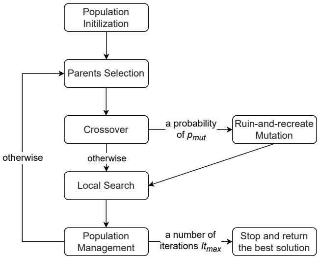
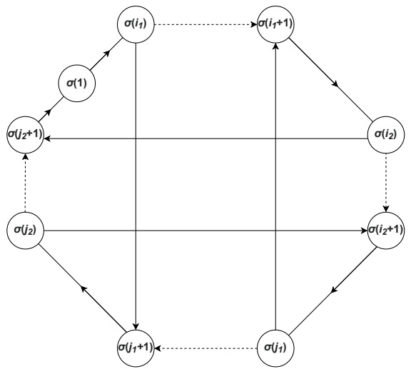
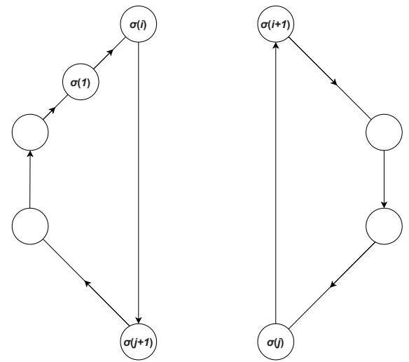
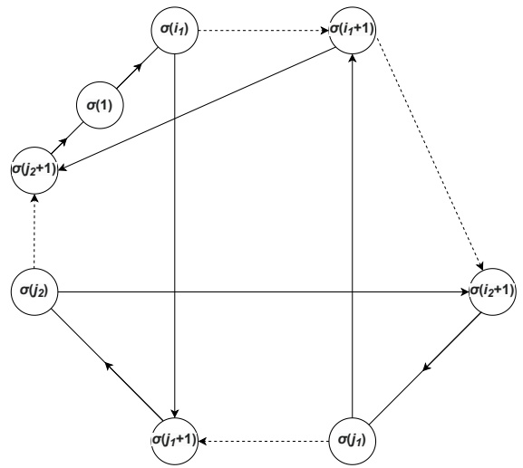
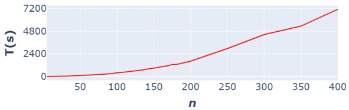

# An Efficient Hybrid Genetic Algorithm for the Quadratic Traveling Salesman Problem

**Quang Anh Pham**<sup>1</sup>**, Hoong Chuin Lau**2**, Minh Hoang H** \` à1\***, Lam Vu**1,

1 ORLab, Faculty of Computer Science, Phenikaa University, Hanoi, Vietnam 2 Singapore Management University hoang.haminh@phenikaa-uni.edu.vn

## Abstract

The traveling salesman problem (TSP) is the most wellknown problem in combinatorial optimization which has been studied for many decades. This paper focuses on dealing with one of the most difficult TSP variants named the quadratic traveling salesman problem (QTSP) that has numerous planning applications in robotics and bioinformatics. The goal of QTSP is similar to TSP which finds a cycle visiting all nodes exactly once with minimum total costs. However, the costs in QTSP are associated with three vertices traversed in succession (instead of two like in TSP). This leads to a quadratic objective function that is much harder to solve. To efficiently solve the problem, we propose a hybrid genetic algorithm including a local search procedure for intensification and a new mutation operator for diversification. The local search is composed of a restricted double-bridge move (a variant of 4-Opt); and we show the neighborhood can be evaluated in $\mathcal { O } ( n ^ { \hat { 2 } } )$ , the same complexity as for the classical TSP. The mutation phase is inspired by a ruin-and-recreate scheme. Experimental results conducted on benchmark instances show that our method significantly outperforms stateof-the-art algorithms in terms of solution quality. Out of the 800 instances tested, it finds 437 new best-known solutions.

## 1 Introduction

Recently, there has been increasing attention to the variants of classical combinatorial optimization problems with quadratic costs e.g. the quadratic assignment problem (Silva, Coelho, and Darvish 2021), the quadratic shortest path problem (Hu and Sotirov 2020), and the quadratic set covering problem (Guimaraes, da Cunha, and Pereira 2020). ˜ Quadratic problems have real-world applications in many fields like engineering, economics, and finance (Horst, Pardalos, and Van Thoai 2000).

The objective functions in these problems are non-linear (or even non-convex) which makes them very difficult to solve computationally. In this paper, we consider the Quadratic Traveling Salesman Problem which is the quadratic variant of the famous Traveling Salesman Problem. The cost in TSP is dependent on 2 consecutive vertices of the tour while the QTSP considers the cost associated with 3 consecutive vertices. This changes the objective function from linear to quadratic which is the main challenge for many underlying combinatorial optimization problems. For example, QTSP has been used to tackle the bioinformatics problem of finding the optimal Markov model for a given set of DNA sequences in (Fischer et al. 2014) and a robotics planning problem in (Aggarwal et al. 2000). It has also seen applications in the planning of telecommunication and transport networks.

## 1.1 Problem Definition

QTSP is formally defined as follows. Let $G   =   \{ V , E \}$ be a complete graph in which $V \; = \; \{ 1 , 2 , . . . , n \}$ is the vertex set and $\widetilde { E   =   \{ ( i , j )   :   i , j   \in   V , i   \neq   j \} }$ is the arc set. Each 3-tuple of nodes $( i , j , k )$ with $i , j , k \in \dot { V }$ is associated with a cost $c _ { i j k } . \mathrm { ~ A ~ }$ Hamiltonian cycle of G is represented as a permutation of nodes $\sigma = \big ( \sigma ( 1 ) , \sigma ( 2 ) , . . . , \sigma ( n ) \big )$ where $\sigma ( i )   \in   \{ 1 , . . . , n \} \forall i   \in   \{ 1 , . . . , \hat { n } \}$ and $\sigma ( i )   \neq   \sigma ( j ) { \dot { \forall } } i   \neq   j$ For convenience, we also assume that $\sigma ( 0 ) \; = \; \sigma ( n )$ and $\sigma ( n   +   1 )   =   \sigma ( 1 )$ . The goal of QTSP is to find a Hamiltonian cycle (i.e. a sequence σ) that minimizes the following objective function:

$$
\text {cost} (\sigma) = \sum_ {i = 0} ^ {n - 1} c _ {\sigma (i) \sigma (i + 1) \sigma (i + 2)}\tag{1}
$$

## 1.2 Related Literature

The QTSP was first introduced by (Aggarwal et al. 2000) with motivation in robotics. The authors used a different name, the angular-metric traveling salesman problem (Angle-TSP). The goal of Angle-TSP is to minimize the total angle of the TSP tour in Euclidean space, where the angle of a tour is the sum of the turning angle at the points. They also proved that the Angle-TSP problem is $\mathcal { N } \bar { \mathcal { P } } .$ -hard. An approximation polynomial-time algorithm with the approximate ratio of $\mathcal { O } ( l o g n )$ was proposed for the Angle-TSP. A similar variant of QTSP named angular-distancemetric TSP (Angle-Distance-TSP) was studied in (Savla, Frazzoli, and Bullo 2008) where the cost $c _ { i j k }$ is the linear combination of both angle and distance. The authors considered the Angle-Distance-TSP as an approximate solution of the TSP for the Dubins vehicle (TSPD). The DTSP problem focuses on planning a route for a nonholonomic vehicle (a robot model), which is required to move along paths of bounded curvature in a given direction. The objective is to minimize the total costs of the tour for such a Dubins vehicle through a given set of target points. (Jager and Molitor 2008) ¨ proposed the Traveling Salesman Problem of Second Order (2-TSP), which is the asymmetric version of QTSP. The 2- TSP is equivalent to finding the optimal Permuted Markov (PM) model (Ellrott et al. 2002) and the optimal Permuted Variable Length Markov (PVLM) model (Zhao, Huang, and Speed 2005) of order two for a given dataset. The PM and PLVM models are used widely in bioinformatics to understand how transcription factors bind to their binding sites. Recently, a few works in the literature (Punnen, Walter, and Woods 2017; Woods and Punnen 2020) have proposed a different version of QTSP where the objective function contains the costs of every pair of edges in the tour. They term the problem setting in Section 1.1 as the adjacent QTSP.

<small><span class="docvortex-page-footnote" data-block-type="page_footnote" style="color:#6b7280"><sup>\*</sup>Corresponding author</span></small>

<small><span class="docvortex-page-footnote" data-block-type="page_footnote" style="color:#6b7280">Copyright © 2023, Association for the Advancement of Artificial Intelligence (www.aaai.org). All rights reserved.</span></small>

The most common approach to dealing with QTSP is exact methods that can prove the optimality of the solution. (Jager and Molitor 2008) first proposed two exact algorithms ¨ i.e. Branch-and-Bound (B&B) and Integer Programming (IP) for solving the 2-TSP. These methods were tested on random instances and real-world instances with a maximum of dimension 44. However, the exact algorithms only solve instances up to 26 nodes. The polyhedral structure of the symmetric QTSP is investigated in (Fischer and Helmberg 2013). The authors also introduced some valid inequalities for the QTSP as well as proved their facetness. A Branchand-Cut (B&C) framework was designed as a “proof-of-concept” to exploit these inequalities which can solve optimally Angle-TSP instances with up to 30 nodes. (Fischer 2014) extended the work of (Fischer and Helmberg 2013) to the Asymmetric QTSP. Their experimental results showed that their B&C approach takes only less than 10 seconds to solve all 2-TSP instances with $n   \leq   4 0$ while the B&B of (Jager and Molitor 2008) consumes about three weeks to ¨ deal with the 26-node instances. (Fischer et al. 2014) dealt with both symmetric and asymmetric QTSP. They presented three exact methods: TSP-R, B&B, and B&C which were tested on random, Angle-TSP, Angle-Distance-TSP, and 2- TSP instances with up to 100 vertices in a limited time. The TSP-R transforms a QTSP instance into a TSP instance which can be solved easily to by the Concorde TSP solver<sup>1</sup>. However, the TSP-R is only able to solve instances with a number of vertices up to 20 due to the large scale of transformed TSP instances. For example, it needs to find the optimal solution of a 420-node TSP instance to deal with a 15- node QTSP instance. B&C is the leading method in terms of scalability and running time which takes 10 minutes to solve all 2-TSP instances up to dimension 100. Finally, an Integer Linear Programming (ILP) based approach is proposed in (Oswin et al. 2017). The method is inspired by the work of (Pferschy and Stanek 2017) for TSP which uses a separa- ˇ tion process detecting the subtour elimination constraints on only integral solutions. Surprisingly, the ILP approach outperforms the B&C approach of (Fischer et al. 2014) despite being a simpler method.

In terms of approximate algorithms, (Jager and Moli- ¨ tor 2008) and (Fischer et al. 2014) adapted several simple heuristics of TSP to deal with the QTSP like Cheapest-Insert algorithm (CI), Nearest-Neighbor algorithm (NN), and k-Opt algorithm (Rosenkrantz, Stearns, and Lewis 1977; Glover et al. 2001; Lin and Kernighan 1973). The performance of these methods is not really good. They could not reproduce all the optimal solutions obtained from exact methods. Furthermore, in (Fischer et al. 2014), the objec tive values of the best heuristic in some instances are nearly double the optimal values. (Stanek et al. 2019) first intro- ˇ duced several metaheuristics to overcome this drawback. These metaheuristics are the combination of construction and improvement approaches based on previous works, geometrical properties, and (I)LP models. The authors mainly focus on solving the Angle-TSP and Angle-Distance-TSP instances. Their metaheuristics are able to find more optimal solutions than previous heuristics. The worst optimal gap in all cases is only slightly over 10%. The best method in (Stanek et al. 2019), which is also the state-of-the-art ap- ˇ proximate algorithm for the QTSP in our best knowledge, is a matheuristic that exploits the (I)LP models for constructing as well as improving solutions. Another interesting approach for QTSP is Deep Reinforcement Learning (DRL) which has been introduced recently by (Zhang et al. 2022). The authors adapt the Transformer architecture (Vaswani et al. 2017) to design a deep neural network that helps to train a model (policy). The model after training takes as input the node coordinates of a QTSP instance and then generates the respective solution. The method is then only tested on a limited amount of instances with 30, 40, and 50 vertices. Two simple heuristics CI and NN from (Fischer et al. 2014) are chosen as baseline approaches. The DRL method easily outperforms them but cannot produce the optimal solution on any benchmark instance. The optimality gap is sometimes over 30% on some instances. This is quite unacceptable for the performance of a learning method on a small-scale dataset.

## 1.3 Our Contribution

Our work makes the following contributions:

• We show that finding the best move among all $\mathcal { O } ( n ^ { 4 } )$ double-bridge moves in QTSP is more difficult than in TSP which takes $\mathcal { O } ( n ^ { 3 } )$ instead of $\mathcal { O } ( n ^ { 2 } )$ time. However, the time complexity for neighborhood exploration can be reduced to $\tilde { \mathcal { O } } ( n ^ { 2 } )$ for a restricted double-bridge neighborhood.

• We combine the restricted double-bridge neighborhood with some classical ones like Relocate, Swap and 2-Opt to create a LS procedure which can improve extensively a QTSP solution. The procedure is then integrated into a hybrid genetic algorithm for dealing with QTSP. Our algorithm also features a new mutation operator relying on the ruin-and-recreate scheme (Schrimpf et al. 2000) to keep a balance between intensification and diversification.

• The results obtained from conducting experiments on the benchmark QTSP instances show that our method can produce all proved optimal solutions and outperform the best one from the literature. Furthermore, it finds the new best-known solutions in nearly all instances which are not solved optimally. We also carry out sensitivity analyses to prove the vital contributions of new mutation operator and restricted double-bridge neighborhood.

<small><span class="docvortex-page-footnote" data-block-type="page_footnote" style="color:#6b7280"><sup>1</sup>https://www.math.uwaterloo.ca/tsp/index.html</span></small>



Figure 1: Overview of HGA metaheuristic

## 2 Method

In this section, we propose a hybrid genetic algorithm (HGA) to solve QTSP. Our metaheuristic is inspired by the hybrid genetic search (HGS) framework of (Vidal et al. 2012). We adapt HGS for QTSP by introducing a new mutation operator and designing a different local search procedure. The overview of HGA is illustrated in Figure 1. The algorithm maintains a population $\mathcal { P }$ of individuals representing QTSP solutions in $I t _ { m a x }$ iterations. At each iteration, two individuals are selected from the population and recombined into an offspring using a crossover operator. The ruin-and-recreate mutation is applied to this offspring with probability $p _ { m u t }$ . The generated offspring is then intensified by a local search (LS) procedure and added to the population. A population management phase is triggered to remove some individuals from the population based on its size and the number of iterations without improvement.

In the next sub-sections, we will describe in detail the main components of HGA. Section 2.1 shows how we evaluate individuals. Section 2.2 describes genetic operators: parent selection, crossover and ruin-and-recreate mutation. The LS procedure and population management phase are discussed in Section 2.3 and Section 2.4, respectively.

## 2.1 Individual Evaluation

Each individual $\mathcal { P } _ { i }$ in the population $\mathcal { P }$ of our HGA is represented by a QTSP tour, i.e a visit sequence $\sigma _ { \mathcal { P } _ { i } }$ as described in Section 1.1. Similar to HGS, we evaluate the individual $\mathcal { P } _ { i }$ by the following biased fitness function:

$$
B F (\mathcal {P} _ {i}) = f ^ {\mathrm{C}} (\mathcal {P} _ {i}) + \left(1 - \frac {\mu^ {\text {ELITE}}}{| \mathcal {P} |}\right) \times f ^ {\mathrm{D}} (\mathcal {P} _ {i})\tag{2}
$$

where $f ^ { \mathrm { c } } ( \mathcal { P } _ { i } )$ and $f ^ { \mathrm { { D } } } ( \mathcal { P } _ { i } )$ represent the ranks of individual $\mathcal { P } _ { i }$ in the population $P$ in terms of its objective value $c o s t ( \sigma _ { \mathcal { P } _ { i } } )$ and the diversity contribution $d c ( \dot { \sigma _ { \mathcal { P } _ { i } } } )$ . The parameter $\hat { \mu } ^ { \mathrm { E L I T E } }$ stands for the number of elite individuals that always survive throughout the search as proven in (Vidal et al. 2012)

For each individual $\mathcal { P } _ { i } ,$ , the diversity contribution $d c ( \mathcal { P } _ { i } )$ is calculated as the average distance to its closest other individuals in $\mathcal { P }$ denoted by set $N _ { c l o s e }$ (Equation 3).

$$
d c (\mathcal {P} _ {i}) = \frac {1}{| N _ {\text {close}} |} \sum_ {\mathcal {P} _ {j} \in N _ {\text {close}}} \delta (\mathcal {P} _ {i}, \mathcal {P} _ {j})\tag{3}
$$

We use the normalized broken-pairs distance (Prins 2009) to compute the distance $\delta ( \mathcal { P } _ { i } , \mathcal { P } _ { j } )$ between two individuals $\mathcal { P } _ { i }$ and $\mathcal { P } _ { j }$ as follows:

$$
\delta (\mathcal {P} _ {i}, \mathcal {P} _ {j}) = \frac {1}{n} \Phi (\mathcal {P} _ {i}, \mathcal {P} _ {j})\tag{4}
$$

where $\Phi ( \mathcal { P } _ { i } , \mathcal { P } _ { j } )$ denotes the number of pairs of successive nodes in the tour $\sigma _ { \mathcal { P } _ { i } }$ which are not included in the tour $\sigma _ { \mathcal { P } _ { j } }$ Note that, in this measure, two pairs of nodes $( i , j )$ and $( j , i )$ are equivalent.

## 2.2 Offspring Generation

To generate a new individual, we first obtain two parent individuals from the population by performing two times of a binary tournament selection process. More precisely, two individuals are randomly picked and the process selects the one with the best fitness as a parent. An ordered crossover (OX) (Oliver, Smith, and Holland 1987) is then applied to the two parents to create an offspring. As shown in (Vidal et al. 2012), the HGS tends to be very susceptible to lack of diversity, leading to the phenomenon of early convergence. Therefore, efficient diversity mechanisms need to be added to prevent the algorithm from falling into the local optimum. One can remove a large part of existing individuals in the population and replace them by the new ones as proposed in (Vidal et al. 2012). However, our initial experiments show that this strategy is not enough to maintain the diversity of our algorithm. As a result, we decide to design an additional mutation operator in which a created offspring is selected with a probability of $p _ { m u t }$ to go through a ruin-and-recreate (R&R) phase (Schrimpf et al. 2000). Its main idea is to remove some vertices from the current offspring using a removal heuristic and then exploit an insertion heuristic to reconstruct the solution. It is similar to a well-known metaheuristic, Large Neighborhood Search (LNS) (Shaw 1998). Basically, LNS iteratively destroys and repairs an initial solution to improve it. We note that the goal of the R&R phase in our algorithm is to diversify the search, not to intensify the search as in LNS. Therefore, the offspring after mutation is not necessarily improved.

In the following, we describe several basic removal and insertion heuristics from the literature that are adapted to solve QTSP. All these heuristics are chosen randomly with a uniform probability during the mutation phase.

**Removal Heuristics** Whenever the mutation phase is triggered, the incumbent solution $\sigma$ is modified by removing some vertices. We denote the number of removed vertices as $p$ which is chosen randomly in the range $[ p _ { m i n } , p _ { m a x } ] .$

• Worst removal (Ropke and Pisinger 2006): The purpose of the worst removal heuristic is to remove “expensive” vertices in the solution. For each node v in the tour $\sigma ,$ the heuristic first computes its cost saving as $c o s t ( \sigma ) -$ $c o s t _ { - v } ( \sigma )$ , where $c o s t _ { - v } ( \sigma )$ is the objective value of $\sigma$ after removing $v .$ We then randomly choose $p$ vertices to remove such that one with larger savings has a higher selection probability.

• Block removal (Veenstra et al. 2017): The block removal heuristic randomly selects one node $\sigma ( k )$ in σ. A subsequence of consecutive nodes $\left( \sigma ( k ) \mathrm { , . . . , } \sigma ( k + p ) \right)$ is then removed from the current solution σ.

**Insertion Heuristics** After the removal phase, p vertices are then sequentially inserted back into the incomplete solution. The insertion order of these vertices relies on one of the below insertion heuristics. Each node is then inserted into its best position with the least increase of objective value.

• Random insertion (Ropke and Pisinger 2006): The order of nodes to be inserted is randomized.

• Cheapest insertion (Fischer et al. 2014): As shown through its name, the heuristic prioritizes inserting the node that makes the total solution costs increase the least.

## 2.3 Local Search

Algorithm 1 shows the LS procedure acting as an intensification phase in our HGA. In general, an incumbent solution σ is iteratively improved by two phases until no improvement is found. In the first phase, several basic neighborhoods in the list $\mathcal { N }$ are explored. Similar to HGS, each node u is associated with a candidate list $\mathcal { L } ( u )$ . The procedure loops through every pair of nodes $( u , v )$ with $v   \in   \mathcal { L } ( u )$ , checks only LS moves containing the arc $( u , v )$ , and applies the first improvement move for each such pair (Lines 5-12). The second phase finds the best move for a restricted double-bridge neighborhood and then updates the solution if there is any improvement (Lines 13-17). Because the second phase consumes more computation time than the first one, we only perform it with a probability $p _ { 4 O p t }$ when there is no improvement in the first phase. In the following, two phases of the LS procedure are described in detail.

**Basic neighborhoods** To construct the candidate list $\mathcal { L } ,$ we adapt the granular search (GS) of (Toth and Vigo 2003). For each node $u ,   \mathcal { L } ( u )$ is defined by Γ closest neighbors v with respect to a measure $\pi ( u , v )$ . This helps to restrict the complexity of exploring a neighborhood to $\mathcal { O } ( \Gamma n )$ instead of $\left[ \mathcal { O } ( n ^ { \check { 2 } } ) \right.$ . Empirically, a suitable value of $\Gamma$ can not only reduce the computing time but also remain or even improve the search performance. This strategy is quite similar to the well-known technique neighbor list applied in 2-Opt and 3-Opt neighborhoods for TSP (Johnson and McGeoch 1997). The popular metric for $\pi ( u , v )$ is the distance between two nodes which is also used in HGS. For QTSP, we set $\pi ( u , v ) = c _ { w , u , v }$ where w is the predecessor of u in the incumbent solution σ.

<div class="docvortex-algorithm" style="white-space: pre-wrap; font-family:monospace;">
Algorithm 1: Local Search
$\sigma \leftarrow$ Current Solution, $imp \leftarrow true$
$use4Opt \leftarrow true$ with a probability $p_{4Opt}$
while imp do
    $imp \leftarrow false$
    for $u \in V$ do
        for $v \in \mathcal{L}(u)$ do
            for $i = 1 \rightarrow |\mathcal{N}|$ do
                $\sigma' \leftarrow move(\sigma, (u, v), \mathcal{N}_i)$
                if $cost(\sigma') &lt; cost(\sigma)$ then
                    $\sigma \leftarrow \sigma'$
                    $imp \leftarrow true$
                    break
    if $use4Opt \land \neg imp$ then
        $\sigma' \leftarrow best4Opt(\sigma)$
        if $cost(\sigma') &lt; cost(\sigma)$ then
            $\sigma \leftarrow \sigma'$
            $imp \leftarrow true$
return $\sigma$
</div>

We next describe the neighborhoods in $\mathcal { N }$ and how they work for each arc $( u , v )$ with $v \in { \mathcal { L } } ( u )$ . We denote the pre-ceding and successive nodes of u in the tour σ as $p r e ( u )$ and suc(u), respectively.

$\mathcal { N } _ { 1 }$ (Relocate 1): Relocate v to a position between u and $s u c ( u )$

$\mathcal { N } _ { 2 }$ (Relocate 2): Relocate $( v ,   s u c ( v ) )$ to a position between u and suc(u).

$\mathcal { N } _ { 3 }$ (Swap 1-1): Swap suc(u) and v.

$\mathcal { N } _ { 4 }$ (Swap 1-2): Swap suc(u) with $( v , s u c ( v ) )$

$\mathcal { N } _ { 5 }$ (Swap 2-1): Swap suc(u) and $s u c ( s u c ( u ) )$ with v.

$\mathcal { N } _ { 6 }$ (Swap 2-2): Swap suc(u) and suc(suc(u)) with v and suc(v).

• $\mathcal { N } _ { 7 }$ (2-Opt): Reverse the visit sequence $\left( s u c ( u ) \right.$ $\overline { { s u c ( s u c ( u ) ) , . . . , p r e ( v ) , v } } \overline { { } }$

**Restricted double-bridge neighborhood** The doublebridge move is a variant of 4-Opt move which is often used as a mutation operator in GAs for TSP (see e.g. (Nguyen et al. 2007)). For the intensification purpose, Glover (1996) first introduced an efficient way to explore the double-bridge TSP neighborhood comprising $\mathcal { O } ( n ^ { 4 } )$ moves in $\mathcal { O } ( n ^ { 2 } )$ time. Pacheco et al. (2022) extended this work to the TSP with pickup and delivery constraints. The authors kept the same idea of (Glover 1996) but presented an easy-to-approach evaluation using dynamic programming (DP). In our algorithm, we adapt this DP representation to design the doublebridge neighborhood for QTSP.

Any double-bridge move can be defined by 4 indices $i _ { 1 } , i _ { 2 } , j _ { 1 }$ and $j _ { 2 }$ such that $1 \: \leq \: i _ { 1 } \: < \: i _ { 2 } \: < \: j _ { 1 } \: < \: j _ { 2 } \: < \: n .$ As illustrated in Figure 2, the move separates the tour σ into four parts $\bigl ( \sigma ( j _ { 2 } + 1 ) , . . . , \sigma ( n ) , \sigma ( 1 ) , . . . , \sigma ( i _ { 1 } ) \bigr ) , \bigl ( \sigma ( i _ { 1 } +$ $1 ) , . . . . , \sigma ( i _ { 2 } ) ) , \left( \sigma ( i _ { 2 } + 1 ) , . . . , \sigma ( j _ { 1 } ) \right)$ and $\left( \sigma ( j _ { 1 }   +   1 ) , \sigma ( j _ { 2 } ) \right)$ by removing some arcs (dash lines). These parts are then reconnected by four arcs $( \sigma ( i _ { 1 } ) , \sigma ( j _ { 1 }   +   1 ) ) , ( \sigma ( j _ { 1 } ) , \sigma ( i _ { 1 }   +   1 ) )$ $( \sigma ( i _ { 2 } ) , \sigma ( j _ { 2 } ^ { \cdot } + 1 ) )$ , and $( \sigma ( j _ { 2 } ) , \sigma ( i _ { 2 } + 1 ) )$ . Pacheco et al. (2022) proposed the following formula for computing the cost of a double-bridge move $\Delta ( i _ { 1 } , i _ { 2 } , j _ { 1 } , j _ { 2 } )$ i.e. change in objective value after applying move:



Figure 2: An illustration of double-bridge move

$$
\Delta (i _ {1}, i _ {2}, j _ {1}, j _ {2}) = \Delta_ {2 O} ^ {D} (i _ {1}, j _ {1}) + \Delta_ {2 O} ^ {D} (i _ {2}, j _ {2})\tag{5}
$$

where $\Delta _ { 2 O } ^ { D } ( i , j )$ is the cost of disconecting 2-Opt move for each pair $( i , j )$ . This move divides the tour into two sub-tours as depicted in Figure 3. A double-bridge move $( i _ { 1 } , i _ { 2 } , j _ { 1 } , j _ { 2 } )$ can be described as the combination of two disconnecting moves of $( i _ { 1 } , j _ { 1 } )$ and $( i _ { 2 } , j _ { 2 } )$ . In QTSP, we calculate the cost $\Delta _ { 2 O } ^ { D } ( i , j )$ as follows:

$$
\begin{array}{r l} \Delta_ {2 O} ^ {D} (i, j) & = c _ {\sigma (i - 1), \sigma (i), \sigma (j + 1)} + c _ {\sigma (i), \sigma (j + 1), \sigma (j + 2)} \\ & + c _ {\sigma (j), \sigma (i + 1), \sigma (i + 2)} + c _ {\sigma (j - 1), \sigma (j), \sigma (i + 1)} \\ & - c _ {\sigma (i - 1), \sigma (i), \sigma (i + 1)} - c _ {\sigma (i), \sigma (i + 1), \sigma (i + 2)} \\ & - c _ {\sigma (j - 1), \sigma (j), \sigma (j + 1)} - c _ {\sigma (j), \sigma (j + 1), \sigma (j + 2)} \end{array}\tag{6}
$$

Based on described representation, the cost of the best double-bridge move of each two fixed indices $( i _ { 2 } , j _ { 2 } )$ in (Pacheco et al. 2022) for TSP can be computed by Equation 7.

$$
\begin{array}{c} \Delta^ {B e s t} (i _ {2}, j _ {2}) = \Delta_ {2 O} ^ {D} (i _ {2}, j _ {2}) + \min \Delta_ {2 O} ^ {D} (i _ {1}, j _ {1}) \\ \forall i _ {1} \in \{1, \ldots , i _ {2} - 1 \}, j _ {1} \in \{i _ {2} + 1, \ldots , j _ {2} - 1 \} \end{array}\tag{7}
$$

Unfortunately, Equation 7 does not hold true in the case of $\mathrm { Q T S P }   \mathrm { i f } \; i _ { 1 } = i _ { 2 } - 1 \; \mathrm { o r } \; j _ { 1 } = i _ { 2 } + 1 \; \mathrm { o r } \; j _ { 1 } = j _ { 2 } - 1$ . We prove this for the first condition $i _ { 1 } = i _ { 2 } - 1$ and the two remaining ones can be done in a similar manner. We first illustrate a double-bridge move of $( i _ { 1 } , i _ { 2 } , j _ { 1 } , j _ { 2 } )$ with $i _ { 1 } = i _ { 2 } - 1$ in Figure 4. It is easy to see that the tour after applying the double-bridge move when $i _ { 1 }   =   i _ { 2 }   -   1$ contains three successive nodes $\sigma ( j _ { 1 } ) , \sigma ( i _ { 1 } + 1 ) , \sigma ( j _ { 2 } + 1 )$ constructed by reconnected arcs. However, the cost of this move computed by Equations 5-6 does not contain $c _ { \sigma ( j _ { 1 } ) , \sigma ( i _ { 1 } + 1 ) , \sigma ( j _ { 2 } + 1 ) }$ which results in the inaccuracy of Equation 7. Therefore, to identify accurately arg min $\Delta ( i _ { 1 } , i _ { 2 } , j _ { 1 } , j _ { 2 } )$ , we categorize each $\bar { \phantom { i _ { 1 } , i _ { 2 } , j _ { 1 } , j _ { 2 } } }$ double-bridge move into one of the following mutually disjoint cases:



Figure 3: An illustration of disconnecting 2-Opt move



Figure 4: A special case of double-bridge move with $i _ { 1 } =$ $i _ { 2 } - 1$

1. $i _ { 1 } + 1 \neq i _ { 2 } , i _ { 2 } + 1 \neq j _ { 1 } , j _ { 1 } + 1 \neq j _ { 2 } ;$ then Equation 7 can be corrected as:

$$
\begin{array}{l} \Delta^ {B e s t} (i _ {2}, j _ {2}) = \Delta_ {2 O} ^ {D} (i _ {2}, j _ {2}) + \min \Delta_ {2 O} ^ {D} (i _ {1}, j _ {1}) \\ \forall i _ {1} \in \{1, \ldots , i _ {2} - 2 \}, j _ {1} \in \{i _ {2} + 2, \ldots , j _ {2} - 2 \} \end{array}\tag{8}
$$

The DP of (Pacheco et al. 2022) can be applied in this case for QTSP to find the arg min $\Delta ( i _ { 1 } , i _ { 2 } , j _ { 1 } , j _ { 2 } )$ in i<sub>1</sub>,i<sub>2</sub>,j<sub>1</sub>,j<sub>2</sub> $\mathcal { O } ( n ^ { 2 } )$ time.

2. $\{ i _ { 1 } + 1 = i _ { 2 } , i _ { 2 } + 1 \neq j _ { 1 } , j _ { 1 } + 1 \neq j _ { 2 } \; \} \; { \bf o r } \; \{ i _ { 1 } + 1 \neq$ $i _ { 2 } , i _ { 2 } \: + \: 1 \: = \: j _ { 1 } , j _ { 1 } \: + \: 1 \: \neq \: j _ { 2 } \} { ~ \mathbf { o r } ~ } \{ i _ { 1 } \: + \: 1 \: \neq \: i _ { 2 } , i _ { 2 } \: + \:$ $1   \neq   j_{1}, j_{1}   +   1   =   j_{2} \}$ : Looping through every 4-tuples $( i _ { 1 } , i _ { 2 } , j _ { 1 } , j _ { 2 } )$ satisfying this condition takes $\mathcal { O } ( n ^ { 3 } )$ time to record the best move.

3. At least two of three conditions $i_{1} + 1 = i_{2}, i_{2} + 1 =$ $j _ { 1 } , j _ { 1 } + 1 = j _ { 2 }$ are satisfied. In this case, if we know 2 of 4 indices $i _ { 1 } , i _ { 2 } , j _ { 1 } , j _ { 2 }$ , we can easily compute the rest and thus find the double-bridge move that results in the best saving cost. The time complexity of this enumeration is $\mathcal { O } ( n ^ { 2 } )$

Overall, handling all three above cases takes $\mathcal { O } ( n ^ { 3 } )$ time which is also the time complexity of detecting the best move in all existing $\mathcal { O } ( n ^ { 4 } )$ double-bridge moves for QTSP. Moreover, a subset of these moves (in the first and third cases) can be explored in $\mathcal { O } ( n ^ { 2 } )$ time by excluding the above second case which consists of $\mathcal { O } ( n ^ { 3 } )$ moves. We define this exploration strategy as a restricted double-bridge neighborhood.

To better understand the time complexity for the restricted double-bridge neighborhood, we now present the DP formulation given in (Pacheco et al. 2022) to compute the minimum value of $\dot { \Delta } ^ { B e s t } ( i _ { 2 } , j _ { 2 } )$ in $\mathcal { O } ( n ^ { 2 } )$ time. First, Equation 8 can be rewritten as:

$$
\Delta^ {B e s t} (i _ {2}, j _ {2}) = \Delta_ {2 Q} ^ {D} (i _ {2}, j _ {2}) + \Delta^ {*} (i _ {2}, j _ {2})\tag{9}
$$

$$
\Delta^ {*} (i _ {2}, j _ {2}) = \min _ {j _ {1} \in \{i _ {2} + 2, \dots , j _ {2} - 2 \}} F (i _ {2}, j _ {1})\tag{10}
$$

$$
F (i _ {2}, j _ {1}) = \min _ {i _ {1} \in \{1, \dots , i _ {2} - 2 \}} \Delta_ {2 O} ^ {D} (i _ {1}, j _ {1})\tag{11}
$$

We can precompute the $F ( i _ { 2 } , j _ { 1 } )$ for each pair $( i _ { 2 } , j _ { 1 } )$ in $\mathcal { O } ( n ^ { 2 } )$ time. Therefore, the time complexity of finding the double-bridge move minimizing $\Delta ^ { B e s \tilde { t } } ( i _ { 2 } , \dot { j _ { 2 } } )$ is also $\mathcal { O } ( n ^ { 2 } )$ based on Equation 10. More precisely, the following recursive calls are performed.

$$
\left| \begin{array}{l} F \left(i _ {2}, j _ {1}\right) = \Delta_ {2 O} ^ {\mathrm{D}} \left(1, j _ {1}\right) \text {if} i _ {2} = 3 \\ F \left(i _ {2}, j _ {1}\right) = \min \left\{F \left(i _ {2} - 1, j _ {1}\right), \Delta_ {2 O} ^ {D} \left(i _ {2} - 2, j _ {1}\right) \right\} \quad \text {otherwise} \\ \Delta^ {*} \left(i _ {2}, j _ {2}\right) = F \left(i _ {2}, i _ {2} + 2\right) \text {if} j _ {2} = i _ {2} + 4 \\ \Delta^ {*} \left(i _ {2}, j _ {2}\right) = \min \left\{\Delta^ {*} \left(i _ {2}, j _ {2} - 1\right), F \left(i _ {2}, j _ {2} - 2\right) \right\} \quad \text {otherwise}. \end{array} \right. \tag {13}
$$

Finally, Algorithm 2 provides the pseudo-code for exploring the restricted double-bridge neighborhood in $\mathcal { O } ( n ^ { 2 } )$ time. For convenience, a boolean function $C o n d ( i _ { 1 } , \dot { i _ { 2 } } , \dot { j _ { 1 } } , j _ { 2 } )$ is defined as true if at least two of three conditions $i _ { 1 } + 1 =$ $i _ { 2 } , i _ { 2 }   +   1 = j _ { 1 } , j _ { 1 }   +   1 = j _ { 2 }$ are satisfied, and false otherwise. Line 1 shows the $\mathcal { O } ( n ^ { 2 } )$ enumeration of the third case above. The introduced recursion (Equations 12-13) is described in Lines 2 to 10.

## 2.4 Population Management

In the beginning, HGA initializes the population by creating µ individuals via Random insertion heuristic (Section $2 . 2 ) .$ . These initial individuals are also diversified and intensified by the mutation operator and LS procedure, respectively. The population continues to grow after each offspring generation until its size |P| exceeds the upper limit of $\mu +$ λ. When this happens, λ individuals are selected to be excluded from the population based on its number of clones and s fitness. Finally, as in HGS, the population undergoes a Diversif ication phase after $I t _ { d i v }$ non-improvement iterations. In this phase, the population keeps $\frac { \mu ^ { \dot { } } } { 3 }$ best individuals, removes the remaining and then triggers the initialization phase again until the population size reaches back to $\mu .$

```julia
Algorithm 2: Restricted double-bridge neighborhood exploration
BEST ← min Cond(i1, i2, j1, j2) is true {Δ(i1, i2, j1, j2)}
for j1 = 5 → n - 3 do
    F(3, j1) = Δ2O^D(1, j1)
    for i2 = 4 → j1 - 2 do
        F(i2, j1) = min{F(i2 - 1, j1), Δ2O^D(i2 - 2, j1)}
for i2 = 3 → n - 5 do
    Δ*(i2 + 4, j2) = F(i2, i2 + 2)
    for j2 ∈ {i2 + 5, ..., n - 1} do
        Δ*(i2, j2) = min{Δ*(i2, j2 - 1), F(i2, j2 - 2)}
        ΔBest(i2, j2) = Δ2opt^D(i2, j2) + Δ*(i2, j2)
        BEST = min(BEST, ΔBest(i2, j2))
return BEST
```

## 3 Computational Studies

HGA is implemented in C++ and compiled by MSVC 14.29. It is run on an AMD Ryzen 7 3700X @ 3.60GHz machine. Based on preliminary experiments and previous studies related to HGS and R&R, and in order to keep the algorithm simple, we fix some parameters of HGA and only calibrate the mutation rate $p _ { m u t }$ and the probability of using the restricted double-bridge neighborhood $p _ { 4 O p t }$ . The IRACE package (Lopez-Ib ´ ánez et al. 2016) is used to tune ˜ $p _ { m u t }$ and $p _ { 4 O p t }$ in the ranges of [0.5-1.0] and [0.1-0.3], respectively. Table 1 shows the final configuration of HGA.

| Parameters | Used values |
| --- | --- |
| p<sub>mut</sub> | 0.9 |
| It<sub>max</sub> | 50000 |
| µ<sup>ELITE</sup> | 5 |
| \|N<sub>close</sub>\| | 2 |
| p<sub>min</sub> | 5 |
| p<sub>max</sub> | min(40,n/3) |
| Γ | 20 |
| p<sub>4Opt</sub> | 0.3 |
| µ | 25 |
| λ | 40 |
| It<sub>div</sub> | 4000 |

Table 1: HGA setting

The algorithm is evaluated on two QTSP variants, the Angle-TSP and Angle-Distance-TSP. We use the benchmark instances from (Stanek et al. 2019) which are randomly gen- ˇ erated with the number of nodes n ranging from 5 to 200. All these instances are available online<sup>2</sup>and a large part of them are not solved optimally. As such, we separate the instances into 4 sets: Angle-opt, Angle-hard, Angle-disopt, and Angle-dis-hard. The first set Angle-opt contains all Angle-TSP instances that have the known optimal solution found by exact methods, while the remaining Angle-TSP instances are included in set Angle-hard. We also construct two sets Angle-dis-opt and Angle-dis-hard in a similar way for Angle-Distance-TSP instances. All detailed results of conducted experiments can be accessed at our online repository <sup>3</sup>.

<small><span class="docvortex-page-footnote" data-block-type="page_footnote" style="color:#6b7280"><sup>2</sup>https://arxiv.org/src/1803.03681v1/anc/ TestInstancesAndResults.rar</span></small>

<table><tbody><tr><td rowspan="2">Set</td><td rowspan="2">#Ins</td><td rowspan="2">|V|</td><td colspan="4">HGA</td><td colspan="3">MH</td></tr><tr><td>Gap</td><td>Avg</td><td>T</td><td>#Best</td><td>Gap</td><td>T</td><td>#Best</td></tr><tr><td>Angle-opt</td><td>150</td><td>5-75</td><td>0.00</td><td>0.004</td><td>87.41</td><td>150</td><td>0.92</td><td>27.14</td><td>83</td></tr><tr><td>Angle-hard</td><td>250</td><td>80-200</td><td>-2.61</td><td>-1.83</td><td>831.05</td><td>250</td><td>1.02</td><td>462.96</td><td>152</td></tr><tr><td>Angle-dis-opt</td><td>200</td><td>5-100</td><td>0.00</td><td>0.00</td><td>130.94</td><td>200</td><td>0.33</td><td>26.99</td><td>115</td></tr><tr><td>Angle-dis-hard</td><td>200</td><td>105-200</td><td>-0.46</td><td>-0.46</td><td>945.44</td><td>200</td><td>0.47</td><td>354.45</td><td>33</td></tr></tbody></table>

Table 2: Summary of comparison results on benchmark instances

## 3.1 Performance Assessment

We run HGA ten times on each benchmark instance and compare its results with those of the best approach in (Stanek et al. 2019) which is a matheuristic as mentioned ˇ in Section 1.2. For convenience, we denote this method as MH. In (Stanek et al. 2019), MH was evaluated on ˇ an Intel(R) Core(TM) i7-4790 CPU 4-Core Processor @ 3.60GHz which is about 16% slower than our computer according to an online assessment tool<sup>4</sup>. On each instance, due to its deterministic nature, MH is run only once. This algorithm is implemented in Python which is in general slower than C++. However, the most time-consuming components of MH are (I)LP-based and are solved using GUROBI, whose backend engine is coded in C/C++ and called by other programming languages via interfaces as described in its manual document<sup>5</sup>. Furthermore, the MH uses the default setting of Gurobi which allows multi-thread mode while our HGA is run on a single processor. Because it is difficult to make a fair conversion of the computing conditions, we do not compare the running time of the methods and decide to present the raw running time of MH as reported in (Stanekˇ et al. 2019), letting the readers self-select the faster method.

Table 2 summarizes our comparison results between HGA and MH on 4 benchmark sets: Angle-opt, Angle-hard, Angle-dis-opt, and Angle-dis-hard. Columns “#Ins” and $\left. \left. ^ { \circ } \right| V \right|  \text{" }$ indicate the number of instances and the number of nodes in each set, respectively. For each method, we report the following information:

• Gap: The average of $g a p ^ { * }$ values computed in percentage as 100. $\frac { \tilde { \tilde { b b j ^ { * } } } \tilde { - b k s } } { \tilde { b k s } } .$ in which obj∗is the best objective value found over 10 runs of HGA or 1 run of MH and bks is the best-known solution value in the literature. Note that the gap value can be negative, implying that our metaheuristic improves the best-known solutions found in the literature.

• Avg: The average of gap values in percentage computed as $\begin{array} { r } { 1 0 0 . \frac { \overline { { o b j } } - b k s } { b k s } } \end{array}$ where $\overline { { o b j } }$ is the average objective value over 10 runs. We omit these values of MH because it is run only once.

• T: The average computation time in seconds.

• #Best: The number of best-known solutions a method found or improved.

As can be seen in Table 2, HGA outperforms MH with respect to solution quality. The “Gap” value of HGA is always no more than 0.00% while the same value for MH ranges from 0.33% to 1.02%. HGA produces all optimal solutions in both two sets Angle-opt and Angle-dis-opt over 10 runs or even 1 run in the case of Angle-dis-opt. Regarding MH, the proportion of instances it finds the optimal solutions is only over 50%. For the remaining sets, MH can reproduce 152/250 and 33/200 best-known solutions on Angle-hard and Angle-dis-hard instances, respectively. HGA still dominates MH when finding or improving all these best-known solutions. Remarkably, 437 over a total of 450 non-proved-optimal instances have new best-known solutions obtained by our method. In terms of stability, the “Avg” value of HGA is in the range of [-1,83%, 0.004%] which clearly shows that the algorithm can consistently generate high-quality solutions.

Another interesting observation is that HGA tends to perform much better on Angle-hard instances than in Angledis-hard ones. This can be explained as follows. The objective function of the Angle-dis variant includes the cost of traversed edges, possibly making this variant closer to the classical TSP. As a consequence, the Angle-dis instances tend to be easier than the Angle instances. From the number of known optimal solutions of both instance classes and the column “Gap” of MH in Table 2, we can clearly observe this phenomenon. On the harder instances, MH and other methods in the literature perform worse and our HGA could have more chances to improve their solutions.

Although HGA has a superior performance in terms of solution quality, it possibly consumes more computation time than MH according to Table 2. In the worst case, HGA is about 5 times slower than MH (set Angle-dis-opt). However, as we mentioned above, two algorithms are run on different computing conditions, it is hard to conclude which method is faster. In addition, MH includes several exponentially computing ILP-based components; it can behave unstably in terms of speed and get slower when dealing with

<small><span class="docvortex-page-footnote" data-block-type="page_footnote" style="color:#6b7280"><sup>3</sup>http://orlab.com.vn/home/download</span></small>

<small><span class="docvortex-page-footnote" data-block-type="page_footnote" style="color:#6b7280"><sup>4</sup>https://www.cpubenchmark.net/</span></small>

<small><span class="docvortex-page-footnote" data-block-type="page_footnote" style="color:#6b7280"><sup>5</sup>https://www.gurobi.com/documentation/10.0/refman/index.html</span></small>

larger instances.

## 3.2 Algorithm Component Analysis

The major difference between HGA and HGS is the two additional features: the restricted double-bridge neighborhood and R&R mutation. Their impact on the algorithm performance is now investigated. We compare the original version of HGA with three other configurations $\mathrm { H G A _ { - 4 O p t } , }$ $\mathrm { H G A } _ { - M u t }$ and $\mathrm { H G A } _ { - B o t h }$ created by removing the restricted double-bridge neighborhood, the mutation operator, and both of them, respectively. Table 3 shows the comparison results with the same measures used in Table 2.

According to Table 3, the full setting of HGA is still the leading method in terms of solution quality as well as stability. Three sets $\begin{array} { r } { A n g l e \_ o p t , } \end{array}$ Angle-dis-opt, and Angle-dishard seem to be easy because we do not notice any significant difference in the performance between all configurations. On Angle-opt-hard instances, $\mathrm { H G A } _ { - M u t }$ is only slightly worse than HGA in which the deviations in Gap and Avg values are only less than 0.02% while these figures for $\mathrm { H G A _ { - 4 O p t } }$ and $\mathrm { H G A } _ { - B o t h }$ increase to over 1%. This clearly shows the vital role of the mutation operator compared to the restricted-double bridge neighborhood. Nevertheless, there is an increasing algorithm performance when applying the restricted double-bridge neighborhood. The algorithm without this feature $\mathrm { ( H G A _ { - 4 O p t } ) }$ cannot generate all optimal solutions as well as find or improve all bestknown solutions on the Angle-TSP instances. Therefore, the restricted double-bridge neighborhood still has a specific impact on the success of HGA.

| Set | #Ins Setting | Gap | Avg | #Best |
| --- | --- | --- | --- | --- |
| Angle-opt | 150 HGA HGA-4OptHGA-Mut HGA-Both | 0.0000.0010.0020.000 | 0.0040.0080.0270.039 | 150149149150 |
| Angle-hard | 250 HGA HGA-4OptHGA-Mut HGA-Both | -2.608-2.540-1.437-1.062 | -1.829-1.6640.1900.627 | 250249223204 |
| Angle-dis-opt | 200 HGA HGA-4OptHGA-Mut HGA-Both | 0.0000.0000.0000.000 | 0.0000.0000.0000.000 | 200200200200 |
| Angle-dis-hard | 200 HGA HGA-4OptHGA-Mut HGA-Both | -0.464-0.464-0.464-0.464 | -0.462-0.461-0.460-0.462 | 200200200200 |

Table 3: Comparison among different configurations of HGA

## 3.3 Results on Larger Instances

We now investigate the performance of HGA on larger instances, which have been generated following the data generation procedure proposed by (Stanek et al. 2019). In- ˇ stances of the Angle-TSP variant, which is considered to be harder, are selected in this experiment. The number of nodes n in the new instances is in the set {250, 300, 350, 400}. For each value of $n ,$ ten instances are randomly generated. As such, we obtain an additional 40 instances for the experiment. We believe that these results can be also used to assess the performance of algorithms proposed by other authors in future studies.



Figure 5: The growth in the running time of HGA

| $\|V\|$ | 50 | 100 | 150 | 200 | 250 | 300 | 350 | 400 |
| --- | --- | --- | --- | --- | --- | --- | --- | --- |
| Gap | 0.00 | 0.34 | 1.02 | 1.55 | 1.75 | 1.54 | 1.83 | 1.91 |

Table 4: Stability of HGA on all Angle-TSP instances

Because there is no benchmark result on these larger instances, we only assess the speed of HGA and its stability. Figure 5 reports the average computation time over 10 runs for each instance size (n). It can be seen that our approach can still handle the large instances in a reasonable running time, where the time needed to solve the largest instance with 400 nodes is less than 2 hours. The relationship between the running time and the instance size tends to follow the quadratic function, which is consistent with the computation complexity of the most expensive component (i.e., the restricted double-bridge local search) of the algorithm. In terms of stability, Table 4 presents the average gap over the 10 runs, where gap is measured based on percentage deviation from the best solution found by HGA. Here, we observe that our approach is stable as the average gap on the largest instances are less than 2.00 %.

## 4 Conclusion

In this article, we develop a hybrid genetic algorithm called HGA to solve the QTSP, which has applications in bioinformatics and robotics planning. Our algorithm has several new features, such as a mutation operator based on ruin-and-recreate principle and a local search procedure including a restricted double-bridge neighborhood running in $\mathcal { O } ( n ^ { 2 } )$ time. Experimental results obtained on the $\mathrm { Q T S P }$ benchmark instances of the literature are compared with the state-of-the-art results, showing a good performance of our HGA in terms of solution quality and stability. In addition, 437 new best-known solutions are first found in this paper. We also conduct a sensitivity analysis to investigate the impact of two components: mutation and double-bridge move on the algorithm performance. The results demonstrate the importance of these features. For future works, exact algorithms that can handle larger instances are definitely worth developing. Their results could help to investigate further the performance of our metaheuristic.

Aggarwal, A.; Coppersmith, D.; Khanna, S.; Motwani, R.; and Schieber, B. 2000. The angular-metric traveling salesman problem. SIAM Journal on Computing, 29(3): 697–711.

Ellrott, K.; Yang, C.; Sladek, F. M.; and Jiang, T. 2002. Identifying transcription factor binding sites through Markov chain optimization. Bioinformatics, 18(suppl 2): S100–S109.

Fischer, A. 2014. An analysis of the asymmetric quadratic traveling salesman polytope. SIAM Journal on Discrete Mathematics, 28(1): 240–276.

Fischer, A.; Fischer, F.; Jager, G.; Keilwagen, J.; Molitor, P.; and ¨ Grosse, I. 2014. Exact algorithms and heuristics for the quadratic traveling salesman problem with an application in bioinformatics. Discrete Applied Mathematics, 166: 97–114.

Fischer, A.; and Helmberg, C. 2013. The symmetric quadratic traveling salesman problem. Mathematical Programming, 142(1): 205–254.

Glover, F. 1996. Finding a best traveling salesman 4-opt move in the same time as a best 2-opt move. Journal of Heuristics, 2(2): 169–179.

Glover, F.; Gutin, G.; Yeo, A.; and Zverovich, A. 2001. Construction heuristics for the asymmetric TSP. European Journal of Operational Research, 129(3): 555–568.

Guimaraes, D. A.; da Cunha, A. S.; and Pereira, D. L. 2020. ˜ Semidefinite programming lower bounds and branch-and-bound algorithms for the quadratic minimum spanning tree problem. European Journal of Operational Research, 280(1): 46–58.

Horst, R.; Pardalos, P. M.; and Van Thoai, N. 2000. Introduction to global optimization. Springer Science & Business Media.

Hu, H.; and Sotirov, R. 2020. On solving the quadratic shortest path problem. INFORMS Journal on Computing, 32(2): 219–233.

Jager, G.; and Molitor, P. 2008. Algorithms and experimental study ¨ for the traveling salesman problem of second order. In International Conference on Combinatorial Optimization and Applications, 211–224. Springer.

Johnson, D. S.; and McGeoch, L. A. 1997. The traveling salesman problem: A case study in local optimization. Local search in combinatorial optimization, 1(1): 215–310.

Lin, S.; and Kernighan, B. W. 1973. An effective heuristic algorithm for the traveling-salesman problem. Operations research, 21(2): 498–516.

Lopez-Ib ´ ánez, M.; Dubois-Lacoste, J.; C ˜ aceres, L. P.; Birattari, M.; ´ and Stutzle, T. 2016. The irace package: Iterated racing for auto- ¨ matic algorithm configuration. Operations Research Perspectives, 3: 43–58.

Nguyen, H. D.; Yoshihara, I.; Yamamori, K.; and Yasunaga, M. 2007. Implementation of an effective hybrid GA for large-scale traveling salesman problems. IEEE Transactions on Systems, Man, and Cybernetics, Part B (Cybernetics), 37(1): 92–99.

Oliver, I.; Smith, D.; and Holland, J. R. 1987. Study of permutation crossover operators on the traveling salesman problem. In Genetic algorithms and their applications: proceedings of the second International Conference on Genetic Algorithms: July 28-31, 1987 at the Massachusetts Institute of Technology, Cambridge, MA. Hillsdale, NJ: L. Erlhaum Associates, 1987.

Oswin, A.; Fischer, A.; Fischer, F.; Meier, J. F.; Pferschy, U.; Pilz, A.; and Stanek, R. 2017. Minimization and maximization versions ˇ of the quadratic travelling salesman problem. Optimization, 66(4): 521–546.

Pacheco, T.; Martinelli, R.; Subramanian, A.; Toffolo, T. A.; and Vidal, T. 2022. Exponential-size neighborhoods for the pickupand-delivery traveling salesman problem. Transportation Science.

Pferschy, U.; and Stanek, R. 2017. Generating subtour elimina- ˇ tion constraints for the TSP from pure integer solutions. Central European journal of operations research, 25(1): 231–260.

Prins, C. 2009. Two memetic algorithms for heterogeneous fleet vehicle routing problems. Engineering Applications of Artificial Intelligence, 22(6): 916–928.

Punnen, A. P.; Walter, M.; and Woods, B. D. 2017. A characterization of linearizable instances of the quadratic traveling salesman problem. arXiv preprint arXiv:1708.07217.

Ropke, S.; and Pisinger, D. 2006. An adaptive large neighborhood search heuristic for the pickup and delivery problem with time windows. Transportation science, 40(4): 455–472.

Rosenkrantz, D. J.; Stearns, R. E.; and Lewis, P. M., II. 1977. An analysis of several heuristics for the traveling salesman problem. SIAM journal on computing, 6(3): 563–581.

Savla, K.; Frazzoli, E.; and Bullo, F. 2008. Traveling salesperson problems for the Dubins vehicle. IEEE Transactions on Automatic Control, 53(6): 1378–1391.

Schrimpf, G.; Schneider, J.; Stamm-Wilbrandt, H.; and Dueck, G. 2000. Record breaking optimization results using the ruin and recreate principle. Journal of Computational Physics, 159(2): 139–171.

Shaw, P. 1998. Using Constraint Programming and Local Search Methods to Solve Vehicle Routing Problems. In Maher, M.; and Puget, J.-F., eds., Principles and Practice of Constraint Programming — CP98, 417–431. Berlin, Heidelberg: Springer Berlin Heidelberg.

Silva, A.; Coelho, L. C.; and Darvish, M. 2021. Quadratic assignment problem variants: A survey and an effective parallel memetic iterated tabu search. European Journal of Operational Research, 292(3): 1066–1084.

Stanek, R.; Greistorfer, P.; Ladner, K.; and Pferschy, U. 2019. Ge- ˇ ometric and LP-based heuristics for angular travelling salesman problems in the plane. Computers & Operations Research, 108: 97–111.

Toth, P.; and Vigo, D. 2003. The granular tabu search and its application to the vehicle-routing problem. Informs Journal on computing, 15(4): 333–346.

Vaswani, A.; Shazeer, N.; Parmar, N.; Uszkoreit, J.; Jones, L.; Gomez, A. N.; Kaiser, Ł.; and Polosukhin, I. 2017. Attention is all you need. Advances in neural information processing systems, 30.

Veenstra, M.; Roodbergen, K. J.; Vis, I. F.; and Coelho, L. C. 2017. The pickup and delivery traveling salesman problem with handling costs. European Journal of Operational Research, 257(1): 118–132.

Vidal, T.; Crainic, T. G.; Gendreau, M.; Lahrichi, N.; and Rei, W. 2012. A hybrid genetic algorithm for multidepot and periodic vehicle routing problems. Operations Research, 60(3): 611–624.

Woods, B. D.; and Punnen, A. P. 2020. A class of exponential neighbourhoods for the quadratic travelling salesman problem. Journal of Combinatorial Optimization, 40(2): 303–332.

Zhang, H.; Zhang, Z.; Chen, J.; and Wang, J. 2022. Solving Quadratic Traveling Salesman Problem with Deep Reinforcement Learning. In 2022 IEEE International Conference on Systems, Man, and Cybernetics (SMC), 2508–2513. IEEE.

Zhao, X.; Huang, H.; and Speed, T. P. 2005. Finding Short DNA Motifs Using Permuted Markov Models. Journal of Computational Biology, 12(6): 894–906.