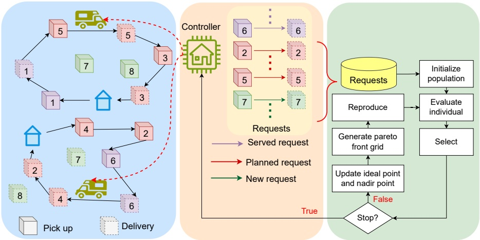
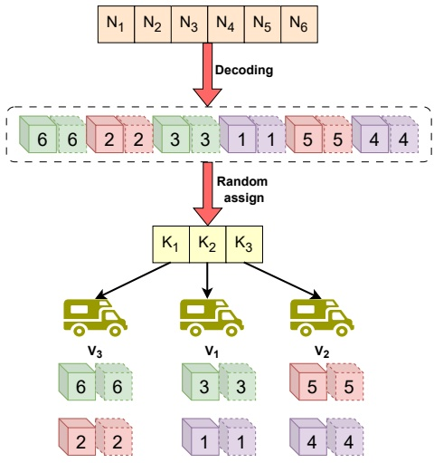
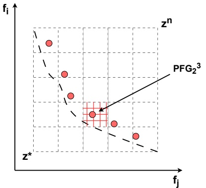
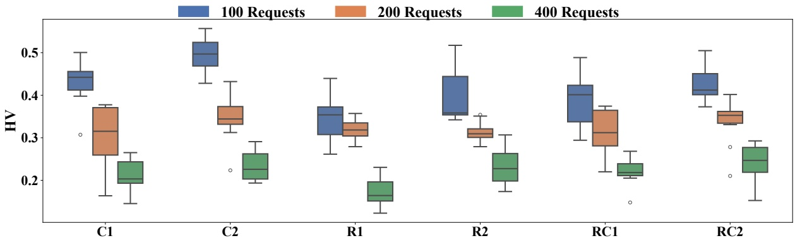
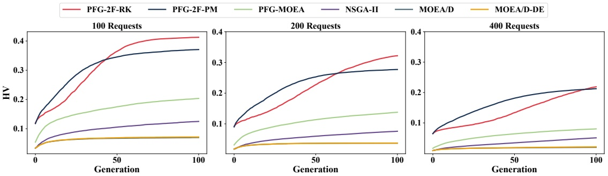
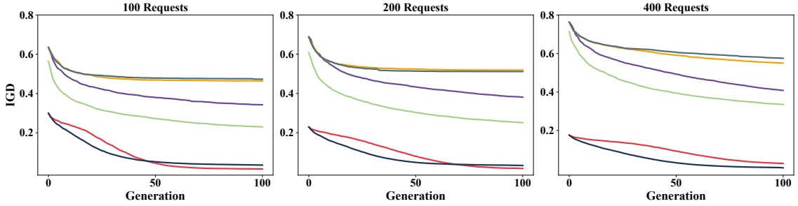

Latest updates: [hps://dl.acm.org/doi/10.1145/3712256.3726467](https://dl.acm.org/doi/10.1145/3712256.3726467)

RESEARCH-ARTICLE

# Pareto Front Grid Guided Multiobjective Optimization In Dynamic Pickup And Delivery Problem Considering Two-Sided Fairness

[HUNG PHAN DUC](https://dl.acm.org/profile/99661650258)[, Hanoi University of Science and Technology, Hanoi, Vietnam](https://dl.acm.org/institution/60071354) [DUC BUI TRONG](https://dl.acm.org/profile/99661650417)[, Hanoi University of Science and Technology, Hanoi, Vietnam](https://dl.acm.org/institution/60071354) [TAM NGUYEN THI](https://dl.acm.org/profile/99661650913)[, Vietnam National University, Hanoi, Hanoi, Vietnam](https://dl.acm.org/institution/60071364) [BINH HUYNH THI THANH](https://dl.acm.org/profile/99660141173)[, Hanoi University of Science and Technology, Hanoi, Vietnam](https://dl.acm.org/institution/60071354)

[Open Access Support](https://libraries.acm.org/acmopen) provided by:

[Hanoi University of Science and Technology](https://dl.acm.org/institution/60071354)

[Vietnam National University, Hanoi](https://dl.acm.org/institution/60071364)

Published: 13 July 2025

[Citation in BibTeX format](https://dl.acm.org/action/exportCiteProcCitation?dois=10.1145%2F3712256.3726467&targetFile=custom-bibtex&format=bibtex)

[GECCO '25: Genetic and Evolutionary](https://dl.acm.org/conference/gecco)

[Computation Conference](https://dl.acm.org/conference/gecco)

July 14 - 18, 2025

Malaga, Spain

Conference Sponsors: [SIGEVO](https://dl.acm.org/sig/sigevo)

# Pareto Front Grid Guided Multiobjective Optimization In Dynamic Pickup And Delivery Problem Considering Two-Sided Fairness

Hung Phan Duc hung.pd214903@sis.hust.edu.vn Hanoi University of Science and Technology Hanoi, Vietnam

Tam Nguyen Thi tamnt@vnu.edu.vn University of Science, Vietnam National University Hanoi, Vietnam

## Abstract

The dynamic delivery problem poses a complex challenge with many practical applications in logistics and transportation. Unlike the static delivery problem, where all order details are known, the dynamic delivery problem deals with continuously evolving information, with only partial data about orders available at any given moment. This paper presents the Multi-objective Dynamic Pickup and Delivery Problem with Time Windows framework, which integrates multiple objectives, including minimizing energy consumption, reducing waiting time, and ensuring fairness for both customers and vehicles. The goal is to lower overall system costs while balancing the customer experience and the workload of service providers. Previous research has primarily focused on optimizing a single objective or converting other objectives into constraints, which can limit the flexibility and effectiveness of the solutions. Our approach tackles this challenge by introducing a Pareto Front Grid-guided Multi-Objective Evolutionary Algorithm that incorporates two-sided fairness—ensuring equitable treatment for customers and service providers. The experimental results reveal that our method substantially outperforms existing multi-objective and single-objective algorithms specifically designed for the dy namic pickup and delivery problem on Hypervolume metric and Inverted Generational Distance metric.

## CCS Concepts

• **Computing methodologies** → **Planning and scheduling**; • **Applied computing** → **Transportation**.

## Keywords

Fairness, Multi-objective optimization, Multi-objective algorithms, Dynamic Pickup and Delivery Problem

Duc Bui Trong ducbt@soict.edu.vn Hanoi University of Science and Technology Hanoi, Vietnam

Binh Huynh Thi Thanh binhht@soict.edu.vn Hanoi University of Science and Technology Hanoi, Vietnam

**ACM Reference Format:** Hung Phan Duc, Duc Bui Trong, Tam Nguyen Thi, and Binh Huynh Thi Thanh. 2025. Pareto Front Grid Guided Multiobjective Optimization In Dynamic Pickup And Delivery Problem Considering Two-Sided Fairness. In Genetic and Evolutionary Computation Conference (GECCO ’25), July 14–18, 2025, Málaga, Spain. ACM, New York, NY, USA, 9 pages. [https://doi.org/10.1145/3712256.3726467](https://doi.org/10.1145/3712256.3726467)

## 1 Introduction

The Dynamic Pickup and Delivery Problem (DPDP) is one of the important and complex variants of the vehicle routing problem, focusing on optimizing the transportation of goods between points in the network. In this problem, each vehicle must complete several orders consisting of two main components: the pickup point from one customer and the delivery point to another [1]. In the static pickup and delivery problem, all transportation requests are known at the planning stage for optimizing the route before vehicles move to minimize costs and transportation time. In contrast, the dynamic variant is more complex because information about the orders is revealed over time. At any given moment, only a part of the infor mation about the requests is known, requiring the system to make decisions nearly immediately based on incomplete data. The routing algorithms and strategies must be flexible and can quickly adapt to continuous environment changes [2]. DPDPs have many realworld applications, especially in modern transportation systems such as express delivery services, e-commerce logistics, and supply chain management. In recent years, Dynamic Pickup and Delivery Problem Considering Time Windows (DPDPTW) have garnered extensive attention in research and industry. Each request must be completed within predefined time constraints involving time windows during which the cargo must be collected or delivered.

However, most works have focused on static cases, little work has been done on the dynamic counterpart of the DPDP. Furthermore, addressing DPDP often involves balancing multiple objectives, such as minimizing energy consumption costs and ensuring fairness in resource allocation. Reducing energy consumption is crucial for sustainability and cost efficiency. At the same time, fairness in service delivery ensures that no customer or request is disproportionately delayed or disadvantaged, which is critical in maintaining equity and customer satisfaction. The combination of dynamic factors and multi-objectives makes the DPDPTW problem more complex.

<small>GECCO ’25, July 14–18, 2025, Málaga, Spain © 2025 Copyright held by the owner/author(s). Publication rights licensed to ACM. ACM ISBN 979-8-4007-1465-8/2025/07 [https://doi.org/10.1145/3712256.3726467](https://doi.org/10.1145/3712256.3726467)</small>

The designed algorithms need to ensure that the execution time is fast enough to provide almost immediate responses to incoming requests while still maintaining a long-term balance between the various objectives. The main contributions of the paper are listed as follows:

• We introduce the Multi-objective Dynamic Pickup and Delivery Problem with Time Windows (MODPDPTW), a multi-objective framework for dynamic pickup and delivery with time windows that addresses traditional logistics challenges while incorporating considerations for energy consumption, customer fairness, and vehicle fairness. The framework ensures equitable service across customers and evenly distributes workload among vehicles, promoting operational efficiency and sustainability.

• We propose Pareto Front Grid guided MOEA considering Two-sided Fairness (PFG-2F), a robust algorithm engineered to effectively explore and exploit the multiobjective solution space by integrating Pareto Front Grid (PFG) with randomkey-based encoding and fairness heuristics.

• Experiments are conducted across various scenarios with different numbers of customers and location distributions. Numerical results demonstrate that PFG-2F outperforms state-of-the-art multi-objective methods in terms of both Hypervolume (HV) and Inverted generational distance (IGD). Furthermore, it surpasses single-objective methods specifically designed for vehicle routing that consider two-sided fairness, underscoring its superior performance.

This paper is structured as follows: Section 2 reviews the literature on DPDPTW and its variations. In Section 3, we detail the problem formulation of MODPDPTW. Our primary contributions are outlined in Section 4, while Section 5 presents an analysis of the computational experiments. Finally, the conclusions are summarized in Section 6.

## 2 Related Works

This section review recent studies related to the DPDP. These studies are classified into two primary categories: exact methods and approximate methods [1]. Exact algorithms guarantee optimal solutions to the problem; however, their applicability to dynamic problems is often limited due to their high computational complexity. In contrast, approximate algorithms, while not ensuring optimality, can yield high-quality solutions within a reasonable computational time. Therefore, we further categorize approximate methods into two main approaches: learning-based techniques and metaheuristic algorithms.

**Learning-based algorithms** for DPDP integrate machine learning techniques with optimization methods to allow systems to learn decision making strategies in dynamic environments, where customer demands and operational conditions evolve over time. In the research [3], the authors introduce the dynamic delivery problem with time constraints, specifically the bi-objective timedependent dynamic pick up and delivery problem (TDPDPLP). This problem has two objectives: minimizing administrative costs and minimizing total late penalties. The study proposes a comprehensive multi-objective reinforcement learning method to solve the bi-objective TDPDPLP, reducing GPU usage during both training and deployment while producing models that can perform efficiently on various problem instances. In the study [4], the authors focus on minimizing the cost for DPDP. They introduce a hierarchical optimization framework to address large-scale DPDPs more effectively. An upper-level agent is designed to dynamically divide the DPDP into sub-problems of varying sizes, optimizing vehicle routes to achieve globally better solutions. A lower-level agent is also developed to solve each sub-problem efficiently by combining the advantages of classical operational research methods with reinforcement learning-based strategies. Li et al. [5] explore the DPDP with constraints on time, LIFO, and back-to-depot, to minimize transportation costs. They introduce a novel graph-based relational learning method for large-scale industry applications, where vehicle relationships in a dynamic dispatching environment are represented through attention-driven graph convolution. Additionally, they propose a constraint embedding technique to futher enhance the efficiency of inference time.

**Metaheuristic algorithms** have been widely applied to solve various combinatorial optimization problems. The main advantage of these methods is their ability to provide high-quality solutions in an acceptable time. The DPDP has made considerable progress, especially with the incorporation of autonomous delivery robots (ADRs) and electric vehicles to improve logistics efficiency and sustainability. Recent research, such as that by [6], has focused on DPDPs involving ADRs. Their study considers energy consumption and recharging strategies to address the unpredictable nature of order arrivals and peak demand periods. They introduce an eassignment algorithm that reassigns previously scheduled orders when a new order arrives. In supply chain management, Zhou et. al [7] proposed a memetic algorithm combining genetic algorithms and local search strategies to solve real-world DPDP. Their extensive experiments demonstrated the effectiveness of this approach in minimizing delivery costs and handling periodic order releases. The authors in [8] introduce a decomposition-based multiobjective evolutionary algorithm to address the complexity of DPDPs with constraints like time windows and vehicle capacity. This approach is a hybrid of multiobjective optimization and tabu search to enhance solution diversity and avoid local optima.

The study [9] introduces a variant of the DPDP that incorporates electric vehicles and time windows, addressing issues like task allocation, routing, and queue scheduling at service sites. A mixed integer linear programming (MILP) model is developed to minimize travel distance and queue time. Additionally, the authors propose an adaptive hybrid neighborhood search algorithm to solve large-scale instances. The experimental results demonstrate the algorithm’s effectiveness in finding competitive solutions. In [10], the authors focus on improve the fairness between service provider and customer in Dynamic Vehicle Routing Problem (DVRP). However, they have main limitations as not considering multi-objective optimization to optimize effectively all the objectives, the encoding scheme and crossover, mutation is still simple, not focus on constrained problem.

In vehicle routing systems involving both providers and customers, fairness is a critical factor for ensuring system sustainability. A lack of fairness can lead to the departure of both providers and customers, thereby undermining the longevity of the system. To establish a balanced system that incorporates fairness, recent studies [11–17] have developed methods aimed at optimizing utility while enhancing fairness among service providers. However, these studies have typically addressed fairness from a single perspective, focusing exclusively on either providers or customers. Recent research [10] has developed a system that considers two-sided fairness for both customers and providers by employing a Genetic Algorithm (GA) specifically designed to optimize all relevant objectives. Despite this advancement, multi-objective approaches that leverage techniques such as multi-objective evolutionary algorithms (MOEAs) to enhance the search for optimal solutions have not been thoroughly explored. These approaches hold the potential to simultaneously optimize multiple conflicting objectives, thereby providing a more comprehensive solution that balances fairness and utility more effectively.

To address these limitations, we introduce the MODPDPTW, wherein a vehicle system serves customer requests that arrive randomly and unpredictably. This problem encompasses multiple objectives, including minimizing consumption costs, improving service quality, and balancing demand among customers and vehicles, making it a nonconvex and NP-hard challenge. In this context, our proposed method employs a multi-objective framework that integrates fairness considerations for both providers and customers within the vehicle routing system. By utilizing advanced multi-objective optimization techniques, we enhance the search process for optimal solutions, ensuring a more equitable distribution of resources and services. This approach overcomes the limitations of previous single-objective and two-sided fairness methods, providing a more robust and balanced solution for sustainable vehicle routing systems.

## 3 Problem Formulation

In this section, we formulate the MODPDPTW problem to schedule a fleet of vehicles to service customer demands in a dynamic environment where demands arrive randomly during the system’s operation. The goal is to enhance the provider’s revenue while ensuring fairness by balancing the workload among vehicles and waiting times among customers.

The real-world map, where a typical MODPDPTW operates, is represented as a directed graph $\mathcal { G } = ( \mathcal { V } , \mathcal { E } )$ . Here, $\mathcal { V }$ denotes the set of all nodes (locations), and $\mathcal { E } \subseteq \mathcal { V }   \times   \mathcal { V }$ represents the set of directed edges (roads connecting different locations). A directed edge from position $i   \mathrm { t o }   j ,$ denoted as $( i , j ) \in \pmb { \mathcal { E } }$ , exists if there is a path enabling travel from 𝑖 to $j .$ Then, $d _ { i j }$ is the distance of the path that the vehicle travels from 𝑖 to $j .$ Let $V$ be a set of 𝐾 homogeneous vehicles, each with capacity $Q ,$ departing from and returning to a common depot daily. Denote $T$ as the system’s operation time. At any time $t   \in   T ,$ each vehicle 𝑣 $\in V$ is defined by its location $l _ { v } ^ { t } ,$ and a set of customer demands $R ^ { t }$ arises at different locations. Each request $r   \in   R ^ { t }$ is represented by a tuple $<   l _ { r } ^ { p } , l _ { r } ^ { d } , q _ { r } , s p _ { r } ^ { b } , s p _ { r } ^ { e } , s d _ { r } ^ { b } , s d _ { r } ^ { e }   > ,$ where $l _ { r } ^ { \not p }$ and $l _ { r } ^ { d }$ are the pickup and delivery locations, $q _ { r }$ is the load of the cargo, $[ s p _ { r } ^ { b } , s p _ { r } ^ { e } ]$ is the soft pickup time window, and $[ s d _ { r } ^ { b } , s d _ { r } ^ { e } ]$ is the soft delivery time window. Regarding the soft time windows, vehicles arriving early wait without penalty, but arriving after the window incurs a delay penalty. Once a vehicle picks up the cargo for request $r ,$ it must complete the corresponding delivery. However, vehicles can sequence multiple pickups before subsequent deliveries, provided the total load does not exceed their capacity. We define the following variables to monitor the scheduling of vehicles:

$x _ { r } ^ { v }$ is a binary variable that equals 1 if demand 𝑟 is served by vehicle 𝑣.

$y _ { r , i j } ^ { v }$ is a binary variable that equals 1 if vehicle 𝑣 traverses arc $( i , j )$ while serving demand 𝑟.

$\tau _ { r } ^ { p }$ represents the time when the cargo for demand 𝑟 is picked ${ \mathfrak { u p } } .$

$\tau _ { r } ^ { d }$ represents the time when the cargo for demand 𝑟 is fully delivered.

**Energy consumption.** The MODPDPTW involves a fleet of fuelpowered vehicles that depart from a depot to serve customers. Based on the mechanical power [18], the constant mechanical power $P _ { i j } ^ { v }$ for vehicle $v \in V$ traveling edge $( i , j ) \in \pmb { \mathcal { E } }$ without considering the gradient of the terrain is calculated as follows:

$$
P _ {i j} ^ {v} = \frac {1}{2} \cdot c _ {d} \cdot \rho \cdot S \cdot \gamma^ {3} + (m _ {v} + \tilde {Q} _ {i j} ^ {v}) \cdot g \cdot c _ {r} \cdot \gamma ,\tag{1}
$$

where $c _ { d }$ is the aerodynamic drag coefficient, $\rho$ is the air density, 𝑆 is the frontal area of the vehicle, $g$ is the gravitational constant, $c _ { r }$ is the rolling friction coefficient, $m _ { v }$ is the curb weight of vehicle, and 𝛾 is the speed of the vehicle. Additionally, $\tilde { Q } _ { i j } ^ { v }$ is the load of the vehicle 𝑣 in edge $( i , j )$

The fuel consumption of the vehicle $v \in V$ when traversing arc $( i , j ) \in \pmb { \mathcal { E } }$ is denoted by $L _ { i j } ^ { v }$ and is calculated as follows:

$$
L _ {i j} ^ {v} = \frac {\xi}{\kappa \cdot \psi} \cdot \left(\omega \cdot R + \frac {P _ {i j} ^ {v}}{\eta}\right) \cdot \frac {d _ {i j}}{\gamma},\tag{2}
$$

where $\xi$ is the fuel-to-air mass ratio, 𝜅 is the heating value of fuel, $\psi$ is the fuel rate conversion factor, and 𝜔 is the engine friction factor. Additionally, 𝑅 and 𝜂 represent the technical parameters of the engine and the drive train efficiency, respectively.

Therefore, energy consumption costs are associated with fuel usage during pickups and deliveries. Based on the referenced energy consumption models, the energy consumption costs $E C$ for the assigned vehicles are calculated as:

$$
f _ {1} = \sum_ {t \in T} \sum_ {r \in R ^ {t}} \sum_ {v \in V} \sum_ {(i, j) \in \mathcal {E}} y _ {r, i j} ^ {v} L _ {i j} ^ {v}.\tag{3}
$$

**Waiting time.** Furthermore, the quality of the service is assessed based on the response time to requests. We define the total waiting time for each demand as follows:

$$
W T _ {r} = \max \left(\tau_ {r} ^ {p} - s p _ {r} ^ {e}, 0\right) + \max \left(\tau_ {r} ^ {d} - s d _ {r} ^ {e}, 0\right), \forall r \in R ^ {t}, t \in T,\tag{4}
$$

where max $\epsilon \Big ( \tau _ { r } ^ { p }   -   s p _ { r } ^ { e } ,   0 \Big )$ and max $\epsilon \Big ( \tau _ { r } ^ { d }   -   s d _ { r } ^ { e } ,   0 \Big )$ represent the waiting time of the request before being picked up and delivered, respectively. The system’s objective is to minimize the waiting time, ensuring that customers receive prompt attention immediately after making a request. This is particularly significant in contexts where the quality of goods deteriorates over time. Therefore, this research optimizes the maximum waiting time of a request, calculated as follows:

$$
f _ {2} = \max _ {r \in R ^ {t}, t \in T} W T _ {r}.\tag{5}
$$

Figure 1: The overview of the proposed algorithm.

**Customer-based Fairness.** Fairness is increasingly important in real-world vehicle routing and scheduling. We address fairness from two perspectives: customer-based, focusing on balancing each customer’s waiting time, and vehicle-based, aiming to distribute the workload among vehicles evenly. Each customer demand has twotime windows corresponding to the pickup and delivery moments. When a vehicle arrives at the pickup or delivery location before the start of the time window, it waits until the task can be performed. However, if the vehicle arrives after the end of the time window, the customers must wait, leading to a decrease in service quality. Then, customer-based fairness is quantified by the variability in wait times across all requests, as follows:

$$
f _ {3} = \sqrt {\frac {1}{n} \sum_ {t \in T} \sum_ {r \in R ^ {t}} \left(W T _ {r} - \frac {1}{n} \sum_ {t \in T} \sum_ {r \in R ^ {t}} W T _ {r}\right) ^ {2}},\tag{6}
$$

where $\begin{array} { r } { n = \sum _ { t \in T } | R ^ { t } | } \end{array}$ is the number of customer demands.

**Vehicle-Provider Fairness.** The workload of each vehicle is calculated based on the total distance traveled by that vehicle. Let $D T _ { v }$ represent the workload of vehicle 𝑣, which is defined as follows:

$$
D T _ {v} = \sum_ {t \in T} \sum_ {r \in R ^ {t}} \sum_ {(i, j) \in \mathcal {E}} y _ {r, i j} ^ {v} d _ {i j}, \forall v \in V.\tag{7}
$$

Instead of focusing solely on profit or revenue, we aim to prevent any particular vehicle from having an excessive workload, thereby achieving a more balanced allocation of trips. Therefore, vehicle based fairness is evaluated based on the disparity in the workload of the vehicles, calculated as follows:

$$
f _ {4} = \sqrt {\frac {1}{K} \sum_ {v \in V} \left(D _ {v} - \frac {1}{K} \sum_ {v \in V} D _ {v}\right) ^ {2}}.\tag{8}
$$

In summary, the MODPDPTW problem is modeled as follows:

$$
\text {minimize} \quad \{f _ {1}, f _ {2}, f _ {3}, f _ {4} \},\tag{9}
$$

$$
\text {subject to.} \quad \sum_ {v \in V} x _ {r} ^ {v} = 1, \forall r \in R ^ {t}, t \in T,\tag{10}
$$

$$
\begin{array}{c} y _ {r, i j} \leq x _ {r} ^ {v}, \forall (i, j) \in \mathcal {E}, r \in R ^ {t}, t \in T, v \in V, \end{array}
$$

$$
\tilde {q} _ {i j} ^ {v, t} \leq Q, \forall (i, j) \in \mathcal {E}, t \in T, v \in V,\tag{11}
$$

$$
\tau_ {r} ^ {p} \geq s p _ {r} ^ {b}, \forall r \in R ^ {t}, t \in T,\tag{12}
$$

(13)

$$
\tau_ {r} ^ {d} \geq s d _ {r} ^ {b}, \forall r \in R ^ {t}, t \in T,\tag{14}
$$

The aim of (9) is to minimize energy consumption costs and the maximum time waiting among customers while maintaining a balance between customer waiting times and workload distribution across vehicles. Constraint (10) ensures that each customer is served exactly once. Constraint (11) stipulates that vehicle 𝑣 only fulfills request 𝑟 if 𝑟 is assigned to 𝑣. Constraint (12) ensures that the load on each vehicle does not exceed its capacity at any point in time. Constraints (13) and (14) guarantee that service times, including pickups and deliveries, adhere to the beginning of each customer’s designated time window.

## 4 Proposed Method

To tackle the problem, we propose a novel algorithm, called PFG-2F, that optimizes multiple objectives based on the Pareto Front grid [19]. Additionally, the algorithm utilizes a two-level encoding, where the upper level represents the order of vehicles, while the lower level corresponds to the assignment of requests to vehicles. Requests are assigned uniformly to vehicles to enhance the balance of their workload and improve the convergence speed of the algo rithm. Furthermore, a priority heuristic is incorporated into the solution decoding process to ensure adherence to time constraints and to minimize customer waiting times.

Figure 1 illustrates the framework of the proposed algorithm. To address the dynamic environment, where requests arrive randomly and unpredictably, we divide the system’s operation time into time slots for monitoring and responding to requests. In each time slot, the central controller collects new request information, and vehicles only begin processing newly assigned requests after completing those from previous time slots. In particular, a solution is implemented based on the goal of providers. The PFG-2F algorithm selects the solution that represents the intersection of hyperplane formed by obtained Pareto front with the line connecting the ideal point and the nadir point. This solution is considered effective in balancing the objective functions. If no such solution exists, the algorithm selects the solution closest to this ideal point.

Figure 2: Individual Representation.

## 4.1 Individual Representation

In [10], the Leader-based Random Keys Encoding Scheme (LERK) is introduced to represent complete solutions. Specifically, Leader Keys determine the sequence of service providers, and the subsequent assignment of all requests follows this ordering. This random key encoding strategy has been shown to be effective in generating diverse solutions within the objective space. In order to promote equitable distribution of workload among vehicle providers, we propose an enhanced version of LERK that incorporates heuristic initialization. Figure 2 demonstrates an example of individual representation. Our methodology comprises two main components: (1) Fairness Heuristics Initialization and (2) an Urgent Time Ordering Rule. The former ensures a balanced allocation of requests across all vehicles, while the latter reorders requests based on the urgency of their time windows. By initially distributing requests equally among vehicles and then prioritizing more urgent time windows, the approach fosters fairness among providers and helps ensure that tightly constrained time windows are served promptly.

**Fairness Heuristics Initialization**. Consider a system with 𝐾 vehicles responsible for fulfilling all customer requests. To encourage fairness among vehicle-providers, we first divide the requests equally among vehicles. Although requests are initially assigned in an equitable manner, these assignments can be subsequently refined via crossover and mutation operations in evolutionary process.

Algorithm 1 Generate PFG

Require: population, the number of segments GK, the number of objectives $m$, the idea point $z^* = [z_1^*, ..., z_m^*]$, the nadir point $z^n = [z_1^n, ..., z_m^n]$, a small positive value $\sigma$;
Ensure: Pareto front grid $\{PFG_j^i\}, \forall j = 1, ..., GK, i = 1, ..., m$;
for $j \leftarrow 1$ to $m$ do
    $d_j \leftarrow (z_j^n - z_j^* + 2\sigma) / \text{GK}$
end for
for all $x \in \text{Pop do}$
    for $j \leftarrow 1$ to $m$ do
        $\text{Grid}_j(x) \leftarrow \left\lceil \frac{f_j(x) - z_j^* + \sigma}{d_j} \right\rceil$
    end for
end for
for $i \leftarrow 1$ to $m$ do
    for $j \leftarrow 1$ to GK do
        $S_i(j) \leftarrow \text{individuals depending on the } j\text{-th segment of the } i\text{-th objective;}$
        $g_{\min} \leftarrow \min\{\text{Grid}(S_i(j))\}$
        for all $x \in S_i(j)$ do
            if $\text{Grid}_j(x) = g_{\min}$ then
                $PFG_j^i \leftarrow PFG_j^i \cup \{x\}$
            end if
        end for
    end for
end for

**Urgent Time Ordering Rule**. In many routing scenarios, each vehicle $k \in K$ receives a subset of pickup or delivery requests, each constrained by a time window. To prioritize requests facing more urgent deadlines, we reorder the assigned requests in ascending order of their due times. Let $\tilde { \mathbf { p } } _ { k }$ denote the route sequence of vehicle 𝑘 after reordering, which is defined as follows

$$
\tilde {\mathbf {p}} _ {k} = \mathrm{ReOrder} (\mathbf {p} _ {k}),\tag{15}
$$

where $\mathfrak { p } _ { k }$ is the set of requests assigned to vehicle 𝑘, and ReOrder(·) arranges requests in ascending order based on the closing time of their time windows. This ordering procedure ensures that requests with earlier deadlines or narrower time windows are handled first. Consequently, on-time arrivals and successful service completion are facilitated for each vehicle’s route.

## 4.2 Pareto Front Grid generation

Pareto Front Grid guided Multi-Objective Evolutionary Algorithm (PFG-MOEA), first proposed in [19], has proven effective for identifying high-quality solutions in multi-objective optimization. The strategy leverages Pareto Front to improve the searching approach to guide the evolutionary process by partitioning the objective space into grids and retaining leading individuals within each grid cell. This method focuses the search on the most promising regions of the objective space, thereby enhancing both the quality of the solutions and the efficiency of the search.

The algorithm employs two well-established reference points in the multi-objective space: the ideal point $z ^ { * }$ and the nadir point $z ^ { n }$ Both points are updated at each evolutionary iteration. The ideal point represents the optimal values for each objective, highlighting solutions on the Pareto front that demonstrate significant trade offs among objectives. In contrast, the nadir point corresponds to the worst objective values within the Pareto optimal set. These reference points are utilized to construct the PFG, as illustrated in Figure 3. The generation of PFG is detailed in Algorithm 1.

Figure 3: Pareto Front Grid generation.

## 4.3 Reproduction

PFG is employed to generate grids that partition the objective space, thereby grouping solutions into different regions. Within each grid, selection is conducted via non-dominated sorting, and the ideal point $z ^ { * }$ is then computed. Any solutions lying farthest from the hyperplane defined by $z ^ { * }$ are removed. Then, two solutions are randomly chosen from the mating pool 𝑃 to serve as parents. To foster diversity both within the same PFG and across the entire population, crossover is governed by a probabilistic rate 𝜖, as shown in Equation 16. With probability $\epsilon ,$ the parents are drawn from consecutive grids $( \mathrm { i . e . , } \; P F G _ { i } ^ { j } \cup P F G _ { i + 1 } ^ { j } ) ;$ otherwise, they are taken from the entire population pop. Therefore, $P$ is define as

$$
P = \left\{ \begin{array}{l l} P F G _ {i} ^ {j} \cup P F G _ {i + 1} ^ {j}, & \text {if} \mathcal {U} [ 0, 1 ] <   \epsilon , \\ \text {pop}, & \text {otherwise.} \end{array} \right.\tag{16}
$$

where $\mathcal { U } [ 0 , 1 ]$ denotes a uniform random variable.

## 5 Experiments and Results

## 5.1 Experimental Setting

The dataset is developed based on the Pickup and Delivery Problem with Time Windows [20], ensuring authenticity and diversity to reflect real-world scenarios. It consists of 180 instances tailored for time slot routing and is categorized into three types: 100 requests, 200 requests, and 400 requests. Each instance is named using the format [dis][category]\_[type]\_[index], where dis indicates the customer distribution type of the instance, including R for random, C for clustered, and RC for combined, category represents the difficulty level based on time windows (1 for narrower and 2 for wider and more flexible), and type denotes the number of locations in the dataset (for example, a 100 request instance includes 200 locations). The number of vehicle-providers is scaled up to fit for each dynamic circumstances in the dataset. Hence, we create 18 different distribution to evaluate the effectiveness of all algorithms.

All parameters are set up to be adapted to real world scenarios, we use the configuration to calculate energy consumption as the setup described in [18]. The problem parameters are set as follow: $c _ { d }   =   0 . 7 ,   c _ { r }   =   0 . 0 1 ,   \xi   =   1 ,   \eta   =   0 . 3 6 ,   m _ { v }   =   3 . 2   \mathsf { t o n s } ,   \psi   =$ 737 liters/gram, $\gamma = 40    km/h ,   \kappa = 44    kJ/gram ,   g = 9.81    m/s ^2,   \rho =$ $1 . 2 0   \mathrm { k g } / \mathrm { m } ^ { 3 } , \omega = 0 . 2   \mathrm { k J } / ( \mathrm { r e v }   \cdot   \mathrm { l i t e r } ) , S = 3 . 9 1 2   \mathrm { m } ^ { 2 } , R = 1 6 5$ liters·rev/s. These values are used consistently in all subsequent calculations.

This paper evaluates the performance of PFG-2F against the original PFG-MOEA [19] and other state-of-the-art multi-objective baseline algorithms, including NSGA-II [21], MOEA/D [22], and MOEA/D-DE [23]. To assess the effectiveness of the Random-Key encoding scheme, we develop a variant of PFG-2F named PFG-2F-PM, which employs a permutation encoding scheme combined with Partially Mapped Crossover (PMX) [24]. This variant is compared to the proposed algorithm, referred to as PFG-2F-RK, to determine the impact of the encoding strategy on overall performance.

To assess multi-objective algorithm performance, two key metrics are used: HV [25] and IGD [26]. The HV metric measures the dominated volume in the objective space, reflecting both convergence and diversity. Higher HV values indicate better performance.

$$
H V = \int_ {f _ {\min}} ^ {f _ {z ^ {n}}} \prod_ {i = 1} ^ {m} (f _ {i} ^ {z ^ {n}} - f _ {i}) d f,\tag{17}
$$

Conversely, the IGD metric evaluates convergence and distribution by measuring the average distance from the reference Pareto set to the obtained solutions, as in Equation 18. Lower IGD values imply closer proximity to the true Pareto front.

$$
I G D = \frac {1}{| Q |} \sum_ {q \in Q} \min _ {p \in \mathcal {P}} \| q - p \| _ {2},\tag{18}
$$

where $Q$ is the reference Pareto set, $\mathcal { P }$ is the obtained non-dominated set, and ∥ · ∥2 denotes the Euclidean distance.

## 5.2 Experimental Results

Table 1 demostrates the average HV values of the evaluated algorithms across various scenarios. The results indicate that the proposed algorithm consistently outperforms existing approaches in nearly all instances. Among the compared methods, the algorithms incorporating the Pareto front grid and equal workload distribution among vehicles exhibit substantial improvements over the remaining approaches. Notably, PFG-2F with the Random-Key Encoding scheme achieves a marginal improvement over the Permutation Encoding scheme. This improvement can be attributed to the inherent limitations of genetic operators in the Permutation Encoding scheme, which are less effective in the reproduction process compared to the equal workload division strategy. In contrast, the Random-Key Encoding scheme offers greater flexibility and a more effective exploration of the solution space. Although PFG-MOEA follows an evolutionary trend guided by the Pareto front grid, fairness objectives are not explicitly considered. When the number of requests remains constant, PFG-2F-RK demonstrates the most significant improvement in scenarios where customer locations exhibit a clustered distribution. With customer locations are randomly distributed, the proposed algorithm continues to maintain superior performance relative to other approaches. However, when combining both random and clustered distributions, the fairness mechanism of PFG-2F-RK encounters challenges, leading to a reduction in performance gains. Despite these challenges, the proposed algorithm remains more effective across the majority of instances. Furthermore, as the number of requests increases, its performance remains stable despite capacity and resource constraints. This finding highlights the robustness and adaptability of PFG-2F-RK in handling complex and dynamic problem environments.

Table 1: HV values of algorithms

|  | NSGA-II | MOEA/D | MOEA/D-DE | PFG-MOEA | PFG-2F-PM | PFG-2F-RK |
| --- | --- | --- | --- | --- | --- | --- |
| C001 R RC | 0.138 ± 0.030.081 ± 0.020.043 ± 0.02 | 0.077 ± 0.030.038 ± 0.010.018 ± 0.01 | 0.081 ± 0.020.038 ± 0.010.020 ± 0.01 | 0.209 ± 0.040.150 ± 0.030.086 ± 0.02 | 0.412 ± 0.050.287 ± 0.040.212 ± 0.03 | 0.463 ± 0.060.325 ± 0.070.223 ± 0.04 |
| C002 R RC | 0.113 ± 0.040.077 ± 0.020.052 ± 0.02 | 0.067 ± 0.030.037 ± 0.010.018 ± 0.01 | 0.064 ± 0.030.039 ± 0.010.021 ± 0.01 | 0.192 ± 0.050.132 ± 0.030.074 ± 0.03 | 0.331 ± 0.050.273 ± 0.030.211 ± 0.04 | 0.370 ± 0.060.316 ± 0.020.203 ± 0.05 |
| C004 R RC | 0.124 ± 0.040.070 ± 0.020.057 ± 0.02 | 0.066 ± 0.020.036 ± 0.010.023 ± 0.01 | 0.071 ± 0.020.036 ± 0.010.022 ± 0.01 | 0.209 ± 0.040.131 ± 0.030.081 ± 0.03 | 0.369 ± 0.060.271 ± 0.050.215 ± 0.02 | 0.406 ± 0.060.324 ± 0.050.231 ± 0.04 |

Table 2: IGD values of algorithms

|  | NSGA-II | MOEA/D | MOEA/D-DE | PFG-MOEA | PFG-2F-PM | PFG-2F-RK |
| --- | --- | --- | --- | --- | --- | --- |
| C001 R RC | 0.353 ± 0.050.369 ± 0.060.435 ± 0.09 | 0.481 ± 0.070.517 ± 0.070.586 ± 0.12 | 0.468 ± 0.060.523 ± 0.070.558 ± 0.10 | 0.258 ± 0.040.241 ± 0.050.298 ± 0.06 | 0.039 ± 0.030.033 ± 0.040.006 ± 0.01 | 0.020 ± 0.020.017 ± 0.020.026 ± 0.01 |
| C002 R RC | 0.325 ± 0.080.372 ± 0.070.401 ± 0.10 | 0.450 ± 0.080.505 ± 0.080.590 ± 0.11 | 0.454 ± 0.090.504 ± 0.080.541 ± 0.10 | 0.201 ± 0.070.247 ± 0.070.370 ± 0.09 | 0.030 ± 0.030.024 ± 0.020.004 ± 0.00 | 0.010 ± 0.010.018 ± 0.010.035 ± 0.02 |
| C004 R RC | 0.350 ± 0.060.402 ± 0.060.389 ± 0.09 | 0.488 ± 0.070.513 ± 0.080.551 ± 0.08 | 0.470 ± 0.070.530 ± 0.090.552 ± 0.09 | 0.232 ± 0.050.265 ± 0.060.335 ± 0.08 | 0.038 ± 0.040.040 ± 0.030.008 ± 0.01 | 0.017 ± 0.020.017 ± 0.020.026 ± 0.02 |

Figure 4: Effectiveness of PFG-2F over all instances.

Meanwhile, PFG-MOEA and NSGA-II continue to improve beyond the 100th generation; however, their progress remains marginal compared to the proposed algorithm in terms of both convergence speed and solution quality. Similarly, this paper presents the average IGD values and convergence trends in Table 2 and Figure 5b, respectively. The improvement achieved by PFG-2F-RK follows a similar pattern to that observed for HV. However, PFG-2F-PM outperforms the proposed algorithm on datasets where customer distribution combines both random and clustered patterns.

Additionally, we visualize the convergence of the algorithms in Figure 5a. Although PFG-2F-PM demonstrates superior exploration capability during the first 50 generations compared to the proposed algorithm, it quickly becomes trapped in local optima. In contrast, PFG-2F-RK continues to improve, although at a decreasing rate as it approaches convergence. The MOEA/D and MOEA/D-DE algorithms exhibit early convergence, often settling in local optima.

Figure 4 illustrates the effectiveness of PFG-2F-RK across 18 scenarios. Each scenario combines 100, 200, or 400 requests with one of six distributions (C1, C2, R1, R2, RC1, RC2). As the number of requests increases, performance tends to decline because the algorithm must handle a larger search space with the same number of generations. Among all distributions, C2 yields the most favorable outcomes, while those with narrower time windows exhibit more variability. The worst performance occurs under R1, primarily due to the randomness of the data and tighter time constraints.

(a) HV convergence trend of PFG-2F compared to other benchmarks.

(b) IGD convergence trend of PFG-2F compared to other benchmarks.

Figure 5: HV and IGD convergence across different instances.

Table 3: Improvement of PFG-2F compared to FairGA

| Dis | EC imp (%) | VF imp (%) | CF imp (%) | MWT imp (%) |
| --- | --- | --- | --- | --- |
| C1 | 15.42 | 69.15 | 39.74 | 40.11 |
| C2 | 18.74 | 58.04 | 45.75 | 36.18 |
| R1 | 16.29 | 64.83 | 28.85 | 34.46 |
| R2 | 14.56 | 59.95 | 58.11 | 49.19 |
| RC1 | 17.62 | 64.90 | 31.35 | 33.60 |
| RC2 | 15.85 | 64.40 | 58.87 | 52.21 |

To evaluate the effectiveness of PFG-2F in comparison to singleobjective algorithms, we benchmark it against FairGA [10]. FairGA is specifically designed to optimize the total distance traveled while incorporating two-sided fairness considerations. It achieves this by integrating two fairness objectives related to reproduction alongside its primary distance optimization. Since PFG-2F generates a set of non-dominated solutions due to its multi-objective nature, we select a single representative solution for comparison. The PFG-2F algorithm chooses the solution that corresponds to the intersection of the hyperplane created by the obtained Pareto front and the line connecting the ideal and nadir points. This solution is deemed effective for balancing the objective functions. If no such solution is found, the algorithm selects the solution nearest to the ideal point. The improvement of algorithm 𝐴 compared to algorithm 𝐵 for instance 𝑖 is %𝑖𝑚𝑝 (𝐴, 𝐵, 𝑖), which is calculated as %𝑖𝑚𝑝 (𝐴, 𝐵, 𝑖) = $\frac{f(B,i)-f(A,i)}{f(B,i)}\times100\%$ , where $f ( \cdot )$ is the considered objective value.

Table 3 presents the percentage improvements of PFG-2F over FairGA across different instances. The results indicate a significant enhancement in the energy consumption (EC) objective, which is the primary focus of FairGA. Additionally, PFG-2F demonstrates superior performance in the remaining three objectives: customer fairness (CF), vehicle fairness (VF), and time window constraint satisfaction (MWT). These findings highlight the advantage of em ploying a multi-objective approach, as PFG-2F effectively balances and improves multiple objectives simultaneously, as evidenced by the increased HV and IGD.

## 6 Conclusions

This paper introduces the Multi-objective Dynamic Pickup and Delivery Problem with Time Windows, addressing the complexities of dynamic logistics by integrating objectives such as minimizing energy consumption, reducing waiting times, and ensuring fairness for both customers and service providers. We propose a multiobjective algorithm based on Pareto Front Grid generation, incorporates two-sided fairness, enhancing solution flexibility and effectiveness beyond existing single and multi-objective approaches. Experimental results demonstrate that our method significantly outperforms state-of-the-art algorithms on HV and IGD metrics, showcasing its superior convergence and diversity. In the future, integrating machine learning-based heuristics may be a promising approach to optimizing vehicle task allocation, further improving the efficiency and adaptability of dynamic delivery systems.

## References

[1] Cai, J.; Zhu, Q.; Lin, Q.; Ma, L.; Li, J.; Ming, Z. A survey of dynamic pickup and delivery problems. Neurocomputing 2023, 126631.

[2] Tran, H.-A.; Duong, C.-S.; Bui, T.-D.; Tong, V.; Binh, H. T. T. GAMR: Revolutionizing Multi-Objective Routing in SDN Networks With Dynamic Genetic Algorithms. IEEE Transactions on Emerging Topics in Computational Intelligence 2025,

[3] Santiyuda, G.; Wardoyo, R.; Pulungan, R.; Vincent, F. Y. Multi-objective reinforcement learning for bi-objective time-dependent pickup and delivery problem with late penalties. Engineering Applications of Artificial Intelligence 2024, 128, 107381.

[4] Ma, Y.; Hao, X.; Hao, J.; Lu, J.; Liu, X.; Xialiang, T.; Yuan, M.; Li, Z.; Tang, J.; Meng, Z. A hierarchical reinforcement learning based optimization framework for largescale dynamic pickup and delivery problems. Advances in neural information processing systems 2021, 34, 23609–23620.

[5] Li, X.; Luo, W.; Yuan, M.; Wang, J.; Lu, J.; Wang, J.; Lü, J.; Zeng, J. Learning to optimize industry-scale dynamic pickup and delivery problems. 2021 IEEE 37th international conference on data engineering (ICDE). 2021; pp 2511–2522.

[6] Jeong, J.; Moon, I. Dynamic pickup and delivery problem for autonomous delivery robots in an airport terminal. Computers & Industrial Engineering 2024, 196, 110476.

[7] Zhou, Y.; Kong, L.; Yan, L.; Liu, Y.; Wang, H. A memetic algorithm for a real-world dynamic pickup and delivery problem. Memetic Computing 2024, 1–15.

[8] Cai, J.; Zhu, Q.; Lin, Q.; Ming, Z.; Tan, K. C. Decomposition-Based Multiobjective Evolutionary Optimization With Tabu Search for Dynamic Pickup and Delivery Problems. IEEE Transactions on Intelligent Transportation Systems 2024,

[9] Zhou, S.; Zhang, D.; Yuan, W.; Wang, Z.; Zhou, L.; Bell, M. G. Pickup and delivery problem with electric vehicles and time windows considering queues. Transportation Research Part C: Emerging Technologies 2024, 167, 104829.

[10] Kang, Y.; Zhang, R.; Shao, W.; Salim, F.; Chan, J. Promoting Two-sided Fairness in Dynamic Vehicle Routing Problems. Proceedings of the Genetic and Evolutionary Computation Conference. 2024; p 759–767.

[11] Suhr, T.; Biega, A. J.; Zehlike, M.; Gummadi, K. P.; Chakraborty, A. Two-Sided Fairness for Repeated Matchings in Two-Sided Markets: A Case Study of a Ride-Hailing Platform. Proceedings of the 25th ACM SIGKDD International Conference on Knowledge Discovery & Data Mining 2019,

[12] Lesmana, N. S.; Zhang, X.; Bei, X. Balancing Efficiency and Fairness in On-Demand Ridesourcing. Advances in Neural Information Processing Systems. 2019.

[13] Nanda, V.; Xu, P.; Sankararaman, K.; Dickerson, J.; Srinivasan, A. Balancing the Tradeoff between Profit and Fairness in Rideshare Platforms during High-Demand Hours. Proceedings of the AAAI Conference on Artificial Intelligence 2020, 34, 2210–2217.

[14] Xu, Y.; Xu, P. Trade the system efficiency for the income equality of drivers in rideshare. Proceedings of the Twenty-Ninth International Joint Conference on Artificial Intelligence. 2021.

[15] Shi, D.; Tong, Y.; Zhou, Z.; Song, B.; Lv, W.; Yang, Q. Learning to Assign: Towards Fair Task Assignment in Large-Scale Ride Hailing. 2021; pp 3549–3557.

[16] Raman, N.; Shah, S.; Dickerson, J. Data-Driven Methods for Balancing Fairness and Efficiency in Ride-Pooling. Proceedings of the Thirtieth International Joint Conference on Artificial Intelligence, IJCAI-21. 2021; pp 363–369, Main Track.

[17] Gupta, A.; Yadav, R.; Nair, A.; Chakraborty, A.; Ranu, S.; Bagchi, A. FairFoody: Bringing In Fairness in Food Delivery. Proceedings of the AAAI Conference on Artificial Intelligence 2022, 36, 11900–11907.

[18] Chen, W.; Zhang, D.; Van Woensel, T.; Xu, G.; Guo, J. Green vehicle routing using mixed fleets for cold chain distribution. Expert Systems with Applications 2023, 233, 120979.

[19] Xu, Y.; Zhang, H.; Huang, L.; Qu, R.; Nojima, Y. A Pareto Front grid guided multi-objective evolutionary algorithm. Applied Soft Computing 2023, 136, 110095.

[20] Li, H.; Lim, A. A Metaheuristic for the Pickup and Delivery Problem with Time Windows. 2001; pp 160–167.

[21] Deb, K.; Pratap, A.; Agarwal, S.; Meyarivan, T. A fast and elitist multiobjective genetic algorithm: NSGA-II. IEEE Transactions on Evolutionary Computation 2002, 6, 182–197.

[22] Zhang, Q.; Li, H. MOEA/D: A Multiobjective Evolutionary Algorithm Based on Decomposition. IEEE Transactions on Evolutionary Computation 2007, 11, 712–731.

[23] Li, H.; Zhang, Q. Multiobjective Optimization Problems With Complicated Pareto Sets, MOEA/D and NSGA-II. IEEE Transactions on Evolutionary Computation 2009, 13, 284–302.

[24] Goldberg, D. E. Alleles, loci and the traveling salesman problem. 1985.

[25] Zitzler, E.; Thiele, L. Thiele, L.: Multiobjective Evolutionary Algorithms: A Comparative Case Study and the Strength Pareto Approach. IEEE Trans. on Evolutionary Computation 3, 257-271. IEEE Transactions on Evolutionary Computation 2000, 3.

[26] Coello, C.; Cortés, N. Solving Multiobjective Optimization Problems Using an Artificial Immune System. Genetic Programming and Evolvable Machines 2005, 6, 163–190.