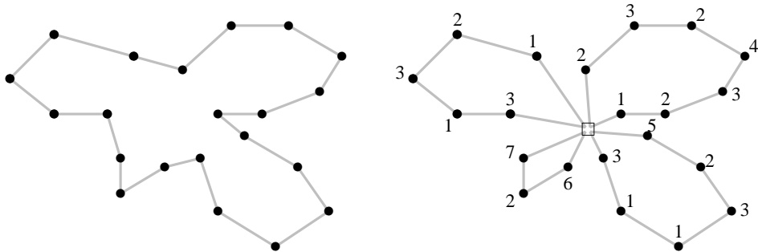
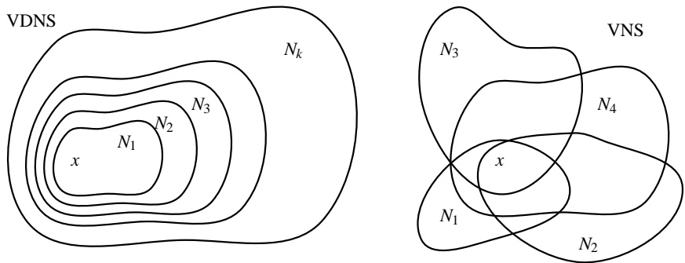
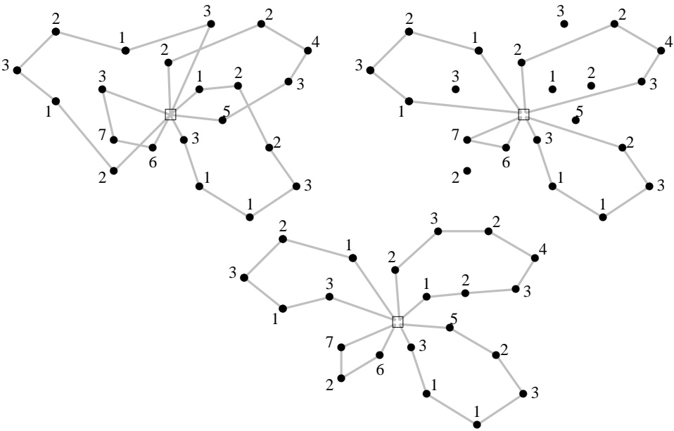
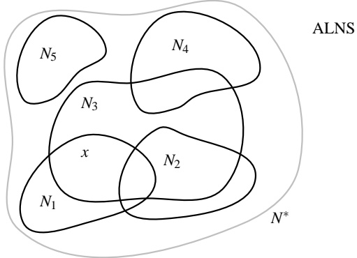

# Large Neighborhood Search

**Pisinger, David; Røpke, Stefan**

Published in: Handbook of Metaheuristics

Publication date: 2010

[Link back to DTU Orbit](https://orbit.dtu.dk/en/publications/61a1b7ca-4bf7-4355-96ba-03fcdf021f8f)

Citation (APA): Pisinger, D., & Røpke, S. (2010). Large Neighborhood Search. In M. Gendreau (Ed.), Handbook of Metaheuristics (2 ed., pp. 399-420). Springer.

<small>General rights</small>

<small>Copyright and moral rights for the publications made accessible in the public portal are retained by the authors and/or other copyright owners and it is a condition of accessing publications that users recognise and abide by the legal requirements associated with these rights.</small>

<small> Users may download and print one copy of any publication from the public portal for the purpose of private study or research.</small>

<small> You may not further distribute the material or use it for any profit-making activity or commercial gain</small>

<small> You may freely distribute the URL identifying the publication in the public portal</small>

<small>If you believe that this document breaches copyright please contact us providing details, and we will remove access to the work immediately and investigate your claim.</small>

# Large neighborhood search

David Pisinger and Stefan Ropke

## Abstract

Heuristics based on large neighborhood search have recently shown outstanding results in solving various transportation and scheduling problems. Large neighborhood search methods explore a complex neighborhood by use of heuristics. Using large neighborhoods makes it possible to find better candidate solutions in each iteration and hence traverse a more promising search path.

Starting from the large neighborhood search method, we give an overview of very large scale neighborhood search methods and discuss recent variants and extensions like variable depth search and adaptive large neighborhood search.

## 1 Introduction

The topic of this chapter is the metaheuristic Large Neighborhood Search (LNS) proposed by Shaw [51]. In LNS, an initial solution is gradually improved by alternately destroying and repairing the solution. The LNS heuristic belongs to the class of heuristics known as Very Large Scale Neighborhood search (VLSN) algorithms [2]. All VLSN algorithms are based on the observation that searching a large neighborhood results in finding local optima of high quality, and hence overall a VLSN algorithm may return better solutions. However, searching a large neighborhood is time consuming, hence various filtering techniques are used to limit the search. In VLSN algorithms, the neighborhood is typically restricted to a subset of the solutions which can be searched efficiently. In LNS the neighborhood is implicitly defined by methods (often heuristics) which are used to destroy and repair an incumbent solution.

<small>Do isinger Department of Management Engineering, Technical University of Denmark, Produktionstorvet, Building 426, 2800 Kgs. Lyngby, Denmark, e-mail: pisinger@man.dtu.dk</small>

<small>Stefan Ropke Department of Transport, Technical University of Denmark, Bygningstorvet, Building 115, 2800 Kgs. Lyngby, Denmark, e-mail: sr@transport.dtu.dk</small>

The two similar terms LNS and VLSN may cause confusion. We consistently use VLSN for the broad class of algorithms that searches very large neighborhoods and LNS for the particular metaheuristic, belonging to the class of VLSN algorithms, that is described in Section 2.

In the rest of the introduction we first define two example problems in Section 1.1. We then define neighborhood search algorithms in Section 1.2 and the class of VLSN algorithms in Section 1.3. In Sections 1.3.1–1.3.3 we describe three subclasses of VLSN algorithms. In Section 2 we describe the LNS heuristic and an extension called adaptive large neighborhood search. This is followed in Section 3 by a survey of LNS applications and the chapter is concluded in Section 4.

## 1.1 Example problems

Throughout this chapter we will refer to two example problems: the Traveling Salesman Problem (TSP) and the Capacitated Vehicle Routing Problem (CVRP). The TSP is probably the most studied and well-known combinatorial optimization problem. In the TSP a salesman has to visit a number of cities. The salesman must perform a tour through all the cities such that the salesman returns to his starting city at the end of the tour. More precisely we are given an undirected graph $G = ( V ,   E )$ in which each edge $e \in E$ has an associated cost $c _ { e }$ . The goal of the TSP is to find a cyclic tour, such that each vertex is visited exactly once. The sum of the edge costs used in the tour must be minimized. We recommend [3] for more information about the TSP.

In the CVRP, which is a generalization of the TSP, one has to serve a set of customers using a fleet of homogeneous vehicles based at a common depot. Each customer has a certain demand for goods which initially are located at the depot. The task is to design vehicle routes starting and ending at the depot such that all customer demands are fulfilled.

The CVRP can be defined more precisely as follows. We are given an undirected graph $G = ( V ,   E )$ with vertices $V = \{ 0 , \ldots , n \}$ where vertex 0 is the depot and the vertices $N = \{ 1 , \ldots , n \}$ are customers. Each edge $e \in E$ has an associated cost $c _ { e }$ The demand of each customer $i \in N$ is given by a positive quantity $q _ { i }$ . Moreover, m homogeneous vehicles are available at the depot and the capacity of each vehicle is equal to $Q .$ The goal of the CVRP is to find exactly m routes, starting and ending at the depot, such that each customer is visited exactly once by a vehicle and such that the sum of demands of the customers on each route is less than or equal to $Q .$ The sum of the edge costs used in the m routes must be minimized. We recommend [55] for further information about the CVRP and vehicle routing problems in general. An example of a TSP and a CVRP solution are shown in Figure 1.

Fig. 1 Left: a TSP solution. Right: A CVRP solution. In the CVRP the depot is marked with a square and the customers i are marked with nodes each having a demand qi

## 1.2 Neighborhood search

In this section we formally introduce the term neighborhood search. We are given an instance I of a combinatorial optimization problem where X is the set of feasible solutions for the instance (we write $X ( I )$ when we need to emphasize the connection between instance and solution set) and $c : X \to \mathbb { R }$ is a function that maps from a solution to its cost. X is assumed to be finite, but is usually an extremely large set. We assume that the combinatorial optimization problem is a minimization problem, that is, we want to find a solution $x ^ { * }$ such that $c ( x ^ { * } ) \leq c ( x )   \forall x \in X$

We define a neighborhood of a solution $x \in X$ as $N ( x ) \subseteq X$ . That is, N is a function that maps a solution to a set of solutions. A solution x is said to be locally optimal or a local optimum with respect to a neighborhood N if $c(x) \leq c(x') \forall x' \in N(x)$ With these definitions it is possible to define a neighborhood search algorithm. The algorithm takes an initial solution x as input. It computes $x ^ { \prime } = \arg \min _ { x ^ { \prime \prime } \in N ( x ) } \{ c ( x ^ { \prime \prime } ) \}$ that is, it finds the cheapest solution $x ^ { \prime }$ in the neighborhood of x. $\operatorname { I f } c ( x ^ { \prime } ) \stackrel { \cdot \cdot \cdot } { < } c ( x )$ then the algorithm performs the update $x = x ^ { \prime }$ . The neighborhood of the new solution x is searched for an improving solution and this is repeated until a local optimum x is reached. When this happens the algorithm stops. The algorithm is denoted a steepest descent algorithm as it always chooses the best solution in the neighborhood.

A simple example of a neighborhood for the TSP is the $2 – o p t$ neighborhood which can be traced back to [15]. The neighborhood of a solution x in the 2-opt neighborhood is the set of solutions that can be reached from x by deleting two edges in x and adding two other edges in order to reconnect the tour. A simple example of a neighborhood for the CVRP is the relocate neighborhood (see e.g. [27]). In this neighborhood, $N ( x )$ is defined as the set of solutions that can be created from x by relocating a single customer. The customer can be moved to another position in its current route or to another route.

We define the size of the neighborhood $N ( \cdot )$ for a particular instance I as max $\{ | N ( x ) | : x \in X ( I ) \}$ . Let ${ \mathcal { I } } ( n )$ be the (possibly infinite) set of all instances of size n of the problem under study. We can then define the size of a neighborhood as a function $f ( n )$ of the instance size n: $f(n) = \max \left\{ \left| N(x) \right| : I \in \mathcal{I}(n), x \in X(I) \right\}$

The 2-opt neighborhood for the TSP as well as the relocate neighborhood for the CVRP have size $f ( n ) = O ( n ^ { 2 } )$ where n is the number of cities/customers.

## 1.3 Very large-scale neighborhood search

Ahuja et al. [2] define and survey the class of VLSN algorithms. A neighborhood search algorithm is considered as belonging to the class of VLSN algorithms if the neighborhood it searches grows exponentially with the instance size or if the neighborhood is simply too large to be searched explicitly in practice. Clearly, the class of VLSN algorithms is rather broad. Ahuja et al. [2] categorize VLSN into three classes: 1) variable depth methods, 2) network flow based improvement methods, 3) methods based on restriction to subclasses solvable in polynomial time. We will describe the three classes in more detail in Sections 1.3.1, 1.3.2 and 1.3.3, respectively. Notice that although the concept of VLSN was not formalized until recently, algorithms based on similar principles have been used for decades.

Intuitively, searching a very large neighborhood should lead to higher quality so lutions than searching a small neighborhood. However, in practice, small neighborhoods can provide similar or superior solution quality if embedded in a metaheuristic framework because they typically can be searched more quickly. Such behavior is reported in e.g. [6] and [26]. This shows that VLSN algorithms are not “magic bullets”. However, for the right applications they provide excellent results.

As stated earlier, the focus of this chapter is a particular VLSN algorithm called LNS, which will be described in Section 2. The LNS heuristic does not fit well into any of the three categories defined in Ahuja et al. [2], but it definitely belongs to the class of VLSN algorithms as it searches a very large neighborhood.

## 1.3.1 Variable-depth methods

Larger neighborhoods generally lead to local solutions of better quality, but the search is more time-consuming. Hence, a natural idea is to gradually extend the size of the neighborhood, each time the search gets trapped in a local minimum.

Variable-Depth Neighborhood Search (VDNS) methods search a parameterized family of still deeper neighborhoods $N _ { 1 } , N _ { 2 } , \ldots , N _ { k }$ in a heuristic way. A typical example is the 1-exchange neighborhood $N _ { 1 }$ where one variable/position is changed. Similarly, the 2-exchange neighborhood $N_{2}$ swaps the value of two variables/positions. In general the k-exchange neighborhood $N _ { k }$ changes k variables. Variable-depth search methods are techniques that search the $k \cdot$ -exchange neighborhood partially, hence reducing the time used to search the neighborhood. See Figure 2 for an illustration of variable-depth neighborhoods.

One of the first applications of variable-depth search was the Lin-Kernighan heuristic [29] for solving the TSP. Briefly, the idea in the Lin-Kernighan heuristic is to replace as many as n edges when moving from a tour S to a tour T. In even steps of the algorithm an edge is inserted into the Hamiltonian path, while in odd steps an edge is deleted to restore a Hamiltonian path. From each Hamiltonian path a Hamiltonian cycle is implicitly constructed by joining the two end nodes. The choice for the edge to be added to the Hamiltonian path is made in a greedy way, maximizing the gain in the objective function. The Lin-Kernighan algorithm terminates when no improving tour can be constructed.

Fig. 2 Illustration of the neighborhoods used by VDNS and VNS. The current solution is marked x. VDNS typically operates on one type of neighborhood with variable depth, while VNS operates on structurally different neighborhoods $N _ { 1 } , \ldots , N _ { k }$

The basic idea in a VDNS heuristic is to make a sequence of local moves and to freeze all moved combinatorial objects to prevent the search from cycling. VDNS stops when no further local move is possible and returns a best found solution.

An extension of the Lin-Kernighan heuristic, called ejection chains, was proposed by Glover in [19]. An ejection chain is initiated by selecting a set of elements that will undergo a change of state. The result of this change leads to identifying a collection of other sets, with the property that the elements of at least one set must be “ejected from” their current states. State-change steps and ejection steps typically alternate. In some cases, a cascade of operations may be triggered leading to a domino effect.

Variable-depth and ejection-chain based algorithms have been applied to several problems, including the traveling salesman problem [17, 43], the vehicle routing problem with time windows [52], the generalized assignment problem [57] and nurse scheduling [13]. Ahuja et al. [2] give an excellent overview of earlier applications of the VDNS methods.

Frequently, VDNS methods are used in conjunction with other metaheuristic frameworks, like the filter-and-fan methods in Glover and Rego [20].

## 1.3.2 Network-flows based improvement algorithms

This family of improvement algorithms use various network-flow algorithms to search the neighborhood. In general they can be grouped in the following three, not necessarily distinct, categories: (i) minimum cost cycle methods, (ii) shortest path based methods, and (iii) minimum cost assignment based methods. In the following we give a short overview of the methods and refer to the survey of Ahuja et al. [2] for further details.

## Neighborhoods defined by cycles

A cyclic exchange neighborhood consists of a sequence of elements being transfered among a family of subsets. Thompson [53] showed how to find an improving neighbor in the cyclic exchange neighborhood by finding a negative cost cycle in an hereto constructed improvement graph. Finding a negative cost subset-disjoint cycle in the improvement graph is NP-hard, but effective heuristics for searching the graph exist.

Thompson and Psarafitis [54] and Gendreau et al. [18] applied the cyclic neighborhood to solve the VRP. Ahuja et al. [1] used cyclic exchanges to solve the capacitated minimum spanning tree problem.

## Neighborhoods defined by paths

Path exchanges is a generalization of the swap neighborhood. A large-scale neighborhood can be defined by aggregating an arbitrary number of so-called independent swap operations [2]. The best neighbor of a TSP tour for the compounded swap neighborhood can be found in $O ( n ^ { \bar { 2 } } )$ time by solving a shortest path problem in an improvement graph constructed for this purpose.

For the one machine batching problem, Hurink [26] applies a special case of the compounded swap neighborhood where only adjacent pairs are allowed to switch. An improving neighbor can be found in $O ( n ^ { \tilde { 2 } } )$ time by solving a shortest path problem in the improvement graph.

Considering the single machine scheduling problem, Brueggemann and Hurink [8] presented an extension of the adjacent pairwise interchange neighborhood which can be searched in quadratic time by calculating a shortest path in an improvement graph.

## Neighborhoods defined by assignments and matching

The assignment neighborhood was first presented by Sarvanov and Doroshko [49] for the TSP. It is an exponential neighborhood structure defined by finding minimum cost assignments in an improvement graph.

For the TSP, the assignment neighborhood is based on the removal of k nodes, from which a bipartite graph is constructed. In this graph, the nodes on the lefthand are the removed nodes, and the nodes on the right-hand side are the remaining nodes. The cost of each assignment is the cost of inserting a node between two existing nodes. Sarvanov and Doroshko [49] considered the case where $k   =   n / 2$ and n is even. Punnen [42] generalized this to arbitrary k and n.

Using the same concept, Franceschi et al. [16] obtained promising results for the distance-constrained CVRP, reporting 13 cases in which they were able to improve the best-known solution in the literature. The assignment problem, extended with additional capacity constraints, is solved as an Integer Programming (IP) problem. A further improvement is to identify removed nodes and insertion points in a clever way.

Brueggemann and Hurink [7] presented a neighborhood of exponential size for the problem of scheduling independent jobs on parallel machines minimizing the weighted average completion time. The neighborhood can be searched through matchings in a certain improvement neighborhood.

## 1.3.3 Efficiently solvable special cases

Several NP-hard problems may be solved in polynomial time when restricting the problem topology or adding constraints to the original problem. Using these special cases as neighborhoods, one can often search exponentially large neighborhoods in polynomial time.

Ahuja et al. [2] describe a general method for turning a solution method for a restricted problem into a VLSN search technique. For each current solution x we create a well-structured instance of the problem which can be solved in polynomial time. The well-structured instance is solved, and a new solution x is found. Although the search method has a large potential, it is not always simple to construct an algorithm which turns x into a well-structured instance.

A Halin graph is a graph that may be obtained by considering a tree with no nodes of degree 2 in the plane and by joining the leaf nodes by a cycle so that the resulting graph is planar. A number of NP-hard problems can be solved efficiently (often in linear time) when restricted to a Halin graph. For instance, Cornuejols et al. [12] presented a linear-time algorithm for the TSP defined on a Halin graph. Phillips et al. [39], presented similar results for the bottleneck TSP, and Winter [56] for the Steiner problem.

Brueggemann and Hurink [8] also present a neighborhood for the single machine scheduling problem which is based on a dominance rule for sequences. A relaxation of the dominance rule can be solved in polynomial time by using a shortest processing time first rule.

## 2 Large neighborhood search

The Large Neighborhood Search (LNS) metaheuristic was proposed by Shaw [51]. Most neighborhood search algorithms explicitly define the neighborhood like the relocate neighborhood described in Section 1.2. In the LNS metaheuristic the neighborhood is defined implicitly by a destroy and a repair method. A destroy method destructs part of the current solution while a repair method rebuilds the destroyed solution. The destroy method typically contains an element of stochasticity such that different parts of the solution are destroyed in every invocation of the method. The neighborhood $N ( x )$ of a solution x is then defined as the set of solutions that can be reached by first applying the destroy method and then the repair method.

Fig. 3 Destroy and repair example. The top left figure shows a CVRP solution before the destroy operation. The top right figure shows the solution after a destroy operation that removed 6 customers (now disconnected from the routes). The bottom figure shows the solution after the repair operation has reinserted the customers.

To illustrate the destroy and repair concepts, consider the CVRP. A destroy method for the CVRP could remove, say 15%, of the customers in the current solution, shortcutting the routes where customers have been removed. A very simple destroy method would select the customers to remove at random. A repair method could rebuild the solution by inserting removed customers, using a greedy heuristic. Such a heuristic could simply scan all free customers, insert the one whose insertion cost is the lowest and repeat inserting until all customers have been inserted. The destroy and repair step is illustrated in Figure 3.

Since the destroy method can destruct a large part of the solution, the neighborhood contains a large amount of solutions which explains the name of the heuristic. Consider for example a CVRP instance with 100 customers. There are $C(100,15)=100!/(15! \times 85!)=2.5 \times 10^{17}$ different ways to select the customers to be removed if the percentage or degree of destruction of the solution is 15%. For each removal choice there are many ways of repairing the solution, but different removal choices can of course result in the same solution after the repair.

We now present the LNS heuristic in more details. Pseudo-code for the heuristic is shown in Algorithm 1. Three variables are maintained by the algorithm. The variable $x ^ { b }$ is the best solution observed during the search, x is the current solution and $x ^ { t }$ is a temporary solution that can be discarded or promoted to the status of current solution. The function $d ( \cdot )$ is the destroy method while $r ( \cdot )$ is the repair method. More specifically, $d ( x )$ returns a copy of x that is partly destroyed. Applying $r ( \cdot )$ to a partly destroyed solution repairs it, that $\mathbf { i } \mathbf { s } ,$ it returns a feasible solution built from the destroyed one. In line 2 the global best solution is initialized. In line 4 the heuristic first applies the destroy method and then the repair method to obtain a new solution $x ^ { t } .$ In line 5 the new solution is evaluated, and the heuristic determines whether this solution should become the new current solution (line $6 )$ or whether it should be rejected. The accept function can be implemented in different ways. The simplest choice is to only accept improving solutions. Line 8 checks whether the new solution is better than the best known solution. Here $c ( x )$ denotes the objective value of solution $x .$ The best solution is updated in line 9 if necessary. In line 11 the termination condition is checked. It is up to the implementer to choose the termination criterion, but a limit on the number of iterations or a time limit would be typical choices. In line 12 the best solution found is returned. From the pseudocode it can be noticed that the LNS metaheuristic does not search the entire neighborhood of a solution, but merely samples this neighborhood.

Algorithm 1 Large neighborhood search
input: a feasible solution $x$
$x^b = x$;
repeat
    $x^t = r(d(x))$;
    if accept($x^t, x$) then
        $x = x^t$;
    end if
    if $c(x^t) &lt; c(x^b)$ then
        $x^b = x^t$;
    end if
until stop criterion is met
return $x^b$

The main idea behind the LNS heuristic is that the large neighborhood allows the heuristic to navigate in the solution space easily, even if the instance is tightly constrained. This is to be opposed to a small neighborhood which can make the navigation in the solution space much harder.

In the original LNS paper [51] the accept method only allowed improving solutions. Later papers like [45] and [50] have used an acceptance criteria borrowed from simulated annealing. With such an acceptance criteria, the temporary solution $x ^ { t }$ is always accepted if $c ( x ^ { t } ) \leq c ( x )$ , and accepted with probability $e ^ { - ( c ( \vec { x } ^ { t } ) - c ( x ) ) / T }$ if $c ( x ) < c ( x ^ { t } )$ . Here $T > 0$ is the current temperature. The temperature is initialized at $T _ { 0 } > 0$ and is decreased gradually, for example by performing the update $T _ { n e w } = \alpha T _ { o l d }$ at each iteration, where $0 < \alpha < 1$ is a parameter. The idea is that $T$ is relatively high initially, thus allowing deteriorating solutions to be accepted. As the search progresses $T$ decreases and towards the end of the search only a few or no deteriorating solutions will be accepted. If such an acceptance criteria is employed, the LNS heuristic can be viewed as a standard simulated annealing heuristic with a complex neighborhood definition.

The destroy method is an important part of the LNS heuristic. The most important choice when implementing the destroy method is the degree of destruction: if only a small part of the solution is destroyed then the heuristic may have trouble exploring the search space as the effect of a large neighborhood is lost. If a very large part of the solution is destroyed then the LNS heuristic almost degrades into repeated re-optimization. This can be time consuming or yield poor quality solutions dependent on how the partial solution is repaired. Shaw [51] proposed to gradually increase the degree of destruction, while Ropke and Pisinger [45] choose the degree of destruction randomly in each iteration by choosing the degree from a specific range dependent on the instance size. The destroy method must also be chosen such that the entire search space can be reached, or at least the interesting part of the search space where the global optimum is expected to be found. Therefore it cannot focus on always destroying a particular component of the solution but must make it possible to destroy every part of the solution.

The implementor of an LNS heuristic has much freedom in choosing the repair method. A first decision is whether the repair method should be optimal in the sense that the best possible full solution is constructed from the partial solution, or whether it should be a heuristic assuming that one is satisfied with a good solution constructed from the partial solution. An optimal repair operation will be slower than a heuristic one, but may potentially lead to high quality solutions in a few iterations. However, from a diversification point of view, an optimal repair operation may not be attractive: only improving or identical-cost solutions will be produced and it can be difficult to leave valleys in the search space unless a large part of the solution is destroyed in each iteration. The framework also enables the implementor to choose if the repair method should be hand-coded or if a general purpose solver like a mixed integer programming (MIP) or constraint programming solver should be invoked.

It is worth observing that the LNS heuristic typically alternates between an infeasible solution and a feasible solution: the destroy operation creates an infeasible solution which is brought back into feasible form by the repair heuristic. Alternately the destroy and repair operations can be viewed as fix/optimize operations: the $\hbar x$ method (corresponding to the destroy method) fixes part of the solution at its current value while the rest remains free, the optimize method (corresponding to the repair method) attempts to improve the current solution while respecting the fixed values. Such an interpretation of the heuristic may be more natural if the repair method is implemented using MIP or constraint programming solvers.

The concept of destroy and repair methods in large neighborhood lends itself best to problems which naturally can be decomposed into a master problem covering a number of tasks to be carried out, and a set of subproblems which need to satisfy some constraints. In this case, the destroy methods remove some tasks from the current solution, and the repair methods reinsert the tasks. Hence, problems where Dantzig Wolfe decomposition has been used with success are good candidates for LNS heuristics.

Before closing this section, it should be mentioned that a framework, very similar to the LNS, has been proposed under the name ruin and recreate by Schrimpf et al. [50].

## 2.1 Adaptive large neighborhood search

The Adaptive Large Neighborhood Search (ALNS) heuristic was proposed in [45] and extends the LNS heuristic by allowing multiple destroy and repair methods to be used within the same search. Each destroy/repair method is assigned a weight that controls how often the particular method is attempted during the search. The weights are adjusted dynamically as the search progresses so that the heuristic adapts to the instance at hand and to the state of the search.

Using neighborhood search terminology, one can say that the ALNS extends the LNS by allowing multiple neighborhoods within the same search. The choice of neighborhood to use is controlled dynamically using recorded performance of the neighborhoods.

Algorithm 2 Adaptive large neighborhood search
input: a feasible solution $x$
$x^b = x; \rho^- = (1, \dots, 1); \rho^+ = (1, \dots, 1)$;
repeat
    select destroy and repair methods $d \in \Omega^-$ and $r \in \Omega^+$ using $\rho^-$ and $\rho^+$;
    $x^t = r(d(x))$;
    if accept($x^t, x$) then
        $x = x^t$;
    end if
    if $c(x^t) &lt; c(x^b)$ then
        $x^b = x^t$;
    end if
    update $\rho^-$ and $\rho^+$;
until stop criterion is met
return $x^b$

A pseudo-code for the ALNS heuristic is shown in Algorithm 2. Compared to the LNS pseudo code in Algorithm 1, the following have changed. Lines 4 and 12 have been added and line 2 has been modified. The sets of destroy and repair methods are denoted $\Omega ^ { - }$ and $\Omega ^ { + }$ , respectively. Two new variables are introduced in line 2: $\boldsymbol { \rho } ^ { - } \in \mathbb { R } ^ { | \Omega ^ { - } | }$ and $\boldsymbol { \rho } ^ { + } \in \mathbb { R } ^ { | \Omega ^ { + } | }$ , to store the weight of each destroy and repair method, respectively. Initially all methods have the same weight. In line 4 the weight vectors $\rho ^ { - }$ and $\rho ^ { + }$ are used to select the destroy and repair methods using a roulette wheel principle. The algorithm calculates the probability $\phi _ { j } ^ { - }$ of choosing the $j ^ { \mathrm { t h } }$ destroy method as follows

$$
\phi_ {j} ^ {-} = \frac {\rho_ {j} ^ {-}}{\sum_ {k = 1} ^ {| \Omega^ {-} |} \rho_ {k} ^ {-}},
$$

and the probabilities for choosing the repair methods are determined in the same way.

The weights are adjusted dynamically, based on the recorded performance of each destroy and repair method. This takes place in line 12: when an iteration of the ALNS heuristic is completed, a score ψ for the destroy and repair method used in the iteration is computed using the formula

$$
\psi = \max \left\{ \begin{array}{l l} \omega_ {1} & \text {if the new solution is a new global best}, \\ \omega_ {2} & \text {if the new solution is better than the current one}, \\ \omega_ {3} & \text {if the new solution is accepted}, \\ \omega_ {4} & \text {if the new solution is rejected}, \end{array} \right.\tag{1}
$$

where $\omega _ { 1 } , \omega _ { 2 } , \omega _ { 3 }$ and $\omega _ { 4 }$ are parameters. A high ψ value corresponds to a successful method. We would normally have $\omega _ { 1 } \geq \omega _ { 2 } \geq \omega _ { 3 } \geq \omega _ { 4 } \geq 0 .$

Let a and b be the indices of the destroy and repair methods that were used in the last iteration of the algorithm, respectively. The components corresponding to the selected destroy and repair methods in the $\rho ^ { - }$ and $\rho ^ { + }$ vectors are updated using the equations

$$
\rho_ {a} ^ {-} = \lambda \rho_ {a} ^ {-} + (1 - \lambda) \psi , \quad \rho_ {b} ^ {+} = \lambda \rho_ {b} ^ {+} + (1 - \lambda) \psi ,\tag{2}
$$

where $\lambda \in [ 0 , 1 ]$ is the decay parameter that controls how sensitive the weights are to changes in the performance of the destroy and repair methods. Note that the weights that are not used at the current iteration remain unchanged. The aim of the adaptive weight adjustment is to select weights that work well for the instance being solved. We encourage heuristics that bring the search forward, these are the ones rewarded with the $\omega _ { 1 } , \omega _ { 2 }$ and $\omega _ { 3 }$ parameters in (1). We discourage heuristics that lead to many rejected solutions as an iteration resulting in a rejected solution is a wasted iteration, roughly speaking. This is achieved by assigning a low value to ω4.

The ALNS heuristic described so far is prone to favor complex repair methods that more often reach high quality solutions compared to simpler repair methods. This is fine if the complex and simple repair methods are equally time-consuming, but that may not be the case. If some methods are significantly slower than others, one may normalize the score ψ of a method with a measure of the time consumption of the corresponding heuristic. This ensures a proper trade-off between time consumption and solution quality.

## 2.2 Designing an ALNS algorithm

The considerations for selecting destroy and repair methods in the LNS heuristic, mentioned earlier, also holds for an ALNS heuristic. However, the ALNS framework gives some extra freedom because multiple destroy/repair methods are allowed. In the pure LNS heuristic we have to select a destroy and repair method that is expected to work well for a wide range of instances. In an ALNS heuristic we can afford to include destroy/repair methods that only are suitable in some cases — the adaptive weight adjustment will ensure that these heuristics seldom are used on instances where they are ineffective. Therefore the selection of destroy and repair methods can be turned into a search for methods that are good at either diversification or intensification.

Below we will discuss some typical destroy and repair methods. In the discussion we will assume that our solution is represented by a set of decision variables. The term variables should be understood in a rather abstract way.

Diversification and intensification for the destroy methods can be accomplished as follows: to diversify the search, one may randomly select the parts of the solution that should be destroyed (random destroy method). To intensify the search one may try to remove q “critical” variables, i.e. variables having a large cost or variables spoiling the current structure of the solution (e.g. edges crossing each other in an Euclidean TSP). This is known as worst destroy or critical destroy.

One may also choose a number of related variables that are easy to interchange while maintaining feasibility of the solution. This related destroy neighborhood was introduced by Shaw [51]. For the CVRP one can define a relatedness measure between each pair of customers. The measure could simply be the distance between the customers and it could include customer demand as well (customers with similar demand are considered related). A related destroy would select a set of customers that have a high mutual relatedness measure. The idea is that it should be easy to exchange similar customers.

Finally, one may use history based destroy where the q variables are chosen according to some historical information as presented in [40]. The historical information could for example count how often setting a given variable (or set of variables) to a specific value leads to a bad solution. One may then try to remove variables that are currently assigned to an improper value, based on the historical information.

The repair methods (Ω+) are often based on concrete well-performing heuristics for the given problem. These heuristics can make use of variants of the greedy paradigm, e.g. performing the locally best choice in each step, or performing the least bad choice in each step. The repair methods can also be based on approximation algorithms or exact algorithms. Exact algorithms can be relaxed to obtain faster solution times at the cost of solution quality. Some examples are presented in [4] and [51]. Time consuming and fast repair methods can be mixed by penalizing the time consuming methods as described earlier.

Fig. 4 Illustration of neighborhoods used by ALNS. The current solution is marked with x. ALNS operates on structurally different neighborhoods $N _ { 1 } , \ldots , N _ { k }$ defined by the corresponding search heuristics. All neighborhoods $N _ { 1 } , \ldots , N _ { k }$ in $\mathrm { A L N S }$ are a subset of the neighborhood $N ^ { * }$ defined by modifying q variables, where $q$ is a measure of the maximum degree of destruction.

Figure 4 illustrates, in an abstract way, the many neighborhoods in an ALNS heuristic. Each neighborhood on the figure can be considered as a unique combination of a destroy and repair method.

In traditional local search heuristics the diversification is controlled implicitly by the local search paradigm (accept ratio, tabu list, etc.). For the (A)LNS heuristic this may not be enough. It can often be advantageous to use noising or randomization in both the destroy and repair methods to obtain a proper diversification. This helps avoiding stagnating search processes where the destroy and repair methods keep performing the same modifications to a solution.

Some optimization problems can be split into a number of sub-problems, where each sub-problem can be solved individually. Such problems include the bin packing problem in which a number of bins are to be filled, or the vehicle routing problem in which a number of routes are to be constructed. For such problems one should decide whether the subproblems should be solved one by one (sequential heuristics) or all subproblems should be solved at the same time (parallel heuristics). Sequential heuristics are easier to implement but may have the disadvantage that the last subproblem solved is left with variables that do not fit well together. This is to some extent avoided in parallel heuristics.

A natural extension to the ALNS framework is to have coupled neighborhoods. In principle one may, for each destroy method $d _ { i } ,$ define a subset $K _ { i } \subseteq \Omega ^ { + }$ of repair neighborhoods that can be used with $d _ { i } .$ . The roulette wheel selection of repair neighborhoods will then only choose a neighborhood in $K _ { i }$ if $d _ { i }$ was chosen.

As a special case, one may have $K _ { i } = \emptyset$ meaning that the neighborhood $d _ { i }$ takes care of both the destroy and repair steps. One could use an ordinary local search heuristic to compete with the other destroy and repair neighborhoods, ensuring that a thorough investigation of the solution space close to the current solution is made from time to time.

For some problems it may be sufficient to have a number of destroy and repair heuristics that are selected randomly with equal probability, that is without the adaptive layer. Such heuristics share the robustness of the ALNS heuristics, while having considerably fewer parameters to calibrate.

## 2.3 Properties of the ALNS framework

The ALNS framework has several advantages. For most optimization problems we already know a number of well-performing heuristics which can form the core of an ALNS algorithm. Due to the large neighborhoods and diversity of the neighborhoods, the ALNS algorithm will explore large parts of the solution space in a structured way. The resulting algorithm becomes very robust, as it is able to adapt to various characteristics of the individual instances, and seldom is trapped in local optima.

The calibration of the ALNS algorithm is quite limited as the adaptive layer automatically adjusts the influence of each neighborhood used. It is still necessary to calibrate the individual sub-heuristics used for searching the destroy and repair neighborhoods, but one may calibrate these individually or even use the parameters used in existing algorithms.

In the design of most local search algorithms the researcher has to choose between a number of possible neighborhoods. In ALNS the question is not “either-or” but rather “both-and”. As a matter of fact, our experience is that the more (reasonable) neighborhoods the ALNS heuristic makes use of, the better it performs [40, 46].

The ALNS framework is not the only one to make use of several neighborhoods in a LNS heuristic. Rousseau et al. [48] use two LNS neighborhoods for the Vehicle Routing Problem with Time Windows (VRPTW): one removing customers and another removing arcs. They propose a Variable Neighborhood Descent (VND) where one neighborhood is used until one is “sufficiently sure” that the search is trapped in a local minimum in which case the search switches to the other neighborhood. When the second neighborhood runs out of steam the first neighborhood is used again and so on.

Perron [36] used an adaptive technique to select repair methods from a portfolio by assigning weights to the repair methods based on their performance like in the ALNS. Laborie and Godard [28] propose a framework very similar to ALNS, the difference being that their framework also dynamically adjusts the parameters of the individual destroy and repair methods. The ALNS framework described in this section assumes that those parameters are fixed in advance. Palpant et al. [35] only use one destroy and repair method but propose a method for dynamically adjusting the scope of the destroy operation in order to find the neighborhood size that allows the repair operation to be completed within reasonable time. The authors use complex, time consuming repair methods.

When implementing an LNS or ALNS heuristic one can choose which "outer" metaheuristic to use to guide the search (if any). Some simply use a descent approach (e.g. [4, 51]), some use iterated local search (e.g. [35, 48]) and other use simulated annealing (e.g. [45, 50]). It is our experience that even a simple outer metaheuristic improves upon a pure descent approach.

The ALNS is related to the VNS metaheuristics [25, 31] in the sense that both heuristics search multiple neighborhoods. Since a local optimum with respect to one neighborhood is not necessarily a local optimum with respect to another neighborhood, changing neighborhoods in the search is a way of diversifying the search.

VNS makes use of a parameterized family of neighborhoods, typically obtained by using a given neighborhood with variable depth. When the algorithm reaches a local minimum using one of the neighborhoods, it proceeds with a larger neighborhood from the parameterized family. When the VNS algorithm gets out of the local minimum it proceeds with the smaller neighborhood. On the contrary, ALNS operates on a predefined set of large neighborhoods corresponding to the destroy (removal) and repair (insertion) heuristics. The neighborhoods are not necessarily well-defined in a formal mathematical sense — they are rather defined by the corresponding heuristic algorithm.

A major challenge in designing a good VNS algorithm is to decide in what order the neighborhoods should be searched. A natural strategy is to order the neighborhoods according to the complexity of searching them, such that one starts with the least complex neighborhoods, and gradually include the move expensive. ALNS take a different approach by using roulette wheel selection with adaptive probabilities to decide which neighborhoods to use.

Another related concept is that of hyper-heuristics. Ross [47] describes hyperheuristics as heuristics to choose heuristics, that is, algorithms where a master heuristic is choosing between several sub-ordinate heuristics. Therefore, the ALNS heuristic can be seen as a kind of hyper-heuristic: the adaptive component is choosing from the set of destroy and repair methods (which usually are heuristics).

A few examples of parallel processing LNS/ALNS implementations exists in the literature. Perron and Shaw [37] describe a parallel LNS heuristic that is applied to a network design problem and Ropke [44] describes a framework for implementing parallel ALNS heuristics. The framework is tested on the CVRP and TSP with pickup and delivery.

## 3 Applications of LNS

So far the LNS heuristic has been most successful within the areas of routing and scheduling problems. In this section we review the main results for these two problem classes.

## 3.1 Routing problems

In this section we survey applications of LNS heuristics to variants of the TSP and VRP. There are many examples of applications of LNS to VRP variants, starting with Shaw’s [51] definition of the LNS heuristic. Many of the heuristics have been successful and have provided state-of-the-art results at the time of publication. An incomplete list of papers describing the application of LNS to VRP variants, in particular the VPRTW is: [4, 5, 10, 16, 22, 23, 30, 40, 41, 45, 46, 48, 50, 51]. Reference [16] does not make the connection to the LNS heuristic, but the approach described fits nicely in the LNS framework.

Bent and Hentenryck [4] describe a LNS heuristic for the VRPTW. In the VRPTW the most common objective is to minimize first the number of vehicles and, for the same number of vehicles, to minimize the total route lengths. Bent and Hentenryck [4] propose to solve the problem in a two-stage approach. In the first stage the number of routes is minimized by a simulated annealing algorithm that uses traditional, small neighborhoods. In the second stage the total route lengths are minimized with an LNS heuristic. The destroy method uses the relatedness principle described in Section 2.2. The size of the neighborhood is gradually increased, starting out by only removing one customer and by steadily increasing the number of customers to remove as the search progresses. At regular intervals, the number of customers to remove is reset to one and the neighborhood size increase starts over. The repair method is implemented using a truncated branch-and-bound algorithm. The LNS algorithm only accepts improving solutions. The results obtained can be considered as state-of-the-art at the time of publication. A similar algorithm was also proposed by the same authors [5] for the Pickup and Delivery Problem with Time Windows (PDPTW).

Ropke and Pisinger [45] introduce the ALNS extension of the LNS previously described in Section 2.1. The algorithm is applied to the PDPTW. Differences with the method in [4] are: (i) several different destroy/repair methods are used, (ii) fast, greedy heuristics are used as repair methods, (iii) the size of the neighborhood varies from iteration to iteration (the number of customers to remove is chosen randomly from a predefined interval) and (iv) a simulated annealing acceptance criterion is used. The heuristic has obtained state-of-the art results for the PDPTW. In subsequent papers [40, 46] it is shown that many VRP variants (including the CVRP and VRPTW) can be transformed to a PDPTW and solved using an improved version of the ALNS heuristic from [45]. For most of the tested VRP variants the ALNS heuristic must be considered to be on par with or better than competing heuristics at the time of publication.

Prescott-Gagnon et al. [41] present an LNS heuristic for the VRPTW with an advanced repair operator that solves a restricted VRPTW through a heuristic branchand-price algorithm. Four destroy methods are used and are chosen based on performance as in [45]. Overall, the heuristic reaches better solutions than previous LNS approaches, probably due to the advanced repair operator.

It should be mentioned that the VRPTW is one of the most studied problem class from a metaheuristic point of view. We estimate that more than a hundred papers have been published on the subject. It is therefore remarkable that LNS heuristics, as a rather young class of heuristics, have been able to be in the forefront of the development in recent years. We should also mention that the best solutions for the VRPTW are currently found using a non-LNS heuristic proposed by Nagata and Bräysy [34].

We are only aware of a few applications of LNS to TSP variants [14, 38, 50]. An explanation for the lower number of applications could be that the LNS heuristic is inherently better suited for VRP variants than for TSP variants because of the partitioning element present in VRPs.

## 3.2 Scheduling problems

LNS and ALNS lend themselves well to scheduling problems due to the tightly constrained nature of the problems. Laborie and Godard [28] present results for a self-adapting large neighborhood search, applied to single-mode scheduling problems. Godard, Laborie, and Nuijten [21] present a randomized large neighborhood search for cumulative scheduling. Carchrae and Beck [9] present results for job-shop scheduling problems. Cordeau et al. [11] present an ALNS heuristic for solving a technician scheduling problem. Instances with hundreds of tasks and technicians are solved in less than 15 minutes. Muller [33] recently presented an ALNS algorithm for the resource constrained project scheduling problem. The computational results show that the algorithm is among the three best on the well known PSPLIB benchmark instances. Finally, [32] presented a hybrid ALNS algorithm for the multi-item capacitated dynamic lot sizing problem with setup times.

## 4 Conclusion

In this chapter we have reviewed the LNS heuristic and its extensions and we have briefly explained the central concepts in VLSN. Both are interesting concepts and we hope that these topics will be subject to increased research in the future. We believe that we have yet to see the full potential from both LNS and VLSN algorithms in general.

One of the key benefits of the LNS heuristic is that a heuristic can be quickly put together from existing components: an existing construction heuristic or exact method can be turned into a repair heuristic and a destroy method based on random selection is easy to implement. Therefore we see a potential for using simple LNS heuristics for benchmark purposes when developing more sophisticated methods.

We do not have any illusions about LNS being superior to all other metaheuristics. We believe that LNS heuristics, in general, work well when the problem considered involves some kind of partitioning decision, as in e.g. VRP, bin-packing or generalized assignment problems. Such structure seems to be well suited for the destroy/repair operations. For problems that do not exhibit this structure it is difficult to predict the performance of the LNS heuristic and other metaheuristics may be better suited.

Large neighborhoods are no guarantee for finding better solutions. Increased complexity of the neighborhood search means that fewer iterations can be performed by a local search algorithm. Gutin and Karapetyan [24] experimentally compare a number of small and large neighborhoods for the multidimensional assignment problem, including various combinations of them. It is demonstrated that some combinations of both small and large neighborhoods provide the best results. This could indicate that hybrid neighborhoods may be a promising direction for future research.

## References

[1] R.K. Ahuja, J.B. Orlin, and D. Sharma. New neighborhood search structures for the capacitated minimum spanning tree problem. Technical Report 99-2, 1999.

[2] R.K. Ahuja, Ö. Ergun, J.B. Orlin, and A.P. Punnen. A survey of very largescale neighborhood search techniques. Discrete Applied Mathematics, 123: 75–102, 2002.

[3] D.L. Applegate, R.E. Bixby, V. Chvátal, and W.J. Cook. The Traveling Salesman Problem: A Computational Study. Princeton University Press, 2006.

[4] R. Bent and P. Van Hentenryck. A two-stage hybrid local search for the vehicle routing problem with time windows. Transportation Science, 38(4):515–530, 2004.

[5] R. Bent and P. Van Hentenryck. A two-stage hybrid algorithm for pickup and delivery vehicle routing problem with time windows. Computers & Operations Research, 33(4):875–893, 2006.

[6] T. Brueggemann and J. Hurink. Two very large-scale neighborhoods for single machine scheduling. OR Spectrum, 29:513–533, 2007.

[7] T. Brueggemann and J.L. Hurink. Matching based exponential neighborhoods for parallel machine scheduling. Technical Report Memorandum No. 1773, 2005.

[8] T. Brueggemann and J.L. Hurink. Two exponential neighborhoods for single machine scheduling. Technical Report Memorandum No. 1776, 2005.

[9] T. Carchrae and J.C. Beck. Cost-based large neighborhood search. In Workshop on the Combination of Metaheuristic and Local Search with Constraint Programming Techniques, 2005.

[10] Y. Caseau, F. Laburthe, and G. Silverstein. A meta-heuristic factory for vehicle routing problems. Lecture Notes in Computer Science, 1713:144–159, 1999.

[11] J.-F. Cordeau, G. Laporte, F. Pasin, and S. Ropke. Scheduling technicians and tasks in a telecommunications company. Journal of Scheduling, 2009. Forthcoming.

[12] G. Cornuejols, D. Naddef, and W.R. Pulleyblank. Halin graphs and the traveling salesman problem. Mathematical Programming, 26:287–294, 1983.

[13] K.A. Dowsland. Nurse scheduling with tabu search and strategic oscillation. European Journal of Operations Research, 106:393–407, 1998.

[14] I. Dumitrescu, S. Ropke, J.-F. Cordeau, and G. Laporte. The traveling salesman problem with pickup and delivery: Polyhedral results and a branch-and-cut algorithm. Mathematical Programming, 2009. Forthcoming.

[15] M.M. Flood. The traveling salesman problem. Operations Research, 4(1): 61–75, 1956.

[16] R. De Franceschi, M. Fischetti, and P. Toth. A new ILP-based refinement heuristic for vehicle routing problems. Mathematical Programming, 105:471–499, 2006.

[17] D. Gamboa, C. Osterman, C. Rego, and F. Glover. An experimental evaluation of ejection chain algorithms for the traveling salesman problem. Technical report, School of Business Administration, University of Mississippi, 2006.

[18] M. Gendreau, F. Guertin, J.-Y. Potvin, and R. Seguin. Neighborhood search heuristics for a dynamic vehicle dispatching problem with pick-ups and deliveries. Technical Report 98-10, 1998.

[19] F. Glover. Ejection chains, reference structures, and alternating path algorithms for the traveling salesman problem. Technical report, 1992.

[20] F. Glover and C. Rego. Ejection chain and filter-and-fan methods in combinatorial optimization. 4OR: A Quarterly Journal of Operations Research, 4: 263–296, 2006.

[21] D. Godard, P. Laborie, and W. Nuijten. Randomized large neighborhood search for cumulative scheduling. Technical Report TR-05-002, ILOG, 2005.

[22] A. Goel. Vehicle scheduling and routing with driver’s working hours. Transportation Science, 2009. Forthcoming.

[23] A. Goel and V. Gruhn. A general vehicle routing problem. European Journal of Operational Research, 191(3):650–660, 2008.

[24] G. Gutin and D. Karapetyan. Local search heuristics for the multidimensional assignment problem. In Proc. Golumbic Festschrift, volume 5420, pages 100–115. 2009.

[25] P. Hansen and N. Mladenovic. Variable neighborhood search: Principles and ´ applications. European Journal of Operational Research, 130:449–467, 2001.

[26] J. Hurink. An exponential neighborhood for a one machine batching problem. OR-Spektrum, 21:461–476, 1999.

[27] P. Kilby, P. Prosser, and P. Shaw. Guided local search for the vehicle routing problem. In Proceedings of the 2nd International Conference on Metaheuristics, July 1997.

[28] P. Laborie and D. Godard. Self-adapting large neighborhood search: Application to single-mode scheduling problems. Technical Report TR-07-001, ILOG, 2007.

[29] S. Lin and B. Kernighan. An effective heuristic algorithm for the traveling salesman problem. Operations Research, 21:498–516, 1973.

[30] D. Mester and O. Bräysy. Active guided evolution strategies for large-scale vehicle routing problems with time windows. Computers and Operations Research, 32:1593–1614, 2005.

[31] N. Mladenovic and P. Hansen. Variable neighborhood search. Computers and Operations Research, 24:1097–1100, 1997.

[32] L. F. Muller and S. Spoorendonk. A hybrid adaptive large neighborhood search algorithm and an application to the multi-item capacitated dynamic lot sizing problem with setup times. In Proceedings of the 9th Workshop on Algorithmic Approaches for Transportation Modeling, Optimization, and Systems (AT-MOS), 2009. Forthcoming.

[33] L.F. Muller. An adaptive large neighborhood search algorithm for the resourceconstrained project scheduling problem. In MIC 2009: The VIII Metaheuristics International Conference, 2009. Forthcoming.

[34] Y. Nagata and O. Bräysy. A powerful route minimization heuristic for the vehicle routing problem with time windows. Operations Research Letters, 2009. Forthcoming.

[35] M. Palpant, C. C. Artigues, and P. Michelon. LSSPER: Solving the resourceconstrained project scheduling problem with large neighbourhood search. Annals of Operations Research, 131:237–257, 2004.

[36] L. Perron. Fast restart policies and large neighborhood search. In Proceedings of CP-AI-OR’2003, 2003.

[37] L. Perron and P. Shaw. Parallel large neighborhood search. In Proceedings of RenPar’15, 2003.

[38] H.L. Petersen and O.B.G. Madsen. The double travelling salesman problem with multiple stacks – formulation and heuristic solution approaches. European Journal of Operational Research, 198(1):139–147, 2009.

[39] J.M. Phillips, A.P. Punnen, and S.N. Kabadi. A linear time algorithm for the bottleneck traveling salesman problem on a Halin graph. Information Processing Letters, 67:105–110, 1998.

[40] D. Pisinger and S. Ropke. A general heuristic for vehicle routing problems. Computers & Operations Research, 34(8):2403–2435, 2007.

[41] E. Prescott-Gagnon, G. Desaulniers, and L.-M. Rousseau. A branch-and-pricebased large neighborhood search algorithm for the vehicle routing problem with time windows. Technical Report G-2007-67, GERAD, Montreal, Quebec, Canada, September 2007.

[42] A.P. Punnen. The traveling salesman problem: New polynomial approximation algorithms and domination analysis. Journal of Information and Optimization Sciences, 22:191–206, 2001.

[43] C. Rego, D. Gamboa, and F. Glover. Data structures and ejection chains for solving large scale traveling salesman problems. European Journal of Operational Research, 160:154–171, 2006.

[44] S. Ropke. Parallel large neighborhood search - a software framework. In MIC 2009. The VIII Metaheuristics International Conference, 2009. Forthcoming.

[45] S. Ropke and D. Pisinger. An adaptive large neighborhood search heuristic for the pickup and delivery problem with time windows. Transportation Science, 40(4):455–472, 2006.

[46] S. Ropke and D. Pisinger. A unified heuristic for a large class of vehicle routing problems with backhauls. European Journal of Operational Research, 171: 750–775, 2006.

[47] P. Ross. Hyper-heuristics. In E.K. Burke and G. Kendall, editors, Introductory Tutorials in Optimisation, Decision Support and Search Methodology, chap ter 17, pages 529–556. Springer, 2005.

[48] L.-M. Rousseau, M. Gendreau, and G. Pesant. Using constraint-based operators to solve the vehicle routing problem with time windows. Journal of Heuristics, 8:43–58, 2002.

[49] V.I. Sarvanov and N.N. Doroshko. Approximate solution of the traveling salesman problem by a local algorithm with scanning neighborhoods of factorial cardinality in cubic time. Software: Algorithms and Programs, Mathematics Institute of the Belorussia Academy of Science., Minsk, 31:11–13, 1981.

[50] G. Schrimpf, J. Schneider, H. Stamm-Wilbrandt, and G. Dueck. Record breaking optimization results using the ruin and recreate principle. Journal of Computational Physics, 159(2):139–171, 2000.

[51] P. Shaw. Using constraint programming and local search methods to solve vehicle routing problems. In CP-98 (Fourth International Conference on Principles and Practice of Constraint Programming), volume 1520 of Lecture Notes in Computer Science, pages 417–431, 1998.

[52] H. Sontrop, P. van der Horn, and M. Uetz. Fast ejection chain algorithms for vehicle routing with time windows. Lecture Notes in Computer Science, 3636: 78–89, 2005.

[53] P.M. Thompson. Local search algorithms for vehicle routing and other combinatorial problems. PhD thesis, Operations Research Center, MIT, 1988.

[54] P.M. Thompson and H.N. Psaraftis. Cyclic transfer algorithms for multivehicle routing and scheduling problems. Operations Research, 41, 1993.

[55] P. Toth and D. Vigo. An overview of vehicle routing problems. In P. Toth and D. Vigo, editors, The Vehicle Routing Problem, volume 9 of SIAM Monographs on Discrete Mathematics and Applications, chapter 1, pages 1–26. SIAM, Philadelphia, 2002.

[56] P. Winter. Steiner problem in Halin networks. Discrete Applied Mathematics, 17:281–294, 1987.

[57] M. Yagiura, T. Ibaraki, and F. Glover. A path relinking approach with ejection chains for the generalized assignment problem. European Journal of Operational Research, 169:548–569, 2006.