## Journal Pre-proof

Multi-visit Drone Routing Problem

Stefan Poikonen, Bruce Golden

PII: S0305-0548(19)30244-8 DOI: [https://doi.org/10.1016/j.cor.2019.104802](https://doi.org/10.1016/j.cor.2019.104802)Reference: CAOR 104802

To appear in: Computers and Operations Research

Computers & Operations Research

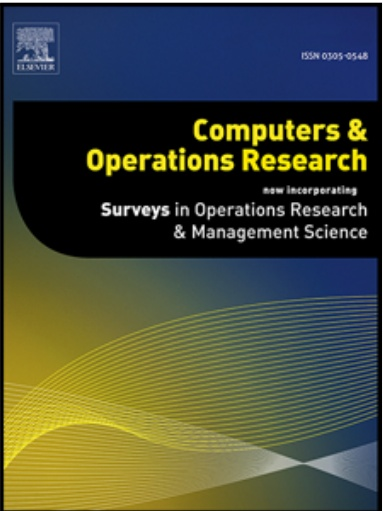

vincerporating Surveys in Operations Research & Management Science

Received date: 18 September 2018

Revised date: 28 July 2019

Accepted date: 13 September 2019

Please cite this article as: Stefan Poikonen, Bruce Golden, Multi-visit Drone Routing Problem, Computers and Operations Research (2019), doi: [https://doi.org/10.1016/j.cor.2019.104802](https://doi.org/10.1016/j.cor.2019.104802)

This is a PDF file of an article that has undergone enhancements after acceptance, such as the addition of a cover page and metadata, and formatting for readability, but it is not yet the definitive version of record. This version will undergo additional copyediting, typesetting and review before it is published in its final form, but we are providing this version to give early visibility of the article. Please note that, during the production process, errors may be discovered which could affect the content, and all legal disclaimers that apply to the journal pertain.

© 2019 Published by Elsevier Ltd.

# Multi-visit Drone Routing Problem

Stefan Poikonen

University of Colorado Denver - Business School stefan.poikonen@ucdenver.edu

Bruce Golden

University of Maryland - R.H. Smith School of Business bgolden@rhsmith.umd.edu

July 28, 2019

## Abstract

The k-Multi-visit Drone Routing Problem (k-MVDRP) considers a tandem between a truck and k drones. (When k = 1, the problem is called the Multi-Visit Drone Routing Problem.) Each drone is capable of launching from the truck with one or more packages to deliver to customers. Each drone may return to the truck to swap/recharge batteries, pick up a new set of packages, and launch again to customer locations. Unlike many papers in the current literature, the model not only allows for a drone to carry multiple heterogeneous packages but also allows the specification of a drone energy drain function that takes into account each package weight, and it decouples the set of launch locations from the set of customer locations. This paper proposes a flexible heuristic solution. Computational experiments and sensitivity analyses are also conducted using physical parameters for drones that are consistent with recent research.

Keywords: vehicle routing, traveling salesman, drones, heuristics Subject Classification: Routing truck/drone tandems where drone may carry multiple packages. Energy constraints.

## 1 Introduction

In a 2013 interview, Amazon CEO Jeff Bezos suggested Amazon would eventually be capable of reducing costs by delivering packages up to five pounds (2.3 kg) within 30 minutes of order placement via drone [10]. Later, Amazon publicly announced in an April 18, 2018 letter to shareholders that the Amazon Prime service, which offers free two-day shipping of millions of Amazon products, had eclipsed 100 million subscribers and that year 2017 saw the largest subscriber growth in the history of Amazon Prime [52]. Naturally, the combination of potentially offering rapid delivery of online orders with cost savings to a massive and growing market caught the attention of many in the operations research community.

Amazon is not alone in their pursuit of drones for delivery. FedEx, UPS, Posti, Google, Russian Post, and DPD all have reportedly been testing drones for use in delivery [55, 56, 46, 59, 48, 49], as drone delivery may offer cost savings, reduced emissions, and lower delivery times. If Amazon’s Prime Air project [4], Google’s Project Wing project [59], and similar ventures come to fruition, then we must consider models that are well-adapted for a drone-specific context.

Some papers, including Murray and Chu [40] and Ulmer and Thomas [54], have studied a warehouse direct to consumer model of drone delivery. In one of two models studied by Murray and Chu [40], customers within range of a warehouse may receive packages by a drone, whereas further away customers may receive packages by truck. Ulmer and Thomas [54] consider a same-day delivery scenario, where trucks and drones are dispatched throughout the day as orders are placed. They study the effect of different policies based on geographic districts and distance thresholds for allocating packages to either a truck or drone for delivery.

Due to range limitations related to the finite battery capacity or communication range [35] of the drone and the desire to limit the number of warehouses due to economies of scale, other papers have considered hybrid truck-and-drone models of delivery, which mitigate the impact of the limited range of the drone. In Dayarian et al. [18], the drone flies from the warehouse to resupply a truck which is out on a delivery route. Campbell et al. [15] use continuous approximation models to assess the economic impact of truck-and-drone hybrid models over a variety of model parameters an customer densities. Carlsson and Song [16] study continuous approximation on the ly Problem, where the truck serves as a mobile depot for the drone, and conclude t efficiency gain is proportional to the squareroot of the speed ratio between drone and truck. Other papers, including Ha et al. [32], Agatz et al. [2], Poikonen et al. Wang et al. [57], Poikonen et al. [44], and Murray and Chu [40], that consider hybrid truck-and-drone delivery typically allow the truck to act as a mobile depot and battery swap station for the drone, which then delivers the package directly to a customer location.

Many of these papers use some (if not most) of the following simplifying assumptions.

1. All packages are homogeneous.

2. The drone is capable of carrying a single package at a time.

3. The battery life of a drone is a fixed amount of time, not dependent on the weight of the package(s) it is carrying.

4. The speed of the drone is fixed and is not a decision variable capable of being optimized.

5. The set of allowable locations to launch/retrieve a drone from the truck is identical to the set of customer locations.

These assumptions may be appropriate in a variety of circumstances. However, in other cases, it may be more appropriate to relax some or all of these assumptions.

With respect to simplifying assumption (1), there are many contexts where the weights of packages may vary significantly. With respect to (2), the vast majority (86%) of packages delivered by Amazon are less than 2.3 kg as of 2013 [10]. Yet, there already exist commercial drones that can carry several multiples of that payload, including the FreeFly Alta 8, which is capable of carrying payloads of up to 18 kg The largest manufacturer of drones in the world [13], Shenzhen-based Da-Jiang Innovations (DJI), also produces drones capable of carrying several consumer parcels. D the DJI Spreading Wings S900 for approximately \$2,000 (as of September 2018), which is capable of carrying a payload of 8.2 kg [22]. Griff Aviation is designing ver ke-off, multi-purpose, autonomous drones. The Griff 300 is designed with a go allowing a 300 kg payload; the Griff 800 is designed with a goal of allowing up to 800 kg payloads [28]. Boeing has also tested prototype vertical take-off cargo drones, which will eventually be able to carry payloads ranging from 250 to 500 pounds while traveling 70 miles per hour at a few hundred feet of altitude, according to Horizon-X division leader Peter Kunz [17, 12]. Thus, there already exist drones with the technical capabilities of carrying the weight of multiple typical consumer packages simultaneousl We note, however, that heterogeneous package sets introduce a number of technical and design challenges, including issues related to package standardization and off-loading, which are beyond the scope of this paper.)

With respect to (3), just like many other aircraft, drones typically require more power while carrying heavier payloads [23, 28, 53]. With respect to (4), it should be noted that the speed of a drone that minimizes energy expenditure per unit distance is frequently slower than the maximum speed of the drone, as drag is a superlinear function of speed. Moreover, these energy- or time-minimizing speeds are dependent on the payload carried by the drone at any given time [19]. With respect to (5), there is no reason to assume that the ideal locations to launch/retrieve a drone are necessarily customer locations. Moreover, in practice, not all customer locations are suitable locations for launching/retrieving the drone from a truck.

Therefore, we will propose a new truck-and-drone delivery model, which relaxes many of the assumptions above. Additionally, we provide thoroughly commented code in the hope that it may be useful to others in the research community.

In Section 2, we formally define the Multi-visit Drone Routing Problem. In Section 3, we describe our heuristic solution method. Section 4 contains theoretical results. In Section 5, we describe our computational experiments and analyze the results. Section 6 offers insights and directions for future research.

## 2 k-Multi-Visit Drone Routing Problem: Definition

## 2.1 Description

The k-Multi-visit Drone Routing Problem (k-MVDRP) is a problem that seeks to deliver a set of packages to a set of customer locations in a manner that minimizes route completion time. In k-MVDRP, a truck and k drones start at a predefined warehouse. The truck acts as a mobile depot and recharging platform for the drones. The drones may launch from the truck with one or more packages, deliver these packages to their designated destinations, then return to the truck for recharging and to pick up additional packages. Drone flights are subject to additional restrictions that will be detailed in Section 2.3. The route is considered complete when all customer packages have been delivered and when the truck and all drones have returned to the origin warehouse. The special case where $k   =   1$ is simply called MVDRP.

## 2.2 Problem Input Parameters

In k-MVDRP, C is the set of customer locations that require a package be delivered. For each customer location $c _ { i } \in C$ , we use wi to denote the corresponding weight of the package demanded at $c _ { i } .$ . The set V contains all locations where a drone is allowed to launch from or return to the truck. By convention, the warehouse location is denoted $v _ { 0 } \in V$

The truck and drone(s) have different travel times betwee irs of locations. For any pair of locations $v _ { i } , v _ { j } \in V$ , the travel time for the truck is g ven by $t t ( v _ { i } , v _ { j } )$ . For any pair of locations $v _ { i } , v _ { j } \in V \cup C$ , the travel time for a drone is given by $t d ( v _ { i } , v _ { j } )$ . We assume the triangle inequality applies for tt and td.

The energy capacity of the battery for each drone is EMAX. It is assumed that for any pair of locations $v _ { i } , v _ { j } \in V \cup \mathbb { C }$ and for any set of packages with combined weight $w ,$ the energy drain per unit time for a drone carrying these packages is $e ( v _ { i } , v _ { j } , w )$ . We only impose the restriction that addition of an extra package to the drone’s payload can never reduce the energy dissipation rate. The constant HOV is the energy dissipation rate (per unit time) of a drone when it is hovering without any payload. This may occur when a drone arrives at a rendezvous location before the truck and must wait for the truck. The constant LaunchP enalty is an overhead time penalty applied anytime the truck stops to launch one or more drones. Table 1 summarizes k-MVDRP input parameters.

## 2.3 Restrictions on Operations

Let us define an operation as a set of actions beginning with the truck and all drones at a launch location $v _ { i } \in V$ and terminating with the truck and all drones located at $v _ { j } \in V$

| Name | Description |
| --- | --- |
| C = {c1,c2,...,c\|C\|} | Set of customers demanding delivery. |
| W = {w1,w2,...,w\|C\|} | Set of package weights demanded by customers. |
| V = {v1,v2,...,v\|V\|} | Set of locations where launching/landing drone is allowed. |
| k | Number of drones. k ∈ N. |
| EMAX | Energy capacity of each drone. EMAX ∈ [0,∞). |
| tt | Travel times for the truck. tt(vi,vj) ≥ 0,∀vi,vj ∈ V. |
| td | Travel times for the drones. td(vi,vj) ≥ 0,∀vi,vj ∈ V ∪ C. |
| HOV | A constant that describes the energy drain per unit time when a drone hovers, waiting for the truck at a rendezvous location. |
| LaunchPenalty | A constant time penalty imposed on any operation that in-cludes a drone launch. |
| e(vi,vj,w) | Energy drain per unit time of a drone traveling from vi to vj, carrying packages with total weight of w. |

Table 1: Summary of k-MVDRP model parameters.

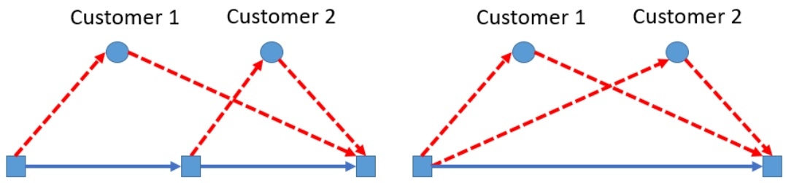

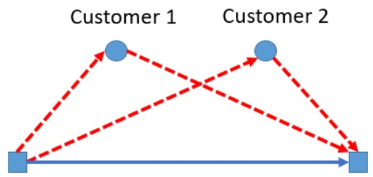

Figure 1: Blue squares: feasible launch/landing locations for the drone. Blue circles: customer locations. Dashed line segments: drone flights. Blue solid line segments: path of truck. At left, an example of an operation that is not allowed in k-MVDRP. At right, an example of an operation that is allowed, because all drone launches occur at a single location and all drone landings occur at a single location.

At vi, any of the k drones may launch from the $v _ { i } ,$ visit one or more customers, then rendezvous with the truck at $v _ { j }$ . (Note: It is allowed, but not required, that $v _ { i } = v _ { j } . )$ A k-MVDRP operation requires that after any drones launch from $v _ { i } ,$ the truck must travel directly from $v _ { i }$ to $v _ { j }$ without stopping or launching additional drones. This is similar to an assumption made in the Horse Fly Problem of Carlsson and Song [16], which has the benefit of producing drone flights whose (non-)feasibility are independent of one another, which reduces computational complexity. (However, the inability of the truck to service customers while any drone is airborne is a clear drawback.) Figure 1 contains two operations. The operation at left is not allowed, because it contains a drone launch in the middle of an operation. The operation at right is allowed in k-MVDRP, because all drone launches/landings occur at the start/end points of the operation.

Each drone flight (sortie) within an operation is allowed only when it is energy feasible. A drone sortie is considered energy feasible if it expends less than EMAX energy. Formally, if a drone sortie launches from location $v _ { i }   \in   V$ , flies (in order) to customers $c _ { s _ { 1 } } , c _ { s _ { 2 } } , . . . , c _ { s _ { n } }$ , then returns to the truck at $v _ { j } \in V$ , then the sortie is energy feasible if and

only if:

$$
e (v _ {i}, c _ {s _ {1}}, w _ {s u m}) * t d (v _ {i}, c _ {s _ {1}})
$$

$$
\sum_ {j = 2} ^ {n} e (c _ {s _ {j - 1}}, c _ {s _ {j}}, w _ {s u m} - \sum_ {a = 1} ^ {j} w _ {s _ {a}}) * t d (c _ {s _ {j - 1}}, c _ {s _ {j}})
$$

$$
e \left(c _ {s _ {n}}, v _ {j}, 0\right) * t d \left(c _ {s _ {n}}, v _ {j}\right)
$$

$$
\text {HOV} * \max (0, t t (v _ {i}, v _ {j}) - \text {droneTime})
$$

$$
\leq E M A X,
$$

where $\begin{array} { r } { w _ { s u m }   =   \sum _ { i \in \{ s _ { 1 } , s _ { 2 } , \ldots , s _ { n } \} } } \end{array}$ wiis the combined weight of all packages delivered in the sortie, and where droneT im $e = t d ( v _ { i } , c _ { s _ { 1 } } ) + \textstyle \sum _ { a = 1 } ^ { j } t d ( c _ { s _ { j - 1 } } , s _ { i _ { j } } ) \mp t d ( s _ { i _ { n } } , v _ { j } )$ . An operation is infeasible if any constituent drone flight is energy infeasible.

## 2.4 Formulation

We may formally define k-MVDRP as the following integer linear program.

$$
\text {Minimize:} \sum_ {o \in O} t _ {o} * x _ {o}\tag{\((C0)\}
$$

subject to:

$$
t _ {o} \geq \text {truckTime} (o), \forall o \in O\tag{C1}
$$

$$
t _ {o} \geq \text {droneTime} _ {i} (o), \forall o \in O, i \in \{1, 2,..., k \}\tag{C2}
$$

$$
\operatorname{cover} (o, j) * x _ {o} \geq 1, \forall j \in \{1, 2, \dots , | C | \}\tag{C3}
$$

$$
\sum_ {o \in O} r p (o, l) * x (o) = \sum_ {o \in O} l p (o, l) * x (o), \forall l \in V\tag{C4}
$$

$$
\text {subtour elimination constraints}\tag{C5}
$$

$$
x _ {o} \in \{0, 1 \}, \forall o \in O\tag{C6).}
$$

In the above formulation, O is the set of all feasible k-MVDRP operations. For an operation $o \in O$ , decision variable $x _ { o } = 1$ if the operation is selected as part of the solution.

$x _ { o } = 0$ , otherwise. The formulation contains several precomputed values. truckT ime(o) is the travel time for the truck from the launch point to the retrieval point of operation $o \in O$ $d r o n e T i m e _ { i } ( o )$ is the time required for drone number i to fly from the launch point of $O _ { \gamma }$ visit all customers that it has been assigned as part of the operation (in order), then return to the retrieval point of the operation. If drone number i has not been assigned to visit any customers as part of operation $O _ { \gamma }$ then droneT $i m e _ { i } ( o ) = 0$ $c o v e r ( o , j )$ has value 1 only if operation o services customer $c _ { j }$ . Otherwise, cover $( o , j ) = 0 . l p ( o , l ) = 1$ whenever operation o begins at location $l ;   r p ( o , l ) = 1$ whenever operation o terminates at location l. $l p ( o , l )$ and $r p ( o , l )$ take value 0 otherwise.

Objective (C0) states that we seek to minimize the to al oute completion time, which is the sum of individual operation times. Constraints ensure that the time required for an operation is at least as large as the time required for the truck to drive from the launch point to retrieval point of the operation. Constraints (C2) ensure that the time required for an operation is at least as long as the longest drone flight duration within the operation. Constraints (C3) ensure that every customer is serviced (covered). Constraints (C4) are flow constraints, which ensure a closed tour. Constraints (C5) are generic constraints to ensure the truck not disjoint. Constraints (C6) ensure that the selection of any operation is a binary variable.

## 3 Heuristic Approach: Route, Transform, Shortest Path

The preceding formulation may quickly become intractable, as the number of feasible drone operations may be extremely large. Thus, we introduce a heuristic solution approach called Route, Transform, Shortest Path (RTS). RTS has three major phases.

## 3.1 Phase 1: Route

Compute the optimal (or heuristic) solution to the standard traveling salesman problem on the set of customer locations and the depot, $C \cup \{ v _ { 0 } \}$ , using the drone travel times, $t d ,$ as the measure of time between any pair of locations. Let us denote the result as:

$$
V i s i t O r d e r = [ p _ {0} = v _ {0}, p _ {1}, p _ {2}, \dots , p _ {| C |}, p _ {| C | + 1} = v _ {0} ].
$$

The first customer location to be visited is $p _ { 1 }$ , the second customer location to be visited is $p _ { 2 }$ , and generally $p _ { i }$ is the ith customer location to be visited.

RTS restricts our search to solutions that have the following properties. (1) If $i \; < \; j ,$ then pj may not be serviced by an operation that terminates before $p _ { j }$ $p _ { i }$ is serviced. (2) If $i < j$ and $p _ { i }$ and $p _ { j }$ are to be serviced on the same drone sortie, then $p _ { i }$ must be serviced before $p _ { j }$ . These properties imply that customers must be visited in the same order as V isitOrder, with possible exceptions when a pair of customers are serviced in the same operation by different drones.

## 3.2 Phase 2: Transform

Let $( i , j )$ represent the condition where truck and all drones are present at physical location $v _ { i }$ and where the first $j$ customer locations $( \mathrm { i . e . , } p _ { 1 } , p _ { 2 } , . . . , p _ { j } )$ have already been serviced.

We construct graph $G ^ { \prime }   =   ( V ^ { \prime } , E )$ . For each $i \in V$ and for each $j \; \in \; \{ 0 , 1 , 2 , . . . , | C | \}$ there exists a vertex $v ^ { \prime } ( i , j ) \in V ^ { \prime }$

Suppose $v ^ { \prime } ( i 1 , j 1 ) , v ^ { \prime } ( i 2 , j 2 )   \in   V ^ { \prime }$ , and let $e d g e ( i 1 , j 1 , i 2 , j 2 )$ be an edge connecting these vertices. $e d g e ( i 1 , j 1 , i 2 , j 2 )$ corresponds to an operation that begins at physical location $v _ { i 1 }$ with the first $j 1$ customer locations serviced, and terminates at physical location $v _ { i 2 }$ with the first $j 2$ customer locations serviced. $e d g e ( i 1 , j 1 , i 2 , j 2 )$ has a corresponding cost, cost $( i 1 , j 1 , i 2 , j 2 )$ , which is the time required to complete the corresponding operation. We may write:

$$
\text {cost} (i 1, j 1, i 2, j 2) = \max (t t (v _ {i 1}, v _ {i 2}), \max _ {a \in \{1, 2, \dots , k \}} \text {droneTime} _ {a} (o)),
$$

where droneT ime $\iota _ { a } ( o )$ is the flight time of drone number a within the operation o that corresponds to tuple $( i 1 , j 1 , i 2 , j 2 )$ . droneT ${ \bar { } } i m e _ { a } ( o )$ is dependent on which customers within the operation are to be visited by drone number a.

We use a heuristic approach to assign customer locations $\mathrm { t o } \phi \mathrm { d r o n e s }$ . In the block assignments scheme, we assign the first $\lceil ( j _ { 2 } - j _ { 1 } ) / k \rceil$ customer locations of an operation to the first drone. The next $\lceil ( j _ { 2 } - j _ { 1 } ) / k \rceil$ are assigned to the second drone, and so on until all customer locations $p _ { j _ { 1 } + 1 } , p _ { j _ { 1 } + 2 } , . . . p _ { j _ { 2 } }$ are assigned. If a drone is assigned customer locations $p _ { s }$ and $p _ { t }$ in the same drone operation and $s < t ; { \mathrm { t h e { \bar { n } } } }$ the block assignment scheme forces the drone to visit $p _ { s }$ before $p _ { t }$

In Figure 2, we display an example of the block assignment scheme applied to edge(11, 4, 7, 10) with three drones. In this example, $j 2 = 1 0 ,   j 1 = 4$ , and $k = 3 .$ so the first drone must deliver to $p _ { 5 }$ and $p _ { 6 }$ , the second drone must deliver to $p _ { 7 }$ and $p _ { 8 }$ , and the third drone must deliver to $p _ { 9 }$ and $p _ { 1 0 }$

We remind the reade that $V i s i t O r d e r = [ p _ { 0 } , p _ { 1 } , . . . , p _ { | C | + 1 } ]$ is determined in the “Route” stage by sol a TSP using travel times defined by td. Therefore, we naturally expect that consecutive customer locations $p _ { i }$ and $p _ { i + 1 }$ will tend to be located near one another. This is the intuition underlying the block assignment scheme: Consecutive blocks of packages are typically located near one another.

In general, the block partitioning scheme is not always the optimal assignment of drones within a single operation. However, in the special case when $k = 1$ , the block partitioning

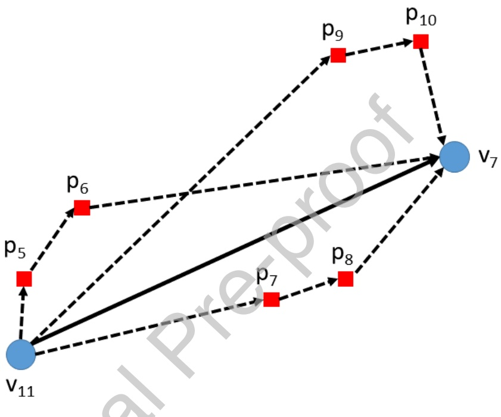

Figure 2: In this example, we display the block assignment partitioning scheme for $e d g e ( 1 1 , 4 , 7 , 1 0 )$ with $k = 3$ drones available. The dashed lines indicate the flight paths of the three drones. The solid line indicates the movement of the truck. Each drone is assigned a consecutive block of customer locations to visit. In this case, each block has size two.

makes the only allowable assignment, where all customers are assigned to the same drone, which implies it is the optimal assignment. In the case where $j 2 - j 1 \leq k$ , then each drone will visit only a single customer location, which is optimal due to the triangle inequality.

If the energy expended by each drone under the block partitioning scheme for $e d g e ( i 1 , j 1 , i 2 , j 2 )$ does not exceed EMAX, then the assignment is feasible and edge $\iota ( i 1 , j 1 , i 2 , j 2 ) \in E$ . Otherwise, $e d g e ( i 1 , j 1 , i 2 , j 2 ) \notin E$

## 3.3 Phase 3: Shortest Path

Phase 3 computes a shortest path over the graph $G = ( V ^ { \prime } , E )$ from vertex $v _ { 0 , 0 } ^ { \prime }$ to $v _ { 0 , | C | } ^ { \prime }$ Recall that $v _ { 0 }$ is the warehouse location. Thus, Phase ma be interpreted as computing a shortest path from “warehouse location $( v _ { 0 } )$ in a state where 0 packages have been delivered” to “warehouse location $( v _ { 0 } )$ in a state where all |C| packages have been delivered” using only operations that obey the orderi dictated by V isitOrder and do not violate drone energy constraints. The resulting path, denoted ROUT E(V isitOrder), is our heuristic solution to the problem with corresponding objective value denoted V AL(V isitOrder).

In Figure 3, we display an example MVDRP solution. At left, we visualize the solution path, traced through the graph $G ^ { \prime } ,$ . At right, we show the physical solution path.

## 4 Theoretical Results

Theorem 1 Among feasible solutions to MVDRP that visit customer locations in the order dictated by V isitOrder, ROUTE(V isitOrder) is the one with the lowest completion time.

Proof 1 Recall that MVDRP is the case where $k = 1$ . We first observe that any feasible solution to MVDRP can be characterized as a sequence of feasible operations, where the end point of the previous operation is the start point of the next operation. An operation

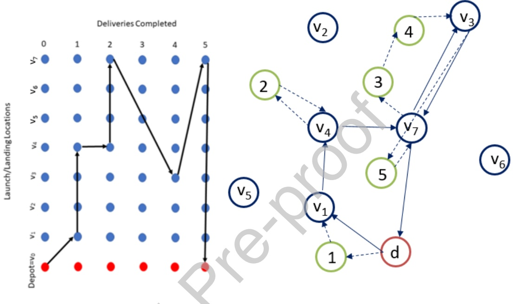

Figure 3: At left, each row represents a different physical location: $v _ { 0 } , v _ { 1 } , . . . , v _ { 7 }$ . Each column is a different state: 0 deliveries completed, 1 delivery completed, ..., 5 deliveries completed. The grid of vertices is the set $V ^ { \prime }$ . Black arrows connecting two vertices indicate that the corresponding operation was chosen as part of the solution. At right, we see the solution traced out in 2-D space. Green circles are customer locations with numeric labels corresponding to V isitOrder. The blue circles are launch/landing locations in V . The warehouse or depot is labeled d.

that obeys V isitOrder must begin at some location $v _ { i 1 }   \in   V$ , terminate at some location $v _ { i 2 }   \in   V$ , and service some consecutive set of customer locations $p _ { j 1 + 1 } , p _ { j 1 + 2 } , . . . , p _ { j 2 }$ . (In the case $j 1 = j 2$ , the customer set is empty and the operation may be viewed as a simple truck relocation from vi1 to $v _ { i 2 } . )$

Observe that in $G ^ { \prime }$ , for any arbitrary vertex $v ^ { \prime } ( i 1 , j 1 )$ , we are allowed to traverse to any other vertex $v ^ { \prime } ( i 2 , j 2 )$ that can be reached by an edge representing a feasible operation that obeys V isitOrder. Any two states that can be connected by an operation obeying V isitOrder are linked by a directed edge in $G ^ { \prime }$

Thus, any feasible sequence of operations that obey V isitOrder is a set of connected directed edges across G0. A solution for MVDRP must begin at the warehouse v0 in a state of 0 customers serviced and must terminate at the warehouse with all |C| customers serviced. Thus, any solution to MVDRP can be represented as a path from $v _ { 0 , 0 } ^ { \prime }$ to $v _ { 0 , | C | } ^ { \prime }$ on graph G0.

The objective value for an MVDRP solution is simply the sum of the durations of the constituent operations. The cost of each edge in $G ^ { \prime }$ is the duration of the associated operation. Thus, the cost of a in $G ^ { \prime }$ , which is the sum of costs of the edges traversed, is equivalent to the objective value for the corresponding MVDRP solution. Therefore, the shortest path across G0from $v _ { 0 , 0 } ^ { \prime }$ to $v _ { 0 , | C | } ^ { \prime }$ is the smallest objective value possible in MVDRP while obeying V isitOrder.

Corollary 1 If we apply Phase 2 and Phase 3 of RTS to every possible permutation of V isitOrder, one of the solutions produced will be a globally optimal solution for MVDRP.

We note that Theorem 1 and Corollary 1 do not apply to k-MVDRP in general, because the block partitioning scheme does not always construct an optimal assignment of drones to customers within operations.

## 4.1 Valid Lower Bounds

Solving the formulation from Section 2.4 proved to be intractable. Therefore, we attempted to construct various lower bound formulations, many of which were also intractable. However, we present two valid lower bound formulations that were tractable and relate k-MVDRP to existing problems in the literature.

## 4.1.1 Lower Bound Derived from a Close-Enough Traveling Salesman Problem

Suppose that td is symmetric: $t d ( v _ { i } , v _ { j } ) = t d ( v _ { j } , v _ { i } ) , \forall v _ { i } , v _ { j } \in \underline { { V } } \cup C$ . Also suppose that the energy function e only depends on the weight of packages carried. In any feasible k-MVDRP solution, for each customer $c _ { i } \in C .$ , it is necessary that the truck must pass through at least one location $v _ { j } \in V$ such that $t d ( v _ { j } , c _ { i } ) / \alpha * \underline { { e } } ( \bar { w _ { i } } ) \pm t d ( c _ { i } , v _ { j } ) / \alpha * e ( 0 ) \leq E M A X$ Equivalently, the truck passes through a $v _ { j }$ such $\operatorname { t h a t } \mathit { t d } ( v _ { j } , c _ { i } ) \leq \alpha { * E M A X } / ( e ( w _ { i } ) { + } e ( 0 ) )$

Let us set cov $( v _ { j } , c _ { i } )   =   1$ whenever $t d ( v _ { j } , e _ { i } ) * e ( w _ { i } ) \: + \: t d ( c _ { i } , v _ { j } ) * e ( 0 ) \: \leq \: E M A X$ , and cov $\iota ( v _ { j } , c _ { i } )   =   0$ otherwise. If $c o v ( \overline { { v _ { j } , c _ { i } } } ) \cong 1$ , we say $v _ { j }$ covers $c _ { i }$ . We can form a lower bound on the k-MVDRP objective value by finding the least cost closed tour that starts at $v _ { 0 }$ , ends at $v _ { 0 }$ , and for each ci ∈ C, goes through at least one $v _ { j }$ such that $v _ { j }$ covers $c _ { i }$

There must exist some location along the truck route such that the drone can fly from the truck to the customer location and return to the truck without running out of battery. The problem is similar to the close-enough traveling salesman problem (CETSP) [58], which requires a tour pass within a specified radius of each customer. In our case, any k-MVDRP tour must visit a vertex within radius $E M A X / ( e ( w _ { i } ) + e ( 0 ) )$ of each customer $c _ { i } \in C$ . A formulation of the lower bound to the k-MVDRP is given below.

$$
\text {Minimize:} \sum_ {v _ {i} \in V} \sum_ {v _ {j} \in V} t t (v _ {i}, v _ {j}) * x (v _ {i}, v _ {j})\tag{C7}
$$

subject to:

$$
\sum_ {v _ {i} \in V} \sum_ {v _ {k} \in V} c o v (v _ {i}, c _ {j}) * x (v _ {k}, v _ {i}) \geq 1, \forall j \in \{1, 2, \dots , | C | \}\tag{C8}
$$

$$
\overline {{\sum_ {v _ {i} \in V} x (v _ {i} , v _ {j}) = \sum_ {v _ {k} \in V} x (v _ {j} , v _ {k}) , \forall v _ {j} \in V}}\tag{C9}
$$

$$
\text {subtour elimination constraints}\tag{C10}
$$

$$
x (v _ {i}, v _ {j}) \in \{0, 1 \}, \forall v _ {i}, v _ {j} \in V\tag{C11).}
$$

Objective (C7) minimizes the length of the truck tour. Constraints (C8) ensure that the truck enters at least one $v _ { i } \in V$ , such that $v _ { i }$ se as a cover for $c _ { j }$ . Constraints (C9) ensure conservation of flow. Constraints (C10) are generic subtour elimination constraints. Constraints (C11) ensure a binary selection $\mathrm { { \textlangle } f }$ edges for the truck tour.

## 4.1.2 Lower Bound Derived from the min-max mTSP

Consider a relaxation of the k-MVDRP, where each drone has infinite battery capacity and range. Also, assume that a for a drone between of locations is less than the driving of the truck between the pair of locations $( \operatorname { i . e . , } \overline { { t d } } ( i , j ) \leq t t ( i , j ) , \forall i , j \in V \cup C )$ . Thus, the drone has no incentive to ever return to the truck mid-route; it makes sense to proceed directly to the next customer due to the triangle inequality. An optimal solution to this relaxation would see the drone depart the truck immediately at the depot, and return to the truck at the depot only after it has completed all of its assigned deliveries. Therefore, this relaxation of the k-MVDRP is equivalent to the multiple traveling salesman problem (mTSP) where k is the number of vehicles deployed and the cost between pairs of locations are equal to the drone’s flight time between the locations. $\mathrm { S o }$ , under the condition $t d ( i , j )   \leq   t t ( i , j ) , \forall i , j   \in   V \cup C ,$ , we can use a min-max mTSP formulation to compute a lower bound for the objective value of k-MVDRP.

## 5 Computational Results

In Section 5.1, we discuss the instance generation procedures. In Section 5.2, we describe the sets of parameters on which we tested each instance. In Section 5.3, we present results. In Section 5.4, we analyze the results.

All computations were performed on a computer with an Intel i7-8750H processor operating at 2.20 GHz and containing 16GB of memory. ode was implemented in Python 2.7 and Gurobi 8.1.0 was used to solve for a TSP solution in Phase 1 of the RTS heuristic. Code used for the MVDRP can be found at http://stefan-poikonen.net/mvdrp/.

## 5.1 Instance Generation Procedures

For each combination of $| V |   =   2 5 , 5 0 \mathrm { a n d } | C |   =   2 5 , 5 0$ , we created 25 random instances. Thus, a total of 100 random instances were generated.

All launch/retrieval locations (V ) and all customer locations (C) were chosen randomly from a uniform distribution over a 25 km by 25 km square region. The depot location was chosen randomly among V . The mass of packages demanded by customers is chosen from a uniform distribution between 0 and 2.3 kg, which relates to statements made by Jeff Bezos about the size of packages that would possibly be subject to drone delivery. The truck is assumed to move at 5 meters per second (or about 12 miles per hour). Both truck and drone travel times are computed as the Euclidean distance divided by the travel speed of the vehicle.

## 5.2 Tested Drone Parameters

## 5.2.1 Quadrocopter vs. Octocopter

Stolaroff et al. [53] conduct an extensive study of energy use and greenhouse emissions in drones for commercial package delivery. We use their work as the basis for many of our model parameters. They describe two base cases: one for a smaller four rotor drone (quadrocopter) and one for a larger eight rotor drone (octocopter). The quadrocopter possesses a 1 kg battery; the octocopter possess a 10 kg battery.

In Supplemental Table 2 of [53], a plot shows estimated ener use per meter traveled against the mass of packages carried for both quadocopter and octocopter cases based on their analytical model. We use piecewise linear functions, which are nearly identical to the energy estimates from [53] and displayed in 4, to estimate the energy use of a drone carrying a given mass of packages between any pair of locations. We fix the constant HOV to be equal to the energy usage rate of the drone, while carrying no package. Exact equations for Figures 4a and 4b can be found in Appendix A.

## 5.2.2 Drone Speed

In both base cases of Stolaroff et al. [53], the drones move at a fixed speed of 10 meters per second, which is slightly below the most energy efficient speed for both drones based on current designs. We test two drone speeds: 10 meters per second and 15 meters per second. of 10 meters per second is meant to simulate current capabilities. The higher 15 meters per second speed is meant to simulate a hypothetical future drone that is more efficient (e.g., better power efficiency of engines, reduced drag). The power output does not change according to the speed choice of the drone.

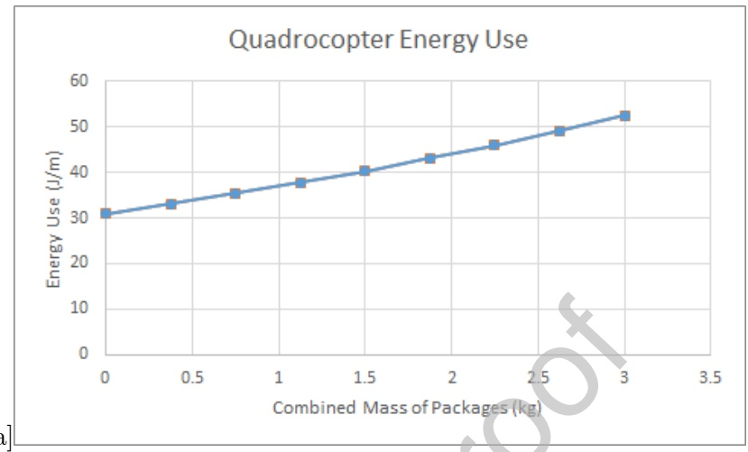

[a]

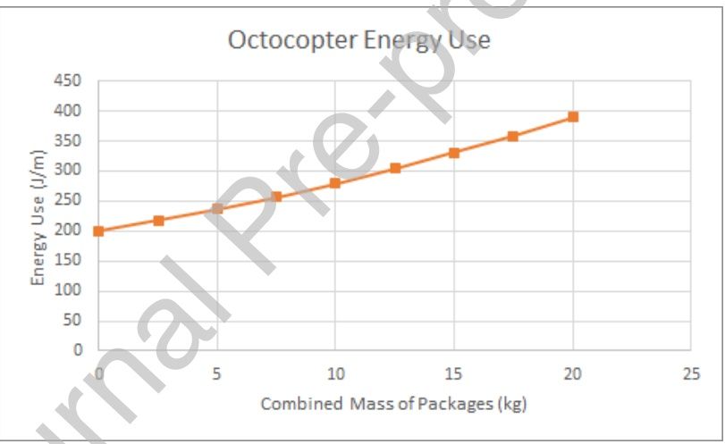

[b]

Figure $4 \mathrm { { _ \mathrm { {  } } } E n f e r g { \bar { y } } }$ dissipation in Joules per meter traveled (vertical axis) is plotted against the combined mass of packages carried by the drone (horizontal axis), assuming 10 meters per second flight speed. In (a), energy dissipation rates are shown for a quadrocopter with a 1 kg battery. In (b), energy dissipation rates are shown for an octocopter with a 10 kg battery.

## 5.2.3 Energy Density of Battery

In [53], it is claimed that 540,000 Joules per kilogram approximates energy density that may be found in current drone batteries. They also estimate that with some foreseeable improvements of battery technology, the energy density may rise to 900,000 Joules per kilogram. We test both 540,000 J/kg and 900,000 J/kg.

## 5.2.4 Number of Drones

For each instance and for each choice of parameters above, we computed routes for $k =$ $1 , 2 , . . . , 8$ drones using the RTS heuristic algorithm.

## 5.3 Results

Among the 100 instances tested, eight of them were infeasible for at least some set of parameters. To allow comparison of results, the reported objective values and computational times are averages among the 92 of 100 instances (i.e., 25 instances each for $| V | = 2 5 , 5 0$ and $| C | = 2 5 , 5 0 )$ that were feasible for all tested parameters.

In Table 2, we present computational results. Each row represents results for a different set of input parameters. in meters per second. column Energy Density reports the energy density in Joules per kilogram. The column Rotors has value 4 for a quadrocopter and has value 8 for an octocopter. he column Obj. displays the average objective value among the 92 feasible instances found by applying the RTS algorithm. The objective value is measured in seconds of route duration. The column Time reports the average computational time of the RTS algorithm among the 92 feasible instances. The column Feas. reports the number of instances that were feasible among the set of 100 generated instances. The column LB reports the average value among feasible instances of the problem lower bound, which is computed as the maximum of the two lower bounds described in Sections 4.1.1 and 4.1.2.

We used an exact formulation in Gurobi to solve for the lower bounds in Section 4.1.1. When computing the mTSP lower bound from Section 4.1.2, we used LKH3 [38] to find heuristic mTSP solutions to reduce computation time for the lower bounds. These mTSP solutions are not guaranteed to be exact, however, LKH3 has been benchmarked on 127 mTSP instances, and in 124 cases found the best known solution. In all cases, lower bounds were formed in less than five minutes. In all benchmark instances of size 50 or smaller (i.e, the size of instances we use in Table 2), LKH3 found the best known solution. That is, we believe these heuristic mTSP solutions are likely to very closely approximate the exact mTSP solutions.

|  | Table 2 | : Compu | tati | onal Result | s |  |  |
| --- | --- | --- | --- | --- | --- | --- | --- |
| Drone Speed | Energy Density | Rotors | k | Obj. | Time | Feas. | LB |
| 10 | 540,000 | 4 | 1 | 26676.98 | 0.55 | 92 | 12512.10 |
| 10 | 540,000 | 4 | 2 | 19498.40 | 0.61 | 92 | 8788.207 |
| 10 | 540,000 | 4 | 3 | 16922.58 | 0.64 | 92 | 7971.14 |
| 10 | 540,000 | 4 | 4 | 15504.69 | 0.68 | 92 | 7655.66 |
| 10 | 540,000 | 4 | 5 | 14732.36 | 0.71 | 92 | 7512.26 |
| 10 | 540,000 | 4 | 6 | 14272.36 | 0.75 | 92 | 7462.53 |
| 10 | 540,000 | 4 | 7 | 14019.66 | 0.78 | 92 | 7441.64 |
| 10 | 540,000 | 4 | 8 | 13829.10 | 0.80 | 92 | 7435.88 |
| 10 | 540,000 | 8 | 1 | 24991.71 | 0.70 | 100 | 12434.81 |
| 10 | 540,000 | 8 | 2 | 18089.47 | 0.95 | 100 | 7184.09 |
| 10 | 540,000 | 8 | 3 | 15433.59 | 1.14 | 100 | 5774.88 |
| 10 | 540,000 | 8 | 4 | 13744.08 | 1.36 | 100 | 5262.12 |
| 10 | 540,000 | 8 | 5 | 12603.37 | 1.57 | 100 | 5041.90 |
| 10 | 540,000 | 8 | 6 | 11823.73 | 1.80 | 100 | 4968.10 |
| 10 | 540,000 | 8 | 7 | 11195.88 | 2.01 | 100 | 4937.39 |
| 10 | 540,000 | 8 | 8 | 10678.31 | 2.20 | 100 | 4928.92 |
| 10 | 900,000 | 4 | 1 | 25088.91 | 0.72 | 100 | 12434.81 |
| 10 | 900,000 | 4 | 2 | 18100.74 | 1.03 | 100 | 7187.70 |
| 10 | 900,000 | 4 | 3 | 15406.86 | 1.27 | 100 | 5828.64 |
| 10 | 900,000 | 4 | 4 | 13713.32 | 1.55 | 100 | 5352.04 |
| 10 | 900,000 | 4 | 5 | 12552.28 | 1.81 | 100 | 5147.24 |
| 10 | 900,000 | 4 | 6 | 11749.28 | 2.10 | 100 | 5078.81 |
| 10 | 900,000 | 4 | 7 | 11095.76 | 2.36 | 100 | 5050.78 |
| 10 | 900,000 | 4 | 8 | 10508.18 | 2.66 | 100 | 5043.10 |
| 10 | 900,000 | 8 | 1 | 24830.67 | 1.37 | 100 | 12434.81 |
| 10 | 900,000 | 8 | 2 | 17820.03 | 2.54 | 100 | 7181.51 |
| 10 | 900,000 | 8 | 3 | 15076.49 | 3.64 | 100 | 5709.28 |
| 10 | 900,000 | 8 | 4 | 13325.06 | 4.84 | 100 | 5140.18 |
| 10 | 900,000 | 8 | 5 | 12134.37 | 6.00 | 100 | 4881.49 |
| 10 | 900,000 | 8 | 6 | 11237.77 | 7.30 | 100 | 4791.79 |
| 10 | 900,000 | 8 | 7 | 10513.51 | 8.49 | 100 | 4754.11 |
| 10 | 900,000 | 8 | 8 | 9939.76 | 9.79 | 100 | 4743.73 |
| 15 | 540,000 | 4 | 1 | 20801.54 | 0.57 | 100 | 8330.60 |
| 15 | 540,000 | 4 | 2 | 14993.71 | 0.69 | 100 | 5454.47 |
| 15 | 540,000 | 4 | 3 | 12791.37 | 0.78 | 100 | 4872.59 |
| 15 | 540,000 | 4 | 4 | 11426.95 | 0.89 | 100 | 4658.15 |
| 15 | 540,000 | 4 | 5 | 10538.31 | 0.99 | 100 | 4560.67 |
| 15 | 540,000 | 4 | 6 | 9921.43 | 1.09 | 100 | 4526.87 |
| 15 | 540,000 | 4 | 7 | 9467.92 | 1.19 | 100 | 4512.67 |
| 15 | 540,000 | 4 | 8 | 9152.89 | 1.29 | 100 | 4508.76 |
| 15 | 540,000 | 8 | 1 | 19477.77 | 0.92 | 100 | 8289.87 |
| 15 | 540,000 | 8 | 2 | 13864.34 | 1.49 | 100 | 4787.67 |
| 15 | 540,000 | 8 | 3 | 11550.42 | 2.01 | 100 | 3806.19 |
| 15 | 540,000 | 8 | 4 | 10149.67 | 2.57 | 100 | 3426.79 |
| 15 | 540,000 | 8 | 5 | 9226.61 | 3.11 | 100 | 3254.86 |
| 15 | 540,000 | 8 | 6 | 8534.77 | 3.72 | 100 | 3195.71 |
| 15 | 540,000 | 8 | 7 | 7947.31 | 4.26 | 100 | 3170.86 |
| 15 | 540,000 | 8 | 8 | 7477.61 | 4.84 | 100 | 3164.01 |
| 15 | 900,000 | 4 | 1 | 19790.31 | 0.94 | 100 | 8289.87 |
| 15 | 900,000 | 4 | 2 | 14000.15 | 1.58 | 100 | 4787.67 |
| 15 | 900,000 | 4 | 3 | 11626.60 | 2.19 | 100 | 3806.19 |
| 15 | 900,000 | 4 | 4 | 10189.43 | 2.85 | 100 | 3426.79 |
| 15 | 900,000 | 4 | 5 | 9229.91 | 3.50 | 100 | 3255.34 |
| 15 | 900,000 | 4 | 6 | 8502.86 | 4.24 | 100 | 3196.19 |
| 15 | 900,000 | 4 | 7 | 7934.69 | 4.90 | 100 | 3171.35 |
| 15 | 900,000 | 4 | 8 | 7464.02 | 5.62 | 100 | 3164.50 |
| 15 | 900,000 | 8 | 1 | 19314.56 | 2.16 | 100 | 8289.87 |
| 15 | 900,000 | 8 | 2 | 13609.35 | 4.55 | 100 | 4787.67 |
| 15 | 900,000 | 8 | 3 | 11170.28 | 7.05 | 100 | 3806.19 |
| 15 | 900,000 | 8 | 4 | 9683.30 | 9.63 | 100 | 3426.79 |
| 15 | 900,000 | 8 | 5 | 8611.47 | 12.29 | 100 | 3254.33 |
| 15 | 900,000 | 8 | 6 | 7901.87 | 15.18 | 100 | 3194.53 |
| 15 | 900,000 | 8 | 7 | 7280.22 | 17.83 | 100 | 3169.41 |
| 15 | 900,000 | 8 | 8 | 6830.86 | 20.51 | 100 | 3128.11 |

In Figure 5, we plot the distributions of objective values among the 92 feasible instances. In blue are the average objective values found among computations where the drone speed was 10 meters per second. In orange are the average objective values found among computations where the drone speed was 15 meters per second.

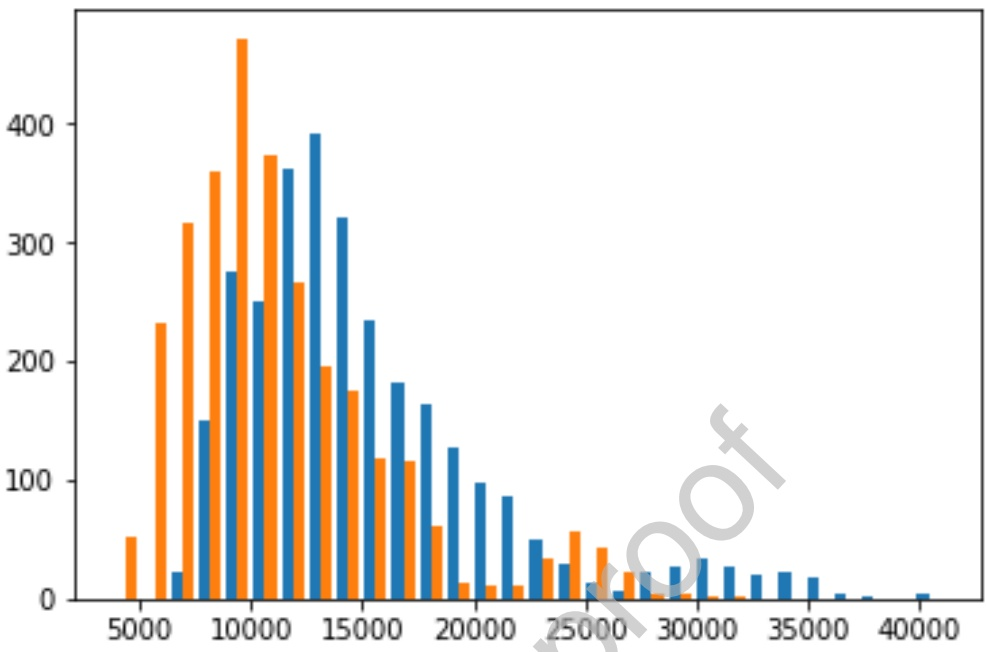

Figure 5: A comparison of objective values based on drone speed: 10 meters per second The average objectives values were 15222.16 and 11264.45, respectively.

In Figure 6, we plot the distributions of objective values among the 92 feasible instances. In blue are the average objective values found among computations where the battery energy density was 540,000 Joules per kilogram. In orange are the average objective values found among computations where the battery energy density was 900,000 Joules per kilogram.

In Figure 7, we plot the distributions of objective values among the 92 feasible instances. In blue are the average objective values found using quadrocopters. In orange are the average objective values found using octocopters.

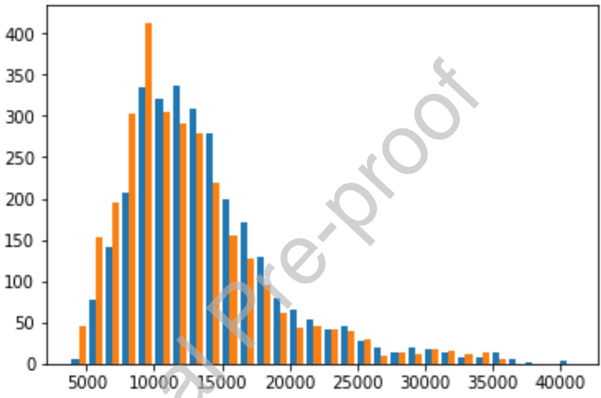

Figure 6: A comparison of objective values based on battery energy density: 540,000 J/kg (blue) vs. 900,000 J/kg (orange). The average objectives values were 13791.84 and 12694.78, respectively.

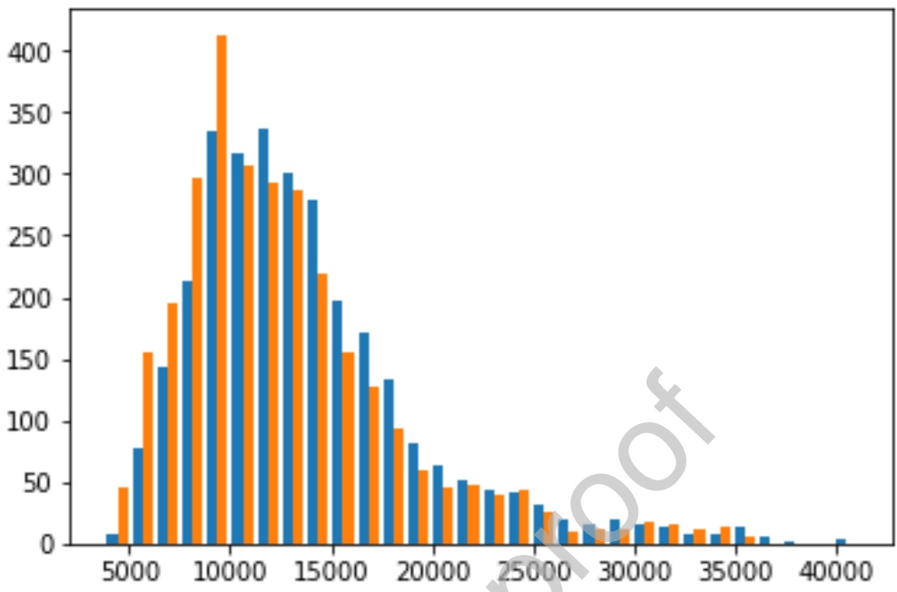

Figure 7: A comparison of objective values based drone type: quadrocopter (blue) vs. octocopter (orange). The average objectives values were 13796.99 and 12689.63, respectively.

In Figure 8, we plot the distributions of objective values among the 92 feasible instances based on the number of drones.

## 5.4 Analysis of Results

In general, the computational time required to run the RTS algorithm was very small, averaging only 3.26 seconds in total. On the largest instances $( | V | = | C | = 5 0 )$ , the average computational time was only 7.32 seconds.

For a fixed number of drones, objective values showed the greatest sensitivity to drone

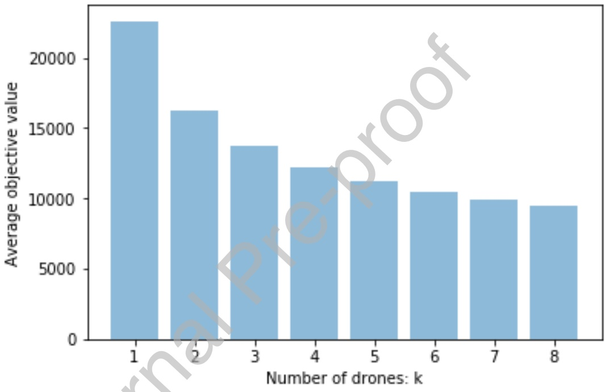

Figure 8: A comparison of objective values by number of drones, ranging from k = 1 to 8.

speed. With drone speed at 15 meters per second, the average objective value was 26.0% lower compared to a drone speed of 10 meters per second.

Improved battery technology and using larger octocopters, which have a larger effective range, also improved results by 8.0% and 8.0%, respectively.

The number of drones on the truck was also very important. Using k = 8 drones, the maximum tested, resulted in objective value decreases of 58.1% relative to a single drone. However, decreasing marginal returns was certainly observed.

Averaged across all instances, the gap between the obj value and lower bound was quite large, averaging 56.0%. The two lower bounds used each have an inherent weakness. The CETSP-derived lower bound does not account for any time the truck spends waiting for one or more drones. On the other hand, the mTSP-derived lower bound does not account for limited payload capacity and battery restrictions of the drone. Of the two lower bounds, the mTSP-derived er bound was larger in 85.8% of instances, whereas the CETSP-derived lower bound was larger in 14.2% of instances. As the number of drones increased, the CETSP-derived lower bound was larger than the mTSP-derived lower bound at a slightly higher rat When $k = 1$ , the CETSP-derived lower bound was the better lower bound in only 9% of the instances. When $k = 8$ , the CETSP-derived lower bound was the better lo er bound in 17.9% of the instances. Other attempted formulations that integrated both synchronization issues (e.g., waiting times) and energy constraints proved to be computationally intractable.

For each value of $k = 1 , 2 , . . . , 8 ,$ we conducted three separate Wilcoxon Signed-Rank Tests which compared median objective values for instances using (1) quadrocopter vs. octocopter, (2) current battery technology vs. future battery technology, and (3) drone speed of 10 m/s vs. 15 m/s. In all cases, the resulting p-value was less than 0.01, strongly suggesting a significant difference in medians in each case.

## 6 Conclusions and Future Work

We introduced the k-MVDRP. The underlying model is novel because it relaxes a number of simplifying constraints that often appear in the literature. In particular, we allow a drone to carry multiple heterogeneous packages, we allow the energy drain function to be any non-decreasing function of weight for each location pair, we decouple the set of launch/landing vertices from the set of customer locations, and we allow an arbitrary number of drones on a truck.

Computational experiments were conducted usi veral physical parameters that reflect recent research about drone energy efficiencies, velocity, and payload capacity. The results indicate that objective values are ghl sensitive to drone speed. The number of drones was also very impactful objective value, though decreasing marginal sav ings were observed. ~~Increasing the speed of the drones from 10 meters per second to 15 meters per second reduced objective values by 26.0% on average. Improvements in battery technology and using a larger octocopter, rather than a smaller quadrocopter, both reduced route completion times by 8.0% each. The use of multiple drones allowed for significantly~~ higher savings 8 had 58.1% lower objective values than k = 1), though decreasing marginal ret urn were shown. However, in practice, the number of drones per truck may ~~be constrained by a variety of factors, including the finite area of the truck’s roof and the number of batteries available. All computational experiments point to the potential for very significant reductions in route duration and delivery times.~~

We believe there are several potential directions for future research. Our heuristic algorithm may introduce suboptimality in two ways. Firstly, the optimal customer visitation order may not be the same as in the Euclidean TSP, and secondly, the assignment of drones to customers within an operation is chosen sub-optimally by the block partitioning scheme. We believe exploration of other potential customer visitation orders and using a different assignment mechanism within an operation (perhaps using an integer programming formulation) are two directions that may improve solution quality. Other completely different algorithmic approaches may prove fruitful also. Additionally, we would like to find tractable formulations that strongly enhance the lower bounds and better account for the structure of this problem, inclusive of both range and synchronicity constraints.

We would also like to consider a number of variants. In ne such variant, the speed of the drone is variable. In particular, we would like to use the RTS heuristic framework, but allow the speed of each drone on an operation to be a variable that may be optimized. We could find the maximum speed of the drone on the operation such that it does not run out of battery before rendezvousing with the truck. Another variant would allow the truck to make deliveries while one or more drones is airborne.

## References

[1] S. Adams and C. Friedland. “A survey of unmanned aerial vehicle (UAV) usage for imagery collection in disaster research and management.”, 9th International Workshop on Remote Sensing for Disaster Response. 2011.

[2] N. Agatz, P. Bouman, and M. Schmidt. “Optimization Approaches for the Traveling Salesman Problem with Drone.” Transportation Science 52.4 (2018): 965-981.

[3] Amazon. “Amazon’s Best of Prime 2017 Reveals Year’s Biggest Trends —More than 5 Billion Items Shipped with Prime 017”. January 2, 2018. Press Release. http://phx.corporate-ir.net/p oen x.zhtml?c=176060&p=irolnewsArticle&ID=2324426

[4] Amazon Prime Air. “Amazon Prime Air: Frequently Asked Questions.” Accessed: April 9, 2018. https://www.amazon.com/b?node=8037720011

[5] Amazon YouTube Channel. “Amazon Prime Air.” Amazon. November 29, 2015. Accessed: April 9, 2018. Note: YouTube video. https://www.youtube.com/watch?v=MXo\_d6tNWuY

[6] C. Attanasio. “Drones Offer New Advantages for Police.” GovTech.com. January 8, 2018. Accessed: March 5, 2018. http://www.govtech.com/public-safety/Drones-Offer-New-Advantages-for-Police.html

[7] G. Avellar, G. Pereira, L. Pimenta, and P. Iscold. “Multi-uav routing for area coverage and remote sensing with minimum time.” Sensors, 15.11 (2015): 27783-27803.

[8] A. Barrientos, J. Colorado, J. Cerro, A. Martinez, C. Rossi, D. Sanz, and J. Valente. “Aerial remote sensing in agriculture: A practical approach to area coverage and path planning for fleets of mini aerial robots.” Journal of Field Robotics, 28.5 (2011): 667-689.

[9] L. Babel. “Curvature-constrained traveling salesman tours for aerial surveillance in scenarios with obstacles.” European Journal of Operational Research. 262.1 (2017): 335-346.

[10] J. Bezos. Interview with Charlie Rose. Broadcasted on: 60 Minutes, CBS. December 1, 2013. Transcript: https://www.cbsnews.com/news/amazons-jeff-bezos-looks-to-the-future/

[11] BI Intelligence Unit, Drones could help protect ers Business Insider. April 10, 2017. Accessed: March 5, 2018. http://www.businessinsider.com/drones-could-help-protect-us-borders-2017-4

[12] Boeing YouTube Channel. “Future autonomous air travel: Boeing unveils new cargo air vehicle prototype.” Boeing. January 10, 2018. Accessed: April 29, 2018. Note: YouTube video. https://www.youtube.com/watch?v=uluR-dNUPvI

[13] M. Borak, World’s donre seller DJI made \$2.7 billion in 2017, TechNode. January 3, 2018. Accessed: April 7, 2018. https://technode.com/2018/01/03/worlds-top-drone-seller-dji-made-2-7-billion-2017/

[14] J. Bowen, Fayetteville police use drones to chase suspects, find the missing WRAL. April 4, 2018. Accessed: April 7, 2018. http://www.wral.com/drones-to-help-fayetteville-police-nab-fleeing-suspects-find-missing-people-/17465062/

[15] J. Campbell, D. Sweeney, and J. Zhang. “Strategic Design for Delivery with Trucks and Drones.” Technical Report. 2017.

[16] J. Carlsson and S. Song. “Coordinated logistics with a truck and a drone.” Management Science 64.9 (2017): 4052-4069.

[17] A. Davies, “Boeing’s Experimental Cargo Drone is a Heavy Lifter.” Wired.com. January 14, 2018. Accessed: September 4, 2018. https://www.wired.com/story/boeing-delivery-drone/

[18] I. Dayarian, M. Savelsbergh, and J.P. Clarke. “Same- a Delivery with Drone Resupply.” Technical Report. 2018. Available at: htt www.optimization-online.org/DB\_FILE/2017/09/6206.pdf.

[19] C. Di Franco and G.C. Buttazzo. “Energy-Aware Coverage Path Planning of UAVs.” ICARSC. 2015. Available at: https://www.researchgate.net/profile/Carmelo\_Di\_Franco/publication/279848193\_Energy-aware\_Coverage\_Path\_Planning\_of\_UAVs/links/57d7c2e908ae6399a3973197/Energy-aware-Coverage-Path-Planning-of-UAVs.pdf.

[20] E. Dijkstra. “A note on two problems in connexion with graphs.” Numerische Mathematik 1.1 (1959): 269-271.

[21] M. Franco. “DHL uses completely autonomous system to deliver consumer goods by drone.” New Atlas. May 10, 2016. Accessed: April 19, 2018. https://newatlas.com/dhl-drone-delivery/43248/

[22] DJI. “Spreading Wings S900.” Accessed: September 4, 2018. https://www.dji.com/spreading-wings-s900

[23] DJI. “Chart: Matrice 600 Pro Flight Time vs. Payload (kg).” (Image) Accessed: September 4, 2018. https://www3.djicdn.com/assets/images/products/m600-pro/s3-i1-en-015b82d9de0d6ca3c55721b000ebdcec.jpg

[24] R. Ellis and J. Newsome, Drone, social media make flood rescue happen in real time, CNN. January 18, 2018. Accessed: April 2, 2018. https://www.cnn.com/2016/10/11/us/weather-matthew-drone-rescue/index.html

[25] C. Engelking, Drone Pilot Helps Rescue Flood Victims in Texas Discover Magazine. May 21, 2015. Accessed: April 7, 2018. http://blogs. discovermagazine.com/ drone360/2015/05/21/drone-rescue-flood-victims

[26] A. Ferris-Rotman, How Drones Are Helping N Recover From The Earthquake Huffington Post. May 7, 2015. Accessed: March 28, 2018. https://www.huffingtonpost.com/2015/05/07/nepal-earthquake- drones\_n\_7232764.html

[27] B. Fessier, Coachella using drones, security plans enacted after 9/11 to pre-vent another Las Vegas-type incident April 4, 2018. Accessed: April 7, 2018. https://www.desertsun .com/story/life/entertainment/music/coachella/ 2018/04/04/coachella-using-drones-security-plans-enacted-after-9-11- prevent-another-las-vegas-type-incident/487502002/

[28] J. Flynt, “How much weight can a drone carry?” 3DInsider.com. November 29, 2017. Accessed: August 1, 2018. https://3dinsider.com/drone-payload/

[29] Gurobi Optimization Inc. “tsp.py.” 2017. http://www.gurobi.com/documentation/7.5/examples/tsp\_py.html Note: Python Code. Accessed: March 1, 2018.

[30] I. Jawhar, N. Mohamed, J. Al-Jaroodi, D.P. Agrawal, and S. Zhang. “Communication

and networking of UAV-based systems: Classification and associated architectures.” Journal of Network and Computer Applications, 84 (2017), 93-108.

[31] C. Greenfield. “An analysis of U.S. Navy humanitarian assistance and disaster relief operations”. Dissertation. Retrieved from: https://calhoun.nps.edu/bitstream/handle/10945/10769/11Jun\_Greenfield\_MBA.pdf?sequence=1. 2011.

[32] Q. Ha, Y. Deville, Q. Pham, and M. Hà. “On the min-cost traveling salesman problem with drone.” Transportation Research Part C: Emerging Technologies. 86 (2018): 597-621.

[33] L. Kuo, Africa is now the world’s testing ground mmercial drones Quartz. June 24, 2017. Accessed: March 8, 2018. https: qz. com/1003810/the-worlds-firstcommercial-drone-delivery-operates-from-a-hill-in-rwanda/

[34] K. Leary, Matternet Is Expanding Drone Delivery to Hospitals in Switzerland Futurism. September 27, 2017. Accessed: April 2, 2018. https://futurism.com/matternet-is-expanding-drone-delivery-to-hospitals-in-switzerland/

[35] B. Lillian, Flying Drones Beyond Line of Sight: How Can We Get There? Unmanned Aerial. May 10, 2017. Accessed: March 22, 2018. https://unmanned-aerial.com/flying-drones-beyond-line-sight-can-get

[36] L. Lin and M. Goodrich. “Hierarchical heuristic search using a Gaussian mixture model for UAV coverage planning.” IEEE Trans. Cybernet. 44 (2014), 2532–2544.

[37] S. Lin and B.W. Kernighan (1973). “An effective heuristic algorithm for the travelingsalesman problem.” Operations Research., 21.2: 498-516.

[38] K. Helsgaun. “An Extension of the Lin-Kernighan-Helsgaun TSP Solver for Constrained Traveling Salesman and Vehicle Routing Problems.” Technical Report, 2017. Roskilde, Denmark. Accessed at: http://akira.ruc.dk/\~keld/research/LKH-3/LKH-3\_REPORT.pdf. Accessed on: March 1, 2019.

[39] G. Mitchell, Facebook’s Internet-delivering drone takes flight June 30, 2017. Accessed: April 2, 2018. https://www.usatoday.com/story/tech/nation-now/2017/06/30/facebooks-internet-delivering-drone-takes-flight/444559001/

[40] C. Murray and A. Chu. “The flying sidekick traveling salesman problem: Optimization of drone-assisted parcel delivery.” Transportation Research Part C: Emerging Technologies. 54: 86-109.

[41] A. Nedjati, G. Izbirak, B. Vizvari, and J. Arkat. “Complete coverage path planning for a multi-UAV response system in post-earthquake assessment.” Robotics 5.4 (2016): 26-41.

[42] A. Otto, N. Agatz, J. Campbell, B. Golden, and E. Pesch. ”Optimization approaches for civil applications of unmanned aerial vehicles (UAVs) or aerial drones: A survey”. Networks. 72.4 (2018): 411-458.

[43] F. Planer Martin. “Panama’s Indigenous Technicians Are Using Drones to 1 llegal Logging.” Vice Magazine. February 2018. Accessed: April 7, 2018. Web version: https://www.vice.com/en\_uk/article/ez84ka/panamas-indigenous-technicians-are-using-drones-to-fight-illegal-logging

[44] S. Poikonen, E. Wasil, and B. Golden. “A Branch-and-Bound Approach to the Traveling Salesman Problem with a Drone.” INFORMS Journal on Computing 31.2 (2019): 335-346.

[45] S. Poikonen, X. Wang, and B. Golden. “The vehicle routing problem with drones: Extended models and connections.” Networks. 70.1 (2017): 34-43.

[46] Reuters staff. “Finnish post office tests drone for parcel delivery.” September 14, 2015. Accessed: June 11, 2018. Reuters. https://www.reuters.com/article/us-finland-postaldrone-iduskcn0re15e20150914

[47] M. Raap, M. Zsifkovits, and S. Pickl, “Trajectory optimization under kinematical constraints for moving target search.” Computers & Operations Research. 88 (2017): 324–331.

[48] P. Rey. “Paketzustellung per Drohne: DPDgr startet den weltweit ersten Drohnenverkehr im Linienbetrieb” (Package delivery with a drone: DPDgroup starts the first regular drone service worldwide). Press Release DPDgroup (2016). https://www.dpd.com/portal\_de/home/news/aktuelle\_neuigkeiten/dpdgroup\_startet\_den\_weltweit\_ersten\_drohnenverkehr\_im\_linienbetrieb

[49] Reuters staff. “Russian postal drone program hits wall in debut.” Reuters. April 2, 2018. Accessed: April 16, 2018. https://www.reuters.com/article/us-russia-post-drone-crash/russian-postal-drone-program-hits-wall-in-debut-idUSKCN1H91B4

[50] H. Savuran and M. Karakaya. “Efficient route planning for an unmanned air vehicle deployed on a moving carrier.” Soft Computing. 20.7 (2016): 2905-2920.

[51] J. Smith. “Exclusive: Afghan drone war - data show unmanned flights dominate air campaign.” Reuters. April 20, 2016. Accessed: May 15, 2018. https://www.reuters.com/article/us-global-markets/asian-shares-falter-as-u-s-readies-china-tariffs-euro-at-2-week-low-on-ecb-idUSKBN1JB03U

[52] T. Spangler, “Amazon Has More Than 100 Million Prime Subscribers, Jeff Bezos Discloses.” Variety. April 18, 2018. https://variety.com/2018/digital/news/amazon-prime-100-million-subscribers-jeff-bezos-1202757832/

[53] Stolaroff, Joshuah K., et al. “Energy use and life cycle greenhouse gas emissions of drones for commercial package delivery.” Nature Communications, 9.1 (2018): 409.

[54] M. Ulmer and B. Thomas. “Same-Day Delivery with a Heterogeneous Fleet of Drones and Vehicles.” Networks. 72.4 (2018): 475-505.

[55] N. Cary and N. Bose. “UPS, FedEx and Amazon gather flight data to prove drone safety.” Venture Beat. September $2 4 , \underset {} { \substack { \oplus } } { 2 } \underline { { 0 } } \underline { { 1 } } 6 ,$ Accessed: May 17, 2017. https://venturebeat.com/2016/09/24/ups- edex-and-amazon-gather-flightdata-to-prove-drone-safety/

[56] UPS YouTube Channel. “UPS Tests Residential Delivery Via Drone.” Feburary 2017. Accessed: March 2017. https: //www.youtube.com/watch?v=\xx9\_6OyjJrQ Note: YouTube Video.

[57] X. Wang, S. Poikonen, and B. Golden. “The vehicle routing problem with drones: Several worst-case results.” Optimization Letters. 11.4 (2017): 679-697.

[58] X. Wang, Golden, and E. Wasil. “A Steiner Zone Variable Neighborhood Search Heuristic for the Close-Enough Traveling Salesman Problem.” Computers & Operations Research. 101 (2019): 200-219.

[59] Project Wing. “Project Wing.” Accessed: June 15, 2018. https://x.company/projects/wing/

[60] Zipline, Inc. “Tanzania Announces World’s Largest National Drone Delivery Network Partnering with Zipline”. August 24, 2017. Accessed: April 4, 2018. Note: Press Release. http://www.flyzipline.com/uploads/Tanzania%20Announcement%20Press%20Release%20vFinal.pdf

## Appendix A

The energy function for the quadrocopter is $e ( v _ { i } , v _ { j } , W ) =$

$$
3 1. 0 0 0 + (3 3. 1 1 0 - 3 1. 0 0 0) (W - 0. 0 0 0) / 0. 3 7 5 \quad 0. 0 0 0 \leq W \leq 0. 3 7 5
$$

$$
3 3. 1 1 0 + (3 5. 3 6 4 - 3 3. 1 1 0) (W - 0. 3 7 5) / 0. 3 7 5 \quad 0. 3 7 5 \leq W \leq 0. 7 5 0
$$

$$
3 5. 3 6 4 + (3 7. 7 1 2 - 3 5. 3 6 4) (W - 0. 7 5 0) / 0. 3 7 5 \quad 0. 7 5 0 \leq W \leq 1. 1 2 5
$$

$$
3 7. 7 1 2 + (4 0. 3 4 2 - 3 7. 7 1 2) (W - 1. 1 2 5) / 0. 3 7 5 \quad 1. 1 2 5 \leq W \leq 1. 5 0 0
$$

$$
4 0. 3 4 2 + (4 3. 0 8 8 - 4 0. 3 4 2) (W - 1. 5 0 0) / 0. 3 7 5 \quad 1. 5 0 0 \leq W \leq 1. 8 7 5
$$

$$
4 3. 0 8 8 + (4 6. 0 2 1 - 4 3. 0 8 8) (W - 1. 8 7 5) / 0. 3 7 5 \quad 1. 8 7 5 \leq W \leq 2. 2 5 0
$$

$$
4 6. 0 2 1 + (4 9. 1 5 4 - 4 6. 0 2 1) (W - 2. 2 5 0) / 0. 3 7 5 \quad 2. 2 5 0 \leq W \leq 2. 6 2 5
$$

$$
4 9. 1 5 4 + (5 2. 5 0 0 - 4 9. 1 5 4) (W - 2. 6 2 5)
$$

$$
2. 6 2 5 \leq W \leq 3. 0 0 0
$$

and is measured in Joules per meter.

The energy function for the octocopter is e(vi, vj , W) =

$$
2 0 0. 0 0 + (2 1 7. 4 1 - 2 0 0. 0 0) (W - 0. 0 0 0) / 2. 5 \quad 0. 0 0 0 \leq W \leq 2. 5
$$

$$
2 1 7. 4 1 + (2 3 6. 3 4 - 2 1 7. 4 1) (W - 2. 5) / 2. 5
$$

$$
2. 5 \leq W \leq 5. 0
$$

$$
2 3 6. 3 4 + (2 5 6. 9 2 - 2 3 6. 3 4) (W - 5. 0) / 2. 5
$$

$$
5. 0 \leq W \leq 7. 5
$$

$$
2 5 6. 9 2 + (2 7 9. 2 8 - 2 5 6. 9 2) (W - 7. 5) / 2. 5
$$

$$
7. 5 \leq W \leq 1 0. 0
$$

$$
2 7 9. 2 8 + (3 0 3. 6 0
$$

$$
2 7 9. 2 8) (W - 1 0. 0) / 2. 5
$$

$$
1 0. 0 \leq W \leq 1 2. 5
$$

$$
3 0 3. 6 0 + (3 3 0. 0 3 - 3 0 3. 6 0) (W - 1 2. 5) / 2. 5
$$

$$
1 2. 5 \leq W \leq 1 5. 0
$$

$$
3 3 0. 0 3 + (3 5 8. 7 7 - 3 3 0. 0 3) (W - 1 5) / 2. 5
$$

$$
1 5. 0 \leq W \leq 1 7. 5
$$

$$
3 5 8. 7 7 + (3 9 0. 0 0 - 3 5 8. 7 7) (W - 1 7. 5)
$$

$$
1 7. 5 \leq W \leq 2 0. 0
$$

and is measured in Joules per meter.