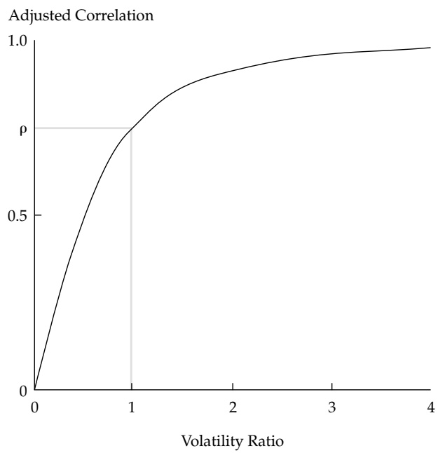
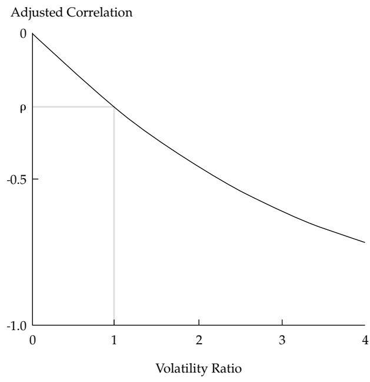
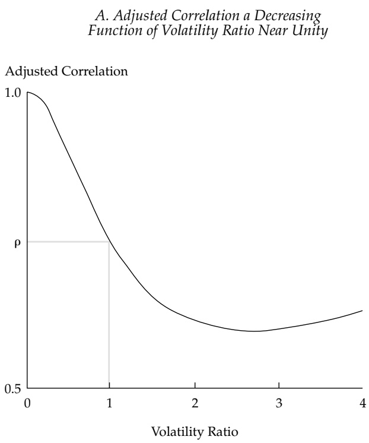
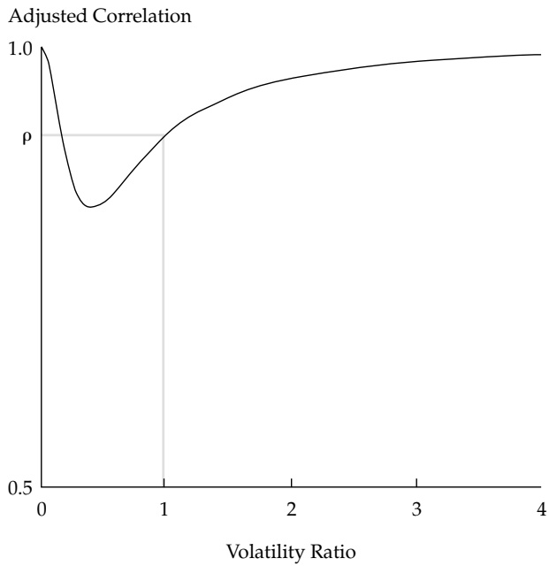
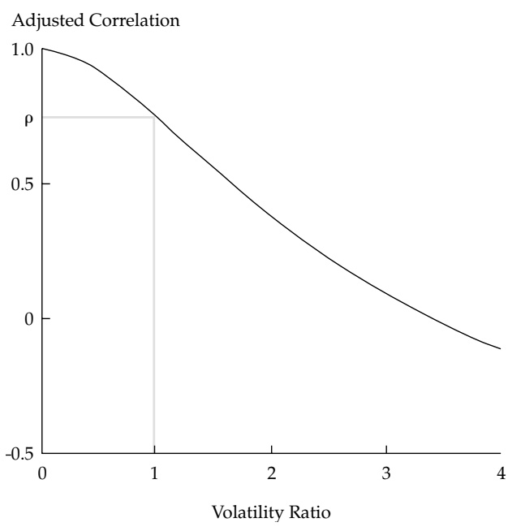

# Conditional Distribution in Portfolio Theory

**Edward Qian & Stephen Gorman**

**To cite this article:** Edward Qian & Stephen Gorman (2001) Conditional Distribution in Portfolio Theory, Financial Analysts Journal, 57:2, 44-51, DOI: [10.2469/faj.v57.n2.2432](https://www.tandfonline.com/action/showCitFormats?doi=10.2469/faj.v57.n2.2432)

**To link to this article:** [https://doi.org/10.2469/faj.v57.n2.2432](https://doi.org/10.2469/faj.v57.n2.2432)

曲 Published online: 02 Jan 2019.

[Submit your article to this journal](https://www.tandfonline.com/action/authorSubmission?journalCode=ufaj20&show=instructions&src=pdf)

Article views: 185

[View related articles](https://www.tandfonline.com/doi/mlt/10.2469/faj.v57.n2.2432?src=pdf)

[Citing articles: 2 View citing articles](https://www.tandfonline.com/doi/citedby/10.2469/faj.v57.n2.2432?src=pdf)

# Conditional Distribution in Portfolio Theory

Edward Qian and Stephen Gorman

We present a new method to obtain a conditional mean vector and a conditional covariance matrix when given an investor’s view about return profiles of certain assets. The method extends earlier results that were limited to the conditional mean. The new method allows an investor to express views on return means, volatilities, and correlations. An application of our results illustrates how a single anticipated volatility shock spreads to other assets and increases the correlation coefficients among assets. Another application shows how a flight-to-quality event affects volatilities and correlations. Based on the conditional mean and covariance matrix, we then derive analytically an optimal mean–variance portfolio and discuss its implications for asset allocation.

he result of mean–variance analysis is T notoriously sensitive to its inputs (e.g., Best and Grauer 1991). This problem manifests itself in two forms. First, given

a fixed covariance matrix and a risk-aversion factor, a set of seemingly reasonable mean forecasts (either in total return or excess return versus a risk-free asset) may give rise to a portfolio that is overwhelmingly concentrated in a few assets. Second, a minute change in either the mean vector or the covariance matrix often leads to a drastic change in the optimal portfolio. This input sensitivity of mean–variance optimization hampers its application to asset allocation.

The Black–Litterman (1991) methodology was developed to alleviate the input-sensitivity problem. It starts with equilibrium expected returns extracted inversely from observed market value weights, with a covariance matrix and a riskaversion factor given (e.g., Best and Grauer 1985). When these equilibrium expected returns are the inputs, a mean–variance optimization automatically leads to the market portfolio, which guarantees a high degree of diversification.

The most innovative feature of the Black– Litterman method is that it uses conditional distribution theory to adjust the entire mean vector to reflect an investor’s view that the expected returns of a few assets will differ from their respective equilibrium levels. Without the conditional adjustment of the mean vector, an optimizer interprets small differences between the equilibrium expected returns and the investor’s forecasts as arbitrage opportunities; the result is often portfolios heavily concentrated in a few assets. In reality, asset returns are more or less correlated with one another. By using conditional distribution implied by the joint equilibrium distribution to adjust the mean vector while keeping the covariance matrix fixed, Black and Litterman reduced the perceived arbitrage opportunities. As a result, the optimal portfolio produced by their method not only reflects investor expectations of differences between future and equilibrium returns but also represents a diversified mix of assets.

The Black–Litterman method deals only with conditional adjustment of the mean vector. In practice, an investor might also have opinions about the volatilities of certain assets and the correlations between them. For example, an increasing number of investors are using GARCH (generalized autoregressive conditional heteroscedasticity) models to forecast future return volatilities. Another alternative is to use implied volatilities of option instruments. Because volatility and correlation also have an impact on asset allocation, conditional adjustment should be made to the covariance matrix. Therefore, we advocate a unified framework for conditional adjustments of both the mean vector and the covariance matrix.

Black and Litterman formulated their approach through Bayesian inference. Although this approach is statistically sophisticated, it does require three uncomfortable assumptions. First, despite the fact that a distribution of the mean vector is never observable, the Black–Litterman method must assume that the mean vector possesses a particular form of prior distribution. Second, interpreting an investor’s view as a likelihood function is rather tenuous statistically. Third, one cannot consistently calibrate the free parameters associated with the two preceding assumptions. Unfortunately, the end result, the posterior distribution, generally depends heavily on the relative sizes of these values. Therefore, a straightforward generalization of the Black–Litterman method does not appear to be possible.

<small>Edward Qian, CFA, is vice president and Stephen Gorman, CFA, is senior vice president at Putnam Investment Management.</small>

Our approach to using conditional distributions in portfolio theory simplifies the Black– Litterman method, in that we apply conditional distribution theory directly to the distribution of the asset returns, rather than to the unknown distribution of the mean vector. We go beyond the Black– Litterman method to adjust both the mean vector and the covariance matrix. Both adjustments occur simultaneously through the multivariate regression relationship implied by conditional distributions of the market equilibrium. Our fundamental assumptions are that the coefficients and the error covariance matrix of this linear regression remain constant and that the error terms stay independent from the asset returns for which views are expressed. Given these assumptions, we can ensure that the expected return and volatility estimates for all assets are consistent with an investor’s view on merely a subset of these estimates.

Note that this assumption is implicitly embedded in the Black–Litterman Bayesian method. We use it to extend their work to estimate a conditional covariance matrix. As we note in later sections, this working assumption bears close similarity to the one that anchors the capital asset pricing model. Because these stationarity assumptions are often not preserved in practice, one must use the theoretical results with caution and seek to improve them. Although a thorough empirical investigation into the nonstationarity problem and its remedy is beyond the scope of this article, we present one illustrative case in Appendix A.

Our result for the conditional mean vector turns out to be equivalent to that of Black and Litterman. The result for the conditional covariance matrix is entirely new, and it also reduces the sensitivity of mean–variance optimization to an investor’s volatility estimates. In particular, the effect on the covariance matrix of an anticipated volatility shock in a single asset or a combination of two assets is interesting. Such an expectation increases the volatility estimates for all the assets and also changes their correlation coefficients in a variety of ways.

## The Two-Asset Case

We assume that the equilibrium return distribution of two assets is a bivariate normal distribution, $\stackrel { \rightarrow } { r } \sim N ( \vec { \mu } , \Sigma )$ , where $\scriptstyle { \vec { r } }$ is the return vector, $\vec { \mu }$ is its mean, and $\Sigma$ is the covariance matrix. Explicitly,

$$
\vec {r} = \binom{r _ {1}}{r _ {2}},\tag{1a}
$$

$$
\vec {\mu} = \binom{\mu_ {1}}{\mu_ {2}},\tag{1b}
$$

and

$$
\sum = \left( \begin{array}{c c} \sigma_ {1} ^ {2} & \rho \sigma_ {1} \sigma_ {2} \\ \rho \sigma_ {1} \sigma_ {2} & \sigma_ {2} ^ {2} \end{array} \right),\tag{1c}
$$

where the volatilities of the two assets are $\sigma _ { 1 }$ and $\sigma _ { 2 }$ and $\rho$ denotes the correlation between the two assets.

**Views about a Single Asset.** Consider an investor who expects the mean return, $\tilde { \mu } _ { 2 } ,$ and the volatility, $\tilde { \mathbf { \sigma } } _ { 2 ^ { \prime } }$ of the second asset to differ from the equilibrium levels. (The tilde denotes non-equilibrium quantities.) According to standard multivariate statistics theory, the conditional distribution of $r _ { 1 }$ given $r _ { 2 }$ is a univariate normal distribution given by

$$
\left| N \left[ \mu_ {1} + \frac {\rho \sigma_ {1}}{\sigma_ {2}} \left(r _ {2} - \mu_ {2}\right), \sigma_ {1} ^ {2} \left(1 - \rho^ {2}\right) \right]. \right.\tag{2}
$$

We can recast the conditional distribution (Equation 2) as a linear regression of $r _ { 1 }$ against $r _ { 2 }$ (e.g., Murihead 1982):

$$
r _ {1} = \mu_ {1} + \frac {\rho \sigma_ {1}}{\sigma_ {2}} \bigg (r _ {2} - \mu_ {2} \bigg) + \varepsilon .\tag{3}
$$

The error term follows a zero-mean normal distribution and is independent of $r _ { 2 , }$ the variable being held fixed:

$$
\varepsilon \sim N \left[ 0, \sigma_ {1} ^ {2} \left(1 - \rho^ {2}\right) \right].\tag{4}
$$

We now assume that the linear relationship and the distribution of ε continue to apply when $r _ { 2 }$ deviates from its equilibrium distribution.1 Taking the expectation of Equation 3 and rearranging the results produces

$$
\frac {\tilde {\mu} _ {1} - \mu_ {1}}{\sigma_ {1}} = \rho \frac {(\tilde {\mu} _ {2} - \mu_ {2})}{\sigma_ {2}}.\tag{5}
$$

The correlation coefficient serves as a scalar— equilibrating the change in mean, standardized by equilibrium volatility. Therefore, i $\mathrm { f }   \rho   >   0 ,$ , the adjustments to the equilibrium means must be either both positive or both negative. If $\mathsf { p } < 0 ,$ , the changes are in the opposite direction.

Similarly, taking the variance of Equation 3 and rearranging the result produces

$$
\frac {\tilde {\sigma} _ {1} ^ {2} - \sigma_ {1} ^ {2}}{\sigma_ {1} ^ {2}} = \rho^ {2} \frac {\tilde {\sigma} _ {2} ^ {2} - \sigma_ {2} ^ {2}}{\sigma_ {2} ^ {2}},\tag{6}
$$

where the squared correlation cofficient, $\mathsf { p } ^ { 2 } ,$ equilibrates the percentage adjustment to the equilibrium variances. Given $\vec { 0   } <   \rho ^ { 2 }   <   1$ , because we exclude three trivial cases $( \rho = 0 , \mid \rho \mid = 1 )$ from the analysis, the percentage change in the variance of the first asset is positively proportional $\mathbf { t o } ,$ but less than, the percentage change in the variance of the second asset.

The investor’s view on return volatility must also affect the covariance between the two assets. Using Equation 3 and the fact that ε and $r _ { 2 }$ are independent, we obtain

$$
\operatorname{cov} (r _ {1}, r _ {2}) = \frac {\rho \sigma_ {1}}{\sigma_ {2}} \tilde {\sigma} _ {2} ^ {2}.\tag{7}
$$

Combining Equations $6$ and 7 produces the conditional covariance matrix:

$$
\tilde {\Sigma} = \left\{ \begin{array}{c c} \sigma_ {1} ^ {2} \Big [ 1 + \rho^ {2} \Big (c ^ {2} - 1 \Big) \Big ] & c ^ {2} \rho \sigma_ {1} \sigma_ {2} \\ c ^ {2} \rho \sigma_ {1} \sigma_ {2} & c ^ {2} \sigma_ {2} ^ {2} \end{array} \right\},\tag{8}
$$

where $c$ equals $\tilde { \sigma } _ { 2 } / \sigma _ { 2 ^ { \prime } }$ the volatility ratio for the second asset.

From the matrix $\tilde { \Sigma }$ , the adjusted correlation coefficient is simply

$$
\tilde {\rho} = \rho \frac {c}{\sqrt {1 + \rho^ {2} (c ^ {2} - 1)}}.\tag{9}
$$

The adjustment factor in Equation 9 preserves the sign of the original correlation coefficient and is an increasing function of $c ,$ with its range in $( 0 , 1 / \mid \mathsf { p } \mid )$ This factor obviously equals unity when $c \; = \; 1$ Consequently, when the equilibrium correlation is positive, as Panel A of **Figure 1** illustrates, the adjusted correlation coefficient rises if the volatility ratio exceeds 1 (that is, $\tilde { \rho } > \rho \mathrm { ~ i f ~ } c > 1 )$ and falls if the volatility ratio is less than 1 (that is, $\tilde { \rho } > \rho \mathrm { ~ i f ~ } c < 1 )$ Panel B illustrates that the opposite is true when the original correlation is negative. If the volatility ratio exceeds 1, the adjusted correlation becomes more negative. A volatility ratio less than 1 produces a less-negative adjusted correlation.

**Views about the Relative Performance of Two Assets.** Investors often have opinions regarding the relative attractiveness of two assets

Figure 1. Adjusted Correlation Based on Absolute View

A. Positive Original Correlation Coefficient

B. Negative Original Correlation Coefficient

but cannot assign a specific return expectation to each asset. Examples are the stock versus bond decision that involves the equity risk premium and the bond-quality decision that involves credit spreads. In these instances, we consider the return difference, $r _ { d } = r _ { 1 } - r _ { 2 } ,$ between two assets. According to the equilibrium return distribution, $, r _ { d }$ has the mean $d = \mu _ { 1 } - \mu _ { 2 }$ and the variance $\sigma _ { d } ^ { 2 } = \sigma _ { 1 } ^ { 2 } + \sigma _ { 2 } ^ { 2 } - 2 \rho \sigma _ { 1 } \sigma _ { 2 }$

Assume that an investor expresses views on the mean and variance of this return difference as, respectively, $\tilde { d }$ and $\tilde { \mathbf { o } } _ { d } ^ { 2 }$ . The mean return vector for the individual assets and their covariance matrix must be adjusted to reflect these views.

As in the preceding section, we cast each individual return as a linear regression—in this case, against $r _ { d } \cdot$

$$
r _ {1} = \mu_ {1} + \beta_ {1} (r _ {d} - d) + \varepsilon_ {1}\tag{10a}
$$

and

$$
r _ {2} = \mu_ {2} + \beta_ {2} (r _ {d} - d) + \varepsilon_ {2}.\tag{10b}
$$

The regression coefficients may carry opposite signs or the same positive or negative sign. The random variables $\varepsilon _ { 1 }$ and $\varepsilon _ { 2 }$ both have a zero mean.2

Taking the expectation of Equations 10 and incorporating the investor’s views produces the conditional return expectation for each asset:

$$
\tilde {\mu} _ {1} = \mu_ {1} + \beta_ {1} (\tilde {d} - d)\tag{11a}
$$

and

$$
\tilde {\mu} _ {2} = \mu_ {2} + \beta_ {2} (d - d).\tag{11b}
$$

The difference between the conditional and equilibrium mean for each asset (that is, $\mu _ { 1 } - \mu _ { 1 }$ and $\tilde { \mu } _ { 2 } - \mu _ { 2 } )$ is solely a function of the beta. Depending on the signs and magnitudes of the betas, the differences may expand or contract relative to $\tilde { d }   -   d ,$ the change in the mean of the return difference caused by the investor’s views.

We derive the elements in the conditional covariance matrix by using Equations 10 and the covariances of the error terms through a standard statistical calculation:

$$
\tilde {\Sigma} = \left( \begin{array}{c c} \sigma_ {1} ^ {2} + \beta_ {1} ^ {2} \Delta & \rho \sigma_ {1} \sigma_ {2} + \beta_ {1} \beta_ {2} \Delta \\ \rho \sigma_ {1} \sigma_ {2} + \beta_ {1} \beta_ {2} \Delta & \sigma_ {2} ^ {2} + \beta_ {2} ^ {2} \Delta \end{array} \right),\tag{12}
$$

where $\Delta   =   \tilde { \sigma } _ { d } ^ { 2 }   -   \sigma _ { d } ^ { 2 }   =   \sigma _ { d } ^ { 2 }   ( c ^ { 2 }   -   1 )$ , with $c   =   \tilde { \sigma } _ { d } / \sigma _ { d }$

Clearly, the individual variances, the diagonal elements in Equation 12, increase or decrease as a function of the equilibrium variance of the return difference and the volatility ratio. The change in the covariance is less intuitive. Because this change is a function of the product of two betas, a number of adjustments are possible. In particular, when the betas carry opposite signs and the original correlation is positive, an increase in the volatility $( c = \tilde { \sigma } _ { d } / \tilde { \sigma } _ { d } > 1 )$ can actually lower the covariance and hence the correlation coefficient between the two assets. This result is particularly interesting because a higher volatility in the return difference of two traditionally highly correlated assets can cause a decoupling of the two assets, as is often observed in the market when a flight-to-quality event occurs. Contrast this result with the results when an investor has a view on a single asset, as discussed in the preceding section. In that case, a rising volatility ratio magnifies the equilibrium correlation $( \mathrm { i . e . , ~ a ~ }$ positive or negative correlation becomes more so). **Figure 2** provides examples of the behavior of the adjusted correlation coefficient when the betas have the same sign. In the two cases depicted in Figure 2, the adjusted correlation moves to unity as the volatility ratio approaches either zero or infinity. The difference between the two cases arises from the different equilibrium correlation coefficients (0.75 in Panel A and 0.9 in Panel B). In Panel A, the adjusted correlation is a decreasing function of the volatility ratio until the ratio exceeds roughly 2.5. In Panel B, however, the adjusted correlation is a decreasing function of the volatility ratio only until the ratio exceeds 0.5. Therefore, when the betas carry the same sign, an expectation for rising volatility of the return difference between two assets may or may not reduce the expected correlation between those assets. **Figure 3** provides an example of the behavior of the adjusted correlation coefficient when the betas are of opposite signs and the equilibrium correlation is positive. The adjusted correlation moves to 1 as the volatility ratio approaches $0 ,$ and it moves to –1 as the ratio approaches infinity. In this case, an expectation for rising volatility of the return difference between two assets always reduces the expected correlation between those assets.

## The General Case

Let $\scriptstyle { \vec { r } }$ denote the return vector of N assets, $\vec { \mu }$ the equilibrium mean vector, and Σ the equilibrium covariance matrix. As in Black–Litterman, we use a matrix to characterize investor expectations concerning asset performance. Specifically, we represent k views in a full-rank $\bar { k \times N }$ matrix, P. To use conditional distribution, we require k to be less than N.

This representation accommodates views on both the absolute and relative performance of assets. In the simple two-asset cases of the previous section, $\mathbf { P }   =   ( 0$ 1) when the view applies to the second asset and $\mathbf { P } = ( 1 - 1 )$ when the view applies to the relative performance of the assets. The $k \times 1$ vector, $\stackrel { \diamond } { r } _ { v }   =   \mathbf { P }   \stackrel { \diamond } { r } _ { , }$ , forms a return vector about which an investor expresses views. The vector $\vec { \bar { r } } _ { \nu }$ has the following equilibrium mean vector and covariance matrixes (the superscript t denotes the transpose of the matrix):

$$
\vec {\mu} _ {v} = \mathbf {P} \vec {\mu}\tag{13a}
$$

Figure 2. First Case of Adjusted Correlation Based on Relative View: Betas of Same Sign $( \beta _ { 1 } \beta _ { 2 } > 0 )$

B. Adjusted Correlation an Increasing Function of Volatility Ratio Near Unity

Figure 3. Second Case of Adjusted Correlation Based on Relative View: Betas of Opposite Signs $( \beta _ { 1 } \beta _ { 2 } < 0 )$

and

$$
\Sigma_ {v} = \mathbf {P} \Sigma \mathbf {P} ^ {t}.\tag{13b}
$$

For the return vector $\scriptstyle { \vec { r } } _ { \nu }$ we can now incorporate investor views in terms of its expectation, $\tilde { \mu } _ { \nu } ,$ and its covariance matrix, $\Sigma _ { \mathcal { V } }$

We begin by generalizing the previous regression analysis to the multivariate case. The following equation represents the vector form of the linear regression of $\overset { \underset { \underset { \underset { \cdot } { \cdot } } { \overset { 1 } { \cdot } } } } { r }$ versus $\vec { \dot { r } } _ { \nu }$ :

$$
\begin{array}{r} \vec {r} = \vec {\mu} + \mathrm{cov} (\vec {r}, \vec {r} _ {v}) [ \mathrm{cov} (\vec {r} _ {v}, \vec {r} _ {v}) ] ^ {- 1} (\vec {r} _ {v} - \vec {\mu} _ {v}) + \vec {\varepsilon} \\ = \vec {\mu} + (\sum \mathbf {P} ^ {t}) \sum_ {v} ^ {- 1} (\vec {r} _ {v} - \vec {\mu} _ {v}) + \vec {\varepsilon}. \end{array}\tag{14}
$$

As a direct consequence of the regression, the $N   \times   1$ random vector $\gtreqqless$ is independent of $\vec { \bar { r } } _ { \nu }$ and obeys a multivariate normal distribution:

$$
\vec {\mathfrak {E}} \sim N \bigg [ \vec {0}, \Sigma - \Big (\Sigma \mathbf {P} ^ {l} \Big) \Sigma_ {v} ^ {- 1} \Big (\mathbf {P} \Sigma \Big) \bigg ].\tag{15}
$$

Given Equation 14 and the investor views reflected in the expectation of $\vec { \dot { r } } _ { \nu }$ we derive the conditional mean of the individual asset returns:3

$$
\begin{array}{r l}\stackrel {{\rightarrow}} {\tilde {\mu}}&= \vec {\mu} + (\sum \mathbf {P} ^ {t}) \sum_ {v} ^ {- 1} (\stackrel {{\rightarrow}} {\hat {\mu}} _ {v} - \vec {\mu} _ {v}).\end{array}\tag{16}
$$

Similarly, we obtain the conditional covariance matrix of $\vec { \tilde { r } } _ { \gamma }$ by using Equations 14 and 15 and the independence property of $\gtreqqless$ and $\vec { r } _ { \nu } ;$

$$
\tilde {\Sigma} = \Sigma + (\Sigma \mathbf {P} ^ {t}) (\Sigma_ {v} ^ {- 1} \tilde {\Sigma} _ {v} \Sigma_ {v} ^ {- 1} - \Sigma_ {v} ^ {- 1}) (\mathbf {P} \Sigma).\tag{17}
$$

Equations 16 and 17 form the core of the unified framework for adjusting both the mean return vector and covariance matrix. Obviously, the pre-ceding single-view examples represent simple applications of this general framework.

When the number of investor views is full (i.e., $k   =   N   )$ , we do not need to rely on conditional distribution to obtain the view-adjusted mean vector and covariance matrix. In this case, the square matrix P should be nonsingular. Therefore, Equation 13 can be inverted to give

$$
\vec {\mu} = \mathbf {P} ^ {- 1} \vec {\mu} _ {v}\tag{18a}
$$

and

$$
\Sigma = \mathbf {P} ^ {- 1} \Sigma_ {\nu} (\mathbf {P} ^ {\prime}) ^ {- 1}.\tag{18b}
$$

Consequently, any views regarding the return vector $\vec { \bar { r } } _ { \nu }$ are transformed to views regarding the original return vector by

$$
\stackrel {{\rightarrow}} {\tilde {\mu}} = \mathbf {P} ^ {- 1} \stackrel {{\rightarrow}} {\tilde {\mu}} _ {v}\tag{19a}
$$

and

$$
\tilde {\Sigma} = \mathbf {P} ^ {- 1} \tilde {\Sigma} _ {v} (\mathbf {P} ^ {t}) ^ {- 1}.\tag{19b}
$$

At the same time, it is simple to show that Equations 16 and 17 simplify to the same result when P is taken as a nonsingular matrix. We thus conclude that the adjusted conditional mean and conditional covariance can be generalized to the full-view case.

## Implications for Mean–Variance Analysis

In this section, we consider the implications of the conditional expected mean vector and covariance matrix for mean–variance analysis. To keep matters simple, we consider a mean–variance optimization that includes a risk-free asset for which an exact solution is readily available. Specifically, with equilibrium mean excess return $\vec { \mu }$ and covariance matrix Σ given, the following provides the vector of the optimal risky asset weights:

$$
\vec {w} = \lambda^ {- 1} \Sigma^ {- 1} \vec {\mu},\tag{20a}
$$

where $\lambda$ represents the risk-aversion factor, which we assume here is constant. Similarly,

$$
\stackrel {\triangleright} {\tilde {w}} = \lambda^ {- 1} \tilde {\Sigma} ^ {- 1} \stackrel {\triangleright} {\tilde {\mu}}\tag{20b}
$$

provides the vector of optimal risky asset weights given the conditional or view-reflective excess mean and covariance matrix. The difference between w and represents the impact of investor views onw˜ optimal portfolio structure relative to the market equilibrium.

Finding the weight vector, $^ { \Leftrightarrow } _ { w , }$ requires the inverse of the conditional covariance matrix.

**Theorem 1.** The inverse of matrix $\Sigma$ given in Equation 17 is the following:

$$
\tilde {\Sigma} ^ {- 1} = \Sigma^ {- 1} + \mathrm{P} ^ {t} \left(\tilde {\Sigma} _ {v} ^ {- 1} - \Sigma_ {v} ^ {- 1}\right) \mathrm{P}.\tag{21}
$$

Proving Equation 21 by direct verification is straightforward. Combining Equations 16 and 21 provides us with the view-adjusted vector of optimal weights of risky assets.

**Theorem 2.** Given the conditional mean return vector in Equation 16 and the inverse of the conditional covariance matrix in Equation 21, Equation 22 provides the vector of optimal risky asset weights:

$$
\stackrel {{\vec {}}}{\hat {w}} = \stackrel {{\vec {}}} {{w}} + \mathbf {P} ^ {t} (\lambda^ {- 1} \tilde {\Sigma} _ {v} ^ {- 1} \stackrel {{\vec {}}} {{\mu}} _ {v} - \lambda^ {- 1} \Sigma_ {v} ^ {- 1} \stackrel {{\vec {}}} {{\mu}} _ {v}).\tag{22}
$$

Note that the two terms in the parentheses have exactly the same form as the vectors of optimal weights. Clearly, we can identify them as solutions of a sub-mean–variance optimization based on the vector $\vec { \tilde { r } } _ { \nu } ,$ the returns of combinations of assets about which the investor expresses views. Equation 22 also provides the difference between vectors of optimal weights in individual assets in terms of the matrix $\mathbf { P } ^ { t }$ and the difference between vectors of optimal weights in the sub-mean–variance optimization.

Equation 22 has two important implications. First, if an investor’s views about the expected mean and covariance of $\vec { \tilde { r } } _ { \nu }$ are related in such a way that $\begin{array} { r } { \tilde { \sum } _ { \nu } ^ { - 1 } \stackrel { \mathcal { Z } } { \tilde { \mu } } _ { \nu } = \sum _ { \nu } ^ { - 1 } \stackrel { \mathcal { Z } } { \tilde { \mu } } } \end{array}$ , then $\tilde { \tilde { w } } = w \left( \mathrm { i . e . } \right.$ , the optimal portfolio weights remain unchanged). This case may occur because of, for example, higher expected returns accompanied by proportionally higher expected volatilities, which cause the investor to be indifferent to the views.

A second consequence of Theorem 2 concerns cases in which investor views address only a small subset of assets: Without loss of generality, divide N assets into two groups. One group consists of n assets about which the investor expresses views, and the other group consists of the remaining assets. We can then decompose the full-rank matrix P into a $k \times ( N - n )$ zero matrix and a $k \times n$ nonzero matrix, $\mathbf { P }   =   \left[ \mathbf { 0 } _ { k \times   ( N - n ) } ; \mathbf { Q } _ { k \times   n } \right]$ . According to Equation 22, we can similarly decompose the vectors of optimal weights as follows:

$$
\begin{array}{r} \vec {w} = \left( \begin{array}{c} \vec {w} _ {(N - n)} ^ {1} \times 1 \\ \vec {w} _ {n \times 1} ^ {2} \end{array} \right). \end{array}\tag{23}
$$

We now have

$$
\begin{array}{r c l}\stackrel {{\rightarrow 1}} {{\hat {w}}}&=&\stackrel {{\rightarrow 1}} {{w}}\end{array}\tag{24a}
$$

and

$$
\begin{array}{c}\stackrel {{\rightarrow}} {{\tilde {w}}} ^ {2}\\= \vec {w} ^ {2} + \mathbf {Q} ^ {t} (\lambda^ {- 1} \tilde {\Sigma} _ {v} ^ {- 1} \stackrel {{\rightarrow}} {{\mathfrak {p}}} _ {v} - \lambda^ {- 1} \Sigma_ {v} ^ {- 1} \vec {\mu} _ {v}).\end{array}\tag{24b}
$$

According to Equations 24, active views affect the weights in only those assets about which the investor expresses a view. Such expectations have no implications for the weights in the remaining assets.

Equations 22 and 24 clearly indicate that the conditional adjustments of the mean vector and covariance matrix reduce the variability in the result of unconstrained mean–variance analysis. Imposing constraints on the optimization will, of course, force the results away from this base case. Obviously, the size of this deviation will depend on the specifics of the problem and the nature of the constraints. Nonetheless, our results provide valuable, fundamental insight into optimization based on a conditional mean vector and conditional covariance matrix.

## Conclusion

We presented a new method to obtain the conditional mean vector and conditional covariance matrix when given the market equilibrium and the views of an investor. Based on linear regression relationships, we replicated the conditional expected return vector obtained through Bayesian inference by Black and Litterman. Our derivation of the conditional covariance matrix extends that work. Like the conditional mean vector, the conditional covariance matrix tends to stabilize the results generated by mean–variance analysis. By studying the analytical solution of a mean–variance optimization, we uncovered the condition under which the investor view has no impact on the allocations of assets in the optimal portfolio. This work also demonstrates that allocations to assets for which the investor expresses no view are unaffected by the conditional adjustments.

For general mean–variance optimizations with various constraints encountered in more realistic asset allocation problems, the results of our study on the conditional mean and conditional covariance provide two basic inputs to any required numerical methods.

Both the Black–Litterman method and our method rely on the assumption that the regression relationship (Equation 14) stays constant, which is questionable in practice. Any deviation from it, such as changes in regression coefficients or in standard errors, will affect our estimates of the conditional mean and covariance matrix and, subsequently, the optimal portfolio based on these inputs. Progress in solving this practical problem would be an improvement on our result.

Our method lends itself naturally to portfolio risk analysis. For instance, an analyst can use it in stress tests to measure in a consistent way the sensitivities of an existing portfolio’s return distribution and, consequently, its exposure to various market events. Finally, we assumed normality for return distributions, but conditional distribution theory is not limited to normal distributions. Increasingly, nonnormal distributions are used to accurately characterize asset returns. An additional area of research, therefore, would be to extend our method to such distributions. We are currently pursuing research in these areas.

<small>We thank Matthew Wu, Charles Wang, and Yanfang Yan for their helpful comments on the original manuscript.</small>

<small>Appendix A. Example of Model Variability</small>

<small>This simple example is designed to highlight the variability of the regression model. We took the monthly return series of the S&P 500 Index and the Ibbotson Long-Term Government Bond Index from January 1970 to December 1999 and divided the data into three 10-year periods. We then ran linear regression of the stock return against the bond return in the three time periods. That is,</small>

<small>rstock = b0 + b1rbond + ε, ε \~ N (0, σ2).</small>

<small>(A1)</small>

<small>The sample estimation of regression coefficients and their standard deviations are given in Table A1.</small>

<small>Table A1. Example Regression Results</small>

<small>Period β0 Std(β0) 1 β Std(β1) s 1970–79 0.002 0.004 0.800 0.161 0.042 1980–89 0.011 0.004 0.360 0.102 0.045 1990–99 0.010 0.004 0.594 0.141 0.036</small>

<small>Note: Std is the standard error of the regressions, and s is the standard error of the model.</small>

<small>The regression coefficients in Table A1 exhibit considerable variability from period to period— especially between the 1970s and the 1980s. The standard errors of the coefficients and the standard</small>

error of the model, s, exhibit less variability. The tstatistics of the coefficients are significant with the exception of $\beta _ { 0 }$ during the 1970s, which raises a question about the validity of the model in that period.

The problem here is similar to the nonstationarity of betas in predicting company stock returns

## Notes

1. To illustrate that this relationship can change over time, we perform this regression in Appendix A with the use of two actual return series from different time periods.

2. The values of the coefficients in Equations 10 are as follows: $\beta _ { 1 } = ( \sigma _ { 1 } ^ { 2 } - \rho \sigma _ { 1 } \sigma _ { 2 } ) / \sigma _ { d } ^ { 2 } ; \beta _ { 2 } = [ - ( \sigma _ { 2 } ^ { 2 } - \rho \sigma _ { 1 } \sigma _ { 2 } ) ] / \sigma _ { d } ^ { 2 } ;$ and $\beta _ { 1 } -$ $\beta _ { 2 }   =   1 .$ And the error terms have the following second-order

## Reference

Best, M., and R.R. Grauer. 1985. “Capital Asset Pricing Compatible with Observed Market Value Weights.” Journal of Finance, vol. 40, no. 1 (March):85–103.

. 1991. “On the Sensitivity of Mean–Variance-Efficient Portfolios to Change in Asset Means: Some Analytical and Computational Results.” Review of Financial Studies, vol. 4, no. 2 (Summer):315–342.

Black, $\mathrm { F . } ,$ and R. Litterman. 1991. “Global Asset Allocation with Equities, Bonds, and Currencies.” Goldman, Sachs & Company (October).

by using the capital asset pricing model. Several methods, including Bayesian adjustment to historical coefficients (Vasicek 1973) and prediction models based on investment fundamentals $( \mathbf { e . g . } ,$ Rosenberg 1985), have been developed to predict future betas. Whether these methods can be applied to our problem remains to be seen.

properties: var $\mathbf { \nabla } ( \mathbf { \varepsilon } _ { 1 } ) = \mathbf { \sigma } _ { 1 } ^ { 2 } - \beta _ { 1 } ^ { 2 } \mathbf { \sigma } _ { d } ^ { 2 } \; ; \; \mathbf { v a r } ( \mathbf { \varepsilon } _ { 2 } ) = \mathbf { \sigma } _ { 2 } ^ { 2 } - \beta _ { 2 } ^ { 2 } \mathbf { \sigma } _ { d } ^ { 2 } \; ,$ ; and $\mathrm{cov}(\boldsymbol{\varepsilon}_{1}, \boldsymbol{\varepsilon}_{2}) = \rho \sigma_{1} \sigma_{2} - \beta_{1} \beta_{2} \sigma_{d}^{2}$

3. Readers may recall that Equation 16 appeared in Black and Litterman.

Murihead, R.J. 1982. Aspects of Multivariate Statistical Theory. New York: John Wiley & Sons.

Rosenberg, B. 1985. “Prediction of Common Stock Beta.” Journal of Portfolio Management, vol. 11, no. 2 (Winter):5–14.

Vasicek, O.A. 1973. “A Note on Using Cross-Sectional Information in Bayesian Estimation of Security Betas.” Journal of Finance, vol. 28, no. 5 (December):1233–39.