# The multiple flying sidekicks traveling salesman problem with variable drone speeds


**Ritwik Raj a,**∗**, Chase Murray b**

**a Department of Industrial & Systems Engineering, University at Buffalo, 426 Bell Hall Buffalo, NY, 14260, USA**

**b Department of Industrial & Systems Engineering, University at Buffalo, 309 Bell Hall Buffalo, NY, 14260, USA**

## A R T I C L E I N F O

**Keywords: Unmanned aerial vehicle UAV speed Drone speed Traveling salesman problem Truck-drone Heuristics**

## A B S T R A C T

**This research considers unmanned aerial vehicles (UAVs) that may travel at varying speeds in a last-mile delivery system involving a single truck and a fleet of UAVs. In existing truck-and-UAV delivery models that assume constant or unlimited UAV endurance, the natural conclusion is that operating UAVs at higher speeds will either decrease, or have no adverse effect on, total delivery times. However, in reality, UAV power consumption is a nonlinear function of both speed and parcel weight; flying at high speeds can dramatically reduce flight ranges, thus limiting the effectiveness of these logistics systems. This paper addresses the tradeoffs between speed and range in a new variant of the combined truck/UAV delivery problem in which UAV speeds are treated as decision variables. A three-phased algorithm is provided that dynamically adjusts UAV speeds to achieve superior performance, with the goal of minimizing the total delivery time (or makespan). Results indicate that significant time savings can be achieved by operating UAVs at variable speeds. Furthermore, under certain conditions, optimizing UAV speeds also results in shorter truck travel distances, reduced UAV energy consumption per trip, and less UAV loitering while waiting to rendezvous with the truck.**

## 1. Introduction

**There has been a growing interest in delivery systems consisting of unmanned aerial vehicles (UAVs, or drones). For example, since its service launch in 2016, Zipline has already made more than 13,000 deliveries of medical supplies in Rwanda, Africa (McNabb, 2019). After their initial testing with UPS in 2017 (Peterson and Dektas, 2017), Workhorse Group announced in 2018 that they are using the truck-launched drone delivery system to make real-life package deliveries near Cincinnati through a Federal Aviation Administration (FAA) approved pilot program (Lillian, 2018). In 2019, the FAA also granted Amazon Prime Air permission to test its latest drones in the U.S. (Webb, 2019). In March of that year, UPS conducted the first revenue-generating UAV delivery in the U.S. when they collaborated with Matternet to deliver medical samples at WakeMed Raleigh (Premack, 2019). Later that year, UPS was granted the first FAA approval to operate a drone airline, named UPS Flight Forward, which was also cleared to operate beyond visual line of sight (BVLOS) flights (UPS, 2019).**

**On the academic side, there has also been increased interest in last-mile delivery involving UAV-and-truck tandems, such as the flying sidekick traveling salesman problem (FSTSP) and the traveling salesman problem with drone (TSP-D). Several variants of these problems have been proposed, including multiple trucks or multiple drones and alternative objectives such as minimizing time or minimizing cost.**

<small><span class="docvortex-page-footnote" data-block-type="page_footnote" style="color:#6b7280">∗ Corresponding author. E-mail addresses: [r28@buffalo.edu](mailto:r28@buffalo.edu) (R. Raj), [cmurray3@buffalo.edu](mailto:cmurray3@buffalo.edu) (C. Murray).</span></small>

**One common assumption in the literature on combined truck-UAV delivery models has been that UAVs have constant endurance or flight range, independent of their speed or payload. A consequence of such an assumption is the conclusion that increasing UAV speed either reduces, or has no adverse effect on, the total delivery time (c.f., Murray and Chu, 2015; Agatz et al., 2018; Ponza, 2016; Boysen et al., 2018; Poikonen et al., 2019; Schermer et al., 2019a,b). In fact, we are not aware of any papers that suggest that the makespan can be reduced by flying at less than the maximum allowable speed, where the maximum allowable speed represents the maximum speed at which the UAV can be flown safely after accounting for motor heating concerns, FAA limitations, or other company-specific operating policies. While such a conclusion may be logical when assuming a fixed endurance, the analyses detailed in this paper demonstrate that this does not hold true when endurance is modeled as a nonlinear function of payload and speed.**

**The transition to more realistic power consumption models can be seen in the recent literature on delivery problems involving both a truck and drones, including Dukkanci et al. (2019), Murray and Raj (2020), and Poikonen and Golden (2020). However, unlike this paper, Murray and Raj (2020) and Poikonen and Golden (2020) consider UAV speeds to be fixed (constant). Conversely, while Dukkanci et al. (2019) consider UAV speeds to be decision variables, they assume that the truck does not make deliveries (it serves as a mobile hub to which the drones return) in a problem with a cost minimization objective.**

**This paper introduces the multiple flying sidekicks traveling salesman problem with variable drone speeds (mFSTSP-VDS), an extension of the mFSTSP defined by Murray and Raj (2020). In this problem, a truck operates in conjunction with a fleet of heterogeneous UAVs to deliver parcels to customers in the minimum time (or minimum makespan). Their operations are coordinated so that the UAVs can be launched or retrieved by the truck, while both the truck and the UAVs deliver parcels. While the mFSTSP (and other related problems in the literature) assume that UAVs fly at constant speeds, the mFSTSP-VDS is the first problem to consider UAV speeds as decision variables where both the truck and drones make deliveries.**

**The motivation behind treating UAV speeds as decision variables can be attributed to UAV power consumption, and its impacts on endurance (flight time) and range (flight distance). Fig. 1a – based on a model developed by Liu et al. (2017) for multi-rotor unmanned aircraft systems, a widely used aircraft type for parcel deliveries (Barmpounakis et al., 2016; Vanian, 2016; Wells and Stevens, 2016) – demonstrates power consumption as a function of a UAV’s speed and payload. At lower speeds, the power consumption remains nearly unchanged (or decreases slightly) with increasing speed. But at higher speeds, the power consumption increases nonlinearly with speed.**

**Given that UAVs have a fixed battery capacity, power consumption also impacts endurance and range. As shown in Fig. 1b, at lower speeds the endurance is nearly constant (or slightly increasing) with increasing speed. Conversely, at higher speeds, the endurance decreases nonlinearly. Thus, while the distance traveled per unit time increases with speed, the duration for which the UAV can fly decreases with speed. The net effect is that the UAV’s range is an increasing function of speed at lower speeds, and a decreasing function at higher speeds, as depicted in Fig. 1c.**

**This is important in the context of combined truck-UAV delivery systems, because there may be situations in which a UAV customer is far enough from the launch location that flying at maximum allowable speed may result in a flight range that is shorter than what is required to reach the customer. Flying at lower speeds may increase its range sufficiently to serve the customer via UAV. Additionally, speed adjustments can be made to achieve higher endurance, thus allowing a UAV to remain airborne while waiting to rendezvous with the truck.**

**Of course, the argument can be made that flying at speeds that maximize flight range for a given parcel weight (i.e., at the top of the curves in Fig. 1c) could be an attractive alternative to optimizing the flight speeds. Such speeds are termed as the maximum-range speeds in this paper, and are defined as the minimum of the maximum allowable speed and the speed that maximizes the flight range for a given payload. To demonstrate the benefits of the mFSTSP-VDS approach over both the naive maximum-range speed and an aggressive constant speed, a 25-customer example is depicted in Fig. 2. The solution shown in Fig. 2a is generated by fixing the UAV speeds to 30 m/s, which is well beyond the peak of the maximum-range speeds (but would be preferable in the models which assume a fixed endurance). The solution in Fig. 2b allows the UAVs to fly at any speed up to 30 m/s, thus making it an mFSTSP-VDS instance.**

**When compared to the maximum allowable speed (30 m/s), there is an overall improvement of 20.4% in the total makespan by employing variable UAV speeds, even though every UAV is flying slower in this case (as shown in Table 1) The total number of customers served by UAVs increased from 10 to 13, because the mFSTSP-VDS leverages potentially longer UAV ranges at lower speeds. This is also evident from the two figures: UAV routes in Fig. 2a are noticeably restricted in range when compared to Fig. 2b. The average UAV speed is only 16.7 m/s, roughly half of the maximum allowed speed, yet still facilitates a faster total delivery time. Lastly, the mFSTSP-VDS resulted in a 25% reduction in total truck travel distance, saving significant cost in the truck operation.**

**In this example the maximum-range speeds also produced a makespan improvement over the aggressive maximum allowable speeds. Additionally, the maximum-range speeds increased the number of UAV customers and decreased total truck distance. However, the optimized variable speeds still provide a greater benefit across these metrics. Furthermore, as shown in the numerical study of Section** $^ { 5 , }$ **the maximum-range speed does not outperform the maximum allowable speed in all cases. Thus, while the naive maximum-range may represent an intuitive means of setting UAV speeds, it is not advisable in general.**

**This paper contributes to the literature in the following ways:**

**1. This is the first study to model the combined truck-UAV delivery problem, with the objective of makespan minimization, in which UAV speeds are decision variables. Specifically, the UAV speeds are not known prior to solving the problem, and can be assigned any speed up to a maximum (allowable) speed during the solution process. Additionally, different flight legs of the same UAV may have different speeds (e.g., while carrying a parcel or flying empty).**

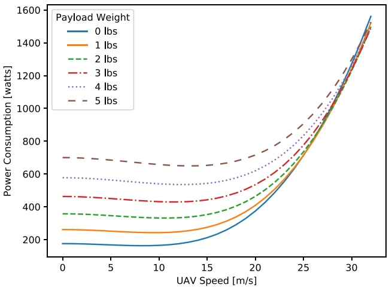

(a) UAV power consumption

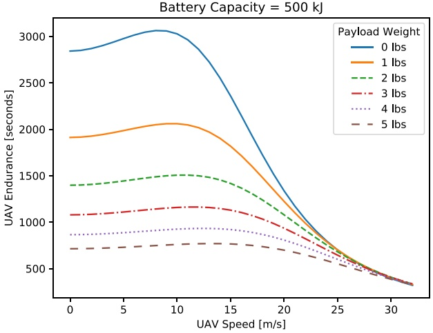

(b) UAV endurance with fixed battery capacity

Battery Capacity = 500 kJ

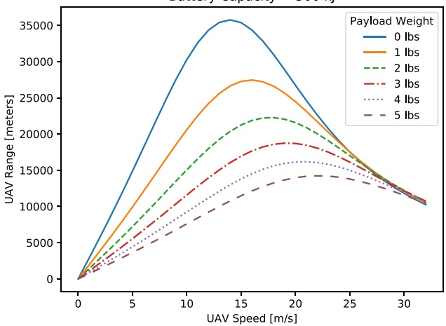

(c) UAV range with fixed battery capacity

Fig. 1. UAV power consumption, endurance, and range as functions of speed and payload.

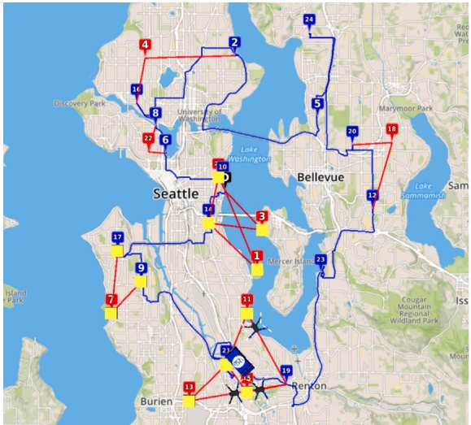

(a) mFSTSP with 3 UAVs

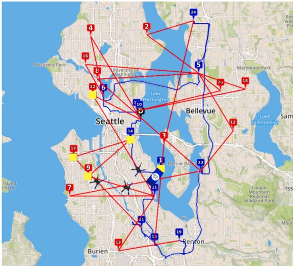

(b) mFSTSP-VDS with 3 UAVs

Fig. 2. A comparison of routes for a 25-customer problem in Seattle.

Table 1

Comparison of important metrics for the 25-customer example problem.

| Metric | Max drone speeds | Max-range drone speeds | Variable drone speeds |
| --- | --- | --- | --- |
| Makespan [hr:min:sec] | 2:29:01 | 2:04:17 | 1:59:07 (20.4% &amp; 4.2% improvements) |
| # UAV customers | 10 | 12 | 13 |
| # Truck customers | 15 | 13 | 12 |
| Avg. UAV speed | 30.0 m/s | 16.1 m/s | 16.7 m/s (44% slower &amp; 4% faster) |
| Total truck distance | 118.8 km | 92.8 km | 89.6 km (25% &amp; 3.5% shorter) |

**2. We propose a three-phased iterative heuristic incorporating the variable UAV speed feature. Since there are no existing solution methods to this new problem, we assessed the solution quality of our heuristic by fixing the UAV speeds, and solving the mFSTSP problem instances of Murray and Raj (2020) to compare against the solutions by their heuristic. We found that it produced better quality solutions, on average, both in terms of the objective function value and the run-time, than the heuristic proposed by Murray and Raj (2020). The result of this analysis, thus, makes our heuristic the state-of-the-art for solving both the mFSTSP and the mFSTSP-VDS.**

**3. The significance of considering variable UAV speeds is demonstrated through an extensive numerical study, which also provides insights into system behavior. We quantify the reduction in makespan afforded by the flexibility of UAV speeds compared to the case in which UAVs are flying at the maximum allowable speed. This is contrary to results presented by earlier literature in this area that consider constant endurance. The importance of variable UAV speeds is further strengthened by analyses showing savings over the case in which UAV speeds are fixed to the maximum-range speeds.**

**The remainder of this paper is organized as follows: An overview of the literature related to combined truck-UAV delivery systems, as well as literature related to UAV power consumption models, is provided in Section 2. A formal description of the problem and details of the UAV endurance model used in this paper are provided in Section 3. In Section 4, the heuristic proposed to solve this problem is described. Section 5 provides a detailed analysis of benefits of using variable drone speeds over the fixedspeed cases, and the factors affecting these benefits. It also highlights the improved performance of the proposed heuristic over the one by Murray and Raj (2020). Section 6 summarizes the paper, highlights new findings, and suggests future research directions.**

## 2. Related literature

**The problem of combining a UAV with a truck was first introduced by Murray and Chu (2015). Since then, numerous variants of this problem have been proposed. The variants differ with each other primarily based on the problem objective or the composition of vehicles. The main objectives are: (1) minimizing the total delivery time (e.g., Murray and Chu, 2015; Agatz et al., 2018; Murray and Raj, 2020; Schermer et al., 2019b), and (2) minimizing the operational cost (e.g., Dukkanci et al., 2019; Sacramento et al., 2019; Wang and Sheu, 2019). In terms of vehicle composition, the literature can be divided into: (1) One truck — one UAV (e.g., Murray and Chu, 2015; Agatz et al., 2018; Dell’Amico et al., 2019; Wang et al., 2019; Jeong et al., 2019), (2) one truck — multiple UAVs (e.g., Ferrandez et al., 2016; Tu et al., 2018; Murray and Raj, 2020; Seifried, 2019; Wikarek et al., 2019), and (3) Multiple trucks — multiple UAVs (e.g., Kitjacharoenchai et al., 2019; Sacramento et al., 2019; Schermer et al., 2019a,b; Wang and Sheu, 2019).**

**Another class of problems with truck-UAV combinations is known as the parallel drone scheduling TSP (Murray and Chu, 2015; Ham, 2018; Dell’Amico et al., 2019; Kim and Moon, 2019) in which truck(s) and drone(s) are operated from the depot independently. A detailed taxonomy based on the composition of vehicles can be found in the review papers of Otto et al. (2018) and Khoufi et al. (2019). The main focus in the rest of this section is to review different types of endurance or UAV energy consumption models that have been used in the UAV delivery systems literature.**

**There are a few papers that consider unlimited battery capacity or endurance. Wang et al. (2016) made this assumption in providing theoretical bounds on the time savings using the combined truck-drone delivery system against the traditional routing methods. Ferrandez et al. (2016) made the same assumption to derive closed-form expressions for optimal delivery times as a function of the number of customers, number of drones, drone speed, and truck speed. bin Othman et al. (2017) proposed approximation algorithms to solve the delivery problem with one truck and one drone. Such theoretical results were possible in the aforementioned papers because no restrictions were placed on the UAV flight time or range.**

**Most papers related to UAVs assume a fixed endurance or fixed flight time (e.g., Murray and Chu, 2015; Luo et al., 2017; Poikonen et al., 2017; Ha et al., 2018; Schermer et al., 2018; Poikonen et al., 2019; Sacramento et al., 2019; Wang and Sheu, 2019). The implication is, as mentioned in Section 1, that with this endurance model, UAVs traveling at higher speeds result in longer flight ranges. Other papers assume a fixed flight range, instead of fixed flight time (e.g., Chang and Lee, 2018; Houseknecht, 2019; Schermer et** $\mathrm { a l . , ~ } 2 0 1 9 \mathrm { a , } \mathrm { b , } \mathrm { c ) }$ **. The two types of assumptions are equivalent from the truck-UAV combined system perspective if the assumption of fixed flight time corresponds to a duration for which UAVs can travel, and unlimited waiting is allowed at the retrieval location.**

**Some studies consider UAV power consumption to be a function of payload (but still independent of the UAV speed), a step further than the fixed endurance/range model. The UAV endurance decreases as the payload increases. Dorling et al. (2017) and Torabbeigi et al. (2019) approximate the power consumption as a linear function of payload:** $p ( w ) = \alpha w   +   \beta ,$ **where** 𝑤 **is the weight of the parcel, and** 𝛼 **and** 𝛽 **are constants. The model by Dorling et al. (2017) is similar to the classical VRP, but with drones instead of trucks and two different objectives of minimizing the delivery time and minimizing the delivery cost. The problem by Torabbeigi et al. (2019) is** **similar, but also involves a strategic planning step, in which depot locations are chosen to be built to provide full coverage. Cheng et al. (2020) also consider power consumption to be dependent on the parcel weight, but instead of linearly approximating the function, they use logical and subgradient cuts in their formulation to exactly calculate the energy consumption. In all three papers, the delivery operations are being carried out exclusively by drones, and there is no truck involved.**

**Liu et al. (2017) provide a UAV power consumption model which is a nonlinear function of both the payload and the UAV speed. A conceptually similar model, albeit with a slightly different mathematical treatment, is introduced by Zeng et al. (2019) in the context of a UAV trajectory optimization model to minimize energy consumption during wireless communication. Choi and Schonfeld (2017) also use a power consumption function that linearly depends on payload and speed in a delivery problem with multiple drones. In that problem, drones can carry multiple packages, and the objective is to minimize the delivery cost. A common attribute among these three papers is that the problems do not involve trucks. More recently, Poikonen and Golden (2020) consider a problem with one truck and** 𝑘 **drones that may each make multiple deliveries. UAV power consumption is modeled as a piecewise linear function of payload, and the truck cannot visit customers while any UAV is airborne.**

**We are aware of only two papers that consider UAV endurance to be a function of both speed and payload in delivery problems involving both a truck and drones: Dukkanci et al. (2019) and Murray and Raj (2020). Dukkanci et al. (2019) utilize the nonlinear power consumption model of Zeng et al. (2019). Similar to the mFSTSP-VDS, they also consider UAV speeds as decision variables. However, their truck-UAV combined delivery model assumes that the truck does not make deliveries, serving only as a launch-and-retrieval hub for the UAVs. Unlike the mFSTSP-VDS, the UAVs cannot be retrieved at a different location than the one from where they were launched. Moreover, the focus in their paper is to optimize the total delivery cost. Therefore, the reason behind using variable drone speeds is to minimize the cost associated with drone travel while making all the deliveries, and is not aimed towards reducing the delivery time. Similar to our model, the mFSTSP by Murray and Raj (2020) also considers the UAV endurance model by Liu et al. (2017). However, unlike the mFSTSP-VDS, the UAV speeds in the mFSTSP are fixed, and thus fails to take advantage of the time savings potentially afforded by flying at variable speeds.**

## 3. Problem definition

**A formal definition of the mFSTSP-VDS is provided in this section. As this problem shares its core characteristics with the mFSTSP – the key distinction being that UAVs can fly at any speed up to a maximum allowable speed – most of the notations are adopted from Murray and Raj (2020).**

**Let** 𝐶 **be the set of customers, each expecting delivery of exactly one parcel, where** $C = \{ 1 , 2 , \ldots , c \}$ **. The weight of the parcel being served to customer** $j \in C$ **is given by** $w _ { j }$

**The delivery system consists of a truck and a set of heterogeneous UAVs, all of which originate at the depot. The UAVs – which may have differing payload capacities, battery power, and maximum speed – are denoted by the set** 𝑉 **. The UAVs work in tandem with the truck to carry out deliveries. The objective of this problem is to minimize the total time to deliver all parcels and return to the depot.**

**The following assumptions are made:**

**• Each UAV can carry only one parcel at a time, therefore serving only one customer in each flight. UAVs are assumed to land while making deliveries, as is the case with DHL’s Parcelcopter and Amazon Prime Air drones. Additionally, each UAV has an associated payload capacity, denoted by** $\kappa _ { v }$ for $\mathbf { U } \mathbf { A } \mathbf { V } v \in V$ . Parcels exceeding this weight cannot be delivered by UAV 𝑣.

**• UAVs are launched from, or retrieved by, the truck either at customer locations or at the depot. The truck driver must be available to perform these operations. Therefore, although several UAVs can be launched/retrieved at a location, the driver can launch or retrieve only one UAV at a time. This requires queueing and scheduling of UAV launches and retrievals at the truck customer location. Additionally, launches/retrievals cannot happen while the driver is delivering the parcel at that location.**

**• A UAV can only be retrieved at a different location than the launch location in the truck route. Therefore, multiple launches of the same UAV from a single location is not possible. However, the truck can serve other customers in between launch and retrieval locations, while a UAV is serving a customer. Moreover, since the truck must be available at the retrieval location for a UAV recovery, either of the two vehicles may have to wait for the other one depending on their arrival times at the retrieval location.**

**• Each UAV can fly at any speed less than or equal to its maximum (allowable) speed, denoted by** $\nu _ { v } ^ { \mathrm { m a x } }$ for ${ \mathrm { U A V } } v \in V .$

**• Each UAV has a fixed battery capacity. The endurance of each UAV, measured in units of time, depends on its speed and payload, since the power consumption is a function of these two parameters. UAV flight time should be less than the endurance, and it must return to the truck or the depot before it runs out of battery. A new battery is installed before each UAV launch. Endurance calculations are discussed in detail in Section 3.2.**

**The complete set of nodes in the network is defined as** $N = \{ 0 , 1 , 2 , \ldots , c + 1 \}$ **, where nodes 0 and** $c + 1$ **correspond to a depot where the truck departs and returns, respectively. The origin depot (0) and the destination depot** $( c + 1 )$ **can have different physical locations. Furthermore,** $N _ { 0 } = \{ 0 , 1 , \ldots , c \}$ **and** $N _ { + } = \{ 1 , 2 , \ldots , c + 1 \}$ represent the sets of nodes from which a vehicle can depart, and **at which a vehicle can arrive, respectively.**

**It takes** $s _ { v i } ^ { L }$ **units of time to replace the battery and launch UAV** $v \in V$ **from node** $i \in N _ { 0 } ,$ and $s _ { v k } ^ { R }$ units of time to retrieve UAV $v \in V$ at node $k \in N _ { + } . ~ \mathrm { A l s o } ,$ , it takes $\sigma _ { k }$ units of time for the truck to deliver the parcel at node $k \in C ,$ **, and** $\sigma _ { v k } ^ { \prime }$ units of time for $\mathbf { U } \mathbf { A } \mathbf { V } v \in V$ to deliver the parcel **at node** $k \in C .$

**The truck travel time from a node** $i \in N _ { 0 }$ to another node $j \in N .$ + **is given by** $\tau _ { i j } ,$ **and is a fixed value for a given** 𝑖 **and** 𝑗**. Since the UAV speed in this problem is a decision variable, the UAV flight time is not a fixed value, as discussed next.**

Table 2

Speeds and flight times corresponding to different UAV flight phases.

<table><tr><td rowspan="2">Flight phase</td><td colspan="2">UAV v</td></tr><tr><td>Speed [m/s]</td><td>Time [s]</td></tr><tr><td>(1) Takeoff from node i</td><td> $\nu_{vi}^{l}$ </td><td> $\tau_{vi}^{l} = h/\nu_{vi}^{l}$ </td></tr><tr><td>(2) Horizontal cruise from i to j</td><td> $\nu_{vij}^{c}$ </td><td> $\tau_{vij}^{c} = d_{ij}/\nu_{vij}^{c}$ </td></tr><tr><td>(3) Land at node j</td><td> $\nu_{vj}^{l}$ </td><td> $\tau_{vj}^{l} = h/\nu_{vj}^{l}$ </td></tr><tr><td>(4) Parcel delivery at node j (stationary)</td><td>-</td><td> $\sigma_{vj}^{t}$ </td></tr><tr><td>(5) Takeoff from node j</td><td> $\nu_{vjj}^{l}$ </td><td> $\tau_{vjj}^{l} = h/\nu_{vj}^{l}$ </td></tr><tr><td>(6) Horizontal Cruise from j to k</td><td> $\nu_{vjk}^{c}$ </td><td> $\tau_{vjk}^{c} = d_{jk}/\nu_{vjk}^{c}$ </td></tr><tr><td>(7) Wait for retrieval at node k (stationary)</td><td>-</td><td> $\tau_{vk}^{h}$ </td></tr><tr><td>(8) Land at node k</td><td> $\nu_{vk}^{l}$ </td><td> $\tau_{vk}^{l} = h/\nu_{vk}^{l}$ </td></tr></table>

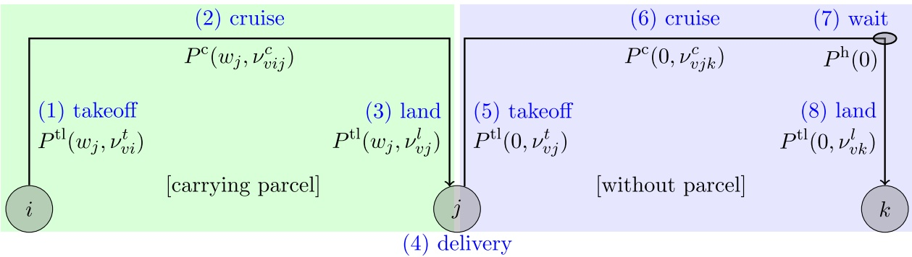

Fig. 3. A UAV sortie with different flight phases.

## 3.1. UAV flight time

**A flight consists of UAV** $v \in V$ traveling from a launch location $( i \in N _ { 0 } )$ **to a** delivery location $( j \in \{ C : w _ { j } \leq \kappa _ { v } \} )$ , then to a **retrieval location** $( k \in N _ { + } )$ . This is known as a UAV sortie, and is denoted by four-tuples of the form $\langle v , i , j , k \rangle .$

**Each sortie can be divided into eight phases, as described in Table 2. The Euclidean distances between** 𝑖 **and** 𝑗 **(between** 𝑗 **and** 𝑘**) are given by** $d _ { i j } ( d _ { j k } ) ,$ **, and the UAV cruise altitude is represented by parameter** ℎ**. During parcel delivery (flight phase (4)), the stationary UAV requires a pre-defined service time of** $\sigma _ { v j ^ { \prime } } ^ { \prime }$ **We assume that the UAV speeds are fixed during the takeoff and landing phases, as these activities typically consume less power when compared to the longer travel between nodes. Furthermore, UAV flight controllers using the MAVLink (MAVLink, 2020) protocol do not provide options for specifying takeoff/landing speeds. Thus, speeds** $\nu _ { v i } ^ { t } , \nu _ { v j } ^ { l } , \nu _ { v j } ^ { t }$ **and** $\nu _ { v k } ^ { l }$ **are parameters.**

**However, cruise speeds** $\nu _ { v i j } ^ { c }$ and $\nu _ { v j k } ^ { c }$ **are considered as decision variables. This is a significant departure from the mFSTSP, as UAV cruise times from node** $i \; \mathbf { \dot { t } } \mathbf { 0 } \; j$ **and from node** 𝑗 to 𝑘 **(denoted by** $\tau _ { v i j } ^ { c }$ **and** $\tau _ { v j k ^ { \prime } } ^ { c }$ **respectively) also become decision variables. The UAV is stationary while waiting for the truck at node** 𝑘 **(phase (7)), but the hover duration,** $\tau _ { v k } ^ { h }$ **, is a decision variable.**

**The minimum time required for the** $\langle v , i , j , k \rangle$ **sortie is given by:**

$$
\begin{array}{l} T _ {v i j k} ^ {\min} = \tau_ {v i} ^ {t} + \tau_ {v i j} ^ {c} + \tau_ {v j} ^ {t} + \sigma_ {v j} ^ {\prime} + \tau_ {v t} ^ {t} + \tau_ {v j k} ^ {c} + \tau_ {v k} ^ {l}. \end{array}\tag{1}
$$

$T _ { v i j k } ^ { \operatorname* { m i n } }$ does not include the time associated with the UAV waiting at the retrieval location $( \tau _ { v k } ^ { h }$ in flight phase (7)), since the waiting time cannot be determined separately from knowledge of the truck’s arrival time to node 𝑘.

## 3.2. UAV endurance

**Endurance defines the maximum time that a UAV can be operational when completing a sortie. This time limit is determined by a UAV’s power consumption, and is a function of both UAV speeds (which are decision variables) and payload. As such, power consumption differs among the flight phases. For example,** $P ^ { \mathrm { t l } } ( w , \nu _ { \mathrm { v e } } )$ **denotes the power consumed during vertical takeoff or landing phases, as a function of parcel weight** 𝑤 **and speed** $\nu _ { \mathbf { v e } ^ { * } }$ Similarly, $P ^ { \tt C } ( w , \nu _ { \tt h o } )$ **denotes the power consumed during cruising, as a function of a parcel weight and a horizontal velocity, while** $P ^ { \mathrm { h } } ( w )$ **denotes hovering power consumption solely as a function of parcel weight. Fig. 3 depicts the power consumption across the flight phases of a sortie. Specific functional forms for** $P ^ { \mathrm { t l } } ( w , \nu _ { \mathrm { v e } } ) ,$ $P ^ { \tt C } ( w , \nu _ { \tt h o } ) ,$ , and $P ^ { \mathrm { h } } ( w )$ **are provided for the numerical analysis in Section 5.**

**Since the UAV is on the ground during parcel delivery (flight phase (4)), the power consumption during this phase is assumed to be negligible compared to other phases. Thus, the minimum energy required to sustain UAV** 𝑣 **for a duration of** $T _ { v i j k } ^ { \operatorname* { m i n } }$ **time units**

**is given by:**

$$
\begin{array}{r} E _ {v i j k} ^ {\mathrm{min}} = \tau_ {v i} ^ {t} P ^ {\mathrm{tl}} (w _ {j}, v _ {v i} ^ {t}) + \tau_ {v i j} ^ {c} P ^ {\mathrm{c}} (w _ {j}, v _ {v i j} ^ {c}) + \tau_ {v j} ^ {l} P ^ {\mathrm{tl}} (w _ {j}, v _ {v j} ^ {l}) \\ + \tau_ {v j} ^ {t} P ^ {\mathrm{tl}} (0, v _ {v j} ^ {t}) + \tau_ {v j k} ^ {c} P ^ {\mathrm{c}} (0, v _ {v j k} ^ {c}) + \tau_ {v k} ^ {l} P ^ {\mathrm{tl}} (0, v _ {v k} ^ {l}). \end{array}\tag{2}
$$

**Letting the battery capacity of UAV** 𝑣 **be denoted by** $E _ { v } ^ { \mathrm { a v a i l } }$ , sortie $\langle v , i , j , k \rangle$ is possible only if $E _ { v i j k } ^ { \mathrm { m i n } } \leq E _ { v } ^ { \mathrm { a v a i l } }$ . If $E _ { v i j k } ^ { \mathrm { m i n } } < E _ { v } ^ { \mathrm { a v a i l } }$ , the UAV has extra remaining energy that can be used to wait (hover) above the retrieval location (𝑘) if required, as in phase (7). The duration for which UAV 𝑣 **hovers (without carrying a parcel) while waiting for the truck at node** 𝑘**, denoted by** $\tau _ { v k ^ { \prime } } ^ { h }$ **, is constrained as:**

$$
\tau_ {v k} ^ {h} \leq \frac {E _ {v} ^ {\mathrm{avail}} - E _ {v i j k} ^ {\mathrm{min}}}{P ^ {\mathrm{h}} (0)}.\tag{3}
$$

**Therefore, the effective endurance for UAV sortie** $\langle v , i , j , k \rangle$ **, denoted as** $e _ { v i j k } ,$ **is given by:**

$$
e _ {v i j k} = \left\{ \begin{array}{c l} T _ {v i j k} ^ {\min} + \frac {E _ {v} ^ {\text {avail}} - E _ {v i j k} ^ {\min}}{P ^ {\mathrm{h}} (0)}, & \text {if} E _ {v i j k} ^ {\min} \leq E _ {v} ^ {\text {avail}}; \\ 0, & \text {otherwise.} \end{array} \right.\tag{4}
$$

## 4. Solution approach

**The mFSTSP-VDS is a complex optimization problem that requires several considerations: Assignment of customers to different vehicles (truck or UAVs); queueing (and scheduling) of launch, retrieval and delivery activities at a customer location; and optimization of UAV speeds to ensure sufficient endurance to feasibly deliver to a customer location in the minimum time. An efficient three-phased heuristic is proposed to solve the problem. Portions of this heuristic are adapted from Murray and Raj (2020) for the mFSTSP.**

**Due to the computational complexity of solving similar problems, we do not provide a mixed integer linear program (MILP) for the mFSTSP-VDS. According to Murray and Raj (2020), the mFSTSP, which is a simpler version of the mFSTSP-VDS due to fixed UAV speeds, is itself an NP-Hard problem. The MILP of the mFSTSP could only be solved to optimality for small 8-customer problems. Similarly, the mathematical formulation provided by Sacramento et al. (2019) for a related vehicle routing problem with drones could only find optimal solutions for up to 12-customer problems. The incorporation of variable UAV speeds in the mFSTSP-VDS adds non-linearity to the problem, further increasing its complexity.**

**This section provides an overview of the mFSTSP-VDS heuristic. Because the heuristic itself cannot be reasonably re-created solely from this overview, source code is available at** [**https://github.com/optimatorlab/mFSTSP-VDS**](https://github.com/optimatorlab/mFSTSP-VDS)**.**

**Pseudocode for the heuristic is given by Algorithm 1. The heuristic starts by iterating over a parameter called the lower truck limit (**LTL**), which denotes the minimum number of customers to assign to the truck in a given iteration (line 6). Depending on the iteration,** LTL **takes values between** $\mathrm { L T L } _ { 0 }$ **and** |𝐶|**, where**

$$
\mathrm{LTL} _ {0} = \left[ \frac {| C | - | V |}{| V | + 1} \right]
$$

**is the minimum number of truck customers required by a feasible solution. For example, if** $| C | = 8$ and $| V | = 2 ,$ then $\mathrm { L T L } _ { 0 }   =   2 ,$ **meaning that at least two customers must be assigned to the truck to have enough launch and recovery points along the truck tour for the two UAVs to serve the other six customers. Iteratively increasing the value of** 𝙻𝚃𝙻 **from 2 to 8 produces feasible truck routes with differing numbers of customers.**

**In each iteration, the problem is initialized with two different UAV cruise speeds, as in line 8, where** $\nu _ { v w } ^ { \tt m a x r a n g e }$ is the maximumrange speed. It is the cruise speed of UAV 𝑣 between the values 0 and $\nu _ { v } ^ { \mathrm { m a x } }$ (maximum allowable speed) that gives the maximum range while carrying a parcel of weight 𝑤 (see Fig. 1c). There are different benefits of initializing with these two speeds. While the speed equal to $\bar { \nu } _ { v w } ^ { \mathrm { m a x r a n g e } }$ **e**nables delivery to distant customers (thus maximizing the number of potential sortie options for each UAV customer), **the speed equal to** $\nu _ { v w } ^ { \mathrm { m a x r a n g e } } + 1 0$ **results in the faster delivery in cases in which endurance is not a limiting factor. Depending on the initial speeds chosen, UAV flight times and endurances are calculated according to Eqs. (1)–(4) (line 9). Note that the cruise speeds (and related parameters) are modified in the third phase of the heuristic to minimize truck waiting.**

**The calculated UAV flight times and endurances, along with other system parameters, are then provided to Phase 1 of the heuristic, in which customers are partitioned between truck- and UAV-served, and a truck tour is generated (line 10). Details of Phase 1 are provided in Section 4.1. A promising truck tour, in terms of feasibility and lower bound, is then added to the queue** P1CandSolutions **(lines 11–13).**

**For each candidate truck tour, and a choice of initial UAV cruise speeds, several candidate solutions for UAV sorties are generated in Phase 2 (lines 15–19). Details of Phase 2 are provided in Section 4.2. Each candidate solution** $( \mathbf { i . e . , \nabla a }$ **sortie-set) out of Phase 2 is then checked for lower bound and feasibility (lines 22–25). A new candidate truck tour is generated if the sortie-set is infeasible (lines 26–28). But if feasible, then the sortie-set, along with the truck route, is passed to Phase 3.**

**For a given truck tour and a sortie-set, the order of launch, retrieval and delivery activities is determined at each truck customer location, and the schedule (timing) of the entire operation is built in Phase 3 (lines 30–31). Additionally, in this phase, UAV cruise** speeds are modified from their initial values $( \nu ^ { \mathrm { i n i t } } )$ **to achieve more savings. Details of Phase 3 are provided in Section 4.3. The output parameter** $0 \mathrm { F V } ^ { * }$ **of Phase 3 is the objective function value (makespan) of the best solution obtained so far.**

**Algorithm 1 Pseudocode for the mFSTSP-VDS heuristic**

```txt
Inputs: Depot location, customer-info (location, parcel weight), truck travel times, UAV-specifications (takeoff/landing speeds, cruise altitude, maximum cruise speed), energy consumption parameters
Outputs: Truck tour, UAV sorties, Activity (departure, arrival, service, launch, retrieval) timings
Set OFV* ← ∞ # initialize objective function value
for LTL in {LTL₀, LTL₀ + 1,...,|C|} do
    P1CandSolutions ← ∅ # Initialize a queue of candidate solutions out of Phase 1
    for νinit in {νmaxrange, νmaxrange + 10} do
        Calculate UAV flight times and endurances using νinit as initial cruise speeds
        <truckCust,UAVcust,TSPtour> ← Obtain using Phase 1
        lowerBound ← cost(TSPtour) + min_{v∈V{∑j∈UAVcust(sviL + svR)}}
        if (TSPtour found in Phase 1) and (lowerBound < OFV*) then
            Add <truckCust,UAVcust,TSPtour> to the queue P1CandSolutions

    while P1CandSolutions is not empty do
        <truckCust,UAVcust,TSPtour> ← Extract the first solution from P1CandSolutions
        for νinit in {νmaxrange, νmaxrange + 10} do
            Calculate UAV flight times and endurances using νinit as initial cruise speeds
            P2CandSolutions ← Obtain several candidate sets of UAV sorties using Phase 2

        while P2CandSolutions is not empty do
            <UAVsorties, iins, pin, insCost> ← Extract the first solution from P2CandSolutions
            lowerBound ← cost(TSPtour) + ∑_{v,i,j,k}∈UAVsorties(sviL + svR) + insCost
            if lowerBound < OFV* then
                if UAVsorties is not a feasible set then
                    tmpTSPtour ← Insert customer iins into position pin in TSPtour
                    tmpTruckCust ← truckCust ∪ {iins}, tmpUAVcust ← UAVcust \ {iins}
                    Add <tmpTruckCust,tmpUAVcust,tmpTSPtour> to P1CandSolutions
                else
                    for each sorting rule in Phase 3 for UAV launches do
                        <OFV*, activityTimings> ← Obtain using Phase 3
                        if Phase 3 resulted in a feasible solution then
                            tmpUAVsorties ← Obtain using local search
                            if tmpUAVsorties ≠ UAVsorties then
                                UAVsorties ← tmpUAVsorties; Go back to line 31.

return <TSPtour,UAVsorties,activityTimings> corresponding to OFV*
```

**The solutions obtained from Phase 3 are further refined through a local search procedure in which UAV sorties that result in truck waiting are modified by shifting the retrieval location to the next truck customer location (line 33). Details of the local search procedure are provided in Section 4.4. The modified set of sorties obtained here is then sent back to Phase 3 to obtain a new schedule (line 35). Details on each phase are provided in the remainder of this section.**

## 4.1. Phase 1 – partition customers and create a TSP tour

**The purpose of Phase 1 is to partition customers between truck-served (**truckCust**) and UAV-served (**UAVcust**), and to generate a route (**TSPtour**) for the customers that belong to the truck.**

**The phase begins by initializing a set,** $P ,$ **with feasible sorties** $\langle v , i , j , k \rangle ,$ **, as determined by endurance limitations (Algorithm 2). Then,** truckCust **is initialized with customers that can only be served by the truck, and** UAVcust **is initialized with the rest of the customers. A** TSPtour **is generated for** truckCust **using a function getTSP(), which solves a mixed integer program to optimality using lazy constraints, the details of which are provided in Gurobi Optimization (2018).**

**Next, customers are added and removed from** TSPtour **with the aim of reducing the makespan of the truck tour (Algorithm 3). This is done using a** savings **metric which is the time saving corresponding to insertion or removal of a customer from the truck tour. This process of sequentially adding and removing customers from the truck tour continues until no further savings are possible, or if the same TSP tour is encountered.**

<div class="docvortex-algorithm" style="white-space: pre-wrap; font-family:monospace;">
$P \leftarrow \{\langle v, i, j, k \rangle : (w_j \leq \kappa_v) \land (T_{vijk}^{\min} \leq e_{vijk}) \land (\tau_{ik} \leq e_{vijk}) \quad \forall \quad v \in V, i \in N_0, j \in C, k \in N_+\}$
truckCust $\leftarrow \{j \in C : \langle v, i, j, k \rangle \notin P \quad \forall \quad v \in V, i \in N_0, k \in N_+\}$
UAVcust $\leftarrow C \setminus$truckCust
TSPtour $\leftarrow$ getTSP(truckCust)
</div>

<div class="docvortex-algorithm" style="white-space: pre-wrap; font-family:monospace;">
Algorithm 3 Move customers between truckCust &amp; UAVcust based on a savings metric
while ((improved savings are found) and (TSPtour is unique)) do
    for ($j \in UAVcust$) do
        savings = $max_{v \in V, \langle i,k \rangle \in TSPtour} \{\tau_{ik} + s_{vi}^{L} + s_{vk}^{R} - \tau_{ij} - \tau_{jk} - \sigma_{j}\}$
        if (savings &gt; 0) then
            truckCust ← truckCust ∪ {j}
    UAVcust ← C \ truckCust
    TSPtour ← getTSP(truckCust)

    for ($j \in truckCust$) do
        savings = $max_{\langle i,j,k \rangle \in TSPtour, \langle v,i,j,k \rangle \in P} \{\tau_{ij} + \tau_{jk} + \sigma_{j} - \tau_{ik} - s_{vi}^{L} - s_{vk}^{R}\}$
        if (savings &gt; 0) then
            UAVcust ← UAVcust ∪ {j}
    truckCust ← C \ UAVcust
    TSPtour ← getTSP(truckCust)
</div>

**The third step is to evaluate the feasibility of the TSP tour, modifying the route as necessary (Algorithm 4). In the** $\mathrm { I P } , \; r _ { i j }$ **is a binary decision variable which equals 1 if the UAV is launched from** 𝑖 ∈ 𝚝𝚛𝚞𝚌𝚔𝙲𝚞𝚜𝚝 ∪ {0} **to serve customer** 𝑗 ∈ 𝚄𝙰𝚅𝚌𝚞𝚜𝚝**. Constraint (5) ensures that no more than** |𝑉 | **UAVs can be launched from any launch location, while Constraint (6) ensures that each UAV customer has only one launch location. The IP does not have an objective function, and is only solved to obtain a feasible solution. If a feasible solution exists, then** infeasCust **is assigned** ∅**. Otherwise, the IP returns a non-empty** infeasCust **set by computing an irreducible inconsistent subsystem (IIS). An IIS is a subset of constraints and variable bounds such that the subsystem is infeasible, but the removal of any of the constraints or bounds from the subsystem makes it feasible. The IP can be solved and the IIS can be computed with the help of a commercial solver such as Gurobi, the details of which can be found in Gurobi Optimization (2020).**

<div class="docvortex-algorithm" style="white-space: pre-wrap; font-family:monospace;">
Algorithm 4 Check feasibility, modify customer partitions as necessary
P1feas ← False
while (not P1feas) do
    infeasCust ← {j ∈ UAVcust : ⟨v, i, j, k⟩∉ P ∀ v ∈ V, ⟨i, k⟩ ∈ TSPtour}
    if infeasCust == ∅ then
        # Solve the following IP to find the updated infeasCust:
            $\sum_{j \in H_i} r_{ij} \le |V| \forall i \in truckCust \cup \{0\}$,
            $\sum_{i \in G_j} r_{ij} = 1 \forall j \in UAVcust$,
            $r_{ij} \in \{0, 1\} \forall i \in truckCust \cup \{0\}, j \in UAVcust$,
            where $H_i \leftarrow \{j \in UAVcust : (\langle v, i, j, k \rangle \in P) \land (\langle i, k \rangle \in TSPtour)$ for any v ∈ V},
            and $G_j \leftarrow \{i \in truckCust \cup \{0\} : (\langle v, i, j, k \rangle \in P) \land (\langle i, k \rangle \in TSPtour)$ for any v ∈ V}.
    if (infeasCust == ∅) and ($|truckCust| \ge LTL$) then
        P1feas ← True
    else if (infeasCust == ∅) and ($|truckCust| &lt; LTL$) then
        Insert a UAV customer into TSPtour with the minimum insertion cost
    else
        Insert a UAV customer into TSPtour that enables feasible UAV assignments to maximum number of customers in infeasCust
    Update truckCust, UAVcust, TSPtour
</div>

**In the fourth and final step,** TSPtour **is further modified if it has already been evaluated in the previous iterations of the heuristic (Algorithm 5).**

**Algorithm 5 Ensure unique TSP solution**

<div class="docvortex-algorithm" style="white-space: pre-wrap; font-family:monospace;">
if TSPtour is not unique then
    Swap a truck customer and a UAV customer
    Subtour reversal (i.e. change $i \rightarrow j \rightarrow k \rightarrow l$ to $i \rightarrow k \rightarrow j \rightarrow l$)
    Reverse the entire TSP tour

    Select the method with the min-cost TSP tour.
    Update truckCust, UAVcust, TSPtour

return (truckCust, UAVcust, TSPtour) for Phase 2
</div>

## 4.2. Phase 2 – create UAV sorties

**For a given truck tour (**TSPtour**), the objective in this phase is to assign a sortie** ⟨𝑣, 𝑖, 𝑗, 𝑘⟩ **to each UAV customer. A feasible sortie-set (**UAVsorties**) contains as many sorties as there are UAV customers. In this phase, we introduce a parameter** 𝑠**, which is the maximum number of customers visited by the truck between a UAV launch and its retrieval. The phase starts by determining the set of sorties available to each UAV customer for a given** 𝑠 **value (Algorithm 6).**

<div class="docvortex-algorithm" style="white-space: pre-wrap; font-family:monospace;">
Algorithm 6 Find the set of feasible sorties for each UAV customer
$t_j = t_i + \tau_{ij} + \sigma_j \quad \forall \quad j \in \text{truckCust}, \langle i, j \rangle \in \text{TSPtour}$
for $s \in \{0, 1, 2, 3\}$ do
    for $j \in \text{UAVcust}$ do
        $support_{sj} \leftarrow \{\langle v, i, j, k \rangle \in P : (t_k - t_i - \sigma_k \le e_{vijk}) \land (\text{upto } s \text{ customers } b/w \ i \text{ and } k)\}$
</div>

**The second step is the sortie assignment process (Algorithm 7), featuring two assignment rules. In Rule 1, the preference is to reduce waiting by the truck, while Rule 2 seeks to reduce UAV waiting. Four sortie-sets, one for each of** 𝑠 ∈ {0, 1, 2, 3}**, are generated using each rule. Therefore, a total of eight candidate solutions are generated in this phase for a given truck tour.**

<div class="docvortex-algorithm" style="white-space: pre-wrap; font-family:monospace;">
Algorithm 7 Assign a sortie to each UAV customer
P2CandSolutions ← ∅
for s ∈ {0,1,2,3} do
    for P2Rule ∈ {1,2} do
        UAVsorties ← ∅, infeasCust ← ∅
        SortedCust ← UAVcust sorted in the order of increasing number of sorties in support$_{sj}$
        for j ∈ SortedCust do
            wait = ∞
            for {⟨v,i,j,k⟩ ∈ support$_{sj}$ : v is available between i and k} do
                if P2Rule == 1 then
                    tmpWait = $T_{vijk}^{\min} - (t_k - t_i)$
                else if P2Rule == 2 then
                    tmpWait = $(t_k - t_i) - T_{vijk}^{\min}$
                if (tmpWait &lt; 0 ≤ wait) ∨ (wait &lt; tmpWait &lt; 0) ∨ (0 ≤ tmpWait &lt; wait) then
                    wait = tmpWait
                    sortie = ⟨v,i,j,k⟩
                if wait == ∞ then
                    infeasCust ← infeasCust ∪ {j}
                else
                    UAVsorties ← UAVsorties ∪ {sortie}
</div>

**In the third and final step, it is determined whether** UAVsorties **has a feasible assignment for every UAV customer (Algorithm 8). If not, a UAV customer is chosen to be inserted into** TSPtour **to generate a new candidate truck tour.**

<table><tr><td colspan="2">Algorithm 8 Find a UAV customer to insert into truck tour if no feasible sortie assignments found</td></tr><tr><td>25:</td><td>if infeasCust ≠ ∅ then</td></tr><tr><td>26:</td><td>Choose a UAV customer  $i_{ins}$  to insert into position  $p_{ins}$  in TSPtour that enables feasible UAV assignments to maximum number of customers in infeasCust</td></tr><tr><td>27:</td><td>insCost ← Increase in TSP cost when inserting  $i_{ins}$  into position  $p_{ins}$  in TSPtour</td></tr><tr><td>28:</td><td>P2CandSolutions ← P2CandSolutions ∪ {⟨UAVsorties, $i_{ins},p_{ins},insCost$ ⟩}</td></tr><tr><td>29:</td><td></td></tr><tr><td>30:</td><td>return P2CandSolutions for Phase 3</td></tr></table>

| Table 3 Decision var | iables in Phase 3. |
| --- | --- |
| 𝑡̌𝑖 | Time at which the truck arrives at node 𝑖 ∈ TSPtour |
| 𝑡̄𝑖 | Time at which the truck finishes delivering parcel at node 𝑖 ∈ TSPtour |
| 𝑡̂𝑖 | Time at which the truck leaves node 𝑖 ∈ TSPtour |
| 𝑡̌'𝑣𝑖 | Time at which UAV 𝑣 ∈ 𝑉 gets retrieved at node 𝑖 ∈ TSPtour |
| 𝑡̂'𝑣𝑖 | Time at which UAV 𝑣 ∈ 𝑉 gets launched at node 𝑖 ∈ TSPtour |

## 4.3. Phase 3 – schedule activities and obtain timings

**For a given truck tour (**TSPtour**) and a set of UAV sorties (**UAVsorties**), the objective in this phase is to determine the order of UAV launches, UAV recoveries, and parcel delivery at each truck customer location, and obtain the timing of each activity. The decision variables corresponding to activity timings are introduced in Table 3.**

**The phase starts by employing a construction heuristic to determine the order of activities at each node sequentially in the truck route (Algorithm 9). Once the order of activities and activity timings at each node are obtained, the second step in this phase is to modify UAV cruise speeds to reduce truck waiting (Algorithm 10). Specifically, for each UAV sortie that resulted in truck waiting, an attempt is made to increase the UAV speed enough so that it reaches the retrieval location just-in-time for when the truck becomes available to retrieve the UAV. This modification changes the activity timings, although the order of activities remains the same. The third and final step is to update the incumbent solution (Algorithm 11), where** $\hat { t } _ { c + 1 }$ **represents the time at which all parcels have been delivered and the truck and UAVs have returned to the depot (i.e., the makespan).**

## 4.4. Local search – reduce truck waiting

**The objective in this procedure is to improve upon the solution obtained in Phase 3, by reducing truck waiting. Starting from the depot, all truck nodes where the truck waited for a UAV retrieval are identified. For every such location** 𝑘**, let the immediate next location in the truck tour be** 𝑧**. Let the sortie of the UAV retrieval that resulted in truck waiting be** $\langle v , i , j , k \rangle$ **. An attempt is made to replace this sortie with** $\langle v , i , j , z \rangle$ **, while maintaining assignment feasibility.**

**Once every possible shift is made, the new set of UAV sorties is returned as the output of the local search. As described in Algorithm 1, this new set of sorties, along with the truck tour, is passed back to Phase 3 to generate a new solution.**

## 5. Numerical analysis

A numerical study was conducted to quantify the benefits of variable-speed UAVs, and to assess the performance of the mFSTSP **VDS heuristic. Because there are no provably-optimal solutions to mFSTSP-VDS instances, nor are there any existing solutions to this new problem, comparisons are made against the case of fixed-speed UAVs (mFSTSP). Specifically, the heuristic described in** Section 4 is first run by fixing UAV cruise speeds to maximum allowable speeds $( \nu _ { v } ^ { \mathrm { m a x } } )$ **, the setting that is popularly assumed in the literature in this area. The maximum allowable speed may depend on several factors such as UAV specifications, safety concerns, FAA limitations, or municipal regulations, and it may take different values depending on which factors come into play. Because of these factors, we do not know the values of maximum allowable speeds which will be implemented in practice, and thus, the study explores a variety of settings. Then, the heuristic is run for the same problem instances by fixing UAV cruise speeds to maximum** range speeds $( \nu _ { v w } ^ { \mathrm { \acute { m a x r a n g e } } } )$ **, the setting that is being tested for the first time in this paper. As before, the maximum-range speed is capped by the maximum allowable speed in cases where the speed that maximizes the flight range is higher than the maximum allowable speed. Therefore, each problem instance has two types of fixed-speed solutions. Finally, the heuristic is run with varying UAV cruise speeds (up to the maximum speed) to generate solutions for the mFSTSP-VDS. It is demonstrated that the delivery makespan can be reduced significantly compared to both types of fixed-speed (maximum speed and maximum-range speed) solutions. Even though this is a heuristic-to-heuristic comparison, this strategy provides a fair estimate of the savings achievable with variable-speed UAVs.**

**The heuristic described in Section 4 is also used to solve 1600 mFSTSP problem instances generated by Murray and Raj (2020), demonstrating that the new heuristic can also efficiently solve problems in which UAV speeds are fixed.**

**All computational work was performed on an 8-core Intel i7-6700 processor with 16 GB RAM running Ubuntu 14.04 in 64-bit mode. The heuristic was coded in Python 2.7.6.**

<div class="docvortex-algorithm" style="white-space: pre-wrap; font-family:monospace;">
Algorithm 9 Determine the order of activities at each truck location
for $i \in$ TSPtour do
    retrievals $\leftarrow$ List of UAVs sorted in the order of their arrivals at node $i$
    # Sort the list of UAVs that are scheduled to be launched from $i$ as follows:
    if P3Rule == 1 then
        launches $\leftarrow$ In the order of decreasing total sortie flight time ($T_{vijk}^{\min}$)
    else if P3Rule == 2 then
        launches $\leftarrow$ In the order of decreasing endurance ($e_{vijk}$)
    else if P3Rule == 3 then
        launches $\leftarrow$ In the order of decreasing remaining endurance ($e_{vijk} - T_{vijk}^{\min}$)
    activityOrderList $\leftarrow$ retrievals + {parcel delivery} + launches
    Calculate timings at $i$ as follows (assuming $h$ is immediately before $i$ in TSPtour):
        Truck arrival: $\hat{t}_i = \hat{t}_h + \tau_{hi}$
        UAV $v$ retrieval: $\hat{t}_{vi}' = \max\{\text{end time of previous activity, arrival time of } v\} + s_{vi}^R$
        Parcel delivery: $\bar{t}_i = (\text{end time of previous activity}) + \sigma_i$
        UAV $v$ launch: $\hat{t}_{vi}' = (\text{end time of previous activity}) + s_{vi}^L$
        Truck departure: $\hat{t}_i = (\text{end time of last activity at } i)$
    # Modify activityOrderList as follows:
    Find the first UAV retrieval in activityOrderList for which the truck has to wait
    Try to move the first non-retrieval activity (parcel delivery or UAV launch) after that retrieval in activityOrderList to just before it (adhering to endurance limitations)
    Update activityOrderList and re-calculate activity timings as per line 13
    Repeat lines 16 - 18 until there is no truck waiting, or until no modification possible
</div>

<div class="docvortex-algorithm" style="white-space: pre-wrap; font-family:monospace;">
Algorithm 10 Modify UAV cruise speeds from their initial values ($v^{init}$) to reduce truck waiting

for $\langle v, i, j, k \rangle \in \text{UAVsorties do}$
    if truck has to wait to retrieve $v$ at $k$ then

        # Increase the cruise speed of $j \to k$ leg:
        if $E_{vijk}^{\min} \leq E_v^{\text{avail}}$ then
            Use the extra energy to increase the speed of $j \to k$ leg until: (i) there is no energy left, or (ii) there is no truck waiting, or (iii) UAV reaches its maximum speed.
            Update the minimum energy required ($E_{vijk}^{\min}$)
        # Increase the cruise speed of $i \to j$ leg, if necessary:
        if $E_{vijk}^{\min} \leq E_v^{\text{avail}}$ then
            Use the extra energy to increase the speed of $i \to j$ leg until: (i) there is no energy left, or (ii) there is no truck waiting, or (iii) UAV reaches its maximum speed.

        Re-calculate flight times of $i \to j$ and $j \to k$ legs, and update the activity timings
</div>

<div class="docvortex-algorithm" style="white-space: pre-wrap; font-family:monospace;">
Algorithm 11 Store the final activity timings, and update the incumbent

activityTimings ← {i, t, i', i'}
if $\hat{t}_{c+1} \leq \text{OFV}^*$ then
    $\text{OFV}^* = \hat{t}_{c+1}$

return $\langle \text{OFV}^*, \text{activityTimings} \rangle$ for local search
</div>

## 5.1. Test problem instance development

**Two sets of test problems were generated for the analysis, with customer locations in the Seattle, Washington area:**

Table 4

Coefficient values for the power consumption model of Liu et al. (2017).

| Coefficient: | $k_{1}$ | $k_{2}$ | $c_{1}$ | $c_{2}$ | $c_{4}$ | $c_{5}$ |
| --- | --- | --- | --- | --- | --- | --- |
| Value: | 0.8554 | 0.3051 | 2.8037 | 0.3177 | 0.0296 | 0.0279 |
| Units: | [unitless] | $\sqrt{\text{kg/m}}$ | $\sqrt{\text{m/kg}}$ | $\sqrt{\text{m/kg}}$ | kg/m | N s/m |

**1. Fixed area, varying number of customers. In the first set, a total of 40 problem instances were generated, with 10 problems for each of four levels of the number of customers (10, 25, 50, and 100). In each problem, customer locations were generated from a uniform distribution on the road network within a service area of 918.0 km**<sup>2</sup>**. For each level of customers, 5 instances featured a centrally-located depot and 5 instances contained a depot at the periphery.**

**2. Varying area, fixed number of customers. In the second set, 10 instances were generated for each of four levels of service area (57.4, 229.5, 516.4, and 918.0 km**<sup>2</sup>**), with each instance comprised of 50 customers uniformly distributed on the road network within the service area. This results in different customer density at each level. Again, in half of the instances the depot is located in the center of the region; the depot is located near the periphery in the other half.**

Each instance was solved with 1,2,3, and 4 UAVs, and with four different maximum allowable UAV cruise speeds $( \nu _ { v } ^ { \mathrm { m a x } } ) ;$ **10, 20, 30, and 40 m/s. The maximum UAV cruise speeds were chosen to be within the maximum speed limit as per FAA regulations (Dorr, 2018), which is 100 mph (44.7 m/s). Thus, each problem instance has 16 different settings (based on the number of** $\mathbf { U } \mathbf { A } \mathbf { V } \mathbf { s } ,$ **and the maximum UAV cruise speed), resulting in a total of 1280 test instances across the two sets.**

**Truck travel times** $( \tau _ { i j } )$ **between nodes were generated in pgRouting (2017), with road network data obtained from Open-StreetMap (2017). In the instances with multiple UAVs, the UAVs are assumed to be identical, although this is not required by the model and is only done to improve clarity in the analysis.**

The delivery time of the truck $( \sigma _ { k } )$ is assumed to be 30 s, while the delivery time of UAVs $( \sigma _ { v k } ^ { \prime } )$ **is assumed to be 60 s. The** launch time $( s _ { v i } ^ { L } )$ of a UAV is assumed to be $6 0 ~ s ,$ while its retrieval time $( s _ { v k } ^ { R } )$ **is assumed to be 30 s. Each UAV is assumed to have** a maximum payload capacity $( \kappa _ { v } )$ of 5 lbs. Customer package weights $( w _ { j } )$ **were randomly chosen to be between 1 and 5 lbs for 85% of the customers; the remaining customer parcels are restricted to being delivered by the truck.**

**We employ the UAV power consumption model of Liu et al. (2017) for the purposes of this numerical analysis, although the mFSTSP-VDS heuristic is not restricted to a specific power consumption model. The power consumption, in units of Watts, during the different flight phases are given by the following functions of parcel weight (**𝑤**), vertical UAV speed** $( \nu _ { \mathrm { v e } } ) _ { z }$ **and horizontal UAV** speed $( \nu _ { \mathrm { h o } } ) :$

**• During takeoff or landing (vertical):**

$$
P ^ {\mathrm{tl}} (w, \nu_ {\mathrm{ve}}) = k _ {1} (W + w) g \left[ \frac {\nu_ {\mathrm{ve}}}{2} + \sqrt {\left(\frac {\nu_ {\mathrm{ve}}}{2}\right) ^ {2} + \frac {(W + w) g}{k _ {2} ^ {2}}} \right] + c _ {2} ((W + w) g) ^ {3 / 2};\tag{8}
$$

**• During horizontal cruise:**

$$
P ^ {\mathbf {c}} (w, v _ {\mathrm{ho}}) = (c _ {1} + c _ {2}) \left[ \left((W + w) g - c _ {5} (v _ {\mathrm{ho}} \cos \alpha) ^ {2}\right) ^ {2} + \left(c _ {4} v _ {\mathrm{ho}} ^ {2}\right) ^ {2} \right] ^ {3 / 4} + c _ {4} v _ {\mathrm{ho}} ^ {3};\tag{9}
$$

**• During hover:**

$$
P ^ {\mathrm{h}} (w) = (c _ {1} + c _ {2}) ((W + w) g) ^ {3 / 2}.\tag{10}
$$

**Here,** $c _ { 1 } , c _ { 2 } , c _ { 4 } , c _ { 5 } , k _ { 1 }$ **and** $k _ { 2 }$ **are model coefficients whose values are derived by Liu et al. (2017), and are provided in Table 4.** 𝑊 **is the UAV frame weight, which we assume to be 1.5 kg, and** 𝛼 **is the angle of attack, which is assumed to be 10 degrees.** $g$ **is** the gravitational constant $(9.8~ m/s ^2)$ . We assume the vertical takeoff speed to be $\nu _ { \mathrm { v e } } = \nu _ { v i } ^ { t } = 1 0 \; \mathrm { m / s } ,$ **and the vertical landing speed** to be $\nu _ { \mathbf { v e } } = \nu _ { v i } ^ { l } = 5 ~ \mathrm { m / s } .$ . The horizontal speed is a decision variable. The battery capacity $( E _ { v } ^ { \mathrm { a v a i l } } )$ **of each UAV is assumed to be 500 kJ.**

**All test problems are available at** [**https://github.com/optimatorlab/mFSTSP-VDS**](https://github.com/optimatorlab/mFSTSP-VDS)**.**

## 5.2. Impact of maximum speed

**Using the first set of test problems, we examine the savings that can be obtained by letting UAVs cruise at variable speeds (up to a particular maximum speed). As shown in Fig. 4a, the improvements over flying at a fixed maximum speed are greater when the maximum cruise speed is high. In fact, no savings were obtained when the maximum allowable cruise speed was 10 m/s. An average savings of 1.6% was observed by flying at speeds lower than 20 m/s, compared to a constant cruise speed of 20 m/s. These numbers grow significantly, to 11.9% and 22.2%, when the maximum cruise speeds are 30 m/s and 40 m/s, respectively. This growth may be explained through Fig. 5. For a maximum allowable speed of 10 m/s, the maximum range is also obtained at this speed. Therefore, there is no advantage associated with flying slower than that speed. However, as the maximum allowable cruise speed increases to 20 m/s (and beyond), the maximum flight range can be obtained at lower speeds. Thus, the heuristic adjusts speeds so that distant customers can be reached at the expense of flying slower, resulting in net savings in terms of total makespan.**

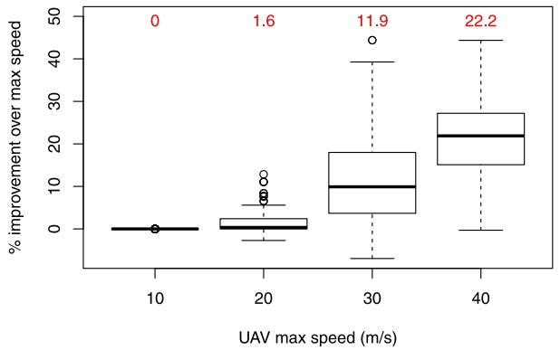

(a) Improvement over maximum allowable speed

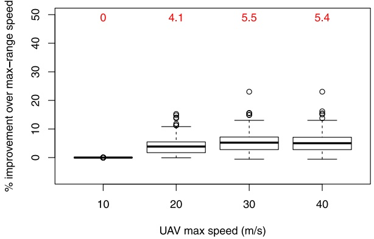

(b) Improvement over maximum-range speed

Fig. 4. Comparison of improvements afforded by variable drone speeds for different maximum allowable speeds. Numbers above each boxplot represent the mean value.

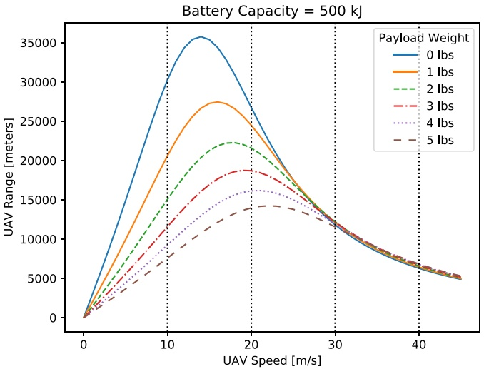

Fig. 5. UAV range at various speeds.

**In Fig. 4b, the improvement in makespan using the variable drone speed over flying at the maximum-range speed is demonstrated. Similar to Fig. 4a, no savings were obtained at the maximum allowable speed of 10 m/s, indicating that maximum speed, maximumrange speed, and variable speed all resulted in solutions of similar quality. At the maximum allowable speed of 20 m/s, the savings over the maximum-range speed case is 4.1% (compared to a savings of only 1.6% over the maximum speed case), indicating that the maximum speed performed better than the maximum-range speed, and the variable speed performed better than both. Finally, at maximum allowable speeds of 30 m/s and 40 m/s, savings over the maximum-range speed case are 5.5% and 5.4% (compared to savings of 11.9% and 22.2% over the maximum speed case), respectively, indicating that the maximum-range speed performed better than the maximum speed, and the variable speed performed better than both. These results show that while the benefits of maximum-range speed over maximum speed (or vice-versa) depend on the maximum allowable UAV speed, variable drone speed is always beneficial over the fixed-speed cases, underscoring the importance of optimizing speeds during the solution process.**

**To put the benefits of using fixed- or variable-speed models into perspective, the average improvement in makespan over the optimal TSP solution is provided in Fig. 6 for 50- and 100-customer problems. As before, the first important observation is that when UAVs fly at maximum allowable speeds, the makespan increases (improvement over TSP solution decreases) with increased speed. Specifically, significant reductions in the improvement can be seen after a maximum UAV speed of 20 m/s for 50-customer problems, and 30 m/s for 100-customer problems. Second, while flying UAVs at maximum-range speeds may seem attractive, it actually performs worse than the maximum speed UAVs in some cases (e.g. at the maximum speed of 20 m/s for 50-customer problems, and at the maximum speed of 20 and 30 m/s for 100-customer problems.) Finally, variable speed UAVs leverage the tradeoffs between speed and range, and provide significant improvements in savings over both fixed-speed cases.**

**Tables 5–8 provide additional comparisons between the two fixed-speed cases (mFSTSP with maximum speed and maximumrange speed) and the variable speed case (mFSTSP-VDS). Consistent with the previous discussion, Table 5 shows the trend of**

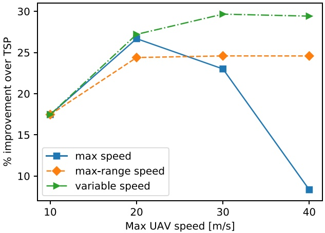

(a) 50-customer problems

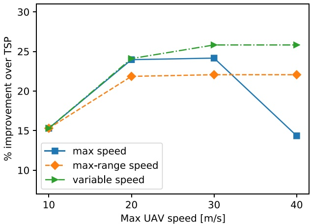

(b) 100-customer problems

Fig. 6. Comparison of improvements afforded by maximum drone speeds, maximum-range drone speeds, and variable drone speeds over optimal TSP solutions without any drones.

## Table 5

Comparison of makespan and number of UAV customers for the variable drone speed (VDS) case against the fixed-speed cases (maximum speed (MS) and maximum-range speed (MRS)).

<table><tr><td rowspan="2"># Customers</td><td rowspan="2">Max allowable speed [m/s]</td><td colspan="3">Avg. makespan [hr:min:sec]</td><td colspan="3">Avg. # UAV customers</td></tr><tr><td>MS</td><td>MRS</td><td>VDS (% savings over MS/MRS)</td><td>MS</td><td>MRS</td><td>VDS (% incr. over MS/MRS)</td></tr><tr><td rowspan="4">10</td><td>10</td><td>1:40:21</td><td>1:40:21</td><td>1:40:21 (0.0/0.0)</td><td>2.9</td><td>2.9</td><td>2.9 (0.0/0.0)</td></tr><tr><td>20</td><td>1:24:00</td><td>1:24:59</td><td>1:20:57 (3.4/4.7)</td><td>4.3</td><td>4.2</td><td>5.0 (13.8/18.6)</td></tr><tr><td>30</td><td>1:41:48</td><td>1:25:09</td><td>1:20:42 (20.5/5.2)</td><td>2.1</td><td>4.6</td><td>5.1 (138.4/11.4)</td></tr><tr><td>40</td><td>1:49:50</td><td>1:25:09</td><td>1:20:47 (26.5/5.1)</td><td>0.6</td><td>4.6</td><td>5.1 (787.0/10.9)</td></tr><tr><td rowspan="4">25</td><td>10</td><td>2:42:59</td><td>2:42:59</td><td>2:42:59 (0.0/0.0)</td><td>6.8</td><td>6.8</td><td>6.8 (0.0/0.0)</td></tr><tr><td>20</td><td>2:16:02</td><td>2:20:54</td><td>2:13:16 (2.0/5.3)</td><td>11.8</td><td>10.0</td><td>12.4 (5.7/24.5)</td></tr><tr><td>30</td><td>2:37:59</td><td>2:20:27</td><td>2:12:03 (16.2/5.8)</td><td>9.5</td><td>10.2</td><td>12.9 (35.8/26.8)</td></tr><tr><td>40</td><td>2:59:42</td><td>2:20:27</td><td>2:12:19 (26.1/5.6)</td><td>4.7</td><td>10.1</td><td>12.8 (171.3/26.2)</td></tr><tr><td rowspan="4">50</td><td>10</td><td>3:35:53</td><td>3:35:53</td><td>3:35:53 (0.0/0.0)</td><td>13.3</td><td>13.3</td><td>13.3 (0.0/0.0)</td></tr><tr><td>20</td><td>3:11:46</td><td>3:17:46</td><td>3:10:24 (0.8/3.7)</td><td>21.8</td><td>18.5</td><td>22.1 (1.5/19.7)</td></tr><tr><td>30</td><td>3:21:23</td><td>3:17:15</td><td>3:03:59 (8.6/6.4)</td><td>23.4</td><td>18.9</td><td>25.4 (8.2/34.6)</td></tr><tr><td>40</td><td>3:59:46</td><td>3:17:16</td><td>3:04:37 (22.8/6.1)</td><td>15.8</td><td>18.8</td><td>25.1 (59.5/33.6)</td></tr><tr><td rowspan="4">100</td><td>10</td><td>5:31:16</td><td>5:31:16</td><td>5:31:16 (0.0/0.0)</td><td>24.4</td><td>24.4</td><td>24.4 (0.0/0.0)</td></tr><tr><td>20</td><td>4:57:22</td><td>5:05:37</td><td>4:56:50 (0.2/2.8)</td><td>42.7</td><td>36.3</td><td>42.4 (-0.6/16.8)</td></tr><tr><td>30</td><td>4:56:36</td><td>5:04:48</td><td>4:50:06 (2.2/4.7)</td><td>48.9</td><td>36.1</td><td>49.9 (1.9/38.2)</td></tr><tr><td>40</td><td>5:34:59</td><td>5:04:48</td><td>4:50:06 (13.3/4.7)</td><td>40.3</td><td>36.1</td><td>49.1 (22.0/36.2)</td></tr></table>

**increased time savings due to variable drone speeds as the maximum allowable cruise speed increases. These savings result from an increase in the number of customers being served by UAVs, as evident from the last three columns of Table 5. It is also observed that time savings decrease as the number of customers increases. This is due to changes in customer density. Since these test problems cover a region of a fixed size, as the number of customers increases, the customer density within a service region also increases. This reduces the benefits of flying at lower than maximum speeds. The impact of customer density is examined further in Section 5.3.**

**Table 6 shows that the UAVs in the mFSTSP-VDS fly at an average speed that is less than the UAV speed in the maximum speed case and greater than the UAV speed in the maximum-range speed case, while resulting in net overall time savings over both fixed-speed cases. This result is in accordance with the variable speed feature of the mFSTSP-VDS in which, while UAVs tend to fly closer to the maximum-range speed to reach distant customers, they may also speed-up to deliver faster and reduce truck waiting where necessary. The comparison is made for UAVs both with and without a parcel. It is observed that the average UAV speed in the mFSTSP-VDS does not change much even when the maximum allowed speed increases from 20 to 40 m/s. This indicates that it may not always be beneficial to invest in high-speed UAVs, since low-speed UAVs can also be used to efficiently deliver parcels by leveraging their speed-dependent power consumption behavior. Moreover, average UAV speeds are consistently higher when carrying a parcel than when flying empty. This is attributable to the fact that maximum-range speed increases with an increase in the payload.**

**Allowing UAVs to fly at variable speeds not only results in time savings, but is also cost efficient. Table 7 shows that the average total distance traveled by the truck can be reduced by up to 30.7% against the maximum speed case and 10.5% against the maximumrange speed case, due to more customers being served by UAVs. To put this into perspective, a reduction of one mile per driver** **each day saves UPS up to \$50 million annually (Sawers, 2020). The average truck distance savings associated with variable-speed UAVs is 9.5 miles when compared to the maximum speed UAVs and 3.9 miles when compared to the maximum-range speed UAVs. This would translate to annual savings of \$475 million and \$195 million, respectively, compared to the two fixed drone speed cases. As highlighted by last three columns of Table 7, variable speed UAVs always result in lower truck waiting times compared to the maximum-range speed UAVs, despite the additional UAV deliveries. Additionally, variable speed UAVs result in lower truck waiting times compared to the maximum speed UAVs in most cases.**

Comparison of UAV cruise speeds for the variable drone speed (VDS) case against the fixed-speed cases (maximum speed (MS) and maximum-range speed (MRS)).

<table><tr><td rowspan="2"># Customers</td><td rowspan="2">Max allowable speed [m/s]</td><td colspan="3">Avg. speed with parcel</td><td colspan="3">Avg. speed w/o parcel</td></tr><tr><td>MS</td><td>MRS</td><td>VDS (% decr. over MS/MRS)</td><td>MS</td><td>MRS</td><td>VDS (% decr. over MS/MRS)</td></tr><tr><td rowspan="4">10</td><td>10</td><td>10.0</td><td>10.0</td><td>10.0 (0.0/0.0)</td><td>10.0</td><td>10.0</td><td>10.0 (0.0/0.0)</td></tr><tr><td>20</td><td>20.0</td><td>17.7</td><td>18.5 (7.4/-4.4)</td><td>20.0</td><td>14.0</td><td>16.2 (19.1/-15.9)</td></tr><tr><td>30</td><td>30.0</td><td>18.2</td><td>18.2 (39.3/-0.1)</td><td>30.0</td><td>14.0</td><td>16.0 (46.6/-14.8)</td></tr><tr><td>40</td><td>40.0</td><td>18.2</td><td>18.1 (54.8/0.5)</td><td>40.0</td><td>14.0</td><td>15.9 (60.2/-13.9)</td></tr><tr><td rowspan="4">25</td><td>10</td><td>10.0</td><td>10.0</td><td>10.0 (0.0/0.0)</td><td>10.0</td><td>10.0</td><td>10.0 (0.0/0.0)</td></tr><tr><td>20</td><td>20.0</td><td>17.9</td><td>18.6 (6.8/-4.3)</td><td>20.0</td><td>14.0</td><td>16.1 (19.4/-15.4)</td></tr><tr><td>30</td><td>30.0</td><td>18.3</td><td>19.3 (35.8/-5.0)</td><td>30.0</td><td>14.0</td><td>16.9 (43.7/-21.1)</td></tr><tr><td>40</td><td>40.0</td><td>18.3</td><td>18.7 (53.2/-1.9)</td><td>40.0</td><td>14.0</td><td>16.4 (58.9/-17.8)</td></tr><tr><td rowspan="4">50</td><td>10</td><td>10.0</td><td>10.0</td><td>10.0 (0.0/0.0)</td><td>10.0</td><td>10.0</td><td>10.0 (0.0/0.0)</td></tr><tr><td>20</td><td>20.0</td><td>18.3</td><td>19.2 (4.0/-4.9)</td><td>20.0</td><td>14.0</td><td>16.9 (15.6/-21.0)</td></tr><tr><td>30</td><td>30.0</td><td>18.7</td><td>21.2 (29.4/-13.4)</td><td>30.0</td><td>14.0</td><td>17.9 (40.4/-28.0)</td></tr><tr><td>40</td><td>40.0</td><td>18.7</td><td>20.8 (48.0/-11.2)</td><td>40.0</td><td>14.0</td><td>17.9 (55.2/-28.4)</td></tr><tr><td rowspan="4">100</td><td>10</td><td>10.0</td><td>10.0</td><td>10.0 (0.0/0.0)</td><td>10.0</td><td>10.0</td><td>10.0 (0.0/0.0)</td></tr><tr><td>20</td><td>20.0</td><td>18.3</td><td>19.4 (2.8/-6.1)</td><td>20.0</td><td>14.0</td><td>18.1 (9.4/-29.7)</td></tr><tr><td>30</td><td>30.0</td><td>18.8</td><td>22.3 (25.8/-18.6)</td><td>30.0</td><td>14.0</td><td>19.1 (36.4/-36.6)</td></tr><tr><td>40</td><td>40.0</td><td>18.8</td><td>23.2 (42.1/-23.4)</td><td>40.0</td><td>14.0</td><td>20.1 (49.9/-43.6)</td></tr></table>

Comparison of average truck travel distances and average total time it waits for UAV retrievals during its trip, for the variable drone speed (VDS) case against the fixed-speed cases (maximum speed (MS) and maximum-range speed (MRS)).

<table><tr><td rowspan="2"># Customers</td><td rowspan="2">Max allowable speed [m/s]</td><td colspan="3">Avg. truck distance [km]</td><td colspan="3">Avg. truck waiting [s]</td></tr><tr><td>MS</td><td>MRS</td><td>VDS (% decr. over MS/MRS)</td><td>MS</td><td>MRS</td><td>VDS (% decr. over MS/MRS)</td></tr><tr><td rowspan="4">10</td><td>10</td><td>87.6</td><td>87.6</td><td>87.6 (0.0/0.0)</td><td>374.8</td><td>374.8</td><td>374.8 (0.0/0.0)</td></tr><tr><td>20</td><td>75.1</td><td>75.9</td><td>72.7 (3.1/4.2)</td><td>162.3</td><td>208.5</td><td>155.3 (4.3/25.5)</td></tr><tr><td>30</td><td>94.2</td><td>72.7</td><td>71.1 (24.5/2.3)</td><td>38.1</td><td>339.2</td><td>203.6 (-434.0/40.0)</td></tr><tr><td>40</td><td>102.2</td><td>72.7</td><td>71.6 (29.9/1.5)</td><td>8.8</td><td>339.2</td><td>186.1 (-2026.8/45.1)</td></tr><tr><td rowspan="4">25</td><td>10</td><td>127.9</td><td>127.9</td><td>127.9 (0.0/0.0)</td><td>598.1</td><td>598.1</td><td>598.1 (0.0/0.0)</td></tr><tr><td>20</td><td>107.5</td><td>111.7</td><td>105.3 (2.0/5.8)</td><td>223.9</td><td>216.2</td><td>191.3 (14.6/11.5)</td></tr><tr><td>30</td><td>130.2</td><td>111.2</td><td>105.0 (19.4/5.5)</td><td>136.2</td><td>224.1</td><td>111.9 (17.9/50.1)</td></tr><tr><td>40</td><td>151.5</td><td>111.1</td><td>105.0 (30.7/5.6)</td><td>81.2</td><td>224.9</td><td>117.6 (-44.8/47.7)</td></tr><tr><td rowspan="4">50</td><td>10</td><td>147.5</td><td>147.5</td><td>147.5 (0.0/0.0)</td><td>592.9</td><td>592.9</td><td>592.9 (0.0/0.0)</td></tr><tr><td>20</td><td>125.9</td><td>131.4</td><td>125.6 (0.2/4.4)</td><td>303.2</td><td>362.3</td><td>232.4 (23.3/35.9)</td></tr><tr><td>30</td><td>135.7</td><td>131.2</td><td>119.9 (11.7/8.7)</td><td>256.0</td><td>336.1</td><td>187.2 (26.9/44.3)</td></tr><tr><td>40</td><td>171.3</td><td>131.3</td><td>120.8 (29.5/8.0)</td><td>104.3</td><td>335.3</td><td>158.7 (-52.2/52.7)</td></tr><tr><td rowspan="4">100</td><td>10</td><td>205.7</td><td>205.7</td><td>205.7 (0.0/0.0)</td><td>666.2</td><td>666.2</td><td>666.2 (0.0/0.0)</td></tr><tr><td>20</td><td>171.5</td><td>181.3</td><td>172.0 (-0.3/5.1)</td><td>242.7</td><td>284.6</td><td>192.3 (20.7/32.4)</td></tr><tr><td>30</td><td>166.7</td><td>181.6</td><td>162.4 (2.6/10.5)</td><td>380.6</td><td>235.4</td><td>229.3 (39.8/2.6)</td></tr><tr><td>40</td><td>205.9</td><td>181.6</td><td>162.9 (20.9/10.3)</td><td>133.6</td><td>235.4</td><td>204.4 (-53.0/13.2)</td></tr></table>

**Lastly, variable UAV speeds also reduce average UAV energy consumption when compared to the maximum UAV speed case, as shown in Table 8. The reduction in energy usage means that UAVs have additional available endurance at the end of their sorties. This is particularly important in the event that the truck is delayed. A reduction in energy consumption may also allow the use of smaller-capacity batteries, saving weight and potentially further increasing flight range. The average UAV energy consumption is, however, lowest for the maximum-range UAV speeds which is an intuitive result since UAVs are most energy efficient at this speed. Additionally, variable UAV speeds reduce the time spent waiting for the truck compared to both the fixed-speed cases. This is an attractive result for residents who may be bothered by hovering UAVs. Less loiter time also reduces opportunities for vandalism of unattended stationary UAVs.**

Comparison of average UAV energy consumption and average time it waits to be retrieved during a sortie, for the variable drone speed (VDS) case against the fixed-speed cases (maximum speed (MS) and maximum-range speed (MRS)).

<table><tr><td rowspan="2"># Customers</td><td rowspan="2">Max allowable speed [m/s]</td><td colspan="3">Avg. UAV energy used [kJ]</td><td colspan="3">Avg. UAV waiting [s]</td></tr><tr><td>MS</td><td>MRS</td><td>VDS (% decr. over MS/MRS)</td><td>MS</td><td>MRS</td><td>VDS (% decr. over MS/MRS)</td></tr><tr><td rowspan="4">10</td><td>10</td><td>426.3</td><td>426.3</td><td>426.3 (0.0/0.0)</td><td>129.8</td><td>129.8</td><td>129.8 (0.0/0.0)</td></tr><tr><td>20</td><td>392.5</td><td>400.4</td><td>396.1 (-0.9/1.1)</td><td>123.5</td><td>179.5</td><td>97.2 (21.3/45.8)</td></tr><tr><td>30</td><td>394.0</td><td>394.2</td><td>388.9 (1.3/1.3)</td><td>95.6</td><td>147.4</td><td>53.0 (44.6/64.1)</td></tr><tr><td>40</td><td>463.2</td><td>394.2</td><td>393.9 (15.0/0.1)</td><td>85.9</td><td>147.4</td><td>56.5 (34.2/61.7)</td></tr><tr><td rowspan="4">25</td><td>10</td><td>389.1</td><td>389.1</td><td>389.1 (0.0/0.0)</td><td>127.5</td><td>127.5</td><td>127.5 (0.0/0.0)</td></tr><tr><td>20</td><td>368.2</td><td>355.6</td><td>354.0 (3.8/0.4)</td><td>123.3</td><td>119.8</td><td>74.6 (39.5/37.7)</td></tr><tr><td>30</td><td>395.5</td><td>359.3</td><td>360.3 (8.9/-0.3)</td><td>109.6</td><td>116.7</td><td>59.7 (45.5/48.8)</td></tr><tr><td>40</td><td>397.4</td><td>360.6</td><td>360.2 (9.4/0.1)</td><td>79.5</td><td>119.3</td><td>56.5 (28.9/52.6)</td></tr><tr><td rowspan="4">50</td><td>10</td><td>355.6</td><td>355.6</td><td>355.6 (0.0/0.0)</td><td>107.5</td><td>107.5</td><td>107.5 (0.0/0.0)</td></tr><tr><td>20</td><td>320.1</td><td>302.9</td><td>293.8 (8.2/3.0)</td><td>111.4</td><td>120.9</td><td>83.8 (24.7/30.7)</td></tr><tr><td>30</td><td>383.2</td><td>294.6</td><td>305.8 (20.2/-3.8)</td><td>94.8</td><td>117.2</td><td>69.8 (26.4/40.5)</td></tr><tr><td>40</td><td>393.1</td><td>294.9</td><td>314.5 (20.0/-6.6)</td><td>81.3</td><td>117.9</td><td>63.0 (22.6/46.6)</td></tr><tr><td rowspan="4">100</td><td>10</td><td>308.0</td><td>307.9</td><td>307.9 (0.0/0.0)</td><td>115.5</td><td>115.0</td><td>114.9 (0.5/0.1)</td></tr><tr><td>20</td><td>261.9</td><td>235.4</td><td>254.0 (3.0/-7.9)</td><td>91.3</td><td>109.5</td><td>83.2 (8.8/24.0)</td></tr><tr><td>30</td><td>347.7</td><td>241.1</td><td>270.0 (22.3/-12.0)</td><td>102.1</td><td>112.2</td><td>62.3 (39.0/44.5)</td></tr><tr><td>40</td><td>389.8</td><td>241.1</td><td>289.9 (25.6/-20.2)</td><td>82.8</td><td>112.2</td><td>67.7 (18.3/39.7)</td></tr></table>

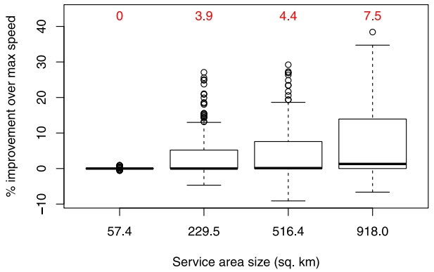

(a) Comparison against maximum allowable speed

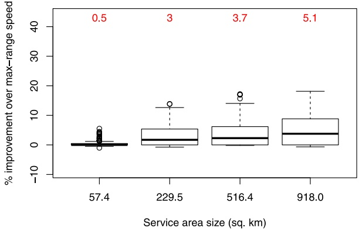

(b) Comparison against maximum-range speed

Fig. 7. Comparison of improvements afforded by variable drone speeds for different service areas with 50 customers. Numbers above each boxplot represent the mean value.

## 5.3. Impact of customer density

**The second set of test problems is used to demonstrate that more savings can be achieved by flying at variable drone speeds when the customer density in a service region is low. Note that these test instances feature an equal number of customers (50) distributed over service regions of varying sizes. Thus, larger regions will have lower customer density.**

**As shown in Fig.** ${ \mathrm { 7 a } } ,$ **the benefits of variable UAV speeds over the maximum speed case increase as the service region becomes larger. If customers are located close enough to each other, such that launch and retrieval locations of UAVs are not far from their service locations, then UAVs will not run out of battery even if they cruise at maximum speed. Conversely, in larger regions, the increased flight range afforded by reduced UAV speeds enables servicing more customers via UAV.**

**Fig. 7b shows the increased benefits of variable UAV speeds over the maximum-range speed case as the service region becomes larger. The reason behind this trend is that, in larger regions, UAVs flying at the maximum-range speeds may take longer to serve distant customers, incurring truck waiting at the retrieval locations. In such situations, truck waiting can be reduced by increasing UAV speeds in the mFSTSP-VDS, thereby providing substantial improvement in the makespan over the fixed maximum-range speed case.**

## 5.4. Performance of the heuristic on mFSTSP instances

**In this section, the mFSTSP-VDS heuristic’s performance is evaluated on instances of the mFSTSP (with fixed UAV speeds). The** mFSTSP-VDS heuristic was applied to all 1600 publicly-available mFSTSP instances by fixing the cruise speeds $( \nu _ { v i j } ^ { c } )$ **in the heuristic** **to the values used in Murray and Raj (2020). This disables some of the features related to speed modifications in Phase 3 of the heuristic.**

Table 9

Comparison of mFSTSP-VDS heuristic (with fixed speeds) against the mFSTSP heuristic on mFSTSP instances.

<table><tbody><tr><td rowspan="2">Customers</td><td rowspan="2">Instances</td><td rowspan="2">Avg. Impr. [%]</td><td rowspan="2"># Instances w/ Better (or Equal) solution</td><td colspan="2">Avg. Run-time [s]</td></tr><tr><td>mFSTSP heuristic</td><td>mFSTSP-VDS heuristic</td></tr><tr><td>8</td><td>320</td><td>1.93</td><td>141 (241)</td><td>0.10</td><td>0.18</td></tr><tr><td>10</td><td>320</td><td>1.93</td><td>172 (278)</td><td>0.13</td><td>0.25</td></tr><tr><td>25</td><td>320</td><td>1.20</td><td>176 (185)</td><td>2.51</td><td>2.97</td></tr><tr><td>50</td><td>320</td><td>0.77</td><td>178 (178)</td><td>39.55</td><td>28.07</td></tr><tr><td>100</td><td>320</td><td>1.13</td><td>202 (202)</td><td>582.25</td><td>394.28</td></tr></tbody></table>

**First, a comparison against the 212 mFSTSP optimal solutions for 8-customer problems is made. The average optimality gap using the mFSTSP-VDS heuristic is 2.3%, compared to 5.0% with the mFSTSP heuristic. Moreover, the maximum gap with the mFSTSP-VDS heuristic is 23.3%, compared to 44.2% with the mFSTSP heuristic. Lastly, optimal solutions were found for 61 of 212 problems using the mFSTSP-VDS heuristic, compared to 51 of 212 problems using the mFSTSP heuristic.**

**Next, a comparison of the solution quality and run-time of the mFSTSP-VDS heuristic against the mFSTSP heuristic is made for all 1600 problems, as summarized in Table 9. Irrespective of the problem-size (number of customers), the average improvement is positive, meaning that the new heuristic finds better solutions than the mFSTSP heuristic in an average sense. The average improvement varies between 0.77% (for 50-customer problems) and 1.93% (for 8-customer problems). Moreover, the number of instances in which the mFSTSP-VDS heuristic found better or equal solutions varies between 178 and 278, out of 320 instances. Additionally, the average run-time of the new heuristic is lower than that of the mFSTSP heuristic for larger problems (50- and 100-customer), indicating the improved scalability of the mFSTSP-VDS heuristic.**

## 6. Conclusions and future work

**This paper extends the mFSTSP to incorporate UAV speeds as decision variables. Numerical studies reveal several insights into last-mile delivery systems with variable-speed UAVs. First, and most importantly, allowing UAVs to travel at less-than-maximum speeds leads to a reduction in overall delivery times when the maximum allowable speed exceeds the speed associated with maximum range. In the experimental setup, this was associated with maximum allowable speeds of 20 m/s and above. Second, in a bid to reduce makespan, flying UAVs at the maximum-range speed is also not enough. This underscores the need for variable UAV speed feature, which outperformed both the maximum speed UAVs and the maximum-range speed UAVs. Third, when variable UAV speeds are employed, more customers tend to be served via UAV (when compared to fixed-speed flights). This leads to a reduction in truck tour length, which can be significant for a delivery firm in terms of dollar savings. Fourth, variable-speed UAVs expend less energy per sortie and spend less time waiting for the truck. Finally, customer density is an important factor in determining the extent of delivery time savings. Densely-distributed customers tend to negate the benefits associated with the variable UAV speeds. The numerical analysis also demonstrated that the proposed three-phased mFSTSP-VDS heuristic outperforms the heuristic provided by Murray and Raj (2020) when applied to instances of the mFSTSP (with constant UAV speeds), both in terms of solution quality and run-times.**

**There are numerous opportunities for future research in this area. For example, there is currently no integer programming formulation for the mFSTSP-VDS. Exact solution methods, or even (relatively) tight bounds, would be useful for assessing the solution quality of heuristics for this problem. Given the time-savings associated with variable UAV speeds for the single-truck multiple-UAV setting, extending the idea to multi-truck problems or the PDSTSP (Murray and Chu, 2015) appears promising. The consideration of non-customer UAV launch or retrieval locations is another interesting extension. Additionally, the problem could be extended to consider variable-speed trucks, perhaps with an objective of minimizing emissions.**

## CRediT authorship contribution statement

**Ritwik Raj: Conceptualization, Methodology, Software, Validation, Formal analysis, Investigation, Writing - original draft, Writing - review & editing, Visualization. Chase Murray: Conceptualization, Methodology, Formal analysis, Investigation, Writing - original draft, Writing - review & editing, Visualization, Supervision.**

## Acknowledgments

**The authors gratefully acknowledge the feedback by Editor-in-Chief Yafeng Yin and the three anonymous reviewers throughout the review process, which improved the quality of this research.**

## References

[Agatz, N., Bouman, P., Schmidt, M., 2018. Optimization approaches for the traveling salesman problem with drone. Transp. Sci..](http://refhub.elsevier.com/S0968-090X%2820%2930718-X/sb1)

[Barmpounakis, E.N., Vlahogianni, E.I., Golias, J.C., 2016. Unmanned Aerial Aircraft Systems for transportation engineering: Current practice and future challenges. Int. J. Transp. Sci. Technol. 5 (3), 111–122.](http://refhub.elsevier.com/S0968-090X%2820%2930718-X/sb2)

[bin Othman, M.S., Shurbevski, A., Karuno, Y., Nagamochi, H., 2017. Routing of carrier-vehicle systems with dedicated last-stretch delivery vehicle and fixed carrier route. J. Inf. Process. 25, 655–666.](http://refhub.elsevier.com/S0968-090X%2820%2930718-X/sb3)

[Boysen, N., Briskorn, D., Fedtke, S., Schwerdfeger, S., 2018. Drone delivery from trucks: Drone scheduling for given truck routes. Networks 72 (4), 506–527.](http://refhub.elsevier.com/S0968-090X%2820%2930718-X/sb4)

[Chang, Y.S., Lee, H.J., 2018. Optimal delivery routing with wider drone-delivery areas along a shorter truck-route. Expert Syst. Appl. 104, 307–317.](http://refhub.elsevier.com/S0968-090X%2820%2930718-X/sb5)

[Cheng, C., Adulyasak, Y., Rousseau, L.-M., 2020. Drone routing with energy function: Formulation and exact algorithm. Transp. Res. B 139, 364–387.](http://refhub.elsevier.com/S0968-090X%2820%2930718-X/sb6)

[Choi, Y., Schonfeld, P.M., 2017. Optimization of Multi-Package Drone Deliveries Considering Battery Capacity. Technical report.](http://refhub.elsevier.com/S0968-090X%2820%2930718-X/sb7)

Dell’Amico, M., Montemanni, R., Novellani, S., 2019. Matheuristic algorithms for the parallel drone scheduling traveling salesman problem. arXiv preprint [arXiv:1906.02962](http://arxiv.org/abs/1906.02962).

[Dorling, K., Heinrichs, J., Messier, G.G., Magierowski, S., 2017. Vehicle routing problems for drone delivery. IEEE Trans. Syst. Man Cybern.: Syst. 47 (1), 70–85.](http://refhub.elsevier.com/S0968-090X%2820%2930718-X/sb9)

Dorr, L., 2018. Federal Aviation Administration. URL [https://www.faa.gov/news/fact\_sheets/news\_story.cfm?newsId=22615](https://www.faa.gov/news/fact_sheets/news_story.cfm?newsId=22615).

Dukkanci, O., Kara, B.Y., Bektas, T., 2019. The drone delivery problem. Available at SSRN, URL [https://papers.ssrn.com/sol3/papers.cfm?abstract\_id=3314556](https://papers.ssrn.com/sol3/papers.cfm?abstract_id=3314556).

[Ferrandez, S.M., Harbison, T., Weber, T., Sturges, R., Rich, R., 2016. Optimization of a truck-drone in tandem delivery network using k-means and genetic algorithm. J. Ind. Eng. Manage. 9 (2), 374–388.](http://refhub.elsevier.com/S0968-090X%2820%2930718-X/sb12)

Gurobi Optimization, 2018. Tsp.py. URL [https://www.gurobi.com/documentation/8.1/examples/tsp\_py.html](https://www.gurobi.com/documentation/8.1/examples/tsp_py.html).

Gurobi Optimization, 2020. Model.computeIIS(). URL [https://www.gurobi.com/documentation/9.0/refman/py\_model\_computeiis.html](https://www.gurobi.com/documentation/9.0/refman/py_model_computeiis.html).

[Ha, Q.M., Deville, Y., Pham, Q.D., Hà, M.H., 2018. On the min-cost traveling salesman problem with drone. Transp. Res. C 86, 597–621.](http://refhub.elsevier.com/S0968-090X%2820%2930718-X/sb15)

[Ham, A.M., 2018. Integrated scheduling of m-truck, m-drone, and m-depot constrained by time-window, drop-pickup, and m-visit using constraint programming. Transp. Res. C 91, 1–14.](http://refhub.elsevier.com/S0968-090X%2820%2930718-X/sb16)

[Houseknecht, J., 2019. An ACO-Inspired, Probabilistic, Greedy Approach to the Drone Traveling Salesman Problem. Working Paper.](http://refhub.elsevier.com/S0968-090X%2820%2930718-X/sb17)

[Jeong, H.Y., Lee, S., Song, B.D., 2019. Truck-drone hybrid delivery routing: Payload-energy dependency and no-fly zones. Int. J. Prod. Econ..](http://refhub.elsevier.com/S0968-090X%2820%2930718-X/sb18)

[Khoufi, I., Laouiti, A., Adjih, C., 2019. A survey of recent extended variants of the traveling salesman and vehicle routing problems for unmanned aerial vehicles. Drones 3 (3), 66.](http://refhub.elsevier.com/S0968-090X%2820%2930718-X/sb19)

[Kim, S., Moon, I., 2019. Traveling salesman problem with a drone station. IEEE Trans. Syst. Man Cybern.: Syst. 49 (1), 42–52.](http://refhub.elsevier.com/S0968-090X%2820%2930718-X/sb20)

[Kitjacharoenchai, P., Ventresca, M., Moshref-Javadi, M., Lee, S., Tanchoco, J.M.A., Brunese, P.A., 2019. Multiple traveling salesman problem with drones: Mathematical model and heuristic approach. Comput. Ind. Eng..](http://refhub.elsevier.com/S0968-090X%2820%2930718-X/sb21)

Lillian, B., 2018. Electric truck plus delivery drone testing now under way. URL [https://ngtnews.com/electric-truck-plus-delivery-drone-testing-now-under-way](https://ngtnews.com/electric-truck-plus-delivery-drone-testing-now-under-way).

[Liu, Z., Sengupta, R., Kurzhanskiy, A., 2017. A power consumption model for multi-rotor small unmanned aircraft systems. In: 2017 International Conference on Unmanned Aircraft Systems (ICUAS). IEEE, pp. 310–315.](http://refhub.elsevier.com/S0968-090X%2820%2930718-X/sb23)

[Luo, Z., Liu, Z., Shi, J., 2017. A two-echelon cooperated routing problem for a ground vehicle and its carried unmanned aerial vehicle. Sensors 17 (5), 1144.](http://refhub.elsevier.com/S0968-090X%2820%2930718-X/sb24) MAVLink, 2020. URL [https://mavlink.io/en/](https://mavlink.io/en/).

McNabb, M., 2019. How Zipline became a \$1.2 billion drone company. URL [https://dronelife.com/2019/05/21/how-zipline-became-a-1-2-billion-drone-company/](https://dronelife.com/2019/05/21/how-zipline-became-a-1-2-billion-drone-company/).

[Murray, C.C., Chu, A.G., 2015. The flying sidekick traveling salesman problem: Optimization of drone-assisted parcel delivery. Transp. Res. C 54, 86–109.](http://refhub.elsevier.com/S0968-090X%2820%2930718-X/sb27)

[Murray, C.C., Raj, R., 2020. The multiple flying sidekicks traveling salesman problem: Parcel delivery with multiple drones. Transp. Res. C 110, 368–398.](http://refhub.elsevier.com/S0968-090X%2820%2930718-X/sb28) OpenStreetMap, 2017. URL [http://openstreetmap.org](http://openstreetmap.org).

[Otto, A., Agatz, N., Campbell, J., Golden, B., Pesch, E., 2018. Optimization approaches for civil applications of unmanned aerial vehicles (UAVs) or aerial drones: A survey. Networks 72 (4), 411–458.](http://refhub.elsevier.com/S0968-090X%2820%2930718-X/sb30)

Peterson, K., Dektas, M., 2017. UPS tests residential delivery via drone launched from atop package car. URL [https://www.pressroom.ups.com/pressroom/ContentDetailsViewer.page?ConceptType=PressReleases&id=1487687844847-162](https://www.pressroom.ups.com/pressroom/ContentDetailsViewer.page?ConceptType=PressReleases&id=1487687844847-162).

pgRouting, 2017. URL [http://pgrouting.org](http://pgrouting.org).

[Poikonen, S., Golden, B., 2020. Multi-visit drone routing problem. Comput. Oper. Res. 113, 104802.](http://refhub.elsevier.com/S0968-090X%2820%2930718-X/sb33)

[Poikonen, S., Golden, B., Wasil, E.A., 2019. A branch-and-bound approach to the traveling salesman problem with a drone. INFORMS J. Comput. 31 (2), 335–346.](http://refhub.elsevier.com/S0968-090X%2820%2930718-X/sb34)

[Poikonen, S., Wang, X., Golden, B., 2017. The vehicle routing problem with drones: Extended models and connections. Networks.](http://refhub.elsevier.com/S0968-090X%2820%2930718-X/sb35)

[Ponza, A., 2016. Optimization of Drone-Assisted Parcel Delivery (Master’s thesis). Università Degli Studi Di Padova.](http://refhub.elsevier.com/S0968-090X%2820%2930718-X/sb36)

Premack, R., 2019. UPS just beat out Amazon, FedEx, and Uber to make America’s first revenue-generating drone delivery. URL [https://www.businessinsider.com/ups-first-revenue-generating-drone-delivery-with-matternet-2019-3](https://www.businessinsider.com/ups-first-revenue-generating-drone-delivery-with-matternet-2019-3).

[Sacramento, D., Pisinger, D., Ropke, S., 2019. An adaptive large neighborhood search metaheuristic for the vehicle routing problem with drones. Transp. Res. C 102, 289–315.](http://refhub.elsevier.com/S0968-090X%2820%2930718-X/sb38)

Sawers, P., 2020. Ups will now use dynamic routing to get parcels to you on time. URL [https://venturebeat.com/2020/01/29/ups-will-now-use-dynamic-routing-to-get-parcels-to-you-on-time/](https://venturebeat.com/2020/01/29/ups-will-now-use-dynamic-routing-to-get-parcels-to-you-on-time/).

[Schermer, D., Moeini, M., Wendt, O., 2018. Algorithms for solving the vehicle routing problem with drones. In: Asian Conference on Intelligent Information and Database Systems. Springer, pp. 352–361.](http://refhub.elsevier.com/S0968-090X%2820%2930718-X/sb40)

[Schermer, D., Moeini, M., Wendt, O., 2019a. A hybrid VNS/tabu search algorithm for solving the vehicle routing problem with drones and en route operations. Comput. Oper. Res. 109, 134–158.](http://refhub.elsevier.com/S0968-090X%2820%2930718-X/sb41)

[Schermer, D., Moeini, M., Wendt, O., 2019b. A matheuristic for the vehicle routing problem with drones and its variants. Transp. Res. C 106, 166–204.](http://refhub.elsevier.com/S0968-090X%2820%2930718-X/sb42)

[Schermer, D., Moeini, M., Wendt, O., 2019c. The traveling salesman drone station location problem. In: World Congress on Global Optimization. Springer, pp. 1129–1138.](http://refhub.elsevier.com/S0968-090X%2820%2930718-X/sb43)

[Seifried, K., 2019. The traveling salesman problem with one truck and multiple drones. Available at SSRN 3389306.](http://refhub.elsevier.com/S0968-090X%2820%2930718-X/sb44)

[Torabbeigi, M., Lim, G.J., Kim, S.J., 2019. Drone delivery scheduling optimization considering payload-induced battery consumption rates. J. Intell. Robot. Syst. 1–17.](http://refhub.elsevier.com/S0968-090X%2820%2930718-X/sb45)

[Tu, P.A., Dat, N.T., Dung, P.Q., 2018. Traveling salesman problem with multiple drones. In: Proceedings of the Ninth International Symposium on Information and Communication Technology. ACM, pp. 46–53.](http://refhub.elsevier.com/S0968-090X%2820%2930718-X/sb46)

UPS, 2019. UPS Flight Forward Attains FAA’s First Full Approval For Drone Airline. URL [https://pressroom.ups.com/pressroom/ContentDetailsViewer.page?ConceptType=PressReleases&id=1569933965476-404](https://pressroom.ups.com/pressroom/ContentDetailsViewer.page?ConceptType=PressReleases&id=1569933965476-404).

Vanian, J., 2016. This drone startup just achieved a milestone in doorstep delivery. URL [http://fortune.com/2016/03/25/flirtey-drone-legal-delivery-urban/](http://fortune.com/2016/03/25/flirtey-drone-legal-delivery-urban/).

[Wang, X., Poikonen, S., Golden, B., 2016. The vehicle routing problem with drones: Several worst-case results. Optim. Lett. 4 (11), 679–697.](http://refhub.elsevier.com/S0968-090X%2820%2930718-X/sb49)

[Wang, Z., Sheu, J.B., 2019. Vehicle routing problem with drones. Transp. Res. B 122, 350–364.](http://refhub.elsevier.com/S0968-090X%2820%2930718-X/sb50)

[Wang, K., Yuan, B., Zhao, M., Lu, Y., 2019. Cooperative route planning for the drone and truck in delivery services: A bi-objective optimisation approach. J. Oper. Res. Soc. 1–18.](http://refhub.elsevier.com/S0968-090X%2820%2930718-X/sb51)

Webb, K., 2019. Amazon’s drone delivery service is one step closer to taking flight. URL [https://www.businessinsider.com/amazon-prime-air-drones-approved-by-faa-2019-6](https://www.businessinsider.com/amazon-prime-air-drones-approved-by-faa-2019-6).

Wells, G., Stevens, L., 2016. Amazon conducts first commercial drone delivery. URL [https://www.wsj.com/articles/amazon-conducts-first-commercial-drone-delivery-1481725956](https://www.wsj.com/articles/amazon-conducts-first-commercial-drone-delivery-1481725956).

[Wikarek, J., Sitek, P., Zawarczyński, Ł., 2019. An integer programming model for the capacitated vehicle routing problem with drones. In: International Conference on Computational Collective Intelligence. Springer, pp. 511–520.](http://refhub.elsevier.com/S0968-090X%2820%2930718-X/sb54)

[Zeng, Y., Xu, J., Zhang, R., 2019. Energy minimization for wireless communication with rotary-wing UAV. IEEE Trans. Wireless Commun. 18 (4), 2329–2345.](http://refhub.elsevier.com/S0968-090X%2820%2930718-X/sb55)