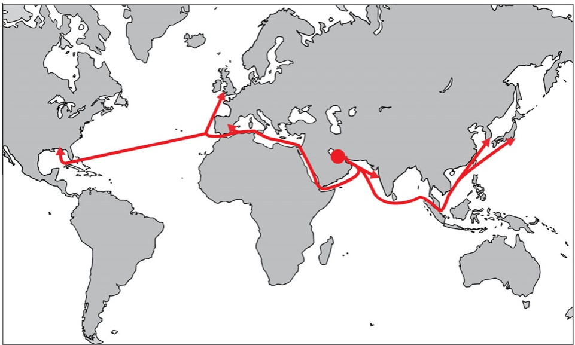
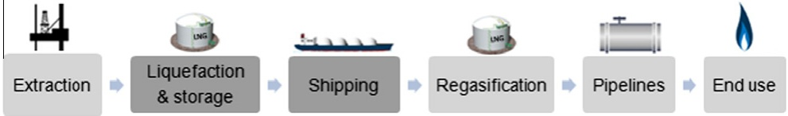
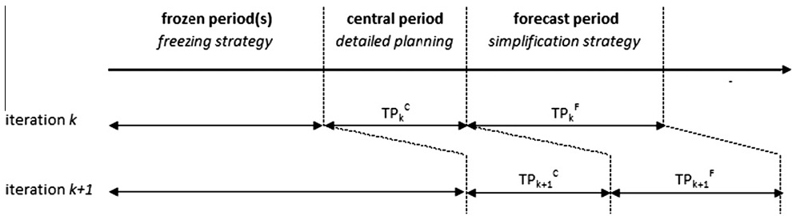

# A rolling horizon heuristic for creating a liquefied natural gas annual delivery program

Jørgen Glomvik Rakke a,⇑, Magnus Stålhane a, Christian Rørholt Moe a, Marielle Christiansen a, Henrik Andersson a, Kjetil Fagerholt a, Inge Norstad a,b

a Department of Industrial Economics and Technology Management, The Norwegian University of Science and Technology, Trondheim, Norway b Norwegian Marine Technology Research Institute (MARINTEK), Trondheim, Norway

a r t i c l e i n f o

Article history: Received 5 December 2009 Received in revised form 21 July 2010 Accepted 16 September 2010

Keywords: Maritime transportation Inventory routing Rolling horizon heuristic

## a b s t r a c t

In this paper a maritime inventory routing problem for one of the world’s largest producers of liquefied natural gas (LNG) is presented. The producer is responsible for the LNG inventories at the liquefaction plant, the loading port with a limited number of berths, and the routing and scheduling of a heterogeneous fleet of LNG ships. In addition, the producer has to fulfill a set of long-term contracts to customers all around the world.

The goal is to create an annual delivery program (ADP) to fulfill the long-term contracts at minimum cost, while maximizing revenue from selling LNG in the spot market. An ADP is a complete schedule of every ship’s sailing plan for the coming year.

A mixed integer programming (MIP) formulation of the ADP planning problem is pre-sented, and it is based on a priori generation of all possible scheduled voyages within the planning horizon. Due to the size and complexity of the problem, a rolling horizon heuristic (RHH) is proposed. The RHH solves the problem by iteratively solving sub-problems with shorter planning horizons. The RHH finds solutions to the problem within a reasonable amount of time, and creates very good ADPs according to the problem owner.

\- 2010 Elsevier Ltd. All rights reserved.

## 1. Introduction

Today the demand for energy is higher than ever, and it is forecast that it will increase even more in the near future. Natural gas (NG) is expected to be one of the most important sources of energy to fulfill this demand. Estimates predict that the world’s demand for NG will increase with 52% from 2005 to 2030 according to EIA (2008). At the same time, traditional sources of energy such as oil and coal are becoming less attractive due to increased prices and environmental considerations. This, and new technology making extraction, refinement, and transportation of NG both cheaper and more efficient, has made it more attractive to invest in projects involving NG. As a result gas-rich areas which previously were considered too remote to be profitable are now being explored.

Traditionally, NG was transported through pipelines, but long distances from the gas fields to many high-consumption markets made it prohibitively expensive to build pipelines. Other forms of transport were also too costly, e.g. the option of transporting the gas as liquefied natural gas (LNG) was undesirable due to the need for expensive specialized ships and equipment to handle the LNG at the loading and unloading ports. However, a combination of higher LNG prices, technical developments, lower production costs, rising demand, and the desire of producers to capitalize on their gas reserves, has set the stage for increased LNG trade and more use of ships as a mean to transport NG. As a result of this, IEA (2007)

<small>⇑ Corresponding author.</small>

<small>E-mail address: [jorgen.rakke@iot.ntnu.no](mailto:jorgen.rakke@iot.ntnu.no) (J.G. Rakke).</small>

predicts that the total fleet of ships transporting LNG will increase to approximately 400 by year 2015, close to double of the total fleet in 2007.

In addition to the rapidly increasing demand for NG a spot market for LNG has arisen in recent years. Traditionally, longterm contracts for delivery have been negotiated in advance of starting projects with take-or-pay clauses shifting the volume risk to the buyer. Few LNG facilities were built until sales contracts were signed for the entire capacity. Contracts also contained ‘‘destination clauses’’ that prevented buyers from reselling the cargoes to third parties. Recently, some projects have gone forward with capacity unclaimed and long-term contracts have been growing increasingly flexible. Newer long-term contracts are designed to provide only a base supply of LNG, and can be supplemented by short-term contracts during periods of high demand. This spare capacity and more flexible contracts are expected to lead to increased short-term sales. Experts project that short-term trading will continue to grow, especially in the Atlantic Basin, and could reach 15–20% of the LNG market over the next decade (EIA, 2007).

With even larger fleets and more complex decisions to make, the rapid growth in the LNG trade and the increasingly complex market of NG have made the work much harder for the schedulers to accomplish manually. This has led to a growing need for decision support systems (DSS) in order to help schedulers make good decisions quickly.

In this paper, a combined LNG ship routing and inventory management problem for one of the world’s largest producers and distributors of LNG is considered. The producer has a single liquefaction plant with storage tanks and a connected loading port. Two types of LNG are produced at the liquefaction plant. The amount of LNG in the storage tanks at the liquefaction plant has to stay within certain limits, and the size of the loading port restricts the number of ships that can load simultaneously. From the loading port, the LNG is shipped to customers world-wide, see Fig. 1.

The producer has to fulfill a set of long-term customer contracts that either outline monthly demands, or state that a certain volume of LNG is to be delivered fairly evenly spread throughout the year to a given regasification terminal. Over- and under-deliveries are accepted within reasonable limits. In addition, the producer has the opportunity to sell LNG in the spot market using short-term contracts. Besides extraction and refinement of NG, the producer operates a large fleet of heterogeneous LNG ships. In peak periods it is possible to charter in additional ships.

To plan for the coming year, an annual delivery program (ADP) which is a list of scheduled voyages is created. Each scheduled voyage includes information about the ship sailing, the day of loading at the loading port, and the contract served. The objective is to create an ADP that abides by the long-term contractual agreements at lowest possible cost, while maximizing the expected revenue from spot contracts. Henceforth, this will be referred to as the ADP planning problem.

The purpose of this paper is twofold: (1) Presenting the LNG supply chain and a case study from one of the world’s largest producers and distributors of LNG, where the objective is to create an ADP. (2) Describing a rolling horizon heuristic (RHH) for the ADP planning problem that solves instances in reasonable time and with good solution quality. In addition, a modified version of the underlying mathematical programming formulation is used to further improve a feasible ADP created by the RHH. The heuristic is compared with an exact solution method and a heuristic by evaluating the solution quality and solution time. The RHH is designed for use in a DSS for the producer in order to facilitate the creation of ADPs. With a fleet of 46 ships, 17 long-term contracts and one year planning horizon the need for a DSS is great, and the possible gain is substantial.

The rest of the paper is organized as follows: Section 2 describes the LNG supply chain and the typical planning problems at various levels within the LNG business. An overview of the recent literature within maritime inventory routing and use of rolling horizon heuristics is presented in Section 3. Section 4 is devoted to a detailed description of the planning problem, while it is formulated as a mixed integer programming problem in Section 5. The RHH is described in Section 6. Real-world cases are described in Section 7 and computational results for these cases are also reported. Finally, concluding remarks and suggestions for future research follow in Section 8.

Fig. 1. Map showing some of the main sailing lanes.

## 2. The LNG supply chain and the planning levels within the LNG business

In order to get a better understanding of the LNG business and the considered problem of the producer, a presentation of the LNG supply chain is given in Section 2.1 and the various planning levels are described in Section 2.2.

## 2.1. The LNG supply chain

The LNG supply chain, illustrated in Fig. 2, begins with the NG being extracted from underground reservoirs and sent through pipelines to a liquefaction facility. At the liquefaction plant, impurities are removed from the gas, and the gas goes through three cooling processes where it reaches its boiling temperature of approximately -160 C. A liquefaction plant may consist of several parallel units (‘‘trains’’). By liquefying the gas, its volume is reduced by a factor of 600. In the supply chain considered, the NG is converted into two types of LNG, rich (RLNG) and lean (LLNG).

The liquefaction plant constitutes a major cost element in the LNG supply chain. LNG plant costs are high primarily due to strict design and safety standards, considerable quantity of cryogenic materials required, and a historical inclination to overdesign in order to guarantee supply. In recent years, major economies of scale have been achieved by increasing the size of liquefaction trains, requiring fewer trains to achieve the same output (Chidinma, 2004).

After the refinement and liquefaction processes, the LNG is either temporarily stored in specially constructed tanks, or directly loaded onto ships where it is kept at its boiling temperature for the duration of the voyage to the regasification terminals. The ships can be owned by the producer, one or many customers or a distributor. If not owned by the producer, the ships may be committed to only serving specific contracts.

Upon a ship’s arrival at the destination port, the LNG is fed into a regasification facility. There it is pumped into a storage tank where it is stored until needed. At that time, the gas is warmed in a controlled environment, and the revaporized natural gas then enters the pipeline system as methane used by consumers, power plants, and industrial customers.

## 2.2. The LNG planning levels

It is common to distinguish between three planning levels with different time horizons when planning the LNG supply chain (Stremersch et al., 2008). The strategic, tactical, and operational planning levels will be discussed in the following, but focus is on the tactical level for creating an ADP.

## 2.2.1. Strategic planning

Strategic decisions are long-term decisions important for both tactical and operational planning. In the LNG business, strategic decisions cover a wide spectrum and have an impact many years ahead. Investment decisions include physical assets associated with the liquefaction plant and the regasification terminals, where key issues are production, storage and berth capacities. In addition, the fleet composition is an important long-term decision for an LNG transporter. Up to now, most of the sales of LNG are tied up in long-term contracts which may have a duration of 20–30 years. The strategic decision concerning the contract portfolio is closely related to the long-term decisions associated with the physical assets.

## 2.2.2. Tactical planning

One of the main tasks at the tactical level is to create a new ADP. The planning horizon is typical one year, but could be extended up to 18 months. When creating the ADP, the aim is to determine an optimal fleet schedule, including the delivery dates at the different customers’ terminals. This fleet schedule must also satisfy inventory considerations, as well as contractual requirements.

In practice, the process of creating an ADP starts by creating an initial ADP in-office. This initial ADP is used when the producer negotiates with its customers on delivery dates of LNG for the next year. As some customers may not accept the delivery dates suggested in the initial ADP, it is reconstructed with certain delivery dates changed. This process continues until all customers get a sufficient supply of LNG at acceptable delivery dates. The problem discussed in this paper is how to create the first in-office ADP, and the ADP for this producer is a table with the following information for each ship and voyage: the type of LNG transported, the contract served, and the dates for loading, unloading and returning to the loading port.

Fig. 2. The LNG supply chain. The elements considered in this paper are highlighted.

## 2.2.3. Operational planning

The operational planning level deals with updating fleet schedules due to various logistical, economic, or contractual reasons. Examples of logistical reasons can be rescheduling due to unplanned events, such as equipment breakdown or ship delays. An example of an economic reason is when spot market prices change; new sales or purchase opportunities may create needs for rescheduling. The typical length of the operational planning horizon is 3 months.

## 3. Related literature

In this section, the presentation is limited to consider literature related to the problem and solution approach considered. Hence, maritime inventory routing problems are described in Section 3.1, while rolling horizon heuristics are reviewed in Section 3.2.

## 3.1. Maritime inventory routing literature

Combined routing and inventory management within maritime transportation have only been considered in the literature during the last 15 years. Christiansen and Fagerholt (2009) give an overview of maritime inventory routing problems, while Christiansen et al. (2007) present a comprehensive review within maritime transportation in general. Within LNG inventory routing problems (LNG-IRP), the literature is scarce. The most general study of the LNG supply chain, including some of its main characteristics, is presented in Andersson et al. (2010). The authors consider two problems, one for a producer of LNG and one for a vertically integrated company. Mathematical models are presented for each problem and solution methods to both models are discussed, but no computational results are given. The main differences are that the problem studied in this paper considers more than one LNG product and takes into account the possibility of selling LNG in the spot market. For the vertically integrated company Andersson et al. (2010) consider inventory management at the regasification terminals, which is not considered in this paper.

The first study reported in the literature on optimization of LNG-IRPs is done by Grønhaug et al. (2010) and Grønhaug and Christiansen (2009). The problem has a more complex structure than the problem considered here, as it involves more than one loading port, inventory constraints both at the loading and delivery ports, and each ship can visit more than one regasification terminal on a given voyage. However, the problem has fewer ships and a much shorter planning horizon than the problem presented in this paper. Grønhaug and Christiansen (2009) give both an arc flow and a path flow formulation for the problem. The paths are pre-generated, while Grønhaug et al. (2010) use a branch-and-price-and-cut algorithm to solve the problem. The authors also introduce the LNG-IRP as a problem class in the literature, a problem class which also includes the problem studied in this paper.

The ADP planning problem presented in this paper is also studied by Stålhane et al. (2009), who developed a construction and improvement heuristic to create good ADPs. The heuristic solves the problem by iteratively constructing an initial ADP. This ADP is then improved using two different heuristics, one local search and one based on a reduced MIP formulation. Halvorsen-Weare and Fagerholt (2009) study a simplified version of the problem where cargoes for each long-term contract are pre-generated with defined time windows, and the fleet of ships can be divided into disjoint groups. The problem is decomposed into a routing sub problem and a scheduling master problem where berth, inventory and scheduling decisions are handled in the master problem, while routing decisions are dealt with in the sub-problem. Unlike branch-and-price, the sub-problems and master problem are solved only once.

The LNG-IRP is a special case of the inventory ship routing problem (ISRP), defined by Christiansen et al. (2007) and is a maritime adaption of the well known inventory routing problem (IRP). The first study of an ISRP was published by Christiansen and Nygreen (1998a,b) and Christiansen (1999). The authors consider a supply chain for ammonia consisting of several locations that either produce or consume ammonia and the transportation network between these locations. The problem has inventory constraints at both the production and consumption locations and the goal is to minimize the transportation cost. The overall problem is solved by a branch-and-price method in Christiansen (1999) and by a heuristic in (Flatberg et al., 2000). Al-Khayyal and Hwang (2007) present a MIP formulation for a multi-commodity liquid bulk ISRP. The problem considered is to find a minimum cost routing solution for a heterogeneous fleet of ships engaged in pick-up and delivery of several liquid bulk products, while also deciding the volumes of each product carried. Small problems are solved to optimality, but due to the exponential growth in computational time as the number of port visits increases, the solution method seems to be unsuitable for solving large problem instances. The maritime inventory routing problem described in Ronen (2002) also includes multiple products. The underlying model focuses on the inventory management and not the routing part of the problem, as the model solution suggests shipment sizes that are assumed to be input for a cargo routing problem at a later stage.

## 3.2. Literature on rolling horizon heuristics

Most contributions describing rolling horizon heuristics in the literature are found within manufacturing scheduling. Here, the practice of rolling horizons or rolling schedules is to routinely update or revise schedules, taking into consideration more reliable and recent data as they become available. Baker (1977) and Baker and Peterson (1979) were among the first to test the effectiveness of schedules obtained from a rolling horizon planning model using limited information about future demand. The authors considered the effects of the length of the horizons, the cost structure, and the demand patterns.

The conclusion was that rolling schedules produced low-cost results, but their efficiency depended on the length of the forecasting period.

There exist several algorithms for solving rolling horizon problems that have proved to be very powerful, see for instance (Stauffer and Liebling, 1997; Mercé and Fontan, 2003; Dimitriadis et al., 1997 and Araujo et al., 2007). These algorithms were constructed to be applied in particular manufacturing settings and are not directly applicable to ship scheduling problems.

The only contribution we know of that applies a rolling horizon approach in a maritime setting is (Bredström and Rönnqvist, 2006). Here, a combined supply chain and ship routing problem for a large Scandinavian producer of pulp is considered. It is an operative planning problem with daily ship routing decisions over a 40 day planning horizon. The authors develop a MIP model with binary variables for combinations of ships and routes. The model is solved with a heuristic solution method based on a rolling horizon. The idea is to repeatedly solve a MIP, each covering a short time horizon. The overall problem is solved when all days in the planning horizon have been considered in at least one MIP. First an initial set of days are selected and then an extension serving as a forecasting period is added. In the forecasting period, the binary restrictions on the variables are relaxed. The approach is applied to real-world problem instances, and a comparison with an exact branch-and-bound on reduced problem instances is provided. The computational studies indicate that real world instances are solvable with the proposed solution method and that it is very efficient in many cases. The ship scheduling part of the problem shares some similarities with the ADP planning problem, but is considerably smaller. The fleet consists of three ships, and the planning horizon is shorter. However, each scheduled voyage is more complex, as it includes several port calls and the cargoes might be partial shiploads.

## 4. Problem description

The problem studied in this paper is a combined ship routing and inventory management problem for a producer of LNG. It considers inventory management at the producer, ship routing and scheduling, and contract management between the producer and its customers.

## 4.1. Storage and liquefaction

Two types of LNG are being produced at the producer’s liquefaction facility, RLNG and LLNG. Production rates at the facility are always such that the equipment available for gas refinement is 100% utilized. Fluctuations in production rates occur due to planned maintenance or unforeseen events, meaning that production rates may vary during a year. The different types of LNG are stored in separate tanks with given upper and lower limits, and a limited number of berths for loading LLNG and RLNG are available.

## 4.2. Shipping

The producer operates a heterogeneous fleet of ships. These ships are either owned by the producer or by one, or a group of customers. However, all ships are included in the fleet scheduled by the producer.

Several factors influence the availability of the ships in the fleet. Since there is no depot, some of the ships may become available for operation after the start of the planning horizon, when they return to the loading port. The ships may also be unavailable due to certain pre-allocated activities, e.g. maintenance. The maintenance is not fixed to certain dates, but is required to be carried out within a given time interval. It is always scheduled to a dry-dock along the sailing lane, thus minimizing the time the ship is out of commission. After the maintenance has been performed, the ship has to go through a purge and cool-down procedure at a berth in the loading port before starting its next voyage. The length of this procedure takes on average 24 h.

A shipload must contain a single type of LNG, but a ship can carry different types of LNG on consecutive voyages without any intermediate preparations. Though it is technically possible for a ship to sail between the loading port and a regasification terminal with only some of the tanks filled, this is not considered economically feasible by the producer and is never done in practice. Due to this, and in order to avoid sloshing during transportation, the ship tanks are always filled up to their capacities at the loading port. The duration of the voyage influences the amount of LNG delivered to the customer due to boiloff, which causes a fixed ship-dependent percentage (normally between 0.11% and 0.13%) of the total capacity of a tank to evaporate each day. To keep the LNG tanks on board a ship cool during the return leg, a certain amount of LNG must be kept in the tanks. If boil-off causes the ship tanks to be completely empty, a 24-h cool-down period is required at the loading port before the next loading operation can take place. However, the producer assumes that a ship will never be completely empty, meaning that ships will never have to go through a cool-down process, except after a maintenance period. In total, the operations executed between the arrival and departure at the loading port, excluding cool-down, takes approximately 24 h.

All ships have individual cruising speed, making the travel times dependent on the ship. The duration of a voyage may also depend on the time of year, as sailing conditions may vary between the summer and the winter months. Not all ships can visit all regasification terminals. This is due to vessel acceptance policies at the ports, and that some ships are limited to only visit their owners’ regasification terminals.

The transportation costs consist of several components. The fixed costs are the time charter rates, while the variable costs are port and canal fees that are determined by the ship type and the contract served. A third variable component is the bunker cost, which is dependent on the ship size, the load on board and the duration of the voyage. Since the fixed costs cannot be changed during the time horizon, the cost of sailing a scheduled voyage is assumed to only be dependent on the capacity class of the ship, the duration of the voyage and the regasification terminal visited.

If the producer does not have enough ships available at a given time, additional ships may be chartered in for one-off deliveries. A daily charter rate defines the cost of these ships.

## 4.3. Long-term contracts and sale of spot cargoes

The producer has a set of long-term contracts to which it is obliged to deliver a certain amount of LNG to specified regasification terminals each year. These contracts have time-frames of 20–30 years. A long-term contract either outlines a monthly demand, or simply states that the LNG is to be delivered fairly evenly spread throughout the year. Due to the contracts being long-term, there is some flexibility in the delivered volumes in a given year.

In addition to serve the long-term contracts, the producer has the opportunity to sell LNG in the spot market. The spot market for LNG has until recently been limited. However, this is now changing and it is expected that the market will grow into a trade-market similar to that of oil in the near future. The spot sales are short-term contracts for one-off deliveries from the producer to buyers on agreed terms, and represent a possibility for increased revenue.

When including the option of selling LNG in the spot market, a new dimension is added to the ADP planning problem. First, the commercial framework shifts; in addition to fulfill the long-term contracts at minimum cost, the producer now seeks to maximize the marginal contribution from selling LNG in the spot market. Second, it becomes necessary to make assumptions about the expected spot price and the times at which spot contracts can be expected to occur in the market.

## 5. The mathematical model

In this section a MIP formulation for the ADP planning problem will be given. In the formulation a contract represents a combination of customer, regasification terminal, and the type of LNG delivered.

The whole planning horizon is divided into a number of time partitions. The time intervals in the time partitions cover the planning horizon and may be overlapping. If the planning horizon is a year, months and quarters could be time intervals, where months and quarters clearly overlap. The whole planning horizon is also considered a time interval. Demand in a given time interval is assumed to be known and is used as a parameter in the model independent of if a long-term contract states a monthly demand or if it states that the LNG should be delivered fairly evenly spread. The demand in each time interval need not to be met exactly, but there exists penalty costs associated with over- and under-deliveries.

A scheduled voyage serves a given contract using a specific ship starting from the loading port on a given day. For each feasible combination of ship, contract and start time, a scheduled voyage is generated. A combination is infeasible if the starting time is prior to the ship being available for operation, or if the vessel is not allowed to visit the regasification terminal associated with the contract. The sailing time of a scheduled voyage might vary during the year, and this is implemented by having the sailing time dependent on the starting day.

In contrast to vehicle routing where the trucks usually return to one or more central depots there are usually no central depots in ship routing. This means that ships may be anywhere at the start of a planning horizon. This model assumes that the starting positions of all ships are known. All ships are obligated to dry-dock for maintenance with an interval of a given number of years. After maintenance the ships are warm and completely empty and will need to go through a purge and cooldown procedure at a berth in the loading port before starting the next voyage. Maintenance is modeled using one contract for each type of LNG, defining which berth is used for the purge and cool-down procedure.

Sometimes, the producer does not have sufficient capacity to lift all cargoes with its own fleet and needs to charter in ships. It is assumed that at most two ships can be chartered in each day, one for each type of LNG.

The production at the loading port may vary, but this is due to planned maintenance or unforeseen events. In this deterministic model unforeseen events are not handled, hence, the production rates are assumed to be known at the time of planning.

The storage tanks at the liquefaction plant have time dependent upper and lower limits, and the inventory levels must always be between these limits. There may be an initial inventory, and there may be LNG left in the tanks at the end of the planning horizon.

In the model, no revenue for long-term contracts are considered, only sailing costs and penalties. For spot cargoes there is a revenue of selling these on the spot market. In order to implement forecasts of the spot market price there is a time dependent revenue per $\mathrm { m } ^ { 3 }$ based on which day the scheduled voyage starts. Since one year’s ADP is dependent on the previous’, there are introduced revenues on the end inventories in order to reduce end effects.

Sets

$\mathcal { G }$ The set of types of LNG, indexed by $g .$

$\mathcal { C }$ The set of contracts, indexed by $\mathcal { C } . \mathcal { C } = \mathcal { C } ^ { L T } \cup \mathcal { C } ^ { S } \cup \mathcal { C } ^ { M } .$

$\mathcal { C } ^ { L T }$ The set of long-term contracts, $\mathcal { C } ^ { L T } \subset \mathcal { C } .$

(continued on next page)

$\mathcal { C } ^ { S }$ The set of spot contracts, ${ \mathcal { C } } ^ { S } \subset { \mathcal { C } } .$

$\mathcal { C } ^ { M }$ The set of maintenance contracts, $\mathcal { C } ^ { M } \subset \mathcal { C } .$

$\mathcal { C } _ { g }$ The set of contracts with demand for gas of type g, $\mathcal { C } _ { \mathcal { G } } \subset \mathcal { C } .$

$\mathcal { C } _ { \nu }$ The set of contracts ship v may serve.

$\mathcal { V }$ The set of available ships, indexed by v. $\mathcal { V } = \mathcal { V } ^ { P } \cup \mathcal { V } ^ { S } .$

$\nu ^ { p }$ The set of ships operated by the producer, $\mathcal { V } ^ { P } \subset \mathcal { V } .$

$\nu ^ { S }$ The spot ships available for chartering, $\mathcal { V } ^ { \mathcal { S } } \subset \mathcal { V } .$

$\nu ^ { M }$ The set of ships that require maintenance during the planning horizon, $\mathcal { V } ^ { M } \subset \mathcal { V } ^ { P }$

$\mathcal { V } _ { c }$ The set of ships that may serve contract c, $\mathcal { V } _ { c } \subset \mathcal { V } .$

$\tau$ The set of days in the planning horizon, indexed by $\mathcal { t } . \; \mathcal { T } = \{ 1 , 2 , 3 , \ldots , \overline { { T } } \}$ , where T is the last day in the planning horizon.

$\mathcal { P }$ The set containing elements of partitions of T , indexed by p.

$\mathcal { T } _ { p }$ The set of days in time interval p, ${ \mathcal { T } } _ { p } \subset { \mathcal { T } } .$

$\mathcal { T } _ { \mathcal { V } }$ The set of days where ship v is available to be scheduled, ${ \mathcal { T } } _ { \nu } \subset { \mathcal { T } } .$

$\boldsymbol { T } _ { \nu } ^ { M }$ The set of days where maintenance of ship v may start, $\mathcal { T } _ { v } ^ { M } \subset \mathcal { T }$

Constants

$C _ { c \nu } ^ { T }$ The transportation cost of serving contract c using ship v.

$C _ { c p } ^ { D + }$ The penalty cost per unit of over-delivery of LNG to a contract c in time interval $p .$

$C _ { c p } ^ { D - }$ The penalty cost per unit of under-delivery of LNG to a contract c in time interval $p .$

$R _ { c t } ^ { S }$ The revenue of selling one unit of LNG under spot contract c at day t.

$R _ { g } ^ { I }$ The per unit value of having LNG of type g left in the tank at day $\overline { { T } } .$

$L _ { \nu }$ The loading capacity of ship v.

$T _ { c v t }$ The time it takes to serve contract c using ship v when starting on day t.

$D _ { c p }$ The demand of contract c in time interval p.

$P _ { g t }$ Accumulated production of LNG of type g up to and including day t, plus the inventory level at the start of the planning horizon.

$B _ { g }$ The number of berths available at the loading port for loading LNG of type g.

$\overline { { I } } _ { g t }$ The maximum amount of LNG of type g that can be stored at the loading port at day t.

$I _ { \mathtt { g } t }$ The minimum amount of LNG of type g that should be available at the loading port at day t.

$x _ { c v t }$ 1 if ship v starts a scheduled voyage for contract c on day t, 0 otherwise.

$y _ { c p } ^ { + }$ The over-delivery to long-term contract c in time interval $p .$

$y _ { c p } ^ { - }$ The under-delivery to long-term contract c in time interval $p .$

$$
\min z = \sum_ {c \in \mathcal {C}} \sum_ {v \in \mathcal {V} _ {c}} \sum_ {t \in \mathcal {T} _ {v}} C _ {c v} ^ {T} x _ {c v t} + \sum_ {c \in \mathcal {C} \backslash \mathcal {C} ^ {M}} \sum_ {p \in \mathcal {P}} C _ {c p} ^ {D +} y _ {c p} ^ {+} + \sum_ {c \in \mathcal {C} \backslash \mathcal {C} ^ {M}} \sum_ {p \in \mathcal {P}} C _ {c p} ^ {D -} y _ {c p} ^ {-}
$$

$$
- \sum_ {c \in \mathcal {C} ^ {S}} \sum_ {v \in \mathcal {V} _ {c}} \sum_ {t \in \mathcal {T} _ {v}} R _ {c t} ^ {S} L _ {v} \mathcal {X} _ {c v t} - \sum_ {g \in \mathcal {G}} R _ {g} ^ {I} (P _ {g \overline {{T}}} - \sum_ {c \in \mathcal {C} _ {g} \setminus \mathcal {C} ^ {M}} \sum_ {v \in \mathcal {V} _ {c}} \sum_ {t \in \mathcal {T} _ {v}} L _ {v} \mathcal {X} _ {c v t}),\tag{5.1}
$$

$$
\sum_ {c \in C _ {g} \backslash \mathcal {C} ^ {M}} \sum_ {v \in V _ {c}} x _ {c v t} + \sum_ {c \in C _ {g} \cap \mathcal {C} ^ {M}} \sum_ {v \in Y ^ {M}} \sum_ {\tau \in \mathcal {T} | \tau + T _ {c v t} - 1 = t} x _ {c v \tau} \leqslant B _ {g}, \quad \forall g \in \mathcal {G}, t \in \mathcal {T},\tag{5.2}
$$

$$
I _ {g t} \leqslant P _ {g t} - \sum_ {c \in C _ {g} \backslash C ^ {M}} \sum_ {v \in V _ {c}} \sum_ {\tau \in \mathcal {T} _ {v} | \tau \leqslant t} L _ {v} x _ {c v \tau} \leqslant \bar {I} _ {g t}, \quad \forall g \in \mathcal {G}, t \in \mathcal {T},\tag{5.3}
$$

$$
\sum_ {v \in \mathcal {V} _ {c}} \sum_ {t \in \mathcal {T} _ {p}} L _ {v} x _ {c v t} + y _ {c p} ^ {-} - y _ {c p} ^ {\perp} = D _ {c p}, \quad \forall c \in \mathcal {C} \setminus \mathcal {C} ^ {M}, p \in \mathcal {P},\tag{5.4}
$$

$$
\left| \sum_ {c \in \mathcal {C}} \sum_ {\tau \in \mathcal {T} | t - T _ {c v \tau} <   \tau \leqslant t} x _ {c v \tau} \leqslant 1, \quad \forall v \in \mathcal {V} ^ {p}, t \in \mathcal {T} _ {v}, \right|\tag{5.5}
$$

$$
\bigg | \sum_ {c \in \mathcal {C} ^ {M}} \sum_ {t \in \mathcal {T} ^ {M}} x _ {c v t} = 1, \quad \forall v \in \mathcal {V} ^ {M},\tag{5.6}
$$

$$
x _ {c v t} \in \{0, 1 \}, \quad \forall c \in \mathcal {C}, \quad \nu \in \mathcal {V} _ {c}, \quad t \in \mathcal {T} _ {\nu},\tag{5.7}
$$

$$
y _ {c p} ^ {+}, y _ {c p} ^ {-} \geqslant 0, \quad \forall c \in \mathcal {C} \setminus \mathcal {C} ^ {M}, p \in \mathcal {P}.\tag{5.8}
$$

The objective function (5.1) minimizes the sum of the transportation and penalty costs minus the revenue from LNG sold in the spot market and the LNG left in the tanks at the end of the planning horizon. The berth restrictions are stated in constraints (5.2). Since a ship goes through a purge and cool-down procedure at one of the berths after maintenance, the variables corresponding to these scheduled voyages are added to the constraints on the return day of the voyages.

Constraints (5.3) ensure that the inventory levels are always between their upper and lower bounds. The contractual demands are handled in constraints (5.4), relating the amount delivered in a time interval with the demand through the overand under-delivery. The routing constraints (5.5) specify that a ship is only allowed to operate one scheduled voyage each day. Maintenance is handled by constraints (5.6), and constraints (5.7) and (5.8) are the variable restrictions.

There are some differences between this model and the model presented in (Stålhane et al., 2009). A cost of over-delivery to a contract has been added to the objective function (5.1) to make the model more general. In addition the revenue of selling LNG in the spot market and the sailing times are dependent on the starting day of a scheduled voyage.

Inventory constraints (5.3) are also modeled as knapsack constraints to enable the solver used to generate more and stronger valid inequalities. Extensive testing shows that this improves the performance of the algorithm.

## 6. Solution method

The ADP planning problem is too large to be solved in reasonable time as a regular MIP using a commercial solver, and even finding a feasible solution is very time-consuming. This motivates the use of an alternative solution method that produces good results in less time. In the literature, rolling horizons have successfully been applied to several problems in order to deal with large MIPs.

Even though the RHH produces good ADPs, it has some limitations. The biggest drawback is that it does not explore the full planning horizon, which means that it is in some sense myopic. To deal with this a MIP-based improvement heuristic has been developed. It solves the problem for the full planning horizon, but the number of binary variables is reduced based on the given solution from the RHH.

The rest of this section presents the RHH and the improvement heuristic developed for the ADP planning problem. Section 6.1 outlines the RHH while Section 6.2 describes the improvement heuristic.

## 6.1. The application of a rolling horizon

The general idea of the RHH is to repeatedly solve the MIP for shorter sub-horizons of the planning horizon using branchand-bound. Each sub-horizon, in the following referred to as time window (TW), consists of two time periods (TP). The two TPs are $T P _ { k } ^ { C } ,$ which is the central period that will be implemented in iteration $k ,$ and the forecasting period $\boldsymbol { T } \boldsymbol { P } _ { k } ^ { F }$ . In the forecasting period the model is simplified according to a simplification strategy. Before solving the problem for $T W _ { k + 1 }$ , the variables in $T P _ { k } ^ { C }$ are frozen, and the sub-horizon is shifted so that the whole, or the first part of, $T P _ { k } ^ { F }$ becomes $T P _ { k + 1 } ^ { C } ,$ If the central period and the forecasting period have equal length, the forecasting period becomes the new central period. Otherwise only the first part of the forecasting period defines the new central period. The deviations from demand in $\bar { T } P _ { k } ^ { c }$ are also transferred to $T P _ { k + 1 } ^ { C }$ . If there is under-delivery in $T P _ { k } ^ { C } ,$ the demand in $T P _ { k + 1 } ^ { C }$ is increased in order to even out the demand deviations over the full planning horizon. Algorithm 1 gives the pseudo code for the RHH, while Fig. 3 illustrates the RHH graphically. A similar figure is also given in (Mercé and Fontan, 2003).

## Algorithm 1. RHH(K: Number of time windows)

k = 0
while (k = k + 1) ≤ K
    Solve the mathematical model for the problem defined by $TP_k^C$ and $TP_k^F$
    Freeze the binary variables $x_{cvt}$ in the central period $TP_k^C$
    if k &lt; K then
        for all $c \in C^{LT}$
            Transfer the deviations from demand in $TP_k^C$ to $TP_{k+1}^C$
        end for
    end if
end while

Fig. 3. The rolling horizon heuristic.

## 6.1.1. The central period

The central period contains binary variables representing the scheduled voyages that will be frozen in the next iteration. When freezing the variables in the central period, the deviations from contracted demands are transferred to the next central period. One reason for this is that the predicted demands represent the yearly demands evenly distributed over the year, with special constraints for some contracts. These predicted demands seldom fit to an integer number of deliveries since they are a percentile of the yearly demand. To exemplify this, assume a long-term contract with an annual demand of $1 0 0 0   \mathrm { m } ^ { 3 }$ of LNG and that the producer has one ship with a capacity of $1 0 0   \mathrm { m } ^ { 3 }$ . If the demand is to be evenly distributed throughout the year the monthly demand is $8 3 . 3 3   \mathrm { \bar { m } } ^ { 3 }$ . Since all ships leaving the loading port have to be fully loaded it will be impossible to deliver $8 3 . 3 3   \mathrm { \bar { m } } ^ { 3 }$ of LNG each month. The solution is then to over-deliver in 10 of the months, and deliver nothing at all in the 2 remaining months. This shows that the initially predicted monthly demands will depend on the deliveries in the previous months.

## 6.1.2. The frozen period

Once the computational time limit is reached or the optimal solution is found for a given time window, the variables in the central period are frozen according to a freezing strategy before the next iteration. Several freezing strategies are discussed in the literature. For the multi-item capacitated lot-sizing problem in Mercé and Fontan (2003) two different strategies were presented; freezing all decisions from the previous central periods, or freezing only the periods when to produce but not the production quantities. In their case the latter strategy proved to be most efficient, but for the ADP planning problem this freezing strategy is not possible to implement because of the problem size. We therefore use the first strategy. By freezing all variables, the previous periods do not introduce any variables for the current period. In fact, this actually reduces the feasible space since many ships will not be available from the start of the time window.

## 6.1.3. The forecasting period

It is desirable to include a forecasting period to use information about a larger part of the planning horizon so that solutions that are clearly sub-optimal outside the central period hopefully can be avoided. There are two main issues that will be addressed in this section. First, the restrictions on the forecasting variables will be discussed. Second, it is necessary to determine the length of the forecasting period. The combination of variable restrictions and a given length constitutes a simplification strategy for the forecasting period.

6.1.3.1. The variables in the forecasting period. There are two options for the variables representing scheduled voyages $( x _ { c v t } ) _ { \mathrm { { } } }$ $0 \leqslant x_{cvt} \leqslant 1   or   x_{cvt} \in \{0,1\}$ . In the RHH the first option is chosen. Using continuous variables will reduce the computational effort required to solve the problem for the forecasting period. The drawback is that the variables can take fractional values in the final solution and, hence, give less accurate forecasting information than binary variables. Still, the role of the forecasting period is to forecast the implications of the decisions made in the central period, hence, less accurate information is acceptable in order to reduce the computational effort. From one iteration to the next, binary restrictions are imposed on the variables in the new central period before re-solving the problem.

6.1.3.2. The length of the forecasting period. In principle, extending the planning horizon by including additional future periods will provide some incremental benefit simply because a greater amount of relevant information is brought into the analysis. Hence, it is expected that the RHH yields better results as the length of the forecasting period increases. Ideally the full remaining period should be included in order to get information about the demand over the entire planning horizon. However, this approach is not practically feasible due to the problem size. Consequently, the forecasting period needs to be relatively short for the heuristic to be efficient. At the same time, it should be long enough to be affected by, and affect, the decisions made in the central period.

## 6.1.4. Solution space reduction

When applying the principles described in the preceding sections, each sub-problem should be of manageable size. Still, due to the size of the feasible region and many almost symmetrical solutions, high solution times for each time window are expected. To deal with this, a solution space reduction (SSR) has been developed. This is a common strategy in scheduling and inventory problems where it has shown both to improve the solution time and quality (Zanakis et al., 1989). The general idea is to reduce the number of almost symmetrical solutions without cutting off many good solutions. By limiting the number of contracts a ship can deliver to on a given day, the number of scheduled voyages can be decreased, while the flexibility with respect to the LNG volumes delivered is kept. Hence, only variables to a subset of the contracts are generated for each day in the planning horizon. The SSR takes an integer N as input, and creates $1 / N$ of all possible variables associated with each contract. The algorithm spreads the variables to different days by taking the sum of the day and the contract number modulo N and only creates variables when this is zero. For contract number 3, only schedules voyages starting on day 1, 5, 9, etc. are generated if $N = 4 ,$

## 6.2. Improvement heuristic

This section will describe how a modified version of the mathematical model in Section 5 is used to improve the ADPs produced by the RHH by generating only a small subset of the variables. By using a feasible ADP as a starting point, the number of variables in the formulation can be limited and, hence, focus the search effort to a more restricted area of the solution space. A similar improvement heuristic is used by Stålhane et al. (2009) with success. The section starts with a description of how a reduced number of variables is created in Section 6.2.1, and then additional constraints added to the formulation are explained in Section 6.2.2. The section ends with a short description of the improvement heuristic.

## 6.2.1. Variable generation

In the full mathematical program described in Section 5, a binary variable $x _ { c v t }$ for every feasible combination of $c ,$ v, t is generated. In the improvement heuristic, only a subset of these binary variables is generated. The set $S ^ { a s t }$ of all scheduled voyages sailed in the ADP is given as input to the improvement heuristic. The sub-sets $\mathcal { S } _ { c t } ^ { * } \subset \mathcal { S } ^ { * }$ are the sets of scheduled voyages serving contract c on day t. For each scheduled voyage in $\mathcal { S } ^ { * }$ serving a long-term contract, the contract c and day t are kept fixed, but all ships $\nu \in \mathcal { V } _ { c }$ are allowed to serve the contract. Thus the following variables are generated:

$$
x _ {c v t} \in \{0, 1 \}, \quad \forall c \in \mathcal {C} ^ {L T}, \quad \boldsymbol {v} \in \mathcal {V} _ {c}, \quad t \in \mathcal {T} _ {v} \text {such that} \mathcal {S} _ {c t} ^ {*} \neq \emptyset .\tag{6.1}
$$

Let $\mathcal { C } ^ { U * }$ be the set of all long-term contracts c in $\mathcal { S } ^ { * }$ that has an under-delivery in the ADP given to the improvement heuristic, and let $S _ { g t } ^ { S * }$ be the set of all scheduled voyages carrying gas of type g serving the spot contracts on day t. Then, ships sailing scheduled voyages in $S _ { g t } ^ { S * }$ can be re-routed to a scheduled voyage serving a long-term contract in $\mathcal { C } ^ { U * }$ . This gives the following variables:

$$
\begin{array}{l} x _ {c v t} \in \{0, 1 \}, \quad \forall g \in \mathcal {G}, c \in \mathcal {C} _ {g} \cap \{\mathcal {C} ^ {U *} \cup \mathcal {C} ^ {S} \}, v \in \mathcal {V} _ {c}, t \in \mathcal {T} _ {v} \\ \text {such that} \mathcal {S} _ {\mathrm{gt}} ^ {S *} \neq \emptyset . \end{array}\tag{6.2}
$$

Maintenance of ships is an area where there is a potential for improvement since taking a ship out of commission for a period of time may have great impact on the ADP. On average maintenance only concerns a fifth of the ships and the part of the planning horizon in which a ship is obligated to start maintenance is very limited. All variables involving the maintenance contract are generated as follows.

$$
x _ {c v t} \in \{0, 1 \}, \quad \forall c \in \mathcal {C} ^ {M}, \quad v \in \mathcal {V} ^ {M}, \quad t \in \mathcal {T} _ {v} ^ {M}.\tag{6.3}
$$

By only creating the variables mentioned above, the size of the problem in the improvement heuristic is limited. Thus it might be easier to find good feasible solutions to the formulation given in Section 5 by using traditional branch-and-bound.

## 6.2.2. Additional constraints

For some instances the problem may still be hard to solve. To ease the solution process further, additional constraints are added to the mathematical programming formulation. For each scheduled voyage, only one $x _ { c v t }$ variable can be equal to one. The reasoning behind this is that the number of scheduled voyages should be kept constant. To enforce this, the following constraints are added:

$$
\sum_ {v \in V _ {c}} x _ {c v t} = \left| \mathcal {S} _ {c t} ^ {*} \right|, \quad \forall c \in \mathcal {C} ^ {L T}, t \in \mathcal {T}.\tag{6.4}
$$

## 6.2.3. Overview of the improvement heuristic

The improvement heuristic solves the mathematical model presented in Section 5 with some additional constraints. The objective function (5.1) and the constraints (5.2)–(5.6), (5.8) are kept and constraints (6.4) are added. The problem is reduced in terms of number of variables based on a feasible ADP generated by the RHH. This is accomplished by only generating variables based on (6.1)–(6.3) instead of generating all possible variables as in (5.7). The effect of the improvement heuristic will be discussed in Section 7.

## 7. Computational study

This section presents the tests performed to evaluate the RHH. Section 7.1 describes the cases used when testing. In Section 7.2 results from solving the full model in Section 5 using commercial software are presented. The parameter testing in Section 7.3 includes tests on the effect of the improvement heuristic and SSR for a large number of penalty settings. Section 7.4 outlines computational results from the best setting found during the parameter tests and compares them with the results for the full model and the construction and improvement heuristic in (Stålhane et al., 2009).

The RHH was implemented in Xpress Mosel ver 2.4.0, using Xpress ver. 19.00.00. The RHH is designed to run on a standalone computer, but due to the number of tests it was decided to run all tests on a cluster after confirming that the performance was similar to that of a standard laptop (A Dell Latitude 630 Intel(R) Core(TM)2 Duo, 2.5 GHz, 3.5GB of RAM, Windows XP). The nodes in the cluster are HP DL 160 G5 computers with an Intel Xeon QuadCore E5472 3.0 GHz processor and 16 GB of RAM running on a Linux operating system. It should be noted that even though the processor used to run these tests have multiple cores, only single thread versions of the programs have been used in order to give running times comparable to using a single core computer.

## 7.1. Description of the cases

The RHH has been tested on four different cases, A–D. Cases A and C are based on real case data provided by the producer, while cases B and D are reduced versions of A and C, respectively. In these cases some of the ships, contracts, and production volumes are removed. The 16 instances created from these cases are listed in Table 1. For each instance the number of ships, number of contracts for each gas type, the length of the planning horizon, the number of berths for each gas type, and a range for the number of scheduled voyages needed are given. The number of scheduled voyages needed is calculated based on the amount of LNG to be shipped and the size of the ships available in the instance.

The instances in Table 1 are organized such that A1, B1, C1, and D1 represent the four cases with a one year planning horizon. The remaining instances represent the original cases with a planning horizon of 8, 6 and 4 months, respectively. The 4 and 8 months instances are used for testing the parameters, while all instances are compared in Section 7.4.

The cases can be divided into two main scenario classes where cases A and B reflect the current situation, and C and D reflect a future situation when all planned production-trains, ships and loading docks have been completed. The main differences between the cases are: Cases A and B have fewer and smaller ships and the production rates are lower, but there is more excess LNG available to sell in the spot market. Cases A and B also include seasonal variations, the demands are of similar size, and the destinations are, on average, situated closer to the producer’s loading port.

The model in Section 5 makes it possible to have different sailing times for different periods of the year, but in the data provided a constant sailing time is assumed throughout the year.

To model the possibility to sell excess LNG in the spot market, one contract for each type of LNG is defined. In all cases it is assumed that LNG can be sold on the spot market at a fixed price of USD 150 per m3 at any time during the planning horizon. Further, at the time the ADP is created, the producer will only know the volume and the delivery times of the LNG to be sold on the spot market, but where the LNG is to be shipped is considered unknown. To make the ADP more robust, it is assumed that all spot cargoes are shipped to the regasification terminal lying furthest away from the loading port.

## 7.2. Exact solution method

Here the computational results of solving the mathematical model given in Section 5 by commercial optimization software are presented. The model is flexible in terms of partitioning the planning horizon and penalizing the different time intervals. It was decided to penalize monthly and annual deviations from demand. Since some of the long-term contracts state monthly demands and others a fairly evenly spread of LNG deliveries, penalizing monthly deviations will capture both these aspects. A penalty cost of USD 25 per m3 for deviations from monthly demands and USD 175 per m3 for deviations from the annual demand has been used during testing. Over- and under-deliveries to the spot contracts are not penalized. The main reason of testing the exact solution method (ESM) is to get lower bounds in order to evaluate the quality of the RHH. Therefore each instance was run for a maximum of 24 h (86,400 s), using heuristics in every branch-and-bound node in order to produce good solutions. Table 2 shows the computational time (CPU(s)), the relative difference between the upper and lower bounds (Gap) and the absolute difference between the upper and lower bounds (UB–LB) given in 1000 USD. The

| Instance | Number of ships | Number LLNG | of contracts RLNG | Planning horizon days | Number LLNG | of berths RLNG | Number of voyages |
| --- | --- | --- | --- | --- | --- | --- | --- |
| A1 | 34 | 5 | 3 | 366 | 4 | 1 | 310-350 |
| A2 | 34 | 5 | 3 | 244 | 4 | 1 | 200-230 |
| A3 | 34 | 5 | 3 | 182 | 4 | 1 | 140-170 |
| A4 | 34 | 5 | 3 | 121 | 4 | 1 | 100-120 |
| B1 | 16 | 1 | 3 | 366 | 2 | 1 | 110-140 |
| B2 | 16 | 1 | 3 | 244 | 2 | 1 | 75-90 |
| B3 | 16 | 1 | 3 | 182 | 2 | 1 | 50-70 |
| B4 | 16 | 1 | 3 | 121 | 2 | 1 | 40-50 |
| C1 | 46 | 6 | 11 | 365 | 4 | 1 | 310-350 |
| C2 | 46 | 6 | 11 | 243 | 4 | 1 | 200-240 |
| C3 | 46 | 6 | 11 | 181 | 4 | 1 | 160-200 |
| C4 | 46 | 6 | 11 | 120 | 4 | 1 | 100-130 |
| D1 | 30 | 4 | 4 | 365 | 4 | 1 | 200-240 |
| D2 | 30 | 4 | 4 | 243 | 4 | 1 | 130-160 |
| D3 | 30 | 4 | 4 | 181 | 4 | 1 | 100-130 |
| D4 | 30 | 4 | 4 | 120 | 4 | 1 | 70-100 |

ESM could not solve any instance to optimality within 24 h, but it was very close for some of the 4 month instances, and provided fairly good results on the 6 and 8 months instances as well. However, for the 12 months instances of cases A, C, and D the ESM is far from closing the gap.

The poor results on the larger instances motivate the development of a heuristic solution method. Even though optimality cannot be proven by the heuristic, it will hopefully produce good solutions in less time than the ESM.

## 7.3. Parameter testing and settings for the heuristic

As described in Section 6 the RHH solves the ADP planning problem by iteratively solving shorter time windows of the full problem. The solution time and performance greatly depend on the length of the central period and the forecasting period. For the ADP planning problem the length of the central and forecasting period should be an integer number of months since the demands of the long-term contracts are given on a monthly basis if any seasonal variations are present. After extensive a priori testing it was chosen to set the central period to 1 month and the forecasting period to 2 months in order to keep the computational effort within reasonable limits. This means that the time window for each sub problem is 3 months. The time used to solve each time window and the improvement heuristic is also limited. If we are unable to prove optimality for a time window the best known solution is accepted as the solution for the time window. If the reduced problem in the improvement heuristic is not solved to optimality, the best known solution when reaching the time limit is returned as the solution of the instance. The time limit is set to 500 s for each time window and to 1000 s for the improvement heuristic. Preliminary testing shows that the results improve for almost all cases when time is increased, but these limits are set in order to have a total running time of less than 2 h for the largest instances, which was a specification provided by the producer.

Monthly and annual deviations from demand are penalized in the mathematical model in Section 5. Since the RHH only solves the problem for shorter time windows, the penalties in the full model, $C _ { c p } ^ { D + }$ and $C _ { c p } ^ { D - }$ , cannot be directly translated to penalties used by the RHH. In order to capture the penalties in the full model, penalties are introduced in each sub problem in the RHH. The over- and under-delivery in each time interval in the time periods and the total deviations in the time window are penalized. Tests of the RHH both with and without the SSR were run with penalties on both time windows and time intervals in the time periods ranging from 100 to 200, with an increment of 25. In later discussions a penalty setting of e.g. [100, 200], means a penalty of 100 for the time windows and a penalty of 200 for the time intervals in the time periods.

The parameter testing is done in three steps. First, the effect of the proposed improvement heuristic is studied. Second, the results of the different penalty settings for the RHH with and without SSR are analyzed separately. To rank the settings, the ADP created by the RHH for a given setting is evaluated using the same objective function as the ESM. This means that the penalties introduced in each sub problem are not used during the evaluation. The settings are ranked on the basis of the aggregated objective value for each of the original cases, i.e. the sum of the objective values of A2, A4, B2, and B4 or C2, C4, D2, and D4. An overall ranking of the penalty settings is then made by summing the rankings from the two original cases. Third, a comparison is made between the ten best penalty settings regardless of algorithm used. The best setting will then be used during further testing.

## 7.3.1. The effect of the improvement heuristic

Section 6.2 describes an improvement heuristic which takes the ADP created by the RHH and improves it by solving a reduced version of the mathematical model in Section 5. In order to validate that the improvement could justify the increase in the total running time of the RHH, tests with and without the improvement heuristic were made. All penalty settings for the RHH both with and without SSR where used in the tests. Results from these tests showed average improvements over all eight instances ranging from 2.44% to 10.20%. These results show a significant impact of using the improvement heuristic, and it is used in all succeeding tests.

Table 2

Results from the ESM.

| Instance | CPU (s) | Gap (%) | UB-LB |
| --- | --- | --- | --- |
| A1 | 86,400 | 396.64 | 54,641 |
| A2 | 86,400 | 20.62 | 20,141 |
| A3 | 86,400 | 22.28 | 8700 |
| A4 | 86,400 | 3.44 | 2492 |
| B1 | 86,400 | 12.24 | 2985 |
| B2 | 86,400 | 6.23 | 3279 |
| B3 | 86,400 | 6.06 | 1387 |
| B4 | 86,400 | 10.63 | 2371 |
| C1 | 86,400 | 7.77 | 112,224 |
| C2 | 86,400 | 3.66 | 37,209 |
| C3 | 86,400 | 0.68 | 5514 |
| C4 | 86,400 | 0.45 | 2476 |
| D1 | 86,400 | 8.66 | 74,957 |
| D2 | 86,400 | 3.39 | 21,499 |
| D3 | 86,400 | 1.53 | 7581 |
| D4 | 86,400 | 0.51 | 1677 |

## 7.3.2. Tests of solution space reduction

In Table 3 the different penalty settings for the parameter tests of the RHH with and without SSR are ranked according to the objective value using objective function (5.1). For each setting the first two columns provide the penalty setting for a given run where (tw) is the penalty used for the time window and (tp) is the penalty used for each time interval in the time periods. Columns 3 and 4 show the ranking of the penalty setting with respect to the total objective value in cases A + B and C + D. The final column gives the total ranking of a particular setting. The overall ranking is based on summing the rankings of columns 3 and 4.

For the tests without SSR studying the columns A + B and C + D separately, there is no penalty setting that is non-dominated, i.e. best in all four cases. For example, the penalty setting of [200, 100] is best for the cases A + B, but it ends up as number 21 for C + D. The best penalty setting overall for the four cases is clearly [100, 100]. This setting ranks as number 2 in A + B and number 1 in C + D, with a total ranking sum of 3. For the tests with SSR the best penalty setting for the four cases is clearly [100, 100].

## 7.3.3. The ten best penalty settings from the parameter tests

In Table 4 the different penalty settings for all the parameter tests of the RHH are ranked. The table has an extra column (Alg) compared to Table 3. This column states if SSR was used (ssr) or if the full sub-problems were solved (full). When it comes to the results of the RHH with and without SSR the former seems to be slightly better than the latter. On the basis of these results it was decided to run the final tests with penalty setting [100, 100] and SSR. The overall ranking is based on the sum of rankings in columns 4 and 5.

## 7.4. Computational results

In this section, the RHH is compared with the ESM and the construction and improvement heuristic (CIH) developed by Stålhane et al. (2009). When comparing with the CIH reported in Stålhane et al. (2009) the setting CON-LS-2-MIP has been chosen since it gives the lowest average absolute difference between the upper and lower bounds. Table 5 presents the results for all instances tested. The relative and absolute gaps between the upper bound and the best lower bound found by the ESM are given for each algorithm.

Only focusing on the relative difference, the performance of all algorithms seems significantly worse for cases A and B compared to C and D. However, this is not the case when looking at the absolute difference between the bounds. The absolute differences are small on almost all instances from cases A and B. The explanation is that in the cases A and B there is a lot of excess LNG to sell, causing the revenue from selling LNG in the spot market to be approximately the same as the transportation and penalty costs giving a lower bound close to zero. This makes the relative differences large in these cases. Cases C and D are much more tightly constrained when it comes to excess LNG. Hence, the objective value is much closer to the sum of transportation and penalty costs, giving relatively smaller differences.

Table 3

Parameter tests for RHH with and without SSR.

<table><tr><td colspan="5">Whitout SSR</td><td colspan="5">With SSR</td></tr><tr><td colspan="2">Penalty</td><td colspan="3">Aggregated objective rank</td><td colspan="2">Penalty</td><td colspan="3">Aggregated objective rank</td></tr><tr><td>tw</td><td>tp</td><td>A + B</td><td>C + D</td><td>Overall</td><td>tw</td><td>tp</td><td>A + B</td><td>C + D</td><td>Overall</td></tr><tr><td>100</td><td>100</td><td>2</td><td>1</td><td>1</td><td>100</td><td>100</td><td>1</td><td>1</td><td>1</td></tr><tr><td>150</td><td>150</td><td>3</td><td>5</td><td>2</td><td>125</td><td>200</td><td>3</td><td>3</td><td>2</td></tr><tr><td>100</td><td>125</td><td>7</td><td>3</td><td>3</td><td>100</td><td>125</td><td>5</td><td>2</td><td>3</td></tr><tr><td>125</td><td>125</td><td>5</td><td>6</td><td>4</td><td>125</td><td>100</td><td>2</td><td>7</td><td>4</td></tr><tr><td>125</td><td>100</td><td>11</td><td>2</td><td>5</td><td>150</td><td>100</td><td>10</td><td>6</td><td>5</td></tr><tr><td>125</td><td>100</td><td>12</td><td>4</td><td>6</td><td>175</td><td>100</td><td>12</td><td>4</td><td>6</td></tr><tr><td>100</td><td>175</td><td>8</td><td>8</td><td>7</td><td>150</td><td>125</td><td>11</td><td>5</td><td>7</td></tr><tr><td>100</td><td>150</td><td>10</td><td>7</td><td>8</td><td>150</td><td>150</td><td>7</td><td>9</td><td>8</td></tr><tr><td>150</td><td>125</td><td>9</td><td>10</td><td>9</td><td>125</td><td>125</td><td>4</td><td>13</td><td>9</td></tr><tr><td>175</td><td>125</td><td>6</td><td>14</td><td>10</td><td>200</td><td>125</td><td>14</td><td>10</td><td>10</td></tr><tr><td>175</td><td>100</td><td>4</td><td>18</td><td>11</td><td>100</td><td>150</td><td>8</td><td>16</td><td>11</td></tr><tr><td>200</td><td>100</td><td>1</td><td>21</td><td>12</td><td>175</td><td>125</td><td>9</td><td>15</td><td>12</td></tr><tr><td>125</td><td>150</td><td>16</td><td>11</td><td>13</td><td>200</td><td>100</td><td>13</td><td>12</td><td>13</td></tr><tr><td>100</td><td>200</td><td>15</td><td>17</td><td>14</td><td>100</td><td>175</td><td>6</td><td>21</td><td>14</td></tr><tr><td>125</td><td>175</td><td>13</td><td>20</td><td>15</td><td>200</td><td>150</td><td>22</td><td>8</td><td>15</td></tr><tr><td>150</td><td>175</td><td>19</td><td>15</td><td>16</td><td>175</td><td>150</td><td>19</td><td>11</td><td>16</td></tr><tr><td>200</td><td>125</td><td>22</td><td>12</td><td>17</td><td>150</td><td>175</td><td>15</td><td>17</td><td>17</td></tr><tr><td>200</td><td>150</td><td>25</td><td>9</td><td>18</td><td>125</td><td>150</td><td>18</td><td>14</td><td>18</td></tr><tr><td>150</td><td>200</td><td>14</td><td>23</td><td>19</td><td>175</td><td>200</td><td>17</td><td>20</td><td>19</td></tr><tr><td>175</td><td>150</td><td>24</td><td>13</td><td>20</td><td>125</td><td>175</td><td>16</td><td>23</td><td>20</td></tr><tr><td>175</td><td>175</td><td>23</td><td>16</td><td>21</td><td>100</td><td>200</td><td>21</td><td>19</td><td>21</td></tr><tr><td>200</td><td>175</td><td>18</td><td>22</td><td>22</td><td>175</td><td>175</td><td>23</td><td>18</td><td>22</td></tr><tr><td>125</td><td>200</td><td>21</td><td>19</td><td>23</td><td>200</td><td>200</td><td>20</td><td>25</td><td>23</td></tr><tr><td>175</td><td>200</td><td>17</td><td>25</td><td>24</td><td>150</td><td>200</td><td>25</td><td>22</td><td>24</td></tr><tr><td>200</td><td>200</td><td>20</td><td>24</td><td>25</td><td>200</td><td>175</td><td>24</td><td>24</td><td>25</td></tr></table>

Table 4

The ten best penalty settings from the parameter tests.

<table><tr><td colspan="2">Penalty</td><td rowspan="2">Alg</td><td colspan="3">Aggregated objective rank</td></tr><tr><td>tw</td><td>tp</td><td>A + B</td><td>C + D</td><td>Overall</td></tr><tr><td>100</td><td>100</td><td>ssr</td><td>1</td><td>2</td><td>1</td></tr><tr><td>100</td><td>100</td><td>Full</td><td>3</td><td>1</td><td>2</td></tr><tr><td>150</td><td>150</td><td>Full</td><td>4</td><td>7</td><td>3</td></tr><tr><td>125</td><td>125</td><td>Full</td><td>6</td><td>8</td><td>4</td></tr><tr><td>100</td><td>125</td><td>Full</td><td>11</td><td>4</td><td>5</td></tr><tr><td>100</td><td>125</td><td>ssr</td><td>13</td><td>3</td><td>6</td></tr><tr><td>125</td><td>200</td><td>ssr</td><td>9</td><td>11</td><td>7</td></tr><tr><td>100</td><td>175</td><td>Full</td><td>12</td><td>9</td><td>8</td></tr><tr><td>125</td><td>100</td><td>ssr</td><td>8</td><td>14</td><td>9</td></tr><tr><td>175</td><td>125</td><td>Full</td><td>7</td><td>17</td><td>10</td></tr></table>

Starting with the overall picture and comparing the average performance, both the average percentage and absolute gaps of the ESM are inferior to the gaps of the heuristics. This is mainly due to a very large gap with the ESM for the current ADP planning problem, A1. In general the gaps in solution quality are more stable for the heuristics than the ESM. When comparing the average performance of the heuristics, the percentage gap is slightly better for the RHH while the absolute gap is slightly worse for the RHH.

The ESM produces best solutions on nine of the 16 instances, something that can be explained by the time limits used. The ESM is run for 86,400 s, compared with less than 7200 s for the RHH and even shorter time for the CIH. On all 12 months instances except B1, the heuristics are better, indicating that a heuristic approach is preferable when solving real size instances. Comparing the RHH and the CIH is harder. On the 16 instances tested, the RHH is better on eight. The RHH is better than CIH on six of the eight instances based on cases A and C, i.e. the cases based on real case data provided by the producer.

Table 6 shows the total running time in cpu(s) for the ESM, RHH and CIH. The ESM has been run for 24 h for all the instances, while the RHH reached the time limit for some, but not all instances. The instances solved by the CIH all have shorter CPU time than the instances solved by the RHH and ESM.

In addition, Table 6 gives information about the CPU time it takes before the ESM obtains a better solution than the one found by the RHH (ESM > RHH). For five of the instances the ESM does not find a better solution than the RHH, hence the value of the column for these instances is ‘‘>86,400’’. When comparing objective values from the RHH and the ESM, considering running time, the RHH outperforms the ESM in 10 out of 16 instances. Only studying the instances with a one year planning horizon, the RHH performs better than the ESM in three out of four instances. The table also shows that the RHH is more stable with regard to the solution time than the ESM.

Table 5

Comparison of solution quality.

<table><tr><td rowspan="2">Instance</td><td colspan="2">ESM</td><td colspan="2">RHH</td><td colspan="2">CIH</td></tr><tr><td>Gap (%)</td><td>UB-LB</td><td>Gap (%)</td><td>UB-LB</td><td>Gap (%)</td><td>UB-LB</td></tr><tr><td>A1</td><td>396.64</td><td>54,641</td><td>33.07</td><td>17,002</td><td>51.91</td><td>23,380</td></tr><tr><td>A2</td><td>20.62</td><td>20,140</td><td>9.35</td><td>10,069</td><td>19.41</td><td>19,148</td></tr><tr><td>A3</td><td>22.28</td><td>8699</td><td>13.02</td><td>5501</td><td>37.70</td><td>13,071</td></tr><tr><td>A4</td><td>3.44</td><td>2492</td><td>3.98</td><td>2866</td><td>9.35</td><td>6403</td></tr><tr><td>B1</td><td>12.24</td><td>2985</td><td>37.27</td><td>7431</td><td>18.92</td><td>4355</td></tr><tr><td>B2</td><td>6.23</td><td>3279</td><td>13.18</td><td>6507</td><td>7.82</td><td>4051</td></tr><tr><td>B3</td><td>6.06</td><td>1386</td><td>12.08</td><td>2613</td><td>16.64</td><td>3460</td></tr><tr><td>B4</td><td>10.63</td><td>2371</td><td>13.51</td><td>2938</td><td>17.73</td><td>3718</td></tr><tr><td>C1</td><td>7.77</td><td>112,224</td><td>6.07</td><td>87,694</td><td>1.84</td><td>26,643</td></tr><tr><td>C2</td><td>3.66</td><td>37,209</td><td>3.78</td><td>38,379</td><td>2.56</td><td>25,992</td></tr><tr><td>C3</td><td>0.68</td><td>5514</td><td>2.17</td><td>17,674</td><td>2.82</td><td>22,918</td></tr><tr><td>C4</td><td>0.47</td><td>2575</td><td>1.77</td><td>9703</td><td>2.40</td><td>13,159</td></tr><tr><td>D1</td><td>8.66</td><td>74,957</td><td>3.95</td><td>34,216</td><td>1.59</td><td>13,731</td></tr><tr><td>D2</td><td>3.39</td><td>21,499</td><td>3.50</td><td>22,238</td><td>2.99</td><td>18,985</td></tr><tr><td>D3</td><td>1.53</td><td>7581</td><td>5.21</td><td>25,839</td><td>5.20</td><td>25,767</td></tr><tr><td>D4</td><td>0.51</td><td>1677</td><td>3.44</td><td>11,289</td><td>0.81</td><td>2676</td></tr><tr><td>Average</td><td>31.55</td><td>22,452</td><td>10.33</td><td>18,873</td><td>12.48</td><td>14,217</td></tr></table>

Table 6

Comparison of computational time.

| Instance | ESM (s) | RHH (s) | CIH (s) | ESM > RHH (s) |
| --- | --- | --- | --- | --- |
| A1 | 86,400 | 6626 | 1587 | >86,400 |
| A2 | 86,400 | 4564 | 642 | >86,400 |
| A3 | 86,400 | 3539 | 318 | >86,400 |
| A4 | 86,400 | 2521 | 157 | 23,577 |
| B1 | 86,400 | 3043 | 152 | 325 |
| B2 | 86,400 | 2528 | 76 | 207 |
| B3 | 86,400 | 2022 | 42 | 2932 |
| B4 | 86,400 | 2015 | 23 | 128 |
| C1 | 86,400 | 5854 | 1788 | >86,400 |
| C2 | 86,400 | 3727 | 729 | 42,149 |
| C3 | 86,400 | 3027 | 410 | 14,348 |
| C4 | 86,400 | 2552 | 218 | 349 |
| D1 | 86,400 | 5174 | 530 | >86,400 |
| D2 | 86,400 | 3607 | 226 | 82,392 |
| D3 | 86,400 | 3069 | 134 | 54 |
| D4 | 86,400 | 2307 | 66 | 326 |

## 8. Concluding remarks

In this paper a rolling horizon heuristic (RHH) for a large scale ship routing and inventory management problem is pre-sented. It is a tactical problem with multiple products, where the goal of the producer is to create an annual delivery program (ADP) that minimizes the cost of fulfilling its long-term contracts, while maximizing revenue from selling LNG in the spot market. The producer operates one loading port with limited inventory and berth capacities for each type of LNG, and a heterogeneous fleet of ships. A long-term contract either outline monthly demands, or state that a certain volume of LNG is to be delivered fairly evenly spread throughout the planning horizon to a given regasification terminal. No inventory management is considered at the regasification terminals. A mixed integer programming model of the ADP planning problem is presented. Over- and under-deliveries within specified time intervals are penalized in the model.

To provide good solutions within reasonable time a RHH is developed. The RHH solves the problem by iteratively solving sub-problems with shorter time horizons. Each such sub problem consists of a central period and a forecasting period. After solving a sub problem, the variables in the central period are frozen and the algorithm moves to the next sub problem. A method for solution space reduction (SSR) is also developed to further reduce the number of variables in each sub problem. Finally, an improvement heuristic is implemented on top of the RHH. Here, the ADP created by the RHH is used as input to a reduced version of the mathematical model.

For the computational study instances reflecting the current and estimated future situations of the producer are generated. The success of the RHH depends on several factors. (1) The penalties used in the mathematical model and in the RHH are critical. An extensive parameter testing has been performed, and the penalties that performed best on average have been used in the rest of the computational study. (2) Initial testing indicated that the variables representing the scheduled voyages in the central period should remain binary, while they should be continuous in the forecasting period. (3) In addition, the length of the forecasting period is set to twice the length the central period (4) The computational results indicate that the RHH should apply SSR as both solution time and quality improved. (5) The improvement heuristic is important for the success of the RHH and improved the results by 2–10% for the instances tested.

The computational study shows that the RHH produces high quality solutions to real-world problem instances in a relative short amount of time. None of the instances could be solved to optimality using an exact solution method (ESM), and for most of the instances the RHH produced better quality solutions than the ESM in the same amount of time. The computational study also showed that the RHH is more stable with regard to the solution time than the ESM. When using the RHH, the user can specify the computational time limit for each of the sub-problems and the improvement heuristic, such that a maximum computational time is given for the RHH to provide a solution. This makes the RHH well suited as a heuristic in a decision support system (DSS), where the user may want quick feedback in some situations where alternative scenarios can be tested in a short amount of time while considerable time is available in others. The RHH is also compared to a construction and improvement heuristic (CIH) developed by Stålhane et al. (2009). This heuristic is fast compared to the RHH, but for half of the instances the RHH produced better solutions. Both methods are valuable in a DSS, where it is expected that the RHH will produce relatively better solutions when there is plenty of computational time available, while the CIH produces good solutions in a short amount of time.

In the future it would be interesting to study exact solution methods for the ADP planning problem. Here, different decomposition approaches combined with problem specific cuts may be promising in order to produce better bounds and hopefully provide optimal solutions to some of the instances. It would also be interesting to study other formulations of the problem in order to strengthen the bound and reduce the symmetry. By finding, and proving, the optimal solutions to some of the instances we would also be able to provide a better measure of the performance of the RHH.

Other planning problems faced by the producer also contain interesting research alternatives. At the strategic planning level, both contract portfolio management and investment planning in physical assets are important decision areas for this major producer of LNG. At the operational level, the ADP has to be updated due to unforeseen events and other disruptions to the plan. Therefore it would be interesting to study how to re-optimize the solution, given that certain parts of the plan is fixed, while other parts of it have to be discarded.

The planning horizon for the ADP spans over an entire year, so it is a major issue to produce a robust plan for the producer. Therefore, an interesting topic for further research would be to study how to create an ADP that minimizes the effect of possible disruptions, while ensuring a low cost ADP.

## Acknowledgments

This work was carried out with financial support from the Research Council of Norway through the OPTIMAR, DOMinant and Desimal Projects.

## References

Al-Khayyal, F., Hwang, S.-J., 2007. Inventory constrained maritime routing and scheduling for multi-commodity liquid bulk, part I: applications and model. European Journal of Operational Research 176, 106–130.

Andersson, H., Christiansen, M., Fagerholt, K., 2010. Transportation planning and inventory management in the LNG supply chain. In: Bjørndal, E., Rönnqvist, M. (Eds.), Energy, Natural Resources and Environmental Economics. Springer, pp. 429–441.

Araujo, S.A., Arenales, M.N., Clark, A.R., 2007. Joint rolling-horizon scheduling of materials processing and lot-sizing with sequence-dependent setups. Journal of Heuristics 13, 337–358.

Baker, K., 1977. An experimental study of the effectiveness of rolling schedules in production planning. Decision Sciences 8, 19–27.

Baker, K.R., Peterson, D.W., 1979. An analytic framework for evaluating rolling schedules. Management Science 25, 341–351.

Bredström, D., Rönnqvist, M., 2006. Supply chain optimization in pulp distribution using a rolling horizon solution approach. Discussion paper 2006:17, Norwegian School of Economics and Business Administration. Department of Finance and Management Science.

Chidinma, O.U., 2004. What effect does the emerging spot market for LNG have on the financing of gas projects? Tech. rep., University of Dundee, Centre for Energy, Petroleum & Mineral Law & Policy.

Christiansen, M., 1999. Decomposition of a combined inventory and time constrained ship routing problem. Transportation Science 33, 3–26.

Christiansen, M., Fagerholt, K., 2009. Maritime inventory routing problems. In: Floudas, C.A., Pardalos, P. (Eds.), Encyclopedia of Optimization, second ed. Springer, pp. 1947–1955.

Christiansen, M., Fagerholt, K., Nygreen, B., Ronen, D., 2007. Maritime transportation. In: Barnhart, C., Laporte, G. (Eds.), Transportation, Handbooks in Operations Research and Management Science, vol. 14. Elsevier Science, pp. 189–284.

Christiansen, M., Nygreen, B., 1998a. A method for solving ship routing problems with inventory constraints. Annals of Operations Research 81, 357–378.

Christiansen, M., Nygreen, B., 1998b. Modelling path flows for a combined ship routing and inventory management problem. Annals of Operations Research 82, 391–413.

Dimitriadis, A., Shah, N., Pantelides, C., 1997. RTN-based rolling horizon algorithms for medium term scheduling of multipurpose plants. Computers & Chemical Engineering 21, 1061–1066.

EIA, 2007. International energy outlook 2007. Tech. rep., Energy Information Administration, US Department of Energy, Energy Information Administration US Department of Energy Washington, DC 20585.

EIA, 2008. International energy outlook 2008. Tech. rep., Energy Information Administration, US Department of Energy, Energy Information Administration US Department of Energy Washington, DC 20585.

Flatberg, T., Haavardtun, H., Kloster, O., Løkketangen, A., 2000. Combining exact and heuristic methods for solving a vessel routing problem. Ricerca Operativa 36, 94–118.

Grønhaug, R., Christiansen, M., 2009. Supply chain optimization for the liquefied natural gas business. In: Bertazzi, L., Nunen, J.v., Speranza, M. (Eds.), Innovations in Distribution Logistics, Lecture Notes in Economics and Mathematical Systems, vol. 619. Springer, pp. 195–218.

Grønhaug, R., Christiansen, M., Desaulniers, G., Desrosiers, J., 2010. A Branch-and-price method for a liquefied natural gas inventory routing problem. Transportation Science 44 (3), 400–415.

Halvorsen-Weare, E., Fagerholt, K., 2009. Routing and scheduling in a liquefied natural gas shipping problem with inventory and berth constraints, working paper. NTNU, Trondheim, Norway.

IEA, 2007. Natural gas market review 2007: security in a globalising market to 2015. International Energy Agency.

Mercé, C., Fontan, G., 2003. MIP-based heuristics for capacitated lotsizing problems. International Journal of Production Economics 85, 97–111.

Ronen, D., 2002. Marine inventory routing: shipments planning. Journal of the Operational Research Society 53, 108–114.

Stauffer, L., Liebling, T., 1997. Rolling horizon scheduling in a rolling-mill. Annals of Operations Research 69, 323–349.

Stålhane, M., Rakke, J., Moe, C., Andersson, H., Christiansen, M., Fagerholt, K., 2009. A construction and improvement heurstic for a liquefied natural gas inventory routing problem, working paper. NTNU, Trondheim, Norway.

Stremersch, G., Michalek, J., Hecq, S., 2008. Decision support software tools for LNG supply chain management. Tech. rep., Gastech.

Zanakis, S.H., Evans, J.R., Vazacopoulos, A.A., 1989. Heuristic methods and applications: a categorized survey. European Journal of Operational Research 43, 88–110.