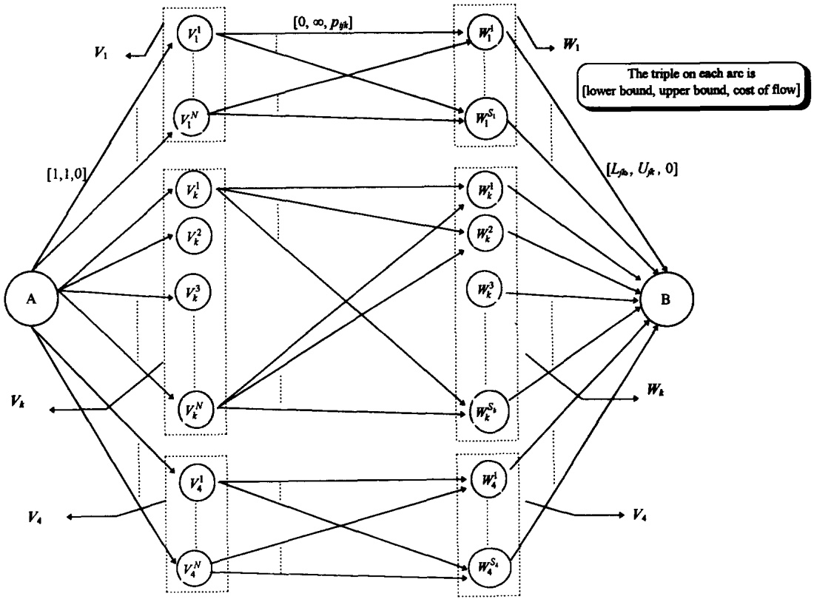

# SCHEDULING TO MAXIMIZE CUSTOMER SATISFACTION: A PROJECT FOR THE SHAD VALLEY PROGRAM

E. W. RICHARDS $^{1}$  and J. BHADURY $^{2}$

$^{1}$ Department of Industrial Engineering, Technical University of Nova Scotia, Halifax, Nova Scotia, Canada

$^{2}$ Faculty of Administration, University of New Brunswick, P.O. Box 4400, Fredericton, N.B. Canada E3B 5A3

(Received 3 December 1995)

Abstract—This paper describes a project that was done for the Shad Valley Program, where it was required to assign students to seminars so as to maximize the satisfaction of the students with their assignments. We begin by describing the problem, its inputs and constraints. Two models are proposed to determine optimal assignments. The first model is based on the Capacitated Transportation Problem and a network formulation is proposed to solve it. The second model is a two phase model whose first phase involves solving a Bottleneck Capacitated Transportation Problem and the second phase solving a Capacitated Transportation Problem. A simple search algorithm is proposed that solves the second model. Implementation of these models is described and the results obtained are discussed. Extensions to the two models are also proposed. Copyright © 1996 Elsevier Science Ltd

## 1. INTRODUCTION

This paper describes a problem that arose from consideration of scheduling students into seminars in the Shad Valley Program at a Canadian university. Shad Valley is a four week summer program in science, technology and entrepreneurship for gifted high school students that is offered in eight different universities in Canada every year. It has run for fourteen years in Canada, and for twelve at this university. Students are selected for high academic achievement in mathematics and science and demonstrated initiative, creativity, drive and leadership skills. Selected students pay a significant tuition fee, and the level of student satisfaction with the program is an important consideration. In each of the four weeks of the program, a number of labs and seminars (referred to as seminars in this paper) are made available to the students. Each student must be scheduled into one seminar for each week. There is a maximum enrolment limit for each seminar and, since many are offered on a volunteer basis, cancellation is not normally permitted. Students are given a short description of each seminar, and they indicate their preference for seminars by ranking the available seminars in each week. The schedule is then developed with the objective of, where possible, assigning each student to the seminars of his or her choice.

Prior to the development of the system being discussed in the paper, the scheduling was done manually. Each week the students submitted a list of their first, second, and third choices for seminars. The program director then prepared the schedule week by week ensuring that all seminars are subscribed to and that maximum capacities are observed while attempting to assign students to their choice of seminars. Although the actual number may vary slightly from year to year, at the Shad Valley Program in this university, there are about 56 students and 6 to 10 seminars each week. Hence this manual scheduling process, although reasonably feasible for the first week, becomes complicated in the second and subsequent weeks as it is necessary to balance the fairness of the assignments by considering whether students were given their first, second, third, or perhaps last choice of seminar in previous weeks. This led the staff at the Shad Valley Program to investigate possibilities for automating the scheduling system by modeling it mathematically.

Scheduling problems similar to the one at the Shad Valley Program have often been solved by using methods similar to the ones used for solving the classical transportation and assignment problems—see for example Mazzola and Neebe [1], Abara [2], Balachandran [3], Fisher and Jaikumar [4] and Ross and Soland [5] to name a few. Frequently the solution methods chosen for solving these models exploit the nice mathematical properties of the assignment and transportation problems. For a review of these problems, their properties and solution methods, the reader is referred to any of the standard texts on Linear Programming and/or Network Flows such as [12–15].

## 2. THE SHAD VALLEY MODEL

In the Shad Valley Program at this university, there are usually about 40 seminars spread over 4 weeks and about 60 students have to be assigned to them. There are limits on the minimum and maximum enrolments possible. It is also required that each student be assigned to exactly one seminar every week. Prior to the scheduling, all students are informed about all the seminars and then asked to rank all the seminars according to individual preferences. The objective is to find an assignment of students to seminars over the duration of the program that maximizes the satisfaction of the students.

## 2.1. Model parameters

For the purposes of modeling, it was decided to assume the following as the parameters of the model to represent all the inputs to the problem:

\- $i, j$ and $k$ are indices to designate the students, seminars and the individual weeks respectively.

\- A total of $N$ students are to be assigned to $S$ seminars over the four weeks.

\- $\hat{S}_k$ represents the set of all seminars offered in week $k$, where $k \in \{1, 2, 3, 4\}$

\- $s_k$ represents the total number of seminars in week $k$—thus $S = (s_1 + s_2 + s_3 + s_4)$.

\- The upper (respectively, lower) limit on the enrolment on the $j$th seminar offered in the $k$th week is denoted by $U_{jk}$ (respectively, $L_{jk}$).

\- On a scale of 1 to 5, $r_{ijk}$ is the rank given by the $i$th student to the $j$th seminar in the $k$th week. Note that the lower the value of $r_{ijk}$, the higher its preference is to him/her.

\- $R$ is used to denote the set of all possible ranks—for example, if students rank all seminars on a scale of 1 to 5, then $R = \{1, 2, 3, 4, 5\}$.

\- $r_{max}$ is used to denote the largest element of $R$—for example when $R = \{1, 2, 3, 4, 5\}$, $r_{max} = 5$. Since the smallest element of $R$ is always 1, $r_{max}$ also equals the cardinality of the set $R$.

The first sub-problem is to develop a scheme for converting the rankings  $r_{ijk}$  to preference scores, which will be denoted by  $p_{ijk}$ . The experience of program staff has been that the satisfaction obtained from being assigned one's first choice is significantly higher than what is obtained from a second choice, which in turn, is far more preferable to a third choice. Thus it is necessary to devise the preference score function in a manner that represents this high utility for first choice over second, second over third and so on. This implies therefore that this function must separate rankings in a non-linear fashion, and consecutive rankings must map to significantly different preference scores. This scheme will have the effect of forcing more first choices into the optimal solutions, as will be shown in section 3.

One function that is simple to program and does this effectively is given by

$$
p _ {i j k} = a \left(r _ {\max} - r _ {i j k}\right) \text {where} a \geqslant 2\tag{1}
$$

We would expect that, as long as $a$ is number greater than 2, its precise value does not affect the quality of the assignments produced by the models we propose. This proved to be the case when comparing results for $a$ equal to 2, 3, 4 and 5. Hence it was decided to use a value of two for $a$ in the implementation.

It is important to note that the decision to have the students simply rank their choices and then convert these rankings to powers of $a$ was based on personal experience with the Shad Valley situation. This does not limit the application of this system to other scheduling problems of the same nature, since an appropriate scoring scheme which gives integer preference values can be adapted to the nature of the clients and their perceived preference for different assignments. Model 1, as described in section 2.2.1, provides a measure of how the best schedule which can be produced, given the constraints of the system, addresses the objective of global or overall satisfaction of the client body. Model 2 will then be used to modify this schedule by imposing conditions on the level of individual satisfaction. Thus, as long as a scoring scheme can be devised that is a reasonable representation of the clients' preferences, the model will prove to be a useful decision support tool to managers of such programs.

Similar to R, the set containing all possible values of the preference scores will be denoted by P. It is assumed that P is ordered and is equal to  $\{p_{1}, p_{2}, \ldots, p_{r_{\max}}\}$  where  $\{p_{1} \leqslant p_{2} \leqslant \ldots \leqslant p_{r_{\max}}\}$ . Hence, in the example given above, where  $R = \{1, 2, 3, 4, 5\}$ , if we choose a = 2 and convert the  $\{r_{ijk}\}$  to  $\{p_{ijk}\}$  in accordance with (1), then  $P = \{p_{1}, p_{2}, p_{3}, \cdot p_{r_{\max}}\} = \{2^{4}, 2^{3}, 2^{2}, 2^{1}, 1\}$ .

## 2.2. Model formulation

Since this problem is similar to an assignment problem, it was decided to model this as a 0/1 Integer Programming problem. Thus the decision variables for the model were defined by $x_{ijk}$, where

$$
x _ {i j k} = \left\{ \begin{array}{l} 1 \text {if student} i \text {is assigned to seminar} j \text {in week} k \\ 0 \text {otherwise} \end{array} \right.\tag{2}
$$

The basic constraints are those for minimum and maximum enrolment and the requirement that each student be assigned exactly one seminar each week. These, along with the binary constraint on  $x_{ijk}$ , can be expressed as:

$$
L _ {j k} \leqslant \sum_ {i = 1} ^ {n} x _ {i j k} \leqslant U _ {j k} \quad \forall j, k
$$

Min and max enrolment (3.1 & 3.2)

$$
\sum_ {j \in \hat {S} _ {k}} x _ {i j k} = 1 \quad \forall k, i \text {One student / seminar / week (3.3)}
$$

$$
x _ {i j k} \in \{0, 1 \} \quad \forall i, j, \mathrm{k} \text {Binary constraints (3.4)}\tag{3}
$$

It is easy to see that (3.1), (3.2) and (3.3) are the constraints for the classical Capacitated Transportation Problem—hence it can be claimed that the constraint matrix defined by (3.1), (3.2) and (3.3) is totally unimodular. Since the upper and lower bounds  $(U_{jk}$  and  $L_{jk})$  are integer-valued, the optimal solution to the LP relaxation of (3) will also be the optimal integer solution. Thus, the binary constraints (3.4) can be dropped and the integer problem solved without resorting to branch and bound methods.

With decision variables as defined by (2) and constraints by (3), two different model formulations were considered for assigning students to seminars—these will be referred to as Model 1 and Model 2 respectively. Although it was Model 2 that was actually implemented, we shall also discuss Model 1 as this first model is also a part of the second one.

2.2.1. Model 1: overall maximization. The first model that was considered was one which optimizes the overall satisfaction, i.e. total satisfaction of all the students. Overall satisfaction can be represented as the sum of all  $p_{ijk}$ , i.e. as

$$
\sum_ {i, j, k} p _ {i j k} x _ {i j k}
$$

Hence our first model optimizes overall satisfaction of all students with all the assignments over all the four weeks, and can be formulated as

$$
\begin{array}{c} \text {Max} Z = \sum_ {i = 1} ^ {N} \sum_ {j = 1} ^ {S} \sum_ {k = 1} ^ {4} p _ {i j k} x _ {i j k} \\ \text {subject to} \\ (3. 1), (3. 2), (3. 3), (3. 4) \end{array}\tag{4}
$$

The model given by (4) is a Capacitated Transportation Problem. We have already argued that the constraint matrix of (4) is totally unimodular—hence (4) can be solved directly as a Linear Program to yield integer optimal solutions. However, there is a more efficient way of solving (4)—namely by formulating it as a Minimum Cost Network Flow problem and it is this network formulation that is described next.

Problem (4) can be represented by a directed acyclic graph $G$ in Fig. 1, where two sets of nodes $\{V_k, W_k\}$ are defined for each week $k$. The set $V_k$ consisting of nodes $V_k^1, V_k^2, \ldots, V_k^N$ represents the N students in the kth week—for example,  $V_{k}^{1}$  represents student 1 in week k. The set  $W_{k}$  consisting of nodes  $W_{k}^{1}, W_{k}^{2}, \ldots, W_{k}^{s_{k}}$  represents the  $s_{k}$  seminars in the kth week—for example,  $W_{k}^{1}$  represents seminar 1 in week k. In addition, two special nodes are also defined—A and B, where A and B are assumed to be the source and sink nodes respectively and all other nodes in G are transshipment nodes. Note that the total number of nodes in G is therefore  $4N + S + 2$ .



Fig. 1. Directed acyclic graph $G$.

The first set of arcs are added to $G$ as follows: for each week $k$, consider the two sets $V_{k}$ and $W_{k}$. From each node $V_{k}^{i}, i = 1, \ldots, N$ in $V_{k}$, an arc is drawn to all nodes $W_{k}^{j}, j = 1, \ldots, s_{k}$ in $W_{k}$. On each such arc between $V_{k}^{i}$ to $W_{k}^{j}$, the lower (respectively, upper) bound on the flow is fixed at 0 (respectively, infinity) and the cost per unit of flow is fixed at $-p_{ijk}$. This step therefore adds NS arcs to $G$.

The next set of arcs is added as follows: from each of the nodes $W_{k}^{j}$, where $j = 1, \ldots, s_{k}$ and $k = 1, \ldots, 4$, an arc is drawn to the sink node $B$. On each of these arcs, the lower (respectively, upper) bound is fixed at $L_{jk}$ (respectively, $U_{jk}$) and the cost of flow is fixed at 0. These bounds ensure that each seminar gets assigned to a number of students that is in keeping with its minimum and maximum enrolment requirements. This next set therefore adds $4N$ arcs to $G$.

The third set of arcs is drawn from the source node $A$ to each of the nodes $V_{k}^{i}$, for $i = 1, \ldots, N$ and $k = 1, \ldots, 4$. On each of these arcs, the lower and the upper bounds on flow are both fixed at 1 and the cost of flow is fixed at 0—thus ensuring that each student is assigned to only one seminar in each week. Hence this third set adds $S$ arcs to $G$. The supply and demand at $A$ and $B$ is fixed at $4N$ respectively. The optimal solution to (4) can then be obtained by solving the Min Cost Flow problem on $G$ and then equating the variables as:

$$
x _ {i j k} = \left\{ \begin{array}{l} 1 \text {if optimal flow on arc from} V _ {k} ^ {i} \text {to} W _ {k} ^ {j} \text {is 1} \\ 0 \text {otherwise} \end{array} \right.\tag{5}
$$

Since $G$ has $O(N + S)$ nodes and $O(NS)$ arcs, the algorithm given in Orlin [7] can be used to solve the above Min Cost Flow Problem in $O(NS \log(N + S)(NS + (N + S)\log(N + S)))$ time. Thus this is the time taken to solve Model 1 to get optimal assignments.

2.2.2. Model 2: two phase optimization. Whereas Model 1 maximizes overall satisfaction of the students with the final assignment of seminars, it is possible that it may do so at the cost of one or a few students who may be assigned to seminars that are very low on their preferences. Hence there was a need to guarantee in the formulation that no individual student is unfairly scheduled, which is important in this application since every student pays a significant fee to attend the Shad Valley Program. This concept of overall schedule optimization constrained by ensuring fairness to the individual student leads naturally to a formulation that seeks to protect every student from an unfair assignment. One such model that does so is given by the following.

$$
\begin{array}{c} \text {Max Min} \left[ p _ {i j k} x _ {i j k} \right] \\ \{\text {ijk} \mid x _ {i j k} = 1 \} \\ \text {subject to (3.1), (3.2), (3.3), (3.4)} \end{array}\tag{6}
$$

It is easy to see that (6) is a Bottleneck Capacitated Transportation Problem (Garfinkel [8], Gabow and Tarjan [9], Mazzola and Neebe [1], Punnen and Nair [10]). The maximum objective function thus finds the schedule that maximizes the worst assignment given to any of the students over the four weeks—thus ensuring that no student is given an unfairly poor assignment when it is possible to obtain an assignment that is better for all students. Bottleneck problems such as (6) above usually have multiple optimal solutions. Hence it was decided to incorporate a second optimization phase in our model. In the first phase, (6) would be solved to obtain the optimal assignment—this optimal assignment guarantees that even the poorest seminar to student assignment is as good as possible. Then in the second phase it was decided to maximize the overall satisfaction of all students (as in Model 1), while guaranteeing that no student obtains an assignment whose preference score is worse than the bottleneck value obtained by solving (6) in the first phase.

Thus the model chosen had two phases. In Phase 1, (6) would be solved to obtain an optimal assignment with respect to the bottleneck preference score in the assignment. Assume that this optimal assignment obtained in the first phase is $X^{*}$ and that the preference score $p_{q^*}$ in $P$ is the bottleneck preference score in $X^{*}$ (i.e. of all seminar to student assignments in $X^{*}$, the least preferred assignment is the one with $p_{q^*}$ as the preference score). Then in the second phase of the model, we solve the following problem:

$$
\begin{array}{c} \text {Max} \sum_ {i = 1} ^ {N} \sum_ {j = 1} ^ {S} \sum_ {k = 1} ^ {4} p _ {i j k} x _ {i j k} \\ \text {subject to} \end{array}\tag{7}
$$

$$
(3. 1), (3. 2), (3. 3), (3. 4), \text {and}
$$

$$
(p _ {i j k} - p _ {q ^ {*}}) x _ {i j k} \geqslant 0, \quad \forall i, j, k\tag{7.1}
$$

The additional constraint (7.1) ensure that if $x_{ijk} = 1$ for any $i, j, k$ in the solution, then $p_{ijk}$ is at least as large as $p_{q^*}$. This implies that no assignment in the second phase will have a preference score that is worse than the bottleneck value of $p_{q^*}$ that was found in the first phase. Thus it is this constraint that ensures that even when the overall student satisfaction is being maximized in the second phase, the worst assignments given to any student is kept as high as possible (at the bottleneck value).

The difference between the two models proposed is best illustrated with the following example. Consider the problem where three students (A, B and C, respectively) have to be assigned to three seminars (I, II and III, respectively) over one week. The upper and lower bound on enrolment in every seminar is assumed to be 1 and 2 respectively, and the rankings (on a scale of 1 to 3) given by the three students to the three seminars are given in Table 1.

Using a value of $a = 2$ in (1), this problem was solved using both Models 1 and 2—the results are shown in Table 2.

As can be seen from the results, Model 1 has a higher value of overall satisfaction than Model 2. However, the higher overall satisfaction value obtained from Model 1 is at the expense of a very poor assignment to one single student, namely, C, who is given his/her third choice (seminar III). Model 2, on the other hand, has a total satisfaction that is only marginally less than that of Model 1, but guarantees that all students are given at least their second choices. Thus, by compromising slightly on the total satisfaction, Model 2 produces a schedule which would probably be more acceptable to all the students, and hence, preferable from a managerial standpoint.

Table 1. Student rankings

<table><tr><td rowspan="2">Students</td><td colspan="3">Seminars</td></tr><tr><td>I</td><td>II</td><td>III</td></tr><tr><td>A</td><td>1</td><td>3</td><td>3</td></tr><tr><td>B</td><td>3</td><td>1</td><td>2</td></tr><tr><td>C</td><td>1</td><td>2</td><td>3</td></tr></table>

Table 2. Results of Models 1 and 2

|  | Model 1 | Model 2 |
| --- | --- | --- |
| Individual assignments | A to I; B to II; C to III | A to I; B to III; C to II |
| Overall/total satisfaction | 9 | 8 |
| Worst assignment | 3rd choice(C to III) | 2nd choice(B to III and C to II) |

Rather than solve (6) and (7) directly in the actual implementation of the model, a search algorithm was chosen that solved both phases of the model simultaneously in each iteration. This search algorithm is based on the following idea: At each iteration of the algorithm, a target preference score is chosen from $P$. Then it is checked to see if it is possible to obtain an assignment with all students being assigned to seminars whose preference is at least as high as the target preference score in this iteration. If so, then this is repeated with a higher target preference score at the next iteration.

To illustrate further, consider the first iteration of the algorithm, where  $p_{1}$  is chosen as the target preference score from P. Then a new set of preferences  $\{p'_{ijk}\}$  is defined where

$$
p _ {i j k} ^ {\prime} = \left\{\frac {p _ {i j k}}{- \infty} \text {if} p _ {i j k} \geqslant p _ {1} \right.\tag{8}
$$

Next problem (4) in Model 1 is solved with these new set of preferences $p_{ijk}'$—i.e. the following problem is solved:

$$
\begin{array}{c} \text {Max} Z = \sum_ {i = 1} ^ {N} \sum_ {j = 1} ^ {S} \sum_ {k = 1} ^ {4} p _ {i j k} ^ {\prime} x _ {i j k} \\ \text {subject to} \\ (3. 1), (3. 2), (3. 3), (3. 4) \end{array}\tag{9}
$$

Since (9) is similar to (4) in Model 1, it can be solved either as a Linear Program or by formulating as a Min Cost Flow Problem. If the optimal objective function value of (9) is found to be positive, then we say that the optimal assignment given by (9) in the current iteration is feasible, since this optimal assignment obtained by solving (9) maximizes overall satisfaction while ensuring that every student is assigned to seminars with preference score at least equal to the target bottleneck preference score  $p_{1}$ . If, however, the optimal solution to (9) is negative, then it can be claimed that it is not possible to obtain an assignment where all students are ensured seminar assignments whose preferences are at least  $p_{1}$ , which implies that the entire problem (4) is unfeasible. If a feasible assignment is obtained, this process is repeated in the next iteration with the next higher preference score in P (i.e.  $p_{2}$ ) as the target preference score. The algorithm stops either when an infeasible assignment is obtained for the first time or if we have been able to obtain a feasible assignment with the highest preference score possible, i.e.  $p_{r_{max}}$ . A formal description of this algorithm appears in the appendix.

Solving (9) can be done in $O(NS \log(N + S)(NS + (N + S)\log(N + S)))$, since it is equivalent to solving Model 1. Since the cardinality of the set $P$ is $r_{max}$, (9) will have to be solved at most $r_{max}$ times. Thus the time taken to solve Model 2 using this search algorithm is $O(r_{max}NS \log(N + S)(NS + (N + S)\log(N + S)))$.

However, the above time complexity bound can be reduced on the basis of the following observation: If at any iteration of the algorithm above a feasible assignment can be obtained with the target preference score of that iteration, then it can be concluded that the optimal bottleneck preference score [i.e. the solution to (6)] is higher than the target preference score under consideration at this iteration. Hence the search process of this algorithm can be made more efficient by conducting a binary search on all elements of P that will ensure that (9) does not have to be solved more than  $(\log r_{max})$  times. Thus by using this binary search, the time complexity bound for solving Model 2 can be reduced to  $O(\log r_{max}NS \log(N + S)(NS + (N + S)\log(N + S)))$ .

Table 3. Shad Valley 1993: student choices and maximum/minimum enrolments by seminar

<table><tr><td>Seminar no.</td><td>No. of 1st choices</td><td>No. of 2nd choices</td><td>No. of 3rd choices</td><td>No. of 4th choices</td><td>No. of 5th choices</td><td>No. of 6th choices</td><td>No. of 7th choices</td><td>No. of 8th choices</td><td>No. of 9th choices</td><td>Seminar minimum</td><td>Seminar maximum</td></tr><tr><td colspan="12">Week 1</td></tr><tr><td>1</td><td>32</td><td>9</td><td>9</td><td>2</td><td>3</td><td>1</td><td>0</td><td>0</td><td>0</td><td>4</td><td>8</td></tr><tr><td>2</td><td>2</td><td>10</td><td>7</td><td>9</td><td>12</td><td>11</td><td>5</td><td>0</td><td>0</td><td>6</td><td>8</td></tr><tr><td>3</td><td>9</td><td>8</td><td>10</td><td>13</td><td>8</td><td>4</td><td>4</td><td>0</td><td>0</td><td>6</td><td>12</td></tr><tr><td>4</td><td>7</td><td>20</td><td>10</td><td>8</td><td>3</td><td>5</td><td>3</td><td>0</td><td>0</td><td>6</td><td>12</td></tr><tr><td>5</td><td>4</td><td>3</td><td>6</td><td>12</td><td>7</td><td>13</td><td>11</td><td>0</td><td>0</td><td>5</td><td>8</td></tr><tr><td>6</td><td>4</td><td>8</td><td>9</td><td>10</td><td>13</td><td>8</td><td>4</td><td>0</td><td>0</td><td>5</td><td>8</td></tr><tr><td>7</td><td>0</td><td>0</td><td>0</td><td>0</td><td>0</td><td>0</td><td>0</td><td>0</td><td>0</td><td>0</td><td>0</td></tr><tr><td>8</td><td>5</td><td>7</td><td>12</td><td>7</td><td>12</td><td>6</td><td>7</td><td>0</td><td>0</td><td>6</td><td>6</td></tr><tr><td>9</td><td>0</td><td>0</td><td>0</td><td>0</td><td>0</td><td>0</td><td>0</td><td>0</td><td>0</td><td>0</td><td>0</td></tr><tr><td>10</td><td>0</td><td>0</td><td>0</td><td>0</td><td>0</td><td>0</td><td>0</td><td>0</td><td>0</td><td>0</td><td>0</td></tr><tr><td colspan="12">Week 2</td></tr><tr><td>1</td><td>4</td><td>3</td><td>6</td><td>11</td><td>6</td><td>9</td><td>7</td><td>7</td><td>3</td><td>4</td><td>8</td></tr><tr><td>2</td><td>13</td><td>9</td><td>11</td><td>4</td><td>6</td><td>4</td><td>7</td><td>0</td><td>2</td><td>4</td><td>8</td></tr><tr><td>3</td><td>4</td><td>8</td><td>9</td><td>4</td><td>14</td><td>3</td><td>7</td><td>5</td><td>1</td><td>6</td><td>12</td></tr><tr><td>4</td><td>2</td><td>11</td><td>6</td><td>12</td><td>11</td><td>7</td><td>5</td><td>2</td><td>0</td><td>6</td><td>12</td></tr><tr><td>5</td><td>20</td><td>10</td><td>6</td><td>7</td><td>2</td><td>9</td><td>2</td><td>0</td><td>0</td><td>6</td><td>12</td></tr><tr><td>6</td><td>13</td><td>13</td><td>7</td><td>9</td><td>3</td><td>6</td><td>1</td><td>4</td><td>0</td><td>6</td><td>12</td></tr><tr><td>7</td><td>1</td><td>3</td><td>7</td><td>9</td><td>11</td><td>6</td><td>6</td><td>8</td><td>5</td><td>6</td><td>6</td></tr><tr><td>8</td><td>8</td><td>10</td><td>8</td><td>7</td><td>8</td><td>8</td><td>3</td><td>1</td><td>3</td><td>4</td><td>6</td></tr><tr><td>9</td><td>7</td><td>4</td><td>8</td><td>6</td><td>2</td><td>5</td><td>7</td><td>8</td><td>9</td><td>4</td><td>8</td></tr><tr><td>10</td><td>0</td><td>0</td><td>0</td><td>0</td><td>0</td><td>0</td><td>0</td><td>0</td><td>0</td><td>0</td><td>0</td></tr><tr><td colspan="12">Week 3</td></tr><tr><td>1</td><td>20</td><td>10</td><td>7</td><td>8</td><td>3</td><td>3</td><td>3</td><td>2</td><td>0</td><td>4</td><td>12</td></tr><tr><td>2</td><td>6</td><td>6</td><td>11</td><td>10</td><td>4</td><td>6</td><td>8</td><td>5</td><td>0</td><td>6</td><td>10</td></tr><tr><td>3</td><td>8</td><td>15</td><td>10</td><td>7</td><td>9</td><td>2</td><td>4</td><td>1</td><td>0</td><td>6</td><td>10</td></tr><tr><td>4</td><td>16</td><td>10</td><td>9</td><td>7</td><td>10</td><td>3</td><td>1</td><td>0</td><td>0</td><td>6</td><td>12</td></tr><tr><td>5</td><td>1</td><td>2</td><td>7</td><td>4</td><td>12</td><td>14</td><td>8</td><td>8</td><td>0</td><td>6</td><td>10</td></tr><tr><td>6</td><td>8</td><td>10</td><td>11</td><td>10</td><td>5</td><td>4</td><td>5</td><td>3</td><td>0</td><td>6</td><td>10</td></tr><tr><td>7</td><td>4</td><td>9</td><td>4</td><td>10</td><td>9</td><td>8</td><td>5</td><td>7</td><td>0</td><td>4</td><td>8</td></tr><tr><td>8</td><td>5</td><td>9</td><td>7</td><td>9</td><td>9</td><td>10</td><td>4</td><td>3</td><td>0</td><td>4</td><td>8</td></tr><tr><td>9</td><td>0</td><td>0</td><td>0</td><td>0</td><td>0</td><td>0</td><td>0</td><td>0</td><td>0</td><td>0</td><td>0</td></tr><tr><td>10</td><td>0</td><td>0</td><td>0</td><td>0</td><td>0</td><td>0</td><td>0</td><td>0</td><td>0</td><td>0</td><td>0</td></tr><tr><td colspan="12">Week 4</td></tr><tr><td>1</td><td>15</td><td>8</td><td>9</td><td>7</td><td>5</td><td>7</td><td>2</td><td>3</td><td>0</td><td>6</td><td>9</td></tr><tr><td>2</td><td>3</td><td>10</td><td>12</td><td>8</td><td>11</td><td>6</td><td>2</td><td>4</td><td>0</td><td>6</td><td>6</td></tr><tr><td>3</td><td>9</td><td>11</td><td>9</td><td>11</td><td>4</td><td>6</td><td>3</td><td>3</td><td>0</td><td>6</td><td>6</td></tr><tr><td>4</td><td>11</td><td>17</td><td>7</td><td>8</td><td>6</td><td>2</td><td>3</td><td>2</td><td>0</td><td>6</td><td>12</td></tr><tr><td>5</td><td>5</td><td>9</td><td>9</td><td>8</td><td>7</td><td>5</td><td>10</td><td>3</td><td>0</td><td>6</td><td>10</td></tr><tr><td>6</td><td>5</td><td>6</td><td>6</td><td>4</td><td>11</td><td>13</td><td>4</td><td>6</td><td>0</td><td>6</td><td>12</td></tr><tr><td>7</td><td>11</td><td>8</td><td>9</td><td>9</td><td>5</td><td>4</td><td>4</td><td>6</td><td>0</td><td>6</td><td>6</td></tr><tr><td>8</td><td>8</td><td>10</td><td>8</td><td>11</td><td>5</td><td>4</td><td>9</td><td>1</td><td>0</td><td>6</td><td>7</td></tr><tr><td>9</td><td>0</td><td>0</td><td>0</td><td>0</td><td>0</td><td>0</td><td>0</td><td>0</td><td>0</td><td>0</td><td>0</td></tr><tr><td>10</td><td>0</td><td>0</td><td>0</td><td>0</td><td>0</td><td>0</td><td>0</td><td>0</td><td>0</td><td>0</td><td>0</td></tr></table>

## 3. IMPLEMENTATION AND EMPIRICAL RESULTS

## 3.1. Shad Valley 1993

The two models were piloted at the 1993 Shad Valley program at this university. There were 56 students (i.e. N was equal to 56) to be assigned to 33 seminars over the four weeks (i.e. S was equal to 33)—8 seminars in weeks 1, 3, and 4 (i.e.  $n_{1}=n_{3}=n_{4}=8$ ), and 9 seminars in week 2 (i.e.  $n_{2}=9$ ). Students were asked to rank these seminars on a scale of 1–9 with 1 being the highest and 9 being the lowest preference given to any seminar. Table 3 shows all the seminars over the four weeks and the number of students that chose this seminar as their 1st, 2nd, 3rd choices, etc.

Note that for convenience of programming, it was assumed that there are 10 seminars each week and the maximum enrolment of a seminar was fixed at 0 for a non-existent seminar. As mentioned before, it was decided to convert these rankings into preference scores, using equation (1) with $a = 2$. Maximum and minimum enrolment requirements were determined for each seminar. The system was solved using an IBM compatible Personal Computer (80486), 50 MHz, 16 Mb RAM. The package LINDO, Version 5.0 was used to solve all the Linear Programs that were involved and solution times were less than 10 s for each run. Although we have only discussed relevant results in this paper, a complete set of all inputs and outputs is available from the authors for the interested reader.

Model 1 was used first to obtain the weekly assignments the results are shown in Table 4.

The schedule produced was deemed to be reasonable by the staff at the Shad Valley Program, but it had the flaw that one student's schedule was sacrificed to the objective of maximizing the overall satisfaction. Results from this model showed that this student was assigned his fifth choice of seminar in the third week (Table 4, Student number 30). Hence it was decided to try Model 2 as it was expected that this schedule would be unsatisfactory to this individual student and that in turn may reflect negatively upon the overall good quality of service of the program.

Model 2 was chosen next to obtain the weekly assignments. The model was solved parametrically as described by the algorithm in the appendix and the results appear in Table 5. For clarity, the steps followed by the algorithm are also outlined below:

Step 1. Choose $q = 2$.

Step 2. Using the Model 1 LP, replace all objective function coefficients which are less than or equal to 256 (2$^{8}$) with -999,999.

Step 3. Solve the LP (11).

Table 4. Shad Valley 1993: Model 1 results objective function value = 102,880

| Student | Week 1 | Week 2 | Week 3 | Week 4 | Contribution | Student | Week 1 | Week 2 | Week 3 | Week 4 | Contribution |
| --- | --- | --- | --- | --- | --- | --- | --- | --- | --- | --- | --- |
| 1 | 1 | 1 | 1 | 1 | 2048 | 29 | 2 | 1 | 1 | 1 | 1792 |
| 2 | 1 | 1 | 1 | 1 | 2048 | 30 | 2 | 1 | 5 | 1 | 1312 |
| 3 | 2 | 1 | 1 | 1 | 1792 | 31 | 1 | 1 | 1 | 1 | 2048 |
| 4 | 1 | 2 | 1 | 1 | 1792 | 32 | 1 | 1 | 1 | 1 | 2048 |
| 5 | 1 | 2 | 1 | 1 | 1792 | 33 | 1 | 2 | 4 | 1 | 1344 |
| 6 | 2 | 1 | 1 | 1 | 1792 | 34 | 2 | 2 | 1 | 1 | 1536 |
| 7 | 2 | 1 | 1 | 1 | 1792 | 35 | 1 | 2 | 1 | 1 | 1792 |
| 8 | 1 | 1 | 1 | 1 | 2048 | 36 | 2 | 1 | 3 | 1 | 1408 |
| 9 | 1 | 1 | 1 | 1 | 2048 | 37 | 1 | 1 | 1 | 1 | 2048 |
| 10 | 1 | 1 | 1 | 2 | 1792 | 38 | 1 | 1 | 1 | 1 | 2048 |
| 11 | 2 | 1 | 1 | 1 | 1792 | 39 | 2 | 1 | 1 | 1 | 1792 |
| 12 | 1 | 3 | 1 | 1 | 1664 | 40 | 1 | 1 | 1 | 2 | 1792 |
| 13 | 1 | 1 | 1 | 1 | 2048 | 41 | 1 | 1 | 1 | 1 | 2048 |
| 14 | 1 | 1 | 1 | 1 | 2048 | 42 | 2 | 1 | 1 | 1 | 1792 |
| 15 | 2 | 1 | 1 | 1 | 1792 | 43 | 2 | 1 | 1 | 1 | 1792 |
| 16 | 1 | 1 | 2 | 1 | 1792 | 44 | 1 | 2 | 1 | 2 | 1536 |
| 17 | 2 | 2 | 1 | 2 | 1280 | 45 | 1 | 1 | 1 | 1 | 2048 |
| 18 | 1 | 1 | 1 | 1 | 2048 | 46 | 1 | 1 | 1 | 1 | 2048 |
| 19 | 2 | 1 | 1 | 1 | 1792 | 47 | 1 | 1 | 1 | 1 | 2048 |
| 20 | 1 | 1 | 1 | 1 | 2048 | 48 | 1 | 3 | 1 | 1 | 1664 |
| 21 | 1 | 1 | 1 | 1 | 2048 | 49 | 1 | 1 | 1 | 1 | 2048 |
| 22 | 2 | 1 | 1 | 2 | 1536 | 50 | 1 | 1 | 1 | 1 | 2048 |
| 23 | 1 | 1 | 1 | 1 | 2048 | 51 | 1 | 1 | 1 | 2 | 1792 |
| 24 | 2 | 1 | 1 | 1 | 1792 | 52 | 1 | 1 | 1 | 1 | 2048 |
| 25 | 2 | 1 | 1 | 1 | 1792 | 53 | 2 | 1 | 1 | 1 | 1792 |
| 26 | 2 | 1 | 1 | 1 | 1792 | 54 | 1 | 2 | 1 | 1 | 1792 |
| 27 | 2 | 2 | 1 | 1 | 1536 | 55 | 2 | 1 | 1 | 1 | 1792 |
| 28 | 1 | 1 | 2 | 1 | 1792 | 56 | 1 | 1 | 1 | 1 | 2048 |

Table 5. Shad Valley 1993: Model 2 results objective function value = 105,528

| Student | Week 1 | Week 2 | Week 3 | Week 4 | Contribution | Student | Week 1 | Week 2 | Week 3 | Week 4 | Contribution |
| --- | --- | --- | --- | --- | --- | --- | --- | --- | --- | --- | --- |
| 1 | 1 | 1 | 1 | 1 | 2048 | 29 | 1 | 1 | 1 | 1 | 2048 |
| 2 | 2 | 1 | 1 | 1 | 1792 | 30 | 2 | 1 | 2 | 1 | 1536 |
| 3 | 2 | 1 | 1 | 1 | 1792 | 31 | 1 | 2 | 1 | 1 | 1792 |
| 4 | 1 | 2 | 1 | 1 | 1792 | 32 | 1 | 1 | 1 | 1 | 2048 |
| 5 | 1 | 2 | 1 | 1 | 1792 | 33 | 1 | 1 | 1 | 1 | 2048 |
| 6 | 2 | 1 | 1 | 1 | 1792 | 34 | 1 | 1 | 1 | 1 | 2048 |
| 7 | 2 | 1 | 1 | 1 | 1792 | 35 | 1 | 2 | 1 | 1 | 1792 |
| 8 | 1 | 1 | 1 | 1 | 2048 | 36 | 2 | 1 | 3 | 1 | 1408 |
| 9 | 1 | 1 | 1 | 1 | 2048 | 37 | 1 | 1 | 1 | 1 | 2048 |
| 10 | 1 | 1 | 1 | 2 | 1792 | 38 | 2 | 1 | 1 | 1 | 1792 |
| 11 | 2 | 1 | 1 | 1 | 1792 | 39 | 2 | 1 | 1 | 1 | 1792 |
| 12 | 1 | 3 | 1 | 2 | 1408 | 40 | 1 | 1 | 1 | 2 | 1792 |
| 13 | 1 | 1 | 1 | 1 | 2048 | 41 | 1 | 1 | 1 | 1 | 2048 |
| 14 | 1 | 1 | 1 | 1 | 2048 | 42 | 1 | 1 | 1 | 1 | 2048 |
| 15 | 2 | 1 | 1 | 1 | 1792 | 43 | 2 | 1 | 1 | 1 | 1792 |
| 16 | 1 | 1 | 2 | 1 | 1792 | 44 | 1 | 2 | 1 | 2 | 1536 |
| 17 | 2 | 2 | 1 | 1 | 1536 | 45 | 1 | 1 | 3 | 1 | 1664 |
| 18 | 1 | 1 | 1 | 1 | 2048 | 46 | 1 | 1 | 1 | 1 | 2048 |
| 19 | 2 | 1 | 1 | 1 | 1792 | 47 | 1 | 1 | 1 | 1 | 2048 |
| 20 | 1 | 1 | 1 | 1 | 2048 | 48 | 1 | 1 | 1 | 1 | 2048 |
| 21 | 1 | 1 | 1 | 1 | 2048 | 49 | 1 | 1 | 1 | 1 | 2048 |
| 22 | 2 | 1 | 2 | 2 | 1280 | 50 | 1 | 1 | 1 | 1 | 2048 |
| 23 | 2 | 1 | 1 | 1 | 1792 | 51 | 1 | 1 | 1 | 2 | 1792 |
| 24 | 1 | 1 | 1 | 1 | 2048 | 52 | 2 | 2 | 1 | 1 | 1536 |
| 25 | 1 | 1 | 1 | 1 | 2048 | 53 | 2 | 1 | 1 | 1 | 1792 |
| 26 | 2 | 1 | 3 | 1 | 1408 | 54 | 1 | 2 | 1 | 1 | 1792 |
| 27 | 2 | 2 | 1 | 1 | 1536 | 55 | 2 | 1 | 1 | 1 | 1792 |
| 28 | 2 | 3 | 2 | 1 | 1152 | 56 | 1 | 1 | 1 | 1 | 2048 |

Step 4. Result: objective value $< 0$, thus infeasible.

Step 5. Choose $q = 4$.

Step 6. Replace all objective function coefficients which are less than or equal to $64(2^6)$.

Step 7. Solve the LP (11).

Step 8. Result: objective value $>0$, therefore feasible.

Step 9. Choose $q = 3$.

Step 10. Replace all objective function efficients which are less than or equal to $128(2^{5})$.

Step 11. Solve the LP (11).

Step 12. Result: objective value $>0$, therefore feasible.

Step 13. Algorithm over: solution gives no assignment worse than the third choice. The output is displayed in Table 5.

Using this model it was possible to obtain an assignment where the worst choice obtained by any student was his/her third choice—and the overall satisfaction of this assignment was not significantly worse than that of the one obtained by using Model 1. Hence it was this assignment, obtained from Model 2, that was chosen by the staff at the Shad Valley Program.

An additional benefit was gained from conducting sensitivity analysis on the Linear Program that is found at the final iteration in Model II. Shadow prices\* were used to determine which of the seminars should be targeted for an increase or decrease in maximum or minimum enrolments. This information allowed us to identify several seminars for which an increase or decrease in their enrolment requirements would significantly improve the quality of the program. This information was passed on to the staff of the Shad Valley Program for deciding the enrolments of these seminars the next year.

Both students and staff benefited from the use of this model. In comparison to the manual procedure of 1992, the system was a time-saving in scheduling effort for the program director. Students were assured that the best possible schedule has been produced for them. Although there are no direct measures of student satisfaction which measure the differences between the 2 years, it was felt that the existence of a proper modeling system significantly increased the credibility of the scheduling process. For this reason, it is fair to state that student satisfaction was greater in 1993 than in 1992.

<small><span class="docvortex-page-footnote" data-block-type="page_footnote" style="color:#6b7280">\*The shadow price for a maximum attendance constraint indicates the level of improvement that would be attained by increasing the maximum attendance for that seminar. The shadow price for a minimum constraint (which will be negative in this formulation) indicates the level of improvement which would be attained by decreasing the minimum attendance for that seminar.</span></small>

Table 6. Shad Valley 1994: manual results objective function value = 24,392

| Student | Week 1 | Week 2 | Week 3 | Week 4 | Contribution | Student | Week 1 | Week 2 | Week 3 | Week 4 | Contribution |
| --- | --- | --- | --- | --- | --- | --- | --- | --- | --- | --- | --- |
| 1 | 1 | 1 | 2 | 1 | 448 | 29 | 1 | 1 | 2 | 1 | 448 |
| 2 | 1 | 3 | 1 | 1 | 416 | 30 | 2 | 1 | 1 | 1 | 448 |
| 3 | 1 | 1 | 1 | 1 | 512 | 31 | 1 | 1 | 1 | 2 | 448 |
| 4 | 2 | 1 | 2 | 2 | 320 | 32 | 2 | 1 | 2 | 1 | 384 |
| 5 | 1 | 2 | 2 | 1 | 384 | 33 | 1 | 1 | 2 | 1 | 448 |
| 6 | 2 | 1 | 2 | 1 | 384 | 34 | 1 | 2 | 1 | 3 | 352 |
| 7 | 1 | 1 | 3 | 3 | 320 | 35 | 1 | 1 | 1 | 1 | 512 |
| 8 | 1 | 1 | 2 | 1 | 448 | 36 | 2 | 1 | 1 | 1 | 448 |
| 9 | 1 | 1 | 2 | 1 | 448 | 37 | 2 | 1 | 2 | 2 | 320 |
| 10 | 1 | 1 | 2 | 2 | 384 | 38 | 1 | 1 | 1 | 1 | 512 |
| 11 | 1 | 1 | 1 | 1 | 512 | 39 | 1 | 1 | 2 | 1 | 448 |
| 12 | 1 | 1 | 1 | 1 | 512 | 40 | 1 | 1 | 1 | 1 | 512 |
| 13 | 1 | 1 | 3 | 1 | 416 | 41 | 1 | 3 | 2 | 1 | 352 |
| 14 | 3 | 1 | 2 | 1 | 352 | 42 | 1 | 1 | 1 | 2 | 448 |
| 15 | 1 | 1 | 1 | 1 | 512 | 43 | 1 | 1 | 1 | 1 | 512 |
| 16 | 1 | 2 | 1 | 1 | 448 | 44 | 1 | 1 | 3 | 2 | 352 |
| 17 | 1 | 1 | 1 | 1 | 512 | 45 | 1 | 2 | 1 | 1 | 448 |
| 18 | 1 | 1 | 1 | 1 | 512 | 46 | 1 | 1 | 1 | 1 | 512 |
| 19 | 2 | 1 | 2 | 1 | 384 | 47 | 1 | 1 | 1 | 1 | 512 |
| 20 | 3 | 1 | 1 | 1 | 416 | 48 | 1 | 2 | 1 | 2 | 384 |
| 21 | 1 | 1 | 1 | 1 | 512 | 49 | 1 | 1 | 1 | 1 | 512 |
| 22 | 1 | 1 | 3 | 1 | 416 | 50 | 1 | 1 | 1 | 1 | 512 |
| 23 | 2 | 1 | 1 | 1 | 448 | 51 | 1 | 5 | 2 | 1 | 328 |
| 24 | 1 | 1 | 2 | 1 | 448 | 52 | 2 | 1 | 2 | 1 | 384 |
| 25 | 1 | 1 | 2 | 2 | 384 | 53 | 1 | 1 | 1 | 2 | 448 |
| 26 | 1 | 1 | 2 | 1 | 448 | 54 | 2 | 1 | 2 | 1 | 384 |
| 27 | 1 | 3 | 1 | 2 | 352 | 55 | 1 | 1 | 1 | 1 | 512 |
| 28 | 1 | 1 | 1 | 2 | 448 | 56 | 3 | 1 | 1 | 1 | 416 |

## 3.2. Shad Valley 1994

In 1994, a different individual was placed in temporary charge of the program administration because of ill health of the previous director. It was this person's decision not to use the scheduling system, but to revert to the manual method as described in section 1. This has provided a set of data for which we can compare the manually achieved results with the schedule that could have been produced using the system described in this paper.

The results of the manually produced schedule for 1994 is shown in Table 6.

Table 7. Shad Valley 1994: Model 1 results objective function value = 25,824

| Student | Week 1 | Week 2 | Week 3 | Week 4 | Contribution | Student | Week 1 | Week 2 | Week 3 | Week 4 | Contribution |
| --- | --- | --- | --- | --- | --- | --- | --- | --- | --- | --- | --- |
| 1 | 1 | 1 | 2 | 1 | 448 | 29 | 1 | 1 | 2 | 1 | 448 |
| 2 | 1 | 2 | 1 | 1 | 448 | 30 | 1 | 1 | 1 | 1 | 512 |
| 3 | 1 | 1 | 1 | 1 | 512 | 31 | 1 | 1 | 1 | 2 | 448 |
| 4 | 1 | 1 | 2 | 2 | 384 | 32 | 2 | 2 | 2 | 1 | 320 |
| 5 | 1 | 1 | 2 | 1 | 448 | 33 | 1 | 1 | 2 | 2 | 384 |
| 6 | 2 | 1 | 2 | 1 | 384 | 34 | 1 | 2 | 1 | 1 | 448 |
| 7 | 1 | 1 | 1 | 1 | 512 | 35 | 1 | 1 | 1 | 1 | 512 |
| 8 | 1 | 1 | 1 | 1 | 512 | 36 | 1 | 1 | 1 | 1 | 512 |
| 9 | 1 | 1 | 2 | 2 | 384 | 37 | 1 | 1 | 1 | 2 | 448 |
| 10 | 1 | 1 | 1 | 1 | 512 | 38 | 1 | 1 | 1 | 2 | 448 |
| 11 | 1 | 1 | 1 | 1 | 512 | 39 | 1 | 2 | 2 | 1 | 384 |
| 12 | 1 | 1 | 1 | 1 | 512 | 40 | 1 | 1 | 1 | 2 | 448 |
| 13 | 1 | 1 | 1 | 1 | 512 | 41 | 1 | 1 | 2 | 1 | 448 |
| 14 | 1 | 1 | 2 | 1 | 448 | 42 | 1 | 1 | 1 | 1 | 512 |
| 15 | 1 | 1 | 1 | 1 | 512 | 43 | 1 | 1 | 2 | 1 | 448 |
| 16 | 1 | 1 | 1 | 1 | 512 | 44 | 1 | 1 | 3 | 2 | 352 |
| 17 | 1 | 1 | 1 | 1 | 512 | 45 | 1 | 2 | 1 | 1 | 448 |
| 18 | 1 | 1 | 1 | 1 | 512 | 46 | 1 | 1 | 1 | 1 | 512 |
| 19 | 1 | 1 | 1 | 1 | 512 | 47 | 1 | 1 | 1 | 1 | 512 |
| 20 | 1 | 1 | 1 | 1 | 512 | 48 | 1 | 1 | 1 | 2 | 448 |
| 21 | 1 | 1 | 1 | 1 | 512 | 49 | 1 | 1 | 1 | 1 | 512 |
| 22 | 4 | 1 | 3 | 1 | 304 | 50 | 1 | 1 | 1 | 1 | 512 |
| 23 | 4 | 1 | 1 | 1 | 400 | 51 | 1 | 1 | 2 | 1 | 448 |
| 24 | 1 | 1 | 2 | 1 | 448 | 52 | 1 | 1 | 2 | 3 | 352 |
| 25 | 1 | 1 | 2 | 2 | 384 | 53 | 1 | 1 | 1 | 1 | 512 |
| 26 | 1 | 1 | 1 | 1 | 512 | 54 | 1 | 1 | 2 | 1 | 448 |
| 27 | 1 | 1 | 1 | 1 | 512 | 55 | 1 | 1 | 1 | 1 | 512 |
| 28 | 1 | 1 | 1 | 2 | 448 | 56 | 3 | 1 | 1 | 1 | 416 |

Table 8. Shad Valley 1994: Model 2 results objective function value = 25,728

| Student | Week 1 | Week 2 | Week 3 | Week 4 | Contribution | Student | Week 1 | Week 2 | Week 3 | Week 4 | Contribution |
| --- | --- | --- | --- | --- | --- | --- | --- | --- | --- | --- | --- |
| 1 | 2 | 1 | 2 | 1 | 384 | 29 | 1 | 1 | 2 | 1 | 448 |
| 2 | 1 | 2 | 1 | 1 | 448 | 30 | 1 | 1 | 1 | 1 | 512 |
| 3 | 1 | 1 | 1 | 1 | 512 | 31 | 1 | 1 | 1 | 1 | 512 |
| 4 | 1 | 1 | 1 | 2 | 448 | 32 | 2 | 1 | 2 | 2 | 320 |
| 5 | 1 | 1 | 2 | 1 | 448 | 33 | 1 | 1 | 2 | 1 | 448 |
| 6 | 2 | 1 | 2 | 1 | 384 | 34 | 1 | 2 | 3 | 1 | 352 |
| 7 | 1 | 1 | 1 | 1 | 512 | 35 | 1 | 1 | 1 | 2 | 448 |
| 8 | 1 | 1 | 1 | 1 | 512 | 36 | 1 | 2 | 1 | 1 | 448 |
| 9 | 1 | 1 | 2 | 2 | 384 | 37 | 1 | 1 | 1 | 2 | 448 |
| 10 | 1 | 1 | 1 | 1 | 512 | 38 | 1 | 1 | 1 | 1 | 512 |
| 11 | 1 | 1 | 1 | 1 | 512 | 39 | 1 | 2 | 2 | 1 | 384 |
| 12 | 1 | 1 | 1 | 1 | 512 | 40 | 1 | 1 | 1 | 2 | 448 |
| 13 | 1 | 1 | 1 | 1 | 512 | 41 | 3 | 1 | 2 | 1 | 352 |
| 14 | 3 | 1 | 2 | 1 | 352 | 42 | 1 | 1 | 2 | 1 | 448 |
| 15 | 1 | 1 | 1 | 1 | 512 | 43 | 1 | 1 | 2 | 1 | 448 |
| 16 | 1 | 1 | 1 | 1 | 512 | 44 | 1 | 1 | 2 | 2 | 384 |
| 17 | 1 | 1 | 1 | 1 | 512 | 45 | 1 | 2 | 1 | 1 | 448 |
| 18 | 1 | 1 | 1 | 1 | 512 | 46 | 1 | 1 | 1 | 1 | 512 |
| 19 | 1 | 1 | 2 | 1 | 448 | 47 | 1 | 1 | 1 | 1 | 512 |
| 20 | 3 | 1 | 1 | 1 | 416 | 48 | 1 | 1 | 1 | 2 | 448 |
| 21 | 1 | 1 | 1 | 1 | 512 | 49 | 1 | 1 | 1 | 1 | 512 |
| 22 | 1 | 1 | 1 | 1 | 512 | 50 | 1 | 1 | 1 | 1 | 512 |
| 23 | 1 | 1 | 1 | 1 | 512 | 51 | 1 | 1 | 2 | 1 | 448 |
| 24 | 1 | 1 | 2 | 1 | 448 | 52 | 1 | 1 | 2 | 3 | 352 |
| 25 | 1 | 1 | 1 | 2 | 448 | 53 | 1 | 1 | 3 | 2 | 352 |
| 26 | 1 | 1 | 1 | 1 | 512 | 54 | 2 | 1 | 1 | 1 | 448 |
| 27 | 1 | 1 | 1 | 1 | 512 | 55 | 1 | 1 | 1 | 1 | 512 |
| 28 | 1 | 1 | 1 | 2 | 448 | 56 | 1 | 1 | 1 | 1 | 512 |

The numbers of seminar offerings in weeks one to four were, respectively, 5, 7, 5 and 6. Thus, $r_{max}$ was set to seven (7), and $P = \{128, 64, 32, 16, 8, 4, 2\}$. For purposes of comparison, the objective value of 24,392 was calculated using these preference scores. Next, Model 1 was applied, and the resulting schedule is shown in Table 7.

Here, the objective function value attained is 25,824, representing a significant improvement over the results attained by manual methods. Finally, Model 2 was applied. The schedule resulting from Model 2, which reduced the worst assignment from 4 (students 22 and 23) to 3, is shown in Table 8.

This shows that the “cost” of imposing the additional constraints of Model 2 resulted in an objective function value of 25,728, which is 96 less than that of Model 1, but still greater than that attained by manual scheduling.

The system produced a schedule which was better in the global sense (an increase of 1428 in objective value). This clearly demonstrates the advantages of this system over manual scheduling.

## 3.3. Implementation issues

The system has minimal requirements for software and hardware (Lindo or other LP Solver, Basic Interpreter on PC 386 with 4 MB Ram). The programs are easily adapted to varying numbers of seminars and students by changing a set of parameters used in the programs. All inputs to the LP solver are produced automatically by BASIC programs, thus no special knowledge of linear or integer programming is required. All that the program administrator is required to do is prepare an ASCII file containing student names, and a file listing seminar offerings and their minimum and maximum enrolments—such files would normally be prepared in any case to support other program administration functions. The students can enter their rankings in a spreadsheet, which is then exported to a flat file, or the rankings can be submitted in other forms and entered by program staff. The programs automatically produce a listing of assignments for each student, and a seminar enrolment report showing, for each seminar, the names of students thus assigned. The execution time for the system is minimal, making its adoption even more attractive.

Thus, the additional costs incurred for implementing the system are limited to the acquisition of an LP solver. No additional staffing is required, and control and use of the system remains with the program staff.

## 4. CONCLUSIONS AND EXTENSIONS

As mentioned in the introduction, this project was initiated by the Shad Valley staff to automate their manual scheduling system, which, given the size of the program, was found unwieldy and cumbersome. Our main conclusions from the study could be summarized as follows:

1. Automating the scheduling system had numerous advantages over the old manual system of scheduling. Not only does automation guarantee consistency in the schedules, but it also produces them much faster, thereby allowing the administrators of the Shad Valley Program to concentrate on other important administrative matters. Further, unanticipated changes such as seminars canceled on short notices or students not being able to attend due to sudden illness, etc. are not uncommon when running a program of this size and for such duration. Automating the system allows such changes to be accommodated very easily, something that is difficult with a manual system.

2. Another major conclusion from our study was that Model 2 is preferable to Model 1 as a scheduling system. Whereas Model 1 concentrates only on maximizing the total student satisfaction, it can (and did) result in very poor assignments to one or a few students. On the other hand, Model 2 ensures that individual student satisfaction is given first priority—by ensuring that the worst assignments given to any student is as good as possible. Only when that has been ensured, does the model attempt to maximize overall student satisfaction. Our experience showed that the overall satisfaction with the schedules produced by Model 2 compared quite favorably with that of the schedules produced from Model 1 and in addition, Model 2 prevented any student from getting an unfair assignment. Further, for the problem sizes encountered in our current and anticipated implementations, Model 2 could be solved easily on a personal computer. Thus, we concluded that Model 2 was the better of the two models.

3. The study of the shadow prices of the enrolment constraints gave useful information about which seminars were extremely popular (or unpopular) with the students. It was recommended that these seminars be targeted for a corresponding increase or decrease of the enrolment requirements when they are offered the next year. It is also possible, depending on time constraints, that the shadow price information might be used to negotiate an immediate increase or decrease in enrolment. Then, the models could be re-run to produce an improved schedule.

Future work on this topic can examine various enhancements to the models described in this paper. The most important of these proposed enhancements is to study the effect of using Models 1 and 2 to obtain assignments on a week to week basis rather than obtaining the entire schedule for all the four weeks all at once, as in the current implementation. The obvious disadvantage of this approach of week to week scheduling is that it reduces the solution space of the Linear Programs and hence week to week scheduling may not obtain schedules that are as good as the ones obtained in the current implementation. However, week to week scheduling has some other advantages in terms of increased flexibility. With week to week scheduling, seminars may be added or dropped during the program. Furthermore, for larger systems it may be advantageous to solve four smaller sub-problems—although in the current implementation, running times were all less than 10 s and this was not a problem. Another disadvantage is that if duplicate offerings of the same seminar are made in different weeks (because the demand for a seminar was high)—it is easy to deal with duplicate seminar offerings when the schedules are obtained separately for each week. Again, this problem of duplicate seminar offerings did not occur in the current implementation. If this were to occur, the model could be modified to explicitly include duplicate seminar constraints. These constraints take the form

$$
\sum_ {j, k \text {duplicates}} x _ {i, j, k} \leqslant 1, \forall i\tag{10}
$$

for each set of duplicate seminars. Thus each pair of duplicate seminars add $N$ constraints to the system. This would destroy the unimodular structure of the constraint matrix. Testing on a hypothetical set of three duplicate seminars in the 1993 data showed that Model 1, augmented with the 168 additional constraints, was solved in 8 s. In this case, the solution to the LP relaxation was integer. In general, this cannot be expected to be the case. However, since all variable coefficients in constraints (10) are 1, the addition of a small number of constraints of type (10) does not totally destroy the strong network structure of the system. Thus, it would seem feasible to explicitly include these constraints to produce a correct four week schedule with a minimum of computational penalty added by the branch and bound tree.

Acknowledgements—This work was supported, in part, by NSERC Grant #OGP 012 1689. This support is gratefully acknowledged. The authors also wish to thank all the staff at the Shad Valley Program for their help and cooperation and A. P. Punnen and an anonymous referee for their helpful comments and suggestions.

## REFERENCES

1. J. B. Mazzola and A. W. Neebe. An algorithm for the bottleneck generalized assignment problem. Computers Ops. Res. 20.4, (1993).

2. J. Abara. Applying integer linear programming to the fleet assignment problem. Interfaces (TIM) 19.4, (1989).

3. V. Balachandran. An integer generalized transportation model for optimal job assignment in computer networks. \*Ops Res.\* 24, 742-759 (1976).

4. M. L. Fisher and R. A. Jaikumar. Generalized assignment heuristic for vehicle routing. Networks 11, 109–124 (1981).

5. L. R. Ford and D. R. Fulkerson. Flows In Networks. Princeton University Press, Princeton, New Jersey (1962).

5. G. T. Ross and R. M. Soland. Modelling facility location problems as generalized assignment problems. Mgmt Sci. 24, 345–357 (1977).

6. W. L. Winston. Operations Research: Applications and Algorithms. PWS-Kent Publishing Co., Boston (1991).

7. J. B. Orlin. A faster strongly polynomial minimum cost flow algorithm. Proc. 20th ACM Symp. Theory of Computing, 377–387 (1988).

8. R. S. Garfinkel and M. R. Rao. The Bottleneck Transportation Problem. Naval Res. Log. Quart. 18, 465 (1971).

9. H. N. Gabow and R. E. Tarjan. Algorithms for two bottleneck optimization problems. J. Algor. 9, 411–417 (1988).

10. A. P. Punnen and K. P. K. Nair. Improved complexity bound for the maximum cardinality bottleneck bipartite matching problem. Discrete Appl. Math. 55, 91–93 (1994).

11. P. L. Hammer. Time minimizing transportation problem, Naval Res. Log. Quart. 16, 345 (1969) and 18, 487 (1971).

12. R. K. Ahuja, T. L. Magnanti and J. B. Orlin. Network Flows: Theory Algorithms and Applications. Prentice Hall, Englewood Cliffs, New Jersey (1993).

13. K. G. Murty. Network Programming. Prentice Hall, Englewood Cliffs, New Jersey (1993).

14. G. L. Nemhauser and L. A. Wolsey, Integer and Combinatorial Optimization: Wiley, New York (1988).

15. A. Ravindran, D. T. Phillips and J. J. Solberg. Operations Research: Principles and Practice. J. Wiley, New York (1987).

## APPENDIX

## Algorithm For Model 2

## begin

1. Choose $q = 1$; /\*$q$ is the index of the target preference score at any iteration. Hence we begin with $q = 1$, i.e. with the lowest preference score $p_1^*$/

2. While $(q\leqslant r_{max})$ do

2.1 Modify each $\{p_{ijk}\}$ to a new set $\{p_{ijk}^{\prime}\}$ as follows: if $(p_{ijk} \geqslant p_q)$ then set $p_{ijk}^{\prime} = p_{ijk}$; else if $(p_{ijk} < p_q)$ then set $p_{ijk}^{\prime} = -\infty$;

2.2 Now solve the following modified problem either directly as a Linear Program or by formulating as a Min Cost Flow problem.

$$
\begin{array}{c} \text {Max} Z ^ {\prime} = \sum_ {i = 1} ^ {N} \sum_ {j = 1} ^ {S} \sum_ {k = 1} ^ {4} p _ {i j k} ^ {\prime} x _ {i j k} \\ \text {subject to} \end{array}
$$

$$
(3. 1), (3. 2), (3. 3), (3. 4)\tag{A1}
$$

2.3 If (optimal solution to (11) is positive) then

Store all the values of $x_{ijk}$;

$$
q = q + 1;
$$

} end if

/\*hence a feasible assignment has been found with $p_q$ as the target bottleneck pref. score \*/

/\* in the next iteration, try the next larger preference score in P as the target bottleneck preference score \*/

2.4 If (the optimal solution to (11) is negative) then /\* indicates that no feasible assignment can be found with  $p_{q}$  as target bottleneck pref. score\*/

```txt
{
If (q = 1) then
```

/\* indicates that no feasible assignment could be found even with $p_1$ as the target and hence problem is infeasible \*/

{
    Output: "The Given Problem Is Infeasible"
} end if

```txt
} end else
    Stop
} end if
} end while
end ◆
```

Output:  $p_{q-1}$  is the optimal bottleneck preference score—i.e. the one that would be found by solving (6), and hence the solution to Phase 1 of the model.  $x_{ijk}$  is the optimal assignment, i.e. the solution to Phase 2 of the model.