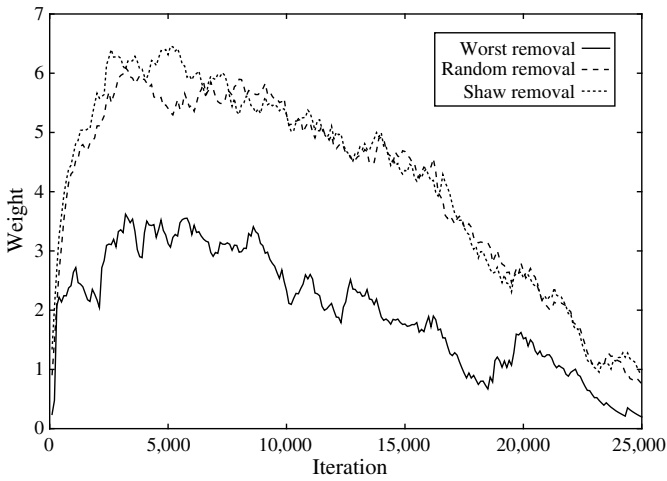

# Transportation Science

## TRANSPORTATION SCIENCE

Publication details, including instructions for authors and subscription information: [http://pubsonline.informs.org](http://pubsonline.informs.org)

# An Adaptive Large Neighborhood Search Heuristic for the Pickup and Delivery Problem with Time Windows

Stefan Ropke, David Pisinger,

**To cite this article:**

Stefan Ropke, David Pisinger, (2006) An Adaptive Large Neighborhood Search Heuristic for the Pickup and Delivery Problem with Time Windows. Transportation Science 40(4):455-472. [http://dx.doi.org/10.1287/trsc.1050.0135](http://dx.doi.org/10.1287/trsc.1050.0135)

## Full terms and conditions of use: [http://pubsonline.informs.org/page/terms-and-conditions](http://pubsonline.informs.org/page/terms-and-conditions)

This article may be used only for the purposes of research, teaching, and/or private study. Commercial use or systematic downloading (by robots or other automatic processes) is prohibited without explicit Publisher approval, unless otherwise noted. For more information, contact permissions@informs.org.

The Publisher does not warrant or guarantee the article’s accuracy, completeness, merchantability, fitness for a particular purpose, or non-infringement. Descriptions of, or references to, products or publications, or inclusion of an advertisement in this article, neither constitutes nor implies a guarantee, endorsement, or support of claims made of that product, publication, or service.

Copyright © 2006, INFORMS

**Please scroll down for article—it is on subsequent pages**

INFORMS is the largest professional society in the world for professionals in the fields of operations research, management science, and analytics. For more information on INFORMS, its publications, membership, or meetings visit [http://www.informs.org](http://www.informs.org)

# An Adaptive Large Neighborhood Search Heuristic for the Pickup and Delivery Problem with Time Windows

Stefan Ropke, David Pisinger

DIKU, University of Copenhagen, Universitetsparken 1, DK-2100 Copenhagen, Denmark {sropke@diku.dk, pisinger@diku.dk}

he pickup and delivery problem with time windows is the problem of serving a number of transportation requests Tusing a limited amount of vehicles. Each request involves moving a number of goods from a pickup location to a delivery location. Our task is to construct routes that visit all locations such that corresponding pickups and deliveries are placed on the same route, and such that a pickup is performed before the corresponding delivery. The routes must also satisfy time window and capacity constraints.

This paper presents a heuristic for the problem based on an extension of the large neighborhood search heuristic previously suggested for solving the vehicle routing problem with time windows. The proposed heuristic is composed of a number of competing subheuristics that are used with a frequency corresponding to their historic performance. This general framework is denoted adaptive large neighborhood search.

The heuristic is tested on more than 350 benchmark instances with up to 500 requests. It is able to improve the best known solutions from the literature for more than 50% of the problems.

The computational experiments indicate that it is advantageous to use several competing subheuristics instead of just one. We believe that the proposed heuristic is very robust and is able to adapt to various instance characteristics.

Key words: pickup and delivery problems with time windows; large neighborhood search; metaheuristics History: Received: July 2004; revision received: August 2005; accepted: August 2005.

## Introduction

In the considered variant of the pickup and delivery problem with time windows (PDPTW), we are given a number of requests and vehicles. A request consists of picking up goods at one location and delivering these goods to another location. Two time windows are assigned to each request: a pickup time window that specifies when the goods can be picked up and a delivery time window that tells when the goods can be dropped off. Furthermore, service times are associated with each pickup and delivery. The service times indicate how long it will take for the pickup or delivery to be performed. A vehicle is allowed to arrive at a location before the start of the time window of the location, but the vehicle must then wait until the start of the time window before initiating the operation. A vehicle may never arrive at a location after the end of the time window of the location.

Each request is assigned a set of feasible vehicles. This can, for example, be used to model situations where some vehicles cannot enter a certain location because of the dimensions of the vehicle.

Each vehicle has a limited capacity, and it starts and ends its duty at given locations called start and end terminals. The start and end location do not need to be the same, and two vehicles can have different start and end terminals. Furthermore, each vehicle is assigned a start and end time. The start time indicates when the vehicle must leave its start location, and the end time denotes the latest allowable arrival at its end location. Note that the vehicle leaves its depot at the specified start time even though this may introduce a waiting time at the first location visited.

Our task is to construct valid routes for the vehicles. A route is valid if time windows and capacity constraints are obeyed along the route, each pickup is served before the corresponding delivery, corresponding pickup and deliveries are served on the same route, and the vehicle serves only requests it is allowed to serve. The routes should be constructed such that they minimize the cost function to be described below.

As the number of vehicles is limited, we might encounter situations where some requests cannot be assigned to a vehicle. These requests are placed in a virtual request bank. In a real-world situation it is up to a human operator to decide what to do with such requests. The operator might, for example, decide to rent extra vehicles in order to serve the remaining requests.

The objective of the problem is to minimize a weighted sum consisting of the following three components: (1) the sum of the distance traveled by the vehicles, (2) the sum of the time spent by each vehicle. The time spent by a vehicle is defined as its arrival time at the end terminal minus its start time (which is given a priori), (3) the number of requests in the request bank. The three terms are weighted by the coefficients $\alpha , \beta ,$ and $\gamma ,$ respectively. Normally, a high value is assigned to  to serve as many requests as possible. A mathematical model is presented in §1 to define the problem precisely.

The problem was inspired from a real-life vehicle routing problem related to transportation of raw materials and goods between production facilities of a major Danish food manufacturer. For confidentiality reasons, we are not able to present any data about the real-life problem that motivated this research.

The problem is NP-hard, as it contains the traveling salesman problem as a special case. The objective of this paper is to develop a method for finding good, but not necessarily optimal, solutions to the problem described above. The developed method should preferably be reasonably fast, robust, and able to handle large problems. Thus, it seems fair to turn to heuristic methods.

The next paragraphs survey recent work on the PDPTW. Although none of the references mentioned below consider exactly the same problem as ours, they all face the same core problem.

Nanry and Barnes (2000) are among the first to present a metaheuristic for the PDPTW. Their approach is based on a reactive tabu search algorithm that combines several standard neighborhoods. To test the heuristic, Nanry and Barnes create PDPTW instances from a set of standard vehicle routing problem with time windows (VRPTW) problems proposed by Solomon (1987). The heuristic is tested on instances with up to 50 requests. Li and Lim (2001) use a hybrid metaheuristic to solve the problem. The heuristic combines simulated annealing and tabu search. Their method is tested on the nine largest instances from Nanry and Barnes (2000), and they consider 56 new instances based on Solomon’s VRPTW problems (1987). Lim, Lim, and Rodrigues (2002) apply “squeaky wheel” optimization and local search to the PDPTW. Their heuristic is tested on the set of problems proposed by Li and Lim (2001). Lau and Liang (2001) also apply tabu search to PDPTW, and they describe several construction heuristics for the problem. Special attention is given to how test problems can be constructed from VRPTW instances.

Recently, Bent and Van Hentenryck (2003a) proposed a heuristic for the PDPTW based on large neighborhood search. The heuristic was tested on the problems proposed by Li and Lim (2001). The heuristic by Bent and Van Hentenryck is probably the most promising metaheuristic for the PDPTW proposed so far.

Gendreau et al. (1998) consider a dynamic version of the problem. An ejection chain neighborhood is proposed, and steepest descent and tabu search heuristics based on the ejection chain neighborhood are tested. The tabu search is parallelized, and the sequential and parallelized versions are compared.

Several column generation methods for PDPTW have been proposed. These methods include both exact and heuristic methods. Dumas et al. (1991) were the first to use column generation for solving PDPTW. They propose a branch-and-bound method that is able to handle problems with up to 55 requests.

Xu et al. (2003) consider a PDPTW with several extra real-life constraints, including multiple time windows, compatibility constraints, and maximum driving-time restrictions. The problem is solved using a column generation heuristic. The paper considers problem instances with up to 500 requests.

Sigurd, Pisinger, and Sig (2004) solve a PDPTW problem related to transportation of livestock. This introduces some extra constraints, such as precedence relations among the requests, meaning that some requests must be served before others to avoid the spread of diseases. The problem is solved to optimality using column generation. The largest problems solved contain more than 200 requests. A recent survey of pickup and delivery problem literature was made by Desaulniers et al. (2002).

The work presented in this paper is based on the master’s thesis of Ropke (2002). In the papers by Pisinger and Ropke (2005) and Ropke and Pisinger (2006), it is shown how the heuristic presented in this paper can be extended to solve a variety of vehicle routing problems—for example the VRPTW, the multidepot vehicle routing problem, and the vehicle routing problem with backhauls.

The rest of this paper is organized as follows: §1 defines the PDPTW problem formally; §2 describes the basic solution method in a general context; §3 describes how the solution method has been applied to PDPTW, and extensions to the method are pre-sented; §4 contains the results of the computational tests. The computational test is focused on comparing the heuristic to existing metaheuristics and evaluating if the refinements presented in §3 improve the heuristic; §5 concludes the paper.

## 1. Mathematical Model

This section presents a mathematical model of the problem; it is based on the model proposed by

Desaulniers et al. (2002). The mathematical model serves as a formal description of the problem. As we solve the problem heuristically, we do not attempt to write the model on integer-linear form.

A problem instance of the pickup and delivery problem contains n requests and m vehicles. The problem is defined on a graph, $P = \{ 1 , \cdots , n \}$ is the set of pickup nodes, $D = \{ n + 1 , \cdots , 2 n \}$ is the set of delivery nodes. Request i is represented by nodes i and $\stackrel { \circ } { i + n . } K$ is the set of all vehicles, $| K | = m$ . One vehicle might not be able to serve all requests; as an example, a request might require that the vehicle has a freezing compartment. $K _ { i }$ is the set of vehicles that are able to serve request i, and $P _ { k } \subseteq P$ and $D _ { k } \subseteq D$ are the set of pickups and deliveries, respectively, that can be served by vehicle $k ;$ thus, for all i and $k \colon k \in$ $K _ { i } \Leftrightarrow i \in P _ { k } \land i \in \dot { D } _ { k }$ . Requests where $K _ { i } \neq K$ are called special requests. Define $\bar { N }   =   P \cup D$ and $N _ { k }   =   P _ { k } \cup D _ { k }$ . Let $\dot { \tau _ { k } } = 2 n \dot { + } k , \; k \in K ,$ and let $\tau _ { k } ^ { \prime } = 2 n + m + k , \; k \in K$ be the nodes that represent the start and end terminal, respectively, of vehicle k. The graph $G = ( V , A )$ consists of the nodes $V = N \cup \{ \tau_1, \cdots, \tau_m \} \cup \{ \tau_1', \cdots, \tau_m' \}$ and the arcs $A = V \times V$ . For each vehicle, we have a subgraph $G _ { k }   =   ( V _ { k } ,   A _ { k } )$ , where $V _ { k }   =   N _ { k } \cup \{ \tau _ { k } \} \cup \{ \tau _ { k } ^ { \prime } \}$ and $A _ { k } = V _ { k } \times V _ { k }$ . For each edge $( i , j ) \in A$ we assign a distance $d _ { i j } \geq 0$ and a travel time $t _ { i j } \geq 0 .$ . It is assumed that distances and times are nonnegative; $d _ { i j } \geq 0 , t _ { i j } \geq 0$ and that the times satisfy the triangle inequality; $t _ { i j } \leq$ $t _ { i l } + t _ { l j }$ for all $i , j , l \in V$ . For the sake of modeling, we also assume that $t _ { i ,   n + i } + s _ { i } > 0 ;$ this makes elimination of subtours and the pickup-before-delivery constraint easy to model.

Each node $i \in V$ has a service time $s _ { i }$ and a time window $[ a _ { i } , b _ { i } ]$ . The service time represents the time needed for loading and unloading, and the time window indicates when the visit at the particular location must start; a visit to node i can only take place between time $a _ { i }$ and $b _ { i } ,   \mathrm { A }$ vehicle is allowed to arrive at a location before the start of the time window, but it has to wait until the start of the time window before the visit can be performed. For each node $i \in N ,   l _ { i }$ is the amount of goods that must be loaded onto the vehicle at the particular node, $l _ { i } \geq 0$ for $i \in P ,$ and $l _ { i } = - l _ { i - n }$ for $\bar { i \in D }$ . The capacity of vehicle $k \in K$ is denoted $C _ { k }$

Four types of decision variables are used in the mathematical model. $x _ { i j k } , \; i , j \in V , \; k \in K$ is a binary variable that is one if the edge between node i and node j is used by vehicle k and zero otherwise. $S _ { i k } ,$ $i \in V ,   k \in K$ is a nonnegative integer that indicates when vehicle k starts the service at location $i , \; L _ { i k } ,$ $i \in V ,   k \in K$ is a nonnegative integer that is an upper bound on the amount of goods on vehicle k after servicing node $i . \; S _ { i k }$ and $L _ { i k }$ are only well defined when vehicle k actually visits node i. Finally $z _ { i } , \; i \in P$ is a binary variable that indicates if request i is placed in the request bank. The variable is one if the request is placed in the request bank and zero otherwise.

A mathematical model is

$$
\min \alpha \sum_ {k \in K} \sum_ {(i, j) \in A} d _ {i j} x _ {i j k} + \beta \sum_ {k \in K} \left(S _ {\tau_ {k} ^ {\prime}, k} - a _ {\tau_ {k}}\right) + \gamma \sum_ {i \in P} z _ {i}\tag{1}
$$

Subject to:

$$
\sum_ {k \in K _ {i}} \sum_ {j \in N _ {k}} x _ {i j k} + z _ {i} = 1 \quad \forall i \in P\tag{2}
$$

$$
\left| \sum_ {j \in V _ {k}} x _ {i j k} - \sum_ {j \in V _ {k}} x _ {j, n + i, k} = 0 \quad \forall k \in K, \forall i \in P _ {k} \right|\tag{3}
$$

$$
\sum_ {j \in P _ {k} \cup \{\tau_ {k} ^ {\prime} \}} x _ {\tau_ {k}, j, k} = 1 \quad \forall k \in K\tag{4}
$$

$$
\sum_ {i \in D _ {k} \cup \{\tau_ {k} \}} x _ {i, \tau_ {k} ^ {\prime}, k} = 1 \quad \forall k \in K\tag{5}
$$

$$
\sum_ {i \in V _ {k}} x _ {i j k} - \sum_ {i \in V _ {k}} x _ {j i k} = 0 \quad \forall k \in K, \forall j \in N _ {k}\tag{6}
$$

$$
x _ {i j k} = 1 \Rightarrow S _ {i k} + s _ {i} + t _ {i j} \leq S _ {j k} \quad \forall k \in K, \forall (i, j) \in A _ {k}
$$

$$
a _ {i} \leq S _ {i k} \leq b _ {i} \quad \forall k \in K, \forall i \in V _ {k}\tag{7}
$$

(8)

$$
\begin{array}{l} S _ {i k} \leq S _ {n + i, k} \quad \forall k \in K, \forall i \in P _ {k} \end{array}\tag{9}
$$

$$
x _ {i j k} = 1 \Rightarrow L _ {i k} + l _ {j} \leq L _ {j k} \quad \forall k \in K, \forall (i, j) \in A _ {k}\tag{10}
$$

$$
L _ {i k} \leq C _ {k} \quad \forall k \in K, \forall i \in V _ {k}\tag{11}
$$

$$
L _ {\tau_ {k} k} = L _ {\tau_ {k} ^ {\prime} k} = 0 \quad \forall k \in K\tag{12}
$$

$$
x _ {i j k} \in \{0, 1 \} \quad \forall k \in K, \forall (i, j) \in A _ {k}
$$

$$
z _ {i} \in \{0, 1 \} \quad \forall i \in P\tag{13}
$$

(14)

$$
S _ {i k} \geq 0 \quad \forall k \in K, \forall i \in V _ {k}\tag{15}
$$

$$
L _ {i k} \geq 0 \quad \forall k \in K, \forall i \in V _ {k}.\tag{16}
$$

The objective function minimizes the weighted sum of the distance traveled, the sum of the time spent by each vehicle, and the number of requests not scheduled.

Constraint (2) ensures that each pickup location is visited or that the corresponding request is placed in the request bank. Constraint (3) ensures that the delivery location is visited if the pickup location is visited and that the visit is performed by the same vehicle. Constraints (4) and (5) ensure that a vehicle leaves every start terminal and a vehicle enters every end terminal. Together with constraint (6), this ensures that consecutive paths between $\tau _ { k }$ and $\tau _ { k } ^ { \prime }$ are formed for each $k \in K$

Constraints (7) and (8) ensure that $S _ { i k }$ is set correctly along the paths and that the time windows are obeyed. These constraints also make subtours impossible. Constraint (9) ensures that each pickup occurs before the corresponding delivery. Constraints (10), (11), and (12) ensure that the load variable is set correctly along the paths and that the capacity constraints of the vehicles are respected.

## 2. Solution Method

Local search heuristics are often built on neighborhood moves that make small changes to the current solution, such as moving a request from one route to another or exchanging two requests, as in Nanry and Barnes (2000) and Li and Lim (2001). These kinds of local search heuristics are able to investigate a huge number of solutions in a short time, but a solution is changed only very little in each iteration. It is our belief that such heuristics can have difficulties in moving from one promising area of the solution space to another when faced with tightly constrained problems, even when embedded in metaheuristics.

One way of tackling this problem is by allowing the search to visit infeasible solutions by relaxing some constraints; see, e.g., Cordeau, Laporte, and Mercier (2001). We take another approach—instead of using small “standard moves,” we use very large moves that potentially can rearrange up to 30%–40% of all requests in a single iteration. The price of doing this is that the computation time needed for performing and evaluating the moves becomes much larger compared to the smaller moves. The number of solutions evaluated by the proposed heuristic per time unit is only a fraction of the solutions that could be evaluated by a standard heuristic. Nevertheless, very good performance is observed in the computational tests, as demonstrated in §4.

The proposed heuristic is based on large neighborhood search LNS, introduced by Shaw (1997). The LNS heuristic has been applied to the VRPTW with good results (Shaw 1997, 1998; Bent and Van Hentenryck 2004). Recently the heuristic has been applied to the PDPTW as well (Bent and Van Hentenryck 2003a). The LNS heuristic itself is similar to the ruin and recreate heuristic proposed by Schrimpf et al. (2000).

The pseudocode for a minimizing LNS heuristic is shown in Algorithm 1. The pseudocode assumes that an initial solution s already has been found, for example, by a simple construction heuristic. The second parameter $q$ determines the scope of the search.

ALGORITHM 1: LNS HEURISTIC.
Function LNS($s \in \{solutions\}, q \in \mathbb{N}$)
    solution $s_{best} = s$;
    repeat
        $s' = s$;
        remove $q$ requests from $s'$
        reinsert removed requests into $s'$;
        if $(f(s') &lt; f(s_{best}))$ then
            $s_{best} = s'$;
        if accept($s', s$) then
            $s = s'$;
    until stop-criterion met
    return $s_{best}$;

Lines 5 and 6 in the algorithm are the interesting part of the heuristic. In Line $5 ,$ a number of requests are removed from the current solution $s ^ { \prime } ,$ and in Line 6 the requests are reinserted into the current solution again. The performance and robustness of the overall heuristic is very dependent on the choice of removal and insertion procedures. In the previously proposed LNS heuristics for VRPTW or PDPTW (Shaw 1997; Bent and Van Hentenryck 2003a), near-optimal methods were used for the reinsert operation. This was achieved using a truncated branch-and-bound search. In this paper we take a different approach by using simple insertion heuristics for performing the insertions. Even though the insertion heuristics themselves usually deliver solutions of poor quality, the quality of the LNS heuristic is very good, because the bad moves that are generated by the insertion heuristics lead to a fruitful diversification of the search process.

The rest of the code updates the (so far) best solution and determines if the new solution should be accepted. A simple accept criterion would be to accept all improving solutions. Such a criterion has been used in earlier LNS implementations (Shaw 1997). In this paper we use a simulated annealing accept criterion.

In Line 11 we check if a stop criterion is met. In our implementation we stop when a certain number of iterations has been performed.

The parameter $q \in \{ 0 , \cdots , n \}$ determines the size of the neighborhood. If q is equal to zero, then no search at all will take place because no requests are removed. On the other hand, if q is equal to $n ,$ then the problem is resolved from scratch in each iteration. In general, one can say that the larger $q$ is, the easier it is to move around in the solution space, but when $q$ gets larger, each application of the insertion procedure is going to be slower. Furthermore, if one uses a heuristic for inserting requests, then choosing q too large might give bad results.

The LNS local search can be seen as an example of a very large-scale neighborhood search as presented by Ahuja et al. (2002). Ahuja et al. define very largescale neighborhoods as neighborhoods whose sizes grow exponentially as a function of the problem size, or neighborhoods that simply are too large to be searched explicitly in practice. The LNS local search fits into the last category, as we have a large number of possibilities for choosing the requests to remove and a large number of possible insertions. One important difference between the proposed heuristic and most of the heuristics described in Ahuja et al. (2002) is that the latter heuristics typically examine a huge number of solutions, albeit implicitly, while the LNS heuristic proposed in this paper examines only a relatively low number of solutions.

Instead of viewing the LNS process as a sequence of remove-insert operations, it can also be viewed as a sequence of fix-optimize operations. In the fix operation a number of elements in the current solution are fixed. If, for example, the solution is represented as a vector of variables, the fix operation could fix a number of these variables at their current value. The optimize operation then reoptimizes the solution while respecting the fixation performed in the previous fix operation. This way of viewing the heuristic might help us to apply the heuristic to problems where the remove-insert operations do not seem intuitive. In §3 we introduce the term adaptive large neighborhood search (ALNS) to describe an algorithm using several large neighborhoods in an adaptive way. A more general presentation of the ALNS framework can be found in a subsequent paper (Pisinger and Ropke 2005).

## 3. LNS Applied to PDPTW

This section describes how the LNS heuristic has been applied to the PDPTW. Compared to the LNS heuristic developed for the VRPTW and PDPTW by Shaw (1997, 1998) and Bent and Van Hentenryck (2003a, 2004), the heuristic in this paper is different in several ways:

1. We are using several removal and insertion heuristics during the same search, while the earlier LNS heuristics used only one method for removal and one method for insertions. The removal heuristics are described in §3.1 and the insertion heuristics are described in §3.2. The method for selecting which subheuristic to use is described in §3.3. The selection mechanism is guided by statistics gathered during the search, as described in §3.4. We are going to use the term adaptive large neighborhood search ALNS heuristic for an LNS heuristic that uses several competing removal and insertion heuristics and chooses between using statistics gathered during the search.

2. Simple and fast heuristics are used for the insertion of requests, as opposed to the more complicated branch-and-bound methods proposed by Shaw (1997, 1998) and Bent and Van Hentenryck (2003a, 2004).

3. The search is embedded in a simulated annealing metaheuristic where the earlier LNS heuristics used a simple descent approach. This is described in §3.5.

The present section also describes how the LNS heuristic can be used in a simple algorithm designed for minimizing the number of vehicles used to serve all requests. The vehicle minimization algorithm only works for homogeneous fleets without an upper bound on the number of vehicles available.

## 3.1. Request Removal

This section describes three removal heuristics. All three heuristics take a solution and an integer q as input. The output of the heuristic is a solution where q requests have been removed. Furthermore, the heuristics Shaw removal and worst removal have a parameter p that determines the degree of randomization in the heuristic.

**3.1.1. Shaw Removal Heuristic.** This removal heuristic was proposed by Shaw (1997, 1998). In this section it is slightly modified to suit the PDPTW. The general idea is to remove requests that are somewhat similar, as we expect it to be reasonably easy to shuffle similar requests around and thereby create new, perhaps better, solutions. If we choose to remove requests that are very different from each other, then we might not gain anything when reinserting the requests because we might only be able to insert the requests at their original positions or in some bad positions. We define the similarity of two requests i and j using a relatedness measure $R ( i , j )$ . The lower $R ( i , j )$ is, the more related are the two requests.

The relatedness measure used in this paper consists of four terms: a distance term, a time term, a capacity term, and a term that considers the vehicles that can be used to serve the two requests. These terms are weighted using the weights $\varphi , \; \chi , \; \psi ,$ and $\omega ,$ respectively. The relatedness measure is given by

$$
\begin{array}{r l} R (i, j) = \varphi (d _ {A (i), A (j)} + d _ {B (i), B (j)}) \\ & \quad + \chi (| T _ {A (i)} - T _ {A (j)} | + | T _ {B (i)} - T _ {B (j)} |) \\ & \quad + \psi | l _ {i} - l _ {j} | + \omega \bigg (1 - \frac {| K _ {i} \cap K _ {j} |}{\min \{| K _ {i} | , | K _ {j} | \}} \bigg). \end{array}\tag{17}
$$

$A ( i )$ and $B ( i )$ denote the pickup and delivery locations of request $i ,$ and $T _ { i }$ indicates the time when location i is visited. $d _ { i j } , \; l _ { i } ,$ and $K _ { i }$ are defined in $\S 1$ Using the decision variable $S _ { i k }$ from $\S 1$ , we can write $T _ { i }$ as $\begin{cases}T_{i} = \sum_{k \in K} \sum_{j \in V_{k}} S_{ik}x_{ijk}\end{cases}$ . The term weighted by + measures distance, the term weighted by $\chi$ measures temporal connectedness, the term weighted by - compares capacity demand of the requests, and the term weighted by . ensures that two requests get a high relatedness measure if only a few or no vehicles are able to serve both requests. It is assumed that $d _ { i j } ,$ $T _ { x } ,$ and $l _ { i }$ are normalized such that $0 \leq R ( i , j ) \leq 2 ( \varphi +$ $\chi ) + \psi + \omega$ . This is done by scaling $d _ { i j } , \; T _ { x } .$ , and $l _ { i }$ such that they only take on values from 0 1 . Notice that we cannot calculate $R ( i , j )$ , if request i or j is placed in the request bank.

The relatedness is used to remove requests in the same way as described by Shaw (1997). The procedure for removing requests is shown in pseudocode in Algorithm 2. The procedure initially chooses a random request to remove, and in the subsequent iterations it chooses requests that are similar to the already removed requests. A determinism parameter $p \geq 1$ introduces some randomness in the selection of the requests (a low value of $p$ corresponds to much randomness).

Algorithm 2: SHAW REMOVAL.
Function ShawRemoval($s \in \{solutions\}$,
    $q \in \mathbb{N}, p \in \mathbb{R}_{+}$)
    request: $r =$ a randomly selected request from $s$;
    set of requests: $D = \{r\}$;
    while $|D| &lt; q$ do
        $r =$ a randomly selected request from $D$;
        Array: $L =$ an array containing all request from $s$ not in $D$;
        sort $L$ such that
            $i &lt; j \Rightarrow R(r, L[i]) &lt; R(r, L[j])$;
        choose a random number $y$ from the interval $[0, 1)$;
        $D = D \cup \{L[y^p | L|\}]$;
    end while
remove the requests in $D$ from $s$;

Notice that the sorting in Line 7 can be avoided in an actual implementation of the algorithm because it is sufficient to use a linear time selection algorithm (Cormen et al. 2001) in Line 9.

**3.1.2. Random Removal.** The random removal algorithm simply selects q requests at random and removes them from the solution. The random removal heuristic can be seen as a special case of the Shaw removal heuristic with $p   =   1$ . We have implemented a separate random removal heuristic however, because it obviously can be implemented to run faster than the Shaw removal heuristic.

**3.1.3. Worst Removal.** Given a request i served by some vehicle in a solution s, we define the cost of the request as $c o s t ( i , s ) = f ( s ) - f _ { - i } ( s )$ where $f _ { - i } ( s )$ is the cost of the solution without request i (the request is not moved to the request bank, but removed completely). It seems reasonable to try to remove requests with high cost and insert them at another place in the solution to obtain a better solution value; therefore, we propose a removal heuristic that removes requests with high costi s.

The worst removal heuristic is shown in pseudocode in Algorithm 3. It reuses some of the ideas from §3.1.1.

Notice that the removal is randomized, with the degree of randomization controlled by the parameter p as in §3.1.1. This is done to avoid situations where the same requests are removed over and over again.

Algorithm 3: Worst Removal.
Function WorstRemoval($s \in \{solutions\}$,
    $q \in \mathbb{N}, p \in \mathbb{R}_{+}$)
    while $q &gt; 0$ do
        Array: $L = \text{All planned requests } i$, sorted by descending $cost(i, s)$;
        choose a random number $y$ in the interval $[0, 1)$;
        request: $r = L[y^p | L|]$;
        remove $r$ from solution $s$;
        $q = q - 1$;
    end while

One can say that the Shaw removal heuristic and the worst removal heuristic belong to two different classes of removal heuristics. The Shaw heuristic is biased toward selecting requests that can “easily” be exchanged, while the worst-removal selects the requests that appear to be placed in the wrong position in the solution.

## 3.2. Inserting Requests

Insertion heuristics for vehicle routing problems are typically divided into two categories: sequential and parallel insertion heuristics. The difference between the two classes is that sequential heuristics build one route at a time, while parallel heuristics construct several routes at the same time. Parallel and sequential insertion heuristics are discussed in further detail in Potvin and Rousseau (1993). The heuristics pre-sented in this paper are all parallel. The reader should observe that the insertion heuristic proposed here will be used in a setting where they are given a number of partial routes and a number of requests to insert— they seldom build the solution from scratch.

**3.2.1. Basic Greedy Heuristic.** The basic greedy heuristic is a simple construction heuristic. It performs at most n iterations as it inserts one request in each iteration. Let $\Delta f _ { i ,   k }$ denote the change in objective value incurred by inserting request i into route k at the position that increases the objective value the least. If we cannot insert request i in route $k ,$ then we set $\Delta f _ { i ,   k } = \infty$ . We then define $c _ { i }$ as $c_{i} = \min_{k \in K} \{ \Delta f_{i,k} \}$ In other words, $c _ { i }$ is the “cost” of inserting request i at its best position overall. We denote this position by the minimum cost position. Finally, we choose the request i that minimizes

$$
\min _ {i \in U} c _ {i}\tag{18}
$$

and insert it at its minimum cost position. U is the set of unplanned requests. This process continues until all requests have been inserted or no more requests can be inserted.

Observe that in each iteration we only change one route (the one we inserted into), and we do not have to recalculate insertion costs in all the other routes. This property is used in the concrete implementation to speed up the insertion heuristics.

An obvious problem with this heuristic is that it often postpones the placement of “hard” requests (requests that are expensive to insert, that is, requests with large $c _ { i } )$ to the last iterations where we do not have many opportunities for inserting the requests because many of the routes are “full.” The heuristic presented in the next section tries to circumvent this problem.

**3.2.2. Regret Heuristics.** The regret heuristic tries to improve on the basic greedy heuristic by incorporating a kind of look-ahead information when selecting the request to insert. Let $x _ { i k } \in \{ 1 , \cdots , m \}$ be a variable that indicates the route for which request i has the kth lowest insertion cost, that is, $\bar { \Delta f _ { i ,   x _ { i k } } } \leq$ $\Delta f _ { i ,   x _ { i k ^ { \prime } } } \; \mathrm { f o r } \; k \leq k ^ { \prime }$ . Using this notation, we can express $c _ { i }$ from §3.2.1 as $c _ { i } = \Delta f _ { i ,   x _ { i 1 } }$ . In the regret heuristic we define a regret value $c _ { i } ^ { * }$ as $c _ { i } ^ { * } = \Delta \bar { f } _ { i ,   x _ { i 2 } }   -   \Delta f _ { i ,   x _ { i 1 } }$ . In other words, the regret value is the difference in the cost of inserting the request in its best route and its second-best route. In each iteration the regret heuristic chooses to insert the request i that maximizes

$$
\max _ {i \in U} c _ {i} ^ {*}.
$$

The request is inserted at its minimum cost position. Ties are broken by selecting the insertion with lowest cost. Informally speaking, we choose the insertion that we will regret most if it is not done now.

The heuristic can be extended in a natural way to define a class of regret heuristics: The regret-k heuristic is the construction heuristic that in each construction step chooses to insert the request i that maximizes:

$$
\max _ {i \in U} \left\{\sum_ {j = 1} ^ {k} (\Delta f _ {i, x _ {i j}} - \Delta f _ {i, x _ {i 1}}) \right\}.\tag{19}
$$

If some requests cannot be inserted in at least $m - k + 1$ routes, then the request that can be inserted in the fewest number of routes (but still can be inserted in at least one route) is inserted. Ties are broken by selecting the request with best insertion cost. The request is inserted at its minimum cost position. The regret heuristic presented at the start of this section is a regret-2 heuristic and the basic insertion heuristic from §3.2.1 is a regret-1 heuristic because of the tie-breaking rules. Informally speaking, heuristics with k > 2 investigate the cost of inserting a request on the k best routes and insert the request whose cost difference between inserting it into the best route and the k − 1 best routes is largest. Compared to a regret-2 heuristic, regret heuristics with large values of k discover earlier that the possibilities for inserting a request become limited.

Regret heuristics have been used by Potvin and Rousseau (1993) for the VRPTW. The heuristic in their paper can be categorized as a regret-k heuristic with $k = m ,$ because all routes are considered in an expression similar to (19). The authors do not use the change in the objective value for evaluating the cost of an insertion, but use a special cost function. Regret heuristics can also be used for combinatorial optimization problems outside the vehicle routing domain, an example of an application to the generalized assignment problem described by Martello and Toth (1981). As in the previous section, we use the fact that we only change one route in each iteration to speed up the regret heuristic.

## 3.3. Choosing a Removal and an Insertion Heuristic

In §3.1 we defined three removal heuristics (Shaw, random, and worst removal), and in §3.2 we defined a class of insertion heuristics (basic insertion, regret-2, regret-3, etc.). One could select one removal and one insertion heuristic and use these throughout the search, but in this paper we propose to use all heuristics. The reason for doing this is that, for example, the regret-2 heuristic may be well suited for one type of instance, while the regret-4 heuristic may be the heuristic best suited for another type of instance. We believe that alternating between the different removal and insertion heuristics gives us a more robust heuristic overall.

To select the heuristic to use, we assign weights to the different heuristics and use a roulette wheel selection principle. If we have k heuristics with weights $w _ { i } , \; i \in$ $\left\{ 1, 2, \cdots, k \right\}$ , we select heuristic j with probability

$$
\frac {w _ {j}}{\sum_ {i = 1} ^ {k} w _ {i}}.\tag{20}
$$

Notice that the insertion heuristic is selected independently of the removal heuristic (and vice versa). It is possible to set these weights by hand, but it can be a quite involved process if many removal and insertion heuristics are used. Instead, an adaptive weightadjusting algorithm is proposed in §3.4.

## 3.4. Adaptive Weight Adjustment

This section describes how the weights $w _ { j }$ introduced in §3.3 can be automatically adjusted using statistics from earlier iterations. The basic idea is to keep track of a score for each heuristic, which measures how well the heuristic has performed recently. A high score corresponds to a successful heuristic. The entire search is divided into a number of segments. A segment is a number of iterations of the ALNS heuristic; here we define a segment as 100 iterations. The score of all heuristics is set to zero at the start of each segment. The score of a heuristic is increased by either $\sigma _ { 1 } ,   \sigma _ { 2 } ,$ or $\sigma _ { 3 }$ in the situations shown in Table 1.

Table 1 Score Adjustment Parameters

| Parameter | Description |
| --- | --- |
| 1 | The last remove-insert operation resulted in a new global best solution. |
| 2 | The last remove-insert operation resulted in a solution that has not been accepted before. The cost of the new solution is better than the cost of current solution. |
| 3 | The last remove-insert operation resulted in a solution that has not been accepted before. The cost of the new solution is worse than the cost of current solution, but the solution was accepted. |

The case for $\sigma _ { 1 }$ is clear: If a heuristic is able to find a new overall best solution, then it has done well. Similarly, if a heuristic has been able to find a solution that has not been visited before and it is accepted by the accept criteria in the ALNS search, then the heuristic has been successful, as it has brought the search forward. It seems sensible to distinguish between the two situations corresponding to parameters $\sigma _ { 2 }$ and $\sigma _ { 3 }$ because we prefer heuristics that can improve the solution, but we are also interested in heuristics that can diversify the search, and these are rewarded by $\sigma _ { 3 } .$ It is important to note that we only reward unvisited solutions. This is to encourage heuristics that are able to explore new parts of the solution space. We keep track of visited solutions by assigning a hash key to each solution and storing the key in a hash table.

In each iteration we apply two heuristics: a removal heuristic and an insertion heuristic. The scores for both heuristics are updated by the same amount, as we cannot tell whether it was the removal or the insertion that was the reason for the “success.”

At the end of each segment we calculate new weights using the recorded scores. Let $w _ { i j }$ be the weight of heuristic i used in segment $j$ as the weight used in formula (20). In the first segment we weight all heuristics equally. After we have finished segment $j ,$ we calculate the weight for all heuristics i to be used in segment $j + 1$ as follows:

$$
w _ {i, j + 1} = w _ {i j} (1 - r) + r \frac {\pi_ {i}}{\theta_ {i}}.
$$

$\pi _ { i }$ is the score of heuristic i obtained during the last segment, and $\theta _ { i }$ is the number of times we have attempted to use heuristic i during the last segment. The reaction factor r controls how quickly the weightadjustment algorithm reacts to changes in the effectiveness of the heuristics. If r is zero, then we do not use the scores at all and stick to the initial weights. If r is set to one, then we let the score obtained in the last segment decide the weight.

Figure 1 The Figure Shows an Example of How the Weights for the Three Removal Heuristics Progressed During One Application of the Heuristic

Notes. The iteration number is shown along the x-axis and the weight is shown along the y -axis. The graph illustrates that for the particular problem, the random removal and the Shaw removal heuristics perform virtually equally well, while the worst heuristic performs worst. Consequently, the worst heuristic is not used as often as the two other heuristics.

Figure 1 shows an example of how the weights of the three removal heuristics progress over time for a certain problem instance. The plots are decreasing because of the simulated annealing acceptance criteria to be described in the next section. Toward the end of the search we only accept good moves, and therefore it is harder for the heuristic to get high scores.

## 3.5. Acceptance and Stopping Criteria

As described in §2, a simple acceptance criterion would be to accept only solutions that are better than the current solution. This would give us a descent heuristic like the one proposed by Shaw (1997). However, such a heuristic has a tendency to get trapped in a local minimum, so it seems sensible to on occasion accept solutions that are worse than the current solution. To do this, we use the acceptance criteria from simulated annealing. That is, we accept a solution $s ^ { \prime }$ given the current solution s with probability $e ^ { - ( f ( s ^ { \prime } ) - \widetilde { f ( s ) } ) / T }$ where $T > 0$ is the temperature.

The temperature starts out at $T _ { s t a r t }$ and is decreased every iteration using the expression $T = T \cdot c ,$ where $0 < c < 1$ is the cooling rate. A good choice of $T _ { s t a r t }$ is dependent on the problem instance at hand, so instead of specifying $\bar { T } _ { s t a r t }$ as a parameter we calculate $T _ { s t a r t }$ by inspecting our initial solution. First we calculate the cost $z ^ { \prime }$ of this solution using a modified objective function. In the modified objective function, $\gamma$ (cost of having requests in the request bank) is set to zero. The start temperature is now set such that a solution that is $w \%$ worse than the current solution is accepted with probability 0.5. The reason for setting  to zero is that this parameter typically is large and could cause us to set the starting temperature to a toolarge number if the initial solution had some requests in the request bank. Now w is a parameter that has to be set. We denote this parameter the start temperature control parameter. The algorithm stops when a specified number of LNS iterations have passed.

## 3.6. Applying Noise to the Objective Function

As the proposed insertion heuristics are quite myopic, we believe that it is worthwhile to randomize the insertion heuristics such that they do not always make the move that seems best locally. This is achieved by adding a noise term to the objective function. Every time we calculate the cost C of an insertion of a request into a route, we also calculate a random number noise in the interval −max N  max N and calculate the modified insertion costs $C ^ { \prime } = \operatorname* { m a x } \{ 0 , C +$ noise. At each iteration we decide if we should use C or $C ^ { \prime }$ to determine the insertions to perform. This decision is taken by the adaptive mechanism described earlier by keeping track of how often the noise applied insertions and the “clean” insertions are successful.

To make the amount of noise related to the properties of the problem instance, we calculate max $N =$ $\eta \cdot \mathsf { m a x } _ { i , \; j \in V } \{ \bar { d _ { i j } } \} ,$ , where < is a parameter that controls the amount of noise. We have chosen to let max N be dependent on the distances $d _ { i j }$ as the distances are an important part of the objective in all of the problems we consider in this paper.

It might seem superfluous to add noise to the insertion heuristics, as the heuristics are used in a simulated annealing framework that already contains randomization; however, we believe that the noise applications are important as our neighborhood is searched by means of the insertion heuristics and not randomly sampled. Without the noise applications we do not get the full benefit of the simulated annealing metaheuristic. This conjecture is supported by the computational experiments reported in Table 4.

## 3.7. Minimizing the Number of Vehicles Used

Minimization of the number of vehicles used to serve all requests is often considered as first priority in the vehicle routing literature. The heuristic proposed so far is not able to cope with such an objective, but by using a simple two-stage algorithm that minimizes the number of vehicles in the first stage and then minimizes a secondary objective (typically traveled distance) in the second stage, we can handle such problems. The vehicle minimization algorithm only works for problems with a homogeneous fleet. We also assume that the number of vehicles available is unlimited, such that constructing an initial feasible solution always can be done. A two-stage method was also used by Bent and Van Hentenryck (2003a, 2004), but while they used two different neighborhoods and metaheuristics for the two stages, we use the same heuristic in both stages.

The vehicle minimization stage works as follows: First, an initial feasible solution is created using a sequential insertion method that constructs one route at a time until all requests have been planned. The number of vehicles used in this solution is the initial estimate on the number of vehicles necessary. The next step is to remove one route from our feasible solution. The requests on the removed route are placed in the request bank. The resulting problem is solved by our LNS heuristic. When the heuristic is run, a high value is assigned to $\gamma ,$ such that requests are moved out of the request bank if possible. If the heuristic is able to find a solution that serves all requests, a new candidate for the minimum number of vehicles has been found. When such a solution has been found, the LNS heuristic is immediately stopped, one more route is removed from the solution, and the process is reiterated. If the LNS heuristic terminates without finding a solution where all requests are served, then the algorithm steps back to the last solution encountered in which all requests were served. This solution is used as a starting solution in the second stage of the algorithm, which simply consists of applying the normal LNS heuristic.

To keep the running time of the vehicle minimization stage down, this stage is only allowed to spend = LNS iterations all together, such that if the first application of the LNS heuristic, for example, spends a iterations to find a solution where all requests are planned, then the vehicle minimization stage is only allowed to perform = − a LNS iterations to minimize the number of vehicles further. Another way to keep the running time limited is to stop the LNS heuristic when it seems unlikely that a solution exists in which all requests are planned. In practice, this is implemented by stopping the LNS heuristic if five or more requests are unplanned and no improvement in the number of unplanned requests has been found in the last  LNS iterations. In the computational experiments = was set to 25,000 and  was set to 2,000.

## 3.8. Discussion

Using several removal and insertion heuristics during the search may be seen as using local search with several neighborhoods. To the best of our knowledge, this idea has not been used in the LNS literature before. The related Variable Neighborhood Search (VNS) was proposed by Mladenović and Hansen (1997). VNS is a metaheuristic framework using a parameterized family of neighborhoods. The metaheuristic has received quite a lot of attention in the recent years and has provided impressive results for many problems. Where ALNS makes use of several unrelated neighborhoods, VNS typically is based on a single neighborhood that is searched with variable depth.

Several metaheuristics can be used at the top level of ALNS to help the heuristic escape a local minimum. We have chosen to use simulated annealing because the ALNS heuristic already contains the random sampling element. For a further discussion of metaheuristic frameworks used in connection with ALNS, see the subsequent paper (Pisinger and Ropke 2005).

The request bank is an entity that makes sense for many real-life applications. In the problems considered in $\S 4$ we do not accept solutions with unscheduled requests, but the request bank allows us to visit infeasible solutions in a transition stage, improving the overall search. The request bank is particularly important when minimizing the number of vehicles.

## 4. Computational Experiments

In this section we describe our computational experiments. We first introduce a set of tuning instances in §4.1. In §4.2 we evaluate the performance of the proposed construction heuristics on the tuning instances. In §4.3 we describe how the parameters of the ALNS heuristic were tuned, and in §4.4 we present the results obtained by the ALNS heuristic and a simpler LNS heuristic.

## 4.1. Tuning Instances

First, a set of representative tuning instances is identified. The tuning instances must have a fairly limited size because we want to perform numerous experiments on the tuning problems, and they should somehow be related to the problems at which our heuristic is targeted. In the case at hand, we want to solve some standard benchmark instances and a new set of randomly generated instances.

Our tuning set consists of 16 instances. The first four instances are LR1\_2\_1, LR202, LRC1\_2\_3, and LRC204 from Li and Lim’s benchmark problems (2001), containing between 50 and 100 requests. The number of available vehicles was set to one more than that reported by Li and Lim to make it easier for the heuristic to find solutions with no requests in the request bank. The last 12 instances are randomly generated instances. These instances contain both singledepot and multidepot problems and problems with requests that only can be served by a subset of the vehicle fleet. All randomly generated problems contain 50 requests.

## 4.2. Evaluation of Construction Heuristics

First, we examine how the simple construction heuristics from §3.2 perform on the tuning problems, to see how well they work without the LNS framework. The construction heuristics regret-1, regret-2, regret-3, regret-4, and regret-m have been implemented. Table 2 shows the results of the test. As the construction heuristics are deterministic, the results were produced by applying the heuristics to each of the 16 test problems once.

Table 2 Performance of Construction Heuristics

|  | Basic greedy | Regret-2 | Regret-3 | Regret-4 | Regret-m |
| --- | --- | --- | --- | --- | --- |
| Avg. gap (%) | 407 | 303 | 263 | 260 | 277 |
| Fails | 3 | 3 | 3 | 2 | 0 |
| Time (s) | 002 | 002 | 002 | 002 | 003 |

Notes. Each column in the table corresponds to one of the construction heuristics. These simple heuristics were not always able to construct a solution where all requests are served; hence, for each heuristic we report the number of times this happened in the fails row. The $A v g .$ gap row shows the average relative difference between the found solution and the best known solution. Only solutions where all requests are served are included in the calculations of the average relative difference. The last row shows the average time (in seconds) needed for applying the heuristic to one problem, running on a 1.5 GHz Pentium IV.

The results show that the proposed construction heuristics are very fast but also very imprecise. Basic greedy is the worst heuristic, while all the regret heuristics are comparable with respect to the solution quality. Regret-m stands out, however, because it is able to serve all requests in all problems. It would probably be possible to improve the results shown in Table 2 by introducing seed requests as proposed by Solomon (1987). However, we are not going to report on such experiments in this paper. It might be surprising that these very imprecise heuristics can be used as the foundation of a much more precise local search heuristic, but as we are going to see in the following sections, this is indeed possible.

## 4.3. Parameter Tuning

This part of the paper serves two purposes. First, it describes how the parameters used for producing the results in §4.4 were found. Next, it tries to unveil which part of the heuristic contributes most to the solution quality.

**4.3.1. Parameters.** This section determines the parameters that need to be tuned. We first review the removal parameters. Shaw removal is controlled by five parameters: $\varphi , \; \chi , \; \psi , \; \omega ,$ and $p ,$ while the worst removal is controlled by one parameter $p _ { w o r s t }$ . Random removal has no parameters. The insertion heuristics are parameter free when we have chosen the regret degree.

To control the acceptance criteria we use two parameters, w and c. The weight-adjustment algorithm is controlled by four parameters, $\sigma _ { 1 } ,   \sigma _ { 2 } ,   \sigma _ { 3 } ,$ and r. Finally, we have to determine a noise rate $\eta$ and a parameter $\xi$ that control how many requests we remove in each iteration. In each iteration, we chose a random number $\rho$ that satisfies $4 \leq \rho \leq \min(100, \xi n)$ , and remove $\rho$ requests. We stop the search after 25,000 LNS iterations as this resulted in a fair trade-off between time and quality.

**4.3.2. LNS Parameter Tuning.** Despite the large number of parameters used in the LNS heuristic, it turns out that it is relatively easy to find a set of parameters that works well for a large range of problems. We use the following strategy for tuning the parameters: First, a fair parameter setting is produced by an ad hoc trial-and-error phase; this parameter setting was found while developing the heuristic. This parameter setting is improved in the second phase by allowing one parameter to take a number of values, while the rest of the parameters are kept fixed. For each parameter setting we apply the heuristic on our set of test problems five times, and the setting that shows the best average behavior (in terms of average deviation from the best known solutions) is chosen. We now move on to the next parameter, using the values found so far and the values from the initial tuning for the parameters that have not been considered yet. This process continues until all parameters have been tuned. Although it would be possible to process the parameters once again using the new set of parameters as a starting point to further optimize the parameters, we stopped after one pass.

One of the experiments performed during the parameter tuning sought to determine the value of the parameter $\xi ,$ which controls how many requests we remove and insert in each iteration. This parameter should intuitively have a significant impact on the results our heuristic is able to produce. We tested the heuristic with $\xi$ ranging from 0.05 to 0.5 with a step size of 0.05. Table 3 shows the influence of $\xi .$ When $\xi$ is too low, the heuristic is not able to move very far in each iteration, and it has a higher chance of being trapped in one suboptimal area of the search space. On the other hand, if $\xi$ is large, then we can easily move around in the search space, but we are stretching the capabilities of our insertion heuristics. The insertion heuristics work fairly well when they must insert a limited number of requests into a partial solution, but they cannot build a good solution from scratch, as seen in §4.2. The results in Table 3 show that $\xi = 0 . 4$ is a good choice. One must notice that the heuristic gets slower when $\xi$ increases because the removals and insertions take longer when more requests are involved; thus, the comparison in Table 3 is not completely fair.

Table 3 Parameter  vs. Solution Quality

| ξ | 0.05 | 0.1 | 0.15 | 0.2 | 0.25 | 0.3 | 0.35 | 0.4 | 0.45 | 0.5 |
| --- | --- | --- | --- | --- | --- | --- | --- | --- | --- | --- |
| Avg. gap (%) | 1.75 | 1.65 | 1.21 | 0.97 | 0.81 | 0.71 | 0.81 | 0.49 | 0.57 | 0.57 |

Notes. The first row shows the values of the parameter  that were tested, and the second row shows the gap between the average solution obtained and the best solutions produced in the experiment.

The complete parameter tuning resulted in the following parameter vector $( \varphi , \chi , \psi , \omega , p , p _ { w o r s t } , w , c ,$ $\sigma _ { 1 } , \sigma _ { 2 } , \sigma _ { 3 } , r , \eta , \xi ) \; = \; ( 9 , 3 , 2 , 5 , 6 , 3 , 0 . 0 5 , 0 . 9 9 9 7 5 , 3 3 )$ $9 , 1 3 , 0 . 1 , 0 . 0 2 5 , 0 . 4 )$ . Our experiments also indicated that it was possible to improve the performance of the vehicle minimization algorithm by setting $( w , c )   =$ 0	35 0	9999, while searching for solutions that serve all requests. This corresponds to a higher start temperature and a slower cooling rate. This indicates that more diversification is needed when trying to minimize the number of vehicles, compared to the situation where one just minimizes the traveled distance.

To tune the parameters we start from an initial guess, and then tune one parameter at a time. When all parameters are tuned, the process is repeated. In this way the calibration order plays a minor role. Although the parameter tuning is quite time consuming, it could easily be automated. In our subsequent papers (Ropke and Pisinger 2006; Pisinger and Ropke 2005), where 11 variants of the vehicle routing problem are solved using the heuristic proposed in this paper, we only retuned a few parameters and obtained very convincing results, so it seems that a complete tuning of the parameters only needs to be done once.

**4.3.3. LNS Configurations.** This section evaluates how the different removal and insertion heuristics behave when used in an LNS heuristic. In most of the test cases a simple LNS heuristic was used that only involved one removal heuristic and one insertion heuristic. Table 4 shows a summary of this experiment.

The first six experiments aim at determining the influence of the removal heuristic. We see that Shaw removal performs best, the worst removal heuristic is second, and the random removal heuristic gives the worst performance. This is reassuring because it shows that the two slightly more complicated removal heuristics actually are better than the simplest removal heuristic. These results also illustrate that the removal heuristic can have a rather large impact on the solution quality obtained, thus, experimenting with other removal heuristics would be interesting and could prove beneficial.

The next eight experiments show the performance of the insertion heuristics. Here we have chosen the Shaw removal as the removal heuristic because it performed best in the previous experiments. In these experiments we see that all insertion heuristics perform quite well, and they are quite hard to distinguish from each other. Regret-3 and regret-4 coupled with noise addition are slightly better than the rest, however. An observation that applies to all experiments is that application of noise seems to help the heuristic. It is interesting to note that the basic insertion heuristic performs nearly as well as the regret heuristics when used in an LNS framework. This is surprising seen in the light of Table 2, where the basic insertion heuristic performed particularly badly. This observation may indicate that the LNS method is relatively robust with respect to the insertion method used.

Table 4 Simple LNS Heuristics Compared to the Full Adaptive LNS with Dynamic Weight Adjustment

| Conf. | Shaw Rand Worst | Reg-1 Reg-2 Reg-3 Reg-4 | Reg-m Noise | Avg. gap (%) |
| --- | --- | --- | --- | --- |
| LNS 1 | • | • |  | 27 |
| 2 | • | • | • | 26 |
| 3 | • | • |  | 54 |
| 4 | • | • | • | 32 |
| 5 | • | • |  | 20 |
| 6 | • | • | • | 16 |
| 7 | • | • |  | 22 |
| 8 | • | • | • | 16 |
| 9 | • | • |  | 18 |
| 10 | • | • | • | 13 |
| 11 | • | • |  | 20 |
| 12 | • | • | • | 13 |
| 13 | • |  | • | 18 |
| 14 | • |  | • • | 17 |
| ALNS 15 | • • • | • • • • | • • | 13 |

Notes. The first column shows if the configuration must be considered as an LNS or an ALNS heuristic. The second column is the configuration number, Columns 3 to 5 indicate which removal heuristics were used. Columns 6 to 10 indicate which insertion heuristics were used. Column 11 states if noise was added to the objective function during insertion of requests (in this case noise was added to the objective function in 50% of the insertions for the simple Configurations 1–14 while in Configuration 15 the number of noise insertions was controlled by the adaptive method). Column 12 shows the average performance of the different heuristics. As an example, in Configuration 4 we used random removal together with the regret-2 insertion heuristic and we applied noise to the objective value. This resulted in a set of solutions whose objective values on average were 3.2% above the best solutions found during the whole experiment.

The last row of the table shows the performance of ALNS. As one can see, it is on par with the two best simple approaches, but not better, which at first may seem disappointing. The results show, however, that the adaptive mechanism is able to find a sensible set of weights, and it is our hypothesis that the ALNS heuristic is more robust than the simpler LNS heuristics. That is, the simple configuration may fail to produce good solutions on other types of problems, while the ALNS heuristic continues to perform well. One of the purposes of the experiments in §4.4 is to confirm or disprove this hypothesis.

## 4.4. Results

This section provides computational experiments conducted to test the performance of the heuristic. There are three major objectives for this section:

1. To compare the ALNS heuristic to a simple LNS heuristic that only contains one removal and one insertion heuristic.

2. To determine if certain problem properties influence the (A)LNS heuristics ability to find good solutions.

3. To compare the ALNS heuristic with state-of-the-art PDPTW heuristics from the literature.

To clarify if the ALNS heuristic is worthwhile compared to a simpler LNS heuristic, we are going to show results for both the ALNS heuristic and the best simple LNS heuristic from Table 4. Configuration 12 was chosen as representative for the simple LNS heuristics as it performed slightly better than Configuration 10. In the following sections we refer to the full and simple LNS heuristic as ALNS and LNS, respectively.

All experiments were performed on a 1.5 GHz Pentium IV PC with 256 MB internal memory, running Linux. The implemented algorithm measures travel times and distances using double precision floating point numbers. The parameter setting found in §4.3.2 was used in all experiments unless otherwise stated.

**4.4.1. Data Sets.** As the model considered in this paper is quite complicated, it is hard to find any benchmark instances that consider exactly the same model and objective function. The benchmark instances that come closest to the model considered in this paper are the instances constructed by Nanry and Barnes (2000) and the instances constructed by Li and Lim (2001). Both data sets are single-depot pickup and delivery problems with time windows, constructed from VRPTW problems. We are only reporting results on the data set proposed by Li and Lim, as the Nanry and Barnes instances are easy to solve due to their size.

Table 5 Summary of Results Obtained on Li and Lim Instances (2001)

| Number of | Number of | Best k soluti | nown ons | Avg. ga | p (%) | Average | time (s) | Fails |  |
| --- | --- | --- | --- | --- | --- | --- | --- | --- | --- |
| locations | problems | ALNS | LNS | ALNS | LNS | ALNS | LNS | ALNS | LNS |
| 100 | 56 | 52 | 50 | 0.19 | 0.50 | 49 | 55 | 0 | 0 |
| 200 | 60 | 49 | 15 | 0.72 | 1.41 | 305 | 314 | 0 | 0 |
| 400 | 60 | 52 | 6 | 2.36 | 4.29 | 585 | 752 | 0 | 0 |
| 600 | 60 | 54 | 5 | 0.93 | 3.20 | 1069 | 1470 | 0 | 0 |
| 800 | 60 | 46 | 5 | 1.73 | 3.27 | 2025 | 3051 | 0 | 2 |
| 1,000 | 58 | 47 | 4 | 2.26 | 4.22 | 2916 | 5252 | 0 | 1 |

Notes. The first column gives the problem size; the next column indicates the number of problems in the data set of the particular size. The rest of the table consists of four major columns, each divided into two subcolumns, one for the ALNS and one for LNS. The column Best known solutions indicates for how many problems the best known solution was identified. The best known solution is either the solution reported by Li and Lim or the best solution identified by the (A)LNS heuristics, depending on which is best. The next column indicates how far the average solution is from best known solution. This number is averaged over all problems of a particular size. The next column shows how long the heuristic on average spends to solve a problem. The last column shows the number of times the heuristic failed to find a solution where all requests are served by the given number of vehicles in all the attempts to solve a particular problem.

The problem considered by Li and Lim was simpler than the one considered in this paper because: (1) it did not contain multiple depots; (2) all requests must be served; (3) all vehicles were assumed to be able to serve all requests. When solving the Li and Lim instances using the ALNS heuristic, we set  to one and - to zero in our objective function. In §4.5 we minimize the number of vehicles as first priority while in §4.4.2 we only minimize the distance driven.

In order to test all aspects of the model proposed in this paper, we also introduce some new, randomly generated instances. These instances are described in §4.4.3.

**4.4.2. Comparing ALNS and LNS Using the Li and Lim Instances.** This section compares the ALNS and LNS heuristics using the benchmark instances proposed by Li and Lim (2001). The data set contains 354 instances with between 100 and 1,000 locations. The data set can be downloaded from SINTEF.

In this section we use the distance driven as our objective even though vehicle minimization is the standard primary objective for these instances. The reason for this decision is that distance minimization makes comparison of the heuristics easier, and distance minimization is the original objective of the proposed heuristic. The number of vehicles available for serving the requests is set to the minimum values reported by Li and Lim in (2001) and on their Web page, which unfortunately is no longer online.

The heuristics were applied 10 times to each instance with 400 or fewer locations and 5 times to each instance with more than 400 locations. The experiments are summarized in Table 5.

The results show that the ALNS heuristic on all four terms performs better than the LNS heuristic. One also notices that the ALNS heuristic becomes even more attractive as the problem size increases. It may seem odd that the LNS heuristic spends more time compared to the ALNS heuristic when they both perform the same number of LNS iterations. The reason for this behavior is that the Shaw removal heuristic used by the LNS heuristic is more time consuming compared to the other two removal heuristics.

**4.4.3. New Instances.** This section provides results on randomly generated PDPTW instances that contain features of the model that were not used in the Li and Lim (2001) benchmark problems considered in §4.4.2. These features are: multiple depots, routes with different start and end terminals, and special requests that can only be served by a certain subset of the vehicles. When solving these instances we set $\alpha   =   \beta   =   1$ in the objective function so that distance and time are weighted equally in the objective function. We do not perform vehicle minimization because the vehicles are inhomogeneous.

Three types of geographical distributions of requests are considered: problems with locations distributed uniformly in the plane, problems with locations distributed in 10 clusters, and problems with 50% of the locations put in 10 clusters and 50% of the locations distributed uniformly. These three types of problems were inspired by Solomon’s VRPTW benchmark problems (1987), and the problems are similar to the R, the C, and the RC Solomon problems, respectively. We consider problems with 50, 100, 250, and 500 requests; all problems are multidepot problems. For each problem size we generated

Table 6 Summary of Results Obtained on New Instances

<table><tr><td rowspan="2">Number of requests</td><td rowspan="2">Number of problems</td><td colspan="2">Best known solutions</td><td colspan="2">Avg. gap (%)</td><td colspan="2">Average time (s)</td></tr><tr><td>ALNS</td><td>LNS</td><td>ALNS</td><td>LNS</td><td>ALNS</td><td>LNS</td></tr><tr><td>50</td><td>12</td><td>8</td><td>5</td><td>1.44</td><td>1.86</td><td>23</td><td>34</td></tr><tr><td>100</td><td>12</td><td>11</td><td>1</td><td>1.54</td><td>2.18</td><td>83</td><td>142</td></tr><tr><td>250</td><td>12</td><td>7</td><td>5</td><td>1.39</td><td>1.62</td><td>577</td><td>1,274</td></tr><tr><td>500</td><td>12</td><td>9</td><td>3</td><td>1.18</td><td>1.32</td><td>3,805</td><td>8,146</td></tr><tr><td>Sum:</td><td>48</td><td>35</td><td>14</td><td>5.55</td><td>6.98</td><td>4,488</td><td>9,596</td></tr></table>

Notes. The captions of the table should be interpreted as in Table 5. The last row sums each column. Notice that the size of the problems in this table is given as number of requests and not the number of locations.

12 problems as we tried every combination of the three problem features shown below:

• Route type: (1) A route starts and ends at the same location, (2) a route starts and ends at different locations.

• Request type: (1) All requests are normal requests, (2) 50% of the requests are special requests. The special requests can only be served by a subset of the vehicles. In the test problems each special request could only be served by between 30% to 60% of the vehicles.

• Geographical distributions: (1) uniform, (2) clustered, and (3) semiclustered.

The instances can be downloaded from www.diku.dk/∼sropke. The heuristics were tested by applying them to each of the 48 problems 10 times. Table 6 shows a summary of the results found. In the table we list the number of problems for which the two heuristics find the best known solution. The best known solution is simply the best solution found throughout this experiment.

We observe the same tendencies as in Table 5; ALNS is still superior to LNS, but one notices that the gap in solution quality between the two methods are smaller for this set of instances while the difference in running time is larger compared to the results on the Li and Lim (2001) instances. One also notices that it seems harder to solve small instances of this problem class compared to the Li and Lim instances.

Table 8 summarizes how the problem features influence the average solution quality. These results show that the clustered problems are the hardest to solve, while the uniformly distributed instances are the easiest. The results also indicate that special requests make the problem slightly harder to solve. The routetype experiments compare the situation where routes start and end at the same location (the typical situation considered in the literature) to the situation where each route starts and ends at different locations. Here we expect the last case to be the easier to solve, as we by having different start and end positions for our routes gain information about the area the route most likely should cover. The results in Table 8 confirm these expectations.

In addition to investigating the question of how the model features influence the average solution quality obtained by the heuristics, we also want to know if the presence of some features could make LNS behave better than ALNS. For the considered features, the answer is negative.

## 4.5. Comparison to Existing Heuristics

This section compares the ALNS heuristics to existing heuristics for the PDPTW. The comparison is performed using the benchmark instances proposed by Li and Lim (2001) that also were used in §4.4.2. When PDPTW problems have been solved in the literature, the primary objective has been to minimize the number of vehicles used, while the secondary objective has been to minimize the traveled distance. For this purpose we use the vehicle minimization algorithm described in §3.7. The ALNS heuristic was applied 10 times to each instance with 200 or fewer locations and 5 times to each instance with more than 200 locations. The experiments are summarized in Tables $^ { 7 , }$ 9, and 10. It should be noted that it was necessary to decrease the w parameter and increase the c parameter when the instances with 1,000 locations were solved to get reasonable solution quality. Apart from that, the same parameter setting has been used for all instances.

Table 7 Comparison Between ALNS Heuristic and Existing Heuristics

<table><tr><td rowspan="2">Number of locations</td><td colspan="2">Best known 2003</td><td colspan="4">BH best</td><td colspan="3">ALNS best of 10 or 5</td><td colspan="2">ALNS best</td></tr><tr><td>Number of vehicles</td><td>Dist.</td><td>Number of vehicles</td><td>Dist.</td><td>Avg. TTB</td><td>Avg. time</td><td>Number of vehicles</td><td>Dist.</td><td>Avg. time</td><td>Number of vehicles</td><td>Dist.</td></tr><tr><td>100</td><td>402</td><td>58,060</td><td>402</td><td>58,062</td><td>68</td><td>3,900</td><td>402</td><td>58,060</td><td>66</td><td>402</td><td>56,060</td></tr><tr><td>200</td><td>615</td><td>178,380</td><td>614</td><td>180,358</td><td>772</td><td>3,900</td><td>606</td><td>180,931</td><td>264</td><td>606</td><td>180,419</td></tr><tr><td>400</td><td>1,183</td><td>421,215</td><td>1,188</td><td>423,636</td><td>2,581</td><td>6,000</td><td>1,158</td><td>422,201</td><td>881</td><td>1,157</td><td>420,396</td></tr><tr><td>600</td><td>1,699</td><td>873,850</td><td>1,718</td><td>879,940</td><td>3,376</td><td>6,000</td><td>1,679</td><td>863,442</td><td>2,221</td><td>1,664</td><td>860,898</td></tr><tr><td>800</td><td>2,213</td><td>1,492,200</td><td>2,245</td><td>1,480,767</td><td>5,878</td><td>8,100</td><td>2,208</td><td>1,432,078</td><td>3,918</td><td>2,181</td><td>1,423,063</td></tr><tr><td>1,000</td><td>2,698</td><td>2,195,755</td><td>2,759</td><td>2,225,190</td><td>6,174</td><td>8,100</td><td>2,652</td><td>2,137,034</td><td>5,370</td><td>2,646</td><td>2,122,922</td></tr></table>

Notes. Each row in the table corresponds to a set of problems with the same number of locations. Each of these problem sets contain between 56 and 60 instances (see Table 9). The first column indicates the number of locations in each problem; the next two columns give the total number of vehicles used and the total distance traveled in the previously best known solutions as listed on the SINTEF Web page in the summer of 2003. The next four columns show information about the solutions obtained by Bent and Van Hentenryck’s heuristic (2003a). The two columns Avg. TTB and Avg. time show the average time needed to reach the best solution and the average time spent on each instance, respectively. Both columns report the time needed to perform one experiment on one instance. The next three columns report the solutions obtained in the experiment with the ALNS heuristic where the heuristic was applied either 5 or 10 times to each problem. The last two columns report the best solutions obtained in several experiments with our ALNS heuristic and with various parameter settings. Note that Bent and Van Hentenryck in some cases have found slightly better results than reported on the SINTEF Web page in 2003. This is the reason why the number of vehicles used by the BH heuristic for the 200 locations problems is smaller than in the best known solutions.

Table 8 Summary of the Influence of Certain Problem Features on the Heuristic Solutions

| Feature | ALNS (%) | LNS (%) |
| --- | --- | --- |
| Distribution: uniform | 1.04 | 1.50 |
| Distribution: clustered | 1.89 | 2.09 |
| Distribution: semiclustered | 1.23 | 1.64 |
| Normal requests | 1.24 | 1.47 |
| Special requests | 1.54 | 2.02 |
| SSttaarrtt ooff rroouuttee== eenndd ooff rroouuttee | 1.591.19 | 2.041.45 |

Notes. The two columns correspond to the two heuristic configurations. Each row shows the average solution quality for each feature. The average solution quality is defined as the average of the average gap for all instances with a specific feature. To be more precise, the solution quality is calculated using the formula: $\begin{array} { r } { q ( \hbar ) = ( 1 / | \bar { F } | ) \sum _ { i \in F } ( ( 1 / 1 0 ) \sum _ { j = 1 } ^ { 1 0 } ( c ( i , j , \hbar ) - c ^ { \prime } ( i ) ) / c ^ { \prime } ( i ) ) } \end{array}$ where F is the set of instances with a specific feature, c	i is the cost of the best known solution to instance i, and $c ( i , j , h )$ is the cost obtained in the jth experiment on instance i using heuristic h.

In the literature, four heuristics have been applied to the benchmark problems: the heuristic by Li and

Table 9 Comparison with Previously Best Known Solutions

<table><tr><td rowspan="2">Number of locations</td><td rowspan="2">Number of problems</td><td colspan="2">ALNS best of 10 or 5</td><td colspan="2">ALNS best</td></tr><tr><td>&lt;PB</td><td>≤PB</td><td>&lt;PB</td><td>≤PB</td></tr><tr><td>100</td><td>56</td><td>0</td><td>54</td><td>0</td><td>55</td></tr><tr><td>200</td><td>60</td><td>22</td><td>42</td><td>27</td><td>57</td></tr><tr><td>400</td><td>60</td><td>40</td><td>47</td><td>41</td><td>55</td></tr><tr><td>600</td><td>60</td><td>41</td><td>45</td><td>51</td><td>57</td></tr><tr><td>800</td><td>60</td><td>37</td><td>42</td><td>48</td><td>53</td></tr><tr><td>1,000</td><td>58</td><td>50</td><td>54</td><td>51</td><td>55</td></tr></table>

Notes. The table is grouped by problem size. The first column shows the problem size; the next column shows the number of problems of that size. The next two columns give additional information about the experiment where the ALNS heuristic was applied 5 or 10 times to each instance. The columns <PB report how many times the best solution found by the ALNS heuristic was strictly better than the previously best known solution. The columns ≤PB show how many times the best solution found by ALNS was at least as good as the previously best known solution. The last two columns show information about the best solutions obtained during experimentation with different parameter settings.

Table 10 Average Performance of the ALNS Heuristic

| Number of | Avg. number |  |
| --- | --- | --- |
| locations | of vehicles | Avg. dist. |
| 100 | 403 | 58249 |
| 200 | 608 | 181707 |
| 400 | 1168 | 425817 |
| 600 | 1686 | 867930 |
| 800 | 2223 | 1432321 |
| 1,000 | 2677 | 2129032 |

Notes. The best solutions reported in Tables 7 and 9 were of course not obtained in all experiments. This table shows the average number of vehicles and average distance traveled obtained. These numbers can be compared to the figures in Table 7.

Lim (2001), the heuristic by Bent and Van Hentenryck (2003a), and two commercial heuristics: a heuristic developed by SINTEF and a heuristic developed by TetraSoft A/S. Detailed results for the last two heuristics are not available, but some results obtained using these heuristics can be found on a Web page maintained by SINTEF (http://www.sintef.no/static/am/opti/projects/top/vrp/benchmarks.html). The heuristic that has obtained the best overall solution quality so far is probably the one by Bent and Van Hentenryck (2003a) (shortened to BH heuristic in the following), therefore the ALNS heuristic is compared to this heuristic in Table 7. The complete results from the BH heuristic can be found in Bent and Van Hentenryck (2003b). The results given for the BH heuristic are the best obtained among 10 experiments (though for the 100 location instances only five experiments were performed). The Avg. TTB column shows the average time needed for the BH heuristic to obtain its best solution. For the ALNS heuristic we only list the time used in total because this heuristic—because of its simulated annealing component—usually finds its best solution toward the end of the search. The BH heuristic was tested on a 1.2 GHz Athlon processor, and the running times of the two heuristics should therefore be comparable (we believe that the Athlon processor is at most 20% slower than our computer). The results show that overall the ALNS heuristic dominates the BH heuristic, especially as the problem sizes increase. It is also clear that the ALNS heuristic is able to improve considerably on the previously best known solutions and that the vehicle minimization algorithm works very well despite its simplicity. The last two columns in Table 7 summarize the best results obtained using several experiments with different parameter settings, which show that the results obtained by ALNS actually can be improved even further.

Table 9 compares the results obtained by ALNS with the best known solutions from the literature. It can be seen that ALNS improves more than half of the solutions and achieves a solution that is at least as good as the previously best known solution for 80% of the problems.

Table 11 Best Results, 100 Locations

|  |  | R1 |  | R2 |  | C1 |  | C2 |  | RC1 |  | RC2 |
| --- | --- | --- | --- | --- | --- | --- | --- | --- | --- | --- | --- | --- |
| 1 | 19 | 165080 | 4 | 125323 | 10 | 82894 | 3 | 59156 | 14 | 170880 | 4 | 140694 |
| 2 | 17 | 148757 | 3 | 119767 | 10 | 82894 | 3 | 59156 | 12 | 155807 | 3 | 137427 |
| 3 | 13 | 129268 | 3 | 94940 | 9 | 103535 | 3 | 59117 | 11 | 125874 | 3 | 108907 |
| 4 | 9 | 101339 | 2 | 84905 | 9 | 86001 | 3 | 59060 | 10 | 112840 | 3 | 81866 |
| 5 | 14 | 137711 | 3 | 105402 | 10 | 82894 | 3 | 58888 | 13 | 163762 | 4 | 130220 |
| 6 | 12 | 125262 | 3 | 93163 | 10 | 82894 | 3 | 58849 | 11 | 142473 | 3 | 115903 |
| 7 | 10 | 111131 | 2 | 90306 | 10 | 82894 | 3 | 58829 | 11 | 123014 | 3 | 106205 |
| 8 | 9 | 96897 | 2 | 73485 | 10 | 82644 | 3 | 58832 | 10 | 114743 | 3 | 85276 |
| 9 | 11 | 120896 | 3 | 93059 | 9 | 100060 |  |  |  |  |  |  |
| 10 | 10 | 115935 | 3 | 96422 |  |  |  |  |  |  |  |  |
| 11 | 10 | 110890 | 2 | 91152 |  |  |  |  |  |  |  |  |
| 12 | 9 | 100377 |  |  |  |  |  |  |  |  |  |  |

Notes. The Li and Lim (2001) benchmark instances are divided into six sets: R1, R2, C1, C2, RC1, and RC2. Each of the major columns corresponds to one of these sets; the column at the left gives the problem number. For each problem instance we report the number of vehicles and the distance traveled in the best solution obtained during experimentation. Bold numbers indicate best known solutions.

The two aforementioned tables dealt only with the best solutions found by the ALNS heuristic. Table 10 shows the average solution quality obtained by the heuristic. These numbers can be compared to those in Table 7. It is worth noticing that the average solution sometimes has a lower distance than the “best of 10 or $5 ^ { \prime \prime }$ solution in Table $7 ;$ this is the case in the last row. This is possible because the heuristic finds solutions that use more than the minimum number of vehicles, and this usually makes solutions with shorter distances possible.

Overall, one can conclude that the ALNS heuristic must be considered as a state-of-the-art heuristic for the PDPTW. The cost of the best solutions identified during the experiments are listed in Tables 11 to 16.

## 4.6. Computational Tests Conclusion

In §4.4 we stated three objectives for our computational experiments. The tests fulfilled these objectives as we saw that: (1) the adaptive LNS heuristic that combines several removal and construction heuristics displays superior performance compared to the simple LNS heuristic that only uses one insertion heuristic and one removal heuristic; (2) certain problem characteristics influence the performance of the LNS heuristic, but we did not find that any characteristics could make the LNS heuristic perform better than the ALNS heuristic; (3) the LNS heuristic is indeed able to find good-quality solutions in a reasonable amount of time, and the heuristic outperforms previously proposed heuristics.

The experiments also illustrate the importance of testing heuristics on large sets of problem instances, because the difference between LNS and ALNS only really becomes apparent when we consider large instances. Note that the problems that need to be solved in the real world often have dimensions comparable to or greater than the biggest problems solved in this paper.

Finally, the computational experiments performed in §4.3.3 indicated that a simple LNS heuristic seems to be more sensitive to the choices of removal heuristic compared to the choices of insertion heuristics. It would be interesting to see if this holds in general for other problems as well.

Table 12 Best Results, 200 Locations

|  |  | R1 |  | R2 |  | C1 |  | C2 |  | RC1 |  | RC2 |
| --- | --- | --- | --- | --- | --- | --- | --- | --- | --- | --- | --- | --- |
| 1 | 20 | 481912 | 5 | 407310 | 20 | 270457 | 6 | 193144 | 19 | 360606 | 6 | 360540 |
| 2 | 17 | 462121 | 4 | 379600 | 19 | 276456 | 6 | 188140 | 15 | 367480 | 5 | 332718 |
| 3 | 15 | 361264 | 4 | 309836 | 17 | 312861 | 6 | 184433 | 13 | 317817 | 4 | 293828 |
| 4 | 10 | 303738 | 3 | 248614 | 17 | 269341 | 6 | 176712 | 10 | 263182 | 3 | 288797 |
| 5 | 16 | 476018 | 4 | 343839 | 20 | 270205 | 6 | 189121 | 16 | 371581 | 5 | 277693 |
| 6 | 14 | 417824 | 4 | 320154 | 20 | 270104 | 6 | 185778 | 17 | 336866 | 5 | 270796 |
| 7 | 12 | 355061 | 3 | 313505 | 20 | 270104 | 6 | 185013 | 14 | 366839 | 4 | 305609 |
| 8 | 9 | 278453 | 2 | 255540 | 20 | 268983 | 6 | 182434 | 13 | 317455 | 4 | 239995 |
| 9 | 14 | 435466 | 3 | 393049 | 18 | 272424 | 6 | 185421 | 13 | 322672 | 4 | 220849 |
| 10 | 11 | 371416 | 3 | 334408 | 17 | 294349 | 6 | 181745 | 12 | 295129 | 3 | 255056 |

Table 13 Best Results, 400 Locations

|  |  | R1 |  | R2 |  | C1 |  | C2 |  | RC1 |  | RC2 |
| --- | --- | --- | --- | --- | --- | --- | --- | --- | --- | --- | --- | --- |
| 1 | 40 | 1063975 | 8 | 975846 | 40 | 715206 | 12 | 411633 | 36 | 912715 | 12 | 747101 |
| 2 | 31 | 1001585 | 7 | 949664 | 38 | 801243 | 12 | 414429 | 31 | 834606 | 11 | 630336 |
| 3 | 23 | 884046 | 6 | 811653 | 33 | 830894 | 12 | 443175 | 25 | 738740 | 9 | 543820 |
| 4 | 16 | 674433 | 4 | 664978 | 30 | 687800 | 12 | 403800 | 19 | 583858 | 5 | 532243 |
| 5 | 29 | 1059954 | 7 | 857484 | 40 | 715000 | 12 | 403063 | 33 | 877375 | 11 | 612013 |
| 6 | 25 | 952545 | 6 | 799506 | 40 | 715402 | 12 | 390029 | 31 | 817790 | 9 | 647956 |
| 7 | 19 | 820037 | 5 | 692861 | 40 | 714943 | 12 | 396251 | 29 | 799208 | 8 | 636126 |
| 8 | 14 | 594644 | 4 | 544740 | 39 | 711116 | 12 | 384445 | 27 | 761343 | 7 | 592893 |
| 9 | 24 | 988614 | 6 | 804320 | 36 | 745221 | 12 | 418893 | 26 | 801348 | 7 | 530353 |
| 10 | 21 | 801662 | 5 | 790477 | 35 | 738713 | 12 | 382844 | 24 | 706573 | 6 | 576078 |

Table 14 Best Results, 600 Locations

|  |  | R1 |  | R2 |  | C1 |  | C2 |  | RC1 |  | RC2 |
| --- | --- | --- | --- | --- | --- | --- | --- | --- | --- | --- | --- | --- |
| 1 | 59 | 2283865 | 11 | 2194530 | 60 | 1409564 | 19 | 797798 | 53 | 1792488 | 16 | 1481772 |
| 2 | 45 | 2024618 | 10 | 1966659 | 58 | 1437953 | 18 | 1027723 | 44 | 1630254 | 14 | 1275877 |
| 3 | 37 | 1807314 | 8 | 1560996 | 50 | 1468343 | 17 | 872830 | 36 | 1406031 | 10 | 1281267 |
| 4 | 28 | 1326971 | 6 | 1081945 | 47 | 1364803 | 17 | 804197 | 25 | 1095052 | 7 | 1057487 |
| 5 | 38 | 2256281 | 9 | 1956741 | 60 | 1408630 | 19 | 804737 | 47 | 1674255 | 14 | 1300952 |
| 6 | 32 | 2064102 | 8 | 1726296 | 60 | 1409079 | 19 | 809411 | 44 | 1689437 | 13 | 1264398 |
| 7 | 25 | 1716290 | 6 | 1581242 | 60 | 1408376 | 19 | 799818 | 39 | 1539487 | 11 | 1200765 |
| 8 | 19 | 1195759 | 5 | 1095090 | 59 | 1455427 | 18 | 757993 | 36 | 1515479 | 10 | 1216343 |
| 9 | 32 | 2142305 | 8 | 1879936 | 54 | 1470612 | 18 | 950100 | 35 | 1513424 | 9 | 1376801 |
| 10 | 27 | 1872313 | 7 | 1703463 | 53 | 1487930 | 17 | 801994 | 31 | 1392551 | 8 | 1201694 |

Table 15 Best Results, 800 Locations

|  |  | R1 |  | R2 |  | C1 |  | C2 |  | RC1 |  | RC2 |
| --- | --- | --- | --- | --- | --- | --- | --- | --- | --- | --- | --- | --- |
| 1 | 80 | 3931592 | 15 | 3381690 | 80 | 2518438 | 24 | 1168706 | 67 | 3226895 | 20 | 2328940 |
| 2 | 59 | 3437037 | 12 | 3257597 | 78 | 2606217 | 24 | 1435892 | 57 | 2839539 | 18 | 2178662 |
| 3 | 44 | 2971809 | 10 | 2531053 | 65 | 2591845 | 24 | 1319829 | 50 | 2435436 | 16 | 1658631 |
| 4 | 25 | 2119765 | 7 | 1950642 | 60 | 2297088 | 23 | 1337682 | 35 | 1824191 | 12 | 1412205 |
| 5 | 50 | 3904606 | 12 | 3263429 | 80 | 2521122 | 25 | 1232980 | 61 | 3099548 | 18 | 2029292 |
| 6 | 42 | 3365950 | 10 | 2787080 | 80 | 2516425 | 24 | 1270287 | 58 | 2856861 | 16 | 2108857 |
| 7 | 32 | 2729419 | 8 | 2507785 | 80 | 2515838 | 25 | 1185586 | 54 | 2816441 | 15 | 1969596 |
| 8 | 21 | 1957021 | 5 | 1925679 | 78 | 2534845 | 24 | 1148288 | 49 | 2615065 | 13 | 1900933 |
| 9 | 42 | 3612669 | 10 | 3079177 | 73 | 2554194 | 24 | 1162961 | 47 | 2493070 | 12 | 1900368 |
| 10 | 32 | 3020086 | 9 | 2826524 | 71 | 2571212 | 24 | 1157858 | 42 | 2427152 | 10 | 1976678 |

Table 16 Best Results, 1,000 Locations

|  |  | R1 |  | R2 |  | C1 |  | C2 |  | RC1 |  | RC2 |
| --- | --- | --- | --- | --- | --- | --- | --- | --- | --- | --- | --- | --- |
| 1 | 100 | 5690388 | 19 | 4542258 | 100 | 4248866 | 30 | 1687924 | 85 | 4870283 | 22 | 3507370 |
| 2 | 80 | 4965210 | 15 | 4782444 | 95 | 4387019 | 31 | 1898098 | 73 | 4513570 | 21 | 3093274 |
| 3 | 54 | 4212444 | 11 | 3989432 | 82 | 4263111 | 30 | 1777249 | 55 | 3547572 | 16 | 2840351 |
| 4 | 28 | 3213336 | 8 | 2831495 | 74 | 3944300 | 29 | 1808993 | 40 | 2774704 | 12 | 2308320 |
| 5 | 61 | 5913586 | 14 | 5320998 | 100 | 4247741 | 31 | 1713753 | 76 | 4981618 | 18 | 3471396 |
| 6 | 50 | 4863763 | 12 | 4379211 | 101 | 4283839 | 31 | 1719801 | 69 | 4446908 | 17 | 3148526 |
| 7 | 37 | 3893654 | 9 | 3672820 | 100 | 4285499 | 31 | 1911767 | 64 | 4141316 | 17 | 2963963 |
| 8 | 26 | 2945232 | 7 | 2627809 | 98 | 4295156 | 30 | 1701863 | 60 | 4059017 | - | - |
| 9 | 50 | 5222315 | 13 | 4844749 | 92 | 4239198 | 31 | 1756595 | 57 | 3958785 | - | - |
| 10 | 40 | 4621835 | 11 | 4415566 | 90 | 4243516 | 29 | 1742555 | 52 | 3619500 | 12 | 2940290 |

Note. Two entries are missing as the corresponding problem instances no longer exist.

## 5. Conclusions

This paper presented an extension to the large neighborhood search and the ruin-and-recreate heuristic called adaptive LNS. The heuristic was tested on the pickup and delivery problem with time windows achieving good results in a reasonable amount of time. The idea of combining several subheuristics in the same search proved to be successful.

Because the proposed model is quite general, it would be interesting to examine if the model and heuristic can be used to solve other vehicle routing problems. We are currently working on this topic, and the results are very promising because the heuristic has been able to discover new best solutions to standard benchmarks for vehicle routing problems with time windows, multidepot vehicle routing problems, and other vehicle routing problems (Pisinger and Ropke 2005; Ropke and Pisinger 2006).

It would also be interesting to apply the ideas presented in this paper to other combinatorial optimization problems. The adaptive LNS framework is easily applicable to most problems, taking advantage of the numerous robust and fast construction heuristics designed during the last decades for various optimization problems.

## Acknowledgments

The authors wish to thank Jakob Birkedal Nielsen for helpful discussions during the development of the heuristic presented in this paper and Emilie Danna for valuable criticism of the paper. Furthermore, they would like to thank the three anonymous referees for valuable comments and corrections.

## References

Ahuja, R. K., O. Ergun, J. B. Orlin, A. P. Punnen. 2002. A survey of very large scale neighborhood search techniques. Discrete Appl. Math. 123 75–102.

Bent, R., P. Van Hentenryck. 2003a. A two-stage hybrid algorithm for pickup and delivery vehicle routing problems with time windows. Lecture Notes in Computer Science, Vol. 2833. Proc. Internat. Conf. Constraint Programming (CP-2003), 123–137.

Bent, R., P. Van Hentenryck. 2003b. A two-stage hybrid algorithm for pickup and delivery vehicle routing problem with time windows. Appendix available at http://www.cs.brown.edu/people/rbent/pickup-appendix.ps.

Bent, R., P. Van Hentenryck. 2004. A two-stage hybrid local search for the vehicle routing problem with time windows. Transportation Sci. 38(4) 515–530.

Cordeau, J.-F., G. Laporte, A. Mercier. 2001. A unified tabu search heuristic for vehicle routing problems with time windows. J. Oper. Res. Soc. 52 928–936.

Cormen, T. H., C. E. Leiserson, R. L. Rivest, C. Stein. 2001. Intro duction to Algorithms, 2nd ed. MIT Press, Boston, MA.

Desaulniers, G., J. Desrosiers, A. Erdmann, M. M. Solomon, F. Soumis. 2002. The VRP with pickup and delivery. P. Toth, D. Vigo, eds. The Vehicle Routing Problem. SIAM Monographs on Discrete Mathematics and Applications, Vol. 9. SIAM, Philadelphia, PA, 225–242.

Dumas, Y., J. Desrosiers, F. Soumis. 1991. The pickup and delivery problem with time windows. Eur. J. Oper. Res. 54 7–22.

Gendreau, M., F. Guertin, J.-Y. Potvin, R. Séguin. 1998. Neighborhood search heuristics for a dynamic vehicle dispatching problem with pick-ups and deliveries. Tech. Rep. CRT-98-10, Centre de Recherche sur les Transport, Universite de Montreal, Montreal, Canada.

Lau, H. C., Z. Liang. 2001. Pickup and delivery with time windows: Algorithms and test case generation. ICTAI-2001, 13th IEEE Conf. Tools Artificial Intelligence, Dallas, TX, 333–340.

Li, H., A. Lim. 2001. A metaheuristic for the pickup and delivery problem with time windows. ICTAI-2001, 13th IEEE Conf. Tools Artificial Intelligence, Dallas, TX, 160–170.

Lim, H., A. Lim, B. Rodrigues. 2002. Solving the pick up and delivery problem with time windows using “squeaky wheel” optimization with local search. Technical Report 2002, Paper 7-2002, Singapore Management University, Singapore.

Martello, S., P. Toth. 1981. An algorithm for the generalized assignment problem. J. P. Brans, ed. Operational Research ’81. North-Holland, New York.

Mladenović, N., P. Hansen. 1997. Variable neighborhood search. Comput. Oper. Res. 24(11) 1097–1100.

Nanry, W. P., J. W. Barnes. 2000. Solving the pickup and delivery problem with time windows using reactive tabu search. Transportation Res. Part B 34 107–121.

Pisinger, D., S. Ropke. 2005. A general heuristic for vehicle routing problems. Comput. Oper. Res. Forthcoming. http:// www.sciencedirect.com

Potvin, J.-Y., J.-M. Rousseau. 1993. A parallel route building algorithm for the vehicle routing and scheduling problem with time windows. Eur. J. Oper. Res. 66 331–340.

Ropke, S. 2002. Heuristics for the multi-vehicle pickup and delivery problem with time windows. Masters Thesis 01-11-8, Department of Computer Science, University of Copenhagen, Denmark.

Ropke, S., D. Pisinger. 2004. An adaptive large neighborhood search heuristic for the pickup and delivery problem with time windows. Technical report, Department of Computer Science, University of Copenhagen, Denmark.

Ropke, S., D. Pisinger. 2006. A unified heuristic for a large class of vehicle routing problems with backhauls. Eur. J. Oper. Res. 171 750–775.

Shaw, P. 1997. A new local search algorithm providing high quality solutions to vehicle routing problems. Technical report, Department of Computer Science, University of Strathclyde, Scotland.

Shaw, P. 1998. Using constraint programming and local search methods to solve vehicle routing problems. Proc. CP-98 Fourth Internat. Conf. Principles Practice Constraint Programming.

Schrimpf, G., J. Schneider, H. Stamm-Wilbrandt, G. Dueck. 2000. Record breaking optimization results using the ruin and recreate principle. J. Comput. Phys. 159 139–171.

Sigurd, M., D. Pisinger, M. Sig. 2004. The pickup and delivery problem with time windows and precedences. Transportation Sci. 38 197–209.

SINTEF. Vehicle routing and travelling salesperson problems. http://www.sintef.no/static/am/opti/projects/top/vrp/benchmarks.html.

Solomon, M. M. 1987. Algorithms for the vehicle routing and scheduling problems with time window constraints. Oper. Res. 35 254–265.

Toth, P., D. Vigo. 2002. An overview of vehicle routing problems. P. Toth, D. Vigo, eds. The Vehicle Routing Problem. SIAM Monographs on Discrete Mathematics and Applications, Vol. 9. SIAM, Philadelphia, PA, 1–26.

Trick, M. A. 1992. A linear relaxation heuristic for the generalized assignment problem. Naval Res. Logist. 39 137–152.

Xu, H., Z.-L. Chen, S. Rajagopal, S. Arunapuram. 2003. Solving a practical pickup and delivery problem. Transportation Sci. 37 347–364.