# An adaptive large neighborhood search metaheuristic for the vehicle routing problem with drones

**Sacramento, David; Pisinger, David; Røpke, Stefan**

Published in: Transportation Research. Part C: Emerging Technologies

Link to article, DOI: [10.1016/j.trc.2019.02.018](https://doi.org/10.1016/j.trc.2019.02.018)

Publication date: 2019

Document Version Peer reviewed version

[Link back to DTU Orbit](https://orbit.dtu.dk/en/publications/de5c7fac-a4e0-41fc-b8e8-2f3bcb033b2b)

Citation (APA): Sacramento, D., Pisinger, D., & Røpke, S. (2019). An adaptive large neighborhood search metaheuristic for the vehicle routing problem with drones. Transportation Research. Part C: Emerging Technologies, 102, 289-315. [https://doi.org/10.1016/j.trc.2019.02.018](https://doi.org/10.1016/j.trc.2019.02.018)

<small><span class="docvortex-page-footnote" data-block-type="page_footnote" style="color:#6b7280">Copyright and moral rights for the publications made accessible in the public portal are retained by the authors and/or other copyright owners and it is a condition of accessing publications that users recognise and abide by the legal requirements associated with these rights.</span></small>

<small><span class="docvortex-page-footnote" data-block-type="page_footnote" style="color:#6b7280"> Users may download and print one copy of any publication from the public portal for the purpose of private study or research.</span></small>

<small><span class="docvortex-page-footnote" data-block-type="page_footnote" style="color:#6b7280"> You may not further distribute the material or use it for any profit-making activity or commercial gain</span></small>

<small><span class="docvortex-page-footnote" data-block-type="page_footnote" style="color:#6b7280"> You may freely distribute the URL identifying the publication in the public portal</span></small>

<small><span class="docvortex-page-footnote" data-block-type="page_footnote" style="color:#6b7280">If you believe that this document breaches copyright please contact us providing details, and we will remove access to the work immediately and investigate your claim.</span></small>

# An Adaptive Large Neighborhood Search Metaheuristic for the Vehicle Routing Problem with Drones

David Sacramento ∗1, David Pisinger<sup>1</sup>, and Stefan Ropke<sup>1</sup>

<sup>1</sup>DTU Management - Technical University of Denmark, Kongens Lyngby, Denmark

## Abstract

Unmanned Aerial Vehicles, commonly known as drones, have attained considerable interest in recent years due to the potential of revolutionizing transport and logistics. Amazon were among the first to introduce the idea of using drones to deliver goods, followed by several other distribution companies working on similar services.

The Traveling Salesman Problem, frequently used for planning last-mile delivery operations, can easily be modified to incorporate drones, resulting in a routing problem involving both the truck and aircraft. Introduced by Murray and Chu (2015), the Flying Sidekick Traveling Salesman Problem considers a drone and truck collaborating. The drone can be launched and recovered at certain visits on the truck route, making it possible for both vehicles to deliver goods to customers in parallel. This generalization considerably decreases the operational cost of the routes, by reducing the total fuel consumption for the truck, as customers on the routes can be serviced by drones without covering additional miles for the trucks, and hence increase productivity.

In this paper a mathematical model is formulated, defining a problem similar to the Flying Sidekick Traveling Salesman Problem, but for the capacitated multipletruck case with time limit constraints and minimizing cost as objective function. The corresponding problem is denoted the Vehicle Routing Problem with Drones. Due to the difficulty of solving large instances to optimality, an Adaptive Large Neighborhood Search metaheuristic is proposed. Finally, extensive computational experiments are carried out. The tests investigate, among other things, how beneficial the inclusion of the drone-delivery option is compared to delivering all items using exclusively trucks. Moreover, a detailed sensitivity analysis is performed on several drone-parameters of interest.

Keywords: Delivery Operations, Vehicle Routing Problems with Drones, UAVs, ALNS

<small><span class="docvortex-page-footnote" data-block-type="page_footnote" style="color:#6b7280"><sup>∗</sup>Corresponding Author.</span></small>

<small><span class="docvortex-page-footnote" data-block-type="page_footnote" style="color:#6b7280">Email addresses: dsle@dtu.dk (David Sacramento), dapi@dtuk.dk (David Pisinger), ropke@dtu.dk (Stefan Ropke).</span></small>

## 1 Introduction

Unmanned Aerial Vehicles (UAVs), better known as drones, have attained considerable attention during the last decade due to their huge potential in logistics, inspection and monitoring. As the name indicates, UAVs are vehicles that are able to stay in the air and travel along specified routes in an automated way. Among the many applications, the transport of parcels, food or other goods stands out, and pilot projects are being studied by several companies (French, 2015).

The delivery of goods using drones reached a new level, when Jeff Bezos, Amazon’s CEO, announced that the company was developing the idea of using UAVs for the delivery of small commodities (Rose, 2013). Amazon company intends to launch its program for the delivery of goods from warehouses to customers, or simply moving goods between warehouses, using its “Prime Air” drone from 2017 (Wang, 2016). Later, DHL stated it was already developing a similar project for the delivery of medicals and other goods considered as urgent on a small island in northern Germany, obtaining promising results (Hern, 2015). In addition, a similar project is being developed by Google X, using the drone “Project Wing” with similar properties as a plane. Moving vertically and horizontally, it drops the merchandise from the air, when it arrives to the location, with the help of a wire to guarantee a safe landing (Muoio, 2016). Many more companies have begun joining parcel-deliveries with drones, highlighting UPS, FedEx or Domino’s Pizza (Sacramento, 2017). An example of a delivery drone is shown in Figure 1.

The use of drones can lead to controversial issues, causing accidents or being used improperly for surveillance. The American organization Federal Aviation Administration (FAA) has laid down regulations that limit the use of drones for commercial activities when operating in the airspace. The new rules that were presented by the FAA on the use of UAVs for commercial activities will greatly favor the companies, but will continue representing a considerable amount of constraints (McDougal, 2016). Also, with re spect to the load that the drones can carry, the combined total weight cannot

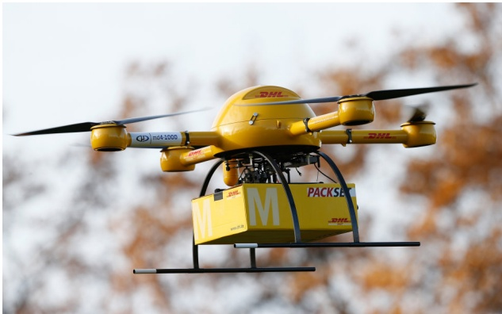

Figure 1: Example of a delivery drone. Photo by Sam Churchill <sup>1</sup>.

exceed 55 pounds (Choi-Fitzpatrick et al., 2016). Nonetheless, the drone being within the visual line of sight during the operation is still a prevailing rule. The latter regulation means that fully automated drone delivery still is a future scenario.

<small><span class="docvortex-page-footnote" data-block-type="page_footnote" style="color:#6b7280"><sup>1</sup>This image is available at: [https://www.flickr.com/photos/samchurchill/14586999783/](https://www.flickr.com/photos/samchurchill/14586999783/) and licensed under CC BY 2.0: [https://creativecommons.org/licenses/by/2.0/](https://creativecommons.org/licenses/by/2.0/)</span></small>

Looking at the potential use of drones to deliver goods, it can be seen that there are limitations to the distance, the flight endurance of the drone’s battery, and the capacity that these flying vehicles can carry. However, considering the synchronization of drones and trucks when delivering goods can be of great importance in reducing operational costs or delivery times. It is observable that the disadvantages of a truck is counteracted by the advantages of flying vehicles and vice versa. The use of airborne robots capable of safely grasping and transporting small packages will significantly change the delivery industry, since it will be an important tool to assist drivers in making deliveries, allowing more deliveries per hour without covering additional miles (Trop, 2016).

In the operations research literature, delivery of small packages are frequently formulated as a Vehicle Routing Problem (VRP) (Toth and Vigo, 2014) where a number of trucks are based at a common depot and delivery routes starting and ending at the depot are constructed in order to serve all delivery requests and minimize routing costs. After the emergence of drones as a delivery option it has been envisioned that each truck can be equipped with a supporting drone. The drone can take care of some of the deliveries while using the truck as launch and recovery site (allowing the truck to move between launch and recovery if the drone is used). Modelling the addition of drones leads to the Vehicle Routing Problem with Drones (VRP-D). The first works that study the cooperation between truck and drone used the Traveling Salesman Problem (TSP) (Applegate et al., 2011) as a base model.

The pioneers in studying the truck-drone problem were Murray and Chu (2015), who formulated the Flying Sidekick Traveling Salesman Problem (FSTSP). The problem is a variant of the TSP where only one truck equipped with a single drone delivers the goods to customers. The drone is dispatched from a location to deliver goods to a customer and meet again in a rendezvous location with the truck. While the drone is flying, the truck can visit other customers, however, it will have to recover the drone at the rendezvous location before the battery of the drone runs out. In this case, the objective is to minimize the completion time of the route. Recent studies, as Murray and Chu (2015) and those presented in Section 2, have investigated the advantages of using these two vehicles for operations management, comparing the results with distributing the goods only using the truck. The benefits obtained are noticeable in terms of completion time.

This paper studies an extension of the VRP where each truck is collaborating with a single UAV. Since the problem is a generalization of the classical VRP, it is N P-hard to solve. Although it is not the main contribution of the paper, a new mathematical formulation for the problem is presented, which is an extension of the FSTP for the multi-truck case, and includes capacity and time completion constraints, while having cost minimization as objective function. An Adaptive Large Neighborhood Search (ALNS) metaheuristic is presented for solving the multi-truck problem. The algorithm represents a new approach for route planning of both vehicles in cooperation. It is experimentally shown that solutions of very high quality can be obtained, and the results provide significant savings in operational cost compared to the truck-only case.

Section 2 presents a review of the literature related to Vehicle Routing Problems using drones for delivery of goods. Most of these studies focus on the TSP and there seems to be very few papers focusing on the application of several trucks. Section 3 reports the mathematical model for the VRP-D, which is inspired by the mathematical model presented by Murray and Chu (2015). The formulation includes different vehicles, multi-trucks, capacity constraints and time limitations. Section 4 is dedicated to the ALNS metaheuristic, which will be described in detail and adapted to solve this variant of the VRP. Furthermore, it is described how the initial solution is obtained. Section 5 deals with the generation and analysis of the instances used for the problem presented in this paper and the study of the performance of the selected algorithm to evaluate it in the different scenarios. Likewise, a comparison of the performance of the algorithm against the case of not using drones is presented and discussed. Finally, a study concerning the modification of different characteristics of the drones is assessed. The paper is concluded and future research is discussed in Section 6.

## 2 Related Literature

Technological progress has allowed drones to be increasingly used in the civilian sector, where one of the most immediate applications is the delivery of goods. This extends the classical TSP and the VRP to use UAVs for complete or partial delivery. The literature for TSP and VRP is comprehensive as can be seen in Applegate et al. (2011), Eksioglu et al. (2009) and Toth and Vigo (2014). Among the many variants of these problems, there are a few papers considering delivery of goods in combination with UAVs. Also, there are conceptually related variants of these problems in the literature.

The model considered in this paper has similarities with the FSTSP formulation by Murray and Chu (2015). This is an optimization problem of parcel deliveries using a single truck with a single drone in synchronization. The objective is to reduce the duration time of the route to service all customers and return both vehicles to the depot. The paper also presents a different problem that is applicable to scenarios in which the distribution center is close to a significant proportion of customer that may be serviced by the UAV, the Parallel Drone Scheduling TSP (PDSTSP). In this problem, a single truck and a fleet of UAVs work together to deliver the goods to customers, although synchronization between the UAV and the truck is not needed since the truck operates independently on the remaining customers. Furthermore, saving heuristics for both formulations are provided by the authors, obtaining considerable improvements in the solution with respect to the truck-only case. Later, Ponza (2016) presents a Simulated Annealing metaheuristic for the resolution of an improved formulation for the FSTSP, whereas Freitas and Penna (2018) present a hybrid heuristic, where the initial solution is obtained by solving a MIP model for the TSP route, which is converted to a FSTSP by an improvement heuristic, based on several truck-only neighborhoods and a single truck-to-drone relocation. Ham (2018) studies an extension of the PDSTSP, where the drone can perform multiple trips to carry out pick-up and deliver operations. A Constraint Programming approach is proposed to solve this variant of the problem.

Within the last-mile delivery concept, in which a truck collaborates with a drone to make deliveries, there are more problems that are worth noting, such as the TSP-D (Agatz et al., 2015). The TSP-D is very similar to the FSTSP, but it is assumed that the drone is faster than the truck by a factor α and both vehicles travel on the same road network. It is therefore possible to provide a bound on the maximum attainable gains that can be achieved by using the two vehicles in union versus the simple case of using a truck exclusively. Moreover, this problem is assuming that the truck can wait for the drone in the same position that it is launched, an aspect that was not considered in FSTSP. A heuristic approach is presented, based on a route first—cluster second procedure with a greedy and exact partitioning algorithm as well as the consideration of an iterative improvement procedure to find a solution. Later, Poikonen et al. (2018) presented different heuristics based on a branch-and-bound algorithm for the TSP-D, considering only a subset of the potential package delivery orders at each node. Mathew et al. (2015) study a similar problem, called the Heterogeneous Delivery Problem (HDP), for the scheduling and routing problem of the cooperating vehicles in urban environments, while minimizing the total delivery cost. In this problem all deliveries are done by the drone and the truck is waiting at a single point (called a street vertex) while the drone is doing a delivery. A number of street vertices are given and not all of them have to be visited. The authors propose a solution approach by reducing the problem to the Generalized Traveling Salesman Problem (GTSP), which can be solved by existing heuristic methods. Moreover, the authors propose additional algorithms for solving the special case of the HDP where all street vertices are considered warehouses. In this version the truck becomes superfluous, since the drone can just fly between warehouses to collect goods to be delivered. Lastly, an iterative approach for the TSP-D is proposed by Yurek and Ozmutlu (2018). At each iteration the solution approach is divided into two stages, determining the truck route in the first-stage and assigning the drone customers in the second-stage.

Another problem for the parcel delivery with UAVs is considered in Ha et al. (2018) Like FSTSP, the launch and recovery operations for the drone are again restricted to different locations. A Mixed Integer Linear Programming (MILP) formulation is proposed as an extension to the formulation proposed by Murray and Chu (2015). Nonetheless, the objective function is focused on minimizing the overall operational costs, which includes the transportation cost as well as a penalty for wasted time, incurred when vehicles need to wait for each other. The paper presents two different heuristic approaches, known as TSP-LS and Greedy Randomized Adaptive Search Procedure (GRASP). The first algorithm is an adaptation of the saving-algorithm proposed by Murray and Chu (2015) to solve the cost-minimization problem, whereas the second algorithm is a metaheuristic based on a split procedure to construct a feasible solution of the TSP-D from a TSP solution. The performance of the methods is compared under different objective functions and construction heuristics. The effectiveness of the GRASP algorithm is documented, outperforming TSP-LS in terms of solution quality. Furthermore, the GRASP algorithm, with a min-time objective function, is compared with FSTSP, achieving better results for small instances with 10 customers.

Four versions of a “single drone and single truck” routing problem are studied by bin Othman et al. (2017). Common to all versions is that the truck’s route is predetermined. The two main variations of the problem considered are 1) the truck can stay at a single point while launching and receiving the drone, 2) the truck has to move between launching and receiving the drone. Two more variants are obtained by disallowing that the drone can move together with the truck (hitch a ride). The paper studies complexity of the different versions, polynomially solvable cases and approximation algorithms.

Carlsson and Song (2017) and Campbell et al. (2017) use continuous approximation methods for the strategic analysis of the design of hybrid truck-drone delivery systems. Carlsson and Song (2017) show that the efficiency of the delivery system is proportional to the square root of the ratio of the speed of both vehicles. Moreover, the authors develop intuitive heuristic rules to determine the coordinated routes of the vehicles. On the other hand, the results provided by Campbell et al. (2017) highlight the economic advantages of such a system in many settings, especially with multiple drones per truck. However, the authors show that the benefits from the truck-drone delivery system are dependent on the relative operating and idle costs of both vehicles, and spatial density of customers.

The drone literature is mainly focused on the use of drones exclusively or in combination with a single truck, especially with focus on delivery operations. There seems to be few papers dealing with the joint work of a fleet of trucks equipped with a series of drones. The most interesting is presented by Wang et al. (2017), which presents a theoretical study of the maximum savings obtained when using drones in a fleet of vehicles. The goal remains to minimize the total time to complete the routes. The coordination between the vehicles in this problem provides a theoretical bound on how beneficial the drones can be, confirming in the results the time saved in comparison to the case of simply using the fleet of trucks. This work is extended by Poikonen et al. (2017) where the effect of limited drone battery life and the effect of having two different distance matrices for the trucks and drones are considered. Relations to the close-enough VRP (CEVRP) are also considered. In the CEVRP, the truck does not have to visit all customer but just travel “close-enough” to each customer. An application of this problem is, for example, reading of meters using wireless technology. Pugliese and Guerriero (2017) present a mathematical formulation for the multi-truck approach with time windows and minimization of the total transportation cost, and Daknama and Kraus (2017) propose a nested-local search heuristic for solving the Vehicle Routing with Drones (VRD), where drones are allowed to be travel between trucks.

Finally, Otto et al. (2018) present an exhaustive review of optimization problems considering the use of drones for operations planning to civil applications. The authors give an overview of more than 218 articles in the field, most of them published in the five past years, but they do not include papers dealing with military and security applications of drones or obstacle-avoiding path planning. The paper highlights the recent growing presence of drones in business activities and the advantage to combine and assist the operations to available vehicles and robots.

## 3 The Vehicle Routing Problem with Drones

Given a fleet of homogeneous driver-operated delivery trucks, each of them equipped with a single UAV or drone, the task is to deliver packages to a given set of customers, each of whom must be served exactly once by either the driver-operated delivery truck or the UAV operating in coordination with the truck. Each truck with its corresponding UAV on board must depart from, and return to, a single depot. The two vehicles may depart (or return) either in tandem or independently to the depot. When the drone is not operational, it will be transported by the truck, saving battery power. The drones can be dispatched from the truck and picked up again by the same truck in a different location multiple times along the truck route. However, the drone can visit only a single customer each time due to the limited payload capacity and there is a maximum flying endurance due to battery capacity. A time is associated with the launch and recovery of the drone, as well as a service time for the customers when delivering the packages. The trucks have a limited capacity that must be respected and the route of the trucks should not exceed a certain time limit during the day of operation. The objective is to minimize the overall cost of the operation of using the fleet of vehicles while respecting the capacity and time constraint, and while meeting the customers’ demand. A visual representation of a solution to the problem is depicted in Figure 2.

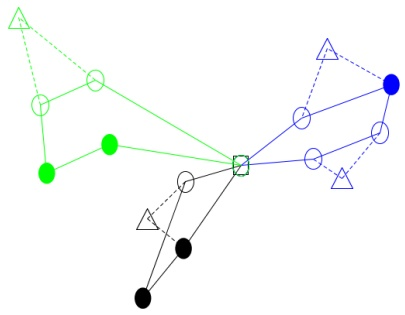

Figure 2: Example of a VRP-D solution. The solid lines indicate the route of the trucks, while the dashed lines indicate the trips of the drones. Filled circle nodes represent customers that, due to a heavy delivery, can only be visited by the truck and emptied circle nodes represent customers that can be visited by either the truck or the drone. Triangle nodes corresponds to drone visits in the solution.

## 3.1 Mathematical Formulation for the VRP-D

We will now present a mathematical formulation for the VRP-D. The mathematical formulation is an extension of the MIP formulation of the FSTSP presented in Murray and Chu (2015), taking into account the time at which a truck and/or a UAV visits a customer. The truck and the UAV must be synchronized in time during the truck’s route, except at the end, where the truck and the UAV can arrive separately to the depot. Moreover, the capacity and the completion time of the routes are considered. The mathematical formulation is extended with an extra index indicating the truck assigned to the route.

## 3.1.1 Definitions

The following sets will be used for this formulation.

$C = \{ 1 , 2 , . . . , c \}$ : Set of customers.

$C ^ { \prime } \subseteq C$ : Subset of customers that may be serviced by the UAV, i.e. whose demand can be carried by a drone.

$D = \{ 0 , c + 1 \}$ : Depot nodes indicating the beginning and end of the route.

$N = \{ 0 , 1 , . . . , c , c + 1 \}$ : Set of all nodes.

$N _ { 0 } = \{ 0 , 1 , 2 , . . . c \}$ : Set of nodes from which a vehicle may depart.

$N _ { + } = \{ 1 , 2 , . . . , c , c + 1 \}$ : Set of nodes to which a vehicle may arrive.

$\Delta ^ { + } ( i ) = N _ { + } \setminus \{ i \}$ : The set of nodes that can be reached from node $i \in N _ { 0 }$

$\Delta ^ { - } ( i ) = N _ { 0 } \setminus \{ i \}$ : The set of nodes that can be used to reach node $i \in N _ { + }$

$A = \{ ( i , j ) : i \in N _ { 0 } , j \in \Delta ^ { + } ( i ) \}$ : Set of feasible arcs.

$V = \{ 1 , . . . , m \}$ : Set of homogeneous trucks, where m is a sufficiently large number.

The parameters required for the mathematical formulation are introduced below. The truck and the drone do not present the same features, and this is reflected by different parameters for each vehicle.

• $\tau _ { i j } ^ { T }$ : Time required for a truck to travel from $i \in N _ { 0 }$ to $j \in N _ { + }$

• $\tau _ { i j } ^ { D }$ : Time required for a UAV to travel from $i \in N _ { 0 }$ to $j \in N _ { + }$

• $c _ { i j } ^ { T }$ : Cost for operating a truck to travel from $i \in N _ { 0 }$ to $j \in N _ { + }$

• $c _ { i j } ^ { D }$ : Cost for operating a UAV to travel from $i \in N _ { 0 }$ to $j \in N _ { + }$

• $Q$ : Capacity of the trucks.

$q _ { i }$ : Demand of customer $i \in C$

• e : Flight endurance of the battery of the UAV.

$S e _ { i } ^ { T }$ : Service time for the truck at customer $i \in C$

$S e _ { i } ^ { D }$ : Service time for the UAV at customer $i \in C ^ { \prime }$

$S L$ : Required time for launching the UAV.

• SR : Required time for recovering the UAV.

• M : A sufficiently large number. A precise value is given in the following.

$T _ { m a x }$ : Maximum duration time of a route.

Furthermore, additional notation is needed for the identification of the possible threenode sorties from where a UAV can operate in the problem. Let P be the set of possible sorties, represented by the tuples $\langle i , j , k \rangle$ . The first node represents the launch position of the UAV, the second node represents the customer that is visited by the UAV, and finally, the third node represents the recovery position of the UAV. Hence, an element $\langle i , j , k \rangle$ belongs to the set P if the following conditions hold:

• The launch position $i \; \in \; N _ { 0 }$ of a tuple is the location from which a UAV can be launched, corresponding to the location from which a truck can depart.

• The delivery position $j \in \{ C ^ { \prime } : j \neq i \}$ of a tuple is the set of customers that can be serviced by the UAV different from the launch position i.

• The rendezvous position or recovery position $k \in \{ N _ { + } : k \neq i , k \neq j , S L + S R + \tau _ { i j } ^ { D } +$ $\tau _ { j k } ^ { D } + S e _ { j } ^ { D } \leq e \}$ of a tuple is the location at which the UAV can be recovered by the truck while respecting the battery life.

Furthermore, the tuples $\langle 0 , i , c + 1 \rangle$ are excluded from P for all $i   \in   C ^ { \prime }$ . These tuples correspond to drone deliveries with launch and rendezvous position at the depot. For a sortie $s = \langle i , j , k \rangle$ , we define its cost as $c _ { s } ^ { D } = c _ { i j } ^ { D } + c _ { j k } ^ { D }$ . We define $P _ { i } ^ { + }$ as all the sorties from P with a launch at node $i   \in   N _ { 0 } , \; P _ { k } ^ { - }$ as all the sorties from $P$ with a recovery at node $k \in N _ { + }$ and $P _ { j }$ as all the sorties from $P$ that delivers to customer $j \in C ^ { \prime }$

The formulation makes use of the following variables.

• $x _ { i j } ^ { v }$ : Binary variable indicating if truck $v \in V$ travels from $i \in N _ { 0 }$ to $j \in N _ { + }$

• $u _ { i } ^ { v }$ : Continuous variable indicating the position of the visit $i   \in   N$ in the route of truck $v \in V$

$t _ { i } ^ { v }$ : Continuous variable indicating the time in the route of truck $v \in V$ arriving to location $i \in N$

$t _ { i } ^ { \prime v }$ : Continuous variable indicating the time of a UAV from truck $v \in V$ arriving to location $i \in N$

$p _ { i j } ^ { v }$ : Binary variable indicating if a customer $j \in C$ is visited after location $i \in N _ { 0 }$ in the route of truck $v \in V$

• $y _ { s } ^ { v }$ : Binary variable indicating if the sortie $s \in P$ is used in the route of truck $v \in V$

## 3.1.2 Mathematical Formulation

We can now formulate a MIP model for the VRP-D.

$$
\left| \min \quad \sum_ {v \in V} \Big (\sum_ {(i, j) \in A} c _ {i j} ^ {T} x _ {i j} ^ {v} + \sum_ {s \in P} c _ {s} ^ {D} y _ {s} ^ {v} \Big) \right|\tag{1}
$$

Subject to:

$$
\sum_ {v \in V} \sum_ {i \in \Delta^ {-} (j)} x _ {i j} ^ {v} + \sum_ {v \in V} \sum_ {s \in P _ {j}} y _ {s} ^ {v} = 1
$$

$$
j \in C\tag{2}
$$

$$
\sum_ {j \in N _ {+}} x _ {0, j} ^ {v} \leq 1
$$

$$
v \in V\tag{3}
$$

$$
\sum_ {i \in N _ {0}} x _ {i, c + 1} ^ {v} \leq 1
$$

$$
v \in V\tag{4}
$$

$$
x _ {0, c + 1} ^ {v} = 0
$$

$$
\left| v \in V \right|\tag{5}
$$

$$
\left| \sum_ {i \in \Delta^ {-} (j)} x _ {i j} ^ {v} = \sum_ {k \in \Delta^ {+} (j)} x _ {j k} ^ {v} \right|
$$

$$
v \in V, j \in C\tag{6}
$$

$$
u _ {i} ^ {v} + 1 \leq u _ {j} ^ {v} + M (1 - x _ {i j} ^ {v})
$$

$$
v \in V, (i, j) \in A\tag{7}
$$

$$
u _ {j} ^ {v} \leq M \sum_ {i \in \Delta^ {-} (j)} x _ {i j} ^ {v}
$$

$$
v \in V, j \in N _ {+}\tag{8}
$$

$$
\left| \sum_ {j \in C} \left(\sum_ {k \in \Delta^ {+} (j)} q _ {j} x _ {j k} ^ {v} + \sum_ {s \in P _ {j}} q _ {j} y _ {s} ^ {v}\right) \leq Q \right|
$$

$$
\left| v \in V \right|\tag{9}
$$

$$
\left| \sum_ {s \in P _ {i} ^ {+}} y _ {s} ^ {v} \leq 1 \right|
$$

$$
v \in V, i \in N _ {0}\tag{10}
$$

$$
\left| \sum_ {s \in P _ {k} ^ {-}} y _ {s} ^ {v} \leq 1 \right|
$$

$$
v \in V, k \in N_{+}\tag{11}
$$

$$
2 y _ {s} ^ {v} \leq \sum_ {h \in \Delta^ {+} (i)} x _ {i h} ^ {v} + \sum_ {l \in \Delta^ {-} (k)} x _ {l k} ^ {v}
$$

$$
v \in V, s = \langle i, j, k \rangle \in P\tag{12}
$$

$$
t _ {0} ^ {v} = 0
$$

$$
v \in V\tag{13}
$$

$$
\left| t _ {0} ^ {\prime v} = 0 \right|
$$

$$
v \in V\tag{14}
$$

$$
t _ {c + 1} ^ {v} \leq T _ {m a x} \sum_ {i \in N _ {0}} x _ {i, c + 1} ^ {v}
$$

$$
\left| v \in V \right|\tag{15}
$$

$$
\left| t _ {c + 1} ^ {\prime v} \leq T _ {m a x} \sum_ {s \in P _ {c + 1} ^ {-}} y _ {s} ^ {v} \right|
$$

$$
v \in V\tag{16}
$$

$$
t _ {h} ^ {v} + \tau_ {h k} ^ {T} + S e _ {h} ^ {T} +
$$

$$
\left| S L \sum_ {s \in P ^ {+} (h)} y _ {s} ^ {v} + S R \sum_ {s \in P ^ {-} (k)} y _ {s} ^ {v} \leq t _ {k} ^ {v} + T _ {\max} \left(1 - x _ {h k} ^ {v}\right) \quad v \in V, (h, k) \in A \right|\tag{17}
$$

$$
t _ {i} ^ {v} + \tau_ {i j} ^ {D} + S L - T _ {\max} \left(1 - \sum_ {s = 1} ^ {n} y _ {s} ^ {v}\right) \leq t _ {j} ^ {\prime v}
$$

$$
v \in V, (i, j) \in A\tag{18}
$$

$$
s \in P _ {i} ^ {+} \cap P _ {j}
$$

$$
t _ {j} ^ {\prime v} + \tau_ {j k} ^ {D} + S e _ {j} ^ {D} + S R - T _ {m a x} \Big (1 - \sum y _ {s} ^ {v} \Big) \leq t _ {k} ^ {\prime v} \quad v \in V, j \in C ^ {\prime}, k \in \Delta^ {+} (j)\tag{19}
$$

$$
s \in P _ {j} \cap P _ {k} ^ {-}
$$

$$
t _ {i} ^ {v} - T _ {\max} \left(1 - \sum_ {s \in P _ {i} ^ {+}} y _ {s} ^ {v}\right) \leq t _ {i} ^ {\prime v}
$$

$$
v \in V, i \in N _ {0}\tag{20}
$$

$$
\left| t _ {i} ^ {v} + T _ {\max} \left(1 - \sum_ {s \in P _ {i} ^ {+}} y _ {s} ^ {v}\right) \geq t _ {i} ^ {\prime v} \right|
$$

$$
v \in V, i \in N _ {0}\tag{21}
$$

$$
t _ {k} ^ {v} - T _ {\max} \left(1 - \sum_ {s \in P _ {k} ^ {-}} y _ {s} ^ {v}\right) \leq t _ {k} ^ {\prime v}
$$

$$
v \in V, k \in C\tag{22}
$$

$$
t _ {k} ^ {v} + T _ {\max} \left(1 - \sum_ {s \in P _ {k} ^ {-}} y _ {s} ^ {v}\right) \geq t _ {k} ^ {\prime v}
$$

$$
v \in V, k \in C\tag{23}
$$

$$
e + T _ {m a x} \Big (1 - \sum_ {s \in P _ {i} ^ {+} \cap P _ {k} ^ {-}} y _ {s} ^ {v}) \geq t _ {k} ^ {\prime v} - t _ {i} ^ {\prime v} \Big)
$$

$$
v \in V, i \in N _ {0}, k \in N _ {+}\tag{24}
$$

$$
(u _ {j} ^ {v} - u _ {i} ^ {v}) \leq M p _ {i j} ^ {v}
$$

$$
v \in V, i \in N _ {0}, j \in C \setminus \{i \}\tag{25}
$$

$$
(u _ {j} ^ {v} - u _ {i} ^ {v}) \geq M (p _ {i j} ^ {v} - 1) + 1
$$

$$
v \in V, i \in N _ {0}, j \in C \setminus \{i \}\tag{26}
$$

$$
t _ {k} ^ {\prime v} - T _ {m a x} \Big (3 - \sum_ {s \in (P _ {i} ^ {+} \cap P _ {k} ^ {-})} y _ {s} ^ {v} - \sum_ {s \in P _ {b} ^ {+}} y _ {s} ^ {v} - p _ {i b} ^ {v} \Big) \leq t _ {b} ^ {\prime v}
$$

$$
v \in V, i \in N _ {0}, k \in N _ {+}, b \in C \setminus\tag{{b}}
$$

$$
x _ {i j} ^ {v} \in \{0, 1 \}\tag{27}
$$

$$
v \in V, (i, j) \in A\tag{28}
$$

$$
y _ {s} ^ {v} \in \{0, 1 \}
$$

$$
v \in V, s \in P\tag{29}
$$

$$
u _ {i} ^ {v}, t _ {i} ^ {v}, t _ {i} ^ {\prime v} \geq 0
$$

$$
v \in V, i \in N\tag{30}
$$

$$
p _ {i j} ^ {v} \in \{0, 1 \}
$$

$$
v \in V, i \in N _ {0}, j \in C \setminus \{i \}\tag{31}
$$

The objective function (1) minimizes the operational cost when visiting the customers. Constraint (2) ensures that each customer is visited exactly once, either by a truck or by a drone. Constraint (3) ensures that all the trucks must depart from the depot at most once. Similarly in (4), it has to be ensured that all the trucks must return to the depot at most once. Moreover, it is prohibited to travel between depots as given by (5). The flow conservation constraints for the truck are defined in (6). The subtour elimination constraints for the truck are defined in Constraints (7) and (8), referring to the position a customer is visited in the truck’s route. Moreover, the capacity constraint is given in (9).

Additionally, the UAV can be launched and recovered at most once from each node, as given by Constraints (10) and (11). Constraint (12) makes sure that if the UAV is launched and recovered in location $i \in N _ { 0 }$ and $k \in N _ { + }$ respectively, then the truck visits the same locations.

The initialization of the times for the truck and the UAV at the beginning of each route are given in (13) and (14). Moreover, the maximum duration of a route is established by imposing a limit to the time of returning to the depot by the vehicles, as stated in (15) and (16).

The time constraints (17) for the truck movement, defines the time at which the truck arrives to the location with respect to the corresponding actions that can happen in between. The time constraints for the drone movement, defining the time a UAV visits a customer according to the truck position are defined in (18) and (19). Constraint (18) ensures that if a UAV is launched from location $i   \in   N _ { 0 }$ to customer $j \in C ^ { \prime }$ , then the arrival time for the UAV to customer $j$ has to be greater than the arrival time for the truck to location i plus the travel time for the UAV between the location and the launch time of the UAV. Similarly for the recovery operation, (19) ensures that if a UAV finishes serving a customer $j \in C ^ { \prime }$ and flies back to the truck at location $k \in N _ { + }$ , then the arrival time of the UAV to location k has to be greater than the arrival time of the UAV to location $j$ plus the travel time between the locations, the service time of the UAV at customer $j$ and the recovering time of the UAV.

The time synchronization constraints for the truck and the UAV are defined in (20)–(23). These constraints impose that the launch and recovery operations are time synchronized. Note that the synchronization is not needed when the truck and the UAV are separately coming back to the depot, hence the constraints (22) and (23) are defined for the set of customer C instead of $N _ { \pm }$

The endurance constraint for the battery of the UAV is given by the launch and recovery variables. Constraint (24) assures that if a UAV is launched from position $i \in N _ { 0 }$ to customer $j \in C ^ { \prime }$ to be recovered at position $k \in N _ { + }$ , then the difference in time between the operations has to satisfy the endurance time of the battery.

The binary variable $p _ { i j } ^ { v }$ defines the order in which the truck makes the visits, establishing whether one customer is visited before another on the route. The value for this variable is assigned according to the difference in the position between the location as stated in (25) and (26). Assuming the departure location $i   \in   N _ { 0 }$ and the customer $j \in C$ , if the truck does visit the customer $j$ after being in location $i ,$ then the difference between the position variables $u _ { i } ^ { v }$ will be positive, imposing the value 1 to $p _ { i j } ^ { v }$ . Otherwise, if the difference is negative, $p _ { i j } ^ { v }$ is imposed to 0. When a truck does not visit a customer in the route, the previous constraints (7)–(8) set the position of the visit to zero. Therefore, in constraint (26) a 1 is added on the right hand side to ensure that $p _ { i j } ^ { v }$ is set to zero when both $u _ { i } ^ { v }$ and $u _ { j } ^ { v }$ are zero.

Constraint (27) is defined to avoid that new launches occur while the UAV is already flying in the route. The arrival time of a UAV to another customer location $b \in C$ from which the UAV can be launched again has to be greater than the arrival time to the location $k \in N _ { + }$ if and only if a drone is recovered at location k occurred earlier. This is taken into account by the order in which the truck visits locations i and b $( p _ { i b } ^ { v } )$ , if a launch occurs from position b and if a drone is recovered at location k. Finally, the domain of the variables is defined in (28)–(31).

## 3.2 Discussion of the Mathematical Model

The mathematical formulation presented in Section 3.1 is an extension of the formulation presented by Murray and Chu (2015). The formulation keeps the sortie selection from the set P in a single variable and the variables are extended with an extra index to account for different trucks $\left( y _ { s } ^ { v } \right)$ . We have considered an unlimited homogeneous fleet of delivery trucks, assuming that there are no specific distinctions between them. As expected, the formulation becomes harder to solve with the inclusion of this extra index, increasing considerable the running time as the number of trucks and customers increase compared to the case of a single vehicle.

Contrary to Murray and Chu (2015), the objective function is no longer focused on reducing the completion time for the trucks returning to the depot, instead, there is a maximum duration time for all routes. This comes from the assumption that drivers have contracts with maximum workable-hours per day that has to be respected. Additionally, there is a cost $c _ { i j } ^ { T }$ and $c _ { i j } ^ { D }$ associated with the truck and the UAV respectively for traversing arc $( i , j )$ , where the cost entails for an estimation of the fuel consumption incurred by the vehicles. We are interested in studying the problem from a cost-minimization perspective, as seen in (1), rather than from a time-minimization. Technology is continuously developing, and in the near future, autonomous trucks will be available for delivery purposes, where drivers will no longer be needed. Therefore, the driver cost is neglected in this case. Moreover, we could also assume that the driver cost is a fixed cost already incurred in the drivers’ contracts. Therefore, it would be interesting to study the collaboration of both vehicles for delivery operations under a cost-minimization objective function, where the vehicles are operated within a time limit as long as they incur minimum cost. Furthermore, it is important to notice that drone-arc costs can be direction dependent in reality, due to the payload and speed, among many others. However, we do not have actual data for correctly modeling these generalizations, and hence assume that drone-arc costs are symmetric and independent of the load.

The endurance constraint (24) can be more easily defined than in Murray and Chu’s formulation. The number of constraints can be reduced, as it is not necessary to consider the arrival time of the UAV to the delivery position. Instead, the constraint only accounts for the time difference between the launch and recovery positions incurred by the UAV, if there exists such sortie.

The model presents several constraints regarding the prohibited moves that cannot be carried out by the UAV. These moves correspond to illegal dispatches of drones in the route. For a better understanding, as shown in Ponza (2016), visual representation of the prohibited moves are depicted in Figures 3-6. The solid and the dashed lines indicate the route of the truck and the UAV respectively. Similarly, circle nodes correspond to customers visited by the truck whereas triangle nodes correspond to customers visited by the drone. The filled squared node correspond to the single depot. Firstly, the truck cannot wait for the UAV in the same location from which it was launched. In the formulation, this move is not considered in the definition of the sorties and its visual representation can be seen in Figure 3. Similarly, due to the definition of the depot nodes, it is not allowed for a UAV to operate independently from the truck, i.e. start the operation from the depot, deliver the goods to the customer, and then come back to the depot. This is also ensured by the set of feasible sorties P. The visual representation of this prohibited move is similar to the previous one, but considering the depot node, as shown in Figure 4.

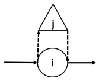

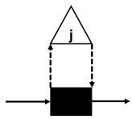

Figure 3: Prohibited move of the UAV for the launch and recovery operation.

Figure 4: Prohibited move of the independently operation of the UAV.

Finally, (27) is ensuring that new launches do not occur before the previous UAVs in the same route have been recovered. Regarding the definition of the variables $p _ { i j } ^ { v }$ , the time of the launch $t _ { b } ^ { \prime v }$ of the UAV from the location $b \in C$ is forced to be greater than the time of the recovery $t _ { k } ^ { \prime v }$ of the previous UAVs. The corresponding prohibited moves can be seen in Figures 5 and 6.

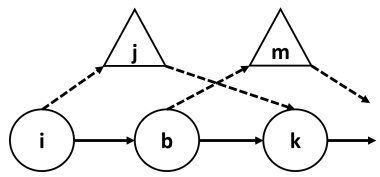

Figure 5: Prohibited move of new launches.

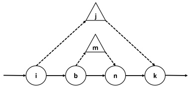

Figure 6: Prohibited move of new launches within a sortie.

## 3.3 Parameters

The mathematical formulation for the VRP-D introduces several parameters reflecting the characteristics and operation times related to the UAV and the truck. We have attempted to find values close to reality, but there are no eligible parameters to be considered in the models as drone delivery is still in early stages to be applied in reality. Table 1 summarizes the parameters and their values. The values have been found in the literature or have been used by companies in their prototype models.

Table 1: Values for the parameters in the main configuration of the problem.

| Parameter | Notation | Value | Reference |
| --- | --- | --- | --- |
| Launch Time | SL | 1 min | Murray and Chu (2015) |
| Recovery Time | SR | 1 min | Murray and Chu (2015) |
| Truck Speed | ν<sup>T</sup> | 35 mph | Ponza (2016) |
| Drone Speed | ν<sup>D</sup> | 50 mph | Trop (2016) |
| Endurance | e | 30 min | Kharpal (2016) |
| Truck Capacity w/ drones | Q | 1300 kg | See text |
| Truck Capacity w/o drones | Q<sup>∗</sup> | 1400 kg | See text |
| Drone Capacity | Q<sup>D</sup> | 5 kg | Trop (2016) |
| Fuel Price | fp | 1.13 e/ l | See text |
| Fuel Consumption | fc | 0.07 l/km | See text |
| Miles Converter | mc | 1.61 km/mi | - |
| Drone Factor Cost | α | 10 % | Kharpal (2016) |
| Maximum Route duration | T<sub>max</sub> | 8 hours | Standard working hours |

The subset $C ^ { \prime }$ of potential drone customers is determined by the maximum load capacity of a drone $Q ^ { D }$ . Given a customer $i \in C .$ , the customer is a potential drone customer if the drone can carried its demand, i.e $q _ { i }   \leq   Q ^ { D }$ . Amazon states that its drones can carry up to 5 pounds (2.27 kilograms) (Allain, 2013), although there are companies like Workhorse that are capable of carrying up to 10 pounds (4.54 kilograms) (Trop, 2016). As future technological achievements may increase the load limit, we set the maximum load for drones to 5 kg. Furthermore, the trucks used for the operations are assumed to be similar to Long Wheelbase Vans, such as a Ford Transit Custom Van 330 L2 2.2 TDCi 125 CV, with a total payload of 1400 kg and an average fuel consumption of 0.07 l/km, as indicated in its technical specifications. However, since the trucks have to be equipped with the UAV material (i.e. the drone, batteries, tools, among other things), the capacity of the truck is reduced by 100 kg. Therefore, the payload capacity of truck fleet is imposed to 1300 kg for the truck-drone case, whereas in the truck-only case, the truck capacity is imposed to 1400 kg.

The speed for the different vehicles is defined assuming the average speed in the operations. The speed limitation of the truck may vary according to the road network, but it is assumed that the trucks operate with a constant average speed of 35 mph (Ponza, 2016). For the UAV’s speed, we will look at companies researching drones for delivery operations, such as Amazon and Workhorse, stating that drones can fly at up to 50 mph (Trop, 2016). Similarly, regarding the endurance of the UAV, the battery total life is set to 30 minutes (Kharpal, 2016).

The distance $d _ { i j }$ between locations $i \in N _ { 0 }$ and $j \in N _ { + }$ in the problem is given as the Euclidean distance between the coordinates in the plane. This distance matrix can be used to determine the travel time matrix $\tau _ { i j } ^ { T }$ and $\tau _ { i j } ^ { D }$ for the truck and the UAV respectively.

Assuming the equation of motion, as the speed $\nu ^ { T , D }$ of the vehicles (UAV and truck respectively) was set to constant, the travel time matrix can be calculated as $\tau _ { i j } ^ { T , D } = d _ { i j } / \nu ^ { T , D }$

The cost matrix $c _ { i j } ^ { T , D }$ is determined by the distance matrix $d _ { i j }$ . The truck’s cost is related to the fuel price $f p$ and consumption rate f c as $c _ { i j } ^ { T } = f p \cdot f c \cdot m c \cdot d _ { i j }$

As the cost of using the UAV is considerably cheaper than using the truck, it is set to a factor α of the cost matrix for the truck, as $c _ { i j } ^ { \vec { D } } = \alpha \cdot \vec { c _ { i j } }$ . Although it might be difficult to determine a precise factor of the total cost, $\alpha = 0 . 1$ seems to be a good approximation, since Workhorse determined an approximate value of 2 cents per mile because of the electricity (Kharpal, 2016), which closely corresponds to between 10-15% of the total truck’s cost. Moreover, the fuel price is set to $1 . 1 3 \; \mathsf { e } \in / \mathrm { l }$ , as the average diesel price in Europe by the end of year 2017.

Finally, the model presents several big-M constraints. The value M is solely used in the subtour elimination constraints and in the order on which the truck visits the locations. As the $u _ { i } ^ { v }$ variables determines the position in the truck’s route, the worst case scenario is that only one truck visits all the customer and return to the depot and this is given by the cardinality of the set of all the nodes, i.e. $M = | N | = n + 2$

## 4 Adaptive Large Neighborhood Search

In this section we propose an ALNS metaheuristic for the VRP-D. The ALNS framework has been applied to many other VRP variants in the past and is often easy to adapt to new problems (Pisinger and Ropke, 2010). Large Neighborhood Search (LNS) was introduced by Shaw (1998) and is based on progressively improving an initial solution by repeatedly destroying and repairing the current solution. The ALNS framework presented by Ropke and Pisinger (2006) is an extension of LNS, which presents many destroy and repair meth ods that are statistically chosen according to the performance achieved during the search. Destroy methods eliminate part of the current solution, while repair methods rebuild the partial solution. Typically, the destroy methods contain some randomness to be able to destroy different parts of the solution and thus to diversify the search for new solutions. The repair methods can also be stochastic to avoid building the same solution if the same partial solution is encountered several times during the search. An important parameter of the metaheuristic is the degree of destruction. If a too small part of the solution is destroyed, it can be difficult for the method to escape local minima. On the other hand, if too much of the solution is destroyed, the repair can have difficulties reconstructing a good solution.

Let $\Omega ^ { - }$ and $\Omega ^ { + }$ denote the set of destroy and repair methods, respectively. At each iteration, a destroy method $d \in \Omega ^ { - }$ and a repair method $r \in \Omega ^ { + }$ are selected to modify the current solution. The selection of each of these methods are chosen probabilistically, based on the weights assigned to the different methods and using the roulette wheel selection principle. At the beginning, the weights are initialized with equal probability and they are updated iteratively with respect to a reaction factor $\rho \in [ 0 , 1 ]$ and the score Ψ of the

Table 2: Score of the corresponding method.

| Parameter Ψ | Description |
| --- | --- |
| σ<sub>1</sub> | The new solution resulted in a new global best solution |
| σ<sub>2</sub> | The new solution resulted in a solution which was accepted with a cost better than the cost of the current solution |
| σ<sub>3</sub> | The new solution resulted in a solution which was accepted with a cost worse than the cost of the current solution |
| σ<sub>4</sub> | The new solution is rejected |

Let $w _ { i j }$ be the weight of the method i at iteration $j .$ Therefore, after each iteration, the weights are updated as follows:

$$
w _ {i, j + 1} = \rho w _ {i j} + \Psi (1 - \rho)
$$

To avoid that the algorithm moves randomly through the solution space, it is necessary to control and accept the solutions that are created by each destroy/repair iteration. The ALNS metaheuristic is therefore extended with an acceptance criteria borrowed from Simulated Annealing (see e.g. Černỳ (1985) and Kirkpatrick et al. (1983)). The algorithm makes use of a temperature parameter $T$ that controls the acceptance probability. If a destroy/repair operation results in an solution $s ^ { t }$ with better objective value than the current solution $s ,$ then $s ^ { t }$ is always accepted. If the new solution $s ^ { t }$ has a higher objective value then $s ^ { t }$ is accepted with probability

$$
e ^ {\frac {f (s) - f (s ^ {t})}{T}}
$$

where $f ( s )$ denotes the objective value of s. We let $T$ start at value $T _ { s t }$ and it is linearly decreased towards zero (following Santini et al. (2018)). We wish to use time as a stopping criterion for the algorithm and for that reason we want $T$ to reach zero when the time has run out. Therefore, we control the temperature using the elapsed time. Let $t ^ { e l a p }$ denote the elapsed time since the algorithm was started and let $t ^ { m a x }$ denote the time limit imposed on the algorithm. We then update the temperature using the formula

$$
T = T _ {s t} \big (1 - \frac {t ^ {e l a p}}{t ^ {m a x}} \big)
$$

The algorithm is stopped as soon as $t ^ { e l a p } \geq t ^ { m a x }$ . The elapsed time is measured using CPU time.

The pseudo-code for the algorithm is given in Algorithm 1. Different from other ALNS metaheuristics the algorithm includes a feature that restores the best solution so far if a certain number of iterations has passed without any improvement (Lines 15 to 17 in Algorithm 1).

<div class="docvortex-algorithm" style="white-space: pre-wrap; font-family:monospace;">
Algorithm 1: Pseudo-Code for the ALNS Algorithm.
    input: Initial Temperature: $T_{st}$,
        Max iterations without improvement: $noImpvMax$,
        Time limit: $t^{max}$
$s \leftarrow InitialSolution()$;
$s^* \leftarrow s$;
$noImpv \leftarrow 0$ ;
while $t^{elap} &lt; t^{max}$ do
    Choose a destroy method $d()$ and a repair method $r()$ from $\Omega^{-}$ and $\Omega^{-}$;
    $s^t \leftarrow r(d(s))$;
    $T = T_{st}(1 - t^{elap}/t^{max})$;
    if $Random(0,1) &lt; \exp(\frac{f(s)-f(s^t)}{T})$ then
        $s \leftarrow s^t$;
    if $f(s) &lt; f(s^*)$ then
        $s^* \leftarrow s$;
        $noImpv \leftarrow 0$;
    else
        $noImpv \leftarrow noImpv + 1$;
        if $noImpv &gt; noImpvMax$ then
            $s \leftarrow s^*$ ;
            $noImpv \leftarrow 0$ ;
    Update scores of $\Omega^{-}$ and $\Omega^{+}$ based on acceptance criteria
return $s^*$;
</div>

## 4.1 Initial Solution

An initial solution is constructed by means of heuristics. The initial solution is divided into three steps: a construction algorithm that only considers service by truck; a local search algorithm that also only considers service using the trucks; and a drone addition algorithm.

The chosen construction algorithm in the first step is the Nearest Neighbor Algorithm. The truck route is built progressively looking for the nearest neighbor to the last visit added as long as the capacity and the time of the route have not been exceeded. If one of these resources is exceeded, a new route is initiated and the process is repeated until all customers have been visited. The solution will be improved in the second phase by means of an improvement heuristic through relocation moves (Fosin et al., 2014). The insertion of customers visited by drones is carried out in the third phase. First, a set D of all customers that can be visited by the drone in the current solution is constructed. Then, for each customer in D, the customer is removed from the truck route and all possible feasible sorties in the current solution where the customer is visited by the drone are identified. The selection of the sortie is performed by the function $F i n d S o r t i e ( c , s , \eta )$ as shown in Algorithm 2, which finds the best sortie where customer $c \in D$ is a drone customer in the partial solution s with respect to a threshold cost η. The check of the feasibility of the sortie in Line 6 ensures that prohibited moves are not constructed in the current solution. The customer is then returned to the truck route and the method continues until all customers in the subset D are checked. The sortie incurring the biggest saving is retrieved and it is added to the current solution. This phase is repeated until no more savings can be obtained.

```javascript
Algorithm 2: FindSortie(c, s, η) function for finding the best sortie for customer c in the partial solution s with respect to a threshold cost η.
input: Partial Solution: s,
    customer to insert as drone-customer: c,
    threshold cost: η
BestSortie = ∅;
for Each Route in s do
    if Capacity(Route) + qc < Q then
        for Pair Positions (i, k) in Route where i < k do
            Construct sortie p = ⟨i, c, k⟩ with launch-position i, delivery position c and recovery-position k;
            Check feasibility for sortie p ;
            if SL + SR + τdcD + τckD + SeC^D < e AND f(s) + CostSortie(p) < η then
                BestSortie ← p;
                Update η;
return BestSortie;
```

The initial solution is further improved by a local search heuristic with a string relocation neighborhood. Basically, the local search heuristic selects a string of customers to be relocated in the same order somewhere else in the current solution. The operator depends on the route to relocate the string, defining a 2−opt move if the string is relocated in the same route and a string relocation move if the string is relocated to another route. The string can have any length, but the start location and end location of the string should not be locations that are visited while a drone is conducting a sortie. The implementation of the string relocation may improve the obtained solution in the previous phases, as it is able to eliminate crosses between visits that cannot be eliminated by single relocation moves. Figure 7 presents examples of how a string is relocated in the same route (top) and in another route (bottom). It can be seen in green the string to be relocated, while the read arcs corresponds to the arcs that will be removed (left) and added afterwards (right).

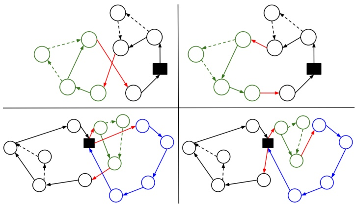

Figure 7: Example of the String Relocation algorithm in the same route (top) and in another route (bottom). On the $l e f t ,$ there is the initial solution after the first three steps and on the right, there is the initial solution improved after the string relocation algorithm.

## 4.2 Destroy Methods

In each iteration, the ALNS algorithm destroys a part of the current solution. The number $\beta$ of customers to remove is controlled by the parameters $\delta ,   c _ { l o w }$ and $c _ { l i m }$ using the formula

$$
\beta = \min \Big (\max (c _ {l o w}, \delta \cdot | C |), c _ {l i m} \Big)\tag{32}
$$

Here, $\delta$ is the ratio of customers to remove, while $c _ { l o w }$ and $c _ { l i m }$ defines absolute lower and upper bounds on the number customers to remove. The parameter $c _ { l o w }$ is chosen as a random number between the interval 1 to 3 while parameter $c _ { l i m }$ is set to 40. In the formula we consider $\delta$ as the main parameter, but $c _ { l o w }$ and $c _ { l i m }$ are included to ensure that the values for $\beta$ are sensible even for very small and very large instances.

Two destroy methods are defined as described below. In each iteration one of them is chosen randomly with equal probability. The same probability is used throughout the whole course of the algorithm. The adaptive part of ALNS is therefore only used for the repair methods.

## 4.2.1 Random destroy

The first destroy method removes random customers from the solution until $\beta$ customers have been removed. If a customer that hosts a launch or recovery operation is chosen for removal, the corresponding drone customer(s) are removed as well. We note that both a launch and a recovery operation can take place at a single customer and therefore the removal of one truck customer can lead to the removal of two drone customers. Hence, the method may remove one or two more customers than specified by $\beta .$

## 4.2.2 Cluster destroy

In the second destroy method the removal of customers is carried out in a zone around a random seed customer. A random customer $c _ { 1 }$ , defining the focal point of the removal, is selected and removed from the current solution. Then, progressively, customers are removed until $\beta$ customers have been removed. In each step the next customer to be removed is chosen randomly from a subset of the two closest customers to the focal customer $c _ { 1 }$ in the current partial solution. The elimination of customers occurs in a concentrated zone of the current solution but adding some noise to the elimination procedure to avoid obtaining the same partial solution before the repair step. Like the previous random destroy method, if the corresponding customer to be removed presents a launch and/or recovery operation, the drone customer(s) will be removed as well. The pseudo-code for this destruction method is outlined in Algorithm 3. Notice that in line 9, removed is incremented by 1,2 or 3 depending on whether any extra drone customers are removed when removing c.

<div class="docvortex-algorithm" style="white-space: pre-wrap; font-family:monospace;">
Algorithm 3: Cluster Removal of Customers.
input: Current Solution: $s$,
    number of customers to remove: $\beta$
$c_1 \leftarrow \text{RandomCustomer}(s)$;
remove $c_1$ from $s$;
$removed \leftarrow c_1$;
while $removed &lt; \beta$ do
    $c \leftarrow \text{RandomCloseCustomer}(c_1, s)$;
    if $c$ is Launch and/or Recovery Position then
        remove drone customer(s) associated with $c$ from $s$
    remove $c$ from $s$;
    update $removed$;
return $s$;
</div>

## 4.3 Repair Methods

During the second phase, the algorithm rebuilds the current partial solution. The destroy step has removed a subset of customers (denoted D) from the solution and these need to be reinserted. The chosen repair methods are greedy algorithms, as they repair the solution by inserting the customers from D one-by-one in the position that seems most promising. The repair methods ensure that infeasible solutions are not constructed. If no feasible insertion for a customer can be found in the current partial solution by the repair method, the customer is kept for a later insertion or a new route is opened to serve such customer. The ability to open a new route ensures that the repair methods always will find a feasible solution, since it is always feasible to serve a customer by a truck, when the customer is alone on the truck route. The adaptive part of the algorithm is defined in the selection of repair methods. These methods indicate the strategy to be followed when deciding how to reconstruct the partial solution. Four repair methods are defined and the ALNS metaheuristic chooses one of them according to the corresponding weights which are assigned to the repair methods iteratively. The repair methods are described in the following subsections.

## 4.3.1 Greedy truck-first sortie-second repair method

The first repair method is divided in two phases. Phase one inserts the customers from D into the routes as truck visits while phase two changes the service of some customers from truck to drone. The method is shown in Algorithm 4. The first phase of the repair method takes place in Lines 1–4. A random customer from D is selected and the function TruckBestInsertion $( c , s )$ inserts customer c in the partial solution s by a Best Insertion algorithm, i.e. at the position that increases cost the least. The function only considers truck-service insertions in the current routes and the opening of a new route for the selected customer c. Moreover, as the truck-insertion can be performed within a sortie, the function also checks if the endurance time of a sortie is respected after the insertion. Hence, only feasible solutions are considered when inserting the customers in the current partial solution.

The procedure is repeated until no more customers are left in D. Lines 6–17 implement phase two of the algorithm. Similarly, a random customer is selected from the set C of all customers in the current solution s. In line 9 we check if the selected customer c currently is visited as a truck-only customer (no launch or recovery is taking place at c) and we check whether the demand $q _ { c }$ of customer c is within the drone capacity $Q ^ { D }$ . If these checks are positive, we remove the customer from the route and we attempt to find a suitable way of serving c by a drone using the function FindSortie(c, s, η), as defined in Algorithm 2, where η is the objective value of s before the removal of customers c. Only if this results in a solution with lower cost, the move is carried out.

<div class="docvortex-algorithm" style="white-space: pre-wrap; font-family:monospace;">
Algorithm 4: Repair method Greedy truck-first sortie-second.
    input: Partial solution: $s$,
        set of free customers: $D$
while $D \neq \emptyset$ do
    $c \leftarrow \text{RandomCustomer}(D)$;
    $D = D \setminus \{c\}$;
    TruckBestInsertion($c, s$);
$C = \text{AllCustomers}(s)$ ;
while $C \neq \emptyset$ do
    $c \leftarrow \text{RandomCustomer}(C)$;
    $C = C \setminus \{c\}$;
    if $q_c \le Q^D$ AND Type($c$) = Truck then
        $s' \leftarrow s$;
        $\eta = f(s')$;
        $s \leftarrow s \setminus \{c\}$;
        $p \leftarrow \text{FindSortie}(c, s, \eta)$;
        if $p \neq \emptyset$ then
            $s \leftarrow s \cup \{p\}$
        else
            $s \leftarrow s'$;
return $s$;
</div>

Figure 8 shows an example of the repair method. Initially, a set of customers has been removed from the current solution (Figure 8 left). Then, the truck route is reconstructed through the best insertion algorithm for the removed customers (Figure 8 middle). Finally, for all those customers that can be still visited by a drone, the algorithm finds the best sortie to add in the current solution (Figure 8 right).

## 4.3.2 Nearby-Area truck-first sortie-second repair method

This repair method works in a similar way as the previous repair method presented in Section 4.3.1, however, the seeking of new solutions in the neighborhood is no longer performed by the Best Insertion algorithm. The method is divided in two phases, as defined previously. Nonetheless, during the first phase, the customers are inserted into the routes as truck visits by randomly selecting a feasible position from a set of nearby positions to the customer in the current partial solution. The nearby area is defined within a 5-mile range. Furthermore, in the second-phase, the service of some customers is changed from truck to drone. Similarly as before, a random truck-only customer c with a portable demand by a drone $( q _ { c } \leq Q ^ { D } )$ is selected. The customer is removed from the route and we identify all the feasible sorties that can be added to the current partial solution as presented in function $F i n d S o r t i e ( c , s , \eta )$ . However, instead of selecting the sortie which incurs the biggest saving, we randomly select a sortie that does not increase the cost of the partial solution more than 10% with respect to the partial solution before the removal. This method can be seen as a weaker version of the previous repair method presented in Section 4.3.1. Instances of smaller size can benefit from this method, as it presents a greater variability when searching for sorties.

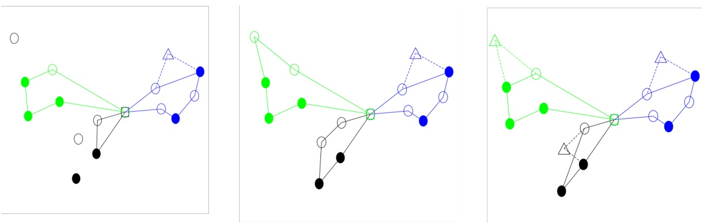

Figure 8: Example of Greedy truck-first and sortie-second repair method in the algorithm. The solid lines indicate the route of the trucks, while the dashed lines indicate the trips of the drones. Filled circle nodes represent customers that can only be visited by the truck and circle nodes represent customers that can be visited by either the truck or the drone. Triangle nodes corresponds to drone visits in the solution.

## 4.3.3 Closest insertion repair method

The next repair method attempts to insert customers using both truck and drone services, as outlined in Algorithm 5. For each free customer $c _ { \gamma }$ it only attempts insertion into one route, namely the one that contains the customer closest to $c$ in the current partial solution, this takes place in lines $5 { - } 7 .$ . The function AttemptBestInsertion $( c , r )$ considers every feasible insertion of $c$ into route $r ,$ both using the truck and the drone and performs the least costly insertion. If it is not possible to insert c in $r$ then c is added to the set of leftover customers $D _ { N }$ . It can be observed that this repair method internally calls another repair method, as the customers left in $D _ { N }$ are inserted using the repair method described in Section 4.3.1 (see Line 10).

<div class="docvortex-algorithm" style="white-space: pre-wrap; font-family:monospace;">
Algorithm 5: Repair method Closest Insertion.
    input: Partial solution: $s$,
        set off free customers: $D$
$D_N = \emptyset$;
while $D \neq \emptyset$ do
    $c \leftarrow \text{RandomCustomer}(D)$;
    $D = D \setminus \{c\}$;
    $c' \leftarrow \text{NearestCustomer}(c, s)$;
    $r \leftarrow \text{RouteOf}(c')$;
    if $AttemptBestInsertion(c, r) = false$ then
        $D_N = D_N \cup \{c\}$ ;
if $D_N \neq \emptyset$ then
    $s \leftarrow \text{RepairTruckFirstSortieSecond}(D_N, s)$ (Algorithm 4);
return $s$;
</div>

## 4.3.4 Heavy insertion repair method

Finally, the last repair method follows a heavy-first policy. The method retrieves all customers from the set D with a demand greater than the drone capacity $Q ^ { D }$ , and these customers are removed from D and added to a new set $D _ { T }$ of truck customers to be inserted. First, a random truck-customer c from $D _ { T }$ is selected and inserted in the current partial solution s through the Best Insertion Algorithm, as defined in the function TruckBestInsertion $( c , s )$ . This process is repeated until no more customers are left in $D _ { T }$ In this way, we first introduce those customers that cannot be serviced by a UAV. Next, the remaining customers in D are inserted using the close insertion repair method described in Section 4.3.3. Similarly as before, there is also an internal call to the previous repair method. In the first place, the left-out customers in D are attempted to be inserted in the route of their closest active neighbor, and next, the remaining customers are greedily inserted as defined in Section 4.3.1.

## 5 Experiments and Empirical Results

The ALNS metaheuristic was implemented in Java, and run on a Huawei XH620 V3 computer with Intel Xeon Processor 2660v3 at 2.60 GHz. The mathematical model presented in Section 3.1.2 has been solved using CPLEX version 12.7.

## 5.1 Test Instances

Since we have no knowledge of real-life instances publicly available, we generated random instances to test the algorithm. The central depot is always located at coordinates (0,0), while the customers are generated in a grid of dimensions $2 d \times 2 d$ around the depot, with coordinates following a uniform distribution $U ( - d , d )$ . The random generated instances are named n.m.t, where n is the number of customers in the scenario, m is the dimension of the grid and t is the generic name of the scenario. Moreover, a few clustered instanced are studied in Appendix B.

Amazon assumes that drones can operate a round trip with a range of about 10 miles from the distribution center (Rose, 2013). Setting the dimension of the grid d to values greater than 10 miles might generate scenarios where the drone cannot work independently, therefore the interaction of the drone with the truck is enforced. On the other hand, generating bigger grids for $d > 2 0$ will expand the horizon and cover a fairly large area, typical of rural areas. Hence, for the experiments, we will generate instances with grid sizes between $5 \times 5$ and $4 0 \times 4 0$

Amazon argues that 86% of its deliveries correspond to items weighing less than 5 pounds (2.27 kilograms) (Allain, 2013). Moreover, since the truck is only operated by the driver, we impose an upper limit on the weight of packages delivered by the truck. According to UPS, the maximum load for a package transported in the truck is 150 pounds (68 kilograms) (UPS, 2017). Following the above limits, the customer demands are generated according to a uniform distribution, depending on whether the delivery can be served by a drone or not. Let c be a customer in the instance and let $0 \leq p < 1$ be a random number associated with the customer in the instance. Then the customer’s demand (in kilograms) is given by:

$$
q (c, p) = \left\{ \begin{array}{l l} q _ {c} \in U (0, 2. 2 7) & \text {if} p <   0. 8 6 \\ q _ {c} \in U (2. 2 7, 6 8) & \text {otherwise} \end{array} \right.\tag{33}
$$

The aforementioned assumption imposes that capacity constraints may not play a major role, even for some larger instances. As specified in Sections 3.2 and 3.3, we have assumed a homogeneous fleet of standard delivery vans with a capacity limit of 1300 kg for the truckdrone case. For some instances, the capacity constraint may become irrelevant, as the total demand of customers will be less than the truck capacity. However, this corresponds to reallife scenarios for small package delivery where we envision that drones may be used. Several routes may still be necessary, but more likely because trucks run out of time compared to that they run out of capacity. Finally, all instances have been made available at Zenodo<sup>2</sup>.

## 5.2 Experiments and Results

In the following sections, the performance of the algorithm and the results obtained for VRP-D will be studied, using the configuration for the problem-parameters (i.e. drone endurance, truck speed, etc.) described in Section 3.3. In Section 5.2.3 we perform a sensitivity study for some of the problem-parameters to analyze the effect of different drone features.

The algorithm-parameters were found using a parameter tuning experiment, documented in Sacramento (2017). The algorithm-parameters are set as follows: initial temperature factor $T _ { S T } ^ { * } = 0 . 0 0 4$ , degree of destruction $\delta = 0 . 1 5$ , and non-improvement parameter noImprov $M a x   =   1 0 0 0$ . The reconstruction of the solution is based on greedy methods, therefore, it makes sense that the non-improvement parameter is set to a small value. If the algorithm cannot find better solutions in the given number of iterations, it returns to the best known solution to continue the search from this origin. Moreover, the degree of destruction, although being a small percentage, destroys an important part of the solution within the specified threshold. Furthermore, the remaining algorithm-parameters concerning the adaptive part of the metaheuristic were set to the values as documented in Ropke and Pisinger (2006). Therefore, the reaction factor is set to $\rho = 0 . 9$ and the scores of the methods to $\sigma _ { 1 } = 3 3 ,   \sigma _ { 2 } = 9 ,   \sigma _ { 3 } = 1 3$ and $\sigma _ { 4 } = 0$

<small><span class="docvortex-page-footnote" data-block-type="page_footnote" style="color:#6b7280"><sup>2</sup>https://doi.org/10.5281/zenodo.2572764</span></small>

The initial temperature $T _ { S T }$ is calculated as $T _ { S T } ^ { * }$ times the value of the initial solution. This adaptation will allow the algorithm to adjust the temperature according to the size of the instance. To avoid too small temperatures for small instances, the initial temperature is increased by 10% for these instances. As an example, in Figure 9 the value of the accepted solutions at each iteration when solving instance 12.10.3 (left) and instance 150.10.3 (right) is shown along with the value of the best known solution found so far at each iteration. Moreover, the number of times that the different repair methods were accepted during the running of the algorithm and the number of times the accepted solutions provided a new global best solution are shown in the adjacent tables. Focusing on instance 12.10.3, it can be seen that the optimal solution is found in the early stages of the algorithm, hence the flat curve for the best known solution. During the search, the algorithm inspects the solution space, accepting solutions that are worse than the current best with certain probability according to the value of the current temperature. Due to the size of the problem, the algorithm accepts very poor moves at the beginning of the search, the accepted solutions are considerably worse than the best know solution and the graph fluctuates notoriously. However, as the temperature is decreased, these fluctuations are more controlled and only very mild deteriorating solutions are accepted. On the other hand, for instance 150.10.3, the fluctuations in the graph are less aggressive and the curve for the best known solution presents a more gradual drop, as we do not have information about the optimal solution. Similarly, the algorithm is more likely to accept solutions that are much worse than the current best know solution at the beginning of the algorithm, but in a more controlled manner. Correspondingly, towards the end, the algorithm only accepts solutions which are slightly worse. Furthermore, from the tables below, it can be observed how the first repair method (Section 4.3.2) is mainly beneficial for small instances. The adaptive part of the algorithm ensures that this repair method is mainly used when it can help the search.

## 5.2.1 Experiments with small instances

First, the mathematical formulation will be tested against the ALNS metaheuristic. It is known that VRP is an N P-hard problem, which makes VRP-D also a computationally difficult problem to solve. Thus, in order to be able to run the mathematical models to optimality and compare the solutions, a collection of 36 small instances are considered. Each of the instances has been run in Java with an execution of exactly $t ^ { m a x } = 5$ minutes, and the results can be found in Table 3. The table provides information regarding the value of the optimal solution $\left( z ^ { * } \right)$ and the execution time $( t ^ { M I P } )$ to optimality by the MIP model, as well as the value of the best obtained solution $( z ^ { A L N S } )$ , the average objective function $( \mu ^ { A L N S } )$ , the standard deviation $( \sigma ^ { A L N S } )$ by the metaheuristic, together with the average amount of time $( t _ { o p t } )$ in seconds within the 5 minutes time limit before the metaheuristic encounters the best solution of each individual run in the 10-run batch, for each instance. Finally, the ratio of the average value of the metaheuristics with respect to the optimal solution is calculated as $\begin{array} { r } { z _ { R a t i o } ^ { A L N \widetilde { S } } = \frac { \mu } { z ^ { * } } - 1 } \end{array}$

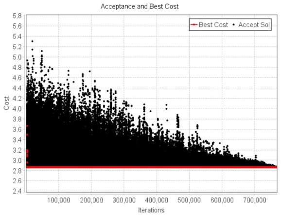

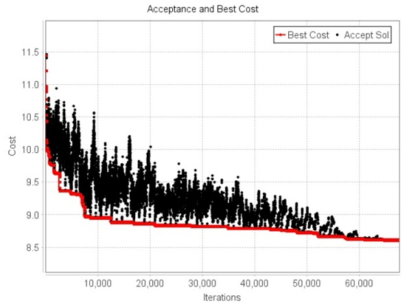

Figure 9: Left: Results for instance 12.10.3. Right: Results for instance 150.10.3. Top: The figures show the cost of the accepted solutions and the best know solutions as function of the iteration count. Bottom: The tables show information about the number of iterations, the number of times the corresponding repair method produced a solution which was accepted, and the number of times such solution provided a new global best solution.

The small instances are constructed with 6, 10 and 12 customers randomly generated in a grid of dimensions 5×5, 10×10 and 20×20. From the table it can be seen that the optimal solution can be reached relatively easily in all cases by the metaheuristic. Moreover, for all instances, the average objective value µ coincides with the optimal value of the instances, therefore, the standard deviation σ and the optimality gap present a zero value. This proves the effectiveness of the metaheuristic, which is able to find the optimal solution for any of the 10 runs of the instances.

From the results, it can also be seen that when the number of customers increases, the mathematical model becomes more difficult to solve to optimality in a reasonable amount of time. As an example, CPLEX spends nearly 17 hours to solve to optimality instance 12.05.1. On the other hand, the metaheuristic is able to obtain optimal solutions for all instances quickly, using at most a couple of seconds, with some exceptions.

| Scenario | \|C<sup>0</sup>\| | z<sup>∗</sup> | t<sup>MIP</sup>(s) | z<sup>ALNS</sup> | µ<sup>ALNS</sup> | σ<sup>ALNS</sup> | t<sub>opt</sub>(s) | z<sub>R</sub><sup>A</sup><sub>a</sub><sup>L</sup><sub>t</sub><sup>N</sup><sub>io</sub><sup>S</sup>(%) |
| --- | --- | --- | --- | --- | --- | --- | --- | --- |
| 06.05.1 | 5 | 1.09821 | 0.926 | 1.09821 | 1.09821 | 0.000 | 0.014 | 0.00% |
| 06.05.2 | 6 | 0.84215 | 3.506 | 0.84215 | 0.84215 | 0.000 | 0.001 | 0.00% |
| 06.05.3 | 5 | 1.21137 | 2.429 | 1.21137 | 1.21137 | 0.000 | 0.001 | 0.00% |
| 06.05.4 | 5 | 0.94599 | 1.365 | 0.94599 | 0.94599 | 0.000 | 0.003 | 0.00% |
| 06.10.1 | 5 | 2.40611 | 7479.000 | 2.40611 | 2.40611 | 0.000 | 0.004 | 0.00% |
| 06.10.2 | 6 | 1.67927 | 6.802 | 1.67927 | 1.67927 | 0.000 | 0.002 | 0.00% |
| 06.10.3 | 6 | 1.32552 | 5.360 | 1.32552 | 1.32552 | 0.000 | 0.003 | 0.00% |
| 06.10.4 | 6 | 1.44307 | 5.228 | 1.44307 | 1.44307 | 0.000 | 0.001 | 0.00% |
| 06.20.1 | 6 | 2.67759 | 4.726 | 2.67759 | 2.67759 | 0.000 | 0.011 | 0.00% |
| 06.20.2 | 5 | 4.31959 | 1.164 | 4.31959 | 4.31959 | 0.000 | 0.054 | 0.00% |
| 06.20.3 | 6 | 3.82475 | 1.813 | 3.82475 | 3.82475 | 0.000 | 0.002 | 0.00% |
| 06.20.4 | 6 | 3.67872 | 2.170 | 3.67872 | 3.67872 | 0.000 | 0.001 | 0.00% |
| 10.05.1 | 5 | 1.65563 | 13.368 | 1.65563 | 1.65563 | 0.000 | 0.002 | 0.00% |
| 10.05.2 | 9 | 1.45185 | 433.150 | 1.45185 | 1.45185 | 0.000 | 0.339 | 0.00% |
| 10.05.3 | 8 | 1.47357 | 236.110 | 1.47357 | 1.47357 | 0.000 | 0.193 | 0.00% |
| 10.05.4 | 9 | 1.28489 | 345.220 | 1.28489 | 1.28489 | 0.000 | 0.002 | 0.00% |
| 10.10.1 | 8 | 2.32647 | 369.920 | 2.32647 | 2.32647 | 0.000 | 0.026 | 0.00% |
| 10.10.2 | 8 | 3.15856 | 121.280 | 3.15856 | 3.15856 | 0.000 | 0.075 | 0.00% |
| 10.10.3 | 7 | 2.55274 | 88.410 | 2.55274 | 2.55274 | 0.000 | 0.427 | 0.00% |
| 10.10.4 | 9 | 2.53931 | 246.430 | 2.53931 | 2.53931 | 0.000 | 0.008 | 0.00% |
| 10.20.1 | 7 | 4.45240 | 6.650 | 4.45240 | 4.45240 | 0.000 | 3.946 | 0.00% |
| 10.20.2 | 8 | 6.16776 | 180.160 | 6.16776 | 6.16776 | 0.000 | 0.011 | 0.00% |
| 10.20.3 | 9 | 4.54630 | 251.140 | 4.54630 | 4.54630 | 0.000 | 1.197 | 0.00% |
| 10.20.4 | 7 | 6.15355 | 275.360 | 6.15355 | 6.15355 | 0.000 | 49.170 | 0.00% |
| 12.05.1 | 9 | 1.37381 | 1161.880 | 1.37381 | 1.37381 | 0.000 | 31.444 | 0.00% |
| 12.05.2 | 12 | 1.05899 | 62131.170 | 1.05899 | 1.05899 | 0.000 | 1.110 | 0.00% |
| 12.05.3 | 10 | 1.44765 | 433.900 | 1.44765 | 1.44765 | 0.000 | 0.028 | 0.00% |
| 12.05.4 | 10 | 1.58100 | 2259.660 | 1.58100 | 1.58100 | 0.000 | 0.100 | 0.00% |
| 12.10.1 | 10 | 2.68103 | 811.260 | 2.68103 | 2.68103 | 0.000 | 81.447 | 0.00% |
| 12.10.2 | 10 | 2.68420 | 1004.350 | 2.68420 | 2.68420 | 0.000 | 0.059 | 0.00% |
| 12.10.3 | 9 | 2.88048 | 793.870 | 2.88048 | 2.88048 | 0.000 | 0.030 | 0.00% |
| 12.10.4 | 10 | 2.31418 | 176.740 | 2.31418 | 2.31418 | 0.000 | 0.011 | 0.00% |
| 12.20.1 | 11 | 5.77759 | 3723.830 | 5.77759 | 5.77759 | 0.000 | 0.272 | 0.00% |
| 12.20.2 | 10 | 8.27254 | 1081.570 | 8.27254 | 8.27254 | 0.000 | 0.004 | 0.00% |
| 12.20.3 | 9 | 4.16693 | 24.520 | 4.16693 | 4.16693 | 0.000 | 0.054 | 0.00% |
| 12.20.4 | 11 | 6.08859 | 1335.740 | 6.08859 | 6.08859 | 0.000 | 0.210 | 0.00% |

Table 3: Performance of the metaheuristics for small scenarios. $T h e$ column $t ^ { M I P }$ reports the execution time (in seconds) in CPLEX for obtaining the optimal solution $z ^ { * }$ , whereas the column $t _ { o p t }$ reports the average amount of time (in second) within the $5$ minutes time limit employed by the metaheuristic to obtain the best know solution $z ^ { \hat { A L N S } }$

## 5.2.2 Larger Instances

Due to the computational complexity, the MIP model cannot be used to evaluate the performance of the metaheuristic for larger instances. In order to check the efficiency of the algorithm and the quality of the solution obtained by the metaheuristic when considering drones in delivery operations, the solutions will be compared to the solutions for the truckonly case. For this purpose, 112 instances have been generated, containing between 6 and 200 customers distributed in areas from $5 \times 5$ miles to $4 0 \times 4 0$ miles and the ALNS metaheuristic has been applied 10 times to each instance with an execution time of exactly $t ^ { m a x }   =   5$ minutes. Two main KPIs are extracted from these experiments, the saving obtained by serving the customers using a mixed truck/drone approach compared to using a truckonly approach (SVRP) and the saving obtained by the ALNS metaheuristic over the initial solution in the mixed truck/drone case (SI). For each instance, the two KPIs are calculated as shown in Equation (34), using the notation $z ^ { A L N S }$ : the best objective found using ALNS and drones, $z ^ { \bar { V } R P }$ : best objective found for the truck-only case, $z ^ { i n }$ objective found by the heuristic for generating initial solutions for the drone case (described in section 4.1).

$$
\left| \begin{array}{c} \mathrm{SVRP} = 1 - \frac {z ^ {A L N S}}{z ^ {V R P}} \quad \text {and} \quad \mathrm{SI} = 1 - \frac {z ^ {A L N S}}{z ^ {i n}} \end{array} \right|\tag{34}
$$

$z ^ { V R P }$ was obtained using an updated version of the ALNS metaheuristic described in Pisinger and Ropke (2007), the ALNS metaheuristic was applied 10 times to each instance and the best objective value was kept. As the drone constraints have been removed from the problem, the truck will have a larger capacity, corresponding to the space that would occupy all the material related to the drone in the truck. This means that we, in the truck-only experiment, have set $Q ^ { * } = 1 4 0 0 ~ \mathrm { k g } ,$ as discussed in Section 3.3.

Figure 10 (left) shows the savings with respect to the initial solution. In most of the instances, it can be observed how the initial solution is improved by 15-25% by the ALNS metaheuristic, thus showing the effectiveness of the ALNS metaheuristic to escape local optima and to obtain better solutions. For small instances, the saving with respect to the initial solution is scattered on the chart. This might be because near-optimal solutions can sometimes be obtained by the initial solution, presenting a small gap with respect best-known solutions.

Figure 10 (right) shows the savings with respect to the truck-only approach. The saving is typically in the range of 20% to 30% and sometimes even larger. It is noticeable that the smallest instances have the largest variation in saving relative to the truck-only solution. We explain this observation by the fact that the placement of one or two customers in a small instance can have a huge impact on the potential saving. If one or two customers are placed far from the depot and both must be served by the truck (due to heavy deliveries) it can be impossible to obtain a significant saving for that instance compared to an instance where such customers are placed close to the depot. In instances with many customers such variation is to a certain extent cancelled out because larger instances, by-and-large, would contain a similar mix of easy and hard customers that must be served by the truck. A more detailed study of the behavior of the savings with respect to the truck-only approach is carried out in Appendix C.

Overall the impact of the drones is significant, showing remarkable improvements to the objective value. The cooperation of both vehicles presents a significant saving that must be considered when planning the routes of the vehicles. It is important to point out that the objective is based on an estimate of fuel costs and does not cover all the cost involved in goods distribution. An important factor that is not considered is, for example, driver wages. Giving a more precise estimation of the total cost involved in both distribution modes is an interesting subject for future work. The complete results for all 112 instances are shown in Table 4 in Appendix A. Furthermore, from the results presented in Table 4, it can be seen that even the initial solution presents a considerable saving with respect to the truck-only case.

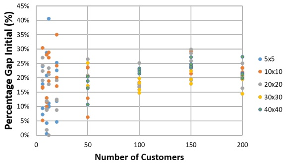

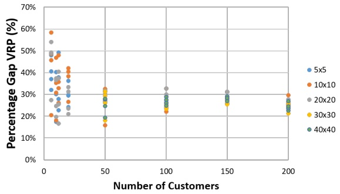

Figure 10: Average saving of the best known solution with respect to the initial solution $( l e f t )$ and to the truck-only case (right) per instance.

Figure 11, on the left, shows the average number of sorties used by the solutions to each instance. It can be seen how the number of customers visited by drones grows linearly as the number of customers increases, corresponding approximately to a total of 50% of potential customers to be visited by a drone. It is important to remark that due to the definition of the tuples $\langle i , j , k \rangle$ for the drone operations, where $i \neq j \neq k$ , there is a theoretical limit on the maximum number of sorties that can be operated. Considering that a route with $n _ { t }$ truck visits can at most launch $n _ { t } + 1$ drones, a VRP-D instance with n customers can operate at most $\frac { 2 n } { 3 }$ sorties with $\frac { n } { 3 }$ trucks. However, deploying so many trucks would be very expensive, and the number of drone deliveries is within reasonable limits.

In the same Figure 11, on the right, it can be seen how the average usage of the total endurance time tends to decrease as the number of customers increases. Moreover, this reduction is present in all scenarios, indicating a greater use of the endurance time as the scenario grid increases. We understand the usage of the total endurance time as the flying time of the drone while performing a sortie. In general, it can be seen that no more than 60% of the endurance time is consumed between the launch and recovery of a drone. In the following Section 5.2.3, a more detailed sensitivity analysis for this parameter is carried out.

Finally, Figures 12 and 13 show the best known solutions found by the metaheuristics for the VRP-D and the VRP for a scenario with 20 and 100 customers respectively. From the figures it can be seen how the final routes for the trucks are affected by the addition of drones in the problem. It is noticeable how the drone routes tend to shorten the truck route by sending the drone to the hard-to-reach customer, if possible.

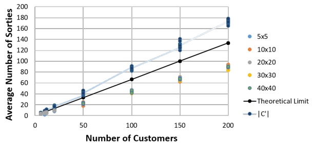

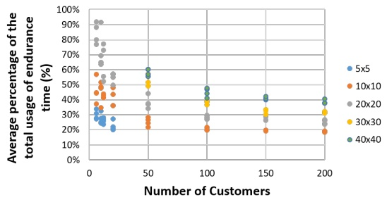

Figure 11: Average number of sorties $( l e f t )$ and average sortie endurance utilization (right) per instance.

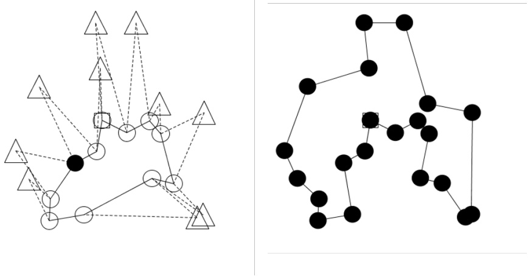

Figure 12: Best known solution for the VRP-D and VRP for an instance with 20 customers. The solid lines indicate the route of the trucks, while the dashed lines indicate the trips of the drones.

## 5.2.3 Experiments with the Drone Features

The main setup provides a study of the performance of the algorithm using problemparameters set to realistic values used by companies and other studies. These parameters have been selected according to certain assumptions as explained in Section 3.3. However, as there is still no real-life parameters on drones delivery, we would like to study the relative importance of different drone-parameters on the model output. In this section we perform a sensitivity study by changing the value of certain parameters of interest. For this, we will fix the main configuration of the problem, and for each parameter of interest, we will study the impact of altering the value of the aforementioned drone-parameter. The sensitivity analysis will help us draw some preliminary conclusions on the collaboration of both vehicles for delivery operations. For a clear comparison, we have set the size of the grid to 30 × 30. The experiments are carried out for a collection of 100 randomly generated instances of four scenarios, each of them consisting of 25 instances. The scenarios are 100.30.X, 150.30.X, 200.30.X and 250.30.X.

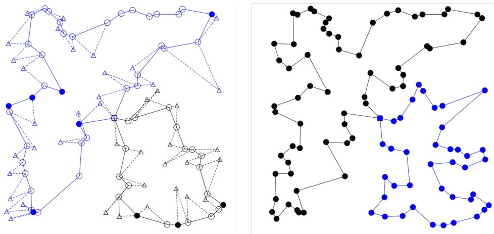

Figure 13: Best known solution for the VRP-D and VRP for an instance with 100 customers. The solid lines indicate the route of the trucks, while the dashed lines indicate the trips of the drones.

Battery Cost The collaboration of both vehicles is the innovative feature in this VRP-approach. We are studying the problem from a cost minimization perspective, where the use of the drone is given as a percentage of the fuel consumption of the truck. In the main setup, this value was set at 10%, but what would happen if the cost associated with using a drone was more expensive? Would it be beneficial with regard to the truck-only case?

Figure 14 shows the impact of the cost of the drone-arcs in the different scenarios. Clearly, the advantages of the collaboration of both vehicles is reduced as the associated drone-cost is increased. The operational cost can be reduced considerably if the use of drones is relatively cheaper than operating a truck. However, the savings become negligible as the drone-cost is increased to 50% of the truck cost. The same trend can be observed in the number of sorties, which decrease as the use of drones becomes more expensive. Figure 14 also indicates that, for a fixed drone cost (e.g. 10%), the curve that describe the savings as a function of the number of customers has a bell-like shape. This shape is also visible in the following experiments and in Appendix C. We explain this shape as follows

• In a scenario, with few customers scattered in a large area, it may be difficult to make use of the drones if endurance is low compared to the time needed to travel between customers. Even if endurance is not limiting it may be necessary for the truck to drive long stretches between customers since the truck has to move for every sortie performed and since there are some customers that only can be served by the truck.

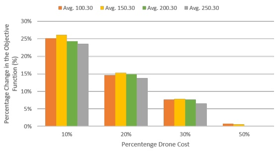

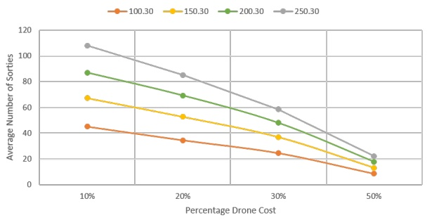

Figure 14: Left: Average saving with respect to the best known solution for the truck-only case as function of the drone-arc cost for each scenario. Right: Average number of sorties as function of the drone-arc cost for each scenario.

• As we increase the number of customers while keeping other parameters fixed we are enlarging the possibilities for using the drones since more potential customers will be within range and we have better possibilities for stringing together good routes where the trucks drive little and the drones do most of the traveling.

• At a certain point, the area becomes saturated and adding more customers no longer increase savings, but rather decrease the saving per customer. One can think of the extreme scenario where customers are located so close that the truck could already have served the next customer in the time we spend on launching and recovering the drone. Some saving is still possible, but not as much as in a more sparse scenario.

Part of the explanation for the drop-off in saving for larger number of customers can also be that the time limit of the heuristic is fixed to 5 minutes and therefore solution quality deteriorates for larger instances. Furthermore, Figure 14 shows instances in the ranges from 100 to 250 customers. In the future it could also be interesting to investigate the saving for small number of customers as Figure 10 seems to indicate a higher saving with around 10 customers compared to 50 customers. One cannot make firm conclusions from Figure 10 given the small number of samples for a fixed set of instance parameters.

Endurance The main setup from Section 3.3 sets the total time endurance of a drone to 30 minutes, however, as shown in Figure 11, drones do not consume all the endurance time once they are dispatched. If the endurance time is decreased, the battery can be reduced, which would decrease cost and the reduced battery weight could be used for carrying higher loads instead. At the same time, technology is constantly improving, and it is not hard to image drones equipped with better batteries that will allow them to stay longer in the air. By increasing the endurance, the set of feasible drone visits will increase. Therefore, we investigate whether it would be relevant to increase or decrease the endurance time.

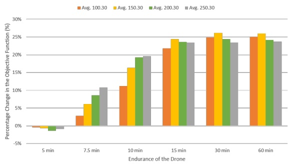

<table><tbody><tr><td></td><td></td><td colspan="2">Scenario</td><td></td></tr><tr><td>Endurance</td><td>100.30.X</td><td>150.30.X</td><td>200.30.X</td><td>250.30.X</td></tr><tr><td>5 min</td><td>0.712</td><td>1.784</td><td>3.528</td><td>6.840</td></tr><tr><td>7.5 min</td><td>11.480</td><td>28.512</td><td>46.760</td><td>67.312</td></tr><tr><td>Avg. Sorties 10 min</td><td>28.720</td><td>52.680</td><td>75.832</td><td>97.840</td></tr><tr><td>15 min</td><td>42.400</td><td>65.448</td><td>86.824</td><td>107.952</td></tr><tr><td>30 min</td><td>45.008</td><td>67.320</td><td>86.896</td><td>108.056</td></tr><tr><td>60 min</td><td>45.160</td><td>67.224</td><td>87.024</td><td>108.392</td></tr><tr><td>5 min</td><td>55.58</td><td>75.47</td><td>94.88</td><td>94.06</td></tr><tr><td>7.5 min</td><td>88.20</td><td>87.87</td><td>86.67</td><td>85.37</td></tr><tr><td>(%) Endurance 10 min</td><td>83.02</td><td>79.81</td><td>76.85</td><td>73.75</td></tr><tr><td>15 min</td><td>68.48</td><td>62.34</td><td>58.06</td><td>54.68</td></tr><tr><td>30 min</td><td>38.20</td><td>33.19</td><td>29.97</td><td>28.41</td></tr><tr><td>60 min</td><td>19.77</td><td>16.77</td><td>15.00</td><td>14.22</td></tr></tbody></table>

Figure 15: Left: Average saving with respect to the best known solution for the truck-only case as function of the endurance time for each scenario. Right: The table shows the average number of sorties and the average time of the total endurance time used by the sorties for each scenario and for the different endurance times.

From Figure 15 it can be seen that there needs to be an appropriate endurance time for the collaboration of the vehicles to be efficient. Modest savings are obtained when the endurance time is low, because drones do not have enough time to perform feasible sorties, and these savings are much lower when the customers are more spread within the grid. Negative savings are observed in scenarios where the drone endurance time is set to 5 minutes. In this case 3 minutes are spent on launch, recovery and serving the customer, leaving only 2 minutes of flying time. With such a short flying time no or only a few sorties will be possible and the instances almost turn into ordinary truck-only VRP. Assuming identical vehicle capacity (recall that in the truck-only scenario the truck can carry 100 kg more, see Section 3.3) an exact method for the VRP-D would never experience negative savings. Since the proposed method is only a heuristic, negative savings can occur. The negative savings indicate that the heuristic for the truck-only case (Pisinger and Ropke (2007)) is superior to the VRP-D heuristic when the VRP-D heuristic cannot make use of its drones. This is no surprise as the VRP-D heuristic is not constructed for this scenario.

When the endurance time increases, drones have more room for maneuver and large savings can be obtained, especially for larger instances, as the average distance between customer is reduced. However, due to the limited drone capacity of carrying a single pay load per sortie, increasing the endurance past 15 minutes hardly impacts the value of the objective function and the number of drones launched. The fact that the objective function is almost unchanged may seem surprising at first, but it can be explained. One reason can be found by inspecting the solution for VRP-D shown in Figure 13, left. The customers shown with filled circles have to be visited by the truck due to their demand, which limits the flexibility even when the drone endurance is increased. Furthermore, given the definition of the problem (following Murray and Chu (2015)), we require the launch customer to be different from the recovery customer. This further limits the use of the drones in a single route, as it implies that we at most can do a k + 1 drone deliveries on a route with k truck visits. Finally, the drone sorties that become possible with the increased endurance are often not very attractive, since they require traveling far and are time consuming.

We notice that the savings curves for 7.5 and 10 minutes endurance at first look different from the bell-like shape observed in Figure 14 and in Figure 15 for higher values of endurance. We believe that for these values, we are only observing the beginning of the bell-like curve. If we increased the number of customers in these scenarios we expect to see that the saving again decreases.

Drone Speed The drone speed is another critical factor for the collaboration of both vehicles in the delivery process. The value of the drone speed was set to 50 mph in the main setup, and we are interested in studying what would happen if the drone operated at the same speed as the truck, as well as slower speeds and considerably superior ones. Similar to the endurance time, by increasing the drone speed, the set of feasible sorties is expanded, since the drone can travel faster and reach more customers within the endurance time.

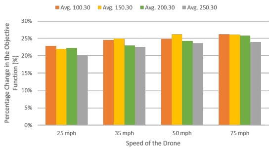

<table><tr><td rowspan="2" colspan="2"></td><td colspan="4">Scenario</td></tr><tr><td>Speed</td><td>100.30.X</td><td>150.30.X</td><td>200.30.X</td></tr><tr><td rowspan="4">Avg. Sorties</td><td>25 mph</td><td>42.640</td><td>55.952</td><td>83.760</td><td>97.656</td></tr><tr><td>35 mph</td><td>44.264</td><td>65.552</td><td>86.304</td><td>107.240</td></tr><tr><td>50 mph</td><td>44.920</td><td>67.416</td><td>87.296</td><td>108.368</td></tr><tr><td>75 mph</td><td>45.632</td><td>67.888</td><td>88.072</td><td>108.456</td></tr><tr><td rowspan="4">(%) Endurance</td><td>25 mph</td><td>57.93</td><td>46.91</td><td>45.24</td><td>39.55</td></tr><tr><td>35 mph</td><td>47.07</td><td>40.12</td><td>36.48</td><td>32.13</td></tr><tr><td>50 mph</td><td>37.90</td><td>33.40</td><td>30.02</td><td>28.54</td></tr><tr><td>75 mph</td><td>31.81</td><td>28.08</td><td>25.87</td><td>24.57</td></tr></table>

Figure 16: Left: Average saving with respect to the best known solution for the truck-only case as function of the drone-speed for each scenario. Right: The table shows the average number of sorties and the average time of the total endurance time used by the sorties for each scenario and for the different considered drone speeds.

As seen from Figure 16, the speed of the drone has a minor impact on the objective function. As the speed of the drone increases, the savings with respect to the truck-only case grows more monotonously. However, the collaboration of both vehicles brings a notable benefit even operating drones at speed lower than the trucks, with saving above 20%. Having a look at the table presented on the right in Figure 16, the total number of sorties remains stable as the speed increases. However, it is observable that the average delivery time of the drones is progressively reduced as the speed increases. Moreover, we observe that the saving curve of the 25 mph scenario, does not exhibit the bell-like shape as observed earlier. We explain this by the limited number of 25 samples instances used for this experiments.

We expect to observe that ordinary curve if the experiment was based on an even higher number of instances.

Payload Capacity According to the main configuration, the maximum payload capacity of a drone is set to 5 kg. Nonetheless, there is no doubt that drones could, in the future, be equipped with better engines that will allow them to carry heavier loads. This increase in drone capacity will extend the set of customers that may be serviced by the drone.

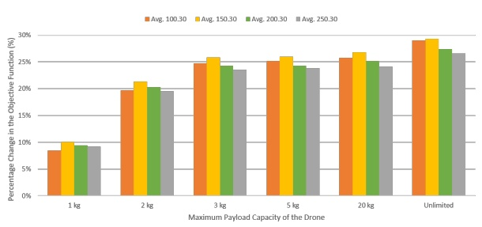

<table><tbody><tr><td colspan="2">Payload</td><td>100.30.X</td><td>Scen150.30.X</td><td>ario200.30.X</td><td>250.30.X</td></tr><tr><td>Avg. Sorties</td><td>1 kg 2 kg 3 kg 5 kg 20 kg Unlimited</td><td>21.45640.03244.89645.22445.5247.552</td><td>34.93660.45667.12867.46468.14470.128</td><td>45.48879.10487.03287.10488.22490.920</td><td>58.664100.032108.160108.080109.232112.12</td></tr><tr><td>(%) Potential</td><td>1 kg</td><td>34.80</td><td>35.87</td><td>34.20</td><td>34.94</td></tr><tr><td>Drone</td><td>2 kg</td><td>69.20</td><td>69.01</td><td>67.64</td><td>69.71</td></tr><tr><td>Customers</td><td>3 kg</td><td>86.40</td><td>85.79</td><td>85.72</td><td>86.54</td></tr><tr><td>|C0|/|C|</td><td>5 kg 20 kg Unlimited</td><td>86.7290.16100</td><td>86.3289.63100</td><td>86.1489.86100</td><td>86.8289.76100</td></tr></tbody></table>

Figure 17: Left: Average saving with respect to the best known solution for the truck-only case as function of the maximum payload capacity for each scenario. Right: The table shows the average number of sorties and the average percentage of potential drone customers for each scenario and for the different maximum payload capacity. A potential drone customer belongs to the subset C<sup>0</sup>if its demand can be carried by drone, as discussed in Section 3.3.

The effect of the maximum payload capacity is much more significant as we increase this value, with a clear rise in the savings with respect to the truck-only case, as it can be seen from Figure 17, left. On the right-hand side, it is shown that by increasing the payload capacity of the drone, the number of potential drone customers increases. This means that customers, who could only be visited by the truck, might now be visited by dispatching a drone. Thus, the truck’s route can be more efficient, launching more drones and perhaps reducing the total cost of the route by not forcing to send a truck to far-off locations. Due to the distribution followed by the customers’ demand, the savings tend to stagnate in the intermediate values of the figure, since larger payload only means a slight increase in the number of potential drone customers. Nevertheless, when no limits on the maximum payload is imposed, the savings for the truck-drone case are higher, due to the possibility of reaching more distant customers with drones. As an example, Figure 18 shows an instance where 56% of the customers have a demand below 2 kg, whereas 88% of the customers have a demand below 20 kg. Considering the maximum payload capacity of the drone to 20 kg supposes an increase of 32% in the number of potential drone customers. It can be observed how customers that previously were forced to be visited by a truck now become drones customers, reducing the total operational cost significantly.

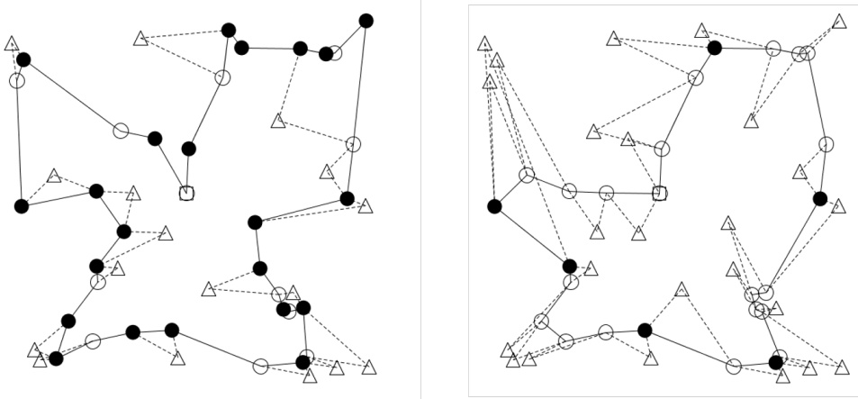

Figure 18: Scenario with a light drone capacity (2 kg, left) with a total operational cost of z = 12.660 and a heavy drone capacity (20 kg, right) with a total operational cost of z = 10.511. The solid lines indicate the route of the trucks, while the dashed lines indicate the trips of the drones.

## 6 Conclusion and Future Researches

Amazon, DHL and Workhorse, among many other companies, are intensively studying how drones can be used for delivery activities. This new technology has also stimulated the development of several mathematical models and solution techniques for this problem, contributing with an analysis of the possible benefits of using small aircrafts in the delivery of merchandise. Especially, the cooperation of the drones along with the trucks on the day of operation can improve the last-mile delivery, since the routes can be designed more efficiently in terms of time and cost savings.

Analyzing the results obtained in the previous section, the clear advantage of using these small aircraft for delivery activities is remarkable. Comparing the results with the case of only using trucks in the problem, the savings are noteworthy. Even the initial solution in most cases surpasses the best known solution for the trucks-only approach. However, we must point out that the objective considered is based on an estimate of fuel costs and does not cover all the cost involved in goods distribution.

The sensitivity analysis shows some preliminary conclusions on the drones’ endurance, which has to be significantly reduced compared to our initial estimate of 30 minutes before it has a clear impact on the solutions obtained. The sensitivity analysis also pointed out that the speed of the drone is not a determining factor in the objective function, bringing notable benefits even operating drones at speeds lower than the trucks. On the other hand, by modifying the maximum payload-capacity of the drone, a reduction on the fuel cost can be more easily observed. Routes can be built more efficiently since the number of potential drone customers increases. This might avoid the dispatch of a truck to visit some remote customers, enabling better routes by sending drones to those positions.

Many extensions of the VRP-D can be studied in future works. One interesting subject is the dynamic case, where routes can be altered during the day of operation through cancellations, break-down of vehicles and other factors related to time and capacity of the customers. These constraints pose a problem of greater complexity where the optimal solution may be utopia. To solve this problem it would be necessary to develop different heuristic methods that can solve the problem quickly to come back to the scheduled plan as fast as possible without affecting many of the routes.

Other possible extensions to the problem that can successfully increase the parceldelivery are related to the number of drones per vehicle, their total transport capacity and the interaction with the vehicle. The increase on the number of drones per vehicle and payload capacity of the drones could significantly impact the operational cost of the problem. However, when considering this new feature in the problem, energy consumption may be affected, influencing the speed and endurance of the drone due to the increased transport load. One possible adaptation to this consideration in the problem is the inclusion of a factor that affects the speed and duration of the battery as more loads are considered to be transported. Furthermore, due to the definition of the objective function, it would be interesting to consider the case where the truck can wait in the same location where it launches the drone, as considered in Agatz et al. (2015). Therefore, several potential launches of drones could be done from the same location while the truck is stopped, saving the total truck cost, since the truck is just waiting to recover the drone in the same location.

Finally, future research could investigate how to solve this problem to optimality through exact methods. Like other VRP-like problems, the VRP-D has a structure that makes it possible to apply Dantzig-Wolfe decomposition to reach a tighter formulation.

## References

Agatz, N., Bouman, P., and Schmidt, M. (2015). Optimization approaches for the traveling salesman problem with drone. Technical Report ERS-2015-011-LIS, ERIM Report Series.

Allain, R. (2013). Physics of the Amazon Octocopter Drone. [https://www.wired.com/2013/12/physics-of-the-amazon-prime-air-drone/](https://www.wired.com/2013/12/physics-of-the-amazon-prime-air-drone/).

Applegate, D., Bixby, R., Chvatal, V., and Cook, W. (2011). The traveling salesman problem: a computational study. Princeton university press.

bin Othman, M. S., Shurbevski, A., Karuno, Y., and Nagamochi, H. (2017). Routing of carriervehicle systems with dedicated last-stretch delivery vehicle and fixed carrier route. Journal of Information Processing, 25:655–666.

Borowczyk, A., Nguyen, D.-T., Nguyen, A. P.-V., Nguyen, D. Q., Saussié, D., and Ny, J. L. (2017). Autonomous landing of a multirotor micro air vehicle on a high velocity ground vehicle. IFAC PapersOnLine, 50:10488–10494.

Campbell, J. F., II, D. C. S., and Zhang, J. (2017). Strategic design for delivery with trucks and drones. Technical report, College of Business Administration, University of Missouri-St. Louis. Supply Chain & Analytics Report SCMA-2017-0201.

Carlsson, J. G. and Song, S. (2017). Coordinated logistics with a truck and a drone. Management Science. To appear. doi: 10.1287/mnsc.2017.2824.

Černỳ, V. (1985). Thermodynamical approach to the traveling salesman problem: An efficient simulation algorithm. Journal of optimization theory and applications, 45(1):41–51.

Choi-Fitzpatrick, A., Chavarria, D., Cychosz, E., Dingens, J. P., Duffey, M., Koebel, K., Siriphanh, S., Yurika Tulen, M., Watanabe, H., Juskauskas, T., et al. (2016). Up in the air: A global estimate of non-violent drone use 2009-2015.

Daknama, R. and Kraus, E. (2017). Vehicle routing with drones. arXiv preprint arXiv:1705.06431.

Dorling, K., Heinrichs, J., Messier, G., and Magierowski, S. (2017). Vehicle routing problems for drone delivery. IEEE Transactions on Systems, Man, and Cybernetics: Systems, 47(1):70–85.

Eksioglu, B., Vural, A., and Reisman, A. (2009). The vehicle routing problem: A taxonomic review. Computers & Industrial Engineering, 57(4):1472–1483.

Fosin, J., Carić, T., and Ivanjko, E. (2014). Vehicle Routing Optimization Using Multiple Local Search Improvements. Automatika–Journal for Control, Measurement, Electronics, Computing and Communications, 55(2):124–132.

Freitas, J. C. and Penna, P. H. V. (2018). A variable neighborhood search for flying sidekick traveling salesman problem. arXiv preprint arXiv:1804.03954.

French, S. (2015). Drone delivery is already here – and it works. [http://www.marketwatch.com/story/drone-delivery-is-already-here-and-it-works-2015-11-30](http://www.marketwatch.com/story/drone-delivery-is-already-here-and-it-works-2015-11-30).

Ha, Q., Deville, Y., Pham, Q., and Hà, M. (2018). On the min-cost traveling salesman problem with drone. Transportation Research Part C: Emerging Technologies, 86:597–621.

Ham, A. M. (2018). Integrated scheduling of m-truck, m-drone, and m-depot constrained by timewindow, drop-pickup, and m-visit using constraint programming. Transportation Research Part C: Emerging Technologies, 91:1–14.

Hern, A. (2015). DHL launches first commercial drone ’parcelcopter’ delivery service. [https://www.theguardian.com/technology/2014/sep/25/german-dhl-launches-first-commercial-drone-delivery-service](https://www.theguardian.com/technology/2014/sep/25/german-dhl-launches-first-commercial-drone-delivery-service).

Kharpal, A. (2016). This firm beat amazon to drone deliveries by launching it from the roof of a truck. [http://www.cnbc.com/2016/08/18/this-firm-beat-amazon-to-drone-deliveries-by-launching-it-from-the-roof-of-a-truck.html](http://www.cnbc.com/2016/08/18/this-firm-beat-amazon-to-drone-deliveries-by-launching-it-from-the-roof-of-a-truck.html).

Kirkpatrick, S., Gelatt, C., Vecchi, M., et al. (1983). Optimization by simulated annealing. Science, 220(4598):671–680.

Mathew, N., Smith, S. L., and Waslander, S. L. (2015). Planning paths for package delivery in heterogeneous multirobot teams. IEEE Transactions on Automation Science and Engineering, 12:1298–1308.

McDougal, T. (2016). Drones and the Law: The Sky’s Not the Limit. [http://droneaccident.lawyer/drones-and-the-law-the-skys-not-the-limit-2/](http://droneaccident.lawyer/drones-and-the-law-the-skys-not-the-limit-2/).

Muoio, D. (2016). Google’s secretive drone delivery project just got cleared for testing – here’s everything we know about the program. [http://www.businessinsider.com/google-project-wing-drone-service-2016-8?r=US&IR=T&IR=T/#david-vos-the-leader-of-project-wing-said-google-x-wants-to-use-drones-to-deliver-packages-starting-in-2017-8](http://www.businessinsider.com/google-project-wing-drone-service-2016-8?r=US&IR=T&IR=T/#david-vos-the-leader-of-project-wing-said-google-x-wants-to-use-drones-to-deliver-packages-starting-in-2017-8).

Murray, C. and Chu, A. (2015). The flying sidekick traveling salesman problem: Optimization of drone-assisted parcel delivery. Transportation Research Part C: Emerging Technologies, 54:86–109.

Otto, A., Agatz, N., Campbell, J., Golden, B., and Pesch, E. (2018). Optimization Approaches for Civil Applications of Unmanned Aerial Vehicles (UAVs) or Aerial Drones: A Survey. Networks. (To Appear), doi: 10.1002/net.21818.

Pisinger, D. and Ropke, S. (2007). A general heuristic for vehicle routing problems. Computers & operations research, 34(8):2403–2435.

Pisinger, D. and Ropke, S. (2010). Large neighborhood search. In Handbook of metaheuristics, pages 399–419. Springer.

Poikonen, S., Golden, B., and Wasil, E. (2018). A Branch-and-Bound Approach to the Traveling Salesman Problem with a Drone. Informs Journal on Computing. (To Appear).

Poikonen, S., Wang, X., and Golden, B. (2017). The vehicle routing problem with drones: Extended models and connections. Networks, 70(1):34–43.

Ponza, A. (2016). Optimization of drone-assisted parcel delivery. Technical report, Universita degli studi di Padova. Master thesis.

Pugliese, L. D. P. and Guerriero, F. (2017). Last-mile deliveries by using drones and classical vehicles. International Conference on Optimization and Decision Science, pages 557–565.

Ropke, S. and Pisinger, D. (2006). An adaptive large neighborhood search heuristic for the pickup and delivery problem with time windows. Transportation science, 40(4):455–472.

Rose, C. (2013). Amazon’s Jeff Bezos looks to the future. [http://www.cbsnews.com/news/amazons-jeff-bezos-looks-to-the-future/](http://www.cbsnews.com/news/amazons-jeff-bezos-looks-to-the-future/).

Sacramento, D. (2017). Heuristics for solving the Drone-Vehicle Routing Problem (Masters Thesis). Technical report, Technical University of Denmark.

Santini, A., Ropke, S., and Hvattum, L. M. (2018). A comparison of acceptance criteria for the adaptive large neighbourhood search metaheuristic. Journal of Heuristics, 24(5):783–815.

Savuran, H. and Karakaya, M. (2015). Route optimization method for unmanned air vehicle launched from a carrier. Lecture Notes on Software Engineering, 3(4):279.

Shaw, P. (1998). Using constraint programming and local search methods to solve vehicle routing problems. In International Conference on Principles and Practice of Constraint Programming, pages 417–431. Springer.

Toth, P. and Vigo, D. (2014). Vehicle routing: problems, methods, and applications. SIAM, 2nd edition.

Trop, J. (2016). Drone Delivery is About to Disrupt the Trucking Industry. [https://www.trucks.com/2016/06/21/drone-delivery-reshape-trucking/](https://www.trucks.com/2016/06/21/drone-delivery-reshape-trucking/).

UPS (2017). UPS: Weight and Size. [https://www.ups.com/content/us/en/resources/ship/packaging/weight\_size.html](https://www.ups.com/content/us/en/resources/ship/packaging/weight_size.html).

Wang, D. (2016). The Economics of Drone Delivery. [https://www.flexport.com/blog/drone-delivery-economics/](https://www.flexport.com/blog/drone-delivery-economics/).

Wang, X., Poikonen, S., and Golden, B. (2017). The vehicle routing problem with drones: several worst-case results. Optimization Letters, 11:679–697.

Yurek, E. E. and Ozmutlu, H. C. (2018). A decomposition-based iterative optimization algorithm for traveling salesman problem with drone. Transportation Research Part C: Emerging Technologies, 91:249–262.

## A Table Result for Large Instances

Table 4 provides the results after running the metaheuristics in the 112 instances, where each instance is run in a 10-run batch with a time limit of 5 exactly minutes. From the table the best known value $( z )$ , the average and standard deviation of the performance of the algorithm $( \mu$ and $\sigma ,$ respectively), the average number of iterations (it), the cardinality of the set of potential drone customers $( | C ^ { \prime } | )$ , the average number of drone customers in the solution $( \# C ^ { \prime } )$ and the average number of routes $( \# V )$ can be observed. Moreover, the savings with respect to the initial solution $z ^ { i n }$ and to the best known solution for the VRP $z ^ { V R P }$ are computed (SI and SVRP, respectively).

Table 4: Performance of the metaheuristics for each scenario.

| Scenario | \|C<sup>0</sup>\| | z<sup>ALNS</sup> | µ<sup>ALNS</sup> | σ<sup>ALNS</sup> | it<sub>ALNS</sub> | #C<sup>0</sup> | #V | z<sup>in</sup> | SI (%) | z<sup>VRP</sup> | SVRP (%) |
| --- | --- | --- | --- | --- | --- | --- | --- | --- | --- | --- | --- |
| 6.5.1 | 5 | 1.09821 | 1.09821 | 0.000 | 41959813 | 3 | 1 | 1.33681 | 17.85% | 1.74449 | 37.05% |
| 6.5.2 | 6 | 0.84215 | 0.84215 | 0.000 | 42802018 | 3 | 1 | 1.10843 | 24.02% | 1.41679 | 40.56% |
| 6.5.3 | 5 | 1.21137 | 1.21137 | 0.000 | 44620683 | 3 | 1 | 1.33722 | 9.41% | 1.78165 | 32.01% |
| 6.5.4 | 5 | 0.94599 | 0.94599 | 0.000 | 44129451 | 3 | 1 | 1.01979 | 7.24% | 1.81631 | 47.92% |
| 6.10.1 | 5 | 2.40611 | 2.40611 | 0.000 | 38949492 | 4 | 2 | 2.87963 | 16.44% | 3.02602 | 20.49% |
| 6.10.2 | 6 | 1.67927 | 1.67927 | 0.000 | 37191908 | 4 | 2 | 1.77023 | 5.14% | 3.26563 | 48.58% |
| 6.10.3 | 6 | 1.32552 | 1.32552 | 0.000 | 38426647 | 4 | 2 | 1.90326 | 30.36% | 3.18434 | 58.37% |
| 6.10.4 | 6 | 1.44307 | 1.44307 | 0.000 | 40046320 | 3 | 1 | 1.73451 | 16.80% | 2.65423 | 45.63% |
| 6.20.1 | 6 | 2.67759 | 2.67759 | 0.000 | 39483597 | 4 | 2 | 3.67040 | 27.05% | 5.81887 | 53.98% |
| 6.20.2 | 5 | 4.31959 | 4.31959 | 0.000 | 42665143 | 3 | 1 | 5.56104 | 22.32% | 5.95116 | 27.42% |
| 6.20.3 | 6 | 3.82475 | 3.82475 | 0.000 | 43387965 | 4 | 2 | 5.05161 | 24.29% | 7.48706 | 48.92% |
| 6.20.4 | 6 | 3.67872 | 3.67872 | 0.000 | 38621176 | 4 | 2 | 4.54767 | 19.11% | 7.25279 | 49.28% |
| 10.5.1 | 5 | 1.65563 | 1.65563 | 0.000 | 25746784 | 2 | 1 | 1.66376 | 0.49% | 2.00444 | 17.40% |
| 10.5.2 | 9 | 1.45185 | 1.45185 | 0.000 | 26450623 | 5 | 1 | 1.51512 | 4.18% | 1.76462 | 17.72% |
| 10.5.3 | 8 | 1.47357 | 1.47357 | 0.000 | 27265176 | 5 | 1 | 1.86194 | 20.86% | 2.10786 | 30.09% |
| 10.5.4 | 9 | 1.28489 | 1.28489 | 0.000 | 25627890 | 5 | 1 | 1.80316 | 28.74% | 2.15180 | 40.29% |
| 10.10.1 | 8 | 2.32647 | 2.32647 | 0.000 | 28019615 | 5 | 1 | 2.67365 | 12.99% | 4.37806 | 46.86% |
| 10.10.2 | 8 | 3.15856 | 3.15856 | 0.000 | 26639115 | 5 | 1 | 3.50870 | 9.98% | 3.85290 | 18.02% |
| 10.10.3 | 7 | 2.55274 | 2.55274 | 0.000 | 29000966 | 6 | 2 | 3.54566 | 28.00% | 3.94166 | 35.24% |
| 10.10.4 | 9 | 2.53931 | 2.53931 | 0.000 | 26113164 | 5 | 1 | 2.87111 | 11.56% | 3.67069 | 30.82% |
| 10.20.1 | 7 | 4.45240 | 4.45240 | 0.000 | 26201747 | 4 | 1 | 4.53510 | 1.82% | 7.10035 | 37.29% |
| 10.20.2 | 8 | 6.16776 | 6.16776 | 0.000 | 26938008 | 4 | 1 | 6.78446 | 9.09% | 8.18607 | 24.66% |
| 10.20.3 | 9 | 4.54630 | 4.54630 | 0.000 | 27736599 | 5 | 1 | 5.16542 | 11.99% | 7.15878 | 36.49% |
| 10.20.4 | 7 | 6.15355 | 6.15355 | 0.000 | 28239850 | 4 | 2 | 6.74167 | 8.72% | 7.65948 | 19.66% |
| 12.5.1 | 9 | 1.37381 | 1.37381 | 0.000 | 22287186 | 6 | 1 | 1.53008 | 10.21% | 1.77670 | 22.68% |
| 12.5.2 | 12 | 1.05899 | 1.05899 | 0.000 | 22431403 | 7 | 2 | 1.78259 | 40.59% | 2.08454 | 49.20% |
| 12.5.3 | 10 | 1.44765 | 1.44765 | 0.000 | 23479327 | 6 | 1 | 1.62929 | 11.15% | 2.32577 | 37.76% |
| 12.5.4 | 10 | 1.58100 | 1.58100 | 0.000 | 23118928 | 6 | 1 | 1.75405 | 9.87% | 2.19318 | 27.91% |
| 12.10.1 | 10 | 2.68103 | 2.68103 | 0.000 | 23554627 | 7 | 2 | 3.77076 | 28.90% | 4.17530 | 35.79% |
| 12.10.2 | 10 | 2.68420 | 2.68420 | 0.000 | 21947382 | 6 | 1 | 3.30802 | 18.86% | 4.00144 | 32.92% |
| 12.10.3 | 9 | 2.88048 | 2.88048 | 0.000 | 21958882 | 6 | 1 | 3.68373 | 21.81% | 3.89544 | 26.06% |
| 12.10.4 | 10 | 2.31418 | 2.31418 | 0.000 | 22823268 | 6 | 1 | 3.17127 | 27.03% | 4.43975 | 47.88% |
| 12.20.1 | 11 | 5.77759 | 5.77759 | 0.000 | 22746779 | 7 | 2 | 7.01873 | 17.68% | 9.69233 | 40.39% |
| 12.20.2 | 10 | 8.27254 | 8.27254 | 0.000 | 20178441 | 4 | 1 | 8.27325 | 0.01% | 9.91900 | 16.60% |
| 12.20.3 | 9 | 4.16693 | 4.16693 | 0.000 | 21708160 | 5 | 1 | 5.43964 | 23.40% | 6.65320 | 37.37% |
| 12.20.4 | 11 | 6.08859 | 6.08859 | 0.000 | 24023052 | 7 | 2 | 7.71453 | 21.08% | 8.17198 | 25.49% |
| 20.5.1 | 15 | 1.79347 | 1.79347 | 0.000 | 11301575 | 9 | 1 | 2.03456 | 11.85% | 2.55338 | 29.76% |
| 20.5.2 | 14 | 1.95401 | 1.95401 | 0.000 | 10631574 | 8 | 1 | 2.04774 | 4.58% | 2.58028 | 24.27% |
| 20.5.3 | 19 | 1.48658 | 1.48658 | 0.000 | 11114470 | 9 | 1 | 1.91912 | 22.54% | 2.11026 | 29.55% |
| 20.5.4 | 18 | 1.37893 | 1.37893 | 0.000 | 12616178 | 10 | 1 | 1.84439 | 25.24% | 2.16427 | 36.29% |
| 20.10.1 | 17 | 3.25253 | 3.25253 | 0.000 | 13287214 | 10 | 1 | 3.92297 | 17.09% | 5.27324 | 38.32% |
| 20.10.2 | 19 | 3.08938 | 3.08938 | 0.000 | 12565887 | 10 | 1 | 4.75887 | 35.08% | 5.17932 | 40.35% |
| 20.10.3 | 19 | 3.70226 | 3.72576 | 0.050 | 11718401 | 9.8 | 1 | 4.63102 | 20.06% | 5.04668 | 26.64% |
| 20.10.4 | 15 | 3.30890 | 3.31367 | 0.015 | 12508345 | 10 | 1 | 4.36469 | 24.19% | 5.69902 | 41.94% |
| 20.20.1 | 19 | 7.34453 | 7.35115 | 0.021 | 11638755 | 10 | 1 | 8.04799 | 8.74% | 9.60624 | 23.54% |
| 20.20.2 | 16 | 7.54889 | 7.54889 | 0.000 | 11942478 | 9 | 1 | 8.58928 | 12.11% | 9.54910 | 20.95% |
| 20.20.3 | 18 | 7.46100 | 7.47458 | 0.043 | 10418184 | 10 | 1 | 8.52744 | 12.51% | 10.84568 | 31.21% |
| 20.20.4 | 17 | 7.01331 | 7.01331 | 0.000 | 11091582 | 9 | 1 | 8.66985 | 19.11% | 10.52166 | 33.34% |
| 50.10.1 | 37 | 5.86134 | 5.86134 | 0.000 | 1110439 | 18 | 1 | 6.25507 | 6.29% | 6.96079 | 15.79% |
| 50.10.2 | 41 | 5.58493 | 5.62101 | 0.076 | 1351994 | 21.2 | 1 | 6.40940 | 12.86% | 7.74661 | 27.90% |
| 50.10.3 | 44 | 5.42240 | 5.42546 | 0.001 | 1453177 | 25 | 1 | 7.10793 | 23.71% | 7.89376 | 31.31% |
| 50.10.4 | 44 | 5.20834 | 5.35262 | 0.109 | 1762387 | 23.7 | 1 | 6.80485 | 23.46% | 7.71366 | 32.48% |
| 50.20.1 | 41 | 10.45526 | 10.45635 | 0.001 | 1313010 | 22 | 1 | 13.20900 | 20.85% | 14.28486 | 26.81% |
| 50.20.2 | 44 | 10.05611 | 10.05611 | 0.000 | 1396076 | 23 | 1 | 12.68456 | 20.72% | 14.39691 | 30.15% |
| 50.20.3 | 44 | 10.54249 | 10.65703 | 0.060 | 1337178 | 23 | 1 | 14.34467 | 26.51% | 15.43061 | 31.68% |
| 50.20.4 | 46 | 10.66415 | 11.00082 | 0.187 | 1299549 | 24.1 | 1 | 12.78350 | 16.58% | 14.61995 | 27.06% |
| 50.30.1 | 40 | 15.81788 | 15.81788 | 0.000 | 1509428 | 24 | 1 | 19.87087 | 20.40% | 23.01535 | 31.27% |
| 50.30.2 | 39 | 15.01482 | 15.46361 | 0.473 | 1427745 | 22.5 | 1 | 20.04851 | 25.11% | 20.32863 | 26.14% |
| 50.30.3 | 43 | 16.76899 | 16.77134 | 0.003 | 1340989 | 24 | 1 | 21.10088 | 20.53% | 23.73563 | 29.35% |
| 50.30.4 | 40 | 18.28746 | 18.28746 | 0.000 | 1138204 | 21 | 1 | 22.09943 | 17.25% | 22.33797 | 18.13% |
| 50.40.1 | 46 | 20.37508 | 21.17709 | 0.551 | 1230243 | 24.1 | 1.3 | 25.11031 | 18.86% | 28.17186 | 27.68% |
| 50.40.2 | 41 | 20.62624 | 20.62624 | 0.000 | 1277543 | 21 | 1 | 23.10381 | 10.72% | 28.65285 | 28.01% |
| 50.40.3 | 42 | 22.64523 | 22.70534 | 0.190 | 1132225 | 21.1 | 1 | 27.08039 | 16.38% | 30.03933 | 24.61% |
| 50.40.4 | 41 | 22.33708 | 22.78912 | 0.195 | 1222262 | 22.5 | 1 | 28.07438 | 20.44% | 27.71988 | 19.42% |
| 100.10.1 | 89 | 6.85741 | 6.89015 | 0.027 | 202025.6 | 47.5 | 1 | 8.92083 | 23.13% | 10.18307 | 32.66% |
| 100.10.2 | 89 | 7.58505 | 7.67814 | 0.081 | 165090.6 | 44.9 | 1 | 9.23212 | 17.84% | 10.21628 | 25.76% |
| 100.10.3 | 91 | 7.18353 | 7.30551 | 0.092 | 184845.5 | 45.3 | 1 | 8.80568 | 18.42% | 10.12143 | 29.03% |
| 100.10.4 | 82 | 7.45675 | 7.54594 | 0.064 | 165521.3 | 42.2 | 1 | 8.98069 | 16.97% | 9.58098 | 22.17% |
| 100.20.1 | 90 | 13.60671 | 13.79462 | 0.114 | 123349.4 | 43.9 | 1 | 16.33884 | 16.72% | 18.68459 | 27.18% |
| 100.20.2 | 89 | 14.13399 | 14.53749 | 0.145 | 144851.9 | 45.7 | 1 | 17.14718 | 17.57% | 19.21943 | 26.46% |
| 100.20.3 | 87 | 13.70990 | 13.76722 | 0.065 | 169246.9 | 47.4 | 1 | 17.45722 | 21.47% | 19.57115 | 29.95% |
| 100.20.4 | 89 | 13.84944 | 14.19761 | 0.245 | 158024.7 | 46.9 | 1 | 18.50382 | 25.15% | 20.59972 | 32.77% |
| 100.30.1 | 84 | 22.58818 | 23.63641 | 0.546 | 288147.8 | 42.9 | 2 | 28.15762 | 19.78% | 30.26120 | 25.36% |
| 100.30.2 | 87 | 22.31432 | 22.38464 | 0.102 | 373620.6 | 45.1 | 2 | 26.18374 | 14.78% | 29.15228 | 23.46% |
| 100.30.3 | 91 | 23.71948 | 23.90941 | 0.114 | 327255.5 | 40.5 | 2 | 28.99190 | 18.19% | 31.24545 | 24.09% |
| 100.30.4 | 88 | 22.37011 | 22.65848 | 0.149 | 436002.3 | 43.1 | 2 | 26.60071 | 15.90% | 29.45129 | 24.04% |
| 100.40.1 | 85 | 29.13966 | 30.18073 | 1.109 | 517088.9 | 44.3 | 2 | 37.98380 | 23.28% | 39.42798 | 26.09% |
| 100.40.2 | 85 | 30.98999 | 31.20916 | 0.177 | 413419.1 | 45.2 | 2 | 39.43678 | 21.42% | 41.23168 | 24.84% |
| 100.40.3 | 89 | 29.02475 | 29.66526 | 0.309 | 448000.5 | 46.2 | 2 | 37.51525 | 22.63% | 40.77274 | 28.81% |
| 100.40.4 | 87 | 28.97348 | 29.20493 | 0.160 | 420257.9 | 41.7 | 2 | 37.16760 | 22.05% | 40.03808 | 27.64% |
| 150.10.1 | 125 | 8.79027 | 8.93509 | 0.057 | 57856.8 | 70.8 | 1 | 11.59840 | 24.21% | 12.05540 | 27.08% |
| 150.10.2 | 126 | 8.25905 | 8.41602 | 0.113 | 53928.8 | 70.2 | 1 | 10.76381 | 23.27% | 11.59550 | 28.77% |
| 150.10.3 | 141 | 8.49602 | 9.02065 | 0.215 | 47886.9 | 71.4 | 1 | 12.00592 | 29.23% | 12.31929 | 31.03% |
| 150.10.4 | 120 | 8.83734 | 9.03983 | 0.129 | 47691.9 | 62.4 | 1 | 11.24672 | 21.42% | 11.93587 | 25.96% |
| 150.20.1 | 132 | 17.31938 | 17.59636 | 0.372 | 65611.7 | 66 | 2 | 21.41857 | 19.14% | 24.01554 | 27.88% |
| 150.20.2 | 131 | 16.63405 | 17.45066 | 0.610 | 134442.8 | 68.7 | 2 | 23.71366 | 29.85% | 24.19077 | 31.24% |
| 150.20.3 | 128 | 17.40579 | 18.34468 | 0.512 | 108024.1 | 69.5 | 2 | 23.48900 | 25.90% | 24.02131 | 27.54% |
| 150.20.4 | 130 | 16.87516 | 17.47742 | 0.389 | 137595.5 | 70.7 | 2 | 23.60548 | 28.51% | 24.48108 | 31.07% |
| 150.30.1 | 130 | 25.98537 | 26.54882 | 0.333 | 126168.8 | 68.3 | 2 | 31.65118 | 17.90% | 35.89031 | 27.60% |
| 150.30.2 | 125 | 26.20552 | 26.74112 | 0.258 | 129856.2 | 67.8 | 2 | 33.74515 | 22.34% | 35.38576 | 25.94% |
| 150.30.3 | 130 | 25.31642 | 26.11368 | 0.456 | 133103.9 | 68 | 2 | 33.04898 | 23.40% | 35.63752 | 28.96% |
| 150.30.4 | 125 | 26.10274 | 27.29231 | 0.900 | 128121.4 | 63.7 | 2 | 32.40173 | 19.44% | 35.03643 | 25.50% |
| 150.40.1 | 137 | 34.01210 | 35.45338 | 1.059 | 125867 | 68.8 | 2.2 | 46.74029 | 27.23% | 47.36621 | 28.19% |
| 150.40.2 | 124 | 36.56164 | 38.29645 | 0.682 | 162347.4 | 66.1 | 2.3 | 47.78252 | 23.48% | 49.99371 | 26.87% |
| 150.40.3 | 125 | 36.65738 | 38.29545 | 0.896 | 162241.7 | 66.3 | 2.3 | 48.15427 | 23.88% | 51.72573 | 29.13% |
| 150.40.4 | 129 | 35.01556 | 36.06616 | 1.054 | 157272.4 | 67.7 | 2.2 | 46.55322 | 24.78% | 48.88489 | 28.37% |
| 200.10.1 | 173 | 10.09452 | 10.40499 | 0.163 | 24243.3 | 92.3 | 2 | 12.54765 | 19.55% | 13.71736 | 26.41% |
| 200.10.2 | 173 | 10.42260 | 10.61488 | 0.105 | 24545.7 | 90.4 | 2 | 13.59715 | 23.35% | 13.92221 | 25.14% |
| 200.10.3 | 177 | 9.79897 | 9.92350 | 0.057 | 75473.9 | 94 | 2 | 12.80248 | 23.46% | 13.93832 | 29.70% |
| 200.10.4 | 176 | 10.35528 | 10.63997 | 0.202 | 41038.9 | 89.8 | 2 | 13.26367 | 21.93% | 13.90924 | 25.55% |
| 200.20.1 | 178 | 21.21505 | 21.46013 | 0.259 | 55098.4 | 90.6 | 2 | 26.51774 | 20.00% | 28.12148 | 24.56% |
| 200.20.2 | 168 | 21.45845 | 22.04610 | 0.627 | 46691.8 | 87.4 | 2 | 26.92906 | 20.31% | 27.98806 | 23.33% |
| 200.20.3 | 176 | 20.85218 | 21.06040 | 0.131 | 49845.9 | 89.4 | 2 | 24.93983 | 16.39% | 27.39656 | 23.89% |
| 200.20.4 | 172 | 19.23495 | 20.18035 | 0.436 | 52022 | 87.8 | 2 | 25.65556 | 25.03% | 26.62789 | 27.76% |
| 200.30.1 | 171 | 30.36023 | 31.78264 | 0.764 | 82205.8 | 86.9 | 2.7 | 37.89680 | 19.89% | 40.88607 | 25.74% |
| 200.30.2 | 176 | 32.81279 | 33.21640 | 0.307 | 33974.5 | 87.7 | 2 | 38.32423 | 14.38% | 41.67798 | 21.27% |
| 200.30.3 | 171 | 32.25350 | 32.73727 | 0.358 | 29877.2 | 83.1 | 2 | 40.03489 | 19.44% | 42.77400 | 24.60% |
| 200.30.4 | 172 | 32.09314 | 32.76376 | 0.450 | 59024.9 | 90.9 | 2.5 | 40.50484 | 20.77% | 42.47321 | 24.44% |
| 200.40.1 | 172 | 41.49802 | 42.30479 | 0.556 | 95321.1 | 90.6 | 3 | 57.06515 | 27.28% | 56.81091 | 26.95% |
| 200.40.2 | 178 | 43.25021 | 44.22107 | 0.476 | 93067.4 | 89.6 | 3 | 55.14169 | 21.57% | 55.84941 | 22.56% |
| 200.40.3 | 165 | 43.33753 | 44.26132 | 0.642 | 100623 | 88.4 | 3 | 54.07578 | 19.86% | 56.85219 | 23.77% |
| 200.40.4 | 178 | 42.05785 | 43.33703 | 0.850 | 98119.2 | 89.8 | 3 | 53.38600 | 21.22% | 55.68861 | 24.48% |

## B Clustered Instances

The previous experiments have been carried out assuming that the customers’ location follow a uniform distribution around the distribution center. Although this is a fair assumption, we would like to better simulate neighborhoods of delivery, where customers are located in clusters, and test the performance of the algorithm. Therefore, we will generate a new batch of 10 randomly generated clustered instances, named as n.m.c.t, where n is the number of customers, m is the dimension of the grid, c is the cluster label of the instance and t is the generic name of the scenario.

The instances have been generated in a grid of dimensions $3 0 \times 3 0$ , where the central de pot is still considered to be located at coordinates (0, 0). For each instance, we will generate θ focal points around the grid, where θ is a random number in the interval 1 to 5. Then, each customer is randomly assigned to a focal point and the customer’s location is generated to follow a normal distribution centered on the focal point and with a standard deviation of 2 miles. As an example, Figure 19 shows instance 150.30.c.10, where customers are located in three clusters around the distribution center.

The ALNS metaheuristic has been applied 10 times to each clustered instance with a time limit of exactly 5 minutes, and the results can be seen in Table 5. The table provides information of the best know value $( z )$ , the average and standard deviation of the performance of the algorithm $( \mu$ and $\sigma ,$ respectively), the average number of iterations (it). Moreover, the number of focal points $( | \theta | )$ , the average number of routes $( \# V )$ , the cardinality of the set of potential drone customers $( | C ^ { \prime } | )$ and the average number of drone customers in the solution $( \# C ^ { \prime } )$ can be observed. Finally, the savings with respect to the initial solution $z ^ { i n }$ and to the best known solution for the VRP $z ^ { V R P }$ are computed (SI and SVRP, respectively). As in Section $5 . 2 . 2 , \: z ^ { V R P }$ was obtained using an updated version of the ALNS metaheuristic described in Pisinger and Ropke (2007), the ALNS metaheuristic was applied 10 times to each instance and the best objective value was kept.

From the results in Table 19, it can be observed that the algorithm seems to show a similar performance as when solving uniformly distributed instances, hence we can draw similar conclusions as discussed in Section 5.2.2. However, it seems that the algorithm performs more steadily in clustered instances, presenting moderately low standard deviation. This may be due to the relative location of the clusters. In some cases, the clusters are totally separated from each other, basically decomposing the problem into individual problems, where each cluster is served by one vehicle. However, if the clusters are relatively close to each other, it may be advantageous to have routes visiting several clusters. As shown in the table, the average number of routes does not coincide with the number of fo-

Figure 19: Instance 150.30.c.10, where customers are located between three clusters around the distribution center. The solid lines indicate the route of the trucks, while the dashed lines indicate the trips of the drones.

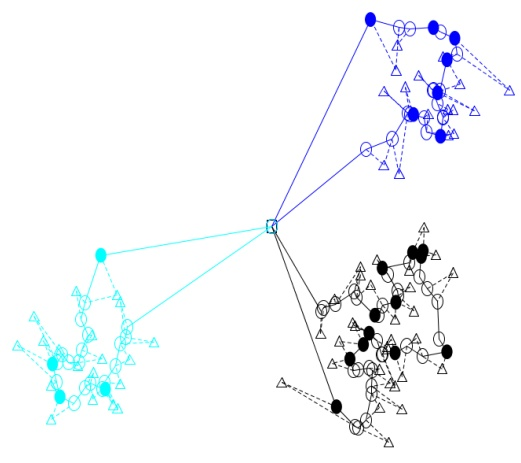

cal points in the instances. For example, the algorithm finds high-quality solutions for instance 150.30.c.10 where customers from two clusters are combined into a single route. Nonetheless, the algorithm can be improved by incorporating more specialized repair methods for clustered instances, which is an interesting subject for future work.

Table 5: Performance of the metaheuristics for clustered instances.

| Scenario | \|θ\| | \|C<sup>0</sup>\| | z<sup>ALNS</sup> | µ<sup>ALNS</sup> | σ<sup>ALNS</sup> | it<sub>ALNS</sub> | #C<sup>0</sup> | #V | z<sup>in</sup> | SI (%) | z<sup>VRP</sup> | SVRP (%) |
| --- | --- | --- | --- | --- | --- | --- | --- | --- | --- | --- | --- | --- |
| 150.30.c.01 | 1 | 134 | 7.2521 | 7.3515 | 0.2225 | 49574.8 | 69.7 | 1 | 9.92438 | 26.93% | 11.4568 | 36.70 % |
| 150.30.c.02 | 4 | 127 | 17.4822 | 17.6275 | 0.1085 | 114685.9 | 67.4 | 2 | 21.442 | 18.47% | 22.4591 | 22.16 % |
| 150.30.c.03 | 5 | 135 | 19.0905 | 19.2616 | 0.1044 | 134913.3 | 68 | 2 | 23.6677 | 19.34% | 26.3510 | 27.55 % |
| 150.30.c.04 | 3 | 134 | 17.4954 | 17.7494 | 0.1725 | 146067.7 | 70 | 2 | 21.7615 | 19.60% | 24.1744 | 27.63 % |
| 150.30.c.05 | 3 | 121 | 13.4906 | 13.5734 | 0.095 | 46701.4 | 65.4 | 2 | 15.8102 | 14.67% | 18.7106 | 27.90 % |
| 150.30.c.06 | 2 | 127 | 12.2798 | 13.1751 | 0.4578 | 98147.5 | 67.6 | 1.8 | 16.7385 | 26.64% | 17.3142 | 29.08 % |
| 150.30.c.07 | 2 | 131 | 10.3291 | 10.561 | 0.1591 | 32354.1 | 68 | 1 | 15.3784 | 32.83% | 17.3957 | 40.62 % |
| 150.30.c.08 | 5 | 134 | 16.0884 | 16.4721 | 0.2272 | 87546.3 | 68.8 | 2 | 20.8928 | 23.00% | 22.2966 | 27.84 % |
| 150.30.c.09 | 5 | 138 | 14.1275 | 14.5081 | 0.2074 | 66638.6 | 69.6 | 2 | 18.8961 | 25.24% | 20.1679 | 29.95 % |
| 150.30.c.10 | 3 | 127 | 17.8299 | 18.005 | 0.1424 | 114454.4 | 66.9 | 2 | 22.7758 | 21.72% | 24.6002 | 27.52 % |

## C Drone Savings as Function of Grid Size and Number of Customers

The incorporation of drones in delivery operations brings significant savings in the operational cost, compared to the case of only using delivery trucks. Certainly, the savings obtained from the collaboration of both vehicles vary according to the considered scenario. In this section, we will present an analysis of the savings for different delivery scenarios. The experiments are carried out for a collection of 375 randomly generated instances, corresponding to 15 scenarios, each represented by 25 instances.

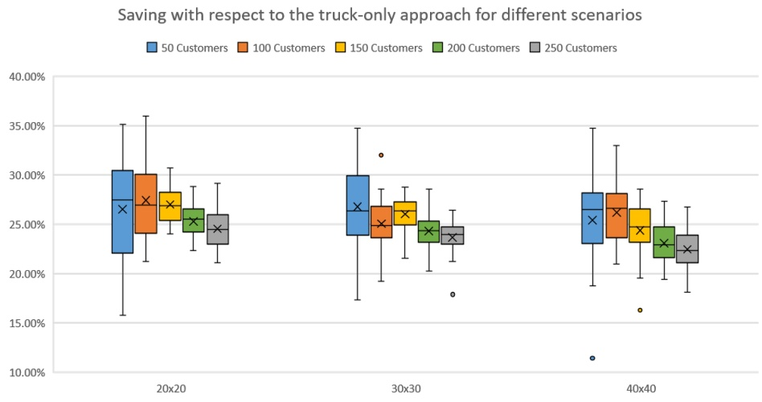

Figure 20: Distribution of the saving obtained by serving the customers using a mixed truck/drone approach compared to using a truck-only approach (SVRP) for different scenarios. The average saving for each scenario is marked with a cross.

Figure 20 shows the distribution of the savings for the different scenarios, which are grouped by grid size, and further grouped by number of customers. For this analysis, the main configuration of parameters is considered, as presented in Section 3.3. From the figure, it is seen that, for each value of the grid size, the curve that describes the saving as a function of the number of customers has a bell-like shape, i.e. the curve first increases until it reaches a peak from where it slowly declines as observed earlier. The figure clearly visualizes that the variability for instances with few customers is much higher compared to that of instances with many customers. This behaviour was already observed in the main text (Section 5.2.2). In the 30x30 scenario, we see that the 50 customer case has a higher average saving compared to the 100 customer case. This is unexpected with respect to the bell-like saving curve “conjecture”. We see two possible explanations: 1) either the computed average for the 50 customer case is far from the true average of the underlying distribution due to the high variance of the data caused by the long endurance time, which raises the average saving for this scenario. In this case, we expect that an experiment with more sample instances per scenario would make the shape of the curve approach to the expected form. 2) Alternatively, it may be that average savings are actually higher for instances with few customers such that the saving curve starts high at a low number of customers, then dips, then rises again and peaks before it ultimately starts declining as more customers are added. As already mentioned in the main text, there is some evidence for the latter conjecture in the data presented in Figure 10. We leave to future work to decide which of the two explanations, if any, is true.

From Figure 11, on the right, in Section 5.2.2, it is seen that, on average, the dispatched drones do not use more than 50% of the total endurance time. Figure 21 shows the distribution of the savings with respect to the truck-only case for the different scenarios when halving the total endurance time. From the figure, it can be seen that the endurance time has a significant impact on the savings. It is interesting to observe that for instances with few customers the saving drops significantly as the grid size increases while the instances with many customers are less sensitive to the grid size. Another observation is that the decreased endurance time causes the variance of the results to decrease significantly compared to the results in Figure 20.

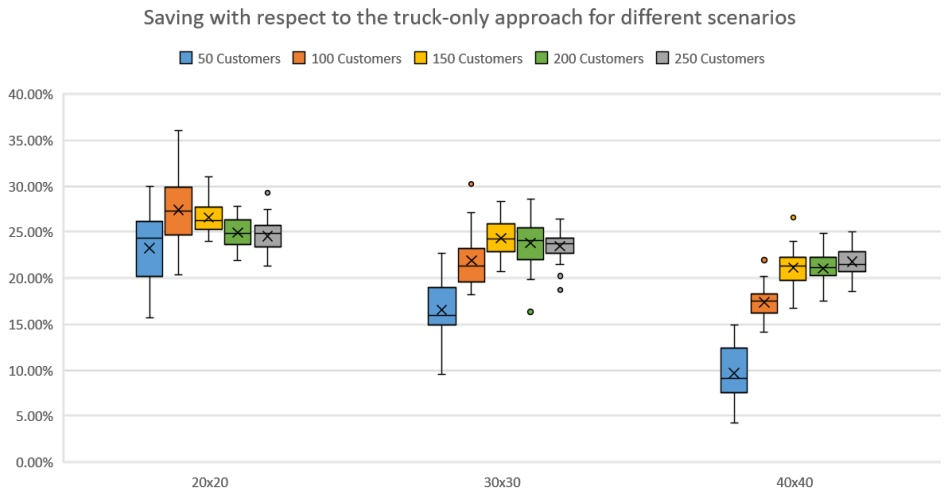

Figure 21: Distribution of the saving obtained by serving the customers using a mixed truck/drone approach compared to using a truck-only approach (SVRP) for different scenarios, when considering 15 minutes of total endurance time. The average saving for each scenario is marked with a cross.