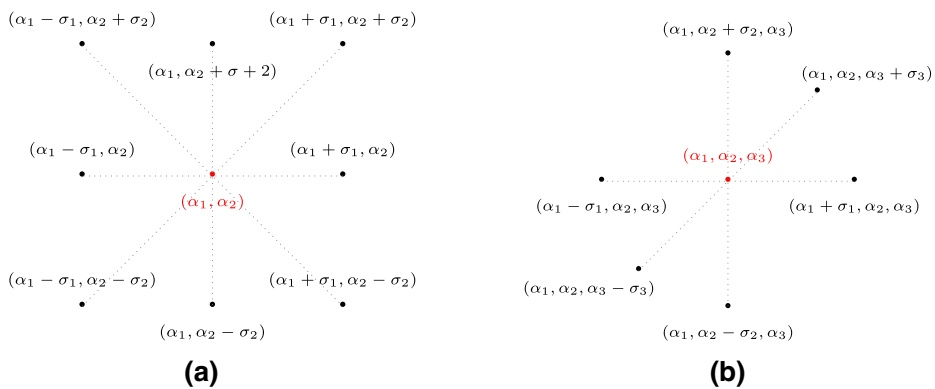
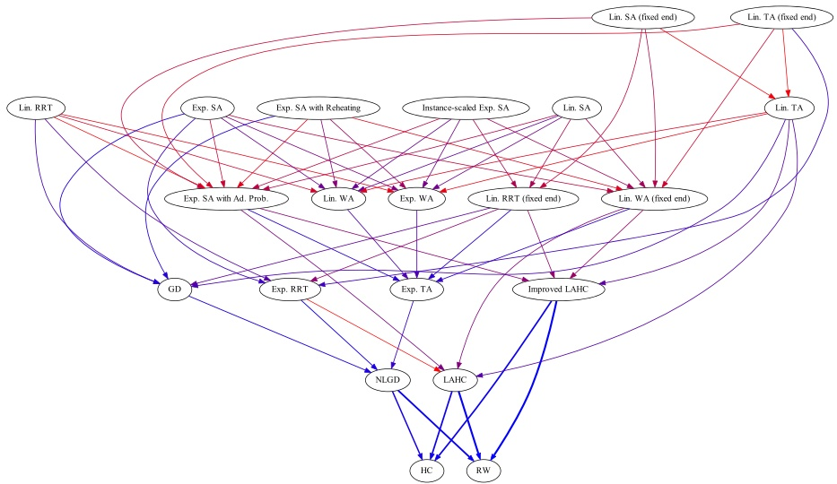
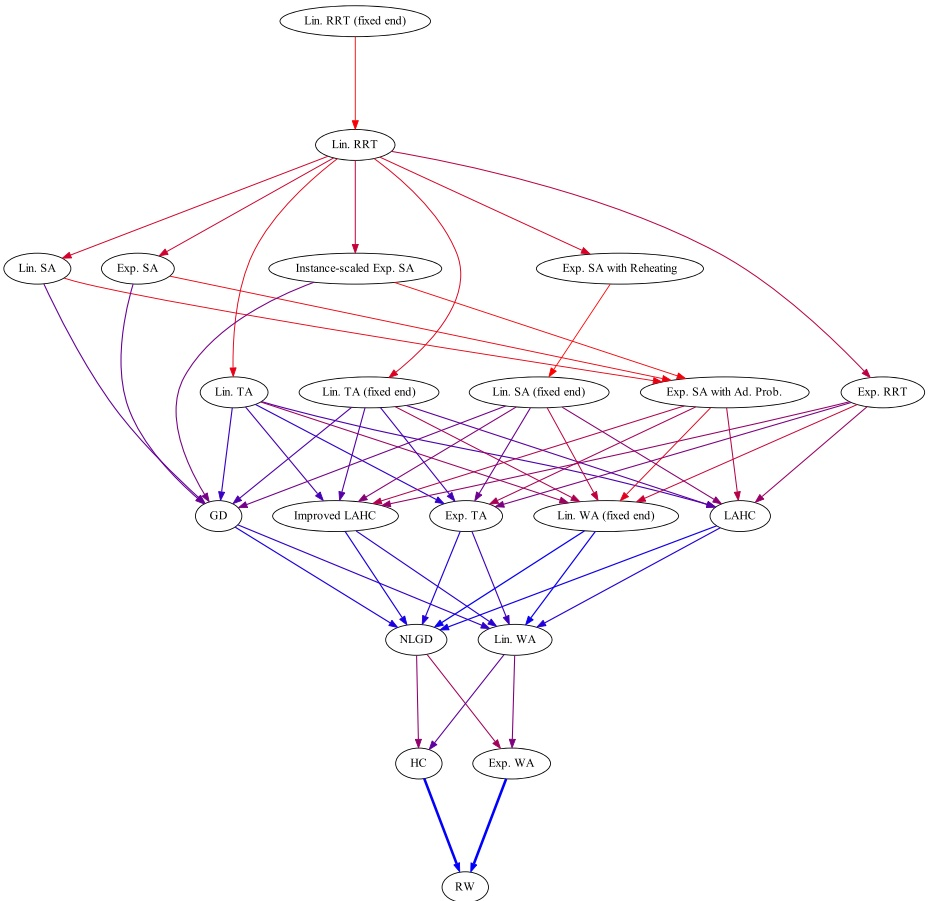
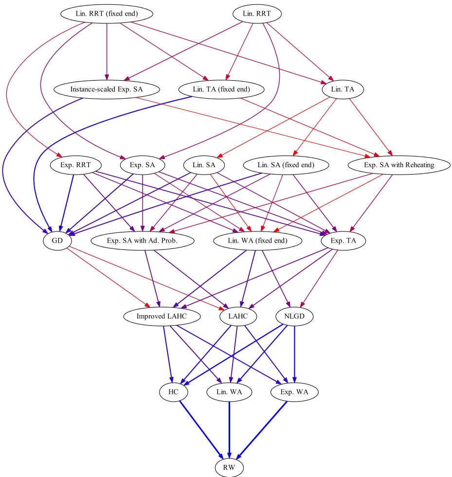
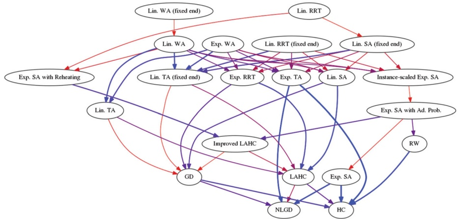

# A comparison of acceptance criteria for the adaptive large neighbourhood search metaheuristic

**Alberto Santini**<strong>1</strong> **· Stefan Ropke**<strong>2</strong> **· Lars Magnus Hvattum**<strong>3</strong>

Received: 17 December 2016 / Revised: 18 April 2018 / Accepted: 18 May 2018

© Springer Science+Business Media, LLC, part of Springer Nature 2018

**Abstract** Adaptive large neighborhood search (ALNS) is a useful framework for solving difficult combinatorial optimisation problems. As a metaheuristic, it consists of some components that must be tailored to the specific optimisation problem that is being solved, while other components are problem independent. The literature is sparse with respect to studies that aim to evaluate the relative merit of different alternatives for specific problem independent components. This paper investigates one such component, the move acceptance criterion in ALNS, and compares a range of alternatives. Through extensive computational testing, the alternative move acceptance criteria are ranked in three groups, depending on the performance of the resulting ALNS implementations. Among the best variants, we find versions of criteria based on simulated annealing, threshold acceptance, and record-to-record travel, with a version of the latter being consistently undominated by the others. Additional analyses focus on the search behavior, and multiple linear regression is used to identify characteristics of search behavior that are associated with good search performance.

<small>B Alberto Santini alberto.santini@upf.edu</small>

<small>Stefan Ropke ropke@dtu.dk</small>

<small>Lars Magnus Hvattum hvattum@himolde.no</small>

<small>1 Pompeu Fabra University and Barcelona GSE, Carrer Ramon Trias-Fargas 25, 08005 Barcelona, Spain</small>

<small>2 DTU Management Science, Produktionstorvet 424, 2800 Kgs., Lyngby, Denmark</small>

<small>3 Molde University College, Britvegen 2, 6410 Molde, Norway</small>

**Keywords** Adaptive large neighbourhood search · Simulated annealing · Threshold acceptance · Record-to-record travel · Vehicle routing problem · Capacitated minimum spanning tree · Quadratic assignment problem

## 1 Introduction

The adaptive large neighborhood search (ALNS) metaheuristic (Ropke and Pisinger 2006a) has become a popular template for implementing heuristic solution methods, especially for vehicle routing applications (Demir et al 2012; Grangier et al 2016; Hemmelmayr et al 2012; Muller et al 2012; Ribeiro and Laporte 2012). The metaheuristic allows the use of problem specific knowledge when specifying operators for partially destroying and then repairing a solution to an optimisation problem. Problem independent components of the ALNS dictate how different destroy and repair operators are used and control the search trajectory. One presumably important component that influences the search trajectory is the move acceptance criterion. In the original ALNS, this criterion was based on simulated annealing (Ropke and Pisinger 2006a), whereas earlier work on large neighborhood search (LNS) by Shaw (1998) accepted only improving solutions. Recently, some implementations have used the record-to-record travel acceptance criterion instead (Lei et al 2011), and in one case it was found to perform better than the standard simulated annealing criterion (Hemmati and Hvattum 2017).

Currently, however, there are no guidelines available to recommend one acceptance criterion over another. This paper intends to fill this gap by investigating a large number of different move acceptance criteria by subjecting them to extensive computational testing. Through empirical experiments we attempt to (1) quantify the effect on performance from using different acceptance criteria, (2) suggest which move acceptance criterion is better suited for an implementation of ALNS, and (3) attempt to measure in which way the move acceptance criteria influence the search behaviour.

In particular, two main hypotheses can be tested with respect to the choice of acceptance criterion in ALNS. The first hypothesis is that the standard simulated annealing acceptance criterion is the best criterion, in that it leads to better solutions within a standard running time than when using any other criterion. This hypothesis is reasonable based on the fact that most publications describing ALNS implements this acceptance criterion. The second hypothesis is that the influence of the acceptance criterion on the performance and behaviour of the search is negligible, that is, the effect size is small compared to random variations in search performance.

To test these hypoteses, we used a vast test bed of instances, from three wellknown problems. The first is the capacitated vehicle routing problem, concerned with the optimal delivery of goods to customers using a fleet of capacitated vehicles. The second is the capacitated minimum spanning tree problem, where we have to find a spanning tree in a graph minimising the cost of the included edges, under a capacity constraint on its sub-trees. The third one is the quadratic assignment problem: an extension of the classical assignment problem, where costs are associated with pairs of simultaneous assignments. See Sect. 4 for a more detailed description.

The remainder of this paper is structured as follows. In Sect. 2 we give a brief description of the ALNS metaheuristic; Sect. 3 lists the acceptance criteria we are comparing in this work. Sections 4 and 5 describe the test problems and give details of the implementation of ALNS used to solve them. Section 6 explains the process with which we tuned the parameters related to the acceptance criteria. We report computational results in Sect. 7 and finally summarise our findings in the conclusions, in Sect. 8.

## 2 The ALNS framework

ALNS was introduced by Ropke and Pisinger (2006a) and extends the LNS metaheuristic first proposed by Shaw (1998). In the LNS, we consider a neighbourhood which is implicitly defined by the sequential application of a destroy and a repair method. A destroy method turns a feasible solution into an incomplete solution, by destroying parts of it; a repair method then takes an incomplete solution and turns it into a feasible solution. In ALNS, we consider a collection of destroy and repair methods. A neighbourhood is implicitly defined for each possible pair of destroy and repair methods, assuming that any repair method is able to reconstruct a solution from an incomplete solution created by any destroy method.

For example, a destroy method for a vehicle routing problem could remove a certain number of customers from their respective routes. A repair method could then try to re-insert the missing customers, trying all feasible positions and choosing the one that minimises the total cost.

Some element of randomness is commonly introduced in the process. This element is usually included in the destroy method, by randomising the choice of which parts of the solution to destroy. In most implementations, the repair methods aim to, myopically, obtain the best possible solution starting from an incomplete solution; however, it is also possible to introduce some stochastic element in the repair methods. At each iteration, the destroy and repair methods are chosen based on their past performance, reflected by a score: the methods are picked with a roulette-wheel selection, where the probabilities are directly proportional to the scores. Initially all methods are assigned the same score.

A synthetic formulation of the ALNS algorithm is given in Algorithm 1. Once the destroy and repair methods are chosen, a new solution is produced. The algorithm then has to decide whether or not to replace the current solution with the one newly produced—thus accepting or rejecting the new solution. The criterion used to decide whether or not the new solution is accepted is therefore called the acceptance criterion. The criterion itself can base the acceptance decision on some internal state, which can vary during the course of the solution process. For example, a simulated annealing (SA) criterion has been the most popular choice when implementing ALNS: in the case of SA, the varying state is represented by the temperature, which starts at a high value and exponentially decreases during the execution of the algorithm.

When the new solution improves on the global best solution, the scores of the corresponding destroy and repair methods are increased by a relatively large value;

Algorithm 1: General Framework
Input: Initial solution: $x_0$
Input: Initial acceptance parameters
Input: Initial destroy/repair scores
$x = x_0$ /* Initialise current solution */
$x^* = x_0$ /* Initialise best solution */
$i = 1$ /* Iteration count */
while $i \leq K$ do
    Choose a destroy method $d$
    Choose a repair method $r$
    $x' \leftarrow r(d(x))$
    if Accept new solution $x'$ then
        $x = x'$
    end
    if $f(x) &lt; f(x^*)$ then
        $x^* = x$
    end
    Update(Destroy/repair scores)
    Update(Acceptance parameters)
    $i = i + 1$
end
return $x^*$

otherwise, if the new solution is accepted, their scores are increased by a relatively smaller value; otherwise, if the new solution is not accepted, their scores are decreased.

In our implementation, the solution process ends when we reach a predetermined number of iterations. Other criteria that have been used include a hard time limit, and a predetermined number of consecutive iterations without improvement.

The LNS and ALNS has similarities to the method known as iterated greedy, first proposed by Ruiz and Stützle (2007). That first implementation of iterated greedy only uses a single destroy method (based on random removal) and a single repair method. As opposed to ALNS, it explicitly includes an optional local search improvement phase. Glover (2000) points out that alternating constructive and destructive phases corresponds to a one-sided strategic oscillation. Strategic oscillation refers to a process where a search is strategically driven to go back and forth between the set of feasible solutions and a set of infeasible solutions (Glover and Laguna 1997). In this context, destroy methods create infeasible solutions, and the repair methods drive the resulting infeasible solution towards a feasible solution. Finally, the ruin and recreate heuristic, proposed in Schrimpf et al (2000) is also very similar to LNS and ALNS in the sense that it improves an initial solution by repeatedly destroying (ruining) and repairing (recreating) the current solution.

## 3 Acceptance criteria

In this section we describe the different acceptance criteria tested within the ALNS framework. In the following we denote by N(x) the neighbourhood of a solution x, defined by a selection of destroy and repair heuristics. The cost of a solution x is denoted by f (x). We refer to the current solution as x; when it is important to specify which iteration of the ALNS algorithm we are considering, we use the notation xi , where i is the iteration number. The new solution produced by the destroy and repair heuristics in N(x) is denoted by x, while we indicate the best encountered solution as x∗. The initial solution is denoted by x0. Finally, K is the total number of iterations. In the pseudo-code, we will assume that we are minimising the objective function f (·).

The acceptance criteria depend on a given number of parameters, that in our case ranges from 0 to 4. Some acceptance criteria make use of an internal state, which varies during the solution process, and we assume that the internal state is updated at each iteration of the ALNS algorithm. Alternative criterion-based approaches exist in the literature. For example, one could decide to update certain values of the internal state only when there is apparent convergence with the current settings. Since these strategies cannot be applied uniformly across all the acceptance criteria, we resort to our simpler approach.

Since we are dealing with problem instances that are very diverse in nature and size, we update the internal state used by the acceptance criteria using information relative to the cost of either the best or the current solution, rather than absolute numbers.

## 3.1 Hill climbing

Hill Climbing (HC), presented in Algorithm 2, accepts a new solution iff it is better than the current one.

Algorithm 2: Hill Climbing
Input: Initial solution: $x_0$
$x = x_0$ /* Initialise current solution */
$i = 1$ /* Initialise iteration count */
while $i \leq K$ do
    Pick $x' \in N(x)$
    if $f(x') \leq f(x)$ then
        $x = x'$
    end
    $i = i + 1$
end
return $x$

## 3.2 Random walk

At the other end of the spectrum from HC, there is Random Walk (RW), presented in Algorithm 3. In this case, we accept all new solutions.

Algorithm 3: Random Walk

Input: Initial solution: $x_0$
$x = x_0$ /* Initialise current solution */
$x^* = x_0$ /* Initialise best solution */
$i = 1$ /* Initialise iteration count */
while $i \leq K$ do
    Pick $x' \in N(x)$
    $x = x'$
    if $f(x) &lt; f(x^*)$ then
        $x^* = x$
    end
    $i = i + 1$
end
return $x^*$

## 3.3 Late acceptance hill climbing

This criterion, presented in Algorithm 4, is similar to HC, but the new solution is compared to what was the current solution L iterations ago. In order to implement this acceptance criterion, it is necessary to keep a circular list of length L that stores the last L current solutions. The criterion was first introduced by Burke and Bykov (2008, 2012).

Parameters related to acceptance This acceptance criterion only uses parameter: the length L of the look-back list.

Variants The standard version of this acceptance criterion would not accept the new solution in case $f ( x _ { i - L } ) < f ( x ^ { \prime } ) < f ( x )$ . As proposed by Burke and Bykov (2012), the criterion can be emended to accept $x ^ { \prime }$ if either it is better than the current solution L iterations ago, or it is better than the current solution at the present iteration. In this variant, called **Improved LAHC**, we edit line 7 to become $f ( x ^ { \prime } ) \leq f ( x _ { i - L } ) \vee$ $f ( x ^ { \prime } ) \leq f ( x )$ (where ∨ denotes logical or).

Algorithm 4: Late Acceptance Hill Climbing
Input: Initial solution: $x_0$
Input: List length: $L$
$x = x_0$ /* Initialise current solution */
$x^* = x_0$ /* Initialise best solution */
$x_{-1}, \ldots, x_{-L+1} = x_0$ /* Initialise list */
$i = 1$ /* Iteration count */
while $i \leq K$ do
    Pick $x' \in N(x)$
    if $f(x') \leq f(x_{i-L})$ then
        $x = x'$
    end
    if $f(x) &lt; f(x^*)$ then
        $x^* = x$
    end
    $i = i + 1$
end
return $x^*$

## 3.4 Threshold acceptance

With the threshold acceptance (TA) criterion introduced by Dueck and Scheuer (1990) and presented in Algorithm 5, a new solution is accepted if the gap between the new and the current solution is smaller than a threshold T . The threshold starts at a large value and decreases at every iteration.

Algorithm 5: Threshold Acceptance
Input: Initial solution: $x_0$
Input: Initial threshold: $T$
$x = x_0$ /* Initialise current solution */
$x^* = x_0$ /* Initialise best solution */
$i = 1$ /* Iteration count */
while $i \leq K$ do
    Pick $x' \in N(x)$
    if $\frac{f(x') - f(x)}{f(x')} &lt; T$ then
        $x = x'$
    end
    if $f(x) &lt; f(x^*)$ then
        $x^* = x$
    end
    Update($T$)
    $i = i + 1$
end
return $x^*$

Parameters related to acceptance The user-provided parameters are the start threshold $T ^ { \mathrm { s t a r t } }$ and the end threshold $T ^ { \mathrm { e n d } }$ . The initial threshold T is set to its start value. At every iteration, the threshold is updated to move towards its end value.

Variants We tested two rates of decay: linear and exponential. In the first case, the **linear threshold acceptance** method, we update the threshold as: $T \gets T - ( T ^ { \mathrm { s t a r t } } -$ $T ^ { \mathrm { e n d } } ) / K$ . In the second case, the **exponential threshold acceptance** method, we update it as $T \gets T \cdot ( T ^ { \mathrm { e n d } } / T ^ { \mathrm { s t a r t } } ) ^ { 1 / \tilde { K } }$

## 3.5 Simulated annealing

Simulated annealing (SA), presented in Algorithm 6, is the acceptance criterion most commonly used within the ALNS framework. It was originally introduced by Kirkpatrick et al (1983) and it was used with the ALNS since its debut by Ropke and Pisinger (2006a). The basic idea behind SA is similar to TA: moves to solutions that are worse than the current one are allowed, but the probability of doing so depends on the state of the search and on the gap between f (x) and $f ( x ^ { \prime } )$

Algorithm 6: Simulated Annealing
Input: Initial solution: $x_0$
Input: Initial temperature: $T$
$x = x_0$ /* Initialise current solution */
$x^* = x_0$ /* Initialise best solution */
$i = 1$ /* Iteration count */
while $i \leq K$ do
    Pick $x' \in N(x)$
    if $\text{rand}(0, 1) \leq e^{\frac{f(x) - f(x')}T}$ then
        $x = x'$
    end
    if $f(x) &lt; f(x^*)$ then
        $x^* = x$
    end
    Update($T$)
    $i = i + 1$
end
return $x^*$

Parameters related to acceptance The probability that a new solution of value $f ( x ^ { \prime } )$ is accepted is

$$
e ^ {\frac {f (x) - f (x ^ {\prime})}{T}}
$$

Given a reference solution value z, if we wanted to accept with probability $p \in [ 0 , 1 ]$ new solutions of cost $f ( x ^ { \prime } ) = h z$ , we would have to set the temperature $T$ according to:

$$
p = e ^ {\frac {z - h z}{T}} \Rightarrow \ln p = \frac {z (1 - h)}{T} \Rightarrow T = \frac {z (1 - h)}{\ln p}
$$

If we use the reference probability $p = 0 . 5$ this becomes

$$
T = \frac {z (1 - h)}{\ln 0 . 5}\tag{1}
$$

We can therefore use two user-provided parameters $h ^ { \mathrm { s t a r t } } , h ^ { \mathrm { e n d } }$ that define how much worse solutions we accept with probability 0.5 at the beginning and the end of the procedure. The corresponding start and end temperatures $T ^ { \mathrm { s t a r t } }$ and $T ^ { \mathrm { e n d } }$ can then be calculated using (1).

Variants It remains an open question how to choose the reference value z. One option is to use the initial solution: $z \; = \; f ( x _ { 0 } )$ . The parameter $T$ should then be initialised as $T ^ { \mathrm { s t a r t } }$ and then updated at every iteration, as $T \gets T \cdot ( T ^ { \mathrm { e n d } } / T ^ { \mathrm { s t a r t } } ) ^ { 1 / K }$ We refer to this method, introduced as the default acceptance criterion for ALNS by Ropke and Pisinger (2006a), simply as exponential simulated annealing. A variant of this method has been proposed by Pisinger and Ropke (2007), where the authors noticed that the start and end temperature values can be sensitive to the size of the instance. How this size is defined is problem dependent (for example, it can be the number of customers in a vehicle routing problem). In the following we just assume that it is a positive real number $s \geq 1$ . In the variant of SA that we called **instancescaled exponential simulated annealing**, we divide the start and end temperature by a coefficient $s ^ { M }$ , where $M \in \mathbb { N }$ is a parameter. Since Pisinger and Ropke (2007) only considered the case where $M = 1$ , we take this as the base case upon which we build the following additional variations. The first variation builds on the observation that the best known solution at a certain iteration could be much better than the initial one. Therefore, the reference value z can be updated every time the best solution value improves, as $T ^ { \mathrm { e n d } } = ( f ( x ^ { * } )   \cdot   ( 1   -   h ) ) /$ **l**n 0.5. This variant, which we call exponential **simulated annealing with adaptive probability** coincides with the base method if the value of the initial solution is never improved. Similarly to what we did for TA, we also considered a version of SA where the decrease between start and end temperature is linear. We named this version **linear simulated annealing**. The update function for T is $T   \leftarrow   T   -   ( T ^ { \mathrm { s t a r t } }   -   T ^ { \mathrm { e n d } } ) / K$ . Another common variant is SA with reheating, discussed by Connolly (1992). Reheating is used to escape local minima in later phases of the exploration, when the temperature is too small to accept a (worsening) diversifying solution. In our implementation we perform reheating a fixed number of times R. When reheating occurs, the temperature is set to the temperature $T ^ { * }$ recorded the last time the best solution was improved, multiplied by a coefficient $r > 1$

$$
T \leftarrow r T ^ {*} \quad (\text {every} K / (R + 1) \text {iterations})
$$

We call this variant **exponential simulated annealing with reheating**. On top of the parameters $h ^ { \mathrm { s t a r t } }$ and $h ^ { \mathrm { e n d } }$ , this variant has the two additional parameters R and $r$

## 3.6 Great deluge

With the Great Deluge (GD) criterion, introduced by Dueck (1993) and presented in Algorithm 7, a new solution is accepted only if its cost is smaller than a threshold, called the water level. The water level starts at a high value and decreases at each iteration.

Parameters related to acceptance The two key parameters used for GD are the initial water level and the decrease rate. The initial water level is set to $W = \alpha \cdot f ( x _ { 0 } )$ where $\alpha > 1$ is a user-provided parameter. The water level is then decreased at each iteration, $W \gets W - \beta ( W - f ( x ) )$ , according to another parameter $\beta \in ( 0 , 1 )$

## 3.7 Non-linear great deluge

The Non-Linear Great Deluge criterion (NLGD), presented in Algorithm 8, builds on the same idea of the GD, with a few variations. The water level decreases more quickly in the beginning of the search process, more slowly towards the end, and can also increase. The NLGD was introduced by Landa-Silva and Obit (2008) for a course timetabling problem; in our implementation we change some of the fixed values, which the authors tuned for their specific problem, and we replace them with parameters.

The general form of this acceptance criterion is similar to the criterion in Algorithm 7. The only difference is that the acceptance criterion checks that either the new solution has a cost lower than the current water level, $o r$ it improves over the current solution. This is done because in NLGD the water level is not guaranteed to be above the cost of the current solution.

Algorithm 7: Great Deluge

Input: Initial solution: $x_0$
Input: Initial water level: $W$
$x = x_0$ /* Initialise current solution */
$x^* = x_0$ /* Initialise best solution */
$i = 1$ /* Iteration count */
while $i \leq K$ do
    Pick $x' \in N(x)$
    if $f(x') &lt; W$ then
        $x = x'$
    end
    if $f(x) &lt; f(x^*)$ then
        $x^* = x$
    end
    Update(W)
    $i = i + 1$
end
return $x^*$

Algorithm 8: Non-Linear Great Deluge
Input: Initial solution: $x_0$
Input: Initial water level: $W$
$x = x_0$ /* Initialise current solution */
$x^* = x_0$ /* Initialise best solution */
$i = 1$ /* Iteration count */
while $i \leq K$ do
    Pick $x' \in N(x)$
    if $f(x') &lt; W \lor f(x') &lt; f(x)$ then
        $x = x'$
    end
    if $f(x) &lt; f(x^*)$ then
        $x^* = x$
    end
    Update(W)
    $i = i + 1$
end
return $x^*$

Parameters related to acceptance The initial water level is chosen similarly as for GD: $W   =   \alpha   \cdot   f ( x _ { 0 } )$ , with a user-provided parameter $\alpha \; > \; 1$ . Three additional parameters— $- \beta , \gamma$ , and δ—are used to update the water level at each iteration, according to the decision flow in Algorithm 9: if the new solution is worse than the water level, then the water level tends to increase, to increase the chance of accepting new solutions. If the last solution is better than the water level, but not much better (the gap is smaller than $\beta )$ , then again we increase the water level, for similar reasons. On the other hand, if the gap is larger than $\beta ,$ , we decrease the water level and the decrease function is exponential.

A comparison of acceptance criteria for the adaptive large…

Algorithm 9: Update(W)
$G = \frac{W - f(x')}{W}$ /* Gap between water level and new solution */
if $G &lt; \beta$ then
    return $W + \gamma \cdot |f(x') - W|$ /* Re-increase W */
else
    return $W \cdot e^{-\delta \cdot f(x^*)} + f(x^*)$ /* Exponentially decrease W */
end

Algorithm 10: Record-to-Record Travel
Input: Initial solution: $x_0$
Input: Initial threshold: $T$
$x = x_0$ /* Initialise current solution */
$x^* = x_0$ /* Initialise best solution */
$i = 1$ /* Iteration count */
while $i \leq K$ do
    Pick $x' \in N(x)$
    if $\frac{f(x') - f(x^*)}{f(x')} &lt; T$ then
        $x = x'$
    end
    if $f(x) &lt; f(x^*)$ then
        $x^* = x$
    end
    Update($T$)
    $i = i + 1$
end
return $x^*$

## 3.8 Record-to-record travel

The record-to-record travel (RRT) criterion presented in Algorithm 10 is similar to TA, but the new solution is accepted if the gap between the new and the best (rather than the current) solution is smaller than a threshold T . The threshold starts at a large value and decreases at every iteration to reach its predetermined value at the end of the search process.

Parameters related to acceptance The user-provided parameters are the start threshold $T ^ { \mathrm { s t a r t } }$ and the end threshold $T ^ { \mathrm { e n d } }$ . The initial threshold T is set to its start value and, at each iteration, moves towards the end value.

Variants Analogous to what was done for TA, we tested two rates of decay that give rise to two variants that we call **linear record-to-record travel** and **exponential record-to-record travel**.

## 3.9 Worse accept

The worse accept (WA) criterion presented in Algorithm 11 tries to increase diversification by accepting a new solution if it improves over the current one, or—regardless of its cost—with a given probability, $p .$ This probability is higher at the beginning and smaller at the end of the solution process.

Algorithm 11: Worse Accept
Input: Initial solution: $x_0$
Input: Initial probability: $p$
$x = x_0$ /* Initialise current solution */
$x^* = x_0$ /* Initialise best solution */
$i = 1$ /* Iteration count */
while $i \leq K$ do
    Pick $x' \in N(x)$
    if $f(x') &lt; f(x) \lor \text{rand}(0, 1) &lt; p$ then
        $x = x'$
    end
    if $f(x) &lt; f(x^*)$ then
        $x^* = x$
    end
    Update($p$)
    $i = i + 1$
end
return $x^*$

This criteria is particularly suited in cases when the objective value of the problem typically holds a few discrete values, and passing from a value to the next better one is a relatively rare occurrence. An example of such a problem is the Vertex Colouring Problem (VCP), in which one has to produce a colouring of a graph, using the smallest number of colours. WA was employed as the acceptance criterion in an ALNS-based metaheuristic for the partition colouring problem (a generalisation of the VCP) by Furini et al (2017).

Parameters related to acceptance The user-provided parameters are the start probability $p ^ { \mathrm { s t a r t } }$ and the end probability $p ^ { \mathrm { e n d } }$

Variants The probability decay, similarly to what done for other methods, can be linear or exponential. This gives rise to two criteria: **linear worse accept** and **exponential worse accept**.

## 3.10 Parameter space reduction

For the linear variants of methods TA, SA, WA and RRT, it is sensible to set the end parameter (be it threshold, temperature or probability) to values very close to zero. We can therefore reduce the dimension of the parameter space, by simply fixing these end parameters to 0. The resulting new methods are referred to by using the additional suffix “**(fixed end)**”. Notice that, on the other hand, an exponential decay function can never reach the value 0, by definition.

## 4 Test problems

To evaluate the different acceptance criteria, we consider ALNS implementations for three different combinatorial optimisation problems, as presented below.

## 4.1 Capacitated vehicle routing problem

In the capacitated vehicle routing problem (CVRP) we have to deliver goods from a depot to a set of customers, using an unlimited fleet of identical vehicles. Each customer demands a certain quantity of goods and the vehicles have a limited capacity. Our task is to construct routes starting and ending at the depot that minimise the total travel distance and that obey the capacity of the vehicles. We assume that travel distances are symmetric in the sense that the distance from A to B is the same as the distance from B to A. The problem can be modelled on a directed graph $G = ( N , A )$ where the node set is $N = \{ 0 , \ldots , n \}$ and node 0 represents the depot, while nodes $C = \{ 1 , \ldots , n \}$ represent the customers. Each customer $i \in C$ has an associated demand $q _ { i } \geq 0$ and the vehicles all have the same capacity $\mathcal { Q } \geq \operatorname* { m a x } _ { i \in C } q _ { i }$

In the literature on heuristics for the CVRP, researchers have typically also considered instances that include a distance or duration limit for each route. In the standard benchmark instances, customers have a service time and for each route the sum of service times plus distance driven has to be less than or equal to a threshold L. For more information the reader is referred to Irnich et al (2014) and Laporte et al (2014).

## 4.2 Capacitated minimum spanning tree problem

In the (symmetric) capacitated minimum spanning tree (CMST) we have to construct a spanning tree subject to a capacity constraint. The problem is defined on a undirected graph $G = ( N , E )$ where N is the node set and E are the edges. For each edge $e \in E$ we are given an associated cost $c _ { e } \geq 0$ . In the node set $N = \{ 0 , \ldots , n \}$ , node 0 is the root node. The remaining nodes $i \in N \setminus \{ 0 \}$ are associated with a demand $d _ { i } \geq 0$ and we are given a maximum demand or capacity $Q .$ Removing node 0 from any spanning tree results in the tree splitting into one or more connected components. In the CMST, the solution has to satisfy the property that the sum of the demands of each component (or sub-tree) is less than or equal to $Q$ (capacity constraints). We seek the spanning tree that minimizes the sum of edge costs while satisfying capacity constraints. For more information on this problem, see Uchoa et al (2008).

## 4.3 Quadratic assignment problem

The linear assignment problem (LAP) aims at assigning n facilities to n locations. The assignment of facility i to location j incurs in a cost $c _ { i j }$ . The objective of the LAP is to minimise the total cost, while each facility is assigned to exactly one location, and each location receives exactly one facility. The quadratic assignment problem (QAP) is an extension of the LAP, where the costs are associated to pairs of assignments: we are given $n ^ { 4 }$ costs, with $c _ { i j k l }$ corresponding to the simultaneous assignment of facility i to location $j$ , and facility k to location l. A cost can be thought of as $c _ { i j k l } = f _ { i k } d _ { j l }$ where $f _ { i k }$ is the flow to be sent from facility i to facility $k ,$ and $d _ { j l }$ is the distance between location $j$ and location l. More information about this problem can be found in the seminal paper by Lawler (1963). For works on metaheuristics for the QAP see, e.g., Stützle (2006); James et al (2009).

## 5 ALNS applied to test problems

In the following we describe details of ALNS implementations for each of the two optimisation problems that we are solving. We point out that we used the parallel version of ALNS described in Ropke and Santini (2016), with the number of parallel threads set to 8.

## 5.1 ALNS for the CVRP

Let n be the number of customers in the instance. We determine an upper bound for the number of customers to remove based on two parameters: an absolute upper bound $\bar { \omega } ^ { + }$ and a relative one $\omega ^ { + }$ . The upper bound is then $n ^ { + }   =   \operatorname* { m i n } \{ \bar { \omega } ^ { + } , \omega ^ { + } n \}$ Similarly a lower bound is based on the parameters $\bar { \omega } ^ { - }$ and $\omega ^ { - }$ ; the lower bound is $n ^ { - } =$ min $\{ n ^ { + }$ , max $\{ \bar { \omega } ^ { - } , \omega ^ { - } n \} \}$ . Based on the upper and lower bound we select the number of customers to remove, r, as a uniformly random number in the interval $\{ n ^ { - } , \ldots , n ^ { + } \}$

The destroy method used are: random removal, relatedness removal (introduced by Shaw (1998)), and history-based removal. These methods are described in detail in Ropke and Pisinger (2006b, Section 5). The repair method used is called regret repair, first introduced for vehicle problems by Potvin and Rousseau (1993) and described in detail in Ropke and Pisinger (2006a, Section 3.2.2). A steepest descent algorithm based on a small neighbourhood is also implemented to improve the solution found by the regret heuristic. The descent algorithm uses the 2-opt neighbourhood, both considering the intra-route and the inter-route variant (also known as $2 \mathtt { - o p t ^ { * } }$ , see Laporte et al (2014)). In order to save running time, it is not used every time a partial solution has been repaired, but only with a given probability $p ^ { 2 - \mathrm { o p t } }$

A random starting solution is created by constructing routes iteratively. Let U be the set of customers that are still not placed in the solution. Initially U contains all customers. In order to start a new route, a random seed customer is selected from U. Customers are then added to the route until the capacity or the length constraint on the route disallow further insertions. When choosing the customer to insert into a growing route, the algorithm simply selects the customer whose insertion increases the cost of the route the least. Whenever a route is full, a new route is created following the same procedure. This process continues until all customers have been inserted.

## 5.2 Simple LNS for the CVRP

A simplified version of the ALNS is also considered for the CVRP. The reason for this is that the full ALNS was developed using the SA acceptance criterion, and that the selection of components in the full ALNS could therefore be biased towards components that fit well with the behavior of the SA criterion. The simple LNS for the CVRP uses a single destroy and a single repair method. The destroy method is random removal and the repair method is the deterministic regret method. The repair method does not include the local improvement method. The number of customers to remove and the initial solution are found in the same way as for the more complex

ALNS method. We sometimes refer to this combination of an ALNS implementation and test problem as Simple CVRP.

## 5.3 CMST

To the best of our knowledge, the first application of the ALNS metaheuristic to the CMST problem is presented in Ropke and Santini (2016). In the following, we give a brief summary of the implementation, while referring the reader to the cited article for more details.

The number of nodes of the graph to remove is determined in the same way as for the CVRP (see Sect. 5.1). The destroy methods used are relatedness removal and history-based removal, which are analogous to the CVRP methods with the same names. Similarly, the repair method, regret repair, is analogous to the method used for the CVRP. Furthermore, we also used a greedy insertion repair method. The solutions produced by the repair methods are improved by solving a minimum spanning tree problem for each sub-tree of the solution.

Unlike what is done for the CVRP, the initial solution is created deterministically by a two-stage procedure that first estimates the number of sub-trees that need to be created, and then assigns nodes to the subtrees.

## 5.4 QAP

The implemented ALNS destroys a solution by removing facilities and repairs the solution by reinserting the facilities. The number of facilities to remove is determined in the same way as for the CVRP and CMST where n now is the number of facilities in the instance. One destroy method is implemented, it selects the facilities to remove at random. Three repair methods are implemented. All methods reinsert the facilities one by one and they differ in the way they order the facilities to insert.

Greedy repair inserts the facility whose insertion increases the overall cost the least. When evaluating insertion positions it is possible to apply noise to the cost of each insertion in order to randomise the method. When the greedy repair method is invoked the deterministic or the randomised version is selected at random, both have equal probability of being selected. Worst-facility-first repair takes the opposite strategy and first inserts the facility that will increase the cost of the solution the most (it has to be inserted, so why not do it straight away). Random-sequence repair creates a random permutation of the facilities that should be inserted and inserts them in this order. Common for all repair methods is that when a facility has to be inserted, it is inserted at the location where it increases the overall cost the least.

A two-opt steepest descent algorithm has been implemented to improve the solution generated by the repair methods. The algorithm considers all possible swaps of two facilities and performs the swap that decreases the objective value the most. This continues until there is no way of improving the solution by swapping two facilities (see e.g. Merz and Freisleben (2000)). The two-opt algorithm is used with 10% probability after the worst-facility-first repair and random-sequence repair methods. It is not used together with the greedy repair method.

Table 1 Problem-specific parameters which have been kept fixed

| Problem | Param type | Parameter | Values |
| --- | --- | --- | --- |
| CMST | Destroy | Number of customers to remove | ω¯+ = 30,ω+ = 0.4,ω¯- = 5,ω- = 0.1 |
| CMST | Destroy | Destroy close customers | η = n2, pfix = 4 |
| CMST | Destroy | Historical node-pair destroy | phist = 5 |
| CMST | Repair | Regret repair | pregret = 1.5 (stochastic version) |
| CVRP | Destroy | Number of nodes to remove | ω¯+ = 50,ω+ = 0.4,ω¯- = 10,ω- = 0.1 |
| CVRP | Destroy | Relatedness destroy method | prel = 5 |
| CVRP | Destroy | Historical node-pair destroy | phist = 5 |
| CVRP | Repair | Regret repair | pregret = 1.5 (stochastic version) |
| CVRP | Local impr. | 2-opt∗ local search | p2-opt = 0.1 |
| QAP | Destroy | Number of locations to remove | ω¯+ = 50,ω+ = 0.4,ω¯- = 8,ω- = 0.1 |
| QAP | Repair | Greedy repair probability of adding noise | p = 0.5 |
| QAP | Repair | Greedy repair noise factor | γ = 0.4 |

To generate an initial solution the greedy-repair method is used. The first two facilities are placed using the approach suggested by Li et al (1994) and the remaining facilities are placed using the greedy repair method.

## 5.5 Problem-specific parameters

Some parameters of the ALNS implementations, relative to the problem-specific destroy and repair heuristics, and to local improvement methods, are kept at fixed values. Table 1 describes the values of these parameters.

## 6 Parameter tuning

With a few exceptions, all acceptance criteria described in Sect. 3 depend on one or more parameters. To tune these parameters an algorithmic approach is preferred to a manual one in order to avoid bias toward acceptance criteria that the authors know well. A substantial amount of literature is available on algorithms for automatic parameter tuning, and some prominent examples are described in the works by Birattari et al (2010) and Hutter et al (2009). In this work we have implemented a simple iterated local search procedure to perform parameter tuning, as described below.

Given an acceptance criterion and a problem chosen among the ones we consider in this work (CMST, CVRP, Simple CVRP, and QAP), let N be the number of parameters we are tuning. Let n be the number of integer parameters and r the number of real-valued parameters. We assume without loss of generality that the parameters are numbered $\alpha _ { 1 } , \ldots , \alpha _ { n } , \alpha _ { n + 1 } , \ldots , \alpha _ { n + r }$ , and that $N = n + r$ . The parameter space will then be $\mathcal { P } = \mathbb { N } ^ { n } \times \mathbb { R } ^ { r }$

The aim of the parameter tuning is to explore the parameter space, starting from an initial parameter assignment $\tilde { \alpha ^ { 0 } = ( a _ { 1 } ^ { 0 } , \ldots , a _ { N } ^ { 0 } ) \in \mathcal { P } }$ , in a certain number $M \in \mathbb { N }$ of iterations, and return the assignment that gives, on average, the best results for the acceptance criterion and problem considered. Let $I _ { 1 } , \ldots , I _ { K }$ be the instances used for parameter tuning and let $B _ { 1 } , \ldots , B _ { K }$ be the best objective function values known from the literature for the instances (these might not be the optimal ones, if the instance is open). For any given parameter assignment α, the algorithm is (re-)run $\lambda \in \mathbb { N }$ times, unchanged, on each instance. This produces K average results, one for each instance, calculated as

$$
A _ {\alpha , k} = \frac {1}{\lambda} \sum_ {i = 1} ^ {\lambda} v _ {\alpha , i, k}
$$

where $v _ { \alpha , i , k }$ is the solution value obtained by the algorithm for instance $I _ { k }$ at the i -th rerun, with parameter assignment α.

We can then calculate the deviation from the best known result, for each instance:

$$
D _ {\alpha , k} = \frac {A _ {\alpha , k} - B _ {k}}{A _ {\alpha , k}}
$$

The score of assignment α is calculated as the average deviation across all instances:

$$
S _ {\alpha} = \frac {1}{K} \sum_ {k = 1} ^ {K} D _ {\alpha , k} \Bigg |
$$

The lower the score and, in particular, the closer it is to 0, the better is the parameter assignment α.

A general overview of the parameter tuning algorithm is given in Algorithm 12. An initial parameter assignment $\alpha ^ { 0 }$ is given, together with an initial step $\sigma ^ { 0 }$ . The step defines the neighbourhood of the current assignment:

$$
\left. \mathcal {N} (\alpha) = \left\{\left(\alpha_ {1} ^ {\prime}, \dots , \alpha_ {N} ^ {\prime}\right) \mid \alpha_ {i} ^ {\prime} - \alpha_ {i} \in \{- \sigma_ {i}, 0, \sigma_ {i} \} \forall i = 1, \dots , N \right\} \right.\tag{2}
$$

The neighbourhood is defined by all possible combination of moves, in all the directions defined by the components of the parameter vector, each by its corresponding step, with $\sigma _ { 1 } ^ { 0 } , \dots , \sigma _ { n } ^ { 0 } \in \mathbb { N }$ and $\sigma _ { n + 1 } ^ { 0 } , \dots , \sigma _ { N } ^ { 0 } \in \mathbb { R }$ . For larger values of N, the exploration of the neighbourhood defined above is computationally expensive. Therefore, for values of $N \geq 3$ , we define the alternative neighbourhood:

$$
\begin{array}{c} \mathcal {N} (\alpha) = \{(\alpha_ {1} ^ {\prime}, \ldots , \alpha_ {N} ^ {\prime}) | \\ \qquad \exists i \in \{1, \ldots , N \}: \alpha_ {i} ^ {\prime} - \alpha_ {i} \in \{- \sigma_ {i}, 0, \sigma_ {i} \} \text {and} \\ \qquad \forall j \neq i \alpha_ {j} ^ {\prime} = \alpha_ {j} \} \end{array}\tag{3}
$$

Algorithm 12: Parameter Tuning Algorithm
Input: Initial parameters $\alpha^0$
Input: Initial steps: $\sigma^0$
for $k = 1, \ldots, M$ do
    $\alpha^{\text{new}} = \text{BestInNb}(\alpha^{k-1}, \sigma^{k-1})$
    if $\alpha^{\text{new}} \neq \alpha^{k-1}$ then
        $\alpha^k = \alpha^{\text{new}}$
        $\sigma^k = \sigma^{k-1}$
    else
        $\alpha', \alpha'' = \text{BestTwo()}$
        $\alpha^k = \text{NewCentre}(\alpha', \alpha'')$
        $\sigma^k = \text{NewSteps}(\alpha', \alpha'')$
        if $\alpha^k = \alpha^{\text{new}}$ or StepsTooSmall($\sigma^k$) then
            $\alpha^k = \text{Diversify}(\alpha^k)$
            $\sigma^k = \sigma^0$
        end
    end
end
return $\arg \min_{k=1, \ldots, M} \{ S_{\alpha^k} \}$

Fig. 1 Representation of neighbourhood $\mathcal { N } ( \alpha )$ . a Case $N = 2$ . b Case $N = 3 .$ The diagonal dotted lines represent movement along a third axis

According to definition (3), therefore, we can only move along one direction at a time. Figure 1a, b give a graphical representation of $\mathcal { N } ( \alpha )$ for $N = 2$ and $N = 3$

At each iteration of the algorithm, the next parameter assignment is chosen in the neighbourhood of the current one (line 2) as the one with the best score:

$$
\left| \alpha^ {k + 1} = \arg \min \left\{S _ {\alpha^ {\prime}} \mid \alpha^ {\prime} \in \mathcal {N} \left(\alpha^ {k}\right) \right\} \right|
$$

When $\alpha ^ { k + 1 } = \alpha ^ { k }$ , we have reached a local optimum and the search must be interrupted and restarted somewhere else in the parameter space. In order to do this, we retrieve the best and second-best parameter configuration encoutered during the whole search, $\alpha ^ { \prime }$ and $\alpha ^ { \prime \prime }$ respectively (line 7), and we set the current parameter configuration as the centre of mass between $\alpha ^ { \prime }$ and $\alpha ^ { \prime \prime }$ (line 8):

$$
\alpha^ {k} = \left(\frac {\alpha_ {1} ^ {\prime} + \alpha_ {1} ^ {\prime \prime}}{2}, \dots , \frac {\alpha_ {N} ^ {\prime} + \alpha_ {N} ^ {\prime \prime}}{2}\right)
$$

where integer components are rounded to the nearest integer. The step sizes are also recalculated (line 9) and set as:

$$
\sigma^ {k} = \left(\frac {| \alpha_ {1} ^ {\prime} - \alpha_ {1} ^ {\prime \prime} |}{3}, \dots , \frac {| \alpha_ {N} ^ {\prime} - \alpha_ {N} ^ {\prime \prime} |}{3}\right)
$$

and, again, integer components are rounded. If, after recalculating $\alpha ^ { k }$ , all steps are below their minimum step size (which is a predetermined parameter), or if it happened that $\alpha ^ { k }$ did not change (line 10) we proceed with a stronger diversification (line 11) and we reset the step sizes (line 12). The strong diversification consists in setting:

$$
\alpha^ {k} = \left(\alpha_ {1} ^ {k - 1} + \rho_ {1} \sigma_ {1} ^ {0}, \dots , \alpha_ {N} ^ {k - 1} + \rho_ {N} \sigma_ {N} ^ {0}\right)
$$

where each $\rho _ { i }$ is taken randomly from the intervals $\left[ -3, -1 \right] \cup \left[ 1, 3 \right]$

Table 2 and 3 summarise the results of parameter tuning for the problems considered, using six tuning instances for each problem. Column “Acceptance Criterion” shows the acceptance criteria, column “Score” gives the value of $S _ { \alpha ^ { * } }$ for the best parameter assignment $\alpha ^ { * } \in \mathcal { P }$ , while column “Parameters” gives the values of the parameters in $\alpha ^ { * }$ , using the same notation as in Sect. 3. The maximum number of tuning iterations has been set to $M = 2 0 .$ , the number of reruns to $\lambda = 1 0$ and the number of iterations of each run (exit criterion) to 150,000.

## 7 Results

The computational experiments have been conducted on the following instances. For CMST: 104 instances, available as the capmst test set in the OR Library of Beasley (1990), containing from 41 to 200 nodes. For CVRP: 14 instances by Christofides et al (1979), 13 instances by Rochat and Taillard (1995), 20 instances by Golden et al (1998), 12 instances by Li et al (2005), and 100 instances by Uchoa et al (2014). The CVRP instances contain between 50 and 1200 customers. For QAP: 136 symmetric instances from the QAPLIB by Burkard et al (1997). The number of iterations and reruns were the same as used for parameter tuning: 150,000 iterations and 10 reruns.

Table 4 summarises the main results, reporting for each acceptance criterion the average deviation to the best known solution from both the average (column “aDev”) and the best (column “bDev”) solution obtained over the 10 runs for each instance. The results are shown separately for the CMST, the CVRP using a full ALNS, the CVRP using a simple LNS, and the QAP. The last column (“aTime”) reports the average solution time. Notice that the Random Walk criterion has consistently higher running time, and this is due to a technical reason in the implementation of the algorithm: every time a solution is accepted (which is, for Random Walk, at every iteration) a

Table2ParametertuningresultssummaryforCMSTandCVRP

<table><tr><td rowspan="2">Acceptance criterion</td><td colspan="2">CMST</td><td colspan="2">CVRP</td></tr><tr><td>Score</td><td>Parameters</td><td>Score</td><td>Parameters</td></tr><tr><td>GD</td><td> $2.216 \times 10^{-2}$ </td><td> $\alpha = 1.0167, \beta = 0.0001$ </td><td> $1.386 \times 10^{-2}$ </td><td> $\alpha = 1.0167, \beta = 0.0002$ </td></tr><tr><td>HC</td><td> $4.563 \times 10^{-2}$ </td><td></td><td> $1.890 \times 10^{-2}$ </td><td></td></tr><tr><td>LAHC</td><td> $1.960 \times 10^{-2}$ </td><td> $L = 22,500$ </td><td> $1.397 \times 10^{-2}$ </td><td> $L = 15,000$ </td></tr><tr><td>Improved LAHC</td><td> $2.024 \times 10^{-2}$ </td><td> $L = 9180$ </td><td> $1.340 \times 10^{-2}$ </td><td> $L = 4166$ </td></tr><tr><td>NLGD</td><td> $2.794 \times 10^{-2}$ </td><td> $\alpha = 2.1714, \beta = 0.0465, \gamma = 0.1057, \delta = 0.0096$ </td><td> $1.470 \times 10^{-2}$ </td><td> $\alpha = 1.2500, \beta = 0.0075, \gamma = 0.0208, \delta = 0.0100$ </td></tr><tr><td>RW</td><td> $5.828 \times 10^{-2}$ </td><td></td><td> $3.062 \times 10^{-2}$ </td><td></td></tr><tr><td>Lin. RRT</td><td> $1.776 \times 10^{-2}$ </td><td> $T^{start} = 0.0750, T^{end} = 0.0037$ </td><td> $9.060 \times 10^{-3}$ </td><td> $T^{start} = 0.0222, T^{end} = 0.0000$ </td></tr><tr><td>Lin. RRT (fixed end)</td><td> $1.773 \times 10^{-2}$ </td><td> $T^{start} = 0.0500$ </td><td> $8.733 \times 10^{-3}$ </td><td> $T^{start} = 0.0167$ </td></tr><tr><td>Exp. RRT</td><td> $2.044 \times 10^{-2}$ </td><td> $T^{start} = 0.0250, T^{end} = 0.0289$ </td><td> $1.133 \times 10^{-2}$ </td><td> $T^{start} = 0.0042, T^{end} = 0.0376$ </td></tr><tr><td>Exp. SA with ad. probab.</td><td> $1.649 \times 10^{-2}$ </td><td> $h^{start} = 9.7500, h^{end} = 2.0093$ </td><td> $1.218 \times 10^{-2}$ </td><td> $h^{start} = 4.7500, h^{end} = 0.6944$ </td></tr><tr><td>Exp. SA</td><td> $1.698 \times 10^{-2}$ </td><td> $h^{start} = 0.1128, h^{end} = 0.0104$ </td><td> $1.130 \times 10^{-2}$ </td><td> $h^{start} = 0.1211, h^{end} = 0.0004$ </td></tr><tr><td>Lin. SA</td><td> $1.606 \times 10^{-2}$ </td><td> $h^{start} = 11.500, h^{end} = 1.7917$ </td><td> $1.132 \times 10^{-2}$ </td><td> $h^{start} = 3.7500, h^{end} = 0.4097$ </td></tr><tr><td>Lin. SA (fixed end)</td><td> $1.651 \times 10^{-2}$ </td><td> $h^{start} = 12.193$ </td><td> $1.180 \times 10^{-2}$ </td><td> $h^{start} = 6.8152$ </td></tr><tr><td>Instance-scaled Exp. SA</td><td> $1.601 \times 10^{-2}$ </td><td> $h^{start} = 13.507, h^{end} = 2.0903, M = 1.0000$ </td><td> $1.122 \times 10^{-2}$ </td><td> $h^{start} = 4.2083, h^{end} = 0.6181, M = 1.0000$ </td></tr><tr><td>Exp. SA with reheating</td><td> $1.611 \times 10^{-2}$ </td><td> $h^{start} = 12.000, h^{end} = 1.8750, r = 3.5000, R = 1.0000$ </td><td> $1.138 \times 10^{-2}$ </td><td> $h^{start} = 13.500, h^{end} = 0.6250, r = 0.5000, R = 1.0000$ </td></tr><tr><td>Lin. TA</td><td> $1.648 \times 10^{-2}$ </td><td> $T^{start} = 0.0708, T^{end} = 0.0014$ </td><td> $1.099 \times 10^{-2}$ </td><td> $T^{start} = 0.0250, T^{end} = 0.0000$ </td></tr><tr><td>Lin. TA (fixed end)</td><td> $1.667 \times 10^{-2}$ </td><td> $T^{start} = 0.0875$ </td><td> $1.123 \times 10^{-2}$ </td><td> $T^{start} = 0.0292$ </td></tr><tr><td>Exp. TA</td><td> $2.259 \times 10^{-2}$ </td><td> $T^{start} = 0.0125, T^{end} = 0.0023$ </td><td> $1.296 \times 10^{-2}$ </td><td> $T^{start} = 0.0016, T^{end} = 0.0017$ </td></tr><tr><td>Exp. WA</td><td> $1.794 \times 10^{-2}$ </td><td> $p^{start} = 0.7851, p^{end} = 0.0979$ </td><td> $1.754 \times 10^{-2}$ </td><td> $p^{start} = 0.0500, p^{end} = 0.0150$ </td></tr><tr><td>Lin. WA</td><td> $1.819 \times 10^{-2}$ </td><td> $p^{start} = 0.6580, p^{end} = 0.0430$ </td><td> $1.744 \times 10^{-2}$ </td><td> $p^{start} = 0.1500, p^{end} = 0.0167$ </td></tr><tr><td>Lin. WA (fixed end)</td><td> $1.867 \times 10^{-2}$ </td><td> $p^{start} = 0.5500$ </td><td> $1.426 \times 10^{-2}$ </td><td> $p^{start} = 1.0000$ </td></tr></table>

Table3ParametertuningresultssummaryforSimpleCVRPandQAP

<table><tr><td rowspan="2">Acceptance criterion</td><td colspan="2">Simple LNS for CVRP</td><td colspan="2">QAP</td></tr><tr><td>Score</td><td>Parameters</td><td>Score</td><td>Parameters</td></tr><tr><td>GD</td><td> $3.362 \times 10^{-2}$ </td><td> $\alpha = 1.1241, \beta = 0.0002$ </td><td> $1.167 \times 10^{-2}$ </td><td> $\alpha = 1.0117, \beta = 0.0001$ </td></tr><tr><td>HC</td><td> $4.845 \times 10^{-2}$ </td><td></td><td> $2.909 \times 10^{-2}$ </td><td></td></tr><tr><td>LAHC</td><td> $3.516 \times 10^{-2}$ </td><td> $L = 10,833$ </td><td> $1.974 \times 10^{-2}$ </td><td> $L = 17,500$ </td></tr><tr><td>Improved LAHC</td><td> $3.472 \times 10^{-2}$ </td><td> $L = 4248$ </td><td> $1.677 \times 10^{-2}$ </td><td> $L = 7431$ </td></tr><tr><td>NLGD</td><td> $3.481 \times 10^{-2}$ </td><td> $\alpha = 1.1042, \beta = 0.0050, \gamma = 0.0000, \delta = 0.0183$ </td><td> $2.124 \times 10^{-2}$ </td><td> $\alpha = 1.7500, \beta = 0.0150, \gamma = 0.0167, \delta = 0.0125$ </td></tr><tr><td>RW</td><td> $4.730 \times 10^{-2}$ </td><td></td><td> $3.072 \times 10^{-2}$ </td><td></td></tr><tr><td>Lin. RRT</td><td> $2.333 \times 10^{-2}$ </td><td> $T^{start} = 0.0176, T^{end} = 0.0000$ </td><td> $0.996 \times 10^{-2}$ </td><td> $T^{start} = 0.1664, T^{end} = 0.0002$ </td></tr><tr><td>Lin. RRT (fixed end)</td><td> $2.405 \times 10^{-2}$ </td><td> $T^{start} = 0.0222$ </td><td> $1.019 \times 10^{-2}$ </td><td> $T^{start} = 0.2558$ </td></tr><tr><td>Exp. RRT</td><td> $2.679 \times 10^{-2}$ </td><td> $T^{start} = 0.0125, T^{end} = 0.0906$ </td><td> $1.421 \times 10^{-2}$ </td><td> $T^{start} = 0.1000, T^{end} = 0.0250$ </td></tr><tr><td>Exp. SA with ad. probab.</td><td> $2.862 \times 10^{-2}$ </td><td> $h^{start} = 20.273, h^{end} = 0.5141$ </td><td> $1.340 \times 10^{-2}$ </td><td> $h^{start} = 9.7500, h^{end} = 1.2083$ </td></tr><tr><td>Exp. SA</td><td> $2.647 \times 10^{-2}$ </td><td> $h^{start} = 0.1367, h^{end} = 0.0008$ </td><td> $1.286 \times 10^{-2}$ </td><td> $h^{start} = 7.6359, h^{end} = 0.0002$ </td></tr><tr><td>Lin. SA</td><td> $2.788 \times 10^{-2}$ </td><td> $h^{start} = 9.0000, h^{end} = 0.0000$ </td><td> $1.309 \times 10^{-2}$ </td><td> $h^{start} = 9.5000, h^{end} = 1.5833$ </td></tr><tr><td>Lin. SA (fixed end)</td><td> $2.750 \times 10^{-2}$ </td><td> $h^{start} = 12.347$ </td><td> $1.132 \times 10^{-2}$ </td><td> $h^{start} = 12.000$ </td></tr><tr><td>Instance-scaled Exp. SA</td><td> $2.733 \times 10^{-2}$ </td><td> $h^{start} = 14.229, h^{end} = 0.6250, M = 1.0000$ </td><td> $1.411 \times 10^{-2}$ </td><td> $h^{start} = 12.000, h^{end} = 2.0000, M = 1.0000$ </td></tr><tr><td>Exp. SA with reheating</td><td> $2.821 \times 10^{-2}$ </td><td> $h^{start} = 12.750, h^{end} = 0.7500, r = 2.4167, R = 2.5833$ </td><td> $1.347 \times 10^{-2}$ </td><td> $h^{start} = 12.250, h^{end} = 1.7292, r = 3.2500, R = 2.8750$ </td></tr><tr><td>Lin. TA</td><td> $2.599 \times 10^{-2}$ </td><td> $T^{start} = 0.0212, T^{end} = 0.0003$ </td><td> $1.847 \times 10^{-2}$ </td><td> $T^{start} = 0.0500, T^{end} = 0.0000$ </td></tr><tr><td>Lin. TA (fixed end)</td><td> $2.597 \times 10^{-2}$ </td><td> $T^{start} = 0.0208$ </td><td> $1.800 \times 10^{-2}$ </td><td> $T^{start} = 0.0419$ </td></tr><tr><td>Exp. TA</td><td> $3.087 \times 10^{-2}$ </td><td> $T^{start} = 0.0033, T^{end} = 0.0059$ </td><td> $1.613 \times 10^{-2}$ </td><td> $T^{start} = 0.0500, T^{end} = 0.0013$ </td></tr><tr><td>Exp. WA</td><td> $3.121 \times 10^{-2}$ </td><td> $p^{start} = 1.0000, p^{end} = 0.1090$ </td><td> $1.002 \times 10^{-2}$ </td><td> $p^{start} = 0.4500, p^{end} = 0.0517$ </td></tr><tr><td>Lin. WA</td><td> $2.974 \times 10^{-2}$ </td><td> $p^{start} = 1.0000, p^{end} = 0.0022$ </td><td> $0.932 \times 10^{-2}$ </td><td> $p^{start} = 0.3000, p^{end} = 0.0300$ </td></tr><tr><td>Lin. WA (fixed end)</td><td> $3.046 \times 10^{-2}$ </td><td> $p^{start} = 0.9833$ </td><td> $1.029 \times 10^{-2}$ </td><td> $p^{start} = 0.3833$ </td></tr></table>

Table4FinalresultsforCMST,CVRP,SimpleLNSforCVRP,andQAP

| Acceptance criterion | aDev % | bDev % | aTime (s) | Acceptance criterion | aDev % | bDev % | aTime (s) |
| --- | --- | --- | --- | --- | --- | --- | --- |
| CMST |  |  |  | CVRP |  |  |  |
| Lin. SA | 0.399 | 0. 108 | 9.367 | Lin. RRT (fixed end) | 0.39 1 | 0. 1 1 2 | 17.87 1 |
| Instance-scaled exp. SA | 0.400 | 0. 1 50 | 9.223 | Lin. RRT | 0.423 | 0. 148 | 1 8.443 |
| Lin. SA (fixed end) | 0.407 | 0. 1 1 9 | 9.224 | Lin. TA | 0.497 | 0. 179 | 20.056 |
| Exp. SA | 0.409 | 0. 1 27 | 9.087 | Lin. TA (fixed end) | 0.5 1 1 | 0. 1 97 | 20.285 |
| Lin. TA (fixed end) | 0.4 1 8 | 0. 1 1 9 | 9.470 | Exp. SA with reheating | 0.527 | 0. 175 | 1 8.508 |
| Exp. SA with reheating | 0.428 | 0. 174 | 9.086 | Lin. SA | 0.527 | 0. 1 67 | 17.500 |
| Lin. RRT | 0.473 | 0.2 1 3 | 7. 888 | Exp. SA | 0.529 | 0. 173 | 1 8.374 |
| Lin. TA | 0.474 | 0. 1 20 | 9. 1 56 | Lin. SA (fixed end) | 0.538 | 0.200 | 1 8.46 1 |
| Exp. SA with ad. probab. | 0.509 | 0. 1 59 | 8 .665 | Instance-scaled Exp. SA | 0.542 | 0. 1 59 | 17.328 |
| Lin. RRT (fixed end) | 0.5 14 | 0.234 | 7.69 1 | Exp. RRT | 0.55 1 | 0. 1 26 | 1 6.308 |
| Lin. WA (fixed end) | 0.5 1 8 | 0.203 | 8 . 1 86 | Exp. SA with ad. prob. | 0.578 | 0.2 1 2 | 17.243 |
| Exp. WA | 0.552 | 0. 1 8 1 | 8 .394 | Lin. WA (fixed end) | 0.66 1 | 0.301 | 1 9.263 |
| Lin. WA | 0.566 | 0. 1 95 | 8 .36 1 | LAHC | 0.7 1 6 | 0.282 | 17.056 |
| Improved LAHC | 0.644 | 0.22 1 | 7. 1 56 | Improved LAHC | 0.720 | 0.307 | 17.7 1 9 |
| Exp. RRT | 0.646 | 0.269 | 6.758 | GD | 0.726 | 0.463 | 17.901 |
| LAHC | 0.655 | 0.244 | 7.380 | Exp. TA | 0.735 | 0.276 | 1 6.4 1 6 |
| GD | 0.682 | 0.37 1 | 6.586 | Lin. WA | 0.963 | 0.496 | 1 6.348 |
| Exp. TA | 0.759 | 0.3 1 5 | 8 . 8 1 8 | NLGD | 0.989 | 0.393 | 1 5.453 |
| NLGD | 0.995 | 0.492 | 7.665 | Exp. WA | 1 . 147 | 0.5 10 | 14.285 |
| HC | 2.226 | 1 .2 1 5 | 6.586 | HC | 1 . 1 63 | 0.557 | 14.008 |
| RW | 2.824 | 2.305 | 1 2. 1 10 | RW | 2.583 | 2.226 | 24. 143 |
| Simple LNSfor CVRP |  |  |  | QAP |  |  |  |
| Lin. RRT (fixed end) | 0.754 | 0.24 1 | 1 1 .685 | Lin. WA (fixed end) | 0. 1 36 | 0.04 1 | 43 .402 |
| Lin. RRT | 0.768 | 0.2 1 8 | 1 1 .547 | Lin. WA | 0. 1 38 | 0.073 | 47.077 |
| Exp. RRT | 0.939 | 0.3 1 5 | 10.42 1 | Exp. WA | 0. 145 | 0.065 | 4 1 .057 |
| Lin. TA (fixed end) | 0.972 | 0.358 | 1 3 .497 | Lin. RRT | 0. 1 54 | 0.042 | 66.973 |
| Lin. TA | 0.973 | 0.328 | 1 3 .529 | Lin. RRT (fixed end) | 0. 1 64 | 0.048 | 73 .529 |
| Exp. SA | 1 .062 | 0.363 | 1 3 .202 | Lin. SA (fixed end) | 0. 173 | 0.048 | 65. 1 9 1 |
| Instance-scaled Exp. SA | 1 .076 | 0.399 | 1 3 . 1 29 | Exp. SA with rehearing | 0.204 | 0. 1 22 | 66.363 |
| Lin. SA (fixed end) | 1 .086 | 0.443 | 1 3 .507 | Lin. SA | 0.240 | 0. 1 22 | 68.000 |
| Lin. SA | 1 . 1 1 2 | 0.427 | 1 3 .206 | Instance-scaled Exp. SA | 0.24 1 | 0. 1 23 | 67.605 |
| Exp. SA with reheating | 1 . 1 50 | 0.445 | 1 2.744 | Exp. SA with ad. prob. | 0.244 | 0.058 | 58.900 |
| Lin. WA (fixed end) | 1 .270 | 0.580 | 10.2 1 6 | Exp. RRT | 0.252 | 0. 1 55 | 84.932 |
| Exp. SA with ad. prob. | 1 .398 | 0.526 | 1 2.979 | Exp. TA | 0.266 | 0. 1 62 | 85.207 |
| Exp. TA | 1 .425 | 0.59 1 | 1 2. 1 65 | Exp. SA | 0.273 | 0. 143 | 68.253 |
| NLGD | 1 .695 | 0.7 1 3 | 1 1 .033 | RW | 0.370 | 0.2 17 | 86.565 |
| GD | 1 .709 | 1 . 1 89 | 1 1 .958 | Lin. TA | 0.390 | 0.052 | 58.036 |
| LAHC | 1 .870 | 0.986 | 8 .208 | Lin. TA (fixed end) | 0.404 | 0.027 | 49.04 1 |
| Improved LAHC | 1 .879 | 0.988 | 7.329 | Improved LAHC | 0.426 | 0.040 | 23 .6 1 2 |
| Lin. WA | 2.46 1 | 1 .272 | 6.347 | GD | 0.430 | 0.022 | 24.3 1 8 |
| Exp. WA | 2.5 1 6 | 1 .3 1 2 | 6. 1 53 | LAHC | 0.504 | 0.043 | 22.342 |
| HC | 2.595 | 1 .38 1 | 5 . 8 10 | NLGD | 0.596 | 0.069 | 24.020 |
| RW | 3 .946 | 3 .340 | 1 5 . 1 26 | HC | 0.666 | 0.073 | 2 1 .454 |

Fig. 2 Graph based on the Wilcoxon test for problem CMST and using the deviation between the average run and the overall best. Methods on top dominate methods on the bottom. Bluer and thicker arcs mean that the difference in deviation is greater

potentially expensive copy is performed, to store the solution object and replace the current solution object.

The results have further been analysed using the Wilcoxon signed-rank test, by comparing each pair of acceptance criteria under the null-hypothesis that the deviations between the average solution found and the best known solution are drawn from identical distributions. Figure 2 summarises the Wilcoxon test for the CMST, with one node per acceptance criterion and an arc going from the better criterion to the worse criterion if the null-hypothesis is rejected at a 0.05 significance level. The same is shown for the full ALNS for CVRP in Fig. 3, for the simple LNS for CVRP in Fig. 4, and for the QAP in Fig. 5.

One of the goals of this study was to quantify the effect that different move acceptance criteria have on the performance of an ALNS. From Table 4 it is clear that the consequences of using a substandard move acceptance criterion can be quite large. For the CMST and both implementations for the CVRP, the difference between the best and the worst acceptance criterion is more than 2 percentage points in terms of the average gap to the best known solutions. There are two criteria that perform consistently worse than the others: RW and HC. However, even when disregarding RW and HC, the difference between the best criteria and the worst of the rest is more than 0.5 percentage points for the full ALNS implementations for CMST and CVRP, and even larger for the simpler LNS method for CVRP. For the QAP, the differences are somewhat smaller, but still around 0.5 percentage points for the average gaps.

Another goal of the study was to determine which move acceptance criterion is best suited for the ALNS. The results are not entirely clear on this point, but by extracting information from the Wilcoxon signed-rank tests, some conclusions can be reached. The simple criteria RW and HC are clearly inferior to the alternatives. The order of the other acceptance criteria vary between problems, but they can be separated in two groups: criteria that are close to being top ranked for at least one problem, and criteria that are always mediocre. In the first category we find variants of SA, RRT, TA, and WA, and in the latter category we find variants of LAHC, GD, and NLGD. Regarding WA, there is only one implementation, for the QAP, where the criterion is among the very best, and there are other implementations, such as for the CVRP, where it does not perform well. This leaves three candidates for the best overall criterion: SA, RRT, and TA.

Fig. 3 Graph based on the Wilcoxon test for problem CVRP and using the deviation between the average run and the overall best. Methods on top dominate methods on the bottom. Bluer and thicker arcs mean that the difference in deviation is greater

Differentiating between the three best types of acceptance criteria may not be entirely straightforward: a variant of SA is best for CMST, whereas a variant of RRT is best for CVRP and QAP. On the other hand, a version of TA is better than RRT on CMST and better than SA on CVRP. However, when considering the statistical significance, as illustrated in Figs. 2, 3, 4 and 5, it turns out that linear RRT is never worse than any other method, with the exception of being worse than linear RRT with fixed end in the full implementation for CVRP. We may therefore suggest that although SA, RRT, and TA are all among the best performing acceptance criteria, RRT may arguably be the very best.

Fig. 4 Graph based on the Wilcoxon test for the Simple LNS for CVRP and using the deviation between the average run and the overall best. Methods on top dominate methods on the bottom. Bluer and thicker arcs mean that the difference in deviation is greater

As each of SA, RRT, and TA were implemented in different variants, it is possible to compare whether linear or exponential versions are better, and whether it is better to fix the end point (fixed end), or to allow the parameter tuning process to potentially find better end points for the control parameters: the linear version of RRT is better than the exponential version of RRT, with statistical significance for each of CMST, CVRP, simple CVRP and QAP. The linear version of TA is better than the exponential version of TA with statistical significance for three of the test sets. The exception is the QAP, where the exponential version has smaller average gaps, but the difference is not statistically significant. There are no statistically significant differences between the exponential and linear versions of SA. Regarding versions with fixed end, no consistent pattern emerges: it seems that the parameter tuning process was able to obtain similar performance whether or not the end point for the control parameter was fixed.

Fig. 5 Graph based on the Wilcoxon test for the problem QAP and using the deviation between the average run and the overall best. Methods on top dominate methods on the bottom. Bluer and thicker arcs mean that the difference in deviation is greater

Regarding the two hypotheses stated in the introduction, we cannot reject the notion that SA is one of the best move acceptance criteria as, even though linear RRT is performing better for CVRP and QAP, linear SA is better for CMST. On the other hand, we can reject the hypothesis that the effect of the move acceptance criterion is small compared to random effects when solving each instance: we find clear evidence that some move acceptance criteria perform worse than others, for example that GD is worse than linear SA with statistical significance in all four test sets.

A third goal of this study was to measure how different move acceptance criteria may influence the search behaviour. To analyse this, statistics were collected during each run and analysed using multiple linear regression. In the regression, the dependent variable is the deviation between the average objective function in a run and the best known solution value. Hence, there is one observation for each combination of an instance and a move acceptance criterion. Eleven independent variables are included, corresponding to the following statistics calculated for each run: the iteration of the last accepted move, the iteration of the last improved best found, the longest streak of rejected moves, the maximum distance between two consecutively accepted solutions, the total distance between accepted solutions, the maximum distance from the initial solution, the number of solutions accepted, the number of times that the best solution was improved, the number of times that the current solution was improved, the relative average accepted objective function value, and the relative average rejected objective function value. The distance between solutions is calculated as the Hamming distance where each edge is represented by a binary digit. The relative objective function value of a move is calculated as the ratio of the new solution and the old solution, so that values greater than one imply worsening moves.

Regression coefficients are determined using the method of ordinary least squares, which implies minimising the sum of the squares of the error terms $\textstyle \sum _ { i = 1 } ^ { \check { N } } \varepsilon _ { i } ^ { 2 }$ where N is the number of observations, and the model is:

$$
y _ {i} = \lambda_ {0} + \lambda_ {1} x _ {i, 1} + \dots + \lambda_ {1 1} x _ {i, 1 1} + \varepsilon_ {i} i = 1, \dots , N\tag{4}
$$

with $\lambda _ { 0 }$ being the intercept and $\lambda _ { 1 } , \ldots , \lambda _ { 1 1 }$ the regression parameters, $y _ { i }$ the observed values of the dependent variables and $x _ { i j }$ the observed values of the independent variables.

To better gauge the relative importance of the different independent variables, the values of each of them were normalised by subtracting the population mean and dividing by the standard deviation. After running the regression analysis with all the independent variables, the variables that did not have regression coefficients significantly different from 0, at a 0.05 significance level, were removed and the regression repeated.

The results of the regression analyses are summarised in Table 5. A negative regression coefficient means that a higher value of the corresponding independent variable is associated with a better performance. There are some differences between the results for each of CMST, CVRP, Simple CVRP, and QAP, but also some consistent similarities: a worse performance is associated with high values of the iteration of the last accepted solution and the iteration of the last improvement of the best solution found. This may indicate that an intensification phase with a high probability of rejecting solutions should not be delayed for too long. Higher values for the length of the longest streak of rejected moves is associated to a worse performance, meaning that move acceptance criteria should be designed so as to avoid being stuck in the same solution for too many iterations. Increased values of the maximum distance of accepted solutions are associated with improved performance. This may suggest that move acceptance should not be based solely on the quality of the resulting solution but also, to some extent, on how similar the new solution is to the current one. The relative average objective function value of rejected solutions is found to influence the performance: as the regression coefficients are negative, good performance is found when the solutions rejected are worse. This could simply mean that it is good that those solutions are not accepted. There is also a trend that a higher number of accepted solutions leads to better performance.

## 8 Conclusions

Many different move acceptance criteria are available when implementing a heuristic based on the ALNS framework. These include Hill Climbing (HC), Random Walk (RW), Late Acceptance Hill Climbing (LAHC), Threshold Acceptance (TA), Simulated Annealing (SA), Great Deluge (GD), Non-Linear Great Deluge (NLGD), and Record-to-Record Travel (RRT). In addition, a new criterion called Worse Accept (WA) was introduced in this paper. Based on current literature, it is difficult to ascertain whether any of these are better choices than the others in the context of the ALNS framework.

Table5RegressionanalysisresultsfromCMST,CVRP,SimpleLNSforCVRP,andQAP

<table><tr><td rowspan="2">Independent variable</td><td colspan="2">CMST</td><td colspan="2">CVRP</td><td colspan="2">Simple LNS for CVRP</td><td colspan="2">QAP</td></tr><tr><td>Regression coeff.</td><td>p value</td><td>Regression coeff.</td><td>p value</td><td>Regression coeff.</td><td>p value</td><td>Regression coeff.</td><td>p value</td></tr><tr><td>(Intercept)</td><td>0.005</td><td>-</td><td>0.006</td><td>-</td><td>0.013</td><td>-</td><td>-0.001</td><td>-</td></tr><tr><td>Iter. Last Accept.</td><td>0.005</td><td>0.000</td><td>0.001</td><td>0.020</td><td>0.005</td><td>0.001</td><td></td><td></td></tr><tr><td>Iter. Last Impr. Best</td><td>0.003</td><td>0.000</td><td>0.001</td><td>0.000</td><td>0.002</td><td>0.000</td><td>0.005</td><td>0.000</td></tr><tr><td>Longest Reject Streak</td><td>0.005</td><td>0.001</td><td>0.002</td><td>0.001</td><td>0.005</td><td>0.001</td><td>0.003</td><td>0.001</td></tr><tr><td>Max. Dist. btw Accepted</td><td>-0.001</td><td>0.000</td><td>-0.006</td><td>0.000</td><td>-0.004</td><td>0.000</td><td>-0.005</td><td>0.000</td></tr><tr><td>Max. Dist. from Init.</td><td>-0.002</td><td>0.001</td><td>0.009</td><td>0.000</td><td>0.004</td><td>0.000</td><td></td><td></td></tr><tr><td>Tot. Dist. by Accept.</td><td></td><td></td><td></td><td></td><td>0.001</td><td>0.000</td><td>-0.001</td><td>0.000</td></tr><tr><td>Num. Sol. Accept.</td><td>-0.001</td><td>0.001</td><td></td><td></td><td>-0.001</td><td>0.000</td><td>-0.007</td><td>0.001</td></tr><tr><td>Num. Sol. Impr. Best</td><td>0.007</td><td>0.000</td><td>-0.002</td><td>0.000</td><td>0.004</td><td>0.000</td><td>0.004</td><td>0.000</td></tr><tr><td>Num. Sol. Impr. Current</td><td></td><td></td><td></td><td></td><td>-0.003</td><td>0.000</td><td></td><td></td></tr><tr><td>Rel. Avg. Accept. Obj.</td><td>-0.002</td><td>0.000</td><td>0.011</td><td>0.000</td><td>0.013</td><td>0.000</td><td></td><td></td></tr><tr><td>Rel. Avg. Reject. Obj.</td><td></td><td></td><td>-0.012</td><td>0.000</td><td>-0.016</td><td>0.000</td><td>-0.011</td><td>0.000</td></tr><tr><td colspan="9">The dependent variable is the deviation between the average run and the overall best. The table only includes values for the significant independent variables</td></tr></table>

We presented a large computational study, where the results point out that HC and RW are bad choices for a move acceptance criterion in four different settings, including an ALNS for a capacitated minimum spanning tree problem (CMST), an ALNS for the capacitated vehicle routing problem (CVRP), a simple LNS for the CVRP, and an ALNS for the quadratic assignment problem (QAP). In the same tests, SA, RRT, and TA performed best, whereas LAHC, GD, NLGD, and WA performed better than HC and RW but worse than SA, RRT, and TA. In the three out of four test sets, a version of RRT performed to such high standards that no other acceptance criterion was better with statistical significance. In the forth test set (the full ALNS for CVRP), the same version of RRT was only bettered by another version of RRT.

Several sub-variants of the move acceptance criteria were also tested and analysed. We observed that linear versions, where the crucial parameter for acceptance changes linearly from a start to an end value, of many well-established criteria fare better than or similarly to the standard exponential versions. Furthermore, the linear versions have the advantage that the end value for the aforementioned parameter can often be fixed to zero. Such an approach does not lead to deteriorated solution quality, but reduces the number of dimensions of the parameter space by one.

It was found that the effect of using different move acceptance criteria can be fairly large, easily affecting the average gap to the best known solutions by more than 0.5 percentage points. Multiple linear regression was used to find relationships between the performance of the move acceptance criteria and statistics gathered during the runs. Better performance is associated with 1) accepting the last move in an early iteration, 2) finding the last improvement of the best solution in an early iteration, 3) not having long streaks of rejecting moves, 4) having a long maximum distance in the search space between accepted solutions, and 5) having high relative average objective function values for rejected solutions.

To summarise, we can make the following recommendations for implementing an ALNS heuristic:

– Use an acceptance criterion based on SA, TA, or RRT. If time permits, it may pay off to attempt all three, and otherwise, RRT should be preferred.

– Use a linear acceptance parameter function ending at zero: this reduces the number of parameters by one and makes tuning easier, without sacrificing the solution quality.

The conclusions drawn from the experiments described in this paper will not necessarily apply to all other implementations, and we expect these recommendations to be most useful when solving problems closely related to the CVRP, the CMST, or the QAP. The relative merit of the move acceptance criteria may also change based on the number of iterations that can be run. In our tests, a rather large number of iterations was performed. In other contexts, this number may be limited, either because the operators in the ALNS are time consuming themselves (Gullhav et al 2017), because other time consuming calculations are made between ALNS iterations (Schmid 2014), or because the ALNS is part of a larger framework and has to run fast (Parragh and Schmid 2013).

Burke et al (2013) considered ALNS to be a form of a hyper-heuristics. Different acceptance criteria have been tested within the framework of hyper-heuristics.

As an example, Burak et al (2006) compared RW, HC, a version of HC with strict improvement required, GD, and a version of SA. However, they did not reach any definite conclusions, and did not provide any evidence-based recommendations for which acceptance criterion to prefer. The narrative literature review of (Burke et al 2013), although summarising several other studies with comparisons of acceptance criteria, also did not provide any conclusions about the relative merit of the different criteria.

For future research, our results indicate that it may be possible to obtain improved move acceptance criteria by basing the decisions not only on the solution quality, but also on the distance between the current and the candidate solution. To the authors knowledge, such a concept has not been explored within the ALNS framework, but a similar idea can be found in skewed variable neighbourhood search (Hansen and Mladenović 2001).

**Acknowledgements** The authors thank two anonymous referees for their helpful comments that led to several improvements of the original manuscript.

## References

Beasley, J.: Or-library: distributing test problems by electronic mail. J. Oper. Res. Soc. 41(11), 1069–1072 (1990)

Birattari, M., Yuan, Z., Balaprakash, P., Stützle, T.: F-race and iterated f-race: an overview. In: Bartz-Beielstein, T., Chiarandini, M., Paquete, L., Preuss, M. (eds.) Experimental Methods for the Analysis of Optimization Algorithms, pp. 311–336. Springer, Berlin (2010)

Burak, B., Özcan, E., Korkmaz, E.E.: An experimental study on hyper-heuristics and exam timetabling. In: International Conference on the Practice and Theory of Automated Timetabling, pp 394–412. Springer, Berlin (2006)

Burkard, R.E., Karisch, S.E., Rendl, F.: QAPLIB—a quadratic assignment problem library. J. Global Optim. 10(4), 391–403 (1997)

Burke, E.K., Bykov, Y.: A late acceptance strategy in hill-climbing for exam timetabling problems. In: PATAT 2008 Conference, Montreal, Canada (2008)

Burke, E.K., Bykov, Y.: The late acceptance hill-climbing heuristic. Technical Report CSM-192, University of Stirling, Technical Report (2012)

Burke, E.K., Gendreau, M., Hyde, M., Kendall, G., Ochoa, G., Özcan, E., Qu, R.: Hyper-heuristics: a survey of the state of the art. J. Oper. Res. Soc. 64(12), 1695–1724 (2013)

Christofides, N., Mingozzi, A., Toth, P.: The vehicle routing problem. In: Mingozzi, A., Toth, P., Sandi, C., Christofides, N. (eds.) Combinatorial Optimization, pp. 315–338. Wiley, New York (1979)

Connolly, D.: General purpose simulated annealing. J. Oper. Res. Soc. 43(5), 495–505 (1992)

Demir, E., Bektaş, T., Laporte, G.: An adaptive large neighborhood search heuristic for the pollution-routing problem. Eur. J. Oper. Res. 223(2), 346–359 (2012)

Dueck, G.: New optimization heuristics: the great deluge algorithm and the record-to-record travel. J. Comput. Phys. 104, 86–92 (1993)

Dueck, G., Scheuer, T.: Threshold accepting: a general purpose optimization algorithm appearing superior to simulated annealing. J. Comput. Phys. 90, 161–175 (1990)

Furini, F., Malaguti, E., Santini, A.: An exact algorithm for the Partition Coloring Problem. Comput. Oper. Res. 1–17 (2017) (submitted)

Glover, F.: Multi-start and strategic oscillation methods principles to exploit adaptive memory. In: Laguna, M., Velarde, J.L.G. (eds.) Computing Tools for Modeling, Optimization and Simulation, Operations Research/Computer Science Interfaces Series, vol. 12, pp. 1–24. Springer, Boston, MA (2000)

Glover, F., Laguna, M.: Tabu Search. Kluwer Academic Publisher, Dordrecht (1997)

Golden, B.L., Wasil, E.A., Kelly, J.P., Chao, I.M., Crainic, T.: The impact of metaheuristics on solving the vehicle routing problem: algorithms, problem sets, and computational results. In: Laporte, G. (ed.) Fleet Management and Logistics, pp. 33–56. Springer, Berlin (1998)

Grangier, P., Gendreau, M., Lehuédé, F., Rousseau, L.M.: An adaptive large neighborhood search for the two-echelon multiple-trip vehicle routing problem with satellite synchronization. Eur. J. Oper. Res. 254(1), 80–91 (2016)

Gullhav, A., Cordeau, J.F., Hvattum, L.M., Nygreen, B.: Adaptive large neighborhood search heuristics for multi-tier service deployment problems in clouds. Eur. J. Oper. Res. 259, 829–846 (2017)

Hansen, P., Mladenović, N.: Variable neighborhood search: principles and applications. Eur. J. Oper. Res. 130, 449–467 (2001)

Hemmati, A., Hvattum, L.: Evaluating the importance of randomization in adaptive large neighborhood search. Int. Trans. Oper. Res. 24, 929–942 (2017)

Hemmelmayr, V., Cordeau, J.F., Crainic, T.: An adaptive large neighborhood search heuristic for twoechelon vehicle routing problems arising in city logistics. Comput. Oper. Res. 39(12), 3215–3228 (2012)

Hutter, F., Hoos, H., Leyton-Brown, K., Stützle, T.: Paramils: an automatic algorithm configuration framework. J. Artif. Intell. Res. 36(1), 267–306 (2009)

Irnich, S., Toth, P., Vigo, D.: The family of vehicle routing problems. In: Toth, P., Vigo, D. (eds.) Vehicle Routing: Problems, Methods, and Applications, Chap 1, 2nd edn, pp. 1–33. SIAM, Philadelphia (2014)

James, T., Rego, C., Glover, F.: Multistart tabu search and diversification strategies for the quadratic assignment problem. IEEE Trans. Syst. Man Cybern. A Syst. Hum. 39(3), 579–596 (2009)

Kirkpatrick, S., Gelatt, C., Vecchi, M.: Optimization by simulated annealing. Science 220, 671–680 (1983)

Landa-Silva, D., Obit, J.: Great deluge with non-linear decay rate for solving course timetabling problems. In: 4th International IEEE Conference on Intelligent Systems, 2008. IS’08, vol. 1, pp. 8–11. IEEE (2008)

Laporte, G., Ropke, S., Vidal, T.: Heuristics for the vehicle routing problem. In: Toth, P., Vigo, D. (eds.) Vehicle Routing: Problems, Methods, and Applications, Chap 4, 2nd edn, pp. 87–116. SIAM, Philadelphia (2014)

Lawler, E.L.: The quadratic assignment problem. Manag. Sci. 9(4), 586–599 (1963)

Lei, H., Laporte, G., Guo, B.: The capacitated vehicle routing problem with stochastic demands and time windows. Comput. Oper. Res. 38(12), 1775–1783 (2011)

Li, F., Golden, B., Wasil, E.: Very large-scale vehicle routing: new test problems, algorithms, and results. Comput. Oper. Res. 32(5), 1165–1179 (2005)

Li, Y., Pardalos, P., Resende, M.: A greedy randomized adaptive search procedure for the quadratic assignment problem. Quadratic Assign. Relat. Problems DIMACS Ser. Discrete Math. Theor. Comput. Sci. 16, 237–261 (1994)

Merz, P., Freisleben, B.: Fitness landscape analysis and memetic algorithms for the quadratic assignment problem. IEEE Trans. Evol. Comput. 4(4), 337–352 (2000)

Muller, L., Spoorendonk, S., Pisinger, D.: A hybrid adaptive large neighborhood search heuristic for lotsizing with setup times. Eur. J. Oper. Res. 218(3), 614–623 (2012)

Parragh, S.N., Schmid, V.: Hybrid column generation and large neighborhood search for the dial-a-ride problem. Comput. Oper. Res. 40, 490–497 (2013)

Pisinger, D., Ropke, S.: A general heuristic for vehicle routing problems. Comput. Oper. Res. 34(8), 2403–2435 (2007)

Potvin, J.Y., Rousseau, J.M.: A parallel route building algorithm for the vehicle routing and scheduling problem with time windows. Eur. J. Oper. Res. 66(3), 331–340 (1993)

Ribeiro, G., Laporte, G.: An adaptive large neighborhood search heuristic for the cumulative capacitated vehicle routing problem. Comput. Oper. Res. 39(3), 728–735 (2012)

Rochat, Y., Taillard, É.D.: Probabilistic diversification and intensification in local search for vehicle routing. J. Heuristics 1(1), 147–167 (1995)

Ropke, S., Pisinger, D.: An adaptive large neighborhood search heuristic for the pickup and delivery problem with time windows. Transp. Sci. 40(4), 455–472 (2006a)

Ropke, S., Pisinger, D.: A unified heuristic for a large class of vehicle routing problems with backhauls. Eur. J. Oper. Res. 171(3), 750–775 (2006b)

Ropke, S., Santini, A.: Parallel adaptive large neighbourhood search. OR-16-11, DEI University of Bologna (2016)

Ruiz, R., Stützle, T.: A simple and effective iterated greedy algorithm for the permutation flowshop scheduling problem. Eur. J. Oper. Res. 177(3), 2033–2049 (2007)

Schmid, V.: Hybrid large neighborhood search for the bus rapid transit route design problem. Eur. J. Oper. Res. 238, 427–437 (2014)

Schrimpf, G., Schneider, J., Stamm-Wilbrandt, H., Dueck, G.: Record breaking optimization results using the ruin and recreate principle. J. Comput. Phys. 159(2), 139–171 (2000)

Shaw, P.: Using constraint programming and local search methods to solve vehicle routing problems. In: CP-98 (Fourth International Conference on Principles and Practice of Constraint Programming), Lecture Notes in Computer Science, vol. 1520, pp. 417–431 (1998)

Stützle, T.: Iterated local search for the quadratic assignment problem. Eur. J. Oper. Res. 174(3), 1519–1539 (2006)

Uchoa, E., Fukasawa, R., Lysgaard, J., Pessoa, A., De Aragao, M., Andrade, D.: Robust branch-cut-and-price for the capacitated minimum spanning tree problem over a large extended formulation. Math. Program. 112(2), 443–472 (2008)

Uchoa, E., Pecin, D., Pessoa, A., Poggi, M., Subramanian, A., Vidal, T.: New benchmark instances for the capacitated vehicle routing problem. Technical Report, UFF, Rio de Janeiro, Brazil. [http://www.optimization-online.org/DB\_HTML/2014/10/4597.html](http://www.optimization-online.org/DB_HTML/2014/10/4597.html) (2014)