# A matheuristic for the multi-product maritime inventory routing problem

Homayoun Shaabani a,\*, Arild Hoff a, Lars Magnus Hvattum a, Gilbert Laporte a,b

a Faculty of Logistics, Molde University College, PO Box 2110, NO 6402, Molde, Norway

b HEC Montréal, Montréal H3T 2A7, Canada

## A R T I C L E I N F O

Keywords: Long planning horizon Mixed integer programming Maritime inventory routing

## A B S T R A C T

This paper considers a multi-product maritime inventory routing problem in which the routes of the vessels are determined while inventories in the ports must remain within given bounds. Since there is more than one product, each port can be a consumption port for one product and a production port for another product. We propose a matheuristic to deal with large-size instances with a planning horizon of 60 days. The first phase of the heuristic identifies a subset of the arcs in order to use them as input parameters for the second phase. In the second phase, a mathematical model is solved with the selected arcs fixed. These two phases are iterated until a stopping criterion is satisfied. The solutions produced by the matheuristic are compared with those obtained by CPLEX. Comparing the single-product version of the problem with the multi-product version revealed that instances with multiple products require significantly more run time compared with the single-product instances.

## 1. Introduction

Transportation and inventory management are two of the main components of a supply chain that should ideally be optimized jointly. The inventory routing problem (IRP) is a complex logistics problem in which inventory management and transportation decisions are made simultaneously. A supplier must determine for each period which customers to serve, how much to deliver to these customers, and which delivery routes to use (Coelho et al., 2014). In the context of this paper, we are interested in maritime transportation. In this case, the IRP becomes a maritime IRP (MIRP).

The classical IRP is concerned with the distribution of a product from a depot to several customers with a given number of vehicles, such that each customer is visited only once per period. The inventories and storage capacities of each customer and vehicle must lie between given minimum and maximum levels. The objective is to minimize the total cost in such a way that no stock-out occurs. The MIRP is concerned with the distribution of a product from loading (production) ports to unloading (consumption) ports with a given number of vessels, while satisfying the classical IRP requirements. Four main characteristics distinguish the MIRP from the classical IRP:

• Unlike most classical IRPs, MIRPs do not include any depots to which the vessels must return.

• The number of visits to each port plays a key role in the MIRP. It is worth noting that instance sizes in MIRP tend to be smaller compared to classical IRP.

• In the classical IRP, the demand of each customer is usually much smaller than the vehicle capacity, while in MIRP, the loading or unloading quantity in each port is a larger part of the vessel capacity. Therefore, in the MIRP, each vessel will visit only a few consumption ports between each visit to a production port, whereas in the classical IRP each vehicle typically visits a larger number of customers after departing from the depot.

• Travel times in a MIRP tend to be much longer than in a classical IRP.

The existing research on the MIRP can be divided into two groups. One group uses exact methods which can solve small-size instances to optimality but leads to large optimality gaps for large-size instances. The other group uses classical heuristics or metaheuristics, but mostly for instances with a single-product or a short planning horizon. The focus of the present work is to develop a matheuristic capable of solving largesize instances for multi-product MIRPs.

The main contribution of this paper is twofold:

1. Developing a matheuristic for the multi-product MIRP that can solve instances with a time horizon of 60 days.

<small>\* Corresponding author.</small>

<small>[https://doi.org/10.1016/j.cor.2023.106214](https://doi.org/10.1016/j.cor.2023.106214)</small>

<small>E-mail addresses: [shho@himolde.no](mailto:shho@himolde.no) (H. Shaabani), [Arild.Hoff@himolde.no](mailto:Arild.Hoff@himolde.no) (A. Hoff), [Lars.M.Hvattum@himolde.no](mailto:Lars.M.Hvattum@himolde.no) (L.M. Hvattum), [gilbert.laporte@hec.ca](mailto:gilbert.laporte@hec.ca) (G. Laporte).</small>

<small>0305-0548/© 2023 The Author(s). Published by Elsevier Ltd. This is an open access article under the CC BY license ([http://creativecommons.org/licenses/by/4.0/](http://creativecommons.org/licenses/by/4.0/)).</small>

2. Comparing the single-product MIRP with the multi-product version to identify the degree of complexity when facing with multi-product MIRP.

The remainder of the paper is organized as follows. Section 2 pre-sents a literature review of the MIRP and of the algorithms used to solve the problem. Section 3 describes the problem and introduces the mathematical model, followed by an illustrative example. Section 4 describes the matheuristic algorithm. Section 5 provides computational results, and the main conclusions are drawn in Section 6.

## 2. Literature review

The MIRP was first mentioned by Miller (1987) who solved a fleet scheduling and inventory resupply problem for a chemical operation that uses several bulk tankers delivering a mix of many products with only one port of loading. Christiansen (1999) considered a single product MIRP for the transportation of ammonia. Another early research paper on the MIRP in the context of a shipment planning problem is that of Ronen (2002). An increased attention to MIRPs subsequently led to several review papers. Andersson et al. (2010) wrote a review of combined inventory management and routing in maritime transportation as well as road-based transportation. A comprehensive review of ship routing and scheduling was presented by Christiansen et al. (2013) which included the MIRP. Papageorgiou et al. (2014a) presented a survey together with a core model, and introduced a library of benchmark results for the MIRP.

Table 1 summarizes 34 papers identified in the MIRP. It provides the largest instance size solved in each paper and the type of algorithm that was used.

The papers are divided into two groups in terms of the employed solution approaches. In one group, the MIRP is solved using an exact algorithm, but mostly for small-size instances. Al-Khayyal & Hwang (2007), who used a commercial solver, were mainly concerned with the modelling aspect, namely the linearization of some constraints. Engineer et al. (2012) studied a single-product MIRP with a time horizon of 60 days and implemented a branch-price-and-cut algorithm to solve smallsize instances in an oil company. They also attempted to solve large-size instances and obtained solutions for 22 out of 45 instances within a time limit of 10 h. They observed large gaps in an instance with only five vessels and six ports. These challenging instances were also considered by Hewitt et al. (2013) who applied branch-and-price guided search to MIRP and obtained solutions within seven percent of optimality on average. The authors suggested some instance-specific local searches to improve the quality and time of solutions.

A single-product MIRP with continuous and discrete times was studied by Jiang & Grossmann (2015). Using CPLEX, these authors were able to find optimal solutions for half of the instances with four production ports and two consumption ports, three vessels and a time horizon of 70 days. A real-life problem about crude oil offloading and supply was considered by Diz et al. (2017) and a small instance was solved using Gurobi. A recent study by Agra et al. (2022) considered a single-vehicle IRP with pickups and deliveries of a single commodity. They proposed two branching rules; their combination achieved optimality for half of the instances with a planning horizon of 240 days.

The second group of papers applied heuristics and metaheuristics. The cost-based heuristic of Ronen (2002) yielded solutions within 15% of the LP bound and within 10% of the best known integer solution. Christiansen et al. (2011) studied a problem arising in the cement industry and constructed a test case based on the real problem, including 12 production ports, 49 consumption ports, and five vessels. They also considered 11 different products and a real planning horizon of up to 28

## Table 1

Summary of relevant MIRP papers.

| Year | Authors | Largest ins Products | tance size s Vessels | olved Ports | Planning horizon | Algorithm |
| --- | --- | --- | --- | --- | --- | --- |
| 1999 | Christiansen | 1 | 5 | 16 | 36 | Branch-and-bound |
| 2002 | Ronen | 5 | 1 | 7 | 30 | Cost-based heuristic |
| 2007 | Al-Khayyal &amp; Hwang | 3 | 4 | 4 | 10 | CPLEX |
| 2011 | Christiansen et al. | 11 | 5 | 61 | 28 | Construction heuristic embedded within a GA |
| 2011a | Siswanto et al. | 2 | 2 | 3 | 15 | Multi-heuristics based GA |
| 2011b | Siswanto et al. | 2 | 3 | 4 | 15 | Multi-heuristics based approach |
| 2012 | Engineer et al. | 1 | 6 | 10 | 60 | Branch-price-and-cut |
| 2013 | Agra et al. | 1 | 5 | 6 | 60 | Xpress |
| 2013 | Chandra et al. | 5 | 5 | 6 | 10 | Combined ACO and LP-based solution technique |
| 2013 | Hewitt et al. | 1 | 6 | 10 | 60 | Branch-and-price guided search |
| 2013 | Song and Furman | 1 | 5 | 8 | 60 | Optimization-based large neighborhood search and branch-and-cut |
| 2013 | Uggen et al. | 1 | 8 | 7 | 180 | Fix-and-relax time decomposition heuristic |
| 2014 | Agra et al. | 4 | 2 | 7 | 15 | Hybrid heuristics (rolling horizon technique, local branching, and feasibility pump) |
| 2014b | Papageorgiou et al. | 1 | 17 | 13 | 60 | Two-stage decomposition algorithm |
| 2015 | Papageorgiou et al. | 1 | 10 | 12 | 120 | Approximate dynamic programming |
| 2015 | Agra et al. | 4 | 2 | 7 | 8 | L-shaped decomposition algorithm |
| 2015 | Jiang &amp; Grossmann | 1 | 3 | 6 | 70 | CPLEX |
| 2016 | Hemmati et al. | 3 | 10 | 16 | 60 | Two-phase hybrid matheuristic |
| 2016 | Agra et al. | 1 | 5 | 6 | 60 | MIP-based local search heuristic |
| 2017 | Diz et al. | 1 | 11 | 11 | 15 | Gurobi |
| 2017 | De et al. | 1 | 6 | 10 | 22 | PSO with composite particles |
| 2017a | Agra et al. | 4 | 2 | 7 | 15 | Xpress |
| 2017b | Agra et al. | 1 | 2 | 61 | 10 | Branch-and-bound and two matheuristics |
| 2018 | Agra et al. | 1 | 5 | 6 | 60 | Decomposition approach and iterated local search |
| 2018 | Zhang et al. | 1 | 4 | 5 | 60 | Lagrangian heuristic |
| 2018 | Dong et al. | 2 | 10 | 8 | 50 | CPLEX |
| 2019 | Diz et al. | 1 | 5 | 6 | 15 | Gurobi |
| 2019 | Rodrigues et al. | 1 | 5 | 6 | 60 | Xpress |
| 2020 | Friske &amp; Buriol | 1 | 4 | 5 | 60 | Multi-start heuristic and a reduced mixed-integer problem |
| 2020 | Eide et al. | 1 | 2 | 4 | 60 | CPLEX |
| 2020 | Misra et al. | 3 | 4 | 7 | 8 | Xpress |
| 2021 | Liu et al. | 1 | 12 | 21 | 30 | Benders decomposition algorithm |
| 2022 | Friske et al. | 1 | 17 | 13 | 60 | Matheuristic |
| 2022 | Agra et al. | 1 | 1 | 6 | 240 | Two branching approaches for the IRP |
| 2023 | Current study | 6 | 5 | 6 | 60 | Routing-based matheuristic |

days. The authors developed a construction heuristic embedded within a genetic algorithm (GA) to solve the problem quickly. A MIRP with optional cargoes was studied by Chandra et al. (2013) who proposed a heuristic combining ant colony optimization (ACO) and an LP-based solution technique. Their method performed well on their instances, but it should be noted that they considered a time horizon of only 10 days. Uggen et al. (2013) used a heuristic based on a fix-and-relax time decomposition for a single-product MIRP. They analyzed four real-world cases with different numbers of vessels and ports over a 180-day planning horizon. They sought to find a trade-off between solution quality and runtime.

A single-product MIRP with time windows was studied by De et al. (2017) who employed particle swarm optimization (PSO) with composite particles that outperformed PSO-differential evolution, a standard PSO, and a GA. Friske & Buriol (2020) considered a single-product MIRP and proposed a multi-start heuristic along with a large neighborhood search method to improve the solutions generated by the multi-start heuristic. They solved small-size instances with 45-day and 60-day planning horizons, but their approach does not appear to be robust in terms of solution quality. The authors also applied their heuristic to long planning horizons, resulting in larger gaps and significantly higher runtime.

When studying MIRP with multiple products, the allocation of compartments to products should also be considered. However, Christiansen et al. (2011) and Hemmati et al. (2016) did not consider the allocation of products to compartments and assumed that a vessel can load any type of product; therefore, only the capacity of each vessel was considered as a parameter. Some other researchers, namely Al-Khayyal & Hwang (2007), Agra et al. (2014), Agra et al. (2015) and Agra et al. (2017a) assumed that compartments are dedicated to each product type; therefore, the capacity of the compartment of each vessel dedicated to each product was considered to be parameter.

The following work is reviewed in terms of the methodology used for MIRP with multiple products:

• Agra et al. (2014) proposed a hybrid heuristic for a short-sea IRP, combining a rolling horizon technique that decompose the original problem into smaller problems. A local branching procedure used to improve feasible solutions, and a feasibility pump used to find initial feasible solutions. Their method was able to solve instances with a time horizon of 15 days, but with 60- and 180-day planning horizons, the integrality gap widened considerably.

• Agra et al. (2015) proposed a two-stage stochastic programming model with recourse because their case involved uncertain sailing times and waiting times at the port. They implemented a decomposition method in which they optimally solve the master problem with one scenario and then use the first-stage decision variables for the complete problem with all scenarios. They tested their method on 10 instances that differed in initial inventory levels, but the number of ports, vessels, and products was the same with a time horizon of eight days. For larger instances, they reported that it becomes much harder to solve the problem, including when the time horizon is increased. They mentioned that this was likely due to the increased number of visits to each port.

• Hemmati et al. (2016) considered a multi-product short-sea IRP and developed a hybrid heuristic that converts the IRP into a ship routing and scheduling problem in the first phase, using a mathematical model to generate cargoes given inventory limits. Then, in a second phase, an adaptive large neighborhood search is used to solve the ship routing and scheduling problem. The generated cargoes are modified at each iteration of the algorithm, based on the information obtained in the process. Their method worked efficiently for small instances and exhibited a robust performance for larger instances. The authors found that the length of the planning horizon can significantly affect the runtime.

• Agra et al. (2017a) provided two types of formulation, a discrete time model and a continuous time model. They investigated different extended formulations and valid inequalities for tighter formulations. With the new formulation it was possible to optimally solve instances with a time horizon of 15 days.

• Dong et al. (2018) used a reoptimization framework to deal with uncertainty. They attempted to solve the large instances using CPLEX and obtained average optimality gaps of 0.5%.

• Misra et al. (2020) proposed a hybrid time discretization framework for multi-product MIRP, combining both continuous-time and discrete-time formulations within one framework. They solved all instances using Xpress with a time limit of 3600 s and the proposed framework was able to solve most instances.

Most of the above papers do not consider a long planning horizon of 60 days, and several authors have tried to improve the formulations rather than develop an algorithm. However, for land-based IRPs, Ben Ahmed et al. (2022) found that the length of the planning horizon can be important. Using simulation to evaluate a reoptimization strategy for IRPs, they found that longer planning horizons led to increased profits in the long run. This paper develops a two-phase matheuristic that attempts to solve large instances with a longer planning horizon of 60 days.

## 3. Problem description

The multi-product maritime inventory routing problem (MIRP) investigated in this study is characterized as follows:

• a set of production and consumption ports with their production and consumption rates;

• lower and upper bounds on the inventory at each port;

• a set of heterogeneous vessels with upper bound for the load;

• a time horizon for planning;

• initial inventories of each product at each port;

• minimum time interval between departure of one vessel and the next arrival at a port;

• sailing times and sailing costs from origin to each port and between each pair of ports;

• time required to load or unload one unit of each product at each port;

• maximum number of visits at each port;

• the vessels can end their routes at any location;

• a vessel can wait at a port before beginning service;

• compartments are dedicated to each product type.

The problem considers transportation of multiple products among different ports while satisfying inventory requirements. There is no fixed destination port for the route of a ship. The origin of each vessel, which can be a port or a point on the sea, is given. In this problem, a number of heterogeneous vessels with different sizes, speeds and compartments capacities are used. The objective is to minimize the total cost, which includes the sailing and operation cost plus the penalty cost of backlogging.

First, notations are defined and then the mathematical model of the multi-product MIRP is given, which is inspired by Agra et al. (2015) with some minor modifications.

<table><tr><td colspan="2">Indices</td></tr><tr><td>i,j</td><td>Indices for ports,i,j ∈ {1, ..., |N|}</td></tr><tr><td>m,n</td><td>Indices for visits at each port,m,n ∈ {1, ..., m}</td></tr><tr><td>v</td><td>Index for vessels,v ∈ {1, ..., |V|}</td></tr><tr><td>k</td><td>Index for products,k ∈ {1, ..., |K|}</td></tr><tr><td>(i,m)</td><td>Index for mthvisit of port i</td></tr><tr><td colspan="2">Sets</td></tr><tr><td>SA</td><td>Set of possible port arrivals (i,m)</td></tr><tr><td>SVA</td><td>Set of port arrivals that may be visited by vessel v</td></tr></table>

(continued on next page)

(continued )

$S ^ { X }$ Set of all possible vessel movements (i, m,j, n)

$S _ { y } ^ { X }$ Set of all possible movements of vessel v

$V _ { i }$ Set of vessels that can visit port i

$K _ { \nu }$ Set of products that vessel v can transport

$N$ Set of ports

$V$ Set of vessels

$K$ Set of products

**Parameters**

$\overline { { m } }$ Maximum number of visits

$J _ { i k }$ 1 if port i is a supplier of product k; − 1 if port i is a consumer of product k;

0 if port i is neither a supplier nor a consumer of product k

$R _ { i k }$ Demand rate of port i for product k

$\boldsymbol { \mathsf { Q } } _ { \nu k } ^ { 0 }$ Load of vessel v of product k at the beginning of the planning horizon

$C _ { \gamma k }$ Capacity of the compartment of vessel v dedicated to product k

$Q _ { i k } ^ { M \bar { M } }$ Minimum unloading quantities of product k at port i

$Q _ { i k } ^ { M A X }$ Maximum unloading quantities of product k at port i

$T$ Length of the time horizon

$T _ { i k } ^ { Q }$ Time required to (un)load one unit of product k at port i

$T _ { i k } ^ { \mathcal { S } }$ Set up time required to operate product k at port i

$T _ { i j v }$ Sailing time between port i and j by vessel v

$T _ { i v } ^ { 0 }$ Sailing time from initial position to port i by vessel v

$T _ { i } ^ { B }$ Minimum interval between the departure of one vessel and the next arrival at port i

$T _ { i m } ^ { W }$ Waiting time at port arrival (i, m)

$S _ { i k } ^ { 0 }$ Initial inventory level of product k at port i

$S _ { i k } ^ { M I N }$ Minimum inventory level of product k at port i

$S _ { \cdot \cdot \cdot } ^ { M A X }$ Maximum inventory level of product k at port i

$C _ { i j v } ^ { T }$ Sailing cost of vessel v from port I to port j

$C _ { o i v } ^ { T O }$ Sailing cost of vessel v from its initial port position to port i

$C _ { i k } ^ { 0 }$ Operating cost of product k at port i

$C _ { i k } ^ { p }$ Penalty cost for backlogging of product k at port i

$C _ { i k } ^ { p p }$ Penalty cost for having more than maximum allowed level at port i for product k

**Binary variables**

$x _ { i m j m v }$ 1 if vessel v sails from port arrival (i, m) directly to port arrival (j, n)

$x _ { i m v } ^ { o }$ 1 if vessel v sails directly from its initial position to port arrival (i, m)

$w _ { i m v }$ 1 if vessel v visits port i at arrival (i, m)

$z _ { i m v }$ 1 if vessel v ends its route at port arrival (i, m)

$y _ { i m }$ 1 if vessel visit port arrival (i, m)

$z _ { \gamma } ^ { o }$ 1 if vessel v is not used

$\rho _ { i m v k }$ 1 if product k is loaded onto or unloaded from vessel v at port visit (i, m)

**Continuous variables**

qimvk Amount of product k loaded onto or unloaded from vessel v at port visit (i,m) fimjnvk Amount of product k that vessel v transports from port visit (i, m) to port visit (j, n)

$f _ { i m v k } ^ { 0 }$ Amount of product k that vessel v transports from its initial position to port visit (i, m)

$t _ { i m }$ Start time for port arrival (i, m)

$t _ { i m } ^ { E }$ End time for port arrival (i, m)

$t _ { i } ^ { + }$ Remaining time from the end of the last visit of port i until time T

$s _ { i m k }$ Inventory level of product k at the start of port visit (i, m)

$s _ { i m k } ^ { E }$ Inventory level of product k at the end of port visit (i, m)

$s _ { i k } ^ { T }$ Inventory level of product k, above the minimum stock level for port i at the end of time T or at the end of the last visit (if this occurs after T)

$s _ { i k } ^ { P T }$ Amount of product k below the maximum stock level for port i at the end of time T or at the end of last visit (if this occurs after T)

$r _ { i m k }$ Backlog of product k at the start of port visit (i, m)

$r _ { i m k } ^ { E }$ Backlog of product k at the end of port visit (i, m)

$r _ { i k } ^ { T }$ Amount of product k below the minimum level for port i at the end of time T

$r _ { i k } ^ { p T }$ Amount of product k above the maximum level for port i at the end of time T

subject to

routing constraints:

$$
\sum_ {(i, m) \in \mathbb {S} _ {v} ^ {A}} x _ {i m v} ^ {o} + z _ {v} ^ {o} = 1 \quad v \in V\tag{2}
$$

$$
w_{imv} - \sum_{\substack{(j,n)\in S^{A}_{v}\\ j\neq i}}x_{jnimv} - x^{O}_{imv} = 0\qquad v\in V,(i,m)\in S^{A}_{v}\tag{3}
$$

$$
w_{imv} - \sum_{\substack{(j,n)\in S_{v}^{A}\\ j\neq i}}x_{imjnv} - z_{imv} = 0\quad \quad v\in V,(i,m)\in S_{v}^{A}\tag{4}
$$

$$
\sum_ {v \in V _ {i}} w _ {i m v} = y _ {i m} \quad (i, m) \in S ^ {4}\tag{5}
$$

$$
y _ {i (m - 1)} - y _ {i m} \geq 0 \quad (i, m) \in S ^ {A}: m > 1\tag{6}
$$

$$
x _ {i m v} ^ {O}, w _ {i m v}, z _ {i m v} \in \{0, 1 \} \quad v \in V, (i, m) \in \tilde {S} _ {v} ^ {A}\tag{7}
$$

$$
x _ {i m j n v} \in \{0, 1 \} \quad v \in V, (i, m, j, n) \in S _ {v} ^ {X}\tag{8}
$$

$$
z _ {v} ^ {O} \in \{0, 1 \} \quad v \in V\tag{9}
$$

$$
y _ {i m} \in \{0, 1 \} \quad (i, m) \in S _ {v} ^ {A}\tag{10}
$$

loading and unloading constraints:

$$
\left| f _ {i m v k} ^ {O} + \sum_ {(j, n) \in S _ {v} ^ {A}} f _ {j n i m v k} + J _ {i k} q _ {i m v k} = \sum_ {(j, n) \in S _ {v} ^ {A}} f _ {i m j n v k} \quad v \in V, (i, m) \in S _ {v} ^ {A}, k \in K _ {v} \right|\tag{11}
$$

$$
\begin{array}{l l} f _ {i m v k} & = Q _ {v k} ^ {O} x _ {i m v} ^ {O} \quad v \in V, (i, m) \in S _ {v} ^ {A}, k \in K _ {v} \end{array}\tag{12}
$$

$$
f _ {i m j n v k} \leq C _ {v k} x _ {i m j n v} \quad v \in V, (i, m, j, n) \in S _ {v} ^ {X}, k \in K _ {v}\tag{13}
$$

$$
0 \leq q _ {i m v k} \leq C _ {v k} o _ {i m v k} \quad v \in V, (i, m) \in S _ {v} ^ {A}, k \in K _ {v}: J _ {i k} = 1\tag{14}
$$

$$
Q _ {i k} ^ {M I N} o _ {i m v k} \leq q _ {i m v k} \leq Q _ {i k} ^ {M A X} o _ {i m v k} \quad v \in V, (i, m) \in S _ {v} ^ {A}, k \in K _ {v}: J _ {i k} = - 1\tag{15}
$$

$$
\sum_ {k \in K _ {v}} o _ {i n v k} \geq w _ {i m v} \quad v \in V, (i, m) \in S _ {v} ^ {A}\tag{16}
$$

$$
\sum_ {(i, m) \in S _ {v} ^ {A}} \sum_ {v \in V} \sum_ {\substack {k \in K _ {v} \\ J _ {i k} = - 1}} q _ {i m v k} \geq \sum_ {i \in N} \sum_ {\substack {k \in K \\ J _ {i k} = - 1}} R _ {i k} T - \sum_ {i \in N} \sum_ {\substack {k \in K \\ J _ {i k} = - 1}} S _ {i k} ^ {O}\tag{17}
$$

$$
o _ {i m v k} \leq w _ {i m v} \quad \quad v \in V, (i, m) \in S _ {v} ^ {A}, k \in K _ {v}\tag{18}
$$

$$
f _ {i n j n v k} \geq 0 \quad v \in V, (i, m, j, n) \in S _ {v} ^ {A}, k \in K _ {v}\tag{19}
$$

$$
f _ {i n w k} ^ {O} \geq 0 \quad v \in V, (i, m) \in S _ {v} ^ {A}, k \in K _ {v}\tag{20}
$$

$$
q _ {i m v k} \geq 0 \quad \quad v \in V, (i, m) \in S _ {v} ^ {A}, k \in K _ {v}: J _ {i k} \neq 0\tag{21}
$$

$$
\text {Minimize} \sum_ {v \in V} \sum_ {(i, m, j, n) \in S _ {V} ^ {X}} C _ {i j v} ^ {T} x _ {i m j n v} + \sum_ {v \in V} \sum_ {(i, m) \in S _ {V} ^ {A}} C _ {o i v} ^ {T O} x _ {i m v} ^ {O} + \sum_ {v \in V} \sum_ {(i, m) \in S _ {V} ^ {A}} \sum_ {k \in K _ {v} | J _ {i k} \neq 0} C _ {i k} ^ {O} o _ {i m v k} + \sum_ {(i, m) \in S _ {V} ^ {A}} \sum_ {k \in K _ {v} | J _ {i k} = - 1} C _ {i k} ^ {P} \left(r _ {i m k} + r _ {i m k} ^ {E}\right) + \sum_ {i \in N} \sum_ {k \in K _ {v} | J _ {i k} = - 1} C _ {i k} ^ {P} r _ {i k} ^ {T} + \sum_ {i \in N} \sum_ {k \in K _ {v} | J _ {i k} = + 1} C _ {i k} ^ {P P} r _ {i k} ^ {P T}\tag{1}
$$

$$
o _ {i m v k} \in \{0, 1 \} \quad \quad v \in V, (i, m) \in S _ {v} ^ {A}, k \in K _ {v}: J _ {i k} \neq 0\tag{22}
$$

time constraints:

$$
t _ {i m} ^ {E} \geq t _ {i m} + \sum_ {v \in V} \sum_ {k \in K _ {v}} T _ {i k} ^ {S} o _ {i m v k} + \sum_ {v \in V} \sum_ {k \in K _ {v}} T _ {i k} ^ {Q} q _ {i m v k} \quad (i, m) \in S ^ {A}\tag{23}
$$

$$
t _ {i m} - t _ {i, E (m - 1)} ^ {i} - T _ {i} ^ {B} y _ {i m} \geq 0 \quad (i, m) \in S ^ {A}: m > 1\tag{24}
$$

$$
t _ {i m} ^ {E} + \sum_ {v \in V _ {i} \cap V _ {j}} T _ {i j v} x _ {i m j n v} + T _ {j n} ^ {W} y _ {j n} - t _ {j n} \leq 2 T \left(1 - \sum_ {v \in V _ {i} \cap V _ {j}} x _ {i m j n v}\right)\tag{\((i,m,j,n)\in S^{X}\}
$$

(25)

$$
\sum_ {v \in V} T _ {i v} ^ {O} x _ {i m v} ^ {O} + T _ {i m} ^ {W} y _ {i m} \leq t _ {i m} \quad (i, m) \in S ^ {A}\tag{26}
$$

$$
t _ {i} ^ {+} \geq T - t _ {\overline {{m}}} ^ {E} \quad i \in N\tag{27}
$$

$$
t _ {i m} \leq T \quad (i, m) \in S ^ {A}\tag{28}
$$

$$
\iota_ {i m} ^ {E} \leq T \quad (i, m) \in S ^ {A}\tag{29}
$$

$$
t _ {i m} \geq 0, t _ {i m} ^ {E} \geq 0 \quad (i, m) \in S ^ {A}\tag{30}
$$

$$
t _ {i} ^ {+} \geq 0 \quad i \in N\tag{31}
$$

inventory constraints (consumption ports):

$$
s _ {i 1 k} = S _ {i k} ^ {O} - R _ {i k} t _ {i 1} + r _ {i 1 k} \quad i \in N, k \in K: J _ {i k} = - 1\tag{32}
$$

$$
s _ {i m k} ^ {E} + r _ {i m k} = s _ {i m k} + r _ {i m k} ^ {E} + \sum_ {v \in V} q _ {i m v k} - R _ {i k} \left(t _ {i m} ^ {E} - t _ {i m}\right) \quad (i, m) \in S ^ {A}, k \in K _ {v}: J _ {i k} = - 1\tag{33}
$$

$$
s _ {i m k} + r _ {i (m - 1) k} ^ {E} = s _ {i (m - 1) k} ^ {E} + r _ {i m k} - R _ {i k} \left(t _ {i m} - t _ {i (m - 1)} ^ {E}\right) (i, m) \in S ^ {A}: m > 1, k \in K: J _ {i k} = - 1\tag{34}
$$

$$
\begin{array}{l} \boldsymbol {s} _ {\overline {{m i k}}} ^ {E} + r _ {i k} ^ {T} = \boldsymbol {s} _ {\overline {{m i k}}} ^ {E} + s _ {i k} ^ {T} + R _ {i k} t _ {i} ^ {+} + s _ {i k} ^ {M I N} \quad \quad i \in N, k \in K: J _ {i k} = - 1 \end{array}\tag{35}
$$

$$
s _ {i m k}, S _ {i m k} ^ {E} \leq S _ {i k} ^ {M A X} \quad (i, m) \in S ^ {A}, k \in K: J _ {i k} = - 1\tag{36}
$$

$$
s _ {i m k}, s _ {i m k} ^ {E}, r _ {i m k}, r _ {i m k} ^ {E} \geq 0 \quad (i, m) \in S ^ {A}, k \in K: J _ {i k} = - 1\tag{37}
$$

$$
s _ {i k} ^ {T}, r _ {i k} ^ {T} \geq 0 \quad i \in N, k \in K: J _ {i k} = - 1\tag{38}
$$

inventory constraints (production ports):

$$
s _ {i 1 k} = S _ {i k} ^ {O} + R _ {i k} t _ {i 1} \quad i \in N, k \in K: J _ {i k} = 1\tag{39}
$$

$$
s _ {i m k} ^ {E} = s _ {i m k} - \sum_ {v \in V} q _ {i m v k} + R _ {i k} \left(t _ {i m} ^ {E} - t _ {i m}\right) \quad (i, m) \in S ^ {A}, k \in K _ {v}: J _ {i k} = 1\tag{40}
$$

$$
s _ {i m k} = s _ {i (m - 1) k} ^ {E} + R _ {i k} \left(t _ {i m} - t _ {i (m - 1)} ^ {E}\right) \quad (i, m) \in S ^ {A}: m > 1, k \in K: J _ {i k} = 1\tag{41}
$$

$$
s _ {i \overline {{m}} k} ^ {E} + R _ {i k} i _ {k} ^ {+} - r _ {i k} ^ {P T} = s _ {i k} ^ {M A X} - s _ {i k} ^ {P T} \quad i \in N, k \in K: J _ {i k} = 1\tag{42}
$$

$$
s _ {i m k}, S _ {i m k} ^ {E} \leq S _ {i k} ^ {M A X} \quad (i, m) \in S ^ {A}, k \in K: J _ {i k} = 1\tag{43}
$$

$$
s _ {i m k}, s _ {i m k} ^ {E} \geq 0 \quad (i, m) \in S ^ {A}, k \in K: J _ {i k} = 1\tag{44}
$$

$$
\begin{array}{l} s _ {i k} ^ {P T}, r _ {i k} ^ {P T} \geq 0 \quad i \in N, k \in K: J _ {i k} = 1 \end{array}\tag{45}
$$

The number of constraints and continuous variables is $O ( | N | ^ { 2 } \overline { { { m } } } ^ { 2 } | V | | K | )$ and the number of binary variables is $O ( | N | ^ { 2 } \overline { { { m } } } ^ { 2 } | V | )$ . In this paper, instances with more than 2000 constraints and more than 600 binary variables are considered as large-size instances, while the remaining instances are considered as small-size instances.

The mathematical model is largely the same as that of Agra et al. (2015), but there are two important differences. First, since these authors considered stochastic model, it is possible to exceed the time horizon when calculating the start and end times of a port. However, since the present work is deterministic, the time horizon cannot be exceeded and constraints (28) and (29) are added. Second, since there are no minimum or maximum inventory levels for the products produced in a port in their problem instance, they did not consider inventory constraints for the production ports. In the present work, however, this is not the case, and constraints (39) to (45) are included in the model.

For each set of constraints, a brief explanation is given here, but for a detailed explanation, see Agra et al. (2015). The sailing cost of vessels between ports plus sailing cost of vessels from their initial position in port are calculated in the first two terms of the objective function (1). The third term covers the cost of port operations. The next three terms are penalty costs for backlog and overstocking.

Constraints (2) to (10) pertain to routing constraints and consist of determining which vessels are used, arc flow conservation, ensuring that each port visit is visited by only one vessel, and maintaining the correct order of visits. Constraints (11) to (22) pertain to loading and unloading and control load flow conservation, the quantity on board a vessel sailing from its initial position, the vessel capacity, the lower and upper limits on the quantities unloaded, the delivery of products for a visited port, the consistency between the quantity of products delivered and consumption over the entire horizon. Constraints (23) to (31) consist of the calculation of the end time for arrival at the port, the minimum interval between two visits, the verification of the end time of a port and the start time of the next port, the consideration of the waiting time, check the time between the last visit and the end of the time horizon and the verification that the start and end time of a port does not exceed the time horizon. Constraints (32) to (38) belong to the inventory constraints for consumption ports and equations (39) to (45) belong to the inventory constraints for production ports and consist of calculating the inventory level for each product at the first visit and at the end of the port visit, check inventory balance, check the storage capacity of the ports for all products.

## 3.1. Illustrative example

In this section, a small illustrative example is solved with two goals: (1) to validate the model, (2) to illustrate the solution. This example and its input parameters are from Al-Khayyal & Hwang (2007). These authors assumed that vessel 1 is initially located in port 1 and vessel 2 is in port 3. Solving this example with the given mathematical model results in a total cost of seven units, including a sailing cost of 4 and an operating cost of 3. This is consistent with Al-Khayyal & Hwang (2007). The optimal route and the obtained (un)loaded quantities are shown in Fig. 1. For example, $q _ { 2 , 1 , 1 , 2 }$ means the amount unloaded on port 2, visit 1

$$
\begin{array}{c} \text {1,1} \xrightarrow {q _ {1 , 1 , 1 , 2} = 9} \\ f _ {1, 1, 2, 1, 1, 2} = 9 \end{array} \xrightarrow {q _ {2 , 1 , 1 , 2} = 9} \boxed {2, 1}
$$

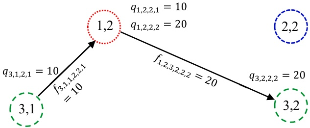

Fig. 1. Optimal route for the small example.

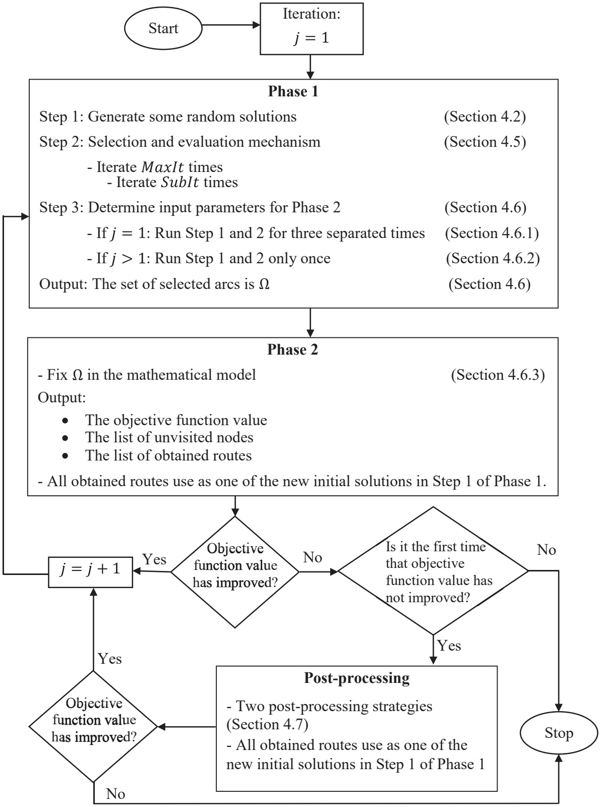

Fig. 2. Graphical overview of the algorithm.

by vessel 1 and product 2 and f1,2,3,2,2,2 means the transport on the link from port 1 visit 2 to port 3 visit 2 by vessel 2 and product 2.

## 4. Matheuristic algorithm

We propose a two-phase matheuristic for the multi-product MIRP. In Phase 1, several solutions are generated. These are analyzed and lead to the identification of a subset of arcs, or alternatively a subset of arcs associated to each vessel. Phase 2 then involves executing a commercial mixed-integer programming solver on a mathematical model where the identified arcs are fixed either directly or indirectly. The solution from Phase 2 then enters Phase 1, as one of the solutions to be used in the next iteration.

The graphical overview of the algorithm is shown in Fig. 2 and is as

follows:

• Step 1: The matheuristic starts by generating a set of random solutions, possibly including the solution generated from the previous execution of Phase 2, if applicable.

• Step 2: Some new solutions are generated from the neighborhoods of the current solutions and then the set of current solutions is updated.

• Step 3: After analyzing the solutions, a subset of arcs is selected.

• Next, in Phase 2, a mathematical model is solved with the selected arcs fixed.

• The solution found in Phase 2 is then used as one of the new initial solutions in Step 1 of Phase 1 in the next iteration.

The details of the matheuristic are explained below. Section 4.1 provides the representation of the solutions. Section 4.2 describes generation of the initial solutions used by the heuristic, and Section 4.3 presents the evaluation function and how a simple approximation of the flow is calculated. Section 4.4 defines three neighborhood operators, while Section 4.5 shows how these neighborhood operators are used within a search process to identify new routes and solutions. Section 4.6 shows how the results from Phase 1 are used for optimization in Phase 2 and shows how the mathematical model is solved by fixing the selected arcs. Section 4.7 describes a post-processing procedure which is applied when the main search fails to find further improved solutions, and Section 4.8 is devoted to an illustrative example in which this solution procedure is implemented on an instance and illustrated graphically. The pseudocode of the proposed heuristic is shown in Appendix A.

## 4.1. Solution representation

The coded solution consists of a vector representing the trips performed by the vessels. These trips appear consecutively in the vector, in increasing order of vessel index, and are separated by delimiters ranging from $\overline { { { \bf m } } } | N | + 1 \; \mathrm { t o } \; \overline { { { \bf m } } } | N | + ( | V | - 1 )$ . The trip of each vessel is a sequence of numbers in the range (1, m|N|) which jointly capture the information on the port that is visited and on the order of the visit made to that port. If the ports are to be visited at most m times, numbers 1 to |N| will represent the first visit to each of the ports, numbers |N| +1 to 2|N| will represent the second visit to each of the ports and so on. This can be expressed as an ${ \overline { { m } } } \times | N |$ matrix as shown in Fig. 3. For example, the number |N| +3 represents the second visit to port 3.

Considering the illustrative example in Section 3.1, which involved three ports $( | N |   =   3 )$ , two visits $( \overline { { m } } = 2 )$ , and two vessels $( | V | = 2 ) ,$ Fig. 4 shows a potential solution. The first vessel starts with the first visit to port 1 and continues with the first visit to port 2. The number 7 $( \overline { { m } } | N |   +   1 )$ indicates that the route of vessel 1 ends, and the route of vessel 2 begins. This route starts with the first visit to port 3, continues with the second visit to port 1 $( | N | + 1 = 4 )$ and continues again with the second visit to port 3 $( | N | + 3 = 6 )$ . Hence, it can be seen that a solution is represented by an array of numbers with the highest value equal to $\overline { { m } } | N | + ( | V | - 1 )$

| 1 | 2 | 7 | 3 | 4 | 6 |
| --- | --- | --- | --- | --- | --- |

Fig. 4. Solution representation for the illustrative example.

## 4.2. Initial solutions

The initial step of the matheuristic is to generate nSol different solutions as random permutations of numbers for all visits, that is, a random solution in which all the potential port visits are randomly distributed to the available vessels. The quality of each solution is then assessed through the evaluation function explained in the next section.

## 4.3. Evaluation function

The objective function considered in this problem consists of sailing costs between ports, in addition to setup and operating costs at the ports. Before defining the evaluation function, constraints handling is explained. There are three main groups of constraints, namely inventory, time, and capacity. Infeasible solutions are allowed in the heuristic by considering penalties in the objective function for violations of the constraints.

In the evaluation of the solutions in Phase 1 of the matheuristic, the loading and unloading quantities of each vessel are calculated assuming that the maximum vessel capacity and inventory levels of each port are used. The inventory quantities are calculated based on the given initial inventory, along with the time spent in each port, multiplied by the corresponding demand rate. Visit times are calculated based on the distance between two ports and the speed of the vessels. At the beginning of the algorithm there is a need for a simple approximation of the flow to start the solution procedure involving the maximum vessel capacity, but in the following iterations it is possible to violate the vessel capacity.

There are three possible ways to violate the inventory in the model, namely violation of inventory of a product at the beginning of the port visit (IV), violation of inventory of a product at the end of the port visit (IVP), and violation of inventory of a product at the end of the planning horizon (IVE). These violations are calculated for all products and each port visit, and finally the violation for each of them (TotalIV, TotalIVP, TotalIVE) is penalized in the evaluation function. These inventory violations are allowed in order to obtain a greater variety of arcs in Phase 1. These arcs are then evaluated in Phase 2 with respect to optimal inventory values. The calculation for the above violations is based on equations (46) to (48), where $s _ { i m k } ^ { E P }$ is the inventory level at the end of the planning horizon. TotalIVE is computed only for the last visit of each port:

|  | Port 1 | Port 2 | Port 3 | ... | Port \|N\| |
| --- | --- | --- | --- | --- | --- |
| Visit 1 | 1 | 2 | 3 | ... | \|N\| |
| Visit 2 | \|N\| + 1 | \|N\| + 2 | \|N\| + 3 | ... | 2\|N\| |
| Visit 3 | 2\|N\| + 1 | 2\|N\| + 2 | 2\|N\| + 3 | ... | 3\|N\| |
| ⋮ | ⋮ | ⋮ | ⋮ | ⋱ | ⋮ |
| Visit $\overline{m}$ | $(\overline{m} - 1)\|N\| + 1$ | $(\overline{m} - 1)\|N\| + 2$ | $(\overline{m} - 1)\|N\| + 3$ | ... | $\overline{m}\|N\|$ |

Fig. 3. Matrix with |N| ports and m visits.

$$
\text {TotalIV} = \sum_ {(i, m) \in S ^ {A}, k \in K} \max \left\{0, S _ {i k} ^ {M I N} - s _ {i m k}, s _ {i m k} - S _ {i k} ^ {M A X} \right\}\tag{46}
$$

$$
\text {TotalIVP} = \sum_ {(i, m) \in S ^ {A}, k \in \mathcal {K}} \max \left\{0, S _ {i k} ^ {\text {MIN}} - s _ {i m k} ^ {E}, s _ {i m k} ^ {E} - S _ {i k} ^ {\text {MAX}} \right\}\tag{47}
$$

$$
\text {TotalIVE} = \sum_ {i \in N, k \in K} \max \left\{0, S _ {i k} ^ {M I N} - s _ {\overline {{t m k}}} ^ {E P}, s _ {\overline {{t m k}}} ^ {E P} - S _ {i k} ^ {M A X} \right\}.\tag{48}
$$

The time constraints imposed on each port visit consist of two parts. In the first part, the time for all visits to a particular port is checked, and it is clear that the time for visit i + 1 must be greater than the time for visit i at a particular port, otherwise a time violation (TV) occurs. In the second part, the time for the last visit of each port is checked, and it should not exceed the time horizon, otherwise a time violation (TV) occurs. These may help to make the search for additional arcs less constrained, since the goal of Phase 1 is to find a set of arcs that will serve as an input to Phase 2. Finally, the average delay over all visits and all ports that is called the mean violation of time (MeanTV) and the proportion of violated times (NoTV) are penalized. MeanTV is calculated according to equation (49):

$$
M e a n T V = \frac {\sum_ {i , m} T V _ {i m}}{| N | \times \overline {{m}}},\tag{49}
$$

where $T V_{i m}=\frac{C T_{i m}-m i n\{C T_{i m}\}}{m a x\{C T_{i m}\}-m i n\{C T_{i m}\}}$ in which $C T _ { i m }$ is the amount of time consumed and is calculated using equation (50):

$$
C T _ {i m} = \left\{ \begin{array}{l l} \max \left\{0, \frac {t _ {i m}}{t _ {i (m + 1)}} - 1 \right\} & m \in \{1, \dots , \overline {{m}} - 1 \} \\ \max \left\{0, \frac {t _ {i m}}{T} - 1 \right\} & m \in \{\overline {{m}} \}. \end{array} \right.\tag{50}
$$

NoTV is calculated according to equation (51).

$$
N o T V = \frac {\text {Number of nonzero elements of} T V _ {i m}}{| N | \times \overline {{m}}}.\tag{51}
$$

Capacity constraints are applied to vessels on each of their visits, and the capacity violation (CV) is calculated separately for each product. The mean capacity violation (MeanCV) and the proportion of capacity violation (NoCV) are penalized. MeanCV is calculated using equation (52):

$$
\text {MeanCV} = \frac {\sum_ {i , m , v , k} \max \left\{0 , \frac {C U _ {i m v k}}{C _ {v k}} - 1 \right\}}{| K | \times | N | \times \bar {m}},\tag{52}
$$

where $C U _ { i m v k }$ is the amount of capacity used and is calculated using equation (53).

$$
C U _ {i m v k} = \left\{ \begin{array}{l l} q _ {i m v k} + f _ {i m v k} ^ {O}, & \text {if vessels starts at initial position} \\ q _ {i m v k} + f _ {j n i m v k}, & \text {otherwise.} \end{array} \right.\tag{53}
$$

NoCV is calculated using equation (54):

$$
\text {NoCV} = \frac {\text {Number of nonzero elements of} C V _ {i m v k}}{| K | \times | N | \times \overline {{m}}}.\tag{54}
$$

Now, an additive penalty function is used in the evaluation function (g(x)) which is shown in equation (55), where x is a solution.

$$
\begin{array}{c} g (x) = f (x) + \alpha_ {1} (\gamma_ {1} \text {MeanTV} + \gamma_ {2} \text {NoTV}) + \alpha_ {2} (\gamma_ {3} \text {MeanCV} + \gamma_ {4} \text {NoCV}) + (\beta_ {1} \\ \quad + \beta_ {2} \text {TotalIVP} + \beta_ {3} \text {TotalIVE}), \end{array}\tag{TotalIV}
$$

(55)

where α and β are penalty factors, $\gamma _ { 1 } , \gamma _ { 3 }$ are weights for the size of violations, and $\gamma _ { 2 } , \gamma _ { 4 }$ are weights for the proportion of time and capacity violations, respectively. The sailing cost of vessels between ports plus the sailing cost of vessels from their initial port position are equal to $f ( x )$ and is calculated similarly to the first two terms in equation (1). Therefore, the evaluation function considers the sailing cost, along with total inventory, time, and capacity violations. This sometimes yields lower sailing costs but may contain some violations. It tries to achieve a balance between sailing costs and violations, eventually leading to a wide range of arcs for the next phase.

## 4.4. Neighborhood structure

Three neighborhood operators $( N _ { 1 } , N _ { 2 } , N _ { 3 } )$ are introduced to adjust the routes of a solution during the search process. The neighborhoods are defined through manipulations of the solution represented as a vector of port visits. The neighborhood operator $N _ { 1 }$ selects one location of the solution vector and shifts its value to a different location, $N _ { 2 }$ selects two locations and swaps the two numbers in the representation of the solution, while $N _ { 3 }$ selects two locations and reverses the sequence between these two locations including the two selected ones. Neighbors of the solution shown in Fig. 4 are illustrated, where location 5 is picked for $N _ { 1 }$ to be shifted to location 2, and locations 5 and 2 are picked for $N _ { 2 }$ and $N _ { 3 }$ . The resulting solutions are shown in Fig. 5.

## 4.5. Selection and evaluation mechanism

As explained in Section 4.2, the algorithm starts by generating nSol random solutions. Next, a selection and evaluation mechanism as Step 2 of the algorithm is performed starting from these solutions.

For each of the existing nSol solutions, φ new solutions are generated based on the neighborhoods defined in Section 4.4. To generate a new solution, one of these neighborhoods is randomly selected, and a random neighbor is picked from this neighborhood; thus, a total of $\varphi \times$ nSol new solutions are generated. These solutions are then evaluated using the evaluation function.

The best nSol solutions are then selected from the newly generated set and sorted by quality, and the first solution is compared with the first solution from the previous set, using a simulated annealing (SA) criterion. The second solution is compared with the second solution from the previous set, and so on. When a solution is accepted, it replaces the old solution. If the value of the evaluation function is better than that of the first solution, then the new solution is kept, otherwise the worse solution is accepted with probability $e ^ { - \Delta F / T E }$ , where TE is a temperature value in an SA framework and $\Delta F = \frac{g(new) - g(old)}{g(old)}$ describes the percentage deviation of the evaluation function with respect to the previous solution. As it is possible that the best-found solution is replaced by a worse solution in this process, it is necessary to also keep track of the best-found solution during this step. After each iteration of Step 2 of the algorithm, nSol solutions are available to be considered in the next iteration. This Step is run for SubIt iterations. Fig. 6 shows an example of two iterations of Step 2 of Phase 1 of the algorithm by assuming nSol = 3 and $\varphi   = 3$

Like the parallel recombinative SA described by Mahfoud & Goldberg (1995) our algorithm starts with an initial temperature $( T _ { 0 } ) _ { , }$ , which is decreased based on a geometric cooling function $T E _ { i + 1 } = \alpha T E _ { i } ,$ where α is a number between 0 and 1. A typical value for α is between 0.8 and 0.99 (Delahaye et al., 2019). The number of iterations at each temperature (SubIt) is dynamically changed as the algorithm progresses, so that as the number of iterations increases the level of intensification becomes higher. Therefore, the strictly increasing function of $S u b I t _ { i } = \lceil S u b I t _ { i - 1 } /$ $\beta \rceil$ , where $0 < \beta < 1$ is used, where $\beta$ is the rate at which the number of iterations increases at each temperature. This step is taken due to the fact that at the start of the search there will be few iterations with high probability of accepting poorer solution, and in the end of the search there will be more iterations with a lower probability of accepting poorer solutions. Preliminary experiments showed that lowering the temperature and increasing the number of iterations improved the final solution.

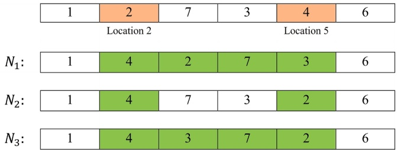

Fig. 5. Example of three neighborhoods.

<table><tr><td colspan="4">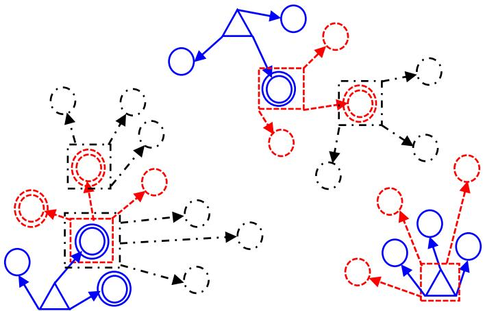</td></tr><tr><td>△</td><td>Initial solutions</td><td>○</td><td>φ newly generated solutions for each of the existing solutions (iteration 2)</td></tr><tr><td>○</td><td>φ newly generated solutions for each of the existing solutions (iteration 1)</td><td>○</td><td>The best nSol solutions from the newly generated set (iteration 2)</td></tr><tr><td>○</td><td>The best nSol solutions from the newly generated set (iteration 1)</td><td>□□</td><td>Selected solutions by comparing the best solutions of newly generated set and previous set (iteration 2)</td></tr><tr><td>□</td><td>Selected solutions by comparing the best solutions of newly generated set and previous set (iteration 1)</td><td>○</td><td>φ newly generated solutions for each of the existing solutions (iteration 3)</td></tr></table>

Fig. 6. Example of two iterations of Step 2 of algorithm.

Step 2 is continued for MaxIt iterations and the resulting output is the stored best-found solution found during the search. In fact, only the vessel routes of this solution are needed. Although the heuristic is run for MaxIt iterations, the stopping criterion for Phase 1 for large instances is 60 s; for small instances it is 20 consecutive iterations without improvement.

## 4.6. Input parameters for Phase 2 of the algorithm

At the end of Step 2, all vessel routes of the best-found solution are stored as the output. To continue the algorithm, it is needed to determine which output of Phase 1 should be used in the second phase and this is Step 3 of the algorithm.

The proposed algorithm seeks to identify some arcs by simply approximating the flow in Phase 1 and then use these arcs in Phase 2. There are two different procedures for selecting a set of arcs in Step 3 and it depends on whether we are in the first execution of Phase 1 or the subsequent executions because no complete solutions containing optimized flow have been evaluated at the first run. These two different procedures are presented in Section 4.6.1 and 4.6.2.

When the selection of arcs from Phase 1 is performed, the resulting problem is sent to Phase 2 in an attempt to find the remaining arcs and optimizing the flow, which is explained in Section 4.6.3. There is no limit on the number of selected arcs except for the first execution of Phase 1 where it uses the minimum number of arcs possible. Although it sounds very modest to fix only one or a few binary variables after Phase 1, fixing one variable $x _ { i m j m v }$ to the value 1 has several immediate consequences: one can also fix to 1 variables $y _ { i m ^ { \prime } }$ for m′ $= 1 , . . . , m ,$ and one can also fix $w _ { i m v }   =   1 .$ . Furthermore, $z _ { \nu } ^ { o }$ can be fixed to $0 ,$ and all $\mathbf { o f }   x _ { i m j ^ { \prime } n ^ { \prime } \nu ^ { \prime } }$ can be fixed to 0 for $j ^ { \prime } \neq j   \mathrm { o r }   n ^ { \prime } \neq n$ and for all v. In addition, all of $x _ { i ^ { \prime } m ^ { \prime } j m ^ { \prime } }$ can be fixed to 0 for $i ^ { \prime } \neq i   \mathrm { o r }   m ^ { \prime } \neq m$ and all $, \gamma ^ { \prime } .$ This means that even if we are in a situation where only one arc is fixed to 1 (in some cases the method will fix more than just one arc), the resulting MIP can be significantly smaller and thus easier to solve than the MIP for the full problem. The critical part is thus to only fix arcs that are also present in the optimal or in near-optimal solutions. The iterations of the algorithm try to address the critical part where Phase 2 provides the initial solution for the next iteration and it is helping Phase 1 of next iteration to search for a better solution to end up fixing arcs that are present in the optimal or near optimal solutions.

## 4.6.1. Selecting a set of arcs in the first execution of Phase 1

The goal of Phase 1 is to define a set of arcs that are given as inputs to Phase 2, where a mathematical model is solved while forcing some arcs to be used. The set of arcs is obtained by looking for similarities among a set of different solutions to the overall problem. In the first execution of

Phase 1, this set of solutions is obtained by repeating Step 1 and 2 several times from different initial solutions. Following preliminary experiments, the steps are repeated thrice, thus obtaining three different solutions that are used to identify a subset of arcs.

The three solutions are compared to determine a set of selected arcs. That is, the arcs which are repeated the most in the three solutions are selected. If these arcs use the same vessel, the vessel number is also fixed, resulting in a fixed variable according to equation (56) stating vessel v is fixed for arc (i, m) to (j,n), describing that visit m to port i is succeeded by visit n to port j:

$$
x _ {i m j n v} = 1.\tag{56}
$$

Otherwise, if an arc is used by different vessels, a new constraint is introduced according to equation (57):

$$
\sum_ {v} x _ {i m j n v} = 1.\tag{57}
$$

## 4.6.2. Selecting a set of arcs in subsequent executions of Phase 1

When Phase 2 has already been executed, the selection of arcs in Phase 1 is slightly modified. In particular, Step 1 and 2 are run only once. Then, the set of arcs that connects two nodes in a similar direction as the previously obtained solution of Phase 2 of the algorithm is considered as the selected arcs. If no similar direction is found, the arc connecting two nodes in the opposite direction is chosen considering the given direction of Phase 2 of the algorithm. In the rare cases where still no shared arc is found, Phase 1 of the algorithm is run again to obtain a new set of arcs. If no shared arc is found again, the algorithm is considered to have failed to find improvements, and therefore proceeds with the post-processing described in Section 4.7.

## 4.6.3. Mathematical programming model with fixed arcs

Phase 2 starts by fixing the selected arcs in the mathematical model, and it then solves the model within 1,200 s and stores the value of the objective function, the list of unvisited nodes, and the list of obtained routes as information obtained so far. A node is defined as a visit to a port, and an unvisited node is a node that no vessel visits.

As can be seen in Fig. 2, Phase 2 tries to find some routes that can be used as new initial solutions in Step 1 of Phase 1. As long as Phase 2 successfully improves the value of the objective function, the iterative process continues between Phases 1 and 2. Preliminary experiments have shown that several of these iterative processes are required to find acceptable solutions. Thus, if Phase 2 runs for a very long time, the total running time of the algorithm increases rapidly.

Before solving the main instances, some similar instances with different initial inventories are used for a preliminary experiment to test 900, 1200, 1500 and 1800 s. This is a common practice. For example, Agra et al. (2015) imposed a time limit of 600 s for each iteration of their algorithm and the total runtime for each instance as the problem becomes more difficult. The results show that a run time of 1200 s usually gives much better results than 900 s but imposing a longer time (1500 and 1800 s) either gives similar results or the improvement is small. Thus, since the goal in this phase is to obtain an acceptable solution in a reasonable time, a run time of 1200 s is chosen.

The obtained route is considered as the initial solution for the next run of Phase 1, where the unvisited nodes are removed automatically since the obtained route may not include all nodes. Since arcs selected in a given iteration are usually different from those selected in the previous runs, this results in a different route and different unvisited nodes, allowing new nodes to be added or removed compared to the previous run. Arcs are either fixed directly as variables as in equation (11) when the vessel number is fixed, or indirectly through new constraints as in equation (12). If no incumbent has been found after 1200 s, the answer to the question “objective function value has improved?” in Fig. 2 is $``  \mathbf{N o}  ''$ because we have not found a solution and continue to follow the flowchart.

Note that in the first execution of Phase 1, if more than one arc is selected, each of them is fixed in turn, and the mathematical model is run for 120 s to find out which of them leads to the best solution. Pre-liminary experiments with stop times of 60, 120, and 300 s have shown that 60 s does not produce results in most cases, and that results obtained in 300 s are not significantly different from those obtained in 120 s when different arcs are compared; therefore, a lower running time is chosen to reduce the total running time of the algorithm. If none of the selected arcs can yield a solution, then these arcs are fixed in pairs, and if still no solution is found, one of them is randomly selected. In the first run of Phase 1, it is desirable not to constrain the problem too much, and therefore, an attempt is made to select only one arc, and if this is not possible, the minimum number of arcs possible.

## 4.7. Post-processing

At the end of Phase 2, Phase 1 is run again and the selected arcs are then determined. This iterative procedure continues until there is no improvement in the objective function. Then there are two post-processing strategies to improve the solution of the algorithm if it achieves no improvement.

Since a different set of arcs can be chosen in each run of the algorithm, if the value of the objective function has not improved the first time, the information stored up to that point (see Section 4.6.3) is used for the first post-processing strategy. Therefore, all the selected arcs obtained in previous runs are fixed in the mathematical model without specifying the vessel number (if there is a contradiction in the selection of the arcs, the arc of the last run is selected because it has a better objective function value), and the most frequently repeated unvisited nodes are excluded from the mathematical model. The most frequently repeated unvisited nodes are obtained by looking at the list of unvisited nodes for each run in Section 4.6.3 and selecting the unvisited nodes that were included in the most runs. Then the problem is solved with this additional information. If an improvement occurs, Phase 1 is continued, but if the solution still has not improved, the second post-processing strategy is used, in which the best run of Phase 2 yielding the lowest objective value is run to optimality, since this run had a shorter runtime (1,200 s); therefore, this may lead to a better result than the previously obtained solution. If a better solution is found, the process continues by considering the obtained routes as the initial solution for the next run of Phase 1 and then solving Phase 1 of the algorithm. Otherwise, the algorithm terminates.

## 4.8. An illustrative example

To illustrate the solution procedure, all steps and the results for one of the instances (instance E) are shown in Fig. 7. All iterations for this instance based on the matheuristic proposed in Section 4 are shown here. It is worth noting that instance E was chosen because it is the only instance that invokes the second post-processing strategy, as the first post-processing strategy leads to improved solutions for all the other instances. Note that the graphs in this figure are drawn based on Fig. 3, and each coordinate was artificially selected because each graph is for visualization purposes only.

## 5. Computational results

This section reports computational results based on the proposed algorithm for a number of problem instances. First, the problem instances are presented in Section 5.1. The parameter settings are explained in Section 5.2. Then numerical results are given in Section 5.3. Analyses regarding number of products and number of ports are given in Section 5.4.

<table><tr><td>Instance E</td><td colspan="8">Iteration 1</td><td>Iteration 2</td></tr><tr><td>The selected arcs</td><td colspan="8">Vessel routes obtained by Phase 1 of the algorithm</td><td>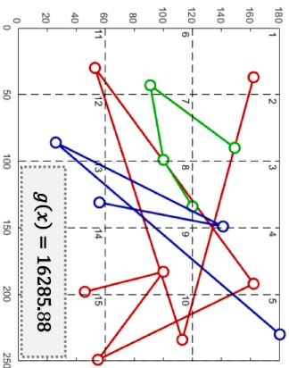</td></tr><tr><td>Solution of MIRP by fixing the selected arcs in Phase 2 of the algorithm</td><td colspan="8"> $x_{52131} = 1$  $Z_{iteration(1)} = 5024.16$ </td><td>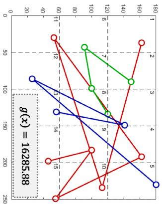 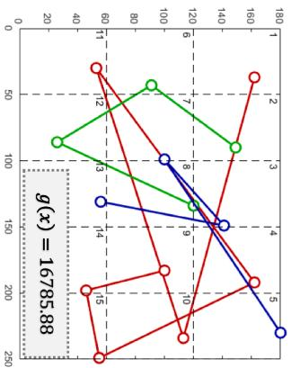</td></tr><tr><td>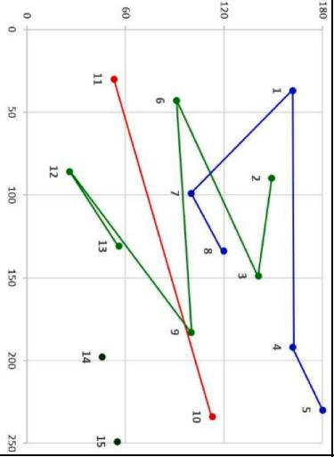</td><td colspan="8"> $x_{21312} = 1, x_{51413} = 1$  $Z_{iteration(2)} = 4972.66$ </td><td rowspan="2">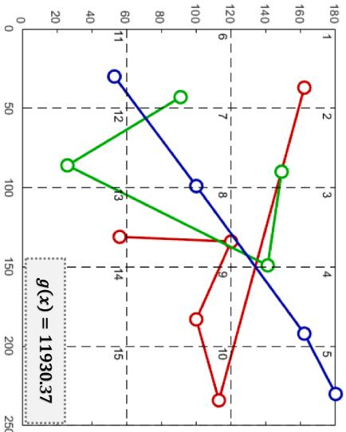</td></tr><tr><td>Unvisited nodes</td><td colspan="8">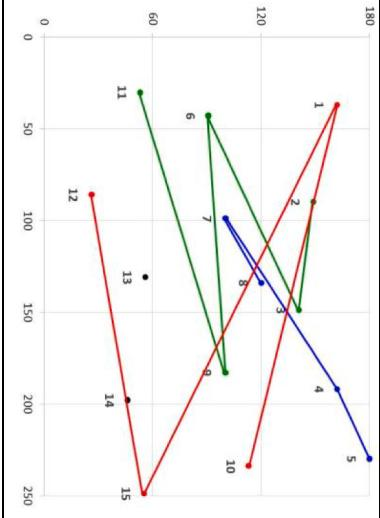</td></tr><tr><td>Initial solution for next iteration</td><td colspan="8">10 11 16 2 3 6 9 12</td><td>13, 14</td></tr><tr><td>Instance E</td><td colspan="8">Iteration 3</td><td>Iteration 4</td></tr><tr><td></td><td colspan="8">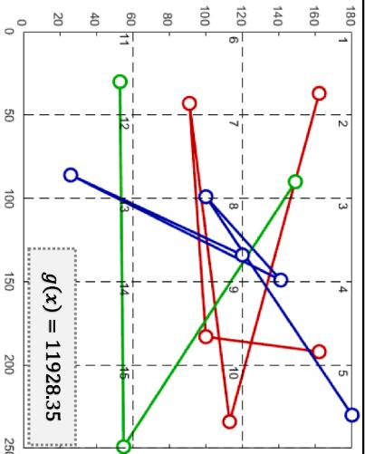</td><td rowspan="2"></td></tr><tr><td colspan="9">Vessel routes obtained by Phase 1 of the algorithm</td></tr><tr><td>The selected arcs</td><td colspan="8"> $\chi_{1242v} = 1$  $Z_{iteration(3)} = 5024.16$ </td><td rowspan="3">Fix all the selected arcs obtained in previous iterations+Exclude the most repeated unvisited nodes</td></tr><tr><td>No improvement</td><td colspan="8"> $Z_{iteration(3)} \nmid Z_{iteration(2)}$ </td></tr><tr><td>Instance E</td><td colspan="8">Iteration 5</td></tr><tr><td rowspan="3">The selected arcs</td><td colspan="8" rowspan="3">Run the best iteration (iteration 2) to optimality $\chi_{21312} = 1, \chi_{51413} = 1$  $Z_{iteration(5)} = 4963.25$ </td><td> $\chi_{2131v} = 1, \chi_{5141v} = 1, \chi_{5213v} = 1$ Exclude node 14,  $Z_{iteration(4)} = 5084.15$ </td></tr><tr><td> $Z_{iteration(4)} \nmid Z_{iteration(2)}$ </td></tr><tr><td rowspan="2">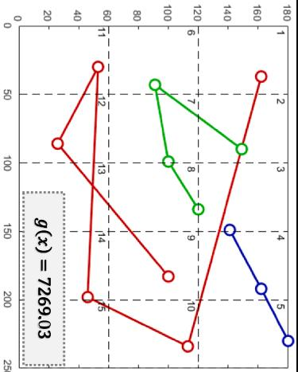</td></tr><tr><td colspan="9">Solution of MIRP by fixing the selected arcs in Phase 2 of the algorithm</td></tr><tr><td>Unvisited nodes</td><td colspan="8">13, 15</td><td rowspan="3"> $\chi_{51413} = 1, \chi_{11521} = 1, \chi_{2232v} = 1$  $\chi_{4313v} = 1, Z_{iteration(6)} = 4963.25$ </td></tr><tr><td rowspan="2">Initial solution for next iteration</td><td>9</td><td>1</td><td>10</td><td>12</td><td>16</td><td>2</td><td>3</td><td>6</td></tr><tr><td>14</td><td>11</td><td>17</td><td>5</td><td>4</td><td>7</td><td>8</td><td></td></tr></table>

Fig. 7. Solution procedure for instance E (red lines: vessel 1, green lines: vessel 2, blue lines: vessel 3). (For interpretation of the references to colour in this figure legend, the reader is referred to the web version of this article.)

## 5.1. Problem instances

There exist a series of studies by Agra et al. (2013), Agra et al. (2016), Agra et al. (2018), and Rodrigues et al. (2019) on single-product MIRP that has used seven similar problem instances, covering five vessels and six ports with a time horizon of 60 days for the largest instance. These instances are also used for the current study, but with some modifications to match the multi-product version. Parameter values that have nothing to do with the number of products are used as is, such as the distance matrix, and parameter values that depend on the number of products are generated based on the interval of existing values. For example, if the demand rate in the reference instances is between 1.5 and 5, the generated values for the demand for other products are taken from the interval of 1.5 to 5. The same procedure was used for the sizes of compartments for different products, if the vessel size in the reference instance is between 100 and 160, the generated values for the size of the compartments for other products are taken from the interval of 100 to 160, but as described by Agra et al. (2015), a vessel cannot necessarily transport all types of products; therefore, it is randomly determined which products can be transported by each vessel. In addition, a new instance H is created using similar data as the previous instances. For the single-product MIRP, the number of ports is directly indicating something about the size of an instance. For multi-product MIRPs, however, a given port can be used both as a production port for some products and a consumption port for other products. Thus, an instance of the multi-product MIRP can be considered larger than a corresponding instance of the single-product MIRP with the same number of ports. Table 2 shows the problem instances in ascending order of difficulty. The time horizon is 60 days. These problem instances are provided in two groups, which are similar in problem sizes but different in input parameters. The first group is used as a training set for fine-tuning the input parameters of the heuristic, while the second group is used for numerical results.

## 5.2. Parameter settings

It is crucial to fine tune the input parameters of a heuristic. The current algorithm contains six parameters that need to be tuned. First, several test problems are solved, and the three best parameter values are empirically determined. Then, fine tuning is performed between these three best values for each parameter.

For the initial temperature, the first test considered the values from 60 to 160 in steps of 20. The three best values were 80, 100, and 120, which were then considered in the second test. Regarding the maximum number of iterations at each temperature (SubIt), the values from 12 to 22 in steps of 2 are considered in the first test where 16, 18, and 20 were the three best values. For the iteration growth rate at each temperature $\beta ,$ the first test considered the values from 0.994 to 0.999 in steps of 0.001. The three best values were 0.996, 0.997, and 0.998, which were then considered in the second test. Temperature reduction rate (α) assessed the values from 0.94 to 0.99 in steps of 0.01 where the three best values selected for the second test are 0.95, 0.96, and 0.97. For number of initial solutions (nSol) and number of generated solutions for each of the initial solutions (φ), the first test considered the values from

Table 3

Levels for control factors.

| Notation | Factors | Level 1 | Level 2 | Level 3 |
| --- | --- | --- | --- | --- |
| A | Initial temperature ($T_0$) | 80 | 100 | 120 |
| B | Maximum number of iterations at each temperature (SubIt) | 16 | 18 | 20 |
| C | Temperature reduction rate ($\alpha$) | 0.95 | 0.96 | 0.97 |
| D | Iteration growth rate at each temperature ($\beta$) | 0.996 | 0.997 | 0.998 |
| E | Number of initial solutions (nSol) | 4 | 5 | 6 |
| F | Number of generated solutions for each initial solution ($\varphi$) | 3 | 4 | 5 |

3 to 8 in increments of 1. The three best values were 4, 5, and 6 for nSol and 3, 4, and 5 for $\varphi .$ Summary of these three levels of values for each parameter (factor) is shown in Table 3.

Fine tuning can be done by means of design of experiments. In the present study, the best parameters of the proposed heuristic were determined using Taguchi methods, which are statistical methods and robust experimental design methods (Taguchi and Phadke, 1989). As shown, there are three levels and six factors; therefore, the orthogonal experimental design $L _ { 2 7 } ( 3 ^ { 6 } )$ is the appropriate choice for this study. In Table $4 ,$ the rows represent the level of parameters for each experimental scheme, and the columns of factors denote a certain level of a parameter.

Since only one output is studied in a process, a non-dynamic SN ratio is used, and if the goal is to minimize the output value and there are no negative data, then the smaller-the-better ratio is the best choice for the non-dynamic SN ratio applied in the current study. A smaller-the-better SN ratio is calculated by equation (58), where y is the responses for the given factor level combination and n is the number of responses in the factor level combination:

$$
S N r a t i o = - 1 0 \log \frac {1}{n} (y _ {1} ^ {2} + y _ {2} ^ {2} + \dots + y _ {n} ^ {2})\tag{58}
$$

After conducting all experiments, statistical analyses are performed using SN ratios (Fig. 8) and means (Fig. 9). The larger value for SN ratios and the smaller value for means indicate optimal level, and if for a factor the best level of SN ratios coincides with the best level of means, then the optimal level for that factor is found, which is the case for all factors in the current study. As shown in Figs. 8 and $^ { 9 , }$ the optimal level was found for six factors. Factors A, C, E and F have the second level. Factor B has the first level and factor D has the third level. Therefore, the initial temperature is set to 100, the maximum number of iterations at each temperature is set to 16, the temperature reduction rate is set to 0.96, the iteration growth rate is set to 0.998, the number of initial solutions and the number of generated solutions for each of the initial solutions are set to 5 and $^ { 4 , }$ respectively.

Fig. 10 shows four residual plots for the SN ratios which support the model. The normal probability plot of the residuals confirms the assumption that the residuals are normally distributed, as can be seen from the straight-line pattern, and no outliers or changing slopes can be detected. There is no discernible or unusual pattern such as a curve in

Table 2

| Instance | Number of products \|K\| | Number of vessels \|V\| | Number of ports \|N\| | Number of rows | Number of columns | Number of discrete variables |
| --- | --- | --- | --- | --- | --- | --- |
| A | 2 | 1 | 3 | 401 | 330 | 109 |
| B | 2 | 2 | 4 | 965 | 947 | 350 |
| C | 2 | 2 | 5 | 1,474 | 1,491 | 527 |
| D | 3 | 2 | 5 | 2,024 | 1,979 | 557 |
| E | 3 | 3 | 5 | 2,786 | 2,842 | 828 |
| F | 2 | 5 | 6 | 4,380 | 5,047 | 1,823 |
| G | 4 | 4 | 6 | 6,388 | 6,625 | 1,606 |
| H | 6 | 5 | 6 | 11,677 | 11,688 | 2,183 |

Table 4

Taguchi orthogonal array design of the problem and obtained results.

| Experiment | A | B | Fac C | tors D | E | F | Mean (Run1-5) | Mean (Run6-10) | Objec Mean (Run11-15) | tive Function Mean (Run16-20) | (OF) Mean (Run21-25) | Mean | SD* | RPDy |
| --- | --- | --- | --- | --- | --- | --- | --- | --- | --- | --- | --- | --- | --- | --- |
| 1 | 1 | 1 | 1 | 1 | 1 | 1 | 692,206 | 719,235 | 757,759 | 684,056 | 769,087 | 724,469 | 38,080 | 8.91 |
| 2 | 1 | 1 | 1 | 1 | 2 | 2 | 734,168 | 669,143 | 676,763 | 697,247 | 673,691 | 690,202 | 26,830 | 3.76 |
| 3 | 1 | 1 | 1 | 1 | 3 | 3 | 675,132 | 666,971 | 683,292 | 674,059 | 655,005 | 670,892 | 10,601 | 0.86 |
| 4 | 1 | 2 | 2 | 2 | 1 | 1 | 712,016 | 785,316 | 711,292 | 720,892 | 735,773 | 733,058 | 30,833 | 10.2 |
| 5 | 1 | 2 | 2 | 2 | 2 | 2 | 677,633 | 673,935 | 691,487 | 677,105 | 696,686 | 683,369 | 10,055 | 2.73 |
| 6 | 1 | 2 | 2 | 2 | 3 | 3 | 689,640 | 663,598 | 702,784 | 710,641 | 712,162 | 695,765 | 20,073 | 4.60 |
| 7 | 1 | 3 | 3 | 3 | 1 | 1 | 711,998 | 661,718 | 709,143 | 689,581 | 675,013 | 689,491 | 21,643 | 3.65 |
| 8 | 1 | 3 | 3 | 3 | 2 | 2 | 693,680 | 688,047 | 690,012 | 654,964 | 699,124 | 685,165 | 17,402 | 3.00 |
| 9 | 1 | 3 | 3 | 3 | 3 | 3 | 689,239 | 692,070 | 756,197 | 677,576 | 768,785 | 716,773 | 42,321 | 7.75 |
| 10 | 2 | 1 | 2 | 3 | 1 | 2 | 671,570 | 669,283 | 654,964 | 655,204 | 674,948 | 665,194 | 9,447 | 0.00 |
| 11 | 2 | 1 | 2 | 3 | 2 | 3 | 675,141 | 689,135 | 663,766 | 724,614 | 670,152 | 684,562 | 24,259 | 2.91 |
| 12 | 2 | 1 | 2 | 3 | 3 | 1 | 669,580 | 727,096 | 674,014 | 690,948 | 715,506 | 695,429 | 25,262 | 4.55 |
| 13 | 2 | 2 | 3 | 1 | 1 | 2 | 694,212 | 690,163 | 676,720 | 689,738 | 680,114 | 686,189 | 7,405 | 3.16 |
| 14 | 2 | 2 | 3 | 1 | 2 | 3 | 702,162 | 722,300 | 674,499 | 703,932 | 697,297 | 700,038 | 17,139 | 5.24 |
| 15 | 2 | 2 | 3 | 1 | 3 | 1 | 675,159 | 725,377 | 679,454 | 684,246 | 670,168 | 686,881 | 22,140 | 3.26 |
| 16 | 2 | 3 | 1 | 2 | 1 | 2 | 761,263 | 713,150 | 717,799 | 676,583 | 677,072 | 709,173 | 34,986 | 6.61 |
| 17 | 2 | 3 | 1 | 2 | 2 | 3 | 676,598 | 692,598 | 703,753 | 677,072 | 732,909 | 696,586 | 23,275 | 4.72 |
| 18 | 2 | 3 | 1 | 2 | 3 | 1 | 690,999 | 689,081 | 697,084 | 690,129 | 719,213 | 697,301 | 12,638 | 4.83 |
| 19 | 3 | 1 | 3 | 2 | 1 | 3 | 677,075 | 697,577 | 675,556 | 673,614 | 675,718 | 679,908 | 9,954 | 2.21 |
| 20 | 3 | 1 | 3 | 2 | 2 | 1 | 675,132 | 676,767 | 699,187 | 675,222 | 730,145 | 691,291 | 23,991 | 3.92 |
| 21 | 3 | 1 | 3 | 2 | 3 | 2 | 689,078 | 715,043 | 697,558 | 709,108 | 700,795 | 702,316 | 10,103 | 5.58 |
| 22 | 3 | 2 | 1 | 3 | 1 | 3 | 713,294 | 700,800 | 661,752 | 688,460 | 709,067 | 694,675 | 20,699 | 4.43 |
| 23 | 3 | 2 | 1 | 3 | 2 | 1 | 723,127 | 692,657 | 743,648 | 676,616 | 663,765 | 699,963 | 32,991 | 5.23 |
| 24 | 3 | 2 | 1 | 3 | 3 | 2 | 691,562 | 675,049 | 710,131 | 698,675 | 713,271 | 697,738 | 15,400 | 4.89 |
| 25 | 3 | 3 | 2 | 1 | 1 | 3 | 735,145 | 689,721 | 697,768 | 663,663 | 663,623 | 689,984 | 29,529 | 3.73 |
| 26 | 3 | 3 | 2 | 1 | 2 | 1 | 713,260 | 735,264 | 729,716 | 689,589 | 674,014 | 708,369 | 26,153 | 6.49 |
| 27 | 3 | 3 | 2 | 1 | 3 | 2 | 675,005 | 673,691 | 715,062 | 674,004 | 674,673 | 682,487 | 18,217 | 2.60 |

\* SD: Standard deviation.

† RPD: Relative percentage deviation = |Mean OF (experiment) – Best (Mean OF)| / |Best (Mean OF)| ×100.

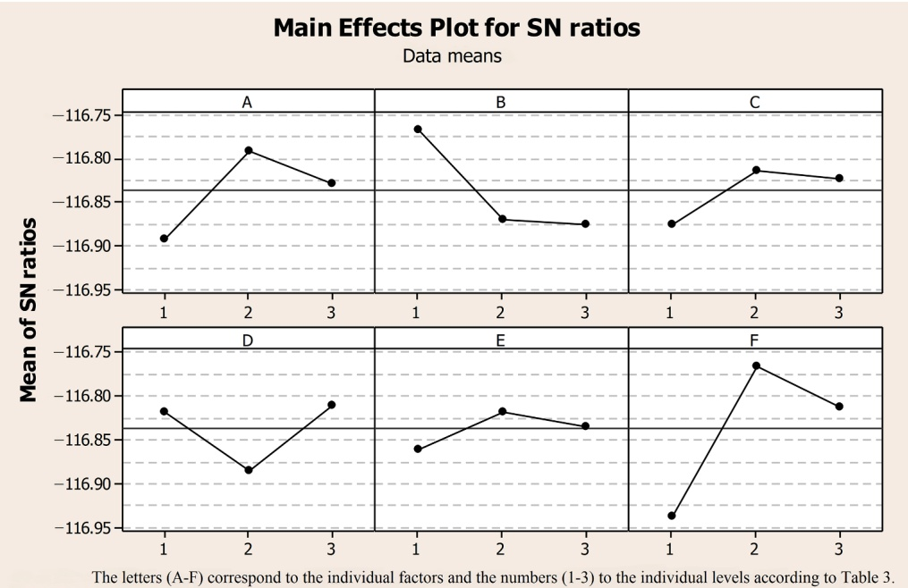

Fig. 8. Main effects plot for SN ratios.

the plot of the residuals versus fits and all points fall randomly on either side of 0.00, meaning that the residuals are randomly distributed and have a constant variance. The histogram of the residuals is appropriate for our problem because there are enough observations (more than 20). This histogram confirms that the data are not skewed since there is no tail in either direction and it does not contain any outliers since there is no bar that is far away from the other bars. The plot of the residuals versus order is displayed in chronological order and shows no patterns or trends, confirming that the residuals are independent.

## 5.3. Numerical results

In this section, we perform computational experiments to present and compare the results. The problem instances are solved using the proposed method and obtained parameters of previous sections. Matheuristic results are compared with the results of the CPLEX solver and are presented in Table 5. Note that the matheuristic was run five times independently. The best solution found, the mean, the standard deviation, and the average time of the five runs are reported in columns five to eight of Table 5. The average number of iterations performed in the five runs is given in the last column of Table 5. Table 6 shows the average time for each part of the matheuristic.

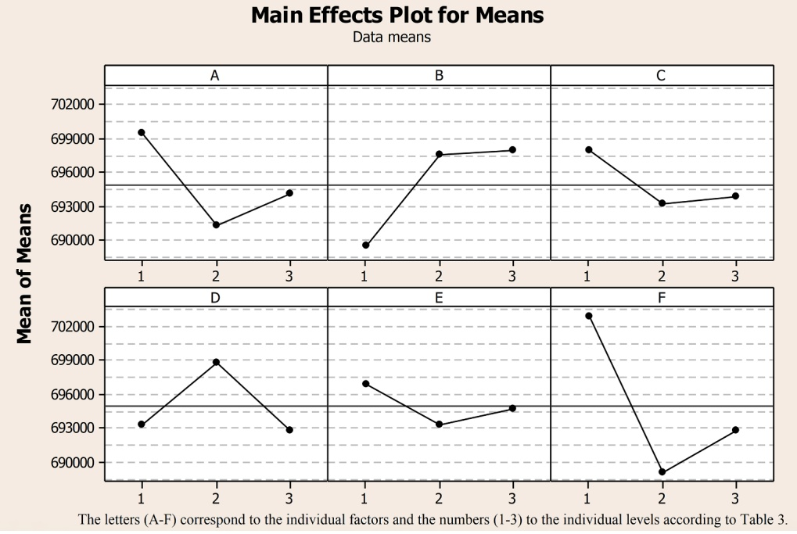

Fig. 9. Main effects plot for Means.

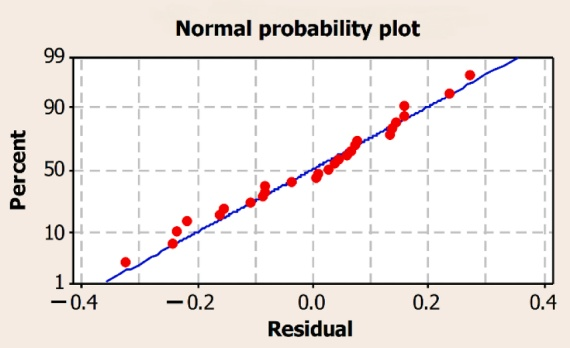

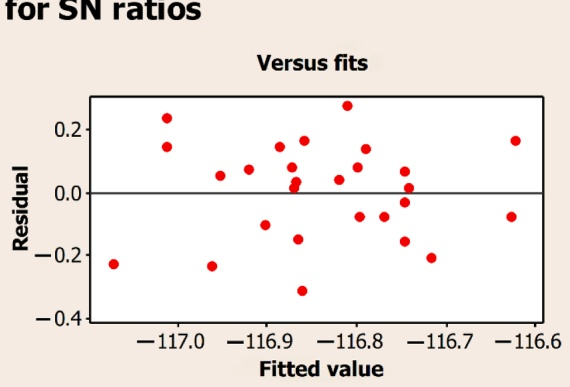

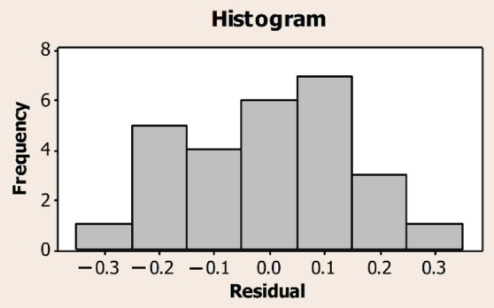

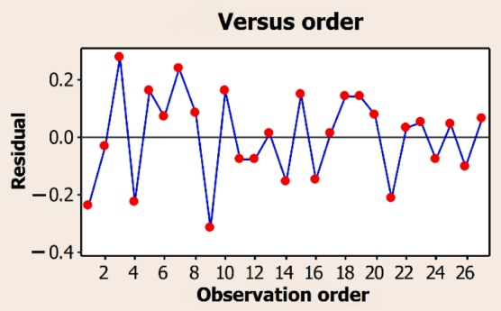

Fig. 10. Residual plots for SN ratios.

Numerical results are reported for CPLEX and the proposed matheuristic. The first four small-size instances reached optimality with

CPLEX, and the matheuristic also found an optimal solution for each of these instances. Moreover, the solution of instance D by the matheuristic reached optimality more than four times faster than with CPLEX. On other four instances, CPLEX was not able to reach optimality therefore, the matheuristic solutions were compared to the solution obtained through CPLEX after 43,200 s. The matheuristic solutions are better than those obtained with CPLEX at 43,200 s for instance G, identical for instance E, but 0.001% worse for instance F. Note that the matheuristic is about six times faster than CPLEX.

Table 5 Numerical results.

| Instance | CPLEX Objective function | Time (s) | Optimality gap*% | Matheuristic Best found | Mean | Standard deviation | Average time (s) | Gap**% | CV†% | Average number of iterations |
| --- | --- | --- | --- | --- | --- | --- | --- | --- | --- | --- |
| A | 271.63 | 0.9 | 0.00 | 271.63 | 271.63 | 0 | 11.6 | 0.00 | 0.00 | 3.0 |
| B | 241.33 | 6.5 | 0.00 | 241.33 | 241.33 | 0 | 22.8 | 0.00 | 0.00 | 3.0 |
| C | 332.99 | 74.9 | 0.00 | 332.99 | 332.99 | 0 | 71.5 | 0.00 | 0.00 | 3.0 |
| D | 368.10 | 925.6 | 0.00 | 368.10 | 368.10 | 0 | 224.8 | 0.00 | 0.00 | 4.4 |
| E | 4,963.25 | 43,200 | 85.81 | 4,963.25 | 4,972.46 | 11.66 | 5,706.4 | 0.00 | 0.23 | 5.0 |
| F | 71,319.29 | 43,200 | 99.15 | 71,320.19 | 71,559.28 | 485.97 | 6,016.0 | - 0.001 | 0.68 | 6.6 |
| G | 183,432.86 | 43,200 | 99.66 | 121,537.16 | 127,084.78 | 5,605.21 | 5,109.4 | 33.74 | 4.41 | 7.6 |
| H | No feasible solution | 43,200 | - | 1,356,842.55 | 1,459,411.97 | 78,361.44 | 8,110.2 | - | 5.37 | 4.6 |

\* Optimality gap as reported by CPLEX.

objectivefunction(CPLEX) − bestfound(Matheuristic) \*\* Gap = × 100. objectivefunction(CPLEX)

† CV: Coefficient of variation = (Standard deviation / Mean) × 100.

Average time for each part of the matheuristic in seconds.

| Instance | Phase 1 | Phase 2 | Post-processing | Total |
| --- | --- | --- | --- | --- |
| A | 10.5 | 0.7 | 0.4 | 11.6 |
| B | 19.0 | 2.7 | 1.1 | 22.8 |
| C | 37.8 | 28.0 | 5.7 | 71.5 |
| D | 134.4 | 80.4 | 10.0 | 224.8 |
| E | 336.0 | 3,502.0 | 1,868.4 | 5,706.4 |
| F | 444.0 | 3,481.4 | 2,090.6 | 6,016.0 |
| G | 516.0 | 3,514.2 | 1,079.2 | 5,109.4 |
| H | 336.0 | 5,512.8 | 2,261.4 | 8,110.2 |

## 5.4. Analyses of number of products and ports

In this section, we examine how the number of products can affect the run time. Also, the impact of the number of ports is analyzed to find out how the structure of the instances affects their computing time.

Instances with four products are considered, which are reduced to two products by merging the first two products into a new product 1 and products 3 and 4 into a new product 2. Finally, instances with one product are created by merging the new product 1 and 2. Since the merging of products forms the new instances, in these instances each port has at most one product. Now instances with four, two and one product are available. Four groups of instances are created, in which the number of vessels and the number of ports varies. Each group has five different tests (I1 to I5) that differ in the demand rate of port i for product k, the initial inventory of product k at port i and the maximum inventory of product k at port i. The demand rate is selected for all instances from a given range, but each instance differs in which port produces or consumes a given product. For example, for instances with four products and eight ports, port 1 consumes product 4 in instance I1, consumes product 1 in instance I2, consumes product 4 in instance I3, produces product 4 in instance I4, and produces product 2 in instance I5. As Table 7 shows, the run time decreases when the number of products is reduced, and the difference in run time is significant when instances with 16 ports are considered. In general, instances with multiple products require significantly more run time than those with one product.

More instances are created to determine the impact of the number of ports on the problem. Instances with 24 ports are considered, which are then reduced to 16 ports, half of which are created by merging previous ports and the other half remain unchanged. Finally, instances with eight ports are created by merging the ports of the previous instances. The merging is done in such a way that two ports are not merged with production or consumption ports where similar products exist. In this sense, instances with 16 ports can have more than one product in each port and instances with eight ports always have more than one product in each port.

Now instances with 24, 16 and eight ports are available. Two groups of instances are created, in which the number of vessels and the number of products is different. Each group has five different tests (I6 to I10)

Computational results for number of products.

<table><tr><td rowspan="2">Time horizon = 60</td><td>Number of vessels |V|:</td><td colspan="2"> $|V| = 4$ </td><td colspan="2"> $|V| = 4$ </td><td colspan="2"> $|V| = 3$ </td><td colspan="2"> $|V| = 3$ </td></tr><tr><td>Number of ports |N|:</td><td colspan="2"> $|N| = 8$ </td><td colspan="2"> $|N| = 16$ </td><td colspan="2"> $|N| = 8$ </td><td colspan="2"> $|N| = 16$ </td></tr><tr><td>Test number</td><td>Number of products|K|</td><td> $OFV^†$ </td><td>Time (s)</td><td>OFV</td><td>Time (s)</td><td>OFV</td><td>Time (s)</td><td>OFV</td><td>Time (s)</td></tr><tr><td rowspan="3">I1</td><td>4</td><td>333.08</td><td>450</td><td>351.59</td><td>3,688</td><td>344.68</td><td>896</td><td>347.97</td><td>949</td></tr><tr><td>2</td><td>268.02</td><td>402</td><td>280.56</td><td>323</td><td>256.61</td><td>235</td><td>336.92</td><td>668</td></tr><tr><td>1</td><td>225.52</td><td>54</td><td>270.59</td><td>8</td><td>199.12</td><td>25</td><td>308.59</td><td>147</td></tr><tr><td rowspan="3">I2</td><td>4</td><td>191.83</td><td>13</td><td>385.91</td><td>16,355</td><td>282.91</td><td>230</td><td>430.63*</td><td>43,200</td></tr><tr><td>2</td><td>191.83</td><td>9</td><td>341.64</td><td>11,554</td><td>246.32</td><td>69</td><td>399.87**</td><td>43,200</td></tr><tr><td>1</td><td>167.64</td><td>4</td><td>316.63</td><td>176</td><td>235.92</td><td>30</td><td>368.55</td><td>103</td></tr><tr><td rowspan="3">I3</td><td>4</td><td>333.08</td><td>277</td><td>305.83</td><td>2,125</td><td>323.70</td><td>233</td><td>348.64</td><td>14,754</td></tr><tr><td>2</td><td>276.50</td><td>244</td><td>210.25</td><td>922</td><td>248.70</td><td>68</td><td>291.74</td><td>3,207</td></tr><tr><td>1</td><td>226.62</td><td>40</td><td>210.25</td><td>441</td><td>237.60</td><td>15</td><td>261.54</td><td>163</td></tr><tr><td rowspan="3">I4</td><td>4</td><td>238.91</td><td>30</td><td>441.39</td><td>15,725</td><td>315.20</td><td>180</td><td>553.82</td><td>28,331</td></tr><tr><td>2</td><td>168.54</td><td>13</td><td>419.75</td><td>11,503</td><td>275.18</td><td>99</td><td>517.04</td><td>2,248</td></tr><tr><td>1</td><td>139.37</td><td>5</td><td>384.11</td><td>419</td><td>248.30</td><td>24</td><td>513.28</td><td>98</td></tr><tr><td rowspan="3">I5</td><td>4</td><td>190.84</td><td>17</td><td>394.90</td><td>2,525</td><td>315.20</td><td>531</td><td>286.19</td><td>1,716</td></tr><tr><td>2</td><td>134.06</td><td>24</td><td>356.48</td><td>357</td><td>259.31</td><td>192</td><td>240.78</td><td>543</td></tr><tr><td>1</td><td>129.86</td><td>3</td><td>344.11</td><td>146</td><td>233.64</td><td>36</td><td>222.48</td><td>154</td></tr></table>

† OFV: Objective function value \* Optimality gap: 6.21% \*\* Optimality gap: 3.92%.

Table 8

Computational results for number of ports.

<table><tr><td rowspan="2">Time horizon = 60</td><td>Number of vessels |V|:</td><td colspan="3">|V| = 4</td><td colspan="3">|V| = 3</td></tr><tr><td>Number of products |K|:</td><td colspan="3">|K| = 4</td><td colspan="3">|K| = 4</td></tr><tr><td>Test number</td><td>Number of ports|N|</td><td> $OFV^†$ </td><td>Time (s)</td><td>Optimality gap (%)</td><td>OFV</td><td>Time (s)</td><td>Optimality gap (%)</td></tr><tr><td rowspan="3">I6</td><td>24</td><td>709.37</td><td>43,200</td><td>15.07</td><td>16,038.46</td><td>43,200</td><td>96.89</td></tr><tr><td>16</td><td>700.58</td><td>43,200</td><td>17.55</td><td>486.62</td><td>2,025</td><td>0</td></tr><tr><td>8</td><td>707.45</td><td>23,286</td><td>0</td><td>554.38</td><td>754</td><td>0</td></tr><tr><td rowspan="3">I7</td><td>24</td><td>876.83</td><td>43,200</td><td>52.24</td><td>21,275.11</td><td>43,200</td><td>97.74</td></tr><tr><td>16</td><td>490.38</td><td>43,200</td><td>3.75</td><td>529.54</td><td>43,200</td><td>3.78</td></tr><tr><td>8</td><td>614.95</td><td>43,200</td><td>2.56</td><td>540.32</td><td>902</td><td>0</td></tr><tr><td rowspan="3">I8</td><td>24</td><td>106,687.61</td><td>43,200</td><td>99.42</td><td>485.35</td><td>43,200</td><td>11.83</td></tr><tr><td>16</td><td>753.98</td><td>43,200</td><td>14.62</td><td>366.32</td><td>10,310</td><td>0</td></tr><tr><td>8</td><td>841.83</td><td>43,200</td><td>15.51</td><td>516.71</td><td>8,872</td><td>0</td></tr><tr><td rowspan="3">I9</td><td>24</td><td>32,874.77</td><td>43,200</td><td>98.12</td><td>990.17</td><td>43,200</td><td>43.24</td></tr><tr><td>16</td><td>664.73</td><td>43,200</td><td>13.27</td><td>599.56</td><td>43,200</td><td>4.05</td></tr><tr><td>8</td><td>754.24</td><td>17,653</td><td>0</td><td>640.88</td><td>20,372</td><td>0</td></tr><tr><td rowspan="3">I10</td><td>24</td><td>703.72</td><td>43,200</td><td>40.1</td><td>548.68</td><td>43,200</td><td>8.85</td></tr><tr><td>16</td><td>443.98</td><td>43,200</td><td>2.72</td><td>471.42</td><td>5,067</td><td>0</td></tr><tr><td>8</td><td>533.19</td><td>23,148</td><td>0</td><td>528.99</td><td>1,016</td><td>0</td></tr></table>

† OFV: Objective function value.

which differ in the demand rate of port i for product $k ,$ the initial inventory of product k at port i and the maximum inventory of product k at port i. Table 8 shows the result for these instances.

As shown in Table 8, reducing the number of ports from 24 to 16 and then to eight is affecting the optimality gap for most instances. Table 8 also shows that instances with 16 ports are more time consuming to solve than those with eight ports. However, increasing the number of ports is not necessarily the only reason for this difference; it is the structure of the instances that makes the problem more time consuming. This becomes clear when comparing the results in Table 7 and 8 for instances with 16 ports and four products and instances with eight ports and four products. The run time in Table 8 is significantly higher for similar problem parameters, which is due to the structure of the instances where each port is not limited to at most one product.

## 6. Conclusion

We have introduced, modelled and solved a maritime inventory routing problem with a focus on solving large-size instances in the multi-product version of the problem with a time horizon of 60 days. A matheuristic was proposed in which the problem is solved under inventory, time, and capacity constraints. The quality of the solutions obtained by the proposed matheuristic was compared with that of the CPLEX solutions of modified benchmark instances. The proposed matheuristic achieved optimality for small-size instances and gave good results on large-size instances.

Two analyses were performed regarding the number of products and the number of ports. These revealed that multi-product MIRP is much more time consuming than single-product MIRP. Moreover, while the number of ports has some impact on the run time of the problem, it is the structure of the instances that makes a significant difference in the run time, because if each port is not limited to at most one product, the run time increases rapidly.

As a future work, further improvements can be made using new methods or heuristics to shorten the running time of the proposed algorithm. A limitation of the proposed approach is the post-processing strategies that try to improve the solution based on the available information. These can be improved by introducing another heuristic that achieves better improvements using additional information. An important improvement for the current problem is the development of an algorithm that can solve the model under uncertainty. It would also be interesting to study the impact of the length of the planning horizon for MIRPs.

## CRediT authorship contribution statement

**Homayoun Shaabani:** Conceptualization, Methodology, Software, Validation, Formal analysis, Data curation, Writing – original draft, Writing – review & editing. **Arild Hoff:** Writing – review & editing, Supervision, Project administration. **Lars Magnus Hvattum:** Conceptualization, Writing – review & editing, Supervision. **Gilbert Laporte:** Writing – review & editing, Supervision.

## Declaration of Competing Interest

The authors declare that they have no known competing financial interests or personal relationships that could have appeared to influence the work reported in this paper.

## Data availability

Data will be made available on request.

## Appendix A. . Pseudocode of the proposed heuristic

Inputs: Maximum number of iterations ($MaxIt$), Initial temperature ($T_0$), Maximum number of iterations at each temperature ($SubIt$), Temperature reduction rate ($\alpha$), Iteration growth rate at each temperature ($\beta$), Number of initial solutions ($nSol$), Number of generated solutions for each of the initial solutions ($\varphi$).
Best solution value = $\infty$
for $j = 1 : I / I$: Maximum number of iterations for the algorithm /
    Phase 1
    for $i = 1 : nSol$
        $sol(i) =$ Generate random solution $\triangleright$ Section 4.2
            if $Cost\ of\ sol(i) \leq Best\ solution\ value\ then$
                $Best\ solution\ value = Cost\ of\ sol(i)$

(continued )

end if
    end for
    $T = T_0$
    for $i = 1 : MaxIt$
        for $k = 1 : SubIt$
            Generate $\varphi$ solutions for each of the current solutions $\triangleright$ Section 4.5
            For each current solution, find $nSol$ solutions based on selection and evaluation    mechanism, and update the set of current solutions $\triangleright$ Section 4.5
            Store the best-found solution = BestS
        end for
        $T = \alpha T \triangleright$ Section 4.5
        $SubIt = SubIt/\beta \triangleright$ Section 4.5
    end for
    Outputs: $BestS \triangleright$ Section 4.5
Select arcs $\Omega$ from the set of current solutions $\triangleright$ Section 4.6.1 and 4.6.2
    Phase 2 _______________
    function $z = minimize Cost \triangleright$ Equation (1) in mathematical model
        Fix $\Omega$ in the mathematical model $\triangleright$ Section 4.6.3
        Solve the mathematical model $\triangleright$ Section 4.6.3
    end function
    Store: Objective function value, lists of unvisited nodes and obtained routes $\triangleright$ Section 4.6.3
    if $j = 1$ or the objective function value has improved then
All obtained routes use as one of the new initial solutions in Step 1 of Phase 1 $\triangleright$ Section 4.6.3
    $j = j + 1$
    else if it is the first time that objective function value has not improved then
        All the selected arcs obtained in previous runs are fixed in mathematical model and the most repeated unvisited nodes are excluded from mathematical model $\triangleright$ Section 4.7
        Solve the mathematical model
            if the objective function value has improved then
                All obtained routes use as one of the new initial solutions in Step 1 of Phase 1
                $j = j + 1$
            Else
                The best run of Phase 2 yielding the lowest objective value is run to optimality $\triangleright$ Section 4.7
            if the objective function value has improved then
                All obtained routes use as one of the new initial solutions in Step 1 of Phase 1
                $j = j + 1$
            end if
        end if
    end if
end if
end for
Output: Final solution

## References

Agra, A., Andersson, H., Christiansen, M., Wolsey, L., 2013. A maritime inventory routing problem: Discrete time formulations and valid inequalities. Networks 62 (4), 297–314. [https://doi.org/10.1002/net.21518](https://doi.org/10.1002/net.21518).

Agra, A., Christiansen, M., Delgado, A., Simonetti, L., 2014. Hybrid heuristics for a short sea inventory routing problem. Eur. J. Oper. Res. 236 (3), 924–935. [https://doi.org/10.1016/j.ejor.2013.06.042](https://doi.org/10.1016/j.ejor.2013.06.042).

Agra, A., Christiansen, M., Delgado, A., Hvattum, L.M., 2015. A maritime inventory routing problem with stochastic sailing and port times. Comput. Oper. Res. 61, 18–30. [https://doi.org/10.1016/j.cor.2015.01.008](https://doi.org/10.1016/j.cor.2015.01.008).

Agra, A., Christiansen, M., Hvattum, L.M., Rodrigues, F., 2016. A MIP based local search heuristic for a stochastic maritime inventory routing problem. Int. Confer. Computat. Logist. 1, 18–34. [https://doi.org/10.1007/978-3-319-44896-1\_2](https://doi.org/10.1007/978-3-319-44896-1_2).

Agra, A., Christiansen, M., Delgado, A., 2017a. Discrete time and continuous time formulations for a short sea inventory routing problem. Optim. Eng. 18 (1), 269–297. [https://doi.org/10.1007/s11081-016-9319-0](https://doi.org/10.1007/s11081-016-9319-0).

Agra, A., Christiansen, M., Ivarsøy, K.S., Solhaug, I.E., Tomasgard, A., 2017b. Combined ship routing and inventory management in the salmon farming industry. Ann. Operat. Res. 253 (2), 799–823. [https://doi.org/10.1007/s10479-015-2088-x](https://doi.org/10.1007/s10479-015-2088-x).

Agra, A., Christiansen, M., Hvattum, L.M., Rodrigues, F., 2018. Robust optimization for a maritime inventory routing problem. Transp. Sci. 52 (3), 509–525. https://doi.org[10.1287/trsc.2017.0814](https://doi.org/10.1287/trsc.2017.0814).

Agra, A., Christiansen, M., Wolsey, L., 2022. Improved models for a single vehicle continuous-time inventory routing problem with pickups and deliveries. Eur. J. Oper. Res. 297 (1), 164–179. [https://doi.org/10.1016/j.ejor.2021.04.027](https://doi.org/10.1016/j.ejor.2021.04.027).

Al-Khayyal, F., Hwang, S.J., 2007. Inventory constrained maritime routing and scheduling for multi-commodity liquid bulk, Part I: Applications and model. Eur. J. Oper. Res. 176 (1), 106–130. [https://doi.org/10.1016/j.ejor.2005.06.047](https://doi.org/10.1016/j.ejor.2005.06.047).

Andersson, H., Hoff, A., Christiansen, M., Hasle, G., Løkketangen, A., 2010. Industrial aspects and literature survey: Combined inventory management and routing. Comput. Oper. Res. 37 (9), 1515–1536. [https://doi.org/10.1016/j.cor.2009.11.009](https://doi.org/10.1016/j.cor.2009.11.009).

Ben Ahmed, M., Okoronkwo, O.L., Okoronkwo, E.C., Hvattum, L.M., 2022. Long-term effects of short planning horizons for inventory routing problems. Int. Trans. Oper. Res. 29, 2995–3030. [https://doi.org/10.1111/itor.12998](https://doi.org/10.1111/itor.12998).

Chandra, S., Srivastava, R.K., Agarwal, Y., 2013. Multi-product maritime inventory routing with optional cargoes : An application to outbound automotive logistics. J. Adv. Manage. Res. 10 (2), 206–229. [https://doi.org/10.1108/JAMR-05-2013-0035](https://doi.org/10.1108/JAMR-05-2013-0035).

Christiansen, M., 1999. Decomposition of a combined inventory and time constrained ship routing problem. Transp. Sci. 33 (1), 3–16. [https://doi.org/10.1287/trsc.33.1.3](https://doi.org/10.1287/trsc.33.1.3).

Christiansen, M., Haugen, Ø., Lund, E.H., Flatberg, T., Fagerholt, K., Kloster, O., 2011. Maritime inventory routing with multiple products: A case study from the cement industry. Eur. J. Oper. Res. 208 (1), 86–94. [https://doi.org/10.1016/j.ejor.2010.08.023](https://doi.org/10.1016/j.ejor.2010.08.023).

Christiansen, M., Fagerholt, K., Nygreen, B., Ronen, D., 2013. Ship routing and scheduling in the new millennium. Eur. J. Oper. Res. 228 (3), 467–483. [https://doi.org/10.1016/j.ejor.2012.12.002](https://doi.org/10.1016/j.ejor.2012.12.002).

Coelho, L.C., Cordeau, J.-F., Laporte, G., 2014. Thirty years of inventory routing. Transp. Sci. 48 (1), 1–19. [https://doi.org/10.1287/trsc.2013.0472](https://doi.org/10.1287/trsc.2013.0472).

De, A., Kumar, S.K., Gunasekaran, A., Tiwari, M.K., 2017. Sustainable maritime inventory routing problem with time window constraints. Eng. Appl. Artif. Intel. 61, 77–95. [https://doi.org/10.1016/j.engappai.2017.02.012](https://doi.org/10.1016/j.engappai.2017.02.012).

Delahaye, D., Chaimatanan, S., & Mongeau, M. (2019). Simulated annealing: From basics to applications. In M. Gendreau & J. -Y. Potvin (Eds.), Handbook of Metaheuristics (3rd ed., pp. 1–35). Doi: 10.1007/978-3-319-91086-4\_1.

[Diz, G.S.D.S., Oliveira, F., Hamacher, S., 2017. Improving maritime inventory routing: application to a Brazilian petroleum case. Marit. Policy Manag. 44 (1), 42–61](http://refhub.elsevier.com/S0305-0548%2823%2900078-3/h0095).

[Diz, G.S.D.S., Hamacher, S., Oliveira, F., 2019. A robust optimization model for the maritime inventory routing problem. Flex. Serv. Manuf. J. 31 (3), 675–701](http://refhub.elsevier.com/S0305-0548%2823%2900078-3/h0100).

Dong, Y., Maravelias, C.T., Jerome, N.F., 2018. Reoptimization framework and policy analysis for maritime inventory routing under uncertainty. Optim. Eng. 19 (4), 937–976. [https://doi.org/10.1007/s11081-018-9383-8](https://doi.org/10.1007/s11081-018-9383-8).

Eide, L., Årdal, G.C.H., Evsikova, N., Hvattum, L.M., Urrutia, S., 2020. Load-dependent speed optimization in maritime inventory routing. Comput. Oper. Res. 123, 105051 [https://doi.org/10.1016/j.cor.2020.105051](https://doi.org/10.1016/j.cor.2020.105051).

Engineer, F.G., Song, J.-H., Furman, K.C., Nemhauser, G.L., Savelsbergh, M.W.P., 2012. A branch-price-and-cut algorithm for single-product maritime inventory routing. Oper. Res. 60 (1), 106–122. [https://doi.org/10.1287/opre.1110.0997](https://doi.org/10.1287/opre.1110.0997).

Friske, M.W., Buriol, L.S., 2020. A multi-start algorithm and a large neighborhood search for a maritime inventory routing problem. IEEE Congress Evolut. Comput. (CEC) 1–8. [https://doi.org/10.1109/CEC48606.2020.9185499](https://doi.org/10.1109/CEC48606.2020.9185499).

Friske, M.W., Buriol, L.S., Camponogara, E., 2022. A relax-and-fix and fix-and-optimize algorithm for a maritime inventory routing problem. Comput. Oper. Res. 137, 105520 [https://doi.org/10.1016/j.cor.2021.105520](https://doi.org/10.1016/j.cor.2021.105520).

Hemmati, A., Hvattum, L.M., Christiansen, M., Laporte, G., 2016. An iterative two-phase hybrid matheuristic for a multi-product short sea inventory-routing problem. Eur. J. Oper. Res. 252 (3), 775–788. [https://doi.org/10.1016/j.ejor.2016.01.060](https://doi.org/10.1016/j.ejor.2016.01.060).

Hewitt, M., Nemhauser, G.L., Savelsbergh, M.W.P., Song, J.H., 2013. A branch-and-price guided search approach to maritime inventory routing. Comput. Oper. Res. 40 (5), 1410–1419. [https://doi.org/10.1016/j.cor.2012.09.010](https://doi.org/10.1016/j.cor.2012.09.010).

Jiang, Y., Grossmann, I.E., 2015. Alternative mixed-integer linear programming models of a maritime inventory routing problem. Comput. Chem. Eng. 77, 147–161. [https://doi.org/10.1016/j.compchemeng.2015.03.005](https://doi.org/10.1016/j.compchemeng.2015.03.005).

Liu, B., Zhang, Q., Yuan, Z., 2021. Two-stage distributionally robust optimization for maritime inventory routing. Comput. Chem. Eng. 149, 107307 [https://doi.org/10.1016/j.compchemeng.2021.107307](https://doi.org/10.1016/j.compchemeng.2021.107307).

Mahfoud, S.W., Goldberg, D.E., 1995. Parallel recombinative simulated annealing: A genetic algorithm. Parallel Comput. 21 (1), 1–28. [https://doi.org/10.1016/0167-8191(94)00071-H](https://doi.org/10.1016/0167-8191%2894%2900071-H).

Miller, D.M., 1987. An interactive, computer-aided ship scheduling system. Eur. J. Oper. Res. 32, 363–379. [https://doi.org/10.1016/S0377-2217(87)80005-X](https://doi.org/10.1016/S0377-2217%2887%2980005-X).

Misra, S., Kapadi, M., Gudi, R.D., 2020. Hybrid time-based framework for maritime inventory routing problem. Ind. Eng. Chem. Res. 59 (46), 20394–20409. [https://doi.org/10.1021/acs.iecr.0c03186](https://doi.org/10.1021/acs.iecr.0c03186).

Papageorgiou, D.J., Nemhauser, G.L., Sokol, J., Cheon, M.S., Keha, A.B., 2014a. MIRPLib - A library of maritime inventory routing problem instances: Survey, core model, and benchmark results. Eur. J. Oper. Res. 235 (2), 350–366. [https://doi.org/10.1016/j.ejor.2013.12.013](https://doi.org/10.1016/j.ejor.2013.12.013).

Papageorgiou, D.J., Keha, A.B., Nemhauser, G.L., Sokol, J., 2014b. Two-stage decomposition algorithms for single product maritime inventory routing. INFORMS J. Comput. 26 (4), 825–847. [https://doi.org/10.1287/ijoc.2014.0601](https://doi.org/10.1287/ijoc.2014.0601).

Papageorgiou, D.J., Cheon, M.-S., Nemhauser, G., Sokol, J., 2015. Approximate dynamic programming for a class of long-horizon maritime inventory routing problems. Transp. Sci. 49 (4), 870–885. [https://doi.org/10.1287/trsc.2014.0542](https://doi.org/10.1287/trsc.2014.0542).

Rodrigues, F., Agra, A., Christiansen, M., Hvattum, L.M., Requejo, C., 2019. Comparing techniques for modelling uncertainty in a maritime inventory routing problem. Eur. J. Oper. Res. 277 (3), 831–845. [https://doi.org/10.1016/j.ejor.2019.03.015](https://doi.org/10.1016/j.ejor.2019.03.015).

Ronen, D., 2002. Marine inventory routing: shipments planning. J. Oper. Res. Soc. 53, 108–114. [https://doi.org/10.1057/palgrave/jors/2601264](https://doi.org/10.1057/palgrave/jors/2601264).

Siswanto, N., Essam, D., Sarker, R., 2011a. Multi-heuristics based genetic algorithm for solving maritime inventory routing problem. IEEE Int. Conf. Indust. Eng. Eng. Manage. 116–120 [https://doi.org/10.1109/IEEM.2011.6117890](https://doi.org/10.1109/IEEM.2011.6117890).

Siswanto, N., Essam, D., Sarker, R., 2011b. Solving the ship inventory routing and scheduling problem with undedicated compartments. Comput. Ind. Eng. 61 (2), 289–299. [https://doi.org/10.1016/j.cie.2010.06.011](https://doi.org/10.1016/j.cie.2010.06.011).

Song, J.H., Furman, K.C., 2013. A maritime inventory routing problem: Practical approach. Comput. Oper. Res. 40 (3), 657–665. [https://doi.org/10.1016/j.cor.2010.10.031](https://doi.org/10.1016/j.cor.2010.10.031).

Taguchi, G., Phadke, M.S., 1989. In: Quality Control, Robust Design, and the Taguchi Method. Springer US, Boston, MA, pp. 77–96. [https://doi.org/10.1007/978-1-4684-1472-1\_5](https://doi.org/10.1007/978-1-4684-1472-1_5).

Uggen, K.T., Fodstad, M., Nørstebø, V.S., 2013. Using and extending fix-and-relax to solve maritime inventory routing problems. TOP 21 (2), 355–377. [https://doi.org/10.1007/s11750-011-0174-z](https://doi.org/10.1007/s11750-011-0174-z).

Zhang, C., Nemhauser, G.L., Sokol, J., Cheon, M.S., Keha, A., 2018. Flexible solutions to maritime inventory routing problems with delivery time windows. Comput. Oper. Res. 89, 153–162. [https://doi.org/10.1016/j.cor.2017.08.011](https://doi.org/10.1016/j.cor.2017.08.011).