# A general reinforcement learning algorithm that masters chess, shogi and Go through self-play

David Silver,1,2∗ Thomas Hubert,1∗Julian Schrittwieser,1 Ioannis Antonoglou,1,2 Matthew Lai,1 Arthur Guez,1 Marc Lanctot,1 Laurent Sifre,1 Dharshan Kumaran,1,2 Thore Graepel,1,2 Timothy Lillicrap,1 Karen Simonyan,1 Demis Hassabis1

1DeepMind, 6 Pancras Square, London N1C 4AG. 2University College London, Gower Street, London WC1E 6BT. ∗These authors contributed equally to this work.

## Abstract

The game of chess is the longest-studied domain in the history of artificial intelligence. The strongest programs are based on a combination of sophisticated search techniques, domain-specific adaptations, and handcrafted evaluation functions that have been refined by human experts over several decades. By contrast, the AlphaGo Zero program recently achieved superhuman performance in the game of Go by reinforcement learning from self-play. In this paper, we generalize this approach into a single AlphaZero algorithm that can achieve superhuman performance in many challenging games. Starting from random play and given no domain knowledge except the game rules, AlphaZero convincingly defeated a world champion program in the games of chess and shogi (Japanese chess) as well as Go.

The study of computer chess is as old as computer science itself. Charles Babbage, Alan Turing, Claude Shannon, and John von Neumann devised hardware, algorithms and theory to analyse and play the game of chess. Chess subsequently became a grand challenge task for a generation of artificial intelligence researchers, culminating in high-performance computer chess programs that play at a super-human level (1,2). However, these systems are highly tuned to their domain, and cannot be generalized to other games without substantial human effort, whereas general game-playing systems (3, 4) remain comparatively weak.

A long-standing ambition of artificial intelligence has been to create programs that can instead learn for themselves from first principles (5, 6). Recently, the AlphaGo Zero algorithm achieved superhuman performance in the game of Go, by representing Go knowledge using deep convolutional neural networks (7, 8), trained solely by reinforcement learning from games of self-play (9). In this paper, we introduce AlphaZero: a more generic version of the AlphaGo Zero algorithm that accomodates, without special-casing, to a broader class of game rules. We apply AlphaZero to the games of chess and shogi as well as Go, using the same algorithm and network architecture for all three games. Our results demonstrate that a general-purpose reinforcement learning algorithm can learn, tabula rasa – without domain-specific human knowledge or data, as evidenced by the same algorithm succeeding in multiple domains – superhuman performance across multiple challenging games.

A landmark for artificial intelligence was achieved in 1997 when Deep Blue defeated the human world chess champion (1). Computer chess programs continued to progress steadily beyond human level in the following two decades. These programs evaluate positions using handcrafted features and carefully tuned weights, constructed by strong human players and programmers, combined with a high-performance alpha-beta search that expands a vast search tree using a large number of clever heuristics and domain-specific adaptations. In (10) we describe these augmentations, focusing on the 2016 Top Chess Engine Championship (TCEC) season 9 world-champion Stockfish (11); other strong chess programs, including Deep Blue, use very similar architectures (1, 12).

In terms of game tree complexity, shogi is a substantially harder game than chess (13, 14): it is played on a larger board with a wider variety of pieces; any captured opponent piece switches sides and may subsequently be dropped anywhere on the board. The strongest shogi programs, such as the 2017 Computer Shogi Association (CSA) world-champion Elmo, have only recently defeated human champions (15). These programs use an algorithm similar to those used by computer chess programs, again based on a highly optimized alpha-beta search engine with many domain-specific adaptations.

AlphaZero replaces the handcrafted knowledge and domain-specific augmentations used in traditional game-playing programs with deep neural networks, a general-purpose reinforcement learning algorithm, and a general-purpose tree search algorithm.

Instead of a handcrafted evaluation function and move ordering heuristics, AlphaZero uses a deep neural network $( \mathbf { p } , v )   =   f _ { \theta } ( s )$ with parameters $\theta .$ This neural network $f _ { \theta } ( s )$ takes the board position s as an input and outputs a vector of move probabilities p with components $p _ { a }   =   \operatorname* { P r } ( a | s )$ for each action $a ,$ and a scalar value $v$ estimating the expected outcome z of the game from position s, $v   \approx   \mathbb { E } [ z | s ]$ . AlphaZero learns these move probabilities and value estimates entirely from self-play; these are then used to guide its search in future games.

Instead of an alpha-beta search with domain-specific enhancements, AlphaZero uses a generalpurpose Monte Carlo tree search (MCTS) algorithm. Each search consists of a series of simulated games of self-play that traverse a tree from root state $\mathcal { S } _ { \mathrm { r o o t } }$ until a leaf state is reached. Each simulation proceeds by selecting in each state s a move a with low visit count (not previously frequently explored), high move probability and high value (averaged over the leaf states of simulations that selected a from $s )$ according to the current neural network $f _ { \theta }$ . The search returns a vector π representing a probability distribution over moves, $\pi _ { a } = \operatorname* { P r } ( a | s _ { \mathrm { r o o t } } )$

The parameters θ of the deep neural network in AlphaZero are trained by reinforcement learning from self-play games, starting from randomly initialized parameters $\theta .$ Each game is played by running an MCTS search from the current position $s _ { \mathrm { r o o t } } \; = \; s _ { t }$ at turn $t ,$ and then selecting a move, $a _ { t } \sim \pi _ { t }$ , either proportionally (for exploration) or greedily (for exploitation) with respect to the visit counts at the root state. At the end of the game, the terminal position $s _ { T }$ is scored according to the rules of the game to compute the game outcome $z ;   - 1$ for a loss, 0 for a draw, and +1 for a win. The neural network parameters $\theta$ are updated to minimize the error between the predicted outcome $v _ { t }$ and the game outcome $之 ,$ and to maximize the similarity of the policy vector $\mathbf { p } _ { t }$ to the search probabilities $\pi _ { t } .$ Specifically, the parameters $\theta$ are adjusted by gradient descent on a loss function l that sums over mean-squared error and cross-entropy losses,

$$
(\mathbf {p}, v) = f _ {\theta} (s),
$$

$$
l = (z - v) ^ {2} - \boldsymbol {\pi} ^ {\top} \log \mathbf {p} + c | | \theta | | ^ {2},\tag{1}
$$

where c is a parameter controlling the level of $L _ { 2 }$ weight regularization. The updated parameters are used in subsequent games of self-play.

The AlphaZero algorithm described in this paper (see (10) for pseudocode) differs from the original AlphaGo Zero algorithm in several respects.

AlphaGo Zero estimated and optimized the probability of winning, exploiting the fact that Go games have a binary win or loss outcome. However, both chess and shogi may end in drawn outcomes; it is believed that the optimal solution to chess is a draw (16–18). AlphaZero instead estimates and optimizes the expected outcome.

The rules of Go are invariant to rotation and reflection. This fact was exploited in AlphaGo and AlphaGo Zero in two ways. First, training data were augmented by generating eight symmetries for each position. Second, during MCTS, board positions were transformed by using a randomly selected rotation or reflection before being evaluated by the neural network, so that the Monte Carlo evaluation was averaged over different biases. To accommodate a broader class of games, AlphaZero does not assume symmetry; the rules of chess and shogi are asymmetric (e.g. pawns only move forward, and castling is different on kingside and queenside). AlphaZero does not augment the training data and does not transform the board position during MCTS.

In AlphaGo Zero, self-play games were generated by the best player from all previous iterations. After each iteration of training, the performance of the new player was measured against the best player; if the new player won by a margin of 55% then it replaced the best player. By contrast, AlphaZero simply maintains a single neural network that is updated continually, rather than waiting for an iteration to complete. Self-play games are always generated by using the latest parameters for this neural network.

Like AlphaGo Zero, the board state is encoded by spatial planes based only on the basic rules for each game. The actions are encoded by either spatial planes or a flat vector, again based only on the basic rules for each game (10).

AlphaGo Zero used a convolutional neural network architecture that is particularly wellsuited to Go: the rules of the game are translationally invariant (matching the weight sharing structure of convolutional networks) and are defined in terms of liberties corresponding to the adjacencies between points on the board (matching the local structure of convolutional networks). By contrast, the rules of chess and shogi are position-dependent (e.g. pawns may move two steps forward from the second rank and promote on the eighth rank) and include long-range interactions (e.g. the queen may traverse the board in one move). Despite these differences, AlphaZero uses the same convolutional network architecture as AlphaGo Zero for chess, shogi and Go.

A

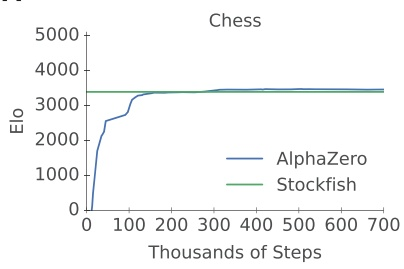

B

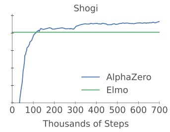

C

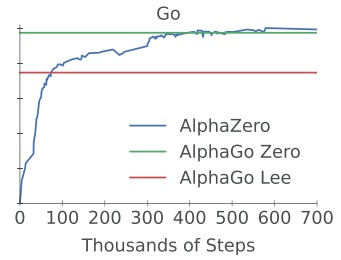

Figure 1: Training AlphaZero for 700,000 steps. Elo ratings were computed from games between different players where each player was given one second per move. (A) Performance of AlphaZero in chess, compared with the 2016 TCEC world-champion program Stockfish. (B) Performance of AlphaZero in shogi, compared with the 2017 CSA world-champion program Elmo. (C) Performance of AlphaZero in Go, compared with AlphaGo Lee and AlphaGo Zero (20 blocks over 3 days).

The hyperparameters of AlphaGo Zero were tuned by Bayesian optimization. In AlphaZero we reuse the same hyperparameters, algorithm settings and network architecture for all games without game-specific tuning. The only exceptions are the exploration noise and the learning rate schedule (see (10) for further details).

We trained separate instances of AlphaZero for chess, shogi and Go. Training proceeded for 700,000 steps (in mini-batches of 4,096 training positions) starting from randomly initialized parameters. During training only, 5,000 first-generation tensor processing units (TPUs) (19) were used to generate self-play games, and 16 second-generation TPUs were used to train the neural networks. Training lasted for approximately 9 hours in chess, 12 hours in shogi and 13 days in Go (see table S3) (20). Further details of the training procedure are provided in (10).

Figure 1 shows the performance of AlphaZero during self-play reinforcement learning, as a function of training steps, on an Elo (21) scale (22). In chess, AlphaZero first outperformed Stockfish after just 4 hours (300,000 steps); in shogi, AlphaZero first outperformed Elmo after 2 hours (110,000 steps); and in Go, AlphaZero first outperformed AlphaGo Lee (9) after 30 hours (74,000 steps). The training algorithm achieved similar performance in all independent runs (see fig. S3), suggesting that the high performance of AlphaZero’s training algorithm is repeatable.

We evaluated the fully trained instances of AlphaZero against Stockfish, Elmo and the pre-vious version of AlphaGo Zero in chess, shogi and Go respectively. Each program was run on the hardware for which it was designed (23): Stockfish and Elmo used 44 central processing unit (CPU) cores (as in the TCEC world championship), whereas AlphaZero and AlphaGo Zero used a single machine with four first-generation TPUs and 44 CPU cores (24). The chess match was played against the 2016 TCEC (season 9) world champion Stockfish (see (10) for details). The shogi match was played against the 2017 CSA world champion version of Elmo (10). The Go match was played against the previously published version of AlphaGo Zero (also trained for 700,000 steps (25)). All matches were played using time controls of 3 hours per game, plus an additional 15 seconds for each move.

In Go, AlphaZero defeated AlphaGo Zero (9), winning 61% of games. This demonstrates that a general approach can recover the performance of an algorithm that exploited board symmetries to generate eight times as much data (see also fig. S1).

In chess, AlphaZero defeated Stockfish, winning 155 games and losing 6 games out of 1,000 (Fig. 2). To verify the robustness of AlphaZero, we played additional matches that started from common human openings (Fig. 3). AlphaZero defeated Stockfish in each opening, suggesting that AlphaZero has mastered a wide spectrum of chess play. The frequency plots in Fig. 3 and the timeline in fig. S2 show that common human openings were independently discovered and played frequently by AlphaZero during self-play training. We also played a match that started from the set of opening positions used in the 2016 TCEC world championship; AlphaZero won convincingly in this match too (26) (see fig. S4). We played additional matches against the most recent development version of Stockfish (27), and a variant of Stockfish that uses a strong opening book (28). AlphaZero won all matches by a large margin (Fig. 2).

Table S6 shows 20 chess games played by AlphaZero in its matches against Stockfish. In several games AlphaZero sacrificed pieces for long-term strategic advantage, suggesting that it has a more fluid, context-dependent positional evaluation than the rule-based evaluations used by previous chess programs.

In shogi, AlphaZero defeated Elmo, winning 98.2% of games when playing black, and 91.2% overall. We also played a match under the faster time controls used in the 2017 CSA world championship, and against another state-of-the-art shogi program (29); AlphaZero again won both matches by a wide margin (Fig. 2).

Table S7 shows 10 shogi games played by AlphaZero in its matches against Elmo. The frequency plots in Fig. 3 and the timeline in fig. S2 show that AlphaZero frequently plays one of the two most common human openings, but rarely plays the second, deviating on the very first move.

AlphaZero searches just 60,000 positions per second in chess and shogi, compared with 60 million for Stockfish and 25 million for Elmo (table S4). AlphaZero may compensate for the lower number of evaluations by using its deep neural network to focus much more selectively on the most promising variations (Fig. 4 provides an example from the match against Stockfish) – arguably a more “human-like” approach to search, as originally proposed by Shannon (30). AlphaZero also defeated Stockfish when given 1/10 as much thinking time as its opponent (i.e. searching \~ 1/10, 000 as many positions), and won 46% of games against Elmo when given 1/100 as much time (i.e. searching \~ 1/40, 000 as many positions), see Fig. 2. The high performance of AlphaZero, using MCTS, calls into question the widely held belief (31, 32) that alpha-beta search is inherently superior in these domains.

The game of chess represented the pinnacle of artificial intelligence research over several decades. State-of-the-art programs are based on powerful engines that search many millions of positions, leveraging handcrafted domain expertise and sophisticated domain adaptations. AlphaZero is a generic reinforcement learning and search algorithm – originally devised for the game of Go – that achieved superior results within a few hours, searching 1/1, 000 as many positions, given no domain knowledge except the rules of chess. Furthermore, the same algorithm was applied without modification to the more challenging game of shogi, again outperforming state-of-the-art programs within a few hours. These results bring us a step closer to fulfilling a longstanding ambition of artificial intelligence (3): a general games playing system that can learn to master any game.

## References

1. M. Campbell, A. J. Hoane, F. Hsu, Artificial Intelligence 134, 57 (2002).

2. F.-h. Hsu, Behind Deep Blue: Building the Computer that Defeated the World Chess Champion (Princeton University Press, 2002).

3. B. Pell, Computational Intelligence 12, 177 (1996).

4. M. R. Genesereth, N. Love, B. Pell, AI Magazine 26, 62 (2005).

5. A. L. Samuel, IBM Journal of Research and Development 11, 601 (1967).

6. G. Tesauro, Neural Computation 6, 215 (1994).

7. C. J. Maddison, A. Huang, I. Sutskever, D. Silver, International Conference on Learning Representations (2015).

8. D. Silver, et al., Nature 529, 484 (2016).

9. D. Silver, et al., Nature 550, 354 (2017).

10. See the supplementary materials for additional information.

11. T. Romstad, M. Costalba, J. Kiiski, et al., Stockfish: A strong open source chess engine. [https://stockfishchess.org/](https://stockfishchess.org/). Retrieved November 29th, 2017.

12. D. N. L. Levy, M. Newborn, How Computers Play Chess (Ishi Press, 2009).

13. V. Allis, Searching for solutions in games and artificial intelligence, Ph.D. thesis, University of Limburg, Netherlands (1994).

14. H. Iida, M. Sakuta, J. Rollason, Artificial Intelligence 134, 121 (2002).

A

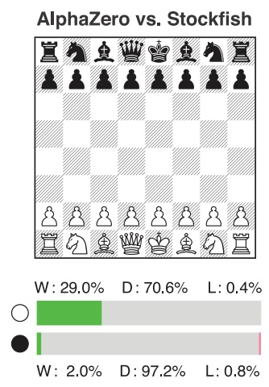

Shogi

<table><tr><td colspan="9">AlphaZero vs. Elmo</td></tr><tr><td>香</td><td>秤</td><td>银</td><td>金</td><td>金</td><td>金</td><td>银</td><td>秤</td><td>香</td></tr><tr><td></td><td>飛</td><td></td><td></td><td></td><td></td><td></td><td>飛</td><td>飛</td></tr><tr><td>步</td><td>步</td><td>步</td><td>步</td><td>步</td><td>步</td><td>步</td><td>步</td><td>步</td></tr><tr><td></td><td>角</td><td></td><td></td><td></td><td></td><td></td><td>飛</td><td>飛</td></tr><tr><td>香</td><td>桂</td><td>銀</td><td>金</td><td>玉</td><td>金</td><td>銀</td><td>桂</td><td>香</td></tr></table>

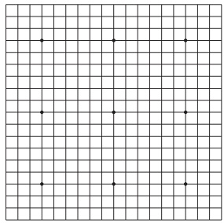

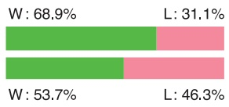

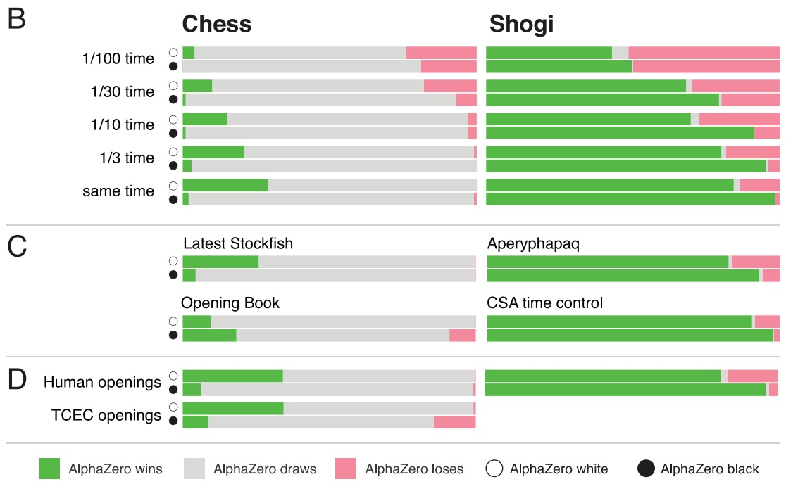

Figure 2: Comparison with specialized programs. (A) Tournament evaluation of AlphaZero in chess, shogi, and Go in matches against respectively Stockfish, Elmo, and the previously published version of AlphaGo Zero (AG0) that was trained for 3 days. In the top bar, AlphaZero plays white; in the bottom bar AlphaZero plays black. Each bar shows the results from AlphaZero’s perspective: win (‘W’, green), draw (‘D’, grey), loss (‘L’, red). (B) Scalability of AlphaZero with thinking time, compared to Stockfish and Elmo. Stockfish and Elmo always receive full time (3 hours per game plus 15 seconds per move), time for AlphaZero is scaled down as indicated. (C) Extra evaluations of AlphaZero in chess against the most recent version of Stockfish at the time of writing (27), and against Stockfish with a strong opening book (28). Extra evaluations of AlphaZero in shogi were carried out against another strong shogi program Aperyqhapaq (29) at full time controls and against Elmo under 2017 CSA world championship time controls (10 minutes per game plus 10 seconds per move). (D) Average result of chess matches starting from different opening positions: either common human positions (see also Fig. 3), or the 2016 TCEC world championship opening positions (see also fig. S4). Average result of shogi matches starting from common human positions (see also Fig. 3). CSA world championship games start from the initial board position. Match conditions are summarized in tables S8 and S9.

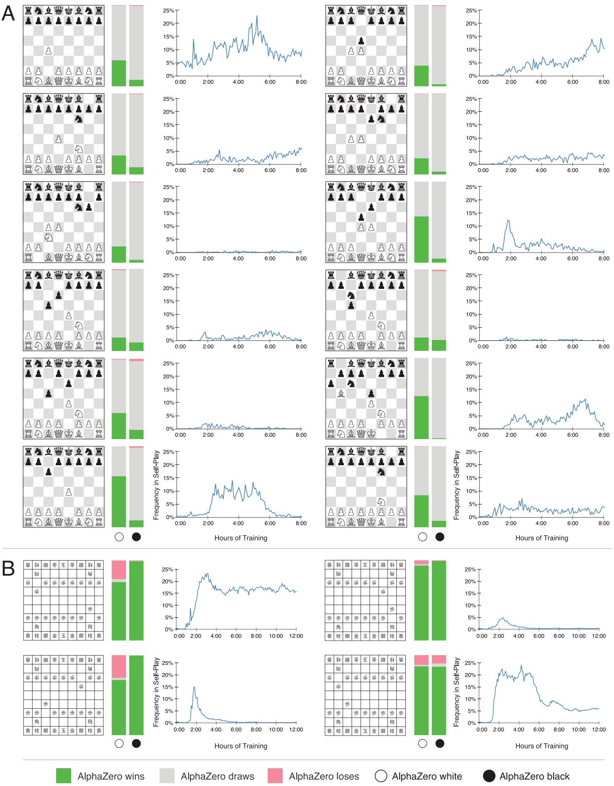

Figure 3: Matches starting from the most popular human openings. AlphaZero plays against (A) Stockfish in chess and (B) Elmo in shogi. In the left bar, AlphaZero plays white, starting from the given position; in the right bar AlphaZero plays black. Each bar shows the results from AlphaZero’s perspective: win (green), draw (grey), loss (red). The percentage frequency of self-play training games in which this opening was selected by AlphaZero is plotted 8 against the duration of training, in hours.

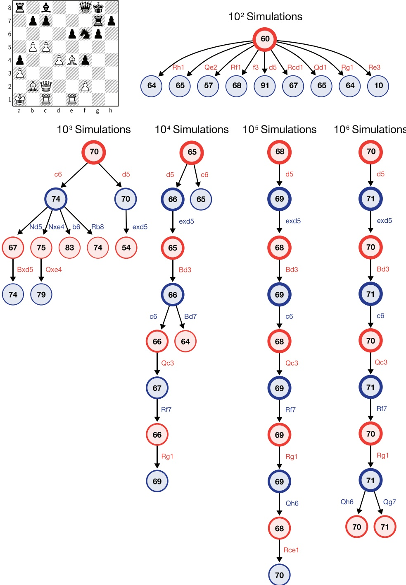

Figure 4: AlphaZero’s search procedure. The search is illustrated for a position (inset) from game 1 (table S6) between AlphaZero (white) and Stockfish (black) after 29. ... Qf8. The internal state of AlphaZero’s MCTS is summarized after $1 0 ^ { 2 } , . . . , 1 0 ^ { 6 }$ simulations. Each summary shows the 10 most visited states. The estimated value is shown in each state, from white’s perspective, scaled to the range [0, 100]. The visit count of each state, relative to the root state of that tree, is proportional to the thickness of the border circle. AlphaZero considers 30. c6 but eventually plays 30. d5. 9 9

15. C. S. Association, Results of the 27th world computer shogi championship. [http://www2.computer-shogi.org/wcsc27/index\_e.html](http://www2.computer-shogi.org/wcsc27/index_e.html). Retrieved November 29th, 2017.

16. W. Steinitz, The Modern Chess Instructor (Edition Olms AG, 1990).

17. E. Lasker, Common Sense in Chess (Dover Publications, 1965).

18. J. Knudsen, Essential Chess Quotations (iUniverse, 2000).

19. N. P. Jouppi, C. Young, N. Patil, et al., Proceedings of the 44th Annual International Symposium on Computer Architecture, ISCA ’17 (ACM, 2017), pp. 1–12.

20. Note that the original AlphaGo Zero paper used GPUs to train the neural networks.

21. R. Coulom, International Conference on Computers and Games (2008), pp. 113–124.

22. The prevalence of draws in high-level chess tends to compress the Elo scale, compared to shogi or Go.

23. Stockfish is designed to exploit CPU hardware and cannot make use of GPU/TPU, whereas AlphaZero is designed to exploit GPU/TPU hardware rather than CPU.

24. A first generation TPU is roughly similar in inference speed to a Titan V GPU, although the architectures are not directly comparable.

25. AlphaGo Zero was ultimately trained for 3.1 million steps over 40 days.

26. Many TCEC opening positions are unbalanced according to both AlphaZero and Stockfish, resulting in more losses for both players.

27. Newest available version of Stockfish as of 13th of January 2018, from [https://github.com/official-stockfish/Stockfish/commit/b508f9561cc2302c129efe8d60f201ff03ee72c8](https://github.com/official-stockfish/Stockfish/commit/b508f9561cc2302c129efe8d60f201ff03ee72c8).

28. Cerebellum opening book from [https://zipproth.de/#Brainfish\_download](https://zipproth.de/##Brainfish_download). AlphaZero did not use an opening book. To ensure diversity against a deterministic opening book, AlphaZero used a small amount of randomization in its opening moves (10); this avoided duplicate games but also resulted in more losses.

29. Aperyqhapaq’s evaluation files are available at [https://github.com/qhapaq-49/qhapaq-bin/releases/tag/eloqhappa](https://github.com/qhapaq-49/qhapaq-bin/releases/tag/eloqhappa).

30. C. E. Shannon, The London, Edinburgh, and Dublin Philosophical Magazine and Journal of Science 41, 256 (1950).

31. O. Arenz, Monte Carlo chess, Master’s thesis, Technische Universitat Darmstadt (2012).

32. O. E. David, N. S. Netanyahu, L. Wolf, International Conference on Artificial Neural Networks (Springer, 2016), pp. 88–96.

## Supplemental References

33. T. Marsland, Encyclopedia of Artificial Intelligence, S. Shapiro, ed. (John Wiley & sons, New York, 1987).

34. G. Tesauro, Artificial Intelligence **134**, 181 (2002).

35. G. Tesauro, G. R. Galperin, Advances in Neural Information Processing Systems 9 (1996), pp. 1068–1074.

36. S. Thrun, Advances in Neural Information Processing Systems (1995), pp. 1069–1076.

37. D. F. Beal, M. C. Smith, Information Sciences **122**, 3 (2000).

38. D. F. Beal, M. C. Smith, Theoretical Computer Science **252**, 105 (2001).

39. J. Baxter, A. Tridgell, L. Weaver, Machine Learning **40**, 243 (2000).

40. J. Veness, D. Silver, A. Blair, W. Uther, Advances in Neural Information Processing Systems (2009), pp. 1937–1945.

41. T. Kaneko, K. Hoki, Advances in Computer Games - 13th International Conference, ACG 2011, Tilburg, The Netherlands, November 20-22, 2011, Revised Selected Papers (2011), pp. 158–169.

42. K. Hoki, T. Kaneko, Journal of Artificial Intelligence Research (JAIR) 49, 527 (2014).

43. M. Lai, Giraffe: Using deep reinforcement learning to play chess, Master’s thesis, Imperial College London (2015).

44. T. Anthony, Z. Tian, D. Barber, Advances in Neural Information Processing Systems 30 (2017), pp. 5366–5376.

45. D. E. Knuth, R. W. Moore, Artificial Intelligence 6, 293– (1975).

46. R. Ramanujan, A. Sabharwal, B. Selman, Proceedings of the 26th Conference on Uncertainty in Artificial Intelligence (UAI) (2010).

47. C. D. Rosin, Annals of Mathematics and Artificial Intelligence **61**, 203 (2011).

48. K. He, X. Zhang, S. Ren, J. Sun, 14th European Conference on Computer Vision (2016), pp. 630–645.

49. The TCEC world championship disallows opening books and instead starts two games (one from each colour) from each opening position.

50. Online chess games database, 365chess (2017). URL: [https://www.365chess.com/](https://www.365chess.com/).

## Acknowledgments

We thank Matthew Sadler for analysing chess games; Yoshiharu Habu for analysing shogi games; Lorrayne Bennett for organizational assistance; Bernhard Konrad, Ed Lockhart and Georg Ostrovski for reviewing the paper; and the rest of the DeepMind team for their support.

## Funding

All research described in this report was funded by DeepMind and Alphabet.

## Author contributions

D.S., J.S., T.H. and I.A. designed the AlphaZero algorithm with advice from T.G., A.G., T.L., K.S., M.Lai, L.S., M.Lanctot; J.S., I.A., T.H. and M.Lai implemented the AlphaZero program; T.H., J.S., D.S., M.Lai, I.A., T.G., K.S., D.K. and D.H. ran experiments and/or analysed data; D.S., T.H., J.S., and D.H. managed the project. D.S., J.S., T.H., M.Lai, I.A. and D.H., wrote the paper.

## Competing interests

The authors declare no competing financial interests. DeepMind has filed the following patent applications related to this work: PCT/EP2018/063869; US15/280,711; US15/280,784.

## Data and materials availability

A full description of the algorithm in pseudocode as well as additional games between AlphaZero and other programs are available in the Supplementary Materials.

## Supplementary Materials

• 110 chess games between AlphaZero and Stockfish 8 from the initial board position.

• 100 chess games between AlphaZero and Stockfish 8 from 2016 TCEC start positions.

• 100 shogi games between AlphaZero and Elmo from the initial board position.

• Pseudocode description of the AlphaZero algorithm.

• Data for Figures 1 and 3 in JSON format.

• Supplementary Figures S1, S2, S3, S4 and Supplementary Tables S1, S2, S3, S4, S5, S6, S7, S8, S9.

• References (33-50).

## Methods

## Anatomy of a Computer Chess Program

In this section we describe the components of a typical computer chess program, focusing specifically on Stockfish (11), an open source program that won the TCEC (Season 9) computer chess world championship in 2016. For an overview of standard methods, see (33).

Each position s is described by a sparse vector of handcrafted features $\phi ( s )$ , including midgame/endgame-specific material point values, material imbalance tables, piece-square tables, mobility and trapped pieces, pawn structure, king safety, outposts, bishop pair, and other miscellaneous evaluation patterns. Each feature $\phi _ { i }$ is assigned, by a combination of manual and automatic tuning, a corresponding weight $w _ { i }$ and the position is evaluated by a linear combination $v ( s , w )   =   \phi ( s ) ^ { \top } w$ . However, this raw evaluation is only considered accurate for positions that are “quiet”, with no unresolved captures or checks. A domain-specialized quiescence search is used to resolve ongoing tactical situations before the evaluation function is applied.

The final evaluation of a position s is computed by a minimax search that evaluates each leaf using a quiescence search. Alpha-beta pruning is used to safely cut any branch that is provably dominated by another variation. Additional cuts are achieved using aspiration windows and principal variation search. Other pruning strategies include null move pruning (which assumes a pass move should be worse than any variation, in positions that are unlikely to be in zugzwang, as determined by simple heuristics), futility pruning (which assumes knowledge of the maximum possible change in evaluation), and other domain-dependent pruning rules (which assume knowledge of the value of captured pieces).

The search is focused on promising variations both by extending the search depth of promising variations, and by reducing the search depth of unpromising variations based on heuristics like history, static-exchange evaluation (SEE), and moving piece type. Extensions are based on domain-independent rules that identify singular moves with no sensible alternative, and domaindependent rules, such as extending check moves. Reductions, such as late move reductions, are based heavily on domain knowledge.

The efficiency of alpha-beta search depends critically upon the order in which moves are considered. Moves are therefore ordered by iterative deepening (using a shallower search to order moves for a deeper search). In addition, a combination of domain-independent move ordering heuristics, such as killer heuristic, history heuristic, counter-move heuristic, and also domain-dependent knowledge based on captures (SEE) and potential captures (MVV/LVA).

A transposition table facilitates the reuse of values and move orders when the same position is reached by multiple paths. In some variants, a carefully tuned opening book may be used to select moves at the start of the game. An endgame tablebase, precalculated by exhaustive retrograde analysis of endgame positions, provides the optimal move in all positions with six and sometimes seven pieces or less.

Other strong chess programs, and also earlier programs such as Deep Blue (1), have used very similar architectures (33) including the majority of the components described above, although important details vary considerably.

None of the techniques described in this section are used by AlphaZero. It is likely that some of these techniques could further improve the performance of AlphaZero; however, we have focused on a pure self-play reinforcement learning approach and leave these extensions for future research.

## Prior Work on Computer Chess and Shogi

In this section we discuss some notable prior work on reinforcement learning and/or deep learning in computer chess, shogi and, due to its historical relevance, backgammon.

TD Gammon (6) was a backgammon program that evaluated positions by a multi-layer perceptron, trained by temporal-difference learning to predict the final game outcome. When its evaluation function was combined with a 3-ply search (34) TD Gammon defeated the human world champion. A subsequent paper introduced the first version of Monte-Carlo search (35), which evaluated root positions by the average outcome of n-step rollouts. Each rollout was generated by greedy move selection and the nth position was evaluated by TD Gammon’s neural network.

NeuroChess (36) evaluated positions by a neural network that used 175 handcrafted input features. It was trained by temporal-difference learning to predict the final game outcome, and also the expected features after two moves. NeuroChess won 13% of games against GnuChess using a fixed depth 2 search, but lost overall.

Beal and Smith applied temporal-difference learning to estimate the piece values in chess (37) and shogi (38), starting from random values and learning solely by self-play.

KnightCap (39) evaluated positions by a neural network that used an attack table based on knowledge of which squares are attacked or defended by which pieces. It was trained by a variant of temporal-difference learning, known as TD(leaf), that updates the leaf value of the principal variation of an alpha-beta search. KnightCap achieved human master level after training against a strong computer opponent with hand-initialized piece-value weights.

Meep (40) evaluated positions by a linear evaluation function based on handcrafted features. It was trained by another variant of temporal-difference learning, known as TreeStrap, that updates all nodes of an alpha-beta search. Meep defeated human international master players in 13 out of 15 games, after training by self-play with randomly initialized weights.

Kaneko and Hoki (41) trained the weights of a shogi evaluation function comprising a million features, by learning to select expert human moves during alpha-beta search. They also performed a large-scale optimization based on minimax search regulated by expert game logs (42); this formed part of the Bonanza engine that won the 2013 World Computer Shogi Championship.

Giraffe (43) evaluated positions by a neural network that included mobility maps and attack and defend maps describing the lowest valued attacker and defender of each square. It was trained by self-play using TD(leaf), also reaching a standard of play comparable to international masters.

DeepChess (32) trained a neural network to perform pair-wise evaluations of positions. It was trained by supervised learning from a database of human expert games that was pre-filtered to avoid capture moves and drawn games. DeepChess reached a strong grandmaster level of play.

All of these programs combined their learned evaluation functions with an alpha-beta search enhanced by a variety of extensions.

By contrast, an approach based on training dual policy and value networks using a policy iteration algorithm similar to AlphaZero was successfully applied to the game Hex (44). This work differed from AlphaZero in several regards: the policy network was initialized by imitating a pre-existing MCTS search algorithm, augmented by rollouts; the network was subsequently retrained from scratch at each iteration; and value targets were based on the outcome of self-play games using the raw policy network, rather than MCTS search.

## MCTS and Alpha-Beta Search

For at least four decades the strongest computer chess programs have used alpha-beta search with handcrafted evaluation functions (33, 45). Chess programs using traditional MCTS (31) were much weaker than alpha-beta search programs (46), whereas alpha-beta programs based on neural networks have previously been unable to compete with faster, handcrafted evaluation functions. Surprisingly, AlphaZero surpassed previous approaches by using an effective combination of MCTS and neural networks.

AlphaZero evaluates positions non-linearly using deep neural networks, rather than the lin ear evaluation function used in typical chess programs. This provides a more powerful evaluation function, but may also introduce larger worst-case generalization errors. When combined with alpha-beta search, which computes an explicit minimax, the biggest errors are typically propagated directly to the root of the subtree. By contrast, AlphaZero’s MCTS averages over the position evaluations within a subtree, rather than computing the minimax evaluation of that subtree. We speculate that the approximation errors introduced by neural networks therefore tend to cancel out when evaluating a large subtree.

## Domain Knowledge

AlphaZero was provided with the following domain knowledge about each game:

1. The input features describing the position, and the output features describing the move, are structured as a set of planes; i.e. the neural network architecture is matched to the grid-structure of the board.

2. AlphaZero is provided with perfect knowledge of the game rules. These are used during MCTS, to simulate the positions resulting from a sequence of moves, to determine game termination, and to score any simulations that reach a terminal state.

3. Knowledge of the rules is also used to encode the input planes (i.e. castling, repetition, no-progress) and output planes (how pieces move, promotions, and piece drops in shogi).

4. The typical number of legal moves is used to scale the exploration noise (see below).

5. Chess and shogi games exceeding 512 steps were terminated and assigned a drawn outcome; Go games exceeding 722 steps were terminated and scored with Tromp-Taylor rules, similarly to previous work (9).

AlphaZero did not use an opening book, endgame tablebases, or domain-specific heuristics.

## Search

We briefly describe here the MCTS algorithm (9) used by AlphaZero; further details can be found in the pseudocode in the Supplementary Data. Each state-action pair $( s , a )$ stores a set of statistics, $\{ N ( s , a ) , W ( s , a ) , Q ( s , a ) , P ( s , a ) \}$ , where $N ( s , a )$ is the visit count, $W ( s , a )$ is the total action-value, $Q ( s , a )$ is the mean action-value, and $P ( s , a )$ is the prior probability of selecting a in s. Each simulation begins at the root node of the search tree, $s _ { 0 }$ , and finishes when the simulation reaches a leaf node $s _ { L }$ at time-step L. At each of these timesteps, $t ~ < ~ L$ , an action is selected, $a _ { t } = \arg \operatorname* { m a x } _ { a } \big ( Q ( s _ { t } , a )   +   U ( s _ { t } , a ) \big )$ , using a variant of the PUCT algorithm (47), $U ( s , a ) \: = \: C ( s ) P ( s , a ) \sqrt { N ( s ) } / ( 1 \: + \: N ( s , a ) )$ , where $N ( s )$ is the parent visit count and $C ( s )$ is the exploration rate, which grows slowly with search time, $C ( s ) = \log \left( ( 1 + N ( s ) + c _ { \mathrm { b a s e } } ) / c _ { \mathrm { b a s e } } \right) + c _ { \mathrm { i n i t } }$ , but is essentially constant during the fast training games. The leaf node $s _ { L }$ is added to a queue for neural network evaluation, $( \mathbf { p } , v )   =   f _ { \theta } ( s _ { L } )$ The leaf node is expanded and each state-action pair $( s _ { L } , a )$ is initialized to $\{ N ( s _ { L } , a ) =$ $0 , W ( s _ { L } , a ) \; = \; 0 , Q ( s _ { L } , a ) \; = \; 0 , P ( s _ { L } , a ) \; = \; p _ { a } \}$ The visit counts and values are then updated in a backward pass through each step $t   \leq   L ,   N ( s _ { t } , a _ { t } )   =   N ( s _ { t } , a _ { t } )   +   1 ,   W ( s _ { t } , a _ { t } )   =$ $\begin{array} { l } { W ( s _ { t } , a _ { t } ) + v , Q ( s _ { t } , \overset { \cdot } { a _ { t } } ) = \frac { W ( s _ { t } , \overset { \cdot } { a _ { t } } ) } { N ( s _ { t } , a _ { t } ) } } \\ \end{array}$

## Representation

In this section we describe the representation of the board inputs, and the representation of the action outputs, used by the neural network in AlphaZero. Other representations could have been used; in our experiments the training algorithm worked robustly for many reasonable choices.

The input to the neural network is an $N \times N \times ( M T + L )$ image stack that represents state using a concatenation of $T$ sets of M planes of size $N \times N$ . Each set of planes represents the board position at a time-step $t \mathrm { ~ - ~ } T \mathrm { ~ + ~ } 1 , . . . , t ,$ and is set to zero for time-steps less than 1. The board is oriented to the perspective of the current player. The M feature planes are composed of binary feature planes indicating the presence of the player’s pieces, with one plane for each piece type, and a second set of planes indicating the presence of the opponent’s pieces. For shogi there are additional planes indicating the number of captured prisoners of each type. There are an additional L constant-valued input planes denoting the player’s colour, the move number, and the state of special rules: the legality of castling in chess (kingside or queenside); the repetition count for the current position (3 repetitions is an automatic draw in chess; 4 in shogi); and the number of moves without progress in chess (50 moves without progress is an automatic draw). Input features are summarized in Table S1.

A move in chess may be described in two parts: first selecting the piece to move, and then selecting among possible moves for that piece. We represent the policy $\pi ( a | s )$ by $\mathrm { a }   8 \times 8 \times 7 3$ stack of planes encoding a probability distribution over 4,672 possible moves. Each of the $8 \times 8$ positions identifies the square from which to “pick $\mathrm { { \bf u } p } ^ { \mathrm { { \textquotesingle } } }$ a piece. The first 56 planes encode possible ‘queen moves’ for any piece: a number of squares [1..7] in which the piece will be moved, along one of eight relative compass directions {N, NE, E, SE, S, SW, W, NW}. The next 8 planes encode possible knight moves for that piece. The final 9 planes encode possible underpromotions for pawn moves or captures in two possible diagonals, to knight, bishop or rook respectively. Other pawn moves or captures from the seventh rank are promoted to a queen.

The policy in shogi is represented by a $9 \times 9 \times 1 3 9$ stack of planes similarly encoding a probability distribution over 11,259 possible moves. The first 64 planes encode ‘queen moves and the next 2 planes encode knight moves. An additional $6 4 \pm 2$ planes encode promoting queen moves and promoting knight moves respectively. The last 7 planes encode a captured piece dropped back into the board at that location.

The policy in Go is represented identically to AlphaGo Zero (9), using a flat distribution over $1 9 \times 1 9 + 1$ moves representing possible stone placements and the pass move. We also tried using a flat distribution over moves for chess and shogi; the final result was almost identical although training was slightly slower.

Illegal moves are masked out by setting their probabilities to zero, and re-normalising the probabilities over the remaining set of legal moves.

The action representations are summarized in Table S2.

## Architecture

Apart from the representation of positions and actions described above, AlphaZero uses the same network architecture as AlphaGo Zero (9), briefly recapitulated here.

The neural network consists of a “body” followed by both policy and value “heads”. The body consists of a rectified batch-normalized convolutional layer followed by 19 residual blocks (48) Each such block consists of two rectified batch-normalized convolutional layers with a skip connection. Each convolution applies 256 filters of kernel size $3 \times 3$ with stride 1. The policy head applies an additional rectified, batch-normalized convolutional layer, followed by a final convolution of 73 filters for chess or 139 filters for shogi, or a linear layer of size 362 for Go, representing the logits of the respective policies described above. The value head applies an additional rectified, batch-normalized convolution of 1 filter of kernel size $1 \times 1$ with stride 1, followed by a rectified linear layer of size 256 and a tanh-linear layer of size 1.

## Configuration

During training, each MCTS used 800 simulations. The number of games, positions, and thinking time varied per game due largely to different board sizes and game lengths, and are shown in Table S3. The learning rate was set to 0.2 for each game, and was dropped three times during the course of training to 0.02, 0.002 and 0.0002 respectively, after 100, 300 and 500 thousands of steps for chess and shogi, and after 0, 300 and 500 thousands of steps for Go. Moves are selected in proportion to the root visit count. Dirichlet noise Dir(α) was added to the prior probabilities in the root node; this was scaled in inverse proportion to the approximate number of legal moves in a typical position, to a value of $\alpha   =   \{ 0 . 3 , 0 . 1 5 , 0 . 0 3 \}$ for chess, shogi and Go respectively. Positions were batched across parallel training games for evaluation by the neural network. Unless otherwise specified, the training and search algorithm and parameters are identical to AlphaGo Zero (9).

During evaluation, AlphaZero selects moves greedily with respect to the root visit count. Each MCTS was executed on a single machine with 4 first-generation TPUs.

## Opponents

To evaluate performance in chess, we used Stockfish version 8 (official Linux release) as a baseline program. Stockfish was configured according to its 2016 TCEC world championship superfinal settings: 44 threads on 44 cores (two 2.2GHz Intel Xeon Broadwell CPUs with 22 cores), a hash size of 32GB, syzygy endgame tablebases, at 3 hour time controls with 15 additional seconds per move. We also evaluated against the most recent version, Stockfish 9 (just released at time of writing), using the same configuration.

Stockfish does not have an opening book of its own and all primary evaluations were performed without an opening book. We also performed one secondary evaluation in which the opponent’s opening moves were selected by the Brainfish program, using an opening book derived from Stockfish. However, we note that these matches were low in diversity, and AlphaZero and Stockfish tended to produce very similar games throughout the match, more than 90% of which were draws. When we forced AlphaZero to play with greater diversity (by softmax sampling with a temperature of 10.0 among moves for which the value was no more than 1% away from the best move for the first 30 plies) the winning rate increased from 5.8% to 14%.

To evaluate performance in shogi, we used Elmo version WCSC27 in combination with YaneuraOu 2017 Early KPPT 4.79 64AVX2 TOURNAMENT as a baseline program, using 44 CPU threads (on two 2.2GHz Intel Xeon Broadwell CPUs with 22 cores) and a hash size of 32GB with the usi options of EnteringKingRule set to CSARule27, MinimumThinkingTime set to 1000, BookFile set to standard book.db, BookDepthLimit set to 0 and BookMoves set to 200. Additionally, we also evaluated against Aperyqhapaq combined with the same YaneuraOu version and no book file. For Aperyqhapaq, we used the same usi options as for Elmo except for the book setting.

## Match conditions

We measured the head-to-head performance of AlphaZero in matches against each of the above opponents (Figure 2). Three types of match were played: starting from the initial board position (the default configuration, unless otherwise specified); starting from human opening positions; or starting from the 2016 TCEC opening positions (49).

The majority of matches for chess, shogi and Go used the 2016 TCEC superfinal time controls: 3 hours of main thinking time, plus 15 additional seconds of thinking time for each move. We also investigated asymmetric time controls (Figure 2B), where the opponent received 3 hours of main thinking time but AlphaZero received only a fraction of this time. Finally, for shogi only, we ran a match using faster time controls used in the 2017 CSA world championship: 10 minutes per game plus 10 seconds per move.

AlphaZero used a simple time control strategy: thinking for 1/20th of the remaining time. Opponent programs used customized, sophisticated heuristics for time control. Pondering was disabled for all players (particularly important for the asymmetric time controls in Figure 2).

Resignation was enabled for all players (-650 centipawns for 4 consecutive moves for Stockfish, -4,500 centipawns for 10 consecutive moves for Elmo, or a value of -0.9 for AlphaZero and AlphaGo Lee).

Matches consisted of 1,000 games, except for the human openings (200 games as black and 200 games as white from each opening) and the 2016 TCEC openings (50 games as black and 50 games as white from each of the 50 openings). The human opening positions were chosen as those played more than 100,000 times in an online database (50).

## Elo ratings

We evaluated the relative strength of AlphaZero (Figure 1) by measuring the Elo rating of each player. We estimate the probability that player a will defeat player b by a logistic function p(a defeats $b )   =   ( 1   +   1 0 ^ { \bar { ( } c _ { \mathrm { e l o } } ( e ( b ) - \bar { e ( a ) } ) ) } ) ^ { - 1 }$ , and estimate the ratings $e ( \cdot )$ by Bayesian logistic regression, computed by the BayesElo program (21) using the standard constant $c _ { \mathrm { e l o } } = 1 / 4 0 0$

Elo ratings were computed from the results of a 1 second per move tournament between iterations of AlphaZero during training, and also a baseline player: either Stockfish, Elmo or AlphaGo Lee respectively. The Elo rating of the baseline players was anchored to publicly available values (9).

In order to compare Elo ratings at 1 second per move time controls to standard Elo ratings at full time controls, we also provide the results of Stockfish vs. Stockfish and Elmo vs. Elmo matches (Table S5).

## Example games

The Supplementary Data includes 110 games from the main chess match between AlphaZero and Stockfish, starting from the initial board position; 100 games from the chess match starting from 2016 TCEC world championship opening positions; and 100 games from the main shogi match between AlphaZero and Elmo. For the chess match from the initial board position, one game was selected at random for each unique opening sequence of 30 plies; all AlphaZero losses were also included. For the TCEC match, one game as white and one game as black were selected at random from the match starting from each opening position. For the shogi match, one game was selected at random for each unique opening sequence of 25 plies (when AlphaZero was black) or 10 plies (when AlphaZero was white).

10 chess games were independently selected from each batch by GM Matthew Sadler, according to their interest to the chess community; these games are included in Table S6. Similarly, 10 shogi games were independently selected by Yoshiharu Habu; these games are included in Table S7.

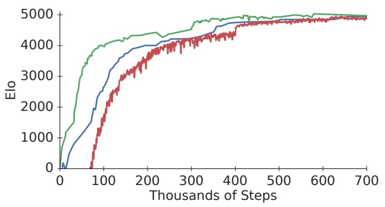

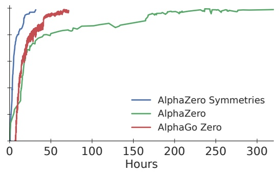

Figure S1: Learning curves showing the Elo performance during training in Go. Comparison between AlphaZero, a version of AlphaZero that exploits knowledge of symmetries in a similar manner to AlphaGo Zero, and the previously published AlphaGo Zero. AlphaZero generates approximately $1 / 8$ as many positions per training step, and therefore uses eight times more wall clock time, than the symmetry-augmented algorithms.

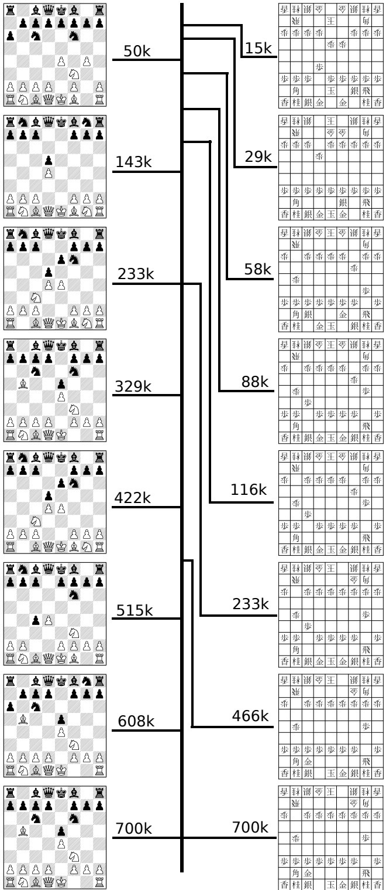

Figure S2: Chess and shogi openings preferred by AlphaZero at different stages of self-play training, labelled with the number of training steps. The figure shows the most frequently selected opening 6 plies played by AlphaZero during its games of self-play. Each move was generated by an MCTS with just 800 simulations per move.

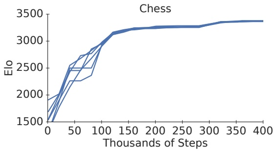

Figure S3: Repeatability of AlphaZero training on the game of chess. The figure shows 6 separate training runs of 400,000 steps (approximately 4 hours each). Elo ratings were computed from a tournament between baseline players and AlphaZero players at different stages of training. AlphaZero players were given 800 simulations per move. Similar repeatability was observed in shogi and Go.

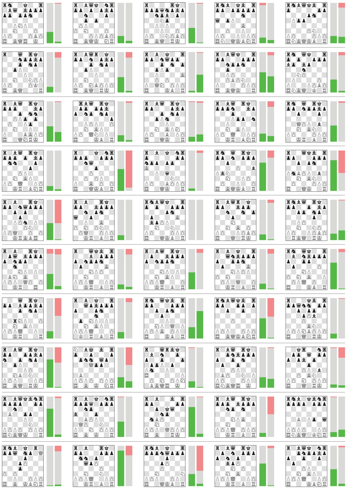

Figure S4: Chess matches beginning from the 2016 TCEC world championship start positions. In the left bar, AlphaZero plays white, starting from the given position; in the right bar AlphaZero plays black. Each bar shows the results from AlphaZero’s perspective: win (green), draw (grey), loss (red). Many of these start positions are unbalanced according to both and AlphaZero and Stockfish, resulting in more losses for both players.

<table><tr><td rowspan="2">Feature</td><td rowspan="2">Go Planes</td><td colspan="2">Chess</td><td colspan="2">Shogi</td></tr><tr><td>Feature</td><td>Planes</td><td>Feature</td><td>Planes</td></tr><tr><td>P1 stone</td><td>1</td><td>P1 piece</td><td>6</td><td>P1 piece</td><td>14</td></tr><tr><td>P2 stone</td><td>1</td><td>P2 piece</td><td>6</td><td>P2 piece</td><td>14</td></tr><tr><td></td><td></td><td>Repetitions</td><td>2</td><td>Repetitions</td><td>3</td></tr><tr><td></td><td></td><td></td><td></td><td>P1 prisoner count</td><td>7</td></tr><tr><td></td><td></td><td></td><td></td><td>P2 prisoner count</td><td>7</td></tr><tr><td>Colour</td><td>1</td><td>Colour</td><td>1</td><td>Colour</td><td>1</td></tr><tr><td></td><td></td><td>Total move count</td><td>1</td><td>Total move count</td><td>1</td></tr><tr><td></td><td></td><td>P1 castling</td><td>2</td><td></td><td></td></tr><tr><td></td><td></td><td>P2 castling</td><td>2</td><td></td><td></td></tr><tr><td></td><td></td><td>No-progress count</td><td>1</td><td></td><td></td></tr><tr><td>Total</td><td>17</td><td>Total</td><td>119</td><td>Total</td><td>362</td></tr></table>

Table S1: Input features used by AlphaZero in Go, chess and shogi respectively. The first set of features are repeated for each position in a $T =$ 8-step history. Counts are represented by a single real-valued input; other input features are represented by a one-hot encoding using the specified number of binary input planes. The current player is denoted by P1 and the opponent by P2.

<table><tr><td colspan="2" rowspan="2">Feature\Chess</td><td colspan="2">Feature\Shogi</td></tr><tr><td>Planes</td><td>Features</td></tr><tr><td>Queen moves</td><td>56</td><td>Queen moves</td><td>64</td></tr><tr><td>Knight moves</td><td>8</td><td>Knight moves</td><td>2</td></tr><tr><td>Underpromotions</td><td>9</td><td>Promoting queen moves</td><td>64</td></tr><tr><td></td><td></td><td>Promoting knight moves</td><td>2</td></tr><tr><td></td><td></td><td>Drop</td><td>7</td></tr><tr><td>Total</td><td>73</td><td>Total</td><td>139</td></tr><tr><td></td><td>Chess</td><td>Shogi</td><td>Go</td></tr><tr><td>Mini-batches</td><td>700k</td><td>700k</td><td>700k</td></tr><tr><td>Training Time</td><td>9h</td><td>12h</td><td>13d</td></tr><tr><td>Training Games</td><td>44 million</td><td>24 million</td><td>140 million</td></tr><tr><td>Thinking Time</td><td>800 sims ∼ 40 ms</td><td>800 sims ∼ 80 ms</td><td>800 sims ∼ 200 ms</td></tr></table>

Table S2: Action representation used by AlphaZero in chess and shogi respectively. The policy is represented by a stack of planes encoding a probability distribution over legal moves; planes correspond to the entries in the table.

| Program | Chess | Shogi | Go |
| --- | --- | --- | --- |
| AlphaZero | 63k (13k) | 58k (12k) | 16k (0.6k) |
| Stockfish | 58,100k (24,000k) |  |  |
| Elmo |  | 25,100k (4,600k) |  |
| AlphaZero | 1.5 GFlop | 1.9 GFlop | 8.5 GFlop |

Table S4: Evaluation speed (positions/second) of AlphaZero, Stockfish, and Elmo in chess, shogi and Go. Evaluation speed is the average over entire games at full time controls from the initial board position (the main evaluation in Figure 2), standard deviations are shown in parentheses. Bottom row: Number of operations used by AlphaZero for one evaluation.

| Program | Win | Draw | Loss |
| --- | --- | --- | --- |
| Stockfish | 57.1 % | 42.9 % | 0.0 % |
| Elmo | 98.7 % | 1.0 % | 0.3 % |

Table S5: Performance comparison of Stockfish and Elmo, when using full time controls of 3h per game, compared to time controls of 1s per move.

| Game 1 - White: AlphaZero Black: Stockfish |
| --- |
| 1. Nf3 Nf6 2. c4 e6 3. Nc3 Bb4 4. Qc2 O-O 5. a3 Bxc3 6. Qxc3 a5 7. b4 d6 8. e3 Ne4 9. Qc2 Ng5 10. b5 Nxf3+ 11. gxf3 Qf6 12. d4 Qxf3 13. Rg1 Nd7 14. Be2 Qf6 15. Bb2 Qh4 16. Rg4 Qh2 17. Rg3 f5 18. O-O-O Rf7 19. Bf3 Qh4 20. Rhl Qf6 21. Kb1 g6 22. Rgg1 a4 23. Ka1 Rg7 24. e4 f4 25. c5 Qe7 26. Rc1 Nf6 27. e5 dxe5 28. Rhe1 e4 29. Bxe4 Qf8 30. d5 exd5 31. Bd3 Bg4 32. f3 Bd7 33. Qc3 Nh5 34. Re5 c6 35. Rce1 Nf6 36. Qd4 cxb5 37. Bb1 Bc6 38. Re6 Rf7 39. Rg1 Qg7 40. Qxf4 Re8 41. Rd6 Nd7 42. Qc1 Rf6 43. f4 Qe7 44. Rxf6 Nxf6 45. f5 Qe3 46. fxg6 Qxc1 47. gxh7+ Kf7 48. Rxc1 Nxh7 49. Bxh7 Re3 50. Rd1 Ke8 51. Ka2 Bd7 52. Bd4 Rh3 53. Bc2 Be6 54. Re1 Kd7 55. Kb2 Rf3 56. Re5 Rg3 57. Re3 Rg2 58. Kc3 Rg4 59. Rf3 Ke8 60. Rf2 Rg3+ 61. Kb4 Rg4 62. Rd2 Bd7 63. Ka5 Rf4 64. Be5 Rf3 65. Rd3 Rf2 66. Bd1 Bc6 67. Kb6 1-0 |
| Game 2 - White: AlphaZero Black: Stockfish |
| 1. d4 Nf6 2. c4 e6 3. Nf3 b6 4. g3 Bb7 5. Bg2 Be7 6. Nc3 O-O 7. O-O Ne4 8. Bd2 d5 9. cxd5 exd5 10. Qb3 c5 11. Bf4 Na6 12. Rfd1 c4 13. Qc2 Nb4 14. Qc1 Qd7 15. h4 Rac8 16. a3 Nxc3 17. bxc3 Nc6 18. Qb1 Rce8 19. Re1 Na5 20. Ng5 f5 21. Nf3 Bf6 22. Ra2 h6 23. a4 Qe6 24. Kh2 Bc8 25. Rh1 Nc6 26. h5 Kh8 27. Ng1 Qf7 28. Bf3 Rd8 29. Nh3 Kg8 30. Bc1 Rfe8 31. Qb5 Bb7 32. Rd1 Na5 33. Qb1 Bc8 34. Nf4 Bg5 35. Ng6 Bxc1 36. Qxc1 Be6 37. Ne5 Qc7 38. Rb2 Nb7 39. Rb5 Na5 40. Qf4 Nb3 41. Ng6 Qc6 42. Qe5 Qd7 43. e3 Na5 44. Bg2 Nb7 45. Ra1 Kh7 46. Nf4 Bg8 47. Rxd5 Bxd5 48. Qxd5 Nd6 49. Bh3 Re7 50. Ng6 Rf7 51. Ne5 Qb7 52. Bg2 Qxd5 53. Bxd5 Rc7 54. Kg2 Ne4 55. Bxe4 fxe4 56. f3 exf3+ 57. Kxf3 Re7 58. Ng6 Rb7 59. e4 b5 60. axb5 Rxb5 61. Nf4 Rb3 62. Ne2 Ra8 63. e5 a5 64. d5 a4 65. d6 a3 66. d7 Kg8 67. Rd1 Rbb8 68. e6 Kf8 69. Nd4 1-0 |
| Game 3 - White: AlphaZero Black: Stockfish |
| 1. d4 Nf6 2. c4 e6 3. Nf3 b6 4. g3 Bb7 5. Bg2 Bb4+ 6. Bd2 Be7 7. Nc3 O-O 8. Qc2 Na6 9. a3 c5 10. d5 exd5 11. Ng5 Nc7 12. h4 h6 13. Nxd5 Ncxd5 14. cxd5 d6 15. a4 Qd7 16. Bc3 Rfe8 17. O-O-O Bd8 18. e4 Ng4 19. Bh3 hxg5 20. f3 f5 21. fxg4 fxg4 22. Bf1 gxh4 23. Bb5 Qf7 24. gxh4 Bf6 25. Rhf1 Rf8 26. Bxf6 gxf6 27. Rf4 Qg7 28. Be2 Qh6 29. Rdf1 g3 30. Qd3 Kh8 31. Qxg3 Rae8 32. Bd3 Bc8 33. Kb1 Rf7 34. Qf2 Bd7 35. h5 Ref8 36. Bc2 Be8 37. Rf3 Re7 38. Rxf6 Qxf6 39. Qxf6+ Rxf6 40. Rxf6 Kg7 41. Rxd6 Bxh5 42. Kc1 Re5 43. a5 bxa5 44. Kd2 Be8 45. Ra6 Rh5 46. Bd3 a4 47. d6 Bf7 48. d7 Rh8 49. e5 1-0 |
| Game 4 - White: AlphaZero Black: Stockfish |
| 1. Nf3 e6 2. c4 Nf6 3. Nc3 Bb4 4. Qc2 O-O 5. a3 Bxc3 6. Qxc3 d6 7. b4 e5 8. Bb2 Nbd7 9. e3 Re8 10. d3 Nf8 11. Be2 a5 12. O-O Bg4 13. h3 Bh5 14. Qc2 h6 15. Bc3 b6 16. b5 N6d7 17. Rad1 Nc5 18. Ba1 Bg6 19. Qb2 Na4 20. Qa2 Nc5 21. d4 exd4 22. Nxd4 Be4 23. Bf3 Bxf3 24. gxf3 Nfe6 25. Kh2 Nxd4 26. Rxd4 Kh7 27. Qc2+ g6 28. Rf4 Qe7 29. Rg1 Rg8 30. h4 h5 31. Rg5 Kh6 32. e4 Ne6 33. Rf6 Nxg5 34. hxg5+ Kh7 35. f4 Rae8 36. Qd3 Rg7 37. f3 Kg8 38. Qd4 Kf8 39. Bc3 Rg8 40. a4 Rd8 41. Kh3 Rd7 42. f5 gxf5 43. Rxf5 Qe6 44. Kh4 Re7 45. Qd5 Rg6 46. Kxh5 Re8 47. Bf6 Qd7 48. Kg4 Rc8 49. Qc6 Qe8 50. Qxe8+ Kxe8 51. Rd5 Rxf6 52. gxf6 Kd7 53. Kf5 c6 54. bxc6+ Kxc6 55. f4 Rh8 56. e5 1-0 |
| Game 5 - White: AlphaZero Black: Stockfish |
| 1. d4 Nf6 2. Nf3 e6 3. c4 b6 4. g3 Bb7 5. Bg2 Bb4+ 6. Bd2 Be7 7. Nc3 c6 8. Bf4 O-O 9. e4 d5 10. e5 Ne4 11. cxd5 cxd5 12. O-O Nxc3 13. bxc3 Ba6 14. Re1 Nc6 15. h4 Rc8 16. Re3 Rc7 17. Ng5 h6 18. Nh3 Kh7 19. Rf3 Na5 20. Qc2+ Kg8 21. Re1 Kh8 22. Qd1 Nc6 23. Be3 Bc4 24. Qd2 Kh7 25. Nf4 Qe8 26. g4 Rh8 27. Nh5 Kg8 28. Rh3 Rb7 29. Bf4 Bf8 30. Qd1 Ne7 31. Bc1 b5 32. f4 Rb6 33. Ba3 Ng6 34. Bxf8 Nxf8 35. Qd2 Qc8 36. Rf3 Qd8 37. Ff2 b4 38. cxb4 Rxb4 39. f5 Qc7 40. Rd1 Qb7 41. Rd2 Qc7 42. Qg3 Bb5 43. Kh2 Bd7 44. Qf2 Rb6 45. Rc2 Rc6 46. Rb2 Rb6 47. Bf1 Qb8 48. Rxb6 axb6 49. f6 g6 50. Ng3 Be8 51. Qb2 Qd8 52. h5 Nd7 53. Kg2 g5 54. Rc3 Nxf6 55. exf6 Qxf6 56. Rf3 Qd8 57. Qb4 Kg7 58. Be2 Bc6 59. Rb3 Bd7 60. Qd6 Ba4 61. Qxd8 Rxd8 62. Rxb6 Kf8 63. Kf2 Rc8 64. Ra6 Bd7 65. Ra7 Ke8 66. Bd3 Rc3 67. Ke2 Kd8 68. Kd2 Rc7 69. Rxc7 Kxc7 70. Kc3 Ba4 71. Kb4 Bd1 72. Be2 Bc2 73. Nf1 1-0 |
| Game 6 - White: AlphaZero Black: Stockfish |
| 1. Nf3 Nf6 2. c4 c5 3. Nc3 e6 4. g3 Qb6 5. d3 d5 6. Bg2 Be7 7. cxd5 exd5 8. e4 d4 9. Nd5 Nxd5 10. exd5 O-O 11. O-O Bg4 12. h3 Bxf3 13. Qxf3 Na6 14. h4 Bd6 15. h5 Qd8 16. h6 g6 17. Re1 Nc7 18. Bd2 a5 19. a4 b6 20. Re2 Re8 21. Rxe8+ Nxe8 22. Re1 Rb8 23. b3 Nc7 24. Re2 Ra8 25. Kf1 Rb8 26. Bh3 Ra8 27. Re4 Rb8 28. Re1 Ra8 29. Bc1 Rb8 30. Re2 Rf8 31. Re5 Bd6 32. Re1 Bf8 33. Bg2 Bd6 34. Bd2 Rc8 35. Bf4 Qd7 36. g4 Re8 37. Re4 Rd8 38. Bg5 Re8 39. Qf6 Bf8 40. Qc6 Qxc6 41. dxc6 Bd6 42. f4 Kf8 43. f5 gxf5 44. gxf5 Rxe4 45. Bxe4 Be5 46. f6 Kg8 47. Bf5 Ne8 48. Kf2 Bc7 49. Kf3 Bb8 50. Bf4 Bxf4 51. Kxf4 1-0 |
| Game 7 - White: AlphaZero Black: Stockfish |
| 1. Nf3 Nf6 2. c4 e6 3. Nc3 d5 4. d4 c6 5. Bg5 Be7 6. e3 h6 7. Bf4 O-O 8. Qc2 Nbd7 9. g4 dxc4 10. Rg1 Nd5 11. g5 Nxf4 12. gxh6 Nh5 13. hxg7 Nxg7 14. O-O-O Qa5 15. Bxc4 Qf5 16. Qe2 Qh7 17. Rg3 Kh8 18. Rdg1 Nf5 19. Qf1 Nxg3 20. Rxg3 Rg8 21. Rh3 Rg7 22. Rxh7+ Rxh7 23. Bd3 Rg7 24. Qd1 Nf6 25. Ne5 Bd7 26. Qf3 Rf8 27. Ne2 Kg8 28. a3 Be8 29. Kb1 a5 30. e4 b5 31. Bc2 b4 32. a4 Kh8 33. Ka2 Kg8 34. Ng3 Rg5 35. Qd1 Kh8 36. Bb3 Rg7 37. Cq2 Ng4 38. Nxc6 Bxc6 39. Qxc6 Rh7 40. Qc7 Bd8 41. Qf4 Rg8 42. Bd1 Nf6 43. h4 Nd7 44. h5 Nf6 45. d5 Re8 46. d6 Rg7 47. h6 Rh7 48. e5 Nd5 49. Qd2 Rg8 50. Bb3 Bg5 51. Qd1 Nb6 52. Ne4 1-0 |
| Game 8 - White: Stockfish Black: AlphaZero |
| 1. e4 e5 2. Nf3 Nc6 3. Bb5 Nf6 4. O-O Nxe4 5. d4 Nd6 6. Bxc6 dxc6 7. dxe5 Nf5 8. Qxd8+ Kxd8 9. Rd1+ Ke8 10. Nc3 Be7 11. b3 Nh4 12. Nxh4 Bxh4 13. Be3 Be7 14. Ne2 h5 15. c3 h4 16. Rd2 Rh5 17. h3 a5 18. Re1 Be6 19. f4 a4 20. Nd4 Bd7 21. b4 c5 22. bxc5 Bxc5 23. Nc2 Be7 24. Rb1 b6 25. Nb4 Be6 26. Nc6 a3 27. Kh2 f6 28. Re1 f5 29. Nd4 Bd7 30. Bf2 Rd8 31. Ree2 c5 32. Nc2 g5 33. Nxa3 g4 34. Kg1 g3 35. Be3 Ra8 36. Nc4 Rh6 37. Rb2 Ra6 38. Bc1 b5 39. Ne3 Ra4 40. c4 bxc4 41. Nd5 c3 42. Nxc3 Rc4 43. Bd2 Rc6 44. Kf1 Be6 45. Rb1 Rb4 46. Ree1 Bc4+ 47. Kg1 Rc8 48. Rbc1 Bd3 49. Nd5 Rb2 50. Bc3 Rxa2 51. Ra1 Rxa1 52. Bxa1 c4 53. Nf6+ Kd8 54. Bc3 Rb8 55. Bd4 Bb4 56. Rd1 Rb5 57. Kh1 Bc5 0-1 |
| Game 9 - White: Stockfish Black: AlphaZero |
| 1. e4 e5 2. Nf3 Nc6 3. Bc4 Bc5 4. d3 a6 5. Ng5 Nh6 6. O-O d6 7. a4 Bg4 8. Nf3 O-O 9. h3 Bh5 10. c3 Kh8 11. Bxh6 gxh6 12. Nbd2 Ba7 13. Bd5 Ne7 14. Bxb7 Rb8 15. Bxa6 f5 16. Kh1 Ng6 17. exf5 Nf4 18. d4 Rxf5 19. Qc2 Rf8 20. Rae1 Qf6 21. Re3 Qg7 22. Rg1 Nd5 23. Bb5 Bg6 24. Qc1 Nxe3 25. fxe3 Bf7 26. Rf1 Bd5 27. Bc4 Ba8 28. a5 e4 29. Nh2 Qg5 30. b4 Qxe3 31. Ng4 Qg5 32. Qe1 h5 33. Ne3 h4 34. Be6 Bc6 35. Bc4 d5 36. b5 Bb7 37. Bb3 Rbc8 38. a6 Ba8 39. Ba4 Bb6 40. Kg1 Qg3 41. Qxg3 hxg3 42. Ra1 Rf2 43. Nfd1 Re2 44. Nf5 Rg8 45. N1xg3 Rd2 46. Rf1 Ba5 47. Rf2 Rxf2 48. Kxf2 Bxc3 49. h4 Rf8 50. Ke3 Be1 51. Ke2 Bxg3 52. Nxg3 Rg8 53. Kf2 Rg4 54. Bd1 e3+ 55. Kf3 Rxd4 56. Be2 Rb4 57. Kxe3 d4+ 58. Kd2 Rb2+ 59. Ke1 Rb3 60. Nh5 d3 61. Bd1 Rxb5 62. Nf4 Ra5 63. g3 Rxa6 64. Nxd3 Bd5 65. Kd2 Bf7 66. g4 Kg7 67. Nf2 Ra8 68. Be2 Ra4 69. Bd1 Rd4+ 70. Ke3 Rb4 71. Nd3 Rb1 72. Kd2 Rb6 73. Ke3 Re6+ 74. Kd2 Rd6 75. Kc3 Bg6 76. Nf2 Rf7 78. Nh3 Bf7 78. Be2 Re6 79. Kd2 Bd5 81. Bd3 Rb4 82. Bf5 h6 83. Ke3 Bf7 84. Nd3 Rb5 85. Bd7 Ra5 86. Bc6 Kf8 87. Be4 Ke7 88. Bf3 Kd6 89. Nf2 Bg6 90. h5 Bb1 91. Nd1 Bh7 92. Nb2 Ke7 93. Nc4 Ra6 94. Ne5 Kf6 95. Nd7+ Kg5 96. Be2 Re6+ 97. Kf2 Re7 0-1 |
| Game 10 - White: Stockfish Black: AlphaZero |
| 1. e4 e5 2. Nf3 Nc6 3. Bb5 Nf6 4. O-O Nxe4 5. d4 Nd6 6. Bxc6 dxc6 7. dxe5 Nf5 8. Qxd8+ Kxd8 9. Nc3 Be7 10. Rd1+ Ke8 11. Ne4 Be6 12. b3 b6 13. h3 Rd8 14. Bb2 h5 15. Rxd8+ Bxd8 16. Rd1 h4 17. Nh2 c5 18. c4 a5 19. Nc3 Nd4 20. Ng4 Rh5 21. Kf1 Bd7 22. f3 Ne6 23. Nd5 Bg5 24. Nf2 Bd8 25. Nd3 Rf5 26. Ne3 Rg |

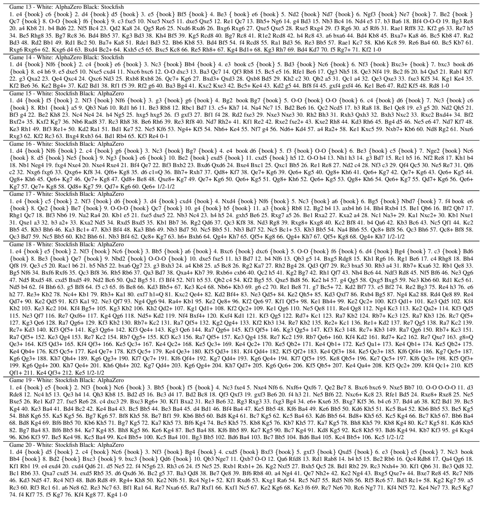

Table S6: Games played by AlphaZero against Stockfish, selected by GM Matthew Sadler. The first 10 games are from the initial board position, the remaining 10 games are from 2016 TCEC world championship start positions.

Game 1 - Black: AlphaZero White: Elmo +2726FU -8384FU +2625FU -8485FU +9796FU -4132KI +3938GI -9394FU +6978KI -7172GI +3736FU -3334FU +2524FU -2324FU +2824HI -8586FU +8786FU -8286HI +5968OU -8685HI +7776FU -2288UM +7988GI -0033KA +2421RY -3388UM +8977KE -8877UM +6877OU -8589RY +0024KE -0085KE +7766OU -0041GI +7868KI -8979RY +6858KI -0027FU +0083FU -2728TO +2432NK -3132GI +2128RY -0054KE +6656OU -7976RY +0066KI -5466KE +6766FU -8577NK +0022KA -7283GI +4746FU -8374GI +0045KE -6152KI +5647OU - 7767NK +0072FU -5161OU +0082KA -6172OU +8291UM -4344FU +4533NK -4445FU +0082FU -6758NK +4958KI -4546FU +4737OU -7678RY +0068KE -7869RY +0059KY -0027FU +2827RY -0047KI +3847GI -4647TO +3747OU -8193KE +2725RY -0046FU +4746OU -0045FU +2545RY -0054GI +4515RY -0071KI +0084KI -6989RY +6876KE -1314FU +1525RY -0024FU +2534RY -7475GI +8281TO -7584GI +8171TO -7283OU +0075FU -8475GI +0065KI -0055KI +6555KI -5455GI +4637OU -0044FU +0065KI -7576GI +6575KI -0045KE +3445RY -4445FU +3332NK -5546GI +3728OU -0038KI +2838OU -0028HI +3828OU -4637NG +2818OU -3728NG +1828OU -9495FU +9182UM -8382OU +0081HI -8292OU +0091KI%TORYO

Game 2 - Black: AlphaZero White: Elmo +2726FU -8384FU +2625FU -8485FU +2524FU -2324FU +6978KI -4132KI +2824HI -0023FU +2426HI -5142OU +7776FU -3334FU +8877KA -2277UM +7877KI -6364FU +5968OU -7172GI +9796FU -7374FU +2628HI -8173KE +4958KI -8281HI +7988GI -3122GI +3948GI -2233GI +4746FU -1314FU +3736FU -7263GI +4847GI -9394FU +1716FU -4252OU +6766FU -6162KI +4756GI -5354FU +7778KI -8586FU +8786FU -8186HI +8887GI -8681HI +0086FU -0022KA +2937KE -3344GI +5847KI -0088FU +7888KI -4455GI +5655GI - 2255KA +8977KE -5566KA +0067FU -6622KA +6878OU -1415FU +1615FU -2244KA +3745KE -2133KE +4533NK -3233KI +0045KE -3332KI +5756FU -9495FU +5655FU -9596FU +9996KY -0095FU +9695KY -9195KY +0096FU -7475FU +7675FU -0076FU +8776GI -0084KE +8887KI -8476KE +8776KI -0098GI +0079KE -9596KY +7574FU -6374GI +5554FU -0075FU +7666KI -5241OU +5453TO -6253KI +4553NK -4453KA +0054FU -5344KA +0053GI -0052FU +5344NG -4344FU +0021KA -0042GI +0092KA -0024KY +0025FU -8184HI +5453TO -4253GI +0054FU -5342GI +2524FU -2324FU +5453TO -4253GI +0055KY -0054KE +0023FU -7463GI +5554KY -6354GI +0055FU -5463GI +0022KI -3233KI +0043KE -5362GI +2231KI -4142OU +2322TO -3343KI +2132UM -4251OU +3243UM -8486HI +0087FU -8682HI +0093KI -8292HI +9392KI -5161OU +0091HI -0071KY +9282KI -0081FU +9181RY -0072GI +8191RY -7576FU +6676KI -0074KA +4757KI -0081FU +0075FU -7483KA +8272KI -8372KA +0042GI -7283KA +5554FU -6172OU +4253GI -5253FU +5453TO -6253GI +4353UM -0062GI +5343UM -0052KI +0092GI -5243KI +9283NG -7261OU +0021KA -4353KI +0054FU -5352KI +9181RY -0072KA +8182RY -7283KA +8283RY -0072GI +8393RY -0086FU +0091KA -8687TO +7987KE -9697NY +7868OU -9887GI +7666KI -8788GI +5747KI -8877GI +6877OU -0065KE +7768OU -0053FU +5453TO -5253KI +0054FU -6354GI +0042GI -0057FU +3141KI -0077FU +9182UM -7778TO +6878OU -5363KI +0052FU -6152OU +2132UM -9787NY +7887OU -6577NK +8777OU -7365KE +7788OU -6577NK +8877OU -0065KE +7786OU -0085FU +8696OU -0095FU +9685OU -0073KE +8594OU -3435FU +8291UM %TORYO

Game 3 - Black: AlphaZero White: Elmo +6978KI -3334FU +7776FU -8384FU +2726FU -4132KI +2625FU -8485FU +2524FU -2324FU +2824HI -8586FU +8786FU -8286HI +2434HI -2233KA +5958OU -5152OU +3736FU -8676HI +8877KA -0026FU +0028FU -2627TO +2827FU -3377UM +7877KI -7674HI +3474HI -7374FU +0028KA -0073KA +0083HI -7172GI +8388RY -7328UM +3928GI -0073KA +0046KA -0087FU +7787KI -7346KA +4746FU -0055KA +8777KI -5546KA +4939KI -0026FU +2726FU -0027FU +2837GI -4637UM +2937KE -2728TO +3928KI -0039HI +1918KY -3919RY +5847OU -1949RY +4756OU -8173KE +6766FU -0058GI +0038KA -4939RY +2829KI -3948RY +0076KA -5859GI +8848RY -5948GI +5647OU -0069HI +4748OU -6979RY +0044FU -4344FU +0083FU -7989RY +8382TO -8982RY +3816KA -0034FU +0086FU -5354FU +1634KA -0043GI +3416KA -0034FU +0045FU -1314FU +4544FU -4344GI +1634KA -0043FU +2938KI -8284RY +7667KA -8475RY +7776KI -7555RY +0047FU -4433GI +3423UM -3223KI +6723UM -0034KA +2334UM -3334GI +0067KA -0013KA +0058GI -0045KE +3745KE -3445GI +0025KE -1322KA +0023HI -5262OU +2343RY -4536GI +0037FU -0042FU +4323RY -3645GI +0041KI -0034KE +3827KI -3426KE +2726KI -2244KA +0027FU -0022FU +2324RY -3132GI +2635KI -4435KA +2435RY -3241GI +6745KA -0044KI +3531RY -5545RY +3141RY -0051KI +4121RY -4525RY +0036GI -2523RY +0026KA -2326RY +2726FU -0024KE +3625GI -5455FU +2131RY -0054KA +0065KE -7365KE +7665KI -5465KA +6665FU -5556FU +0095KA -0073KE +0085KE -9394FU +8573NK -7273GI +0071GI -6171KI +9573UM -6273OU +3151RY -5657TO +5857GI -0056KE +5756GI -0084KA +0057FU -0062GI +0075KE -0049KI +4838OU -4948KI +3848OU -2436KE +3736FU -0059KA +4858OU -5948UM +5869OU -4859UM +6979OU -5969UM +7989OU -0088FU +8998OU -6987UM +9887OU -8475KA +0085KE %TORYO

## Game 4 - Black: AlphaZero White: Elmo

+2726FU -8384FU +2625FU -8485FU +6978KI -4132KI +9796FU -7172GI +3938GI -1314FU +3736FU -8586FU +8786FU -8286HI +5958OU -5162OU +2937KE -8636HI +7776FU -6271OU +8866KA -3634HI +8977KE -0083FU +7968GI -3454HI +7879KI -7182OU +2826HI -3142GI +9695FU -2213KA +2636HI -1322KA +3656HI -5474HI +1716FU -2231KA +5655HI -4251GI +5575HI -7434HI +1615FU -1415FU +2524FU -3424HI +7785KE -8384FU +8593NK -8293OU +7525HI -2434HI +9594FU -9382OU +9493TO -9193KY +0094FU -9394KY +9994KY -0093FU +9493KY -8293OU +0085FU -0064KY +6677KA -8485FU +0089KY -7374FU +2585HI -0084FU +8584HI -0083FU +8485HI -0094FU +0095FU -9382OU +6766FU -1516FU +9594FU -1617TO +6665FU -0073KE +8595HI -7365KE +9493TO -8193KE +0094FU -6577NK +9493TO -8273OU +0065FU -7768NK +7968KI -6465KY +9565HI -8384FU +6595HI -0094FU +9394TO -1727TO +9484TO -7362OU +8483TO -0084FU +8372TO -6172KI +0065KE -0094FU +9594HI -0093FU +9493RY -6252OU +0073KY -7262KI +0071GI -0061GI +7162NG -6162GI +7372NY -0071GI +7271NY -6271GI +9392RY -5241OU +0045KE -0062KA +0061KI -0064KY +0072GI -7172GI +9272RY -0071GI +6171KI -6465KY +0066FU -2738TO +4938KI -0026KE +3828KI -1118NY +7161KI -0052GI +0024FU -1828NY +0071GI -5261GI +7261RY -0052KI +2423TO -3223KI +0012GI -0022KI +1223NG -3437RY +0032FU -3738RY +0048GI -2223KI +7162NG -0049GI +5869OU -4958NG +6858KI -3849RY +0059KA -0077KE +6978OU -4958RY +7887OU -2819NY +0068KI -4132OU +6858KI -0041KI +6251NG -4151KI +6191RY -7769NK +5977KA -6979NK +0024FU -2324KI +0025FU -2434KI +0012HI -0022FU +2524FU -3424KI +1211RY -4344FU +0035FU -0095FU +7795KA -0094FU +9194RY -0093FU +9493RY -7989NK +0012GI -3243OU +4533NK -2133KE +1131RY -5142KI +9584KA -2435KI +0061KA -0041GI +0051GI -0081KY +0082FU -8988NK +8796OU -0083FU +5142GI -4334OU +0036KI -3536KI +6152UM -4152GI +3133RY -3425OU +0017KE -2516OU +3336RY -0094KY +0095FU -0069KA +9685OU -6996UM +8596OU -0085KI +9697OU -8898NK +9787OU -9897NK +8778OU -9787NK +7879OU -8778NK +7978OU -0086KE +7888OU -8678NK +8878OU -2223FU +0027KI -1615OU +3625RY %TORYO

## Game 5 - Black: AlphaZero White: Elmo

+6978KI -3334FU +7776FU -8384FU +2726FU -4132KI +2625FU -8485FU +2524FU -2324FU +2824HI -8586FU +8786FU -8286HI +2434HI -2233KA +5958OU -5141OU +3436HI -8684HI +3626HI -3122GI +3736FU -0086FU +8833UM -2133KE +0088FU -0025FU +2628HI -4152OU +3938GI -5262OU +2937KE -7172GI +2829HI -8434HI +0082KA -3436HI +8291UM -2223GI +9192UM -2526FU +4948KI -0074KA +9282UM -3634HI +0036FU -3436HI +7877KI -3634HI +0036FU -3436HI +7786KI -3634HI +0036FU -3436HI +8675KI -7483KA +0087KY -8394KA +8292UM -0084FU +9796FU -3635HI +9695FU -9483KA +9282UM -6171KI +8271UM -6271OU +8784KY -0036FU +0046KI -3637TO +3837GI -3534HI +8483NY -7283GI +3726GI -7374FU +2635GI -3414HI +7565KI -0034FU +3526GI -0025FU +0024FU -2324GI +0041KA -0023KA +9594FU -9394FU +2637GI -7162OU +0092FU -8173KE +6555KI -2435GI +9291TO -8372GI +9192TO -0081FU +1716FU -0054KY +5554KI -5354FU +9281TO -7281GI +7675FU -0042KI +4132UM -2332KA +7574FU -7365KE +4656KI -0053KE +0036FU -5455FU +5666KI -3345KE +3635FU -4537NK +4837KI -4344FU +3746KI -5345KE +7473TO -6273OU +7968GI -4557NK +6857GI -6557NK +5857OU -0056GI +4656KI -5556FU +6656KI -0065GI +0046KI -0045KI +0074FU -7362OU +0073GI -6251OU +0055KY -4555KI +5655KI -0056FU +5758OU -0053KY +0062GI -5141OU +0033KE -4131OU +6253GI -4253KI +0049KE -0057GI +4957KE -5657TO +5857OU -0056FU +5748OU -0045KE +0049KE -5354KI +3321NK -3121OU +0023FU -0022KE +0033KI -4557NK +4957KE -5657TO +4857OU -0056FU +4656KI -6556GI +5556KI -0075KA +0066KY -0065KE +5665KI -0056FU +5768OU -5657TO +6857OU -3223KA +0043GI %TORYO Game 6 - Black: AlphaZero White: Elmo

+6978KI -3334FU +7776FU -8384FU +2726FU -4132KI +2625FU -8485FU +2524FU -2324FU +2824HI -8586FU +8786FU -8286HI +2434HI -2233KA +5958OU -3142GI +3736FU -5141OU +2937KE -0022FU +3938GI -6151KI +3435HI -8682HI +3525HI -0086FU +0085FU -9394FU +8877KA -8193KE +7988GI -9385KE +7786KA -0087FU +7887KI -9495FU +8675KA -7374FU +0083FU -8283HI +0084FU -8381HI +7566KA -3366KA +6766FU -8184HI +0073KA -8483HI +7391UM -0034KA +9192UM -8384HI +9293UM -8481HI +9392UM -8184HI +0086FU -3489UM +4959KI -9596FU +5968KI -8597NK +9997KY -9697TO +8897GI -8998UM +9293UM -9887UM +9384UM -0083FU +8483UM -0081FU +2529HI -0044KE +0025KY -8776UM +6867KI -0048KI +5868OU -4838KI +2926HI -7687UM +2522NY -0024FU +2232NY -4132OU +0088KI -8754UM +0046KE -3837KI +4654KE -5354FU +0023FU -0033GI +2629HI -0055KE +6777KI -3223OU +0022FU -2322OU +6878OU -0095FU +0025FU -3738KI +2999HI -2232OU +0076FU -7475FU +7675FU -0076FU +7776KI -0096KY +9796GI -9596FU +2524FU -0022FU +0026KY -0064KE +7665KI -0095KY +8394UM -0067GI +7889OU -9697TO +9495UM -9788TO +8988OU -7162GI +0079KY -6476KE +8887OU -0088KI +8796OU -8899KI +0045KA -3241OU +0072HI -4253GI +7574FU -4436KE +2423TO -0094FU +9594UM -9998KI +0034FU -0097HI +9685OU -3344GI +3433TO -4433GI +0095FU -3342GI +2322TO -0071FU +7292RY -8182FU +4523UM -4152OU +2232TO -5547KE +9484UM -7668NK +9282RY -0081FU +8292RY -6879NK +7473TO -0082KY +7382TO -8182FU +0075KY -9777RY +0074FU -6776GI +8594OU -7172FU +7473TO -7273FU +0074FU -7665GI +6665FU -0093FU +9493OU -0083KI +8483UM -8283FU +0071GI -0084KA +9382OU -0022FU +2334UM -7374FU +8281OU -7775RY +0044FU -7565RY +3242TO -5342GI +4443TO -4243GI +0044KI -4334GI +0053GI -5241OU +4434KI -0042FU +0043GI -6253GI +2622NY -0031KY +0032FU -0072KA +9272RY -0092GI +8191OU -8473KA +0082KA -7382KA +7182NG -5162KI +7262RY -1314FU +3231TO %TORYO

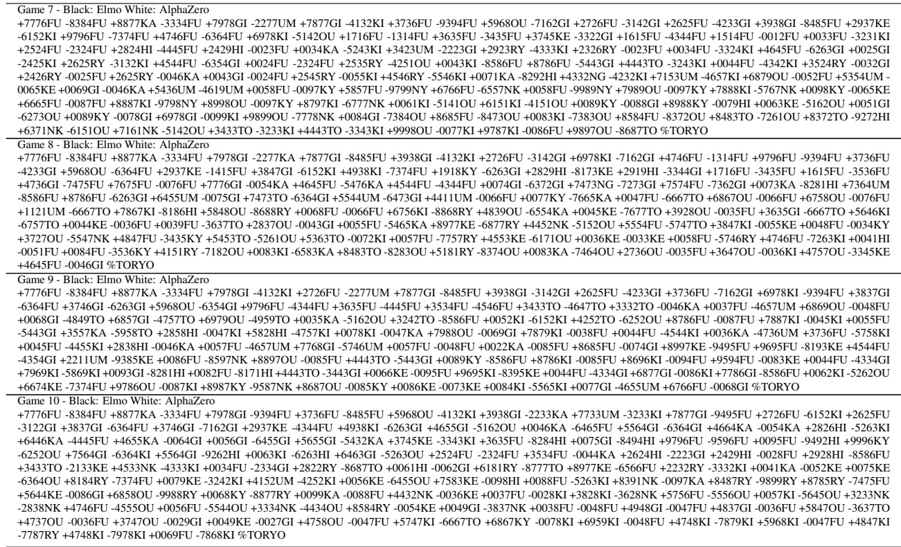

Table S7: 10 games played by AlphaZero against Elmo, selected by Yoshiharu Habu.

<table><tr><td rowspan="2" colspan="2">Fig. Match</td><td rowspan="2">Start Position</td><td colspan="3">AlphaZero</td><td colspan="3">Opponent</td></tr><tr><td>Book</td><td>Main</td><td>Inc</td><td>Book</td><td>Main</td><td>Inc Program</td></tr><tr><td>2A</td><td>Main</td><td>Initial Board</td><td>No</td><td>3h</td><td>15s</td><td>No</td><td>3h</td><td>15s Stockfish 8</td></tr><tr><td>2B</td><td>1/100 time</td><td>Initial Board</td><td>No</td><td>108s</td><td>0.15s</td><td>No</td><td>3h</td><td>15s Stockfish 8</td></tr><tr><td>2B</td><td>1/30 time</td><td>Initial Board</td><td>No</td><td>6min</td><td>0.5s</td><td>No</td><td>3h</td><td>15s Stockfish 8</td></tr><tr><td>2B</td><td>1/10 time</td><td>Initial Board</td><td>No</td><td>18min</td><td>1.5s</td><td>No</td><td>3h</td><td>15s Stockfish 8</td></tr><tr><td>2B</td><td>1/3 time</td><td>Initial Board</td><td>No</td><td>1h</td><td>5s</td><td>No</td><td>3h</td><td>15s Stockfish 8</td></tr><tr><td>2C</td><td>latest Stockfish</td><td>Initial Board</td><td>No</td><td>3h</td><td>15s</td><td>No</td><td>3h</td><td>15s Stockfish 2018.01.13</td></tr><tr><td>2C</td><td>Opening Book</td><td>Initial Board</td><td>No</td><td>3h</td><td>15s</td><td>Yes</td><td>3h</td><td>15s Stockfish 8</td></tr><tr><td>2D</td><td>Human Openings</td><td>Figure 3A</td><td>No</td><td>3h</td><td>15s</td><td>No</td><td>3h</td><td>15s Stockfish 8</td></tr><tr><td>2D</td><td>TCEC Openings</td><td>Figure S4</td><td>No</td><td>3h</td><td>15s</td><td>No</td><td>3h</td><td>15s Stockfish 8</td></tr></table>

Table S8: Detailed conditions for the different evaluations in chess.

<table><tr><td rowspan="2">Fig.</td><td rowspan="2">Match</td><td rowspan="2">Start Position</td><td colspan="3">AlphaZero</td><td rowspan="2">Book</td><td colspan="3">Opponent</td></tr><tr><td>Book</td><td>Main</td><td>Inc</td><td>Main</td><td>Inc</td><td>Program</td></tr><tr><td>2A</td><td>Main</td><td>Initial Board</td><td>No</td><td>3h</td><td>15s</td><td>Yes</td><td>3h</td><td>15s</td><td>Elmo</td></tr><tr><td>2B</td><td>1/100 time</td><td>Initial Board</td><td>No</td><td>108s</td><td>0.15s</td><td>Yes</td><td>3h</td><td>15s</td><td>Elmo</td></tr><tr><td>2B</td><td>1/30 time</td><td>Initial Board</td><td>No</td><td>6min</td><td>0.5s</td><td>Yes</td><td>3h</td><td>15s</td><td>Elmo</td></tr><tr><td>2B</td><td>1/10 time</td><td>Initial Board</td><td>No</td><td>18min</td><td>1.5s</td><td>Yes</td><td>3h</td><td>15s</td><td>Elmo</td></tr><tr><td>2B</td><td>1/3 time</td><td>Initial Board</td><td>No</td><td>1h</td><td>5s</td><td>Yes</td><td>3h</td><td>15s</td><td>Elmo</td></tr><tr><td>2C</td><td>Aperyqhapaq</td><td>Initial Board</td><td>No</td><td>3h</td><td>15s</td><td>No</td><td>3h</td><td>15s</td><td>Aperyqhapaq</td></tr><tr><td>2C</td><td>CSA time control</td><td>Initial Board</td><td>No</td><td>10min</td><td>10s</td><td>Yes</td><td>10min</td><td>10s</td><td>Elmo</td></tr><tr><td>2D</td><td>Human Openings</td><td>Figure 3B</td><td>No</td><td>3h</td><td>15s</td><td>Yes</td><td>3h</td><td>15s</td><td>Elmo</td></tr></table>

Table S9: Detailed conditions for the different evaluations in shogi.