# Production, Manufacturing, Transportation and Logistics New benchmark instances for the inventory routing problem

Jørgen Skålnes a,∗, Mohamed Ben Ahmedb,c, Lars Magnus Hvattumb, Magnus Stålhanea

a Department of Industrial Economics and Technology Management, Norwegian University of Science and Technology, Alfred Getz veg 3, 7491 Trondheim, Norway

b Faculty of Logistics, Molde University College, PO Box 2110, NO-6402 Molde, Norway

c Møreforsking Molde AS, Britvegen 4, Molde, 6410, Norway

## a r t i c l e i n f o

Article history: Received 5 July 2022 Accepted 4 August 2023 Available online 22 August 2023

Keywords: Distribution Test instance Branch-and-cut Matheuristic Vendor-managed inventory

## a b s t r a c t

The existing sets of benchmark instances for the inventory routing problem (IRP) have been beneficial for investigating and illustrating the properties of the problem. However, they possess certain features and design choices that are not necessarily representative of all real-world IRPs. Therefore, we propose a new collection of 270 real-world-like instances ranging from 10 to 200 customers. These instances vary in terms of the number of vehicles and their capacity, the length of the planning horizon, the demand structure, and the geographical distribution of customers. Transportation and inventory holding costs resemble costs found in practice. We present an instance space analysis showing that the new instances nicely complement the original instances. To derive lower and upper bounds for each instance, we present computational experiments with two high-quality solution methods: a matheuristic and an exact branch-and-cut method. The results confirm that the new set of instances is hard to solve with the proposed methods, and they demonstrate the need for developing new solution methods.

© 2023 The Authors. Published by Elsevier B.V.

This is an open access article under the CC BY license ([http://creativecommons.org/licenses/by/4.0/](http://creativecommons.org/licenses/by/4.0/))

## 1. Introduction

The inventory routing problem (IRP) was introduced by Bell et al. (1983) and arises in the context of vendor-managed inventory. It has attracted an increasing amount of attention in recent years. In the standard IRP, a single supplier, denoted 0, delivers a single product to a set of customers, $\mathcal { N } ^ { C }$ , over a planning horizon divided into a set of discrete time periods $\mathcal { T } .$ In each time period $t \in { \mathcal { T } } ,$ , the supplier produces $S _ { t }$ units of the product, while each customer $i \in \mathcal { N } ^ { \mathsf { C } }$ consumes $D _ { i t }$ units of the same product. Both the supplier and the customers, i ∈ $\mathcal { N } = \mathcal { N } ^ { C } \cup \{ 0 \}$ , have an initial inventory level $I _ { i }$ at the beginning of the planning horizon, a required minimum inventory level $\underline { { L } } _ { i } ,$ and a maximum storage capacity $\overline { { L } } _ { i } .$ Inventory holding costs $H _ { i t }$ are incurred for each unit of product at each node $i \in \mathcal { N }$ at the end of time period $t \in { \mathcal { T } } .$ In a given period we assume that deliveries are made before the demands are consumed.

In order to serve the demands, the supplier has a homogeneous fleet of K vehicles, each with a capacity to hold Q units of the product. The problem of routing the vehicles to serve the customers can be defined on a graph $G = ( \mathcal { N } , \mathcal { A } )$ , where N is the set of nodes and $\mathcal { A } = \left\{ ( i , j ) \in \{ \mathcal { N } \times \mathcal { N } \} | i \neq j \right\}$ is the set of arcs connecting the nodes. A cost $C _ { i j }$ is incurred when traversing the arc (i, j), and a customer can be visited at most once per time period. Thus, a route driven by a vehicle can be seen as a simple cycle in the graph starting and ending at the supplier. The objective of the IRP is to create at most one route per vehicle in each time period, minimizing the total transportation and inventory holding costs, while keeping the inventory at each node between its upper and lower limits, $\overline { { L } } _ { i }$ and $\underline { { L } } _ { i } ,$ respectively. This implies that the decision-maker must simultaneously decide (1) when to visit a customer, (2) how much to deliver to a customer upon a visit, and (3) how to route the available vehicles serving the visited customers at most once in each time period.

Archetti, Bertazzi, Laporte, & Speranza (2007) proposed a branch-and-cut (B&C) algorithm for the single-vehicle IRP and demonstrated that the maximum-level inventory (ML) policy is superior to the order-up-to inventory policy, while also establishing what later has become the most popular set of benchmark instances for this problem. There are a total of 160 instances ranging from five to 50 customers, with three and six-time periods, respectively. Subsequently, Archetti, Bertazzi, Hertz, & Speranza (2012) released 60 additional instances, having a planning horizon of sixtime periods and 50, 100, and 200 customers. Later, both sets of instances were adapted by Coelho, Cordeau, & Laporte (2012) to the multi-vehicle IRP by dividing the overall single-vehicle capacity by the number of vehicles considered, rounded to the nearest integer. The instances proposed by Archetti et al. (2007) and Archetti et al. (2012) are usually referred to as the small and large benchmark instances, respectively. Considering vehicle fleets ranging from one to five vehicles, this yields 798 small instances (two of the fivevehicle instances are infeasible) and 300 large instances.

<small>∗ Corresponding author.</small>

<small>E-mail address: [jorgen.skalnes@ntnu.no](mailto:jorgen.skalnes@ntnu.no) (J. Skålnes).</small>

The exact methods developed for the IRP can mainly be classified into branch-cut-and-price algorithms (Desaulniers, Rakke, & Coelho, 2016) or branch-and-cut algorithms (Adulyasak, Cordeau, & Jans, 2014; Archetti et al., 2007; Avella, Boccia, & Wolsey, 2018; Coelho & Laporte, 2014; Guimarães, Schenekemberg, Coelho, Scarpin, & Pécora, 2023; Manousakis, Repoussis, Zachariadis, & Tarantilis, 2021; Skålnes, Andersson, Desaulniers, & Stålhane, 2022; Skålnes, Vadseth, Andersson, & Stålhane, 2023). Branch-and-cut algorithms have also been the most popular among exact methods for other variants of the IRP, such as the IRP with zero-inventory ordering policy (Diabat, Bianchessi, & Archetti, 2023), the IRP with split deliveries (Dinh, Archetti, & Bertazzi, 2023) and the IRP with product substitution (Mahmutogullari ˘ & Yaman, 2023).

Archetti & Ljubić (2022) presented a comparison of various aggregated and disaggregated formulations, i.e., formulations without or with vehicle indices, respectively, for the IRP. They demonstrated that both types of formulations give the same lower bound for the linear relaxation, but that the aggregated formulations obtain better results at the termination of the B&C method they used to solve the problem.

Considerable effort has also been put into developing efficient heuristic algorithms. Archetti et al. (2012) proposed a matheuristic for the single-vehicle IRP combining a tabu search with the solution of a mixed-integer linear program (MILP), which was later modified also to handle multiple vehicles (Archetti, Boland, & Speranza, 2017), and improved the best-known solutions for 92% of the large multi-vehicle instances. Many of these solutions were further improved by Chitsaz, Cordeau, & Jans (2019) who proposed a three-phase decomposition matheuristic. Despite being designed for the assembly routing problem, their algorithm was able to find new best-known solutions for 194 out of the 300 large IRP instances.

Alvarez, Cordeau, Jans, Munari, & Morabito (2021) presented a matheuristic for the IRP with perishable products, combining an iterative local search metaheuristic with two mathematical programming components. This algorithm found high-quality solutions for the variant with perishable products, but it also improved the bestknown solution for a few of the small instances on the standard IRP. Another matheuristic for the standard IRP was developed by Diniz, Martinelli, & Poggi (2020), where they combined an iterative local search algorithm with a randomized variable neighborhood descent. Using this heuristic, they improved the best-known solutions for several of the small benchmark instances. Vadseth, Andersson, & Stålhane (2021) further improved the solutions for 178 of the large benchmark instances by solving the problem with a novel iterative matheuristic. They used a column generation framework where they created an initial route pool by splitting a giant tour. Then they iteratively solved a master problem that combines routes into a feasible solution and a heuristic that identifies potentially improving routes. In addition to obtaining high-quality solutions, they solved the instances considerably faster than the other methods presented in the literature.

Solyalı & Süral (2022) proposed a novel matheuristic for the IRP that relies on a sequential solution of three different MILPs of a restricted version of the problem only once. The first two MILPs are used to construct a good feasible solution, while the third MILP attempts to improve the solution. The improvement is performed by transforming feasible routes into distinct giant routes for each period and vehicle, and next, choosing the best routes from giant routes by determining the customers to visit in each period and vehicle. Many other techniques have been proposed to solve the IRP. We mention here the hyper-heuristic method of Kheiri (2020), the local search-based matheuristic of Su, Zhipeng, Wang, Qi, & Benlic (2020), and the kernel search-based matheuristic presented in Archetti, Guastaroba, Huerta-Muñoz, & Speranza (2021).

Both best-known lower and upper bounds have been considerably improved for all benchmark instances, driven by the rapid development of both exact methods and heuristics, thus highlighting how these instances have provided a solid ground for evaluating various solution methods. However, these benchmark instances possess specific characteristics that can be exploited by tailoring solution methods specifically for these instances. Avella, Boccia, & Wolsey (2015) pointed out that the inventory capacities in these instances are integer multiples (specifically two and three) of the customer demands, which allows for the development of specialized valid inequalities, whose efficiency is data-dependent. In addition, the abundant vehicle capacity in many of these instances allows for easily computing optimal or near-optimal delivery dates. In these cases, the IRP reduces to a capacitated vehicle routing problem for each period or traveling salesman problems, for each period and vehicle, where the customer visits are determined a priori. This is especially clear for the 212 three-period instances that are solved to optimality by our B&C method. Here, on average 5.3%, 94%, and 7.3% of the customers are visited in the first, second, and third period, respectively. Several heuristics, e.g., the matheuristics of Archetti et al. (2017) and Solyalı & Süral (2022), have exploited this aspect. Moreover, the difficulty of solving problems with long planning horizons diminishes with stationary demands, because repeating distribution patterns can be identified.

To avoid a research direction of overfitting new solution methods, we propose a new set of real-world-like instances for the standard IRP to complement the current benchmark instances. In doing so, we respond to calls from several practitioners advocating more diversity in IRP instances by allowing for different instance characteristics when it comes to the parameters governing the inventories (Avella et al., 2015), including time-varying demands (Manousakis et al., 2021; Solyalı & Süral, 2022) and considering longer planning horizons (Ben Ahmed, Okoronkwo, Okoronkwo, & Hvattum, 2021). Our endeavor also finds inspiration in several contributions in the literature that dealt with generating new benchmark instances for routing problems, such as the capacitated vehicle routing problem (Uchoa et al., 2017), the liner shipping problem (Brouer, Alvarez, Plum, Pisinger, & Sigurd, 2014), the tramp shipping problem (Hemmati, Hvattum, Fagerholt, & Norstad, 2014), and the maritime inventory routing problem (Papageorgiou, Nemhauser, Sokol, Cheon, & Keha, 2014). Kendall et al. (2016) also advocate the importance of focusing on the instances themselves when proposing a new benchmark set, without distractions from descriptions of new solution methods. In this paper, we therefore focus on the properties of the new instances.

The new instances have non-stationary demands, i.e., a customer does not necessarily have the same demand in every time period of the planning horizon, which we believe corresponds better to customers’ demands in practice. We also scale the vehicle fleet based on real-life vehicles such that the routes typically become shorter than in the current benchmark instances. In the new instances, the inventory capacity of the customers has a higher variance, potentially resulting in greater differences in the minimum visiting frequency between each pair of customers. We also introduce an explicit upper bound of the inventory capacity at the depot. Furthermore, we propose instances where the node locations have different structures. In some instances, the nodes are positioned randomly (R), in others, they are positioned in clusters (C), and finally, some are positioned as a mix between the two prior location structures (RC). This describes different realistic situations where the supplier serves customers scattered across a large city or in the countryside (R) or where the supplier serves several smaller towns or neighborhoods (C) represented by clusters. With the mixed node locations (RC), we allow for a combination of the two prior settings.

We additionally incorporate an assumption of economies of scale for the inventories, thus resulting in the supplier having the lowest inventory cost. Hence, the inventory cost at a customer represents the marginal cost increase of storing a product unit at the customer rather than at the supplier. We aim to use realistic values for inventory and transportation costs, thus correctly reflecting their relative importance when solving the IRP. Finally, we apply a rounding of the distances between each pair of nodes such that the triangular inequality is fulfilled.

The new set of benchmark instances is analyzed and compared with the original benchmark instances through an instance space analysis (Smith-Miles & Muñoz, 2023) using the MATILDA platform (Smith-Miles, Muñoz, & Neelofar, 2020). This analysis shows that the new set of instances have different features than the existing set of benchmark instances.

Furthermore the new instances are solved using an exact B&C method, and a matheuristic from the literature to establish initial upper and lower bounds for the instances. These tests show that the new instances are both diverse and complex, and that existing solution methods struggle to obtain high quality solutions to many of them. These results suggest that there is still room for new and improved solution methods for the IRP.

The remainder of this paper is organized as follows: In Section 2 we present the new set of instances and how they are generated, Section 3 presents a model formulation for the problem, and Section 4 gives a brief description of the B&C method, and the matheuristic used to obtain lower and upper bounds on the new instances. Finally, we present the instance space analysis and the lower and upper bounds obtained by these methods in Section 5, before the concluding remarks are presented in Section 6.

## 2. Instance generation

In this section, we describe how the new benchmark instances are generated. The instances are generic and may represent a wide range of practical applications, but lie mainly within the sector of road-based transportation. More specifically, the instances are based on the transportation of pallets, but can easily be translated to instead represent, e.g., transportation of cubic meters of gas, liquid, or mass. In the case of transportation of pallets, the instances may represent any business that transports their products loaded onto pallets, such as electronics, beverages, or groceries. The instances are closely aligned with the transportation of homogeneous products, but may also represent simplified problems with heterogeneous products as long as they are loaded onto pallets, and thus the pallets themselves can be viewed as the products to be transported.

We believe that the vehicle capacity is the feature of an IRP instance that is the most constrained in practice. In practice, there is a limited number of vehicle types, at least for road-based transportation. The vehicles cannot be larger than what is controlled by the regulations set by the authorities. Therefore, we begin by presenting the available vehicle types used in the vehicle fleet of the new instances in Section 2.1. Section 2.2 describes how the demand is determined and Section 2.3 explains how the initial inventory levels and inventory capacities are selected. Section 2.4 presents how the node locations are drawn, and Section 2.5 presents the mechanism we use to ensure that the generated instances are feasible, i.e., how the vehicle fleet size and demand are scaled. Finally, we give an overview of the main characteristics of the proposed instances in Section 2.6.

Table 1

Types of vehicles used for the instances.

| Vehicle type | Capacity (EUR-pallets) |
| --- | --- |
| Small truck | 8 |
| Truck | 18 |
| Trailer truck | 38 |

## 2.1. Vehicle fleet

All instances presented in this paper have a vehicle fleet with characteristics based on real-life vehicle types. We have defined a set of three vehicle types commonly used. Table 1 shows the different vehicle types used to generate the instances where the column ‘Vehicle type’ defines the vehicle name/ID and the column ‘Capacity’ denotes the corresponding capacity expressed in EUR-pallets. A EUR-pallet has the dimensions 1200mm × 800mm × 144mm (47.2in × 31.5in × 5.7in), and has a total safe loading weight of 1500 kg. The demands and the inventory capacities are also expressed in EUR-pallets.

An instance is based on a homogeneous fleet consisting of one of the vehicle types in Table 1, where the number of vehicles is scaled according to the number of customers and the total demand. This is explained in more detail in Section 2.5.

## 2.2. Demand generation

Like previous research, we assume that customers allow at most one visit in each time period. Therefore we scale the average demand at each customer so that total demand over the planning horizon can always be satisfied by a maximum of one visit per time period. To reflect the demand patterns seen in practice, where the demand typically varies from time period to time period, and where it is positively correlated between customers operating within the same sector, we draw random deviations from a constructed demand trajectory for each customer. Such a demand trajectory can capture various demand patterns, e.g., the one seen by grocery stores where the demand is typically high at the beginning of the week, decreasing in the middle of the week, before increasing towards the weekend. To capture this volatile behavior often seen in practice we build the demand trajectory, $\overline { { D } } _ { i t }$ for customer $i \in \mathcal { N } ^ { C }$ and time period $t \in { \mathcal { T } } ,$ using a sine function. With the sine function we can for each customer $i \in \mathcal { N } ^ { \mathsf { C } }$ set the frequency between each peak demand with a frequency coefficient $\theta _ { i } .$ For each customer $i \in \mathcal { N } ^ { \mathsf { C } }$ , we also define a shift coefficient $\phi _ { i }$ to define where on the trajectory we are in the first period, e.g. rising or decreasing demand. Furthermore, for each customer $i \in \mathcal { N } ^ { \mathsf { C } }$ , we define the relative magnitude of the peak demands with a coefficient $B _ { i } ,$ and we define the average demand, $K _ { i } ,$ by adding a constant term to the sine function. The demand trajectory $\overline { { D } } _ { i t }$ for customer $i \in \mathcal { N } ^ { \mathsf { C } }$ and time period $t \in \mathcal { T }$ can then be expressed as follows:

$$
\overline {{D}} _ {i t} = B _ {i} K _ {i} \sin \left(\theta_ {i} t + \phi_ {i}\right) + K _ {i}, \quad i \in \mathcal {N} ^ {C}, t \in \mathcal {T}.\tag{1}
$$

All of the above coefficients are drawn from uniform distributions. An illustration of the demand trajectory for a customer can be seen in Fig. 1, where the solid middle line represents a customer’s demand trajectory. Finally, the demand $D _ { i t }$ for customer i in time period t, seen as squared boxes in the figure, is drawn from a uniform distribution with the mean $\overline { { D } } _ { i t }$ and a relative symmetric support a from the interval 0, 1]. For instance, if $\overline { { D } } _ { i t } = 1 0$ and $a = 0 . 2$ , the demand $D _ { i t }$ is drawn from a uniform distribution with the lower support being 8 and the upper support being 12, rounded to the nearest integer. The lower and upper support are represented with dot-dashed lines in the figure.

For the depot, we assume a constant production rate, St, in each time period $t \in { \mathcal { T } } .$ which is set to be equal to the total demand divided by the number of time periods, rounded up to the nearest integer:

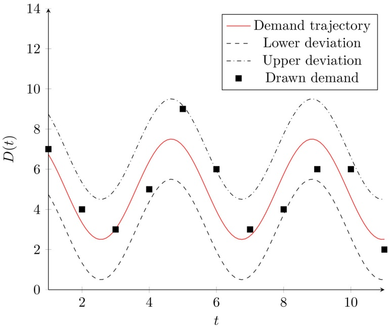

Fig. 1. Illustration of a customer demand distribution.

$$
S _ {t} = \left\lceil \sum_ {i \in \mathcal {N} ^ {\mathbb {C}}} \sum_ {t \in \mathcal {T}} D _ {i t} / | \mathcal {T} | \right\rceil , \quad t \in \mathcal {T}.\tag{2}
$$

## 2.3. Inventory

In practice, the inventory capacity varies from customer to customer. Some customers practice a just-in-time inventory policy where they have the smallest possible inventory capacity, while others want to be less dependent on frequent deliveries and have large inventory capacities. Therefore, we determine the inventory capacity by selecting a minimum visiting frequency, F, in the interval [1, |T|] for each customer i. This visiting frequency is drawn randomly from a continuous uniform distribution. The inventory capacity Ii is then calculated as:

$$
I _ {i} = \left\lceil \max \{\max _ {t \in \mathcal {T}} \{D _ {i t} \}, \sum_ {t \in \mathcal {T}} D _ {i t} / F \} \right\rceil , \quad i \in \mathcal {N} ^ {C}.\tag{3}
$$

In the case that the visiting frequency of a customer is equal to one, we set its inventory capacity equal to its total demand over the planning horizon. Conversely, if the visiting frequency is equal to |T|, the inventory capacity is set equal to the maximum demand incurred over the planning horizon. We ensure that it is always possible to satisfy customer demands without exceeding the inventory capacity.

Similarly, as for the customers, the inventory capacity also varies from supplier to supplier. Some aim to ship out their products directly from production just having a bare minimum of inventory, while others keep large inventories to easier handle peaks in demand. Therefore, we draw the inventory capacity at the depot from a uniform distribution with the following support [max $\begin{array} { r } { \{ S _ { t } , \operatorname* { m a x } _ { i \in \mathcal { N } } \{ \sum _ { t \in \mathcal { T } } D _ { i t } \} \} , \sum _ { i \in \mathcal { N } } \sum _ { t \in \mathcal { T } } D _ { i t } ] . } \end{array}$

N   The initial inventory represents the remaining inventory from the last time period of the previous planning period. Therefore, we assume that the initial inventory at each customer $i \in \mathcal { N } ^ { \mathsf { C } }$ lies in the interval [0, min $\{ D _ { i 1 } + D _ { i 2 } , \overline { { L } } _ { i } \} ]$ . We use the demand of the first two periods as an upper limit to not make the first part of the planning horizon trivial to solve. The initial inventory is then drawn from a uniform distribution with the mentioned support. Similarly, the initial inventory at the depot is drawn from a uniform distribution with the support $\begin{array} { r } { [ \sum _ { i \in \mathcal { N } ^ { C } } D _ { i 0 } , \operatorname* { m i n } \{ S _ { 1 } + S _ { 2 } , \bar { L } _ { 0 } \} ] } \end{array}$ The lower support is set to $\textstyle \sum _ { i \in \mathcal { N } ^ { C } } D _ { i 0 }$ in order to guarantee that the first-period deliveries are feasible.

Furthermore, we assume that the depot has the smallest inventory cost due to economies of scale. The customers then have a marginal inventory cost increase relative to the depot. The customers’ marginal inventory cost per unit of product per time period is drawn from a uniform distribution with the support [0.0, 0.3]. The support is based on a multi-case study that covers the inventory holding costs on automated inventory systems (Azzi, Battini, Faccio, Persona, & Sgarbossa, 2014).

## 2.4. Node locations

The nodes, i.e., the depot and the customers, are located on a 2D map defined over a $5 0 0 \times 5 0 0$ grid. The depot’s coordinates are drawn from a uniform distribution, while the geographical distribution of customers follows either the random (R), clustered (C), or random-clustered (RC) positioning, similar to those of Solomon (1987) for the vehicle routing problem with time windows. The random location method randomly draws the customers’ coordinates from a uniform distribution. The clustered location method randomly draws the cluster’s center from a uniform distribution. Then the customers’ coordinates are determined by drawing an angle and a radius from the cluster center. The angle is drawn from a uniform distribution before the radius r is drawn from an exponentially decaying distribution:

$$
p (x \mid \lambda) = \lambda e ^ {- \lambda r}
$$

A high value of λ results in a dense cluster where most of the customers are located close to the cluster’s center. The customers become more dispersed with a lower value of λ. By testing different values we found $\lambda = 5 0$ to be a reasonable value to better reflect the appearance of a city or town. The random-clustered location method combines the latter two, where 50% of the customers are located with the random method, and the remaining customers are located with the clustering method. The node positions for one of the 50-customer instances are shown in Fig. 2 for the three location methods: random, clustered, and random-clustered. The depot is represented by a dark square, while the customers are represented by small circular nodes.

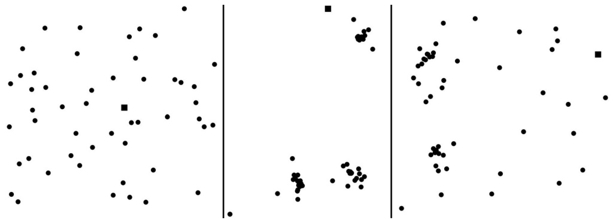

Fig. 2. An example of random, clustered, and random-clustered node positioning.

van der Meulen et al. (2020) reported an average freight rate of 1.52 euros/km on road transport of containers for a ‘trailer truck’ type of vehicle. Ti&Upply (2020) reported a similar average in the second quarter of 2020, 1.58 euros/km, but also reported the range on a selected benchmark of direct routes, namely from 0.80 euros/km to 3.16 euros/km. The freight rates involve a profit margin, so the actual variable cost faced by a transportation company is expected to be lower than this. Therefore, for simplicity, we use a cost of 1 euro/km. In addition, we propose two different versions of the cost matrix depending on whether the 2D-grid represents an urban area, $C _ { i j } ^ { \mathrm { u r b a n } }$ , or a rural area, $C _ { i j } ^ { \mathrm { r u r a l } }$ . We let one unit of distance in the 2D grid represent 0.1 km for the urban area and 0.5 km for the rural area. This impacts the ratio between the transportation cost and the inventory holding cost, which is expected to be the largest for the latter case. Both cost matrices are based on a distance matrix, $E _ { i j } ,$ which represents the Euclidean distance between each pair of nodes (i, j).

$$
E _ {i j} = \sqrt {(y _ {j} - y _ {i}) ^ {2} + (x _ {j} - x _ {i}) ^ {2}}, \quad i, j \in \mathcal {N},\tag{4}
$$

$$
C _ {i j} ^ {\text {urban}} = \left\lfloor 0. 1 E _ {i j} + 1 \right\rfloor ,
$$

$$
i, j \in \mathcal {N},\tag{5}
$$

$$
C _ {i j} ^ {\mathrm{rural}} = \left\lfloor 0. 5 E _ {i j} + 1 \right\rfloor ,
$$

$$
i, j \in \mathcal {N}.\tag{6}
$$

Adding one to the term involving an element of the distance matrix and rounding down to the nearest integer ensures that the triangular inequality is satisfied. For example, in the rural case, $C_{ik}^{\mathrm{travel}} = \left\lfloor 0.5E_{ik} + 1 \right\rfloor \leq \left\lfloor 0.5E_{ij} + 0.5E_{jk} + 1 \right\rfloor \leq \left\lceil 0.5E_{ij} \right\rceil +$ $\lfloor 0 . 5 E _ { j k } + 1 \rfloor \stackrel { \sim } { \leq } \lfloor 0 . 5 E _ { i j } + 1 \rfloor + \lfloor 0 . 5 E _ { j k } + 1 \rfloor = C _ { i j } ^ { \mathrm { r u r a l } } + C _ { j k } ^ { \mathrm { r u r a l } } .$ In addition, it is worth noting that many algorithms only work well when the triangle inequality is satisfied (Fleming, Griffis, & Bell, 2013; Toth & Vigo, 2002).

## 2.5. Feasibility inspection heuristic

We developed an inspection heuristic to ensure that the instances are feasible. It checks if the given customer demands can be covered by a given fleet of vehicles. If this is not possible, the heuristic expands the vehicle fleet or reduces the demand. For each customer $i \in \mathcal { N } ^ { \mathsf { C } }$ and period $t \in \mathcal { T }$ , let $I_{it} = \max(I_i - \sum_{s=0}^{t} D_{is}, 0)$ be the inventory in period t remaining from the initial inventory.

The basic scheme of our feasibility inspection heuristic is illustrated in Algorithm 1. The heuristic starts by invoking a construction heuristic for the IRP, which computes the delivered quantities to each customer in each time period. Next, given the inventory position at the beginning of each time period t, and the demand requirements $D _ { i t }$ , the feasibility heuristic estimates the stock-out value $\sigma _ { i t } , i \in \mathcal { N } ^ { C } , t \in \mathcal { T } .$ . If the solution comprises stock-outs at customers, two procedures are invoked to recover feasibility. The first procedure increases the fleet size by k¯ identical vehicles. The value of k¯ is chosen such that the shortages at customers are covered and such that the fleet size K does not exceed a preset limit $K ^ { \mathrm { m a x } }$ . If no more vehicles can be added, the second procedure is performed. It reduces customer demands by an amount of d¯, which absorbs the encountered stock-out. Whenever a change in the fleet size or the demand requirements occurs, a new IRP solution is generated, and the process is iterated until a feasible one is obtained.

Algorithm 1: Feasibility inspection heuristic.
repeat
    Run an IRP construction heuristic (Algorithm 2)
    for $i \in \mathcal{N}^{\mathcal{C}}$, $t \in \mathcal{T}$ do
        Let $\sigma_{it} = \max(D_{it} - I_{it}, 0)$
    end
    Let $\bar{k} = \min(K^{\max} - K, \left\lceil \frac{\sum_{i \in \mathcal{N}^{\mathcal{C}}} \sum_{t \in \mathcal{T}} \sigma_{it}}{Q \times |\mathcal{T}|} \right\rceil)$
    if $\bar{k} &gt; 0$ then
        $K \leftarrow K + \bar{k}$
    end
    else
        Let $\bar{d} = \frac{\sum_{i \in \mathcal{N}^{\mathcal{C}}} \sum_{t \in \mathcal{T}} \sigma_{it}}{|\mathcal{T}|}$
        for $i \in \mathcal{N}^{\mathcal{C}}$, $t \in \mathcal{T}$ do
            $D_{it} \leftarrow D_{it} - \bar{d}$
        end
    end
until no stock-outs

**Construction heuristic for the IRP:** For the sake of completeness, we describe the construction heuristic we developed to derive IRP solutions. For each time period $t \in { \mathcal { T } } ,$ we construct two subsets of customers. The first one, referred by urgent customers, $\mathcal { N } _ { t } ^ { U C } , t \in \mathcal { T } ,$ which includes all customers whose remaining inventory level from the initial inventory, $I _ { i t } ,$ is not sufficient to cover the demand $D _ { i t }$ in the current time period $t \in { \mathcal { T } } ,$ while the non-urgent customers subset, $\mathcal { N } _ { t } ^ { N U C } , t \in \mathcal { T } ,$ contains the remaining ones. Starting with the first subset, each customer is considered sequentially, and the delivered quantity $q _ { i t }$ is set as the potential stockout, that we denote by $\sigma _ { i t } , i \in \mathcal { N } _ { t } ^ { U C } , t \in \mathcal { T }$ . The customer is assigned to the vehicle with the highest residual capacity $r _ { k t } , t \in \mathcal { T } , k \in \mathcal { K } .$ Note that such a solution might be infeasible in terms of stock-outs at the supplier and vehicles’ capacities. However, when combined with the feasibility inspection heuristic described in Algorithm 1, we guarantee that it is always possible to satisfy all customers’ demands. Next, for every element i in the second subset, we add a visit at day $t < | \mathcal { T } |$ using the vehicle with the highest residual capacity $r _ { k t } , t \in \mathcal { T } , k \in \mathcal { K }$ . The quantity $q _ { i t }$ delivered to customer i on day t is the minimum between: (i) the maximum quantity that can be delivered without exceeding the maximum inventory capacity $\overline { { L } } _ { i } ,   ( i i )$ the highest available vehicle’s residual capacity, and (iii) the quantity $I _ { 0 , t }$ t available at the supplier. Each vehicle’s route is ultimately constructed using the Lin-Kernighan heuristic (Lin & Kernighan, 1973). The proposed construction heuristic is pre-sented in Algorithm 2. The route generating part of the construc-

Algorithm 2: A construction heuristic for the inventory routing problem.
for $t \in \mathcal{T}$ do
    Let $\mathcal{N}_t^{UC} := \{i \in \mathcal{N}^C : I_{it} &lt; D_{it}\}$
    for $i \in \mathcal{N}_t^{UC}$ do
        Let $k$ be the index of the vehicle with the highest residual capacity $r_{kt}$
        $q_{itk} \leftarrow \sigma_{it}$
        Update vehicle and inventory calculations
    end
    Let $\mathcal{N}_t^{NUC} := \{i \in \mathcal{N}^C : I_{it} \geq D_{it}\}$
    for $i \in \mathcal{N}_t^{NUC}$ do
        if $t &lt; T$ then
            if (i is visited) then
                Let $k$ be the index of the vehicle serving customer $i$
                $q_{itk} \leftarrow q_{itk} + \min(r_{kt}, \min(U_i - I_{it}, I_{0t}))$
            end
        else
            Let $k$ be the index of the vehicle with the highest residual capacity $r_{kt}$
            $q_{itk} \leftarrow \min(r_{kt}, \min(U_i - I_{it}, I_{0t}))$
        end
        Update vehicle and inventory calculations
    end
end
for $k \in K$ do
    Build the vehicle's route using the Lin-Kernighan algorithm
end
end

tion heuristic is not necessary to ensure a feasible solution, but for simplicity, we do not present a separate construction heuristic just for evaluating feasibility during the instance generation procedure.

## 2.6. Instance overview

This section provides an overview of the main attributes of the instances proposed in this paper, and a brief comparison with the original instances. The instances are ordered by the number of customers ranging from 10 to 200. We defined two geographical areas: urban and rural. Each area yields a different transportation to inventory costs ratio as described in Section 2.4. Node positioning can be random, clustered, or random-clustered. The planning horizon length varies between 6, 9, and 12 time periods. A vehicle can have a capacity of either 8, 18, or 38 EUR-pallets. In so doing, it is likely that the average route length on instances with different vehicle types varies. The number of available vehicles K is calculated by running the feasibility inspection heuristic presented in Section 2.5. For each instance, only one vehicle type is selected, creating a homogeneous fleet of vehicles. An overview of the instances’ main attributes is presented in Table 2. By varying these attributes, one at a time, we obtain 270 instances with distinct configurations. Finally, the name of an instance follows the format A-P-N-Q-T, where A is the geographical area (rural or urban), P is the node positioning (random, clustered, or random clustered), N is the number of customers, Q represents the vehicle capacity, and T is the length of the planning horizon. The new benchmark instances are publicly available on the AXIOM project web page: [http://axiomresearchproject.com/publications/.](http://axiomresearchproject.com/publications/) The best-known solutions from the B&C method and the matheuristic are also available on this web page.

Disregarding the vehicle capacity, some of the new instances overlap with the original instances, namely those set in a rural area with random node positioning, six periods, and 10 or 25 customers. Since we scale the vehicle fleet to the number of customers, only some of the 10- and 25-customer instances have a vehicle fleet of the same size as in the original instances, while the remaining instances have a vehicle fleet strictly larger than the original instances. Even though these instances have overlapping attributes, some key features such as the vehicle capacity and the demand are different and we expect this to affect the solution structure. Since there are several features that are different across the old and the new instances it is difficult to predict whether it becomes easier or harder to find good solutions even though they are similar with respect to the attributes listed in Table 2.

The new instances have smaller average vehicle capacity to inventory capacity ratios than the original instances, which hypothetically can reduce the maximum feasible route length, thus yielding a smaller solution space. On the other hand, instances with a large vehicle fleet have been proven to be more challenging for B&C methods (Adulyasak et al., 2014; Avella et al., 2018; Coelho & Laporte, 2014; Manousakis et al., 2021; Skålnes et al., 2022). The new instances have time-varying demands for each customer, while the original instances have constant demands. This might affect the diversity of routes in a good solution. When the demands are time-varying, it might be worse to re-use a route in other time periods than when the demands are stationary.

Another feature that differs from the original instances is the inventory holding costs. Since the depot in the new instances always has the lowest inventory holding cost, it is possible to derive an upper bound on the delivered quantity to each customer, which is equal to the total demand over the planning horizon. This is only possible for a subset of customers in the original instances, potentially making the dual bounds in an exact method better for the new instances. However, calculating such a bound is possible only if the inventory capacity at the depot cannot be violated, which might occur in the new instances. This makes it hard to predict whether it is possible to use such a bound or not without assessing each individual instance. In the new instances, the inventory capacities and the initial inventory levels also make the minimum visiting frequency vary more across customers compared to the original instances. Some customers must be visited more frequently than in the original instances, while others may be visited less frequently. The net effect of this behavior is hard to predict. Due to the mentioned features of the new instances, we show in Section 5.2 that the net effect of these features does not make the problem significantly easier to solve with either the B&C method or the matheuristic than for the corresponding original instances, i.e., those with the same number of customers, number of periods and number of vehicles.

## 3. Model formulation

In this section, we present a MILP formulation for the IRP. In addition to the notation presented in Section 1, we introduce the following decision variables. Let $x _ { i j t }$ be 1 if a vehicle traverses arc $( i , j ) \in \mathcal { A }$ in time period $t \in \mathcal { T } ,   0$ otherwise. To improve the readability of the model we introduce for each node $i \in \mathcal { N }$ and time period $t \in \mathcal { T }$ an integer variable $\delta _ { i t } ,$ which denotes the number of times node i is visited in time period t (binary for the customers $i \in \mathcal { N } ^ { C } ) ,$ . For each node $i \in \mathcal { N }$ and time period $t \in { \mathcal { T } } ,$ we also introduce a non-negative variable $s _ { i t } .$ , which represents the inventory level at node i at the end of time period t. Finally, we define for each customer $i \in \mathcal { N } ^ { \mathsf { C } }$ and time period $t \in \mathcal { T } \textit {  }$ a non-negative variable $q _ { i t } .$ , which determines the quantity delivered to customer i in time period t. We can now formulate the standard IRP as the MILP described by Skålnes et al. (2022):

Table 2

Overview of the main attributes of the new set of benchmark instances for the IRP.

| Area | Positioning | Customers | Vehicle capacity | Periods |
| --- | --- | --- | --- | --- |
| Urban, Rural | R,C,RC | 10, 25, 50, 100, 200 | 8, 18, 38 | 6, 9, 12 |

$$
\min \sum_ {(i, j) \in \mathcal {A}} \sum_ {t \in \mathcal {T}} C _ {i j} x _ {i j t} + \sum_ {i \in \mathcal {N}} \sum_ {t \in \mathcal {T}} H _ {i t} s _ {i t}\tag{7}
$$

$$
s _ {0 t} = S _ {t} - \sum_ {i \in \mathcal {N} ^ {\mathcal {C}}} q _ {i t} + s _ {0 (t - 1)}, \quad t \in \mathcal {T},\tag{8}
$$

$$
s _ {i t} = q _ {i t} - D _ {i t} + s _ {i (t - 1)}, \quad \quad \quad \quad \quad \quad i \in \mathcal {N} ^ {\mathcal {C}}, t \in \mathcal {T},\tag{9}
$$

$$
\underline {{L}} _ {i} \leq s _ {i t} \leq \overline {{L}} _ {i},
$$

$$
i \in \mathcal {N}, t \in \mathcal {T},\tag{10}
$$

$$
\sum_ {i \in \mathcal {N} ^ {\mathbb {C}}} q _ {i t} \leq Q \delta_ {0 t},
$$

$$
t \in \mathcal {T},\tag{11}
$$

$$
q _ {i t} \leq \bar {L} _ {i} - s _ {i (t - 1)},
$$

$$
i \in \mathcal {N} ^ {\mathcal {C}}, t \in \mathcal {T},\tag{12}
$$

$$
q _ {i t} \leq \min \left(\bar {L} _ {i} - I _ {i t}, Q\right) \delta_ {i t},
$$

$$
i \in \mathcal {N} ^ {\mathcal {C}}, t \in \mathcal {T},\tag{13}
$$

$$
\sum_ {j \in \mathcal {N} \setminus \{i \}} x _ {i j t} = \delta_ {i t},
$$

$$
i \in \mathcal {N}, t \in \mathcal {T},\tag{14}
$$

$$
\sum_ {j \in \mathcal {N} \backslash \{i \}} x _ {i j t} = \sum_ {j \in \mathcal {N} \backslash \{i \}} x _ {j i t},
$$

$$
i \in \mathcal {N}, t \in \mathcal {T},\tag{15}
$$

$$
\sum_ {(i, j) \in (S: S)} x _ {i j t} \leq \sum_ {i \in S} \delta_ {i t} - \delta_ {m t},
$$

$$
\mathcal {S} \subset \mathcal {N} ^ {\mathcal {C}}, | \mathcal {S} | \geq 2,
$$

$$
t \in \mathcal {T}, m \in \mathcal {S},\tag{16}
$$

$$
\sum_ {(i, j) \in (\mathcal {S}; \mathcal {N} \backslash \mathcal {S})} Q x _ {i j t} \geq \sum_ {i \in \mathcal {S}} q _ {i t},
$$

$$
\mathcal {S} \subset \mathcal {N} ^ {\mathcal {C}}, | \mathcal {S} | \geq 2, t \in \mathcal {T},\tag{17}
$$

$$
q _ {i t} \geq 0,
$$

$$
i \in \mathcal {N} ^ {\mathcal {C}}, t \in \mathcal {T},\tag{18}
$$

$$
\delta_ {i t} \in \{0, 1 \},
$$

$$
i \in \mathcal {N} ^ {C}, t \in \mathcal {T},\tag{19}
$$

$$
\delta_ {0 t} \in \{0, 1, \dots , K \},
$$

$$
t \in \mathcal {T},\tag{20}
$$

$$
x _ {i j t} \in \{0, 1 \},
$$

$$
(i, j) \in \mathcal {A}, t \in \mathcal {T},\tag{21}
$$

where $s _ { 0 0 } = I _ { 0 }$ and $s _ { i 0 } = I _ { i } , i \in \mathcal { N } ^ { C }$ The objective function (7) minimizes the sum of the transportation cost and the inventory holding cost. The inventory holding cost associated with the initial inventory level is a constant term and thus has been omitted from the objective function and the cost calculation of the solution. Constraints (8) and (9) balance the inventory at the supplier and the customers, respectively, while constraints (10) make sure that the inventory levels always stay between their lower and upper limits at the supplier and at the customers. Constraints (11) state that the vehicles used in a given period never deliver more than their capacity. The maximum level inventory policy is enforced by constraints (12), and constraints (13) ensure that a delivery only can be made to a customer if the customer is visited. Constraints (14) are the degree constraints and constraints (15) ensure a correct vehicle-flow between nodes. The standard subtour and capacitated subtour-elimination constraints are stated in constraints (16) and (17), respectively, where the notation on the form (E : $\mathcal { F } ) = \{ ( i , j ) : i \in \mathcal { E } , j \in \mathcal { F } \setminus \{ i \} \}$ denotes the set of arcs going from the nodes in the set of nodes, E, to the nodes in the set of nodes, F. Finally, constraints (18)–(21) define the variable domains.

## 4. Solution methods

This section describes the B&C method and the matheuristic used to derive primal and dual bounds on the new benchmark instances. For instances where these methods fail to obtain a feasible solution, we show that they are feasible by running the construction heuristic given in Algorithm 2. Section 4.1 briefly describes the B&C algorithm, and Section 4.2 describes the matheuristic.

## 4.1. Branch-and-cut method

The B&C method starts by solving the linear relaxation of the MILP defined by the formulation $( 7 )  – ( 1 5 )$ and (18)–(21). The standard and capacitated subtour-elimination constraints, (16) and (17), respectively, are added dynamically at every node of the branchand-bound tree. In addition, we use the same valid inequalities as Skålnes et al. (2022), i.e., those of Coelho & Laporte (2014), the capacity inequalities of Desaulniers et al. (2016) and the Disjoint Route (DR) inequalities of Avella et al. (2018), but where we omit the h-DR inequalities. For the 100 and 200 customer instances these valid inequalities become too expensive to separate using the suggested route length of $h = 8 .$ Finding the best parameter settings for these valid inequalities on larger instances is outside the scope of this paper and is better left to future research. In addition, it is worth pointing out that we are not using the customer schedule formulation of Skålnes et al. (2022) since the enumeration of the customer schedules is too time-consuming for 9 and 12 time periods. The a priori generation of these schedules is better suited for six time periods or less. The capacity inequalities of Desaulniers et al. (2016) and the simple DR inequalities of Avella et al. (2018) are separated exactly, and added only in the root node due to the computational complexity of these separation algorithms. Further details on these separation algorithms are presented by Skålnes et al. (2022) and Avella et al. (2018).

## 4.2. Matheuristic

We have implemented the matheuristic of Archetti et al. $( 2 0 1 7 ) ,$ which has been successful for the original benchmark instances of the IRP. The proposed method involves three phases: a construction phase, a tabu search algorithm, and an improvement phase. Both the construction and improvement phases rely on the solution of MILP models.

The construction phase aims to generate a starting solution and relies on a relaxation of an exact MILP formulation, where only the integrality of the δ-variables is retained. The relaxation does not have to be optimal, and any feasible relaxation obtained within a specified time limit is accepted. A solution to the IRP is next completed by applying the Lin-Kernighan algorithm to derive vehicle routes. The construction phase includes a fail-safe heuristic that constructs an IRP solution when the MILP relaxation fails to achieve that within the given time limit. However, the feasibility of the fail-safe solution is not guaranteed.

The tabu search looks for an enhanced solution to the IRP within the neighborhood of the starting solution. The neighborhood exploration employs five move operators: adding a visit, removing a visit, moving a visit to another day, swapping two visits, or moving to a different route. Delivered quantities are meanwhile adjusted to avoid stock-outs at customers. Vehicle capacity violations and stock-outs at the supplier are permitted during the tabu search, and specific recovery mechanisms are incorporated to restore the solution’s feasibility. The improvement phase incorporates information collected during the tabu search and attempts to fix the values of certain variables to zero. The MILP formulation becomes easier to solve, and it is rerun to obtain a new solution.

Finally, we emphasize that our reimplementation of the matheuristic may not be identical to the one used by Archetti et al. (2017), although when solving the original instances, we obtain the same solutions as the original implementation after most phases of the matheuristic. That is, we believe any differences in performance from the original implementation are due to implementation details such as the choice of data structures.

## 5. Computational results

In this section, we compare the new instances with the original instances and we discuss which attributes of the problem seem to be the drivers of an instance’s difficulty, assessed by the performance of the matheuristic and the B&C method. The algorithms are implemented in C++, and the MILPs are solved by the commercial solver Gurobi 9.5, with default settings, except that we use a single thread for the computations. The experiments have been run on a Lenovo NextScale nx360 M5 machine, with a dual 2.3GHz Intel E5-2670v3 processor with 64 GB RAM memory. Most exact methods have used a computational time limit of 7,200 seconds (Coelho & Laporte, 2014; Desaulniers et al., 2016; Skålnes et al., 2022), while the matheuristic of Archetti et al. (2017) had a computational time limit of 1800 seconds. Therefore, our B&C method has a computational time limit of 7,200 seconds, while the matheuristic has a computational time limit of 1800 seconds for the instances with 25 customers or less. For the remaining instances, we used 2400 seconds to give the matheuristic a better chance of finding feasible solutions. The detailed results can be found in Appendix B and online ([http://axiomresearchproject.com/publications](http://axiomresearchproject.com/publications)).

In Section 5.1, we present an instance space analysis comparing the new set of instances to the original. Section 5.2 further compares the original and new instances by examining how the matheuristic and the B&C method perform across these instances. Then, the remaining part of this computational study focuses on the new instances and investigates potential drivers of an instance’s difficulty, such as the number of customers and node locations in Section 5.3, the number of periods in Section 5.4 and the vehicle capacity in Section 5.5.

## 5.1. Instance space analysis

In this section, we present an instance space analysis (Smith-Miles & Muñoz, 2023) of both the original and the new set of instances, by using the research platform MATILDA (Smith-Miles et al., 2020). Based on a defined set of features, we can describe an instance space for the IRP. We aim to create an instance space as a 2D projection of a multi-dimensional feature space, that both describes the similarities and differences between instances well and organizes the instances into regions of difficulty or easiness for different solvers.

Once MATILDA has selected a subset of useful features that correlate with algorithm performance, a 2D projection from the multi-dimensional feature space is performed to create an instance space, visualizing the instances in this space along with an estimate of the theoretical boundary of the instance space. In addition, we use the gap as a performance criterion, in this case, the difference between the upper bound (UBi) of a method i and the lower bound (LB) obtained by the B&C method, $\mathtt { g a p } = ( \mathtt { U B } ^ { i } - \mathtt { L B } ) / \mathtt { U B } ^ { i }$ , where i refers to either the matheuristic or the B&C method. This is an overestimate of the optimality gap, since the lower bound, LB, is smaller than or equal to the optimal solution.

To describe the instance space of the IRP, we define a total of 13 features:

1. Number of customers, $| N ^ { C } |$

2. Number of periods, |T |.

3. Number of vehicles, |K|.

4. Average standard deviation of demand, $\sigma ^ { D } =$ $\begin{array} { r l r } { \sum _ { i \in \mathcal { N } ^ { \mathsf { C } } } ( \sqrt { \sum _ { t \in \mathcal { T } } ( D _ { i t } - \mu _ { i } ^ { D } ) ^ { 2 } ~ / ~ | \mathcal { T } | } ) } & { { } ~ / ~ } & { | \mathcal { N } ^ { \mathsf { C } } | . } \end{array}$ , where the average demand for customer $i \in \mathcal { N } ^ { \mathsf { C } }$ is defined as $\begin{array} { r } { \mu _ { i } ^ { D } = \widetilde { \sum _ { t \in \mathcal { T } } D _ { i t } } \big / | \mathcal { T } | . } \end{array}$

 5. Standard deviation of inventory capacity, $\sigma ^ { I } =$ $\begin{array} { r } { \sqrt { \sum _ { i \in \mathcal { N } } ( \overline { { L } } _ { i } - \mu ^ { I } ) ^ { 2 } ~ / ~ | \mathcal { N } | } , } \end{array}$ where the average inventory    capacity $\mu ^ { I }$ is defined as $\begin{array} { r } { \mu ^ { I } = \sum _ { i \in \mathcal { N } } \bar { L } _ { i } / | \mathcal { N } | . } \end{array}$

6. Standard deviation of edge cost, $\sigma ^ { E } =$ $\sqrt { \textstyle \sum _ { ( i , j ) \in \mathcal { A } ^ { E } } ( C _ { i j } - \mu ^ { E } ) ^ { 2 } } / \left| \mathcal { A } ^ { E } \right|$ , where the average edge cost $\mu ^ { E }$ is defined as $\begin{array} { r } { \mu ^ { E } = \sum _ { ( i , j ) \in \mathcal { A } ^ { E } } C _ { i j } \mathrm { ~ / ~ } | \mathcal { A } ^ { E } | , } \end{array}$ where $\mathcal { A } ^ { E } = \{ ( i , j ) \in \mathcal { A } \mid i < j \}$ is the set of edges.

7. Average inventory cost to average edge cost ratio, $R ^ { I E } =$ $\mu ^ { I C } ~ / ~ \mu ^ { E }$ , where $\begin{array} { r } { \mu ^ { I C } = \sum _ { i \in \mathcal { N } } \sum _ { t \in \mathcal { T } } H _ { i t } \quad / \quad | \mathcal { N } | | \mathcal { T } | } \end{array}$ is the average inventory cost.

8. Average demand to average inventory capacity ratio, $R ^ { D I } =$ $\mu ^ { D } \mathrm { ~ / ~ } \mu ^ { I } .$

9. Average demand to vehicle capacity ratio, $R ^ { D Q } = \mu ^ { D } \mathrm { ~ / ~ } Q .$

10. Average inventory capacity to vehicle capacity ratio, $R ^ { I \bar { Q } } =$ $\mu ^ { I } \; / \; Q .$

11. Average inventory cost ratio between the depot and the customers, $\begin{array} { r } { \mu ^ { D C } = \dot { \sum _ { i \in \mathcal { N } ^ { C } } } \sum _ { t \in \mathcal { T } } ( H _ { 0 t } / H _ { i t } ) / \dot { | \mathcal { N } | | \mathcal { T } | } } \end{array}$

 12. Average ratio between demand and initial inventory capacity, $\begin{array} { r } { \tilde { R ^ { D S } } = ( \sum _ { i \in \mathcal { N } ^ { C } } \mu _ { i } / I _ { i } ) / | \mathcal { N } ^ { C } | } \end{array}$

13. Average ratio between initial inventory and inventory capacity, $\begin{array} { r } { R ^ { S I } = \big ( { \sum _ { i \in \mathcal { N } ^ { C } } I _ { i } } / \overline { { L } } _ { i } \big ) / | \mathcal { N } ^ { C } | } \end{array}$

It is recommended to use 10 or fewer instance features for the instance space analysis in order to return stable results (video tutorial: [https://matilda.unimelb.edu.au/matilda/showMobileHomePage).](https://matilda.unimelb.edu.au/matilda/showMobileHomePage%29) Therefore we use the auto-selection tool of MATILDA to select the 10 features that have the strongest correlation with the performance criterion and that have the smallest possible overlap across features. After this selection procedure, we obtain the set of 10 instance features listed in the matrix below. The MATILDA toolkit then calculates a 2D projection matrix that aims to retain as much as possible of the variation of the original 10D instance space in the new 2D instance space. The 2D projection matrix maps the original feature values onto a new coordinate system $[ z _ { 1 } , z _ { 2 } ]$ . The axes $z _ { 1 }$ and $z _ { 2 }$ do not have a practical interpretation, but instances that lie close in the 2D space have similar feature values, while those that lie far apart have large differences in feature values. The coordinates for each instance are calculated by doing the following 2D projection:

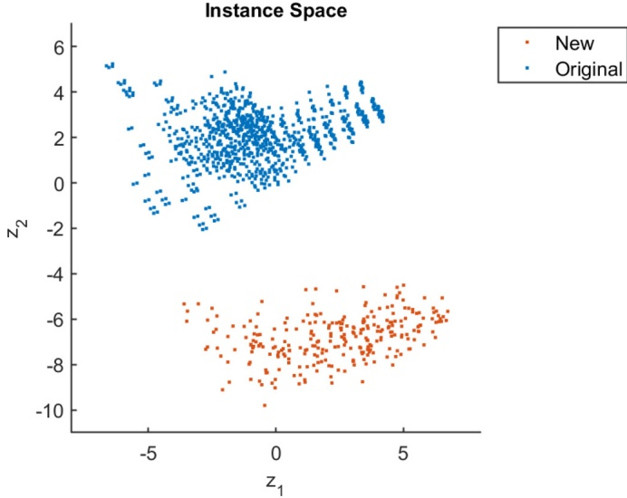

Fig. 3. Distribution of instances across the 2D projection of the instance space.

$$
\left[ \begin{array}{c} z _ {1} \\ z _ {2} \end{array} \right] = \left[ \begin{array}{c c} - 0. 0 0 8 5 & - 0. 9 5 7 5 \\ 0. 2 1 9 8 & - 0. 2 4 4 7 \\ 0. 3 1 3 5 & 0. 1 1 6 3 \\ 0. 8 2 6 & 0. 6 2 3 9 \\ - 0. 1 5 8 2 & - 0. 1 5 4 2 \\ 0. 4 2 8 9 & - 0. 6 8 5 3 \\ 0. 7 8 3 7 & 0. 2 9 8 3 \\ 0. 8 8 8 3 & - 0. 6 6 8 \\ 0. 2 5 7 6 & - 0. 8 6 4 \\ - 0. 0 7 7 & 1. 1 4 0 9 \end{array} \right] ^ {T} \left[ \begin{array}{c} \sigma^ {D} \\ \sigma^ {E} \\ R ^ {I E} \\ \sigma^ {I} \\ R ^ {D I} \\ | \mathcal {K} | \\ | \mathcal {N} ^ {C} | \\ | \mathcal {T} | \\ R ^ {D S} \\ R ^ {S I} \end{array} \right]
$$

where the features are normalized to [0,1] within the MATILDA platform. Fig. 3 shows the 2D projection of the instance space generated by the MATILDA toolkit. The red dots represent the new instances while the blue dots represent the original instances. We see that the red and blue dots lie in distinct areas of the projected 2D instance space, which indicates that the new instances nicely complement the original instances.

Furthermore, we visualize the instance features across the 2D instance space in Fig. 4, where the red line around the instances is the theoretical boundary of the instance space. This helps us identify which subsets of instances belong to a specific area of the instance space. For example, Fig. 4f shows that the new instances with a small number of vehicles are located in the left-most area of the 2D instance space. In contrast, the new instances with a large number of vehicles are located in the right-most part of the 2D instance space.

Not surprisingly, we see in Fig. 4a, that there is a big difference in the average standard deviation of demands between the new and original set of instances. In Fig. 4b we see that the standard deviation of the edge costs varies much more in the new set of instances than for the original set of instances. This reflects the various node location structures found in the new instances, i.e., random, clustered, and random-clustered node locations. Moreover, we can see in Fig. 4c that the smallest and largest average inventory-cost-to-edge-cost ratio $( R ^ { I E } )$ are fairly similar between the two sets of instances, but that the gradient from the smallest to the largest value is smoother for the new instances than for the original instances. From Fig. 4d and g we see that the standard deviation of inventory capacity and the number of customers are distributed similarly across both the new and the original instances.

Table 3

Average difference in upper bounds from the results of Archetti et al. (2017) in %.

| N\\K | 2 | 3 | 4 | 5 | Average |
| --- | --- | --- | --- | --- | --- |
| 5 | 0.00 | 0.00 | 0.00 | 0.00 | 0.00 |
| 10 | -0.03 | 1.94 | -1.10 | -1.89 | -0.27 |
| 15 | -0.04 | -1.07 | -2.57 | -2.56 | -1.56 |
| 20 | 0.18 | -0.16 | 0.97 | 0.56 | 0.39 |
| 25 | 0.28 | 2.13 | -0.33 | 0.64 | 0.68 |
| 30 | 0.77 | 2.92 | 5.09 | 6.01 | 3.70 |
| Average | 0.19 | 0.96 | 0.34 | 0.48 | 0.49 |

The average demand to average inventory capacity ratio for the original instances appears to have three to four distinct levels, while there seems to be a more continuous transition from the smallest to the largest values for the new instances. This reflects that the new instances do not have the same demand-to-inventory capacity ratio as the original instances, i.e., the inventory capacity for a customer in the original instances is a multiple of two or three times the demand.

In Fig. 4h, we see how the instances are distributed by the number of time periods. The blue, green, orange, and yellow dots represent three, six, nine, and 12 time periods, respectively. Furthermore, we observe in Fig. 4i that the average demand to average initial inventory level ratio $( R ^ { D I } )$ is much lower for the original instances than for the new instances. This indicates that the new instances have fewer customers that can be served in the first period by the initial inventory. Finally, Fig. 4j shows that the original instances have an average initial-inventory-to-inventory-capacity ratio larger than the new instances. This indicates that on average the initial inventory at a customer is emptier for the new instances than for the original instances.

## 5.2. Performance across all instances

In this section, we compare the solutions of the new instances with those of the original instances obtained by the matheuristic and the B&C method. We first demonstrate that we have a reasonable re-implementation of the matheuristic of Archetti et al. (2017), before showing how the two solution methods perform across all instances. Table 3 reports the average relative difference between the upper bound found by our re-implementation $( U B ^ { R } )$ and the original matheuristic $\stackrel{\frown}{(UB^{A})}:\ \frac{UB^{R}-UB^{A}}{UB^{A}}$ . In this comparison we have only included the six-period instances, to not skew the average results by including many easy three-period instances. This subset can be further partitioned into smaller disjoint subsets defined by the number of customers (N) and the number of vehicles (K). A negative number in the table denotes an improvement in favor of our re-implementation, highlighted in bold. From Table 3 we see that our re-implementation obtains slightly worse upper bounds on average, but obtains better average gaps than the original implementation of Archetti et al. (2017) on the smallest instances. The subsets with the worst performance are the 30- customer instances with 4 and 5 vehicles. Despite this, we consider our re-implementation to be of sufficient quality to carry on with the analyses presented in this paper.

Using the instance space defined in Section 5.1, we now focus on the performance of the matheuristic and the B&C method across all instances. Fig. 5a highlights the instances where the algorithms obtained a gap of less than 5%. In this case, the yellow, green, and blue dots represent instances where both algorithms, one of the algorithms or none of the algorithms obtained a gap of less than 5%, respectively. This clearly shows that the two algorithms tested in this paper obtained worse gaps on the new set of instances than for the original set of instances. Comparing this figure to Fig. 4 we see that the most difficult instances to solve, with

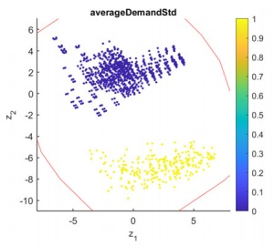

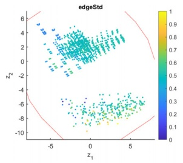

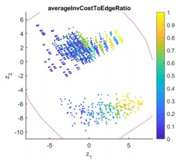

c: RIE.

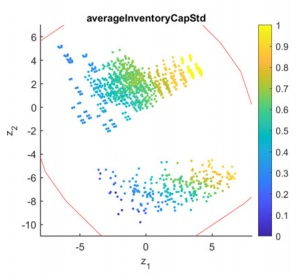

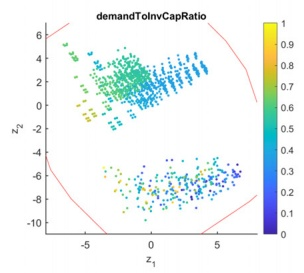

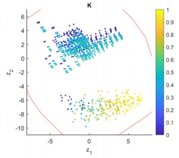

f: Number of vehicles.

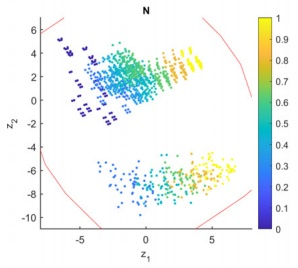

g: Number of customers.

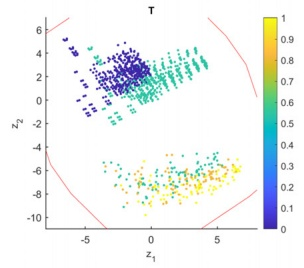

h: Number of periods.

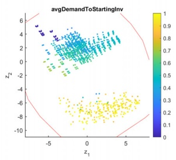

$$
\mathrm{i}: R ^ {D I}.
$$

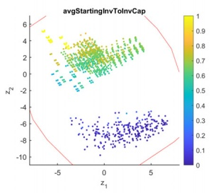

$$
R ^ {S I}.
$$

Fig. 4. Feature distributions.

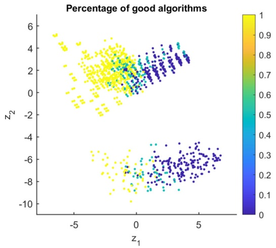

(a) Highlighting the percentage of good algorithms.

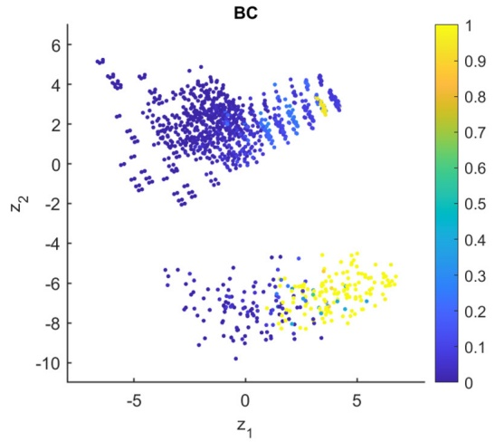

Fig. 5. Algorithm performance.

(b) The normalized gap obtained by the B&C method.

Table 4

Overview of the number of feasible solutions.

<table><tr><td rowspan="2">N</td><td colspan="4">Constructive</td><td colspan="4">Matheuristic</td><td colspan="4">B&amp;C</td></tr><tr><td>R</td><td>C</td><td>RC</td><td>Sum</td><td>R</td><td>C</td><td>RC</td><td>Sum</td><td>R</td><td>C</td><td>RC</td><td>Sum</td></tr><tr><td>10</td><td>18</td><td>18</td><td>18</td><td>54</td><td>18</td><td>18</td><td>18</td><td>54</td><td>18</td><td>18</td><td>18</td><td>54</td></tr><tr><td>25</td><td>18</td><td>18</td><td>18</td><td>54</td><td>18</td><td>18</td><td>18</td><td>54</td><td>18</td><td>18</td><td>18</td><td>54</td></tr><tr><td>50</td><td>18</td><td>18</td><td>18</td><td>54</td><td>0</td><td>0</td><td>0</td><td>0</td><td>5</td><td>3</td><td>10</td><td>18</td></tr><tr><td>100</td><td>18</td><td>18</td><td>18</td><td>54</td><td>0</td><td>0</td><td>0</td><td>0</td><td>3</td><td>0</td><td>4</td><td>7</td></tr><tr><td>200</td><td>18</td><td>18</td><td>18</td><td>54</td><td>0</td><td>0</td><td>0</td><td>0</td><td>0</td><td>0</td><td>0</td><td>0</td></tr><tr><td>Sum</td><td>90</td><td>90</td><td>90</td><td>270</td><td>36</td><td>36</td><td>36</td><td>108</td><td>44</td><td>39</td><td>50</td><td>133</td></tr></table>

the two methods tested in this work, are those with many vehicles and many customers across both sets of instances. In Fig. 5a it looks like most of the 200-customer instances are equally difficult to solve across the two sets of instances, but Fig. 5b tells a different story. Fig. 5b shows the normalized gap of the B&C method, i.e., $\mathsf { g a p } _ { \mathsf { n o r m a l i z e d } } = \mathsf { g a p } _ { i } / \mathsf { g a p } _ { \mathsf { l a r g e s t } } ,$ where gapi is the gap on an instance i, and $\mathsf { g a p } _ { \mathsf { l a r g e s t } }$ is the largest gap across all instances. Here we see that the B&C method generally obtains better gaps for the original instances than for the new instances indicating that the new instances are more difficult to solve than the original instances when using the B&C method. See Appendix A for additional figures of the instance space analysis.

In most of the published research on the IRP (Avella et al., 2018; Coelho & Laporte, 2014; Desaulniers et al., 2016 among others), it has been common to report the results across three of the ten features defining our instance space, namely the number of customers, the number of vehicles, and the number of periods. There are 18 of the new instances that have the same number of customers, vehicles, and periods as at least one of the original instances. Vice versa, 40 original instances have the same number of customers, vehicles, and periods as at least one of the new instances. It is therefore interesting to analyze these instances in more detail to determine the net effect on algorithmic performance from the remaining seven features of the instance space, e.g., the average standard deviation of demand, $\sigma ^ { D } ,$ which is larger for the new instances than for the original instances (See Fig. 4a).

Comparing these instances, we found that the matheuristic on the 12 new 10-customer instances with the same number of vehicles (2, 4, or 5) and periods (6) as at least one of the original instances, on average obtained 23% better gaps than the 30 corresponding original 10-customer instances. However, it spent on average 83.6% longer time to solve these new instances compared with the original ones. For the six new 25-customer instances the matheuristic obtained an average gap 12.3% worse than the 10 original 25-customer instances with the same number of vehicles and periods, in roughly the same computational time. The B&C method performs similarly across these 18 new instances and 40 original instances. Thus, the different feature values on the seven features other than the number of customers, vehicles, and periods, do not make it easier on average for the matheuristic or the B&C method to solve the new instances compared with the original instances. Here we define easier as finding better or equally good solutions (measured by the gap) in the same or shorter computational time.

## 5.3. Impact of node locations on algorithm performance

In this section, we examine how the number of customers and the node locations affect the performance of the B&C method and the matheuristic on the new instances. Table 4 gives an overview of the number of feasible solutions obtained by the construction heuristic, the matheuristic, and the B&C method. The left-most column denotes the number of customers, and for each block of the table, ‘R’, ‘C’, and ‘RC’ denote random, clustered, and randomclustered node distributions. The columns ‘Sum’ shows the total number of feasible solutions on each row for each solution method, and the row ‘Sum’ shows the total number of feasible solutions for each column. The matheuristic found feasible solutions on all instances of 10 and 25 customers, a total of 108 instances, but the computational time limit was reached before the algorithm successfully obtained any feasible solutions for the remaining instances. The B&C algorithm found feasible solutions on the same instances, but only on some of the 50 and 100-customer instances. No feasible solutions were found by either the matheuristic or the B&C method on the 200-customer instances. As expected, the B&C method struggles to find feasible solutions within the time limit when the number of customers becomes high, $\mathbf { i . e . , }$ 50 customers or more. However, it is more surprising that the matheuristic does not find any feasible solutions for 50 customers or more. A likely reason for this is that the vehicle fleet is scaled proportionally to the number of customers, making the relaxed vehicle-indexed MILPs of the matheuristic much slower than when the vehicle fleet is small.

Another interesting observation is that the B&C method struggles to find feasible solutions for the clustered instances, and it finds the most feasible solutions in the random-clustered instances. The phase transition phenomenon might explain such behavior. Gent & Walsh (1996) defined the phase transition phenomenon as a sudden and drastic change in the solvability of a combinatorial optimization problem, whereby the problem transitions from being easily solved to hard or intractable. This sharp transition occurs when the value of a randomly generated problem’s parameter increases beyond a specific threshold. Subsequent research has demonstrated that phase transitions exist in various combinatorial optimization problems, including the TSP. For instance, Zhang (2004) showed that the phase transition in TSP is influenced by the number of distinct distance values. Moreover, van Hemert & Urquhart (2004) and Smith-Miles, van Hemert, & Lim (2010) demonstrated that adjusting the ratio of clusters to nodes in TSP instances can trigger a phase transition phenomenon. As such, these insights may help to explain why the B&C method struggles to solve the clustered IRP instances, as these instances may be crossing the phase transition threshold, thereby making them more challenging to solve.

Moreover, the B&C method can prove optimality on only 13 out of 270 instances. These 13 instances are all among the 10 customer instances, where six are among the random, one among the clustered, and six among the random-clustered instances, respectively. This further supports the theory that the MILP solver especially struggles to find feasible solutions and close the gap for the clustered instances. In addition, the matheuristic found one of the optimal solutions among the random-clustered instances.

Table 5 reports the average gaps between the upper bound and the best-known lower bound (LB), i.e., the lower bound obtained from the B&C algorithm. We define this as $\mathtt { G a p } = { \frac { \mathtt { U B } ^ { j } - \mathtt { L B } } { \mathtt { L B } } }$ , where UBj is the upper bound found by method j. Moreover, the table only includes the gaps for the instances where the method j found a feasible solution, i.e., for the construction heuristic, all instances are included except for two instances where no lower bound was obtained. In contrast, for the matheuristic, 108 instances are included, and for the B&C method, 133 instances are included. The same is valid for Tables 5–8. Results obtained using the construction heuristic are displayed, albeit not being the main focus of this study, only to assess the quality of solutions found by the matheuristic and the B&C methods. Recall that the construction heuristic in practice represents a naive planning approach where deliveries are allocated more or less randomly onto vehicles, and then the routes are found by solving a TSP for each vehicle. Such a solution is likely to perform badly, as seen in the 10 and 25- customer instances. However, for the B&C method, the solution quality drops significantly for the 50-customer instances, and for the 100-customer instances, the feasible solutions are much worse than those obtained by the construction heuristic. Therefore, it is not easy to draw conclusions from the 50 and 100-customer instances, but we present the results of these instances for the sake of completeness.

Table 5

Overview of average gaps (%).

<table><tr><td rowspan="2">N</td><td colspan="4">Constructive</td><td colspan="4">Matheuristic</td><td colspan="4">B&amp;C</td></tr><tr><td>R</td><td>C</td><td>RC</td><td>All</td><td>R</td><td>C</td><td>RC</td><td>All</td><td>R</td><td>C</td><td>RC</td><td>All</td></tr><tr><td>10</td><td>49.9</td><td>52.8</td><td>53.9</td><td>52.2</td><td>2.35</td><td>0.91</td><td>1.33</td><td>1.53</td><td>1.24</td><td>0.50</td><td>0.52</td><td>0.75</td></tr><tr><td>25</td><td>53.0</td><td>45.3</td><td>60.4</td><td>52.9</td><td>14.10</td><td>10.01</td><td>14.50</td><td>12.87</td><td>3.54</td><td>1.03</td><td>2.42</td><td>2.33</td></tr><tr><td>50</td><td>64.1</td><td>51.5</td><td>65.5</td><td>60.3</td><td>n/a</td><td>n/a</td><td>n/a</td><td>n/a</td><td>25.99</td><td>25.59</td><td>34.50</td><td>30.65</td></tr><tr><td>100</td><td>89.1</td><td>71.7</td><td>104.5</td><td>88.4</td><td>n/a</td><td>n/a</td><td>n/a</td><td>n/a</td><td>252.7</td><td>n/a</td><td>293.6</td><td>276.1</td></tr><tr><td>200</td><td>135.8</td><td>146.4</td><td>145.0</td><td>142.5</td><td>n/a</td><td>n/a</td><td>n/a</td><td>n/a</td><td>n/a</td><td>n/a</td><td>n/a</td><td>n/a</td></tr><tr><td>All</td><td>77.8</td><td>73.5</td><td>85.2</td><td>78.8</td><td>8.22</td><td>5.46</td><td>7.92</td><td>7.20</td><td>22.14</td><td>2.67</td><td>31.44</td><td>19.93</td></tr></table>

Table 6

Overview of average gaps per number of customers and per number of time periods (%).

<table><tr><td rowspan="2">N\T</td><td colspan="4">Constructive</td><td colspan="4">Matheuristic</td><td colspan="4">B&amp;C</td></tr><tr><td>6</td><td>9</td><td>12</td><td>All</td><td>6</td><td>9</td><td>12</td><td>All</td><td>6</td><td>9</td><td>12</td><td>All</td></tr><tr><td>10</td><td>56.14</td><td>49.67</td><td>50.80</td><td>52.20</td><td>0.90</td><td>1.47</td><td>2.22</td><td>1.53</td><td>0.52</td><td>0.66</td><td>1.08</td><td>0.75</td></tr><tr><td>25</td><td>55.50</td><td>48.73</td><td>54.47</td><td>52.90</td><td>9.46</td><td>12.49</td><td>16.66</td><td>12.87</td><td>2.01</td><td>1.82</td><td>3.15</td><td>2.33</td></tr><tr><td>50</td><td>65.05</td><td>61.39</td><td>54.56</td><td>60.34</td><td>n/a</td><td>n/a</td><td>n/a</td><td>n/a</td><td>19.16</td><td>39.90</td><td>44.94</td><td>30.65</td></tr><tr><td>100</td><td>91.32</td><td>89.06</td><td>84.92</td><td>88.43</td><td>n/a</td><td>n/a</td><td>n/a</td><td>n/a</td><td>276.3</td><td>334.8</td><td>40.8</td><td>276.1</td></tr><tr><td>200</td><td>135.0</td><td>155.5</td><td>136.2</td><td>142.5</td><td>n/a</td><td>n/a</td><td>n/a</td><td>n/a</td><td>n/a</td><td>n/a</td><td>n/a</td><td>n/a</td></tr><tr><td>All</td><td>80.61</td><td>80.88</td><td>74.82</td><td>78.80</td><td>5.18</td><td>6.98</td><td>9.44</td><td>7.20</td><td>16.39</td><td>35.18</td><td>7.24</td><td>19.93</td></tr></table>

Table 7

Average computational times for the 10 customer instances in seconds.

<table><tr><td rowspan="2">Q\T</td><td colspan="4">Matheuristic</td><td colspan="4">B&amp;C</td></tr><tr><td>6</td><td>9</td><td>12</td><td>All</td><td>6</td><td>9</td><td>12</td><td>All</td></tr><tr><td>Small truck (8)</td><td>1800</td><td>1800</td><td>1800</td><td>1800</td><td>1498</td><td>3617</td><td>5265</td><td>3460</td></tr><tr><td>Truck (18)</td><td>1800</td><td>1800</td><td>1800</td><td>1800</td><td>4808</td><td>7200</td><td>7200</td><td>6403</td></tr><tr><td>Trailer truck (38)</td><td>1339</td><td>1800</td><td>1800</td><td>1646</td><td>4812</td><td>7200</td><td>7200</td><td>6404</td></tr><tr><td>All</td><td>1646</td><td>1800</td><td>1800</td><td>1749</td><td>3706</td><td>6006</td><td>6555</td><td>5422</td></tr></table>

Table 8

Overview of average gaps per number of customers and vehicle capacity (%).

<table><tr><td rowspan="2">N\Q</td><td colspan="4">Constructive</td><td colspan="4">Matheuristic</td><td colspan="4">B&amp;C</td></tr><tr><td>8</td><td>18</td><td>38</td><td>All</td><td>8</td><td>18</td><td>38</td><td>All</td><td>8</td><td>18</td><td>38</td><td>All</td></tr><tr><td>10</td><td>49.52</td><td>37.83</td><td>69.27</td><td>52.20</td><td>0.52</td><td>1.53</td><td>2.54</td><td>1.53</td><td>0.11</td><td>0.39</td><td>1.76</td><td>0.75</td></tr><tr><td>25</td><td>42.60</td><td>36.79</td><td>79.31</td><td>52.90</td><td>9.17</td><td>13.79</td><td>15.65</td><td>12.87</td><td>0.68</td><td>2.47</td><td>3.83</td><td>2.33</td></tr><tr><td>50</td><td>41.58</td><td>38.50</td><td>100.92</td><td>60.34</td><td>n/a</td><td>n/a</td><td>n/a</td><td>n/a</td><td>27.45</td><td>50.30</td><td>24.72</td><td>30.65</td></tr><tr><td>100</td><td>47.62</td><td>53.21</td><td>164.5</td><td>88.43</td><td>n/a</td><td>n/a</td><td>n/a</td><td>n/a</td><td>42.23</td><td>n/a</td><td>587.8</td><td>276.1</td></tr><tr><td>200</td><td>61.78</td><td>97.19</td><td>284.2</td><td>142.5</td><td>n/a</td><td>n/a</td><td>n/a</td><td>n/a</td><td>n/a</td><td>n/a</td><td>n/a</td><td>n/a</td></tr><tr><td>All</td><td>48.62</td><td>52.70</td><td>136.3</td><td>78.80</td><td>4.84</td><td>7.66</td><td>9.10</td><td>7.20</td><td>9.51</td><td>5.19</td><td>45.65</td><td>19.93</td></tr></table>

The most interesting observation from Table 5 is that the clustered instances have smaller average gaps than the other instances for both the matheuristic and the B&C method. For the B&C method, this is somewhat skewed because the B&C method finds fewer feasible solutions for the set of clustered instances. However, if we focus on the 10 and 25 customer instances where both methods found a feasible solution on all instances of this subset, we observe the same trend: the clustered instances have a better average gap. One possible explanation for this finding is that the main cost drivers are the arcs connecting the clusters in these instances. The arcs within a cluster contribute little to the overall cost, so once the solution method has determined which arcs to use between the clusters, the lower bound is quite strong. It still needs to determine which arcs to use within the cluster to find a feasible solution, but the visiting sequence within the cluster has a relatively small impact on the overall cost, thus affecting the lower bound much less than the inter-cluster decisions.

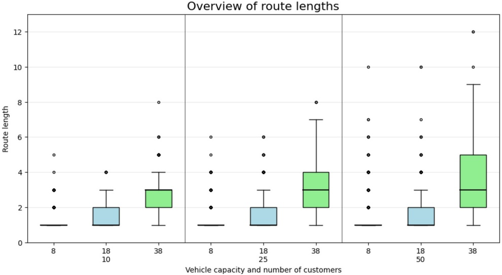

Fig. 6. Overview of the route length on a subset of the new instances.

## 5.4. Impact of number of periods on algorithm performance

In this section, we investigate how the number of periods affects the performance of the B&C method and the matheuristic on the new instances. We expect the methods to obtain worse solutions on instances with a large number of periods than on instances with a small number of periods. Table 6 reports the average gaps per number of customers and per number of periods. For the matheuristic, we notice that the average gap is higher when the number of periods increases. The same can be observed for the B&C method, but with a few exceptions. The 25-customer and nine-period instances have an average gap lower than the 25- customer and six-period instances. This is most likely because the internal Gurobi heuristics managed to find a few more good feasible solutions for the nine-period instances than for the six-period instances. The same goes for the 100-customer instances where the feasible solutions for the six and nine-period instances are extremely bad, skewing the overall average. Disregarding the seven 100 customer instances where the B&C method found a feasible solution, the average gap for six, nine, and twelve periods becomes 4.84%, 5.96% and 6.40%, respectively. This confirms that it becomes harder to solve the instances with either of these methods when the number of periods increases. However, it is interesting to see how small the impact of the number of periods has on the average gap compared with the number of customers. A possible reason for this is that a higher number of customers comes with a larger vehicle fleet, making the instances much more challenging.

In addition to the average gaps, let us investigate the number of periods’ impact on the computational time. For most of the instances, the matheuristic and the B&C method did not terminate before they reached their respective time limits. However, they did for some of the 10 customer instances, and here the trend is clear, a higher number of periods require longer computational times. Table 7 reports the average computational times for the 10 customer instances across the vehicle capacity Q and the number of periods T. It is quite clear that the six-period instances require less computational time to be solved for both methods. However, a more surprising observation from this table is the impact on the average computational times from the vehicle capacity. The B&C method recorded the shortest solution time for the small truck instances, while the matheuristic has the shortest solution time for the trailer truck instances. A possible explanation for this is that the matheuristic heavily relies on the solution of a MILP formulation, which does not perform well for instances with a large number of vehicles.

## 5.5. The impact of vehicle capacity on algorithm performance

The somewhat surprising impact on the average computational times from the vehicle capacity motivates some further analysis along this dimension. We first investigate how the vehicle capacity affects the performance of the B&C method and the matheuristic on the new instances, before we examine the structure of the solutions in more detail. Table 8 reports the average gaps per number of customers and for each type of vehicle fleet denoted by the vehicle capacity. Let us start by focusing on the matheuristic. Despite having the shortest average computational time for the trailer truck (Q = 38) instances, it does not seem to reflect the quality of the solutions. The matheuristic obtained better solutions for the small truck (Q = 8) instances. This indicates that even though the relatively high number of vehicles has a negative impact on the average computational time for the matheuristic, it is easier to find reasonably good solutions for these instances.

The B&C method seems to obtain average gaps more correlated with the average computational time than the matheuristic. Here the solution quality seems to drop when the vehicle capacity goes up. The average gaps are so large for the 50- and 100-customer instances that it becomes hard to identify any trend, skewing the overall average. The apparent drop in solution quality could also be caused by a weaker linear relaxation when the vehicle capacity is large. Due to constraints (13), the delivered quantity to a given customer requires a smaller arc-flow the larger the vehicle capacity Q is. Thus, a large vehicle capacity might give a worse lower bound on the objective function value than when the vehicle capacity is small. Nevertheless, from the 10- and 25-customer instances, where the average gaps are reasonably good, it is clear that it is harder to prove that we have obtained an optimal or nearoptimal solution when the vehicle capacity is large.

The solutions found by the B&C method obtained the best average gaps, so let us now shift our attention to how the vehicle capacity affects the structure of these solutions. We focus on how the average route length of the solutions obtained by the B&C method changes with the vehicle capacity. Let us define the route length as the number of customers in a route. For the instances that have not been solved to optimality, the route length is also a property of the solution, because the optimal solution might consist of different routes than the solution found by our method. However, when the gap is fairly small it should still give a reasonable indication of the structure of the optimal solution.

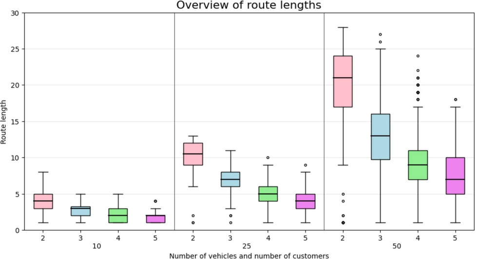

Fig. 7. Overview of the route lengths on a subset of the original instances.

Fig. 6 presents a box-plot giving an overview of the route lengths across the new 10-, 25- and 50-customer instances, and across the small truck (Q = 8), truck (Q = 18) and trailer truck (Q = 38) instances. The bottom and top edges of the boxes represent the first and third quartiles, respectively, while the slightly ticker line within the edges of a box represents the median. The whiskers extend to 1.5 times the interquartile range, i.e., the difference between the third and first quartile, on both sides of the box. However, the whisker is limited to never exceeding any data point, so we do not see the whisker on the bottom side of the corresponding box for the small truck and the truck instances. The outliers are marked with a small circle.

For the small truck (Q = 8) instances, we can see that the majority of the routes, i.e., more than 75% of the routes, are direct routes visiting only one customer. For the truck (Q = 18) instances, there are still more than 50% of the routes that only visit one customer, but there is also a significant portion of routes with several customer visits. For the trailer truck (Q = 38) instances, less than 25% of the routes visit only one customer, and more than half of the routes visit three or more customers.

Focusing on the distribution of the route lengths for a subset of the original instances, we can see how the new instances nicely complement the original instances. In Fig. 7, the route lengths for the original 10-, 25-, and 50-customer instances and two, three, four, and five vehicles are displayed in a box plot. In general, we observe that the route lengths are much longer for the original instances than for the new instances. This indicates that the new instances represent a different business segment than the original instances. We can also observe that the route lengths increase much more for the original instances than the new instances going from 10 to 25 customers and going from 25 customers to 50 customers. This indicates that the vehicle fleet is scaled well for the new instances, capturing a behavior expected to see in practice, namely that an increase of customers is met by expanding the vehicle fleet, not the capacity of each vehicle.

## 6. Conclusion

In this work, we proposed a new set of real-world-like benchmark instances for the IRP, intended to complement the existing ones. The generated instances exhibit new features that should allow for a better assessment of the performance of the existing methodology and perhaps stimulate further development of new solution methods for the IRP. A total of 270 new instances were generated. Each instance is characterized by varied problem parameters. We conducted extensive computational experiments using two high-quality solution methods to derive lower and upper bounds for each instance and to study the impact of the instances’ features on the methods’ performance. Our analysis shows that the instances have the desired level of diversity and complexity and suggest the need to adapt the existing methodology accordingly.

We believe that these instances will possibly favor the use of commodity flow formulations since these formulations scale well for instances with a large number of vehicles and periods (Manousakis et al., 2021). The new instances may also promote the application of branch-cut-and-price algorithms over B&C algorithms, which are more effective when vehicle routes contain a few numbers of customer visits (Desaulniers et al., 2016). Besides, investigating the impact of valid inequalities and branching decisions on the new instances becomes a possible path for research. Regarding heuristic and matheuristic solution methods, we expect that the design of more complex neighborhoods will be important for obtaining good results. The existing algorithms may also be improved by exploiting instance-specific information, such as partitioning the nodes into clusters by location or consumption rate, as suggested by Cao & Glover (2010).

Finally, we emphasize that these instances can be extended to other rich IRP variants as needed by providing additional attributes like multiple depots, multiple and perishable products, time windows, or heterogeneous fleets of vehicles. For the variant where the inventory holding costs of the customers are not relevant to the decision maker, i.e., these costs are zero, we recommend setting the inventory holding cost at the depot equal to that of the first customer in the instance files.

## Acknowledgments

The authors are grateful to Claudia Archetti for providing detailed information about the computational experiments reported in Archetti et al. (2017). We also thank the editor and the two anonymous reviewers for their valuable feedback, which helped us improve the quality of this paper. This work was carried out with financial support from the AXIOM project [grant number: [263031](https://prosjektbanken.forskningsradet.no/en/project/FORISS/263031?Kilde=FORISScedistribution=Arcechart=barcecalcType=fundingceSprak=nocesortBy=datecesortOrder=descceresultCount=30ceoffset=30ceLTP.1=LTP2+Havcesource=FORISSceprojectId=315385)], partially funded by the [Research Council of Norway.](https://doi.org/10.13039/501100005416)

**Appendix A. Additional figures from the instance space analysis**

BC

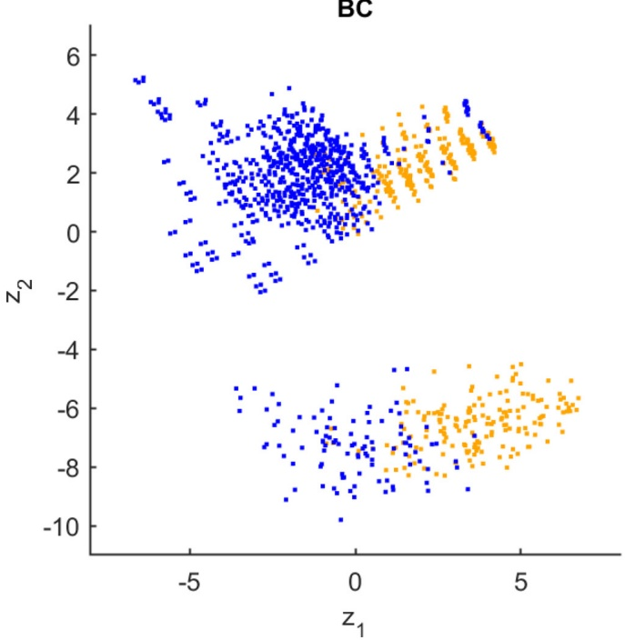

Fig. A.1. Highlighting each instance where the B&C method obtained a gap lower than or equal to 5%.

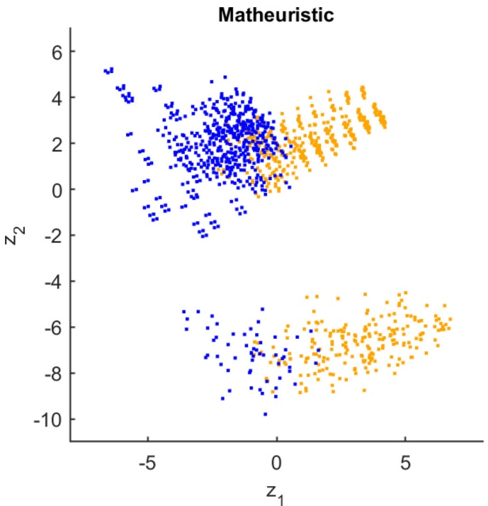

Fig. A.2. Highlighting each instance where the matheruistic obtained a gap lower than or equal to 5%.

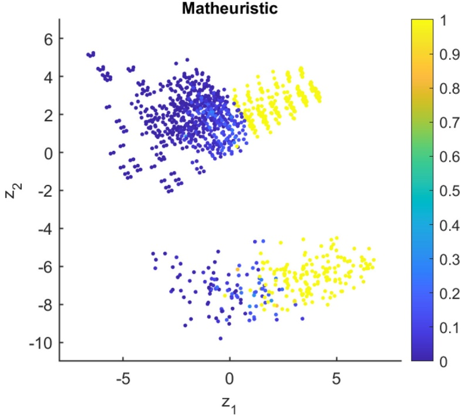

Fig. A.3. The normalized gap obtained by the matheuristic.

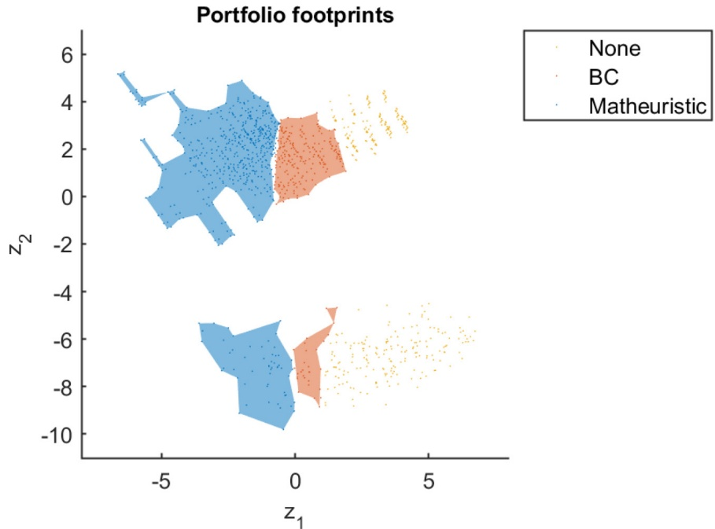

Fig. A.4. Footprint analysis. Recommendation of which algorithm to use on a given subset of the instances.

**Appendix B. Detailed results for the new instances**

Table B.1 Random node positioning and rural area.

|  |  |  | Construction |  | Matheuristic |  | B&amp;C |  |  |
| --- | --- | --- | --- | --- | --- | --- | --- | --- | --- |
| N | Q | T | UB | Seconds | UB | Seconds | LB | UB | Seconds |
| 10 | 8 | 6 | 13,249.40 | 0 | 7,306.35 | 1800 | 7,218.91 | 7,219.63 | 404 |
| 10 | 8 | 9 | 19,075.70 | 0 | 14,279.60 | 1800 | 14,221.30 | 14,222.50 | 38 |
| 10 | 8 | 12 | 30,074.00 | 0 | 24,773.20 | 1800 | 24,734.90 | 24,736.60 | 44 |
| 10 | 18 | 6 | 9,608.84 | 0 | 6,701.70 | 1800 | 6,615.15 | 6,667.00 | 7200 |
| 10 | 18 | 9 | 7,930.06 | 0 | 6,041.41 | 1800 | 5,934.52 | 5,950.01 | 7200 |
| 10 | 18 | 12 | 18,126.80 | 0 | 15,555.20 | 1800 | 15,529.90 | 15,531.70 | 7200 |
| 10 | 38 | 6 | 6,820.39 | 0 | 4,772.80 | 1800 | 4,693.04 | 4,772.80 | 7200 |
| 10 | 38 | 9 | 8,627.35 | 0 | 6,132.67 | 1800 | 5,906.97 | 5,959.90 | 7200 |
| 10 | 38 | 12 | 10,626.20 | 0 | 7,587.88 | 1800 | 6,930.60 | 7,366.15 | 7200 |
| 25 | 8 | 6 | 27,700.70 | 0 | 22,132.90 | 1800 | 21,113.60 | 21,321.20 | 7199 |
| 25 | 8 | 9 | 34,568.40 | 0 | 25,615.29 | 1800 | 24,078.50 | 24,087.20 | 7198 |
| 25 | 8 | 12 | 70,433.90 | 0 | 51,443.73 | 1800 | 47,852.10 | 48,185.00 | 7200 |
| 25 | 18 | 6 | 18,932.20 | 0 | 15,371.50 | 1800 | 13,717.50 | 14,097.90 | 7199 |
| 25 | 18 | 9 | 25,445.00 | 0 | 24,496.78 | 1800 | 21,082.10 | 21,227.60 | 7199 |
| 25 | 18 | 12 | 27,839.80 | 0 | 27,500.75 | 1800 | 23,609.30 | 25,369.20 | 7199 |
| 25 | 38 | 6 | 11,952.20 | 0 | 6,555.82 | 1800 | 6,052.46 | 6,394.81 | 7199 |
| 25 | 38 | 9 | 25,691.90 | 0 | 18,048.16 | 1800 | 15,614.20 | 16,179.90 | 7198 |
| 25 | 38 | 12 | 24,918.10 | 0 | 17,574.61 | 1800 | 13,381.30 | 14,347.20 | 7199 |
| 50 | 8 | 6 | 50,979.30 | 0 | n/a | 2400 | 35,542.70 | n/a | 7191 |
| 50 | 8 | 9 | 101,604.00 | 0 | n/a | 2400 | 72,789.60 | 78,321.40 | 7198 |
| 50 | 8 | 12 | 174,307.00 | 0 | n/a | 2400 | 111,912.00 | 160,103.00 | 7193 |
| 50 | 18 | 6 | 39,387.90 | 0 | n/a | 2400 | 22,625.80 | n/a | 7194 |
| 50 | 18 | 9 | 54,725.60 | 0 | n/a | 2400 | 39,625.60 | n/a | 7192 |
| 50 | 18 | 12 | 53,320.40 | 0 | n/a | 2400 | 42,969.50 | n/a | 7193 |
| 50 | 38 | 6 | 28,851.40 | 0 | n/a | 2400 | 13,628.00 | n/a | 7194 |
| 50 | 38 | 9 | 43,120.80 | 0 | n/a | 2400 | 22,461.90 | n/a | 7192 |
| 50 | 38 | 12 | 52,335.40 | 0 | n/a | 2400 | 27,160.60 | n/a | 7192 |
| 100 | 8 | 6 | 139,690.00 | 1 | n/a | 2400 | 108,699.00 | 150,078.00 | 7194 |
| 100 | 8 | 9 | 182,648.00 | 1 | n/a | 2400 | 130,462.00 | 187,451.00 | 7192 |
| 100 | 8 | 12 | 286,004.00 | 2 | n/a | 2400 | 162,883.00 | n/a | 7196 |
| 100 | 18 | 6 | 100,660.00 | 0 | n/a | 2400 | 60,412.00 | n/a | 7192 |
| 100 | 18 | 9 | 121,369.00 | 1 | n/a | 2400 | 79,301.30 | n/a | 7192 |
| 100 | 18 | 12 | 166,628.00 | 1 | n/a | 2400 | 118,391.00 | n/a | 7193 |
| 100 | 38 | 6 | 62,345.10 | 0 | n/a | 2400 | 28,554.80 | n/a | 7193 |
| 100 | 38 | 9 | 130,663.00 | 1 | n/a | 2400 | 36,732.20 | 285,172.00 | 7194 |
| 100 | 38 | 12 | 83,495.90 | 0 | n/a | 2400 | 32,620.90 | n/a | 7193 |
| 200 | 8 | 6 | 220,954.00 | 7 | n/a | 2400 | 161,239.00 | n/a | 7211 |
| 200 | 8 | 9 | 331,363.00 | 13 | n/a | 2400 | 221,085.00 | n/a | 7214 |
| 200 | 8 | 12 | 591,800.00 | 18 | n/a | 2400 | 355,401.00 | n/a | 7229 |
| 200 | 18 | 6 | 190,499.00 | 3 | n/a | 2400 | 85,232.60 | n/a | 7209 |
| 200 | 18 | 9 | 236,283.00 | 4 | n/a | 2400 | 121,943.00 | n/a | 7226 |
| 200 | 18 | 12 | 212,598.00 | 11 | n/a | 2400 | 112,595.00 | n/a | 7221 |
| 200 | 38 | 6 | 108,353.00 | 1 | n/a | 2400 | 28,436.90 | n/a | 7207 |
| 200 | 38 | 9 | 154,284.00 | 2 | n/a | 2400 | 40,962.30 | n/a | 7215 |
| 200 | 38 | 12 | 168,727.00 | 3 | n/a | 2400 | n/a | n/a | 7221 |

Table B.2

Random node positioning and urban area.

|  |  |  | Construction |  | Matheuristic |  | B&amp;C |  |  |
| --- | --- | --- | --- | --- | --- | --- | --- | --- | --- |
| N | Q | T | UB | Seconds | UB | Seconds | LB | UB | Seconds |
| 10 | 8 | 6 | 2,166.93 | 0 | 1,553.46 | 1800 | 1,551.68 | 1,551.68 | 6 |
| 10 | 8 | 9 | 4,190.46 | 0 | 2,572.59 | 1800 | 2,560.31 | 2,562.70 | 7200 |
| 10 | 8 | 12 | 5,160.40 | 0 | 2,607.86 | 1800 | 2,601.48 | 2,601.74 | 2745 |
| 10 | 18 | 6 | 1,733.17 | 0 | 1,341.72 | 1800 | 1,321.26 | 1,321.38 | 22 |
| 10 | 18 | 9 | 2,771.31 | 0 | 2,146.03 | 1800 | 2,045.30 | 2,087.51 | 7200 |
| 10 | 18 | 12 | 2,478.89 | 0 | 1,810.38 | 1800 | 1,787.96 | 1,791.45 | 7200 |
| 10 | 38 | 6 | 1,229.15 | 0 | 822.15 | 1800 | 799.41 | 822.15 | 7200 |
| 10 | 38 | 9 | 1,929.21 | 0 | 1,135.59 | 1800 | 1,088.90 | 1,125.80 | 7200 |
| 10 | 38 | 12 | 2,301.88 | 0 | 1,353.49 | 1800 | 1,271.05 | 1,319.16 | 7200 |
| 25 | 8 | 6 | 5,749.55 | 0 | 4,810.25 | 1800 | 4,480.08 | 4,539.95 | 7199 |
| 25 | 8 | 9 | 12,520.30 | 0 | 9,246.15 | 1800 | 8,520.40 | 8,607.99 | 7200 |
| 25 | 8 | 12 | 13,054.20 | 0 | 9,993.56 | 1800 | 8,747.69 | 8,799.26 | 7199 |
| 25 | 18 | 6 | 5,564.38 | 0 | 3,449.67 | 1800 | 3,065.11 | 3,214.79 | 7200 |
| 25 | 18 | 9 | 5,981.87 | 0 | 5,350.71 | 1800 | 4,556.26 | 4,676.05 | 7198 |
| 25 | 18 | 12 | 7,492.67 | 0 | 6,961.32 | 1800 | 6,155.47 | 6,597.74 | 7199 |
| 25 | 38 | 6 | 3,064.04 | 0 | 2,048.07 | 1800 | 1,704.36 | 1,761.59 | 7200 |
| 25 | 38 | 9 | 5,057.60 | 0 | 3,219.04 | 1800 | 2,777.69 | 2,924.19 | 7199 |
| 25 | 38 | 12 | 6,339.94 | 0 | 4,263.77 | 1800 | 3,387.46 | 3,666.35 | 7199 |
| 50 | 8 | 6 | 13,709.20 | 0 | n/a | 2400 | 10,477.80 | 14,218.80 | 7197 |
| 50 | 8 | 9 | 21,808.00 | 0 | n/a | 2400 | 16,178.10 | n/a | 7197 |
| 50 | 8 | 12 | 33,512.70 | 0 | n/a | 2400 | 22,389.20 | n/a | 7189 |
| 50 | 18 | 6 | 7,043.67 | 0 | n/a | 2400 | 4,534.75 | 5,620.24 | 7196 |
| 50 | 18 | 9 | 14,865.40 | 0 | n/a | 2400 | 11,237.50 | n/a | 7191 |
| 50 | 18 | 12 | 12,781.60 | 0 | n/a | 2400 | 10,417.30 | n/a | 7191 |
| 50 | 38 | 6 | 5,202.06 | 0 | n/a | 2400 | 2,259.37 | 2,703.34 | 7195 |
| 50 | 38 | 9 | 7,160.50 | 0 | n/a | 2400 | 3,298.60 | n/a | 7194 |
| 50 | 38 | 12 | 10,657.40 | 0 | n/a | 2400 | 5,104.72 | n/a | 7193 |
| 100 | 8 | 6 | 24,079.90 | 1 | n/a | 2400 | 18,481.20 | n/a | 7193 |
| 100 | 8 | 9 | 33,563.50 | 1 | n/a | 2400 | 20,165.80 | n/a | 7192 |
| 100 | 8 | 12 | 61,970.90 | 2 | n/a | 2400 | 35,747.80 | n/a | 7197 |
| 100 | 18 | 6 | 18,042.50 | 0 | n/a | 2400 | 10,587.80 | n/a | 7191 |
| 100 | 18 | 9 | 33,142.80 | 1 | n/a | 2400 | 20,134.20 | n/a | 7195 |
| 100 | 18 | 12 | 29,412.30 | 1 | n/a | 2400 | 19,330.20 | n/a | 7196 |
| 100 | 38 | 6 | 11,643.90 | 0 | n/a | 2400 | 4,860.50 | n/a | 7191 |
| 100 | 38 | 9 | 18,641.90 | 0 | n/a | 2400 | 7,874.87 | n/a | 7193 |
| 100 | 38 | 12 | 20,587.40 | 0 | n/a | 2400 | 8,725.20 | n/a | 7194 |
| 200 | 8 | 6 | 53,322.90 | 8 | n/a | 2400 | 38,237.50 | n/a | 7209 |
| 200 | 8 | 9 | 101,567.00 | 11 | n/a | 2400 | 59,031.80 | n/a | 7222 |
| 200 | 8 | 12 | 117,193.00 | 18 | n/a | 2400 | 59,462.40 | n/a | 7231 |
| 200 | 18 | 6 | 33,304.20 | 2 | n/a | 2400 | 16,994.80 | n/a | 7209 |
| 200 | 18 | 9 | 52,886.60 | 5 | n/a | 2400 | 25,762.30 | n/a | 7217 |
| 200 | 18 | 12 | 87,014.10 | 7 | n/a | 2400 | 44,956.90 | n/a | 7226 |
| 200 | 38 | 6 | 24,142.50 | 1 | n/a | 2400 | 6,918.92 | n/a | 7206 |
| 200 | 38 | 9 | 34,372.80 | 2 | n/a | 2400 | 8,755.60 | n/a | 7217 |
| 200 | 38 | 12 | 40,483.20 | 3 | n/a | 2400 | 11,656.00 | n/a | 7218 |

Table B.3

Clustered node positioning and rural area.

|  |  |  | Construction |  | Matheuristic |  | B&amp;C |  |  |
| --- | --- | --- | --- | --- | --- | --- | --- | --- | --- |
| N | Q | T | UB | Seconds | UB | Seconds | LB | UB | Seconds |
| 10 | 8 | 6 | 7,378.79 | 0 | 5,974.75 | 1800 | 5,970.01 | 5,970.59 | 16 |
| 10 | 8 | 9 | 26,506.30 | 0 | 19,177.50 | 1800 | 19,155.10 | 19,162.40 | 7200 |
| 10 | 8 | 12 | 16,663.70 | 0 | 9,957.34 | 1800 | 9,879.11 | 9,887.20 | 7200 |
| 10 | 18 | 6 | 3,034.10 | 0 | 2,008.91 | 1800 | 2,006.73 | 2,008.91 | 7200 |
| 10 | 18 | 9 | 7,101.85 | 0 | 5,378.35 | 1800 | 5,348.75 | 5,363.36 | 7200 |
| 10 | 18 | 12 | 11,167.30 | 0 | 10,039.70 | 1800 | 10,001.00 | 10,007.00 | 7200 |
| 10 | 38 | 6 | 4,065.59 | 0 | 2,396.66 | 1800 | 2,334.55 | 2,396.66 | 7200 |
| 10 | 38 | 9 | 10,382.00 | 0 | 6,595.08 | 1800 | 6,569.73 | 6,579.44 | 7200 |
| 10 | 38 | 12 | 5,132.08 | 0 | 3,274.09 | 1800 | 3,207.78 | 3,245.02 | 7200 |
| 25 | 8 | 6 | 45,732.00 | 0 | 36,479.54 | 1800 | 35,983.70 | 36,031.90 | 7200 |
| 25 | 8 | 9 | 46,746.30 | 0 | 36,989.90 | 1800 | 35,091.30 | 35,133.30 | 7200 |
| 25 | 8 | 12 | 75,355.40 | 0 | 56,066.15 | 1800 | 53,010.90 | 53,398.70 | 7200 |
| 25 | 18 | 6 | 11,162.70 | 0 | 8,121.86 | 1800 | 7,486.21 | 7,544.34 | 7200 |
| 25 | 18 | 9 | 24,357.60 | 0 | 22,772.79 | 1800 | 19,759.70 | 19,845.30 | 7199 |
| 25 | 18 | 12 | 45,552.70 | 0 | 40,399.06 | 1800 | 38,486.70 | 38,807.80 | 7198 |
| 25 | 38 | 6 | 13,505.20 | 0 | 10,233.00 | 1800 | 9,875.91 | 9,939.82 | 7198 |
| 25 | 38 | 9 | 12,521.80 | 0 | 8,444.52 | 1800 | 8,189.84 | 8,389.26 | 7198 |
| 25 | 38 | 12 | 18,705.50 | 0 | 13,598.35 | 1800 | 11,983.20 | 12,125.40 | 7198 |
| 50 | 8 | 6 | 44,692.20 | 0 | n/a | 2400 | 32,347.70 | n/a | 7193 |
| 50 | 8 | 9 | 110,306.00 | 0 | n/a | 2400 | 83,448.80 | n/a | 7192 |
| 50 | 8 | 12 | 184,403.00 | 0 | n/a | 2400 | 117,340.00 | 175,306.00 | 7196 |
| 50 | 18 | 6 | 36,146.50 | 0 | n/a | 2400 | 23,041.80 | n/a | 7195 |
| 50 | 18 | 9 | 45,238.80 | 0 | n/a | 2400 | 32,299.30 | n/a | 7190 |
| 50 | 18 | 12 | 79,602.80 | 0 | n/a | 2400 | 62,552.50 | n/a | 7192 |
| 50 | 38 | 6 | 23,797.20 | 0 | n/a | 2400 | 11,096.80 | 13,255.00 | 7195 |
| 50 | 38 | 9 | 27,925.80 | 0 | n/a | 2400 | 17,947.50 | n/a | 7192 |
| 50 | 38 | 12 | 54,763.90 | 0 | n/a | 2400 | 35,803.60 | n/a | 7191 |
| 100 | 8 | 6 | 141,390.00 | 1 | n/a | 2400 | 108,073.00 | n/a | 7194 |
| 100 | 8 | 9 | 258,958.00 | 1 | n/a | 2400 | 169,036.00 | n/a | 7195 |
| 100 | 8 | 12 | 348,544.00 | 2 | n/a | 2400 | 222,959.00 | n/a | 7196 |
| 100 | 18 | 6 | 93,699.70 | 0 | n/a | 2400 | 58,222.20 | n/a | 7191 |
| 100 | 18 | 9 | 117,709.00 | 0 | n/a | 2400 | 84,778.20 | n/a | 7195 |
| 100 | 18 | 12 | 149,969.00 | 1 | n/a | 2400 | 110,995.00 | n/a | 7195 |
| 100 | 38 | 6 | 50,587.00 | 0 | n/a | 2400 | 20,827.90 | n/a | 7192 |
| 100 | 38 | 9 | 113,412.00 | 0 | n/a | 2400 | 63,231.70 | n/a | 7192 |
| 100 | 38 | 12 | 137,057.00 | 0 | n/a | 2400 | 49,841.50 | n/a | 7195 |
| 200 | 8 | 6 | 272,759.00 | 7 | n/a | 2400 | 188,649.00 | n/a | 7214 |
| 200 | 8 | 9 | 417,595.00 | 11 | n/a | 2400 | 252,938.00 | n/a | 7218 |
| 200 | 8 | 12 | 575,146.00 | 18 | n/a | 2400 | 296,848.00 | n/a | 7229 |
| 200 | 18 | 6 | 148,659.00 | 3 | n/a | 2400 | 81,160.80 | n/a | 7210 |
| 200 | 18 | 9 | 178,887.00 | 4 | n/a | 2400 | 120,529.00 | n/a | 7220 |
| 200 | 18 | 12 | 220,543.00 | 8 | n/a | 2400 | 112,696.00 | n/a | 7225 |
| 200 | 38 | 6 | 108,826.00 | 1 | n/a | 2400 | 26,556.60 | n/a | 7212 |
| 200 | 38 | 9 | 165,433.00 | 2 | n/a | 2400 | 26,911.30 | n/a | 7216 |
| 200 | 38 | 12 | 192,580.00 | 3 | n/a | 2400 | 53,081.60 | n/a | 7217 |

Table B.4

Clustered node positioning and urban area

|  |  |  | Construction |  | Matheuristic |  | B&amp;C |  |  |
| --- | --- | --- | --- | --- | --- | --- | --- | --- | --- |
| N | Q | T | UB | Seconds | UB | Seconds | LB | UB | Seconds |
| 10 | 8 | 6 | 4,203.77 | 0 | 2,740.34 | 1,800 | 2,734.91 | 2,737.54 | 7,200 |
| 10 | 8 | 9 | 1,451.46 | 0 | 761.47 | 1,800 | 755.78 | 760.09 | 7,200 |
| 10 | 8 | 12 | 2,780.42 | 0 | 2,365.05 | 1,800 | 2,344.25 | 2,347.97 | 7,200 |
| 10 | 18 | 6 | 2,241.91 | 0 | 1,349.57 | 1,800 | 1,324.16 | 1,330.42 | 7,200 |
| 10 | 18 | 9 | 3,368.29 | 0 | 2,392.42 | 1,800 | 2,378.90 | 2,386.55 | 7,200 |
| 10 | 18 | 12 | 2,252.80 | 0 | 1,608.34 | 1,800 | 1,573.25 | 1,585.20 | 7,200 |
| 10 | 38 | 6 | 837.50 | 0 | 392.74 | 17 | 391.43 | 392.74 | 7,200 |
| 10 | 38 | 9 | 1,473.92 | 0 | 974.40 | 1,800 | 967.23 | 972.35 | 7,200 |
| 10 | 38 | 12 | 2,100.12 | 0 | 1,445.75 | 1,800 | 1,423.43 | 1,440.85 | 7,200 |
| 25 | 8 | 6 | 5,772.65 | 0 | 4,136.52 | 1,800 | 3,982.84 | 4,006.99 | 7,200 |
| 25 | 8 | 9 | 15,238.00 | 0 | 12,585.90 | 1,800 | 10,883.20 | 10,907.20 | 7,199 |
| 25 | 8 | 12 | 7,098.12 | 0 | 5,133.01 | 1,800 | 4,395.11 | 4,425.63 | 7,199 |
| 25 | 18 | 6 | 4,596.90 | 0 | 3,426.52 | 1,800 | 3,143.10 | 3,165.20 | 7,200 |
| 25 | 18 | 9 | 5,803.28 | 0 | 4,491.19 | 1,800 | 4,104.70 | 4,130.00 | 7,199 |
| 25 | 18 | 12 | 9,553.81 | 0 | 8,721.10 | 1,800 | 7,517.90 | 7,598.05 | 7,199 |
| 25 | 38 | 6 | 3,427.58 | 0 | 2,052.57 | 1,800 | 1,866.49 | 1,872.77 | 7,199 |
| 25 | 38 | 9 | 3,997.25 | 0 | 2,767.21 | 1,800 | 2,531.43 | 2,573.73 | 7,199 |
| 25 | 38 | 12 | 5,036.39 | 0 | 3,748.18 | 1,800 | 2,911.35 | 3,066.03 | 7,198 |
| 50 | 8 | 6 | 13,007.20 | 0 | n/a | 2,400 | 9,892.00 | 10,674.90 | 7,199 |
| 50 | 8 | 9 | 28,165.30 | 0 | n/a | 2,400 | 20,447.70 | n/a | 7,193 |
| 50 | 8 | 12 | 35,976.20 | 0 | n/a | 2,400 | 23,746.30 | n/a | 7,198 |
| 50 | 18 | 6 | 9,711.41 | 0 | n/a | 2,400 | 6,975.62 | n/a | 7,193 |
| 50 | 18 | 9 | 9,689.91 | 0 | n/a | 2,400 | 7,568.99 | n/a | 7,189 |
| 50 | 18 | 12 | 15,197.80 | 0 | n/a | 2,400 | 12,167.40 | n/a | 7,190 |
| 50 | 38 | 6 | 6,116.38 | 0 | n/a | 2,400 | 3,346.83 | n/a | 7,193 |
| 50 | 38 | 9 | 9,128.50 | 0 | n/a | 2,400 | 4,620.78 | n/a | 7,193 |
| 50 | 38 | 12 | 13,589.20 | 0 | n/a | 2,400 | 8,571.61 | n/a | 7,190 |
| 100 | 8 | 6 | 27,875.30 | 1 | n/a | 2,400 | 21,270.10 | n/a | 7,192 |
| 100 | 8 | 9 | 50,044.00 | 1 | n/a | 2,400 | 34,266.30 | n/a | 7,196 |
| 100 | 8 | 12 | 54,894.90 | 2 | n/a | 2,400 | 35,553.90 | n/a | 7,195 |
| 100 | 18 | 6 | 13,161.80 | 0 | n/a | 2,400 | 8,039.71 | n/a | 7,193 |
| 100 | 18 | 9 | 23,473.10 | 1 | n/a | 2,400 | 16,339.10 | n/a | 7,194 |
| 100 | 18 | 12 | 35,407.50 | 1 | n/a | 2,400 | 23,779.80 | n/a | 7,194 |
| 100 | 38 | 6 | 13,010.20 | 0 | n/a | 2,400 | 7,362.41 | n/a | 7,192 |
| 100 | 38 | 9 | 14,554.20 | 0 | n/a | 2,400 | 6,350.41 | n/a | 7,192 |
| 100 | 38 | 12 | 22,218.20 | 0 | n/a | 2,400 | 9,915.23 | n/a | 7,193 |
| 200 | 8 | 6 | 56,418.80 | 7 | n/a | 2,400 | 41,554.30 | n/a | 7,209 |
| 200 | 8 | 9 | 82,638.70 | 12 | n/a | 2,400 | 52,455.70 | n/a | 7,222 |
| 200 | 8 | 12 | 137,197.00 | 17 | n/a | 2,400 | 75,059.20 | n/a | 7,232 |
| 200 | 18 | 6 | 33,339.80 | 2 | n/a | 2,400 | 18,954.60 | n/a | 7,209 |
| 200 | 18 | 9 | 35,706.50 | 4 | n/a | 2,400 | 19,328.30 | n/a | 7,220 |
| 200 | 18 | 12 | 38,809.10 | 7 | n/a | 2,400 | 21,532.70 | n/a | 7,230 |
| 200 | 38 | 6 | 24,819.30 | 1 | n/a | 2,400 | 7,281.76 | n/a | 7,208 |
| 200 | 38 | 9 | 37,574.80 | 2 | n/a | 2,400 | 12,931.70 | n/a | 7,216 |
| 200 | 38 | 12 | 46,372.40 | 3 | n/a | 2,400 | 12,584.70 | n/a | 7,226 |

Table B.5

Random-clustered node positioning and rural area.

|  |  |  | Construction |  | Matheuristic |  | B&amp;C |  |  |
| --- | --- | --- | --- | --- | --- | --- | --- | --- | --- |
| N | Q | T | UB | Seconds | UB | Seconds | LB | UB | Seconds |
| 10 | 8 | 6 | 14,746.00 | 0 | 10,773.70 | 1800 | 10,762.00 | 10,763.10 | 96 |
| 10 | 8 | 9 | 19,977.10 | 0 | 15,627.00 | 1800 | 15,613.10 | 15,614.50 | 45 |
| 10 | 8 | 12 | 35,659.60 | 0 | 25,085.60 | 1800 | 24,873.20 | 25,054.50 | 7200 |
| 10 | 18 | 6 | 5,847.09 | 0 | 3,907.04 | 1800 | 3,895.65 | 3,896.01 | 29 |
| 10 | 18 | 9 | 11,346.40 | 0 | 8,317.24 | 1800 | 8,224.23 | 8,238.37 | 7200 |
| 10 | 18 | 12 | 13,658.70 | 0 | 12,196.21 | 1800 | 12,143.80 | 12,157.90 | 7200 |
| 10 | 38 | 6 | 6,531.75 | 0 | 3,519.75 | 1800 | 3,516.06 | 3,516.38 | 39 |
| 10 | 38 | 9 | 5,375.90 | 0 | 2,789.97 | 1800 | 2,744.25 | 2,786.52 | 7200 |
| 10 | 38 | 12 | 8,660.96 | 0 | 4,977.98 | 1800 | 4,953.73 | 4,956.09 | 7200 |
| 25 | 8 | 6 | 39,952.40 | 0 | 34,477.90 | 1800 | 31,545.30 | 31,573.30 | 7199 |
| 25 | 8 | 9 | 48,728.30 | 0 | 40,879.19 | 1800 | 38,927.00 | 38,956.40 | 7199 |
| 25 | 8 | 12 | 67,835.20 | 0 | 48,196.47 | 1800 | 44,421.30 | 45,072.10 | 7200 |
| 25 | 18 | 6 | 18,837.20 | 0 | 14,086.27 | 1800 | 12,809.30 | 13,015.70 | 7199 |
| 25 | 18 | 9 | 47,348.10 | 0 | 36,437.21 | 1800 | 31,439.10 | 32,128.90 | 7199 |
| 25 | 18 | 12 | 25,956.60 | 0 | 25,724.00 | 1800 | 20,560.50 | 20,691.10 | 7198 |
| 25 | 38 | 6 | 11,935.00 | 0 | 5,909.60 | 1800 | 5,371.96 | 5,665.70 | 7199 |
| 25 | 38 | 9 | 20,617.00 | 0 | 13,019.36 | 1800 | 11,234.00 | 11,747.40 | 7199 |
| 25 | 38 | 12 | 26,483.50 | 0 | 14,865.39 | 1800 | 11,957.70 | 12,412.10 | 7199 |
| 50 | 8 | 6 | 50,984.10 | 0 | n/a | 2400 | 40,202.50 | 42,396.10 | 7199 |
| 50 | 8 | 9 | 112,998.00 | 0 | n/a | 2400 | 89,475.10 | 94,072.70 | 7195 |
| 50 | 8 | 12 | 201,268.00 | 0 | n/a | 2400 | 129,804.00 | 186,777.00 | 7189 |
| 50 | 18 | 6 | 36,566.20 | 0 | n/a | 2400 | 24,173.70 | 30,263.80 | 7194 |
| 50 | 18 | 9 | 79,805.40 | 0 | n/a | 2400 | 67,172.60 | n/a | 7192 |
| 50 | 18 | 12 | 102,798.00 | 0 | n/a | 2400 | 81,865.20 | n/a | 7193 |
| 50 | 38 | 6 | 26,320.50 | 0 | n/a | 2400 | 12,590.50 | n/a | 7194 |
| 50 | 38 | 9 | 55,307.10 | 0 | n/a | 2400 | 18,657.80 | 25,312.40 | 7191 |
| 50 | 38 | 12 | 51,830.00 | 0 | n/a | 2400 | 21,724.00 | n/a | 7192 |
| 100 | 8 | 6 | 115,596.00 | 1 | n/a | 2400 | 90,296.80 | n/a | 7195 |
| 100 | 8 | 9 | 171,176.00 | 1 | n/a | 2400 | 116,568.00 | 170,638.00 | 7197 |
| 100 | 8 | 12 | 232,299.00 | 2 | n/a | 2400 | 152,972.00 | 215,387.00 | 7198 |
| 100 | 18 | 6 | 83,117.20 | 0 | n/a | 2400 | 50,908.10 | n/a | 7192 |
| 100 | 18 | 9 | 137,352.00 | 0 | n/a | 2400 | 93,443.60 | n/a | 7191 |
| 100 | 18 | 12 | 170,774.00 | 1 | n/a | 2400 | 111,287.00 | n/a | 7193 |
| 100 | 38 | 6 | 47,831.70 | 0 | n/a | 2400 | 18,874.10 | n/a | 7192 |
| 100 | 38 | 9 | 96,818.10 | 1 | n/a | 2400 | 24,790.00 | 166,749.00 | 7194 |
| 100 | 38 | 12 | 118,733.00 | 0 | n/a | 2400 | 41,977.30 | n/a | 7194 |
| 200 | 8 | 6 | 239,608.00 | 7 | n/a | 2400 | 173,200.00 | n/a | 7208 |
| 200 | 8 | 9 | 274,577.00 | 12 | n/a | 2400 | 156,459.00 | n/a | 7221 |
| 200 | 8 | 12 | 659,002.00 | 18 | n/a | 2400 | 375,560.00 | n/a | 7230 |
| 200 | 18 | 6 | 161,923.00 | 4 | n/a | 2400 | 67,216.70 | n/a | 7211 |
| 200 | 18 | 9 | 263,219.00 | 8 | n/a | 2400 | 145,809.00 | n/a | 7216 |
| 200 | 18 | 12 | 251,454.00 | 9 | n/a | 2400 | 94,148.20 | n/a | 7225 |
| 200 | 38 | 6 | 108,641.00 | 1 | n/a | 2400 | 30,227.20 | n/a | 7208 |
| 200 | 38 | 9 | 158,884.00 | 2 | n/a | 2400 | 31,767.40 | n/a | 7212 |
| 200 | 38 | 12 | 188,558.00 | 2 | n/a | 2400 | n/a | n/a | 7224 |

Table B.6

Random-clustered node positioning and urban area.

|  |  |  | Construction |  | Matheuristic |  | B&amp;C |  |  |
| --- | --- | --- | --- | --- | --- | --- | --- | --- | --- |
| N | Q | T | UB | Seconds | UB | Seconds | LB | UB | Seconds |
| 10 | 8 | 6 | 1,507.98 | 0 | 1,208.53 | 1800 | 1,203.28 | 1,203.40 | 1267 |
| 10 | 8 | 9 | 5,979.09 | 0 | 5,064.45 | 1800 | 5,040.68 | 5,040.75 | 20 |
| 10 | 8 | 12 | 2,958.27 | 0 | 1,484.66 | 1800 | 1,456.79 | 1,459.00 | 7200 |
| 10 | 18 | 6 | 2,026.22 | 0 | 1,253.13 | 1800 | 1,237.02 | 1,239.60 | 7200 |
| 10 | 18 | 9 | 1,835.79 | 0 | 1,520.50 | 1800 | 1,474.35 | 1,486.45 | 7200 |
| 10 | 18 | 12 | 4,064.09 | 0 | 3,001.28 | 1800 | 2,874.87 | 2,885.74 | 7200 |
| 10 | 38 | 6 | 1,396.33 | 0 | 851.73 | 818 | 851.66 | 851.73 | 31 |
| 10 | 38 | 9 | 1,364.44 | 0 | 750.02 | 1800 | 742.18 | 748.12 | 7200 |
| 10 | 38 | 12 | 1,970.40 | 0 | 1,162.62 | 1800 | 1,095.75 | 1,143.27 | 7200 |
| 25 | 8 | 6 | 7,881.24 | 0 | 6,916.03 | 1800 | 6,083.32 | 6,090.56 | 7200 |
| 25 | 8 | 9 | 9,582.61 | 0 | 6,966.52 | 1800 | 5,796.21 | 5,900.69 | 7199 |
| 25 | 8 | 12 | 8,743.74 | 0 | 5,623.77 | 1800 | 5,081.56 | 5,158.15 | 7200 |
| 25 | 18 | 6 | 4,008.62 | 0 | 3,145.32 | 1800 | 2,734.26 | 2,848.64 | 7199 |
| 25 | 18 | 9 | 4,853.19 | 0 | 3,736.42 | 1800 | 3,253.77 | 3,331.08 | 7198 |
| 25 | 18 | 12 | 9,535.76 | 0 | 8,820.58 | 1800 | 7,577.99 | 7,842.27 | 7199 |
| 25 | 38 | 6 | 2,480.00 | 0 | 1,501.74 | 1800 | 1,356.69 | 1,391.07 | 7200 |
| 25 | 38 | 9 | 4,664.00 | 0 | 3,231.86 | 1800 | 2,815.71 | 2,899.55 | 7199 |
| 25 | 38 | 12 | 3,401.56 | 0 | 2,111.68 | 1800 | 1,749.59 | 1,831.33 | 7199 |
| 50 | 8 | 6 | 14,865.10 | 0 | n/a | 2400 | 11,296.50 | 12,546.20 | 7197 |
| 50 | 8 | 9 | 20,473.10 | 0 | n/a | 2400 | 13,166.30 | 19,658.10 | 7193 |
| 50 | 8 | 12 | 31,809.10 | 0 | n/a | 2400 | 21,075.70 | 30,221.80 | 7193 |
| 50 | 18 | 6 | 8,856.05 | 0 | n/a | 2400 | 5,571.00 | n/a | 7195 |
| 50 | 18 | 9 | 14,832.60 | 0 | n/a | 2400 | 9,488.87 | 19,145.80 | 7192 |
| 50 | 18 | 12 | 11,391.40 | 0 | n/a | 2400 | 9,553.21 | n/a | 7189 |
| 50 | 38 | 6 | 6,571.21 | 0 | n/a | 2400 | 3,558.33 | 4,416.37 | 7196 |
| 50 | 38 | 9 | 9,889.73 | 0 | n/a | 2400 | 4,783.31 | n/a | 7193 |
| 50 | 38 | 12 | 10,968.90 | 0 | n/a | 2400 | 6,577.93 | n/a | 7191 |
| 100 | 8 | 6 | 27,094.80 | 1 | n/a | 2400 | 18,362.60 | n/a | 7193 |
| 100 | 8 | 9 | 47,738.90 | 1 | n/a | 2400 | 34,366.50 | n/a | 7196 |
| 100 | 8 | 12 | 54,547.80 | 2 | n/a | 2400 | 34,542.80 | n/a | 7196 |
| 100 | 18 | 6 | 19,644.60 | 0 | n/a | 2400 | 11,673.90 | n/a | 7193 |
| 100 | 18 | 9 | 22,151.20 | 0 | n/a | 2400 | 15,039.10 | n/a | 7197 |
| 100 | 18 | 12 | 41,255.70 | 1 | n/a | 2400 | 29,504.90 | n/a | 7194 |
| 100 | 38 | 6 | 29,838.00 | 1 | n/a | 2400 | 5,701.85 | 35,035.90 | 7194 |
| 100 | 38 | 9 | 17,568.80 | 0 | n/a | 2400 | 7,784.86 | n/a | 7193 |
| 100 | 38 | 12 | 25,214.40 | 0 | n/a | 2400 | 11,719.40 | n/a | 7195 |
| 200 | 8 | 6 | 67,897.60 | 7 | n/a | 2400 | 50,067.60 | n/a | 7211 |
| 200 | 8 | 9 | 81,475.30 | 12 | n/a | 2400 | 52,485.00 | n/a | 7218 |
| 200 | 8 | 12 | 117,634.00 | 18 | n/a | 2400 | 61,796.00 | n/a | 7231 |
| 200 | 18 | 6 | 29,050.60 | 2 | n/a | 2400 | 14,342.20 | n/a | 7210 |
| 200 | 18 | 9 | 38,011.90 | 5 | n/a | 2400 | 19,778.40 | n/a | 7219 |
| 200 | 18 | 12 | 40,045.00 | 18 | n/a | 2400 | 20,321.40 | n/a | 7228 |
| 200 | 38 | 6 | 26,596.30 | 1 | n/a | 2400 | 7,878.25 | n/a | 7208 |
| 200 | 38 | 9 | 36,289.10 | 2 | n/a | 2400 | 10,530.10 | n/a | 7217 |
| 200 | 38 | 12 | 48,586.90 | 3 | n/a | 2400 | 13,074.40 | n/a | 7230 |

## Supplementary material

Supplementary material associated with this article can be found, in the online version, at doi:[10.1016/j.ejor.2023.08.010.](https://doi.org/10.1016/j.ejor.2023.08.010)

## References

[Adulyasak, Y., Cordeau, J.-F., & Jans, R. (2014). Formulations and branch-and-cut algorithms for multivehicle production and inventory routing problems. INFORMS Journal on Computing, 26(1), 103–120.](http://refhub.elsevier.com/S0377-2217%2823%2900615-X/sbref0001)

[Alvarez, A., Cordeau, J.-F., Jans, R., Munari, P., & Morabito, R. (2021). Inventory routing under stochastic supply and demand. Omega, 102, 102304.](http://refhub.elsevier.com/S0377-2217%2823%2900615-X/sbref0002)

[Archetti, C., Bertazzi, L., Hertz, A., & Speranza, M. G. (2012). A hybrid heuristic for an inventory routing problem. INFORMS Journal on Computing, 24(1), 101–116.](http://refhub.elsevier.com/S0377-2217%2823%2900615-X/sbref0003)

[Archetti, C., Bertazzi, L., Laporte, G., & Speranza, M. G. (2007). A branch-and-cut algorithm for a vendor-managed inventory-routing problem. Transportation Science, 41(3), 382–391.](http://refhub.elsevier.com/S0377-2217%2823%2900615-X/sbref0004)

[Archetti, C., Boland, N., & Speranza, M. G. (2017). A matheuristic for the multivehicle inventory routing problem. INFORMS Journal on Computing, 29(3), 377–387.](http://refhub.elsevier.com/S0377-2217%2823%2900615-X/sbref0005)

[Archetti, C., Guastaroba, G., Huerta-Muñoz, D. L., & Speranza, M. G. (2021). A kernel search heuristic for the multivehicle inventory routing problem. International Transactions in Operational Research, 28, 2984–3013.](http://refhub.elsevier.com/S0377-2217%2823%2900615-X/sbref0006)

[Archetti, C., & Ljubic, ´ I. (2022). Comparison of formulations for the inventory routing problem. European Journal of Operational Research, 303(3), 997–1008.](http://refhub.elsevier.com/S0377-2217%2823%2900615-X/sbref0007)

[Avella, P., Boccia, M., & Wolsey, L. A. (2015). Single-item reformulations for a vendor managed inventory routing problem: Computational experience with benchmark instances. Networks, 65(2), 129–138.](http://refhub.elsevier.com/S0377-2217%2823%2900615-X/sbref0008)

[Avella, P., Boccia, M., & Wolsey, L. A. (2018). Single-period cutting planes for inventory routing problems. Transportation Science, 52(3), 497–508.](http://refhub.elsevier.com/S0377-2217%2823%2900615-X/sbref0009)

[Azzi, A., Battini, D., Faccio, M., Persona, A., & Sgarbossa, F. (2014). Inventory holding costs measurement: A multi-case study. The International Journal of Logistics Management, 25(1), 109–132.](http://refhub.elsevier.com/S0377-2217%2823%2900615-X/sbref0010)

[Bell, W. J., Dalberto, L. M., Fisher, M. L., Greenfield, A. J., Jaikumar, R., Kedia, P., . . . Prutzman, P. J. (1983). Improving the distribution of industrial gases with an on-line computerized routing and scheduling optimizer. INFORMS Journal on Applied Analytics, 13(6), 4–23.](http://refhub.elsevier.com/S0377-2217%2823%2900615-X/sbref0011)

[Ben Ahmed, M., Okoronkwo, O. L., Okoronkwo, E. C., & Hvattum, L. M. (2021). Long-term effects of short planning horizons for inventory routing problems. International Transactions in Operational Research, 29, 2995–3030.](http://refhub.elsevier.com/S0377-2217%2823%2900615-X/sbref0012)

[Brouer, B. D., Alvarez, J. F., Plum, C. E. M., Pisinger, D., & Sigurd, M. M. (2014). A base integer programming model and benchmark suite for liner-shipping network design. Transportation Science, 48, 281–312.](http://refhub.elsevier.com/S0377-2217%2823%2900615-X/sbref0013)

[Cao, B., & Glover, F. (2010). Creating balanced and connected clusters to improve service delivery routes in logistics planning. Journal of Systems Science and Systems Engineering, 19(4), 453–480.](http://refhub.elsevier.com/S0377-2217%2823%2900615-X/sbref0014)

[Chitsaz, M., Cordeau, J.-F., & Jans, R. (2019). A unified decomposition matheuristic for assembly, production, and inventory routing. INFORMS Journal on Computing, 31(1), 134–152.](http://refhub.elsevier.com/S0377-2217%2823%2900615-X/sbref0015)

[Coelho, L. C., Cordeau, J.-F., & Laporte, G. (2012). Consistency in multi-vehicle inventory-routing. Transportation Research Part C: Emerging Technologies, 24(Supplement C), 270–287.](http://refhub.elsevier.com/S0377-2217%2823%2900615-X/sbref0016)

[Coelho, L. C., & Laporte, G. (2014). Improved solutions for inventory-routing problems through valid inequalities and input ordering. International Journal of Production Economics, 155, 391–397.](http://refhub.elsevier.com/S0377-2217%2823%2900615-X/sbref0017)

[Desaulniers, G., Rakke, J. G., & Coelho, L. C. (2016). A branch-price-and-cut algorithm for the inventory-routing problem. Transportation Science, 50(3), 1060–1076.](http://refhub.elsevier.com/S0377-2217%2823%2900615-X/sbref0018)

Diabat, A., Bianchessi, N., & Archetti, C. (2023). On the zero-inventory-ordering policy in the inventory routing problem. European Journal of Operational Research. [https://doi.org/10.1016/j.ejor.2023.07.013.](https://doi.org/10.1016/j.ejor.2023.07.013)

Dinh, N. M., Archetti, C., & Bertazzi, L. (2023). The inventory routing problem with split deliveries. Networks, 1–14. [https://doi.org/10.1002/net.22175.](https://doi.org/10.1002/net.22175)

[Diniz, P., Martinelli, R., & Poggi, M. (2020). An efficient matheuristic for the inventory routing problem. In M. Baïou, B. Gendron, O. Günlük, & A. R. Mahjoub (Eds.), Combinatorial optimization (pp. 273–285). Cham: Springer International Publishing.](http://refhub.elsevier.com/S0377-2217%2823%2900615-X/sbref0021)

[Fleming, C. L., Griffis, S. E., & Bell, J. E. (2013). The effects of triangle inequality on the vehicle routing problem. European Journal of Operational Research, 224, 1–7.](http://refhub.elsevier.com/S0377-2217%2823%2900615-X/sbref0022)

[Gent, I. P., & Walsh, T. (1996). The TSP phase transition. Artificial Intelligence, 88, 349–358.](http://refhub.elsevier.com/S0377-2217%2823%2900615-X/sbref0023)

Guimarães, T. A., Schenekemberg, C. M., Coelho, L. C., Scarpin, C. T., & Pé- cora, J. E., Jr. (2023). Mechanisms for feasibility and improvement for inventoryrouting problems. Journal of the Operational Research Society, 1–13. [https://doi.org/10.1080/01605682.2023.2174052.](https://doi.org/10.1080/01605682.2023.2174052)

[Hemmati, A., Hvattum, L. M., Fagerholt, K., & Norstad, I. (2014). Benchmark suite for industrial and tramp ship routing and scheduling problems. INFOR: Information Systems and Operational Research, 52, 28–38.](http://refhub.elsevier.com/S0377-2217%2823%2900615-X/sbref0025)

[Kendall, G., Bai, R., Błazewicz, J., De Causmaecker, P., Gendreau, M., John, R., . . . Qu, R., et al., (2016). Good laboratory practice for optimization research. Journal of the Operational Research Society, 67(4), 676–689.](http://refhub.elsevier.com/S0377-2217%2823%2900615-X/sbref0026)

[Kheiri, A. (2020). Heuristic sequence selection for inventory routing problem. Transportation Science, 54, 302–312.](http://refhub.elsevier.com/S0377-2217%2823%2900615-X/sbref0027)

[Lin, S., & Kernighan, B. W. (1973). An effective heuristic algorithm for the traveling-salesman problem. Operations Research, 21, 498–516.](http://refhub.elsevier.com/S0377-2217%2823%2900615-X/sbref0028)

[Mahmutogullari, ˘ Ö., & Yaman, H. (2023). A branch-and-cut algorithm for the inventory routing problem with product substitution. Omega, 115, 102752.](http://refhub.elsevier.com/S0377-2217%2823%2900615-X/sbref0029)

[Manousakis, E., Repoussis, P., Zachariadis, E., & Tarantilis, C. (2021). Improved branch-and-cut for the inventory routing problem based on a two-commodity flow formulation. European Journal of Operational Research, 290(3), 870–885.](http://refhub.elsevier.com/S0377-2217%2823%2900615-X/sbref0030)

[Papageorgiou, D. J., Nemhauser, G. L., Sokol, J., Cheon, M.-S., & Keha, A. B. (2014). MIRPLib – A library of maritime inventory routing problem instances: Survey, core model, and benchmark results. European Journal of Operational Research, 235, 350–366.](http://refhub.elsevier.com/S0377-2217%2823%2900615-X/sbref0031)

[Skålnes, J., Andersson, H., Desaulniers, G., & Stålhane, M. (2022). An improved formulation for the inventory routing problem with time-varying demands. European Journal of Operational Research, 302(3), 1189–1201.](http://refhub.elsevier.com/S0377-2217%2823%2900615-X/sbref0032)

Skålnes, J., Vadseth, S., Andersson, H., & Stålhane, M. (2023). A branch-and-cut embedded matheuristic for the inventory routing problem. Computers & Operations Research, 106353. [https://doi.org/10.1016/j.cor.2023.106353.](https://doi.org/10.1016/j.cor.2023.106353)

[Smith-Miles, K., van Hemert, J., & Lim, X. Y. (2010). Understanding TSP difficulty by learning from evolved instances. In Lecture notes in computer science (pp. 266–280). Springer Berlin Heidelberg.](http://refhub.elsevier.com/S0377-2217%2823%2900615-X/sbref0034)

[Smith-Miles, K., & Muñoz, M. A. (2023). Instance space analysis for algorithm testing: Methodology and software tools. ACM Computing Surveys, 55, 1–31.](http://refhub.elsevier.com/S0377-2217%2823%2900615-X/sbref0035)

Smith-Miles, K., Muñoz, M. A., & Neelofar (2020). Melbourne algorithm test instance library with data analytics (MATILDA). Available at, [https://matilda.unimelb.edu.au.](https://matilda.unimelb.edu.au)

[Solomon, M. M. (1987). Algorithms for the vehicle routing and scheduling problems with time window constraints. Operations Research, 35, 254–265.](http://refhub.elsevier.com/S0377-2217%2823%2900615-X/sbref0036)

[Solyalı, O., & Süral, H. (2022). An effective matheuristic for the multivehicle inventory routing problem. Transportation Science, 56(4), 1044–1057.](http://refhub.elsevier.com/S0377-2217%2823%2900615-X/sbref0037)

[Su, Z., Zhipeng, L., Wang, Z., Qi, Y., & Benlic, U. (2020). A matheuristic algorithm for the inventory routing problem. Transportation Science, 54, 330–354.](http://refhub.elsevier.com/S0377-2217%2823%2900615-X/sbref0038)

Ti&Upply (2020). The European road freight rate benchmark - Q2-2020. (Accessed: 9th of May 2022) [https://www.ti-insight.com/european-road-freight-rate-benchmark-report.](https://www.ti-insight.com/european-road-freight-rate-benchmark-report)

[Toth, P., & Vigo, D. (2002). 1. An overview of vehicle routing problems. In The vehicle routing problem (pp. 1–26). Society for Industrial and Applied Mathematics.](http://refhub.elsevier.com/S0377-2217%2823%2900615-X/sbref0039)

[Uchoa, E., Pecin, D., Pessoa, A., Poggi, M., Vidal, T., & Subramanian, A. (2017). New benchmark instances for the capacitated vehicle routing problem. European Journal of Operational Research, 257, 845–858.](http://refhub.elsevier.com/S0377-2217%2823%2900615-X/sbref0040)

[Vadseth, S. T., Andersson, H., & Stålhane, M. (2021). An iterative matheuristic for the inventory routing problem. Computers & Operations Research, 131, 105262.](http://refhub.elsevier.com/S0377-2217%2823%2900615-X/sbref0041)

Van der Meulen, S., Grijspaardt, T., Mars, W., van der Geest, W., Roest-Crollius, A., & Kiel, J. (2020). Cost figures for freight transport - final report. (Accessed: 9th of May 2022) [https://www.kimnet.nl/binaries/kimnet/documenten/formulieren/2020/05/26/cost-figures-for-freight-transport/Cost+figures+for+freight+transport+-+final+report.pdf.](https://www.kimnet.nl/binaries/kimnet/documenten/formulieren/2020/05/26/cost-figures-for-freight-transport/Cost+figures+for+freight+transport+-+final+report.pdf)

[Van Hemert, J. I., & Urquhart, N. B. (2004). Phase transition properties of clustered travelling salesman problem instances generated with evolutionary computation. In Lecture notes in computer science (pp. 151–160). Springer Berlin Heidelberg.](http://refhub.elsevier.com/S0377-2217%2823%2900615-X/sbref0042)

[Zhang, W. (2004). Phase transitions and backbones of the asymmetric traveling salesman problem. Journal of Artificial Intelligence Research, 21, 471–497.](http://refhub.elsevier.com/S0377-2217%2823%2900615-X/sbref0043)