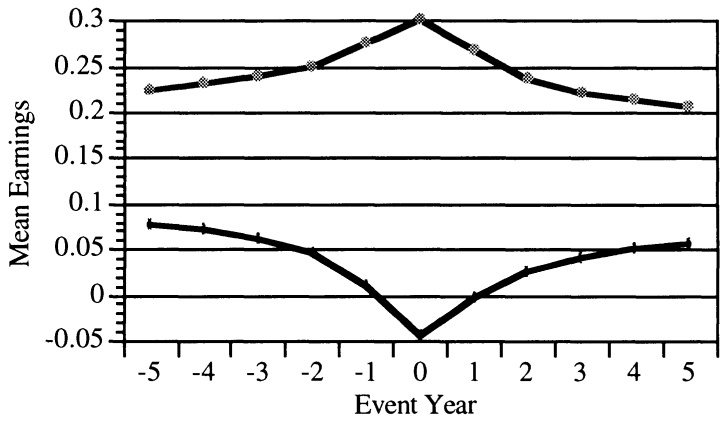
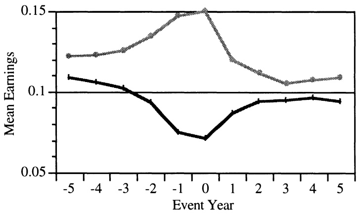
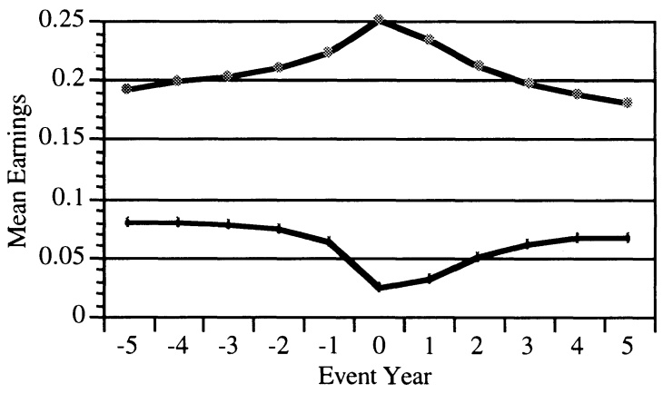
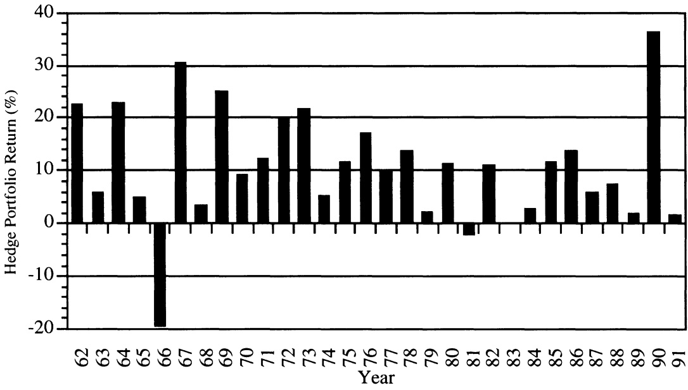
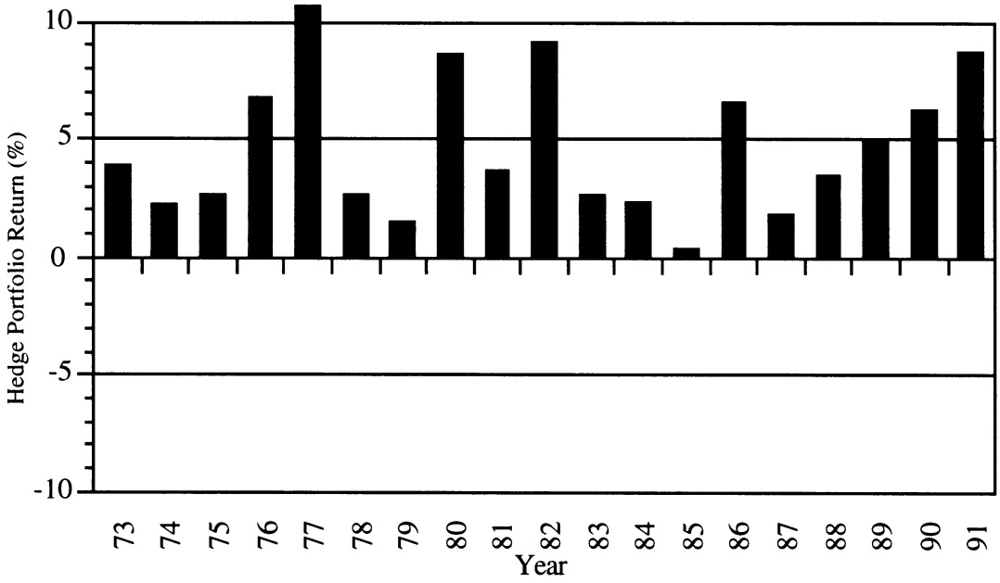

AMERICAN ACCOUNTING ASSOCIATION

Do Stock Prices Fully Reflect Information in Accruals and Cash Flows about Future Earnings? Author(s): Richard G. Sloan

Source: The Accounting Review, Vol. 71, No. 3 (Jul., 1996), pp. 289-315

Published by: American Accounting Association

Stable URL: http://www.jstor.org/stable/248290

Accessed: 27/10/2014 02:14

Your use of the JSTOR archive indicates your acceptance of the Terms & Conditions of Use, available at http://www.jstor.org/page/info/about/policies/terms.jsp

JSTOR is a not-for-profit service that helps scholars, researchers, and students discover, use, and build upon a wide range of content in a trusted digital archive. We use information technology and tools to increase productivity and facilitate new forms of scholarship. For more information about JSTOR, please contact support@jstor.org.

American Accounting Association is collaborating with JSTOR to digitize, preserve and extend access to The Accounting Review.

# Do Stock Prices Fully Reflect Information in Accruals and Cash Flows About Future Earnings?

Richard G. Sloan
University of Pennsylvania

ABSTRACT: This paper investigates whether stock prices reflect information about future earnings contained in the accrual and cash flow components of current earnings. The extent to which current earnings performance persists into the future is shown to depend on the relative magnitudes of the cash and accrual components of current earnings. However, stock prices are found to act as if investors “fixate” on earnings, failing to reflect fully information contained in the accrual and cash flow components of current earnings until that information impacts future earnings.

Key Words: Accruals, Cash flows, Earnings, Market efficiency.

Data Availability: Data are commercially available from the sources identified in the text.

## I. INTRODUCTION

Texts on financial statement analysis frequently advocate examining the accrual and cash flow components of current earnings for the purpose of predicting future earnings.$^{1}$ Indeed, some financial analysts argue that since investors tend to “fixate” on reported earnings, analysis of this type can be used to detect mispriced securities.$^{2}$ This paper examines the nature of the information contained in the accrual and cash flow components of earnings and the extent to which this information is reflected in stock prices. The results indicate that earnings performance attributable to the accrual component of earnings exhibits lower persistence than earnings performance attributable to the cash flow component of earnings. The results also indicate that stock prices act as if investors “fixate” on earnings, failing to distinguish fully between the different properties of the accrual and cash flow components of earnings. Consequently, firms with relatively high (low) levels of accruals experience negative (positive) future abnormal stock returns that are concentrated around future earnings announcements.

<small>$^{1}$  See, Graham et al. (1962, 108–110), Brownlee et al. (1990, 803–804), Bernstein (1993, 461), Haskins et al. (1993, 642–649), Schilit (1993, 123–130), Stickney (1993, 102), White et al. (1994, 138–159) and Kieso and Weygandt (1995, 1231).</small>

<small>$^{2}$ For example, several analysts sell investment advice based on this type of analysis. They include Thornton O'Glove (The Quality of Earnings Report), Jack Ciesielski (The Analyst's Accounting Observer), David Tice (Behind the Numbers), Michael Murphy (Overpriced Stock Service) and Kellogg Associates (Financial Statement Alert). Specific examples of such recommendations are discussed in "Early Warnings," (Forbes 1990, 246), "Financial Misstatements" (Institutional Investor 1993, 171) and "The Sherlock Homes of Accounting," (Business Week 1994, 48).</small>

<small>This paper has benefited from the comments of workshop participants at Harvard University, Hong Kong University of Science and Technology, Massachusetts Institute of Technology, the University of Michigan, the University of North Carolina, the University of Pennsylvania, Washington University, the 1993 annual meetings of the American Accounting Association and anonymous referees. I acknowledge a special debt to the late Vic Bernard, whose comments and encouragement were instrumental in the completion of this project.</small>

<small>Submitted February 1995. Accepted February 1996.</small>

The paper adds to the growing body of evidence indicating that stock prices reflect naive expectations about fundamental valuation attributes such as earnings. In particular, it adds to the evidence in Ou and Penman (1989), which employs a mechanical statistical prediction model to predict one-year ahead earnings changes, and in Bernard and Thomas (1990), which uses the auto-regressive properties of quarterly earnings to predict future quarterly earnings. In addition to corroborating the findings of these studies in a different setting, this paper contributes in three key respects. First, instead of relying on a statistically motivated model to predict future earnings, this paper employs a model that relies on characteristics of the underlying accounting process that are documented in texts on financial statement analysis. Second, while Ou and Penman (1989) and Bernard and Thomas (1990) use a random walk model to represent investors' naive earnings expectations, this paper uses a less restrictive model that assumes investors might not fully discriminate between different components of earnings. Finally, unlike previous research, this paper assesses the extent to which the magnitude of the predictable stock returns is consistent with the predictions of the naive earnings expectations model.

The paper also has implications for prior research investigating the differential information content of the cash flow and accrual components of earnings by examining contemporaneous stock price responses (Wilson 1987; Bernard and Stober 1989; Lev and Thiagarajan 1993). For example, Bernard and Stober (1989) find no evidence that stock prices respond in a systematic manner to the release of information about the cash flow and accrual components of earnings and conjecture that the information content of these two components of earnings may not be systematically different. However, the results in this paper demonstrate that the information content of these components is systematically different, but that stock prices do not reflect this information fully until it impacts future earnings.

The remainder of the paper is organized as follows. Section II develops testable hypotheses concerning the relation between the accrual and cash flow components of current earnings, future earnings and future stock returns. Section III describes sample formation and variable measurement. Section IV presents the empirical results and section V concludes the paper.

## II. DEVELOPMENT OF HYPOTHESES

The importance of analyzing the accrual and cash components of current earnings in the assessment of future earnings is frequently emphasized in texts on financial statement analysis. For example, Graham et al. (1962) emphasize the importance of information in current earnings and its components for estimating the future earnings power of an enterprise.$^{3}$ They recommend a five-step process for adjusting current earnings to arrive at earnings power. These steps adjust current earnings for various operating accruals including arbitrary reserves, unusual levels of depreciation (or amortization) and different inventory valuation methods. The reasoning underlying these steps is that these accruals are less likely to recur in future periods' earnings. This line of reasoning is frequently reiterated. For example, Bernstein (1993, 461) states that:

<small>$^{3}$  Graham et al. (1962) define earnings power as the level of earnings an enterprise can be expected to sustain over the next five to ten years.</small>

CFO (cash flow from operations), as a measure of performance, is less subject to distortion than is the net income figure. This is so because the accrual system, which produces the income number, relies on accruals, deferrals, allocations and valuations, all of which involve higher degrees of subjectivity than what enters the determination of CFO. That is why analysts prefer to relate CFO to reported net income as a check on the quality of that income. Some analysts believe that the higher the ratio of CFO to net income, the higher the quality of that income. Put another way, a company with a high level of net income and a low cash flow may be using income recognition or expense accrual criteria that are suspect.

Similar reasoning was used by the FASB (1980, para. 54) as a justification for greater emphasis on cash flow information in firms' financial statements.

The common theme underlying this reasoning is that the accrual and cash flow components of current earnings have different implications for the assessment of future earnings. While both components contribute to current earnings, current earnings performance is less likely to persist if it is attributable primarily to the accrual component of earnings as opposed to the cash flow component. For example, high earnings performance that is attributable to the cash flow component of earnings is more likely to persist than high earnings performance that is attributable to the accrual component of earnings. This reasoning forms the basis for the first testable hypothesis:

H1: The persistence of current earnings performance is decreasing in the magnitude of the accrual component of earnings and increasing in the magnitude of the cash flow component of earnings.

The remaining hypotheses concern the extent to which stock prices reflect the different properties of the accrual and cash flow components of earnings. The relation between stock prices and earnings has been widely researched. Following Ball and Brown (1968), many studies have documented a positive contemporaneous association between stock returns and earnings, which is generally attributed to earnings' ability to summarize value relevant information. However, a number of recent studies present evidence that investors do not correctly use available information in forecasting future earnings performance (Ou and Penman 1989; Bernard and Thomas 1990; Hand 1990; Maines and Hand 1996). This evidence raises the possibility that the well documented association between earnings and stock returns may, in part, reflect investors' naive fixation on reported earnings, rather than earnings' ability to summarize value relevant information. By identifying the role of information in the accrual and cash flow components of current earnings in the forecasting of future earnings, this study provides a natural setting in which to corroborate and extend prior evidence.

A meaningful test of whether stock prices fully reflect available information requires the specification of an alternative “naive” expectation model, against which to test the null of market efficiency. The naive model employed in this study is that investors “fixate” on earnings and fail to distinguish between the accrual and cash flow components of current earnings. This naive earnings expectation model is consistent with the functional fixation hypothesis, which has received empirical support in capital markets, behavioral and experimental research (Hand 1990; Abdel-khalik and Keller 1979; Bloomfield and Libby 1995). This model is not as restrictive as the random walk model implicit in Ou and Penman (1989) and Bernard and Thomas (1990). Earnings expectations are permitted to reflect the overall level of persistence in earnings performance, but are hypothesized not to reflect the differential degrees of persistence attributable to the accrual and cash flow components of earnings. The second hypothesis is then:

H2(i): The earnings expectations embedded in stock prices fail to reflect fully the higher earnings persistence attributable to the cash flow component of earnings and the lower earnings persistence attributable to the accrual component of earnings.

This hypothesis makes predictions about both the direction and the magnitude of deviations in the expectations embedded in stock prices from the actual relationships. Two extensions of this hypothesis provide corroborative evidence on the extent to which stock price behavior deviates from the rational expectations model. The first extension develops a trading strategy to exploit the naive earnings expectations embedded in stock prices, providing insight into the economic significance of deviations from the rational expectations model. If investors naively fixate on earnings, then they will tend to overprice (underprice) stocks in which the accrual component is relatively high (low). This occurs because the lower persistence of earnings performance attributable to the accrual component of earnings is not fully anticipated. The mispricing will be corrected when future earnings are realized to be lower (higher) than expected, resulting in predictable negative (positive) abnormal stock returns. A simple strategy that exploits this mispricing can therefore be implemented as follows: $^{4}$

H2(ii): A trading strategy taking a long position in the stock of firms reporting relatively low levels of accruals and a short position in the stock of firms reporting relatively high levels of accruals generates positive abnormal stock returns.

The above extension of the stock price hypothesis concerns the sign and magnitude of abnormal stock returns resulting from naive fixation on earnings. A second extension of the stock price hypothesis relates to the timing of the abnormal stock returns resulting from naive fixation on earnings. If the abnormal stock returns represent a delayed response to predictable changes in future earnings, then they should be concentrated around information events that reveal the predictable earnings changes, such as future earnings announcements. Thus, the second extension of the naive expectations model is that the predictable stock returns will be clustered around future earnings announcements:

H2(iii): The abnormal stock returns predicted in H2(ii) are clustered around future earnings announcement dates.

Bernard and Thomas (1990) conduct a similar test in their examination of the post-earnings announcement drift. Consistent with their naive-expectations model, they find that almost 40 percent of the drift is clustered around future earnings announcements.

## III. SAMPLE FORMATION AND VARIABLE MEASUREMENT

The empirical tests are conducted using all firms with available data in the intersection of the 1993 versions of the Compustat annual industrial and research files and the CRSP monthly stock returns file. The CRSP file provides data on NYSE and AMEX firms from 1926, while the Compustat files provide data on a similar population from 1950. However, the Compustat data prior to 1962 suffer from a serious survivorship bias (Fama and French 1992) and frequently do not contain data on the variables required to compute accruals. Therefore, pre-1962 observations are eliminated. Further the stock price tests require at least one year of future returns data, so Compustat data after 1991 are eliminated from the tests. The study, therefore, employs financial statement data for the 30 years beginning in 1962 and ending in 1991. Finally, the financial statement data required to compute operating accruals are not available for all firms. In particular, these data are not available on Compustat for banks, life insurance or property and casualty companies. This results in a final sample of 40,679 firm-year observations with the required financial statement and stock price data. $^{5}$

<small>$^{4}$  The trading strategy could also be stated in terms of the relative magnitude of the cash flow component of earnings. That is, a trading strategy taking a long position in firms with relatively high levels of cash flow and a short position in firms with relatively low levels of cash flow should generate positive excess returns.</small>

The financial variables of interest in this study are earnings, accruals and cash from operations. The definition of earnings employed in the tests is operating income after depreciation (Compustat data item 178). This definition is selected because it excludes non-recurring items such as extraordinary items, discontinued operations, special items and non-operating income. These non-recurring items are problematic because Compustat does not provide the information necessary to decompose them into their underlying cash and accrual components. Exclusion of these items from the empirical tests therefore allows unambiguous assessments of the persistence of the cash and accrual components of income from continuing operations.

SFAS No. 95 requires the information necessary for computing the accrual component of earnings to be identified in the operating section of the Statement of Cash Flows as part of the reconciliation of net income with operating cash flows (para. 29). However, SFAS No. 95 was in effect for only the final four years of the 30-year period examined in this paper. Prior to SFAS No. 95, firms were required to produce a Statement of Changes in Financial Position that focused on working capital rather than cash, seriously hindering the computation of operating accruals (Drtina and Largay 1985). Accordingly, the accrual component of earnings is computed using information from the balance sheet and income statement, as is common in the earnings management literature (Dechow et al. 1995):

## Accruals = (ΔCA - ΔCash) - (ΔCL - ΔSTD - ΔTP) - Dep

(1)

where $\Delta \mathrm{CA} =$ change in current assets (Compustat item 4),

$\Delta \mathrm{Cash} =$ change in cash/cash equivalents (Compustat item 1),

$\Delta \mathrm{CL} =$ change in current liabilities (Compustat item 5),

$\Delta \mathrm{STD} =$ change in debt included in current liabilities (Compustat item 34),

$\Delta \mathrm{TP} =$ change in income taxes payable (Compustat item 71), and

Dep = depreciation and amortization expense (Compustat item 14).

Debt in current liabilities is excluded from accruals because it relates to financing transactions as opposed to operating transactions. Income taxes payable is also excluded from accruals for consistency with the definition of earnings employed in the empirical tests.$^{6}$ The cash flow component of earnings is measured as the difference between earnings and the accrual component of earnings.

<small>$^{5}$ There are 71,732 NYSE and AMEX firm-year observations on the Compustat tapes from 1962 through 1991. Elimination of firms with insufficient data to compute accruals reduces the sample to 53,322 firm-years. Elimination of firms that either could not be found on $CRSP$ or had insufficient returns data on CRSP further reduces the sample to 42,120 firm-years. Elimination of firms for which the subsequent year's income is unavailable produces the final sample of 40,679 firm-year observations.</small>

<small>$^{6}$  Recall that the definition of earnings employed in the empirical tests is income from continuing operations, which excludes tax expense. Income from continuing operations also excludes interest expense, indicating that interest payable should be excluded from accruals. Interest accruals arising from differences between periodic interest payments and the associated interest expense are included in the net book value of debt, and therefore excluded from accruals. Interest accruals arising because periodic interest payment dates do not coincide with the fiscal year-end are reported by Compustat in either “debt in current liabilities” or “current liabilities—other.” In the former case, they are excluded from accruals, while in the latter case, they are included in accruals. As a practical matter, however, exclusion of “current liabilities—other” from the definition of accruals has no material impact on the results reported in the paper.</small>

The empirical analysis requires cross-sectional and temporal comparisons of the magnitude of earnings performance and the relative magnitude of the accrual and cash flow components of earnings. Accordingly, all three variables are standardized by firm size to facilitate such comparisons. The measure of firm size employed is total assets, measured as the average of the beginning and end of year book value of total assets (Compustat data item 6). $^{7}$  The following definitions of the three financial variables are used in the empirical analysis:

$$
\text {Earnings} = \frac {\text {Income from Continuing Operations}}{\text {Average Total Assets}},
$$

$$
\text {Accrual Component} = \frac {\text {Accruals}}{\text {Average Total Assets}}, \text {and}
$$

$$
\text {Cash Flow Component} = \frac {\text {Income from Continuing Operations - Accruals}}{\text {Average Total Assets}}.
$$

The measurement of future stock returns begins four months after the end of the fiscal year from which the financial statement data are gathered. Alford et al. (1994) report that, by this time, almost all firms' financial statements are publicly available. Stock returns inclusive of dividends are obtained for each firm from the CRSP monthly returns file and annual buy-hold returns are computed for three future years. If a security delists during a particular year, then the CRSP delisting return is included in the buy-hold annual return, and the proceeds are re-invested in the CRSP size-matched decile portfolio for the remainder of the year. If a security delists as a result of either a liquidation or a forced delisting by the exchange or the SEC and the delisting return is coded as missing by CRSP, then a delisting return of -100% is assumed.$^{8}$

The computation of abnormal returns requires adjustment for the normal or expected return. Two alternative adjustment procedures are employed in this study. First, size is a well-documented predictor of future returns, and prior research in this area typically employs a size adjustment (Ou and Penman 1989; Bernard and Thomas 1990). In this study, size-adjusted returns are computed by measuring the buy-hold return in excess of the buy-hold return on a value-weighted portfolio of firms having similar market values. The size portfolios are formed by CRSP and are based on size deciles of NYSE and AMEX firms. Membership in a particular portfolio is determined using the market value of equity at the beginning of the calendar year in which the return cumulation period begins.

The second adjustment procedure estimates Jensen alphas at the portfolio level using the technique first suggested by Ibbotson (1975). The procedure involves estimating the following time-series regression separately for each portfolio for each of the three years in the evaluation period.

<small>$^{7}$  Since the definition of earnings used in the study does not include a charge for interest expense, total assets is an appropriate book measure of the investment base used to generate earnings. Alternative deflators were also considered, including the market value of equity and the book value of the net assets generating the accruals. However, each of these deflators introduces complications. Market value of equity is systematically associated with subsequent stock returns, and so deflating by market value of equity may itself induce an association with subsequent stock returns (Fama and French 1992). Book value of net assets is problematic because it can take on values that are negative, producing economically meaningless figures. The results, however, are relatively insensitive to the choice of deflator.</small>

<small>$^{8}$  The results are robust with respect to the alternative procedures of (1) eliminating these securities from the sample, and (2) assuming a delisting return of zero.</small>

$$
(R _ {p t} - R _ {f t}) = \alpha_ {p} + \beta_ {p} (R _ {m t} - R _ {f t}) + \varepsilon_ {p t}\tag{2}
$$

where $R_{pt} =$ equal-weighted return on portfolio p in year t,

$R_{mt} =$ market return in year t, and

$R_{ft} =$ riskless rate of return in year t.

Each regression is estimated using annual returns for the thirty years in the sample period. The relative risk (beta) of each portfolio is then measured by  $\beta_{p}$  and the excess return by  $\alpha_{p}$  (its Jensen alpha). This technique assumes that the Sharpe-Lintner version of the capital asset pricing model is used by investors in setting expected returns. It also assumes stability in the relative risk of portfolios within each year of the evaluation period. However, it does allow for variations in relative risk for a particular security over time and for a particular portfolio in different years of the evaluation period. This feature is useful when firms are placed into portfolios on the basis of economic characteristics that are unstable. Jensen alphas are estimated separately for each portfolio, for each of the three years in the evaluation period. Since this approach assumes that the returns in each portfolio are aligned in calendar time, the results for this approach are restricted to firms with December fiscal year-ends. Thus, the sample size for this particular adjustment technique is reduced to 24,209 firm-years. Annual buy-hold risk-free returns ( $R_{f}$ ) are estimated using CRSP treasury bill yields. Annual market returns ( $R_{m}$ ) are estimated by cumulating CRSP monthly returns on the equal-weighted NYSE/AMEX index (including dividends).

## IV. EMPIRICAL ANALYSIS

## Descriptive Statistics

The empirical predictions developed in section II derive from the properties of the accrual and cash flow components of earnings. Therefore, the empirical analysis begins by providing descriptive statistics relating to these components. Table 1 provides statistics on the characteristics of decile portfolios formed by ranking firms on the magnitude of the accrual component of earnings. Firm-years are ranked annually and assigned in equal numbers to the ten portfolios. Panel A reports the portfolio mean and median values for the magnitudes of earnings and its two components. Consistent with prior research (Dechow 1994), there is evidence of a strong negative relation between accruals and cash flows. The mean (median) value of cash flow falls from 0.22 (0.23) for the lowest accrual portfolio to 0.00 (0.00) for the highest accrual portfolio. In contrast, earnings performance is positively related to accruals. The mean (median) value of earnings is 0.07 (0.07) for the lowest accrual portfolio and 0.15 (0.13) for the highest accrual portfolio. Sorting on the absolute magnitude of accruals therefore provides a simple and effective way of sorting on the relative magnitude of the accrual component of earnings.$^{9}$ This characteristic of the data is exploited in implementing the trading strategy to test H2(ii).

Panel B of table 1 provides statistics on two potential risk factors in order to assess the possibility that systematic variation in future stock returns across the accrual portfolios may be attributable to incomplete adjustment for risk. The first row provides the event-time portfolio betas computed using the Ibbotson (1975) technique described in section III. There is evidence shaped” pattern in the betas: the beta is 1.25 for the lowest accrual portfolio, falls to 0.86 for portfolio 4 and then gradually increases to 1.23 for the highest accrual portfolio. Thus, the extreme portfolios are more risky, but a hedge portfolio with equal-sized long and short positions in portfolios 1 and 10 respectively would have a beta of only 0.02. The second risk proxy is firm size, measured as the natural logarithm of the market value of equity. There is evidence of an inverted “U-shaped” relation in the portfolio means and medians, with the extreme portfolios containing the smaller, more risky stocks. As with the betas, a hedge portfolio with equal-sized long and short positions in portfolios 1 and 10 respectively would have negligible net exposure to small firms.

<small>$^{9}$  The rank correlation between accruals and cash flows is -0.53, while the rank correlation between accruals and the ratio of accruals to earnings is 0.94.</small>

TABLE 1

Mean (median) Values of Selected Characteristics for Ten Portfolios of Firms Formed Annually by Assigning Firms to Deciles Based on the Magnitude of Accruals. Sample Consists of 40,679 Firm-years between 1962 and 1991 $^{a}$

<table><tr><td rowspan="2"></td><td colspan="10">Portfolio Accrual Ranking</td></tr><tr><td>Lowest</td><td>2</td><td>3</td><td>4</td><td>5</td><td>6</td><td>7</td><td>8</td><td>9</td><td>Highest</td></tr><tr><td colspan="11">Panel A: Components of Earnings</td></tr><tr><td>Accruals</td><td>-0.18(-0.15)</td><td>-0.09(-0.09)</td><td>-0.07(-0.06)</td><td>-0.05(-0.05)</td><td>-0.03(-0.03)</td><td>-0.02(-0.02)</td><td>-0.00(0.00)</td><td>0.02(0.02)</td><td>0.05(0.05)</td><td>0.15(0.12)</td></tr><tr><td>Cash Flows</td><td>0.22(0.23)</td><td>0.18(0.18)</td><td>0.16(0.16)</td><td>0.15(0.15)</td><td>0.13(0.13)</td><td>0.12(0.13)</td><td>0.12(0.11)</td><td>0.10(0.10)</td><td>0.08(0.07)</td><td>0.00(0.00)</td></tr><tr><td>Earnings</td><td>0.07(0.07)</td><td>0.09(0.09)</td><td>0.10(0.09)</td><td>0.11(0.10)</td><td>0.11(0.10)</td><td>0.11(0.11)</td><td>0.12(0.11)</td><td>0.13(0.12)</td><td>0.13(0.13)</td><td>0.15(0.13)</td></tr><tr><td colspan="11">Panel B: Risk Proxies</td></tr><tr><td colspan="11">Portfolio</td></tr><tr><td>Beta</td><td>1.25</td><td>0.94</td><td>0.95</td><td>0.86</td><td>0.91</td><td>0.94</td><td>0.93</td><td>0.93</td><td>1.06</td><td>1.23</td></tr><tr><td>Size</td><td>3.80(3.54)</td><td>4.57(4.38)</td><td>4.93(4.84)</td><td>4.97(4.93)</td><td>4.94(4.86)</td><td>4.90(4.84)</td><td>4.77(4.65)</td><td>4.62(4.53)</td><td>4.32(4.20)</td><td>3.99(3.86)</td></tr><tr><td colspan="11">Panel C: Components of Accruals</td></tr><tr><td>Current</td><td rowspan="2">-0.08(-0.06)</td><td rowspan="2">-0.01(-0.01)</td><td rowspan="2">0.01(0.01)</td><td rowspan="2">0.02(0.01)</td><td rowspan="2">0.03(0.02)</td><td rowspan="2">0.04(0.03)</td><td rowspan="2">0.05(0.05)</td><td rowspan="2">0.07(0.07)</td><td rowspan="2">0.11(0.10)</td><td rowspan="2">0.21(0.19)</td></tr><tr><td>Asset</td></tr><tr><td>Current</td><td rowspan="2">-0.03(-0.02)</td><td rowspan="2">-0.02(-0.02)</td><td rowspan="2">-0.02(-0.01)</td><td rowspan="2">-0.02(-0.01)</td><td rowspan="2">-0.02(-0.01)</td><td rowspan="2">-0.02(-0.01)</td><td rowspan="2">-0.02(-0.01)</td><td rowspan="2">-0.02(-0.02)</td><td rowspan="2">-0.02(-0.02)</td><td rowspan="2">-0.03(-0.03)</td></tr><tr><td>Liability</td></tr><tr><td>Depreciation</td><td rowspan="2">-0.06(-0.05)</td><td rowspan="2">-0.06(-0.05)</td><td rowspan="2">-0.05(-0.05)</td><td rowspan="2">-0.05(-0.05)</td><td rowspan="2">-0.04(-0.04)</td><td rowspan="2">-0.04(-0.04)</td><td rowspan="2">-0.04(-0.03)</td><td rowspan="2">-0.03(-0.03)</td><td rowspan="2">-0.03(-0.03)</td><td rowspan="2">-0.03(-0.03)</td></tr><tr><td>Expense</td></tr><tr><td colspan="11">aThe firm characteristics are computed as follows:</td></tr><tr><td>Accruals</td><td colspan="10">= the change in non-cash current assets, less the change in current liabilities (exclusive of short-term debt and taxes payable), less depreciation expense, all divided by average total assets.</td></tr><tr><td>Earnings</td><td colspan="10">= income from continuing operations divided by average total assets.</td></tr><tr><td>Cash flows</td><td colspan="10">= the difference between earnings and accruals (as defined above).</td></tr><tr><td>Portfolio beta</td><td colspan="10">= the beta coefficient from a time-series regression of the excess return on the portfolio over the risk-free rate on the excess return on the market over the risk-free rate using the 30 calendar years in the sample.</td></tr><tr><td>Size</td><td colspan="10">= the natural log of the market value of common equity (in millions of dollars) measured at fiscal year end.</td></tr><tr><td>Current asset</td><td colspan="10">= the change in non-cash current assets divided by average total assets.</td></tr><tr><td>Current liability</td><td colspan="10">= minus the change in current liabilities (exclusive of short-term debt and taxes payable) divided by average total assets.</td></tr><tr><td>Depreciation</td><td colspan="10">= minus depreciation expense divided by average total assets.</td></tr></table>

Panel C of table 1 investigates the importance of the major components of accruals in explaining variation in the accrual component of earnings. Following from the definition of accruals in equation (1), the major components of accruals are measured as:

$$
\begin{array}{c c c} \frac {\Delta \mathrm{CA} - \Delta \text {Cash}}{\text {Avg Total Assets}} & - \frac {\Delta \mathrm{CL} - \Delta \mathrm{STD} - \Delta \mathrm{TP}}{\text {Avg Total Assets}} & - \frac {\text {Dep}}{\text {Avg Total Assets}} \\ | & | & | \\ \text {Current Asset} & \text {Current Liability} & \text {Depreciation} \end{array} .\tag{3}
$$

It is readily apparent from a comparison of the means and median values across the portfolios that the majority of the variation in accruals is attributable to variation in the current asset component. Across the accrual portfolios, the mean (median) values of the current asset component range from -0.08 (-0.06) to 0.21 (0.19). The corresponding values for the current liability and depreciation components are from -0.03 (-0.02) to -0.03 (-0.03), and -0.06 (-0.05) to -0.03 (-0.03), respectively. Further analysis (not reported) reveals that variation in current accruals is attributable primarily to variation in receivables and inventory, though the relative importance of these two accounts varies considerably by industry.

The results in panel C raise the possibility that a sort on accruals may be very similar to a sort on the current asset component of accruals, given the lack of significant variation in the other two components of accruals. However, this is not the case. The current asset and current liability components of accruals are strongly negatively correlated, reflecting the fact that growing firms, with increasing working capital requirements, tend to experience increases in both their current asset and their current liability accounts. Thus, a sort on the current asset component induces a reverse sort on the current liability component, resulting in relatively little variation in the aggregate accrual component. Sorting on the aggregate accrual component isolates cases where current assets have changed without proportionate changes in current liabilities.

## Tests of H1

The first hypothesis is that earnings performance attributable to the accrual component of earnings is less persistent than earnings performance attributable to the cash flow component of earnings. Following Freeman et al. (1982), the relation between current earnings performance and future earnings performance can be expressed as:

$$
\mathrm{Earnings}_{t + 1} = \alpha_{0} + \alpha_{1}\mathrm{Earnings}_{t} + v_{t + 1}.\tag{4}
$$

Recall that “Earnings” is defined as operating income scaled by total assets, so  $\alpha_{1}$  measures the persistence of the accounting rate of return on assets. It is well established that accounting rates of return are mean reverting, implying that  $\alpha_{1}$  is less than unity (Beaver 1970; Freeman et al. 1982). However, H1 predicts that equation (4) is misspecified because it constrains the coefficients on the cash and accrual components of earnings to be equal. The specification implied by H1 is:

$$
\text {Earnings} _ {t + 1} = \gamma_ {0} + \gamma_ {1} \text {Accruals}, + \gamma_ {2} \text {Cash Flows}, + v _ {t + 1}\tag{5}
$$

where $\gamma_{1} < \gamma_{2}$. The smaller coefficient on accruals relative to cash flows reflects the lower persistence of earnings performance attributable to the accrual component of earnings.

Tests of H1 are provided in tables 2 and 3. Table 2 reports results from the estimation of equation (4) to establish the average level of persistence in earnings performance. Equation (4) is estimated via both a single pooled regression and via industry specific regressions conducted at the two-digit SIC code level. The time-series properties of earnings differ as a function of industry characteristics (Lev 1983) and it is therefore possible that the pooled regression results suffer from a varying parameters problem. The industry level regressions ensure that the results are robust to this problem. $^{10}$  A second potential concern with the regression results is that they are attributable to a small number of outlying observations that are not representative of the population and/or are measured with error. To investigate the robustness of the results with respect to this concern, the regressions are also estimated using the decile rankings of the variables in place of their actual values. The decile ranks are assigned annually for each of the 30 fiscal years in the sample and range from 1 (lowest values) to 10 (highest values).

The first column of results in panel A of table 2 provides parameter estimates for equation (4) estimated in pooled form. The estimate of $\alpha_{1}$ is 0.841, confirming prior findings that earnings performance is slowly mean reverting. The t-statistic of 303.98 strongly rejects the null hypothesis that earnings performance is purely transitory (i.e., $\alpha_{1} = 0$). Similarly, the null hypothesis that earnings performance follows a random walk (i.e., $\alpha_{1} = 1$) is rejected with a t-statistic of -57.47.$^{11}$ The industry level regressions provide similar results. The mean value of $\alpha_{1}$ is 0.773 and the interquartile range is from 0.708 to 0.863. The rank regressions in panel B of table 2 provide slightly smaller estimates of $\alpha_{1}$. The pooled estimate is 0.783, while the industry level mean is 0.768. To the extent that outliers unduly influence the results in panel A, they influence the results toward overstating $\alpha_{1}$. Overall, the results in table 2 confirm previous evidence that accounting rates of return are mean reverting, with an average persistence parameter, $\alpha_{1}$, of approximately 0.8.

Table 3 provides parameter estimates for equation (5), which does not constrain the persistence coefficients on the accrual and cash components of earnings to be equal. The first column of panel A provides the pooled regression results. The coefficient on the accrual component of earnings, $\gamma_{1}$, is 0.765, while the coefficient on the cash component of earnings, $\gamma_{2}$, is 0.855. An F-test rejects the hypothesis that the coefficients are equal (F = 614.01). The remainder of panel A provides statistics from the distributions of the coefficients from the industry level regressions. The $\gamma_{1}$ coefficient is consistently smaller than the $\gamma_{2}$ coefficient. In industry specific comparisons of $\gamma_{1}$ and $\gamma_{2}$, $\gamma_{1}$ is less than $\gamma_{2}$ in 86 percent of the industries examined, and the null hypothesis of equality is rejected with a sign test. The rank regression results reported in panel B provide corroborating evidence that $\gamma_{1}$ is less than $\gamma_{2}$. The pooled regression yields a $\gamma_{1}$ estimate of 0.565 versus a $\gamma_{2}$ estimate of 0.838. Equality of these two coefficients is strongly rejected (F=4894.24). The industry level regressions confirm that $\gamma_{1}$ is centered between 0.5 and 0.6, while $\gamma_{2}$ is centered around 0.8. The $\gamma_{1}$ coefficient is less than the $\gamma_{2}$ coefficient in 99 percent of the industries, and the null hypothesis of equality is rejected using a sign test. The results in table 3 therefore provide strong evidence in support of H1.

Figure 1 illustrates the lower persistence of earnings performance attributable to the accrual component of earnings relative to earnings performance attributable to the cash flow component of earnings. The figure provides time-series plots of earnings performance for firm-years in the extreme deciles when ranked by earnings, accruals and cash flows, respectively. Year zero

<small>$^{10}$ The results are also estimated using a fixed effects model. The tenor of the results is unchanged.</small>

<small>$\alpha_{1} = 1$</small>

<small>$^{11}$ Significance testing is conducted using Dickey-Fuller critical values, because the standard critical values are inappropriate under the null hypothesis that  $\alpha_{1}=1$  (Fuller 1976).</small>

## TABLE 2

Results from Ordinary Least Squares Regressions of Future Earnings Performance on Current Earnings Performance (t-statistics in parentheses)
Sample Consists of 40,679 Firm-years from 1962 to 1991 $^{a}$

$$
E a r n i n g s _ {t + 1} = \alpha_ {0} + \alpha_ {1} E a r n i n g s _ {t} + v _ {t + 1}
$$

Panel A: Regressions using actual values

<table><tr><td rowspan="2"></td><td rowspan="2">Pooled</td><td colspan="4">Industry Level</td></tr><tr><td>Mean</td><td>Q1</td><td>Median</td><td>Q3</td></tr><tr><td> $\alpha_0$ </td><td>0.015(32.57)**</td><td>0.021</td><td>0.014</td><td>0.019</td><td>0.027</td></tr><tr><td> $\alpha_1$ </td><td>0.841(303.98)**</td><td>0.773</td><td>0.708</td><td>0.774</td><td>0.863</td></tr></table>

Panel B: Regressions using decile rankings

<table><tr><td rowspan="2"></td><td rowspan="2">Pooled</td><td colspan="4">Industry Level</td></tr><tr><td>Mean</td><td>Q1</td><td>Median</td><td>Q3</td></tr><tr><td> $\alpha_0$ </td><td>1.193(62.37)**</td><td>1.300</td><td>0.885</td><td>1.187</td><td>1.454</td></tr><tr><td> $\alpha_1$ </td><td>0.783(253.93)**</td><td>0.768</td><td>0.699</td><td>0.772</td><td>0.825</td></tr></table>

$^{a}$  Earnings is income from continuing operations divided by average total assets.

\*\*Denotes significance at the 0.01 level using a two-tailed t-test.

represents the year in which firms are ranked into extreme deciles, and the plots document mean earnings performance in the five years either side of year zero. The first graph plots earnings performance for firms with extreme earnings in year zero. Consistent with the results in table 2, earnings performance reverts slowly to the mean. Mean reversion is gradual and far from complete by the fifth year. This graph provides a benchmark against which to compare the rates of mean reversion in earnings documented in the second and third graphs. The second graph plots earning performance for firms with extreme accruals. Mean reversion takes place more rapidly in this graph. Most of the mean reversion takes place in the first year, and mean reversion is essentially complete by the third year. The third and final graph plots earnings performance for firms with extreme cash flows. Mean reversion takes place gradually, as in the first graph, and is far from complete by the fifth year.

## Tests of H2(i)

The second hypothesis concerns whether stock prices reflect the different properties of the accrual and cash flow components of earnings. The tests employ the framework developed by

# Results from Ordinary Least Squares Regressions of Future Earnings Performance on the Accrual and Cash Flow Components of Current Earnings Performance (t-statistics in parentheses) Sample Consists of 40,679 Firm-years from 1962 to 1991 $^{a}$

$$
\text {Earnings} _ {t + 1} = \gamma_ {0} + \gamma_ {1} \text {Accruals} _ {t} + \gamma_ {2} \text {Cash Flows} _ {t} + v _ {t + 1}
$$

Panel A: Regressions using actual values

<table><tr><td rowspan="2"></td><td rowspan="2">Pooled</td><td colspan="4">Industry Level</td></tr><tr><td>Mean</td><td>Q1</td><td>Median</td><td>Q3</td></tr><tr><td> $\gamma_0$ </td><td>0.011(24.05)**</td><td>0.019</td><td>0.009</td><td>0.016</td><td>0.022</td></tr><tr><td> $\gamma_1$ </td><td>0.765(186.53)**</td><td>0.721</td><td>0.635</td><td>0.703</td><td>0.780</td></tr><tr><td> $\gamma_2$ </td><td>0.855(304.56)**</td><td>0.781</td><td>0.733</td><td>0.777</td><td>0.873</td></tr></table>

F-test of $\gamma_{1} = \gamma_{2}$: 614.01b

Proportion of cases in which $\gamma_{1} < \gamma_{2}$: $86\%^{\mathrm{c}}$

Panel B: Regressions using decile rankings

<table><tr><td rowspan="2"></td><td rowspan="2">Pooled</td><td colspan="4">Industry Level</td></tr><tr><td>Mean</td><td>Q1</td><td>Median</td><td>Q3</td></tr><tr><td> $\gamma_0$ </td><td>-2.216(-55.86)**</td><td>-1.691</td><td>-2.666</td><td>-1.938</td><td>-1.459</td></tr><tr><td> $\gamma_1$ </td><td>0.565(141.02)**</td><td>0.507</td><td>0.438</td><td>0.520</td><td>0.585</td></tr><tr><td> $\gamma_2$ </td><td>0.838(209.34)**</td><td>0.794</td><td>0.760</td><td>0.805</td><td>0.884</td></tr><tr><td colspan="2">F-test of  $\gamma_1 = \gamma_2: 4894.24^b$ </td><td colspan="4">Proportion of cases in which  $\gamma_1 = \gamma_2: 99\%^c$ </td></tr></table>

<small>$^{b}$  Significant at the 0.01 level using an F-test</small>

<small>$^{a}$  Accruals is the change in non-cash current assets, less the change in current liabilities (exclusive of short-term debt and taxes payable), less depreciation expense, all divided by average total assets. Earnings is income from continuing operations divided by average total assets. Cash flows is the difference between earnings and accruals (as defined above).</small>

<small>$^{c}$  Significant at the 0.01 level using a sign test.</small>

<small>\*\*Denotes significance at the 0.01 level using a two-tailed t-test.</small>

## FIGURE 1

Time Series Properties of Earnings, Accruals and Operating Cash Flows. Year 0 is the year in which firms are ranked and assigned in equal numbers to ten portfolios based on each of the three respective variables. Earnings is measured as income from continuing operations scaled by average total assets for the year. Accruals is the change in non-cash current assets, less the change in current liabilities (exclusive of short-term debt and taxes payable), less depreciation expense, all divided by average total assets. Cash flow is the difference between earnings and accruals (as defined above).

<table><tr><td rowspan="2"></td><td>High Earnings Portfolio</td></tr><tr><td>Low Earnings Portfolio</td></tr></table>

|  | High Accrual Portfolio |
| --- | --- |
|  | Low Accrual Portfolio |

| High Cash Flow Portfolio |
| --- |
| Low Cash Flow Portfolio |

Mishkin (1983) to test rational expectations hypotheses in macro-econometrics.$^{12}$ The framework starts from the basic implication of market efficiency that abnormal returns are zero in expectation:

$$
E (r _ {t + 1} - r _ {t + 1} | \phi_ {t}) = 0\tag{6}
$$

where

$\phi_t$ = the set of information available to the market at the end of period $t$,

$E(\dots|\phi_t) =$ the objective expectation conditional on $\phi_t$,

$r_{t + 1}$ = the return to holding a security during period $t + 1$ , and

$r_{t + 1}$ = the market's subjective expectation of the normal return for period $t + 1$.

A model that satisfies the efficient-markets condition in (6) is

$$
(r _ {t + 1} - r _ {t + 1} | \phi_ {t}) = \beta (X _ {t + 1} - X _ {t + 1} ^ {e}) + \varepsilon_ {t + 1}\tag{7}
$$

where

$\varepsilon_{t} =$ a disturbance with the property that $E(\varepsilon_{t + 1}|\phi_t) = 0,$

$X_{t}$ = a variable relevant to the pricing of the security in period t,

$X_{t + 1}^{e}$ = the rational forecast of $X_{t + 1}$ at time t [i.e., $X_{t + 1}^{e} = E(X_{t + 1}|\phi_t)$],

$\beta$ = a valuation multiplier.

The implication of market efficiency highlighted by this model is that only unanticipated changes in  $X_{t+1}$  can be correlated with  $(r_{t+1}-r_{t+1}|\phi_{t})$ . In the present context, the value relevant variable, X, is earnings performance and  $\beta$  is the earnings response coefficient. The model is estimated using the two specifications of the earnings forecasting equation in (4) and (5). $^{13}$  Combining the earnings forecasting model in equation (4) with the rational pricing model in equation (7) provides the following system:

$$
E a r n i n g s _ {t + 1} = \alpha_ {0} + \alpha_ {1} E a r n i n g s _ {t} + \upsilon_ {t + 1.}\tag{8}
$$

$$
(r _ {t + 1} - r _ {t + 1} | \phi_ {t}) = \beta (E a r n i n g s _ {t + 1} - \alpha_ {0} - \alpha_ {1} ^ {*} E a r n i n g s _ {t}) + \varepsilon_ {t + 1}.\tag{9}
$$

Market efficiency imposes the constraint that $a_1 = a_1^*$. This nonlinear constraint requires that stock prices correctly anticipate the average persistence of earnings performance.

Combining the expanded earnings forecasting model in equation (5) with equation (7) gives:

$$
\text {Earnings}_{t + 1} = \gamma_{0} + \gamma_{1}\text{Accruals}_{t} + \gamma_{2}\text{Cash flows}_{t} + v_{t + 1},\tag{10}
$$

$$
(r _ {t + 1} - r _ {t + 1} | \phi_ {t}) = \beta (E a r n i n g s _ {t + 1} - \gamma_ {0} - \gamma_ {1} ^ {*} A c c r u a l s _ {t} - \gamma_ {2} ^ {*} C a s h f l o w s _ {t}) + \varepsilon_ {t + 1}.\tag{11}
$$

Market efficiency now imposes the dual constraints that $\gamma_{1} = \gamma_{1}^{*}$ and $\gamma_{2} = \gamma_{2}^{*}$. In particular, the tests of H1 indicate that $\gamma_{1} < \gamma_{2}$, so market efficiency requires $\gamma_{1}^{*} < \gamma_{2}^{*}$. Alternatively, if security prices act as if investors do not distinguish between these two components of earnings, then the coefficients on the two components will be equal (i.e., $\gamma_1^* = \gamma_2^*$).

<small>$t,\phi_{I},$</small>

<small>$^{12}$ See Mishkin (1983) and Abel and Mishkin (1983) for details of the estimation procedure, including formal proofs of all properties of the procedure that are stated in this paper.</small>

<small>$^{13}$ One obvious limitation of both specifications is that there are certainly other variables available in the information set available at t,  $\phi_{r}$ , that would be useful for forecasting earnings at  $t+1$ . However, the tests of the cross-system non-linear constraints reported in tables 4 and 5 remain valid tests of market efficiency regardless of whether the forecasting equation has omitted variables (Mishkin 1983, 49; Abel and Mishkin 1983, 10).</small>

The two systems are estimated using iterative weighted non-linear least squares (Mishkin 1983). $^{14}$  The expected return,  $\bar{r}_{i+1}$ , is measured using the realized return on a size-matched portfolio following the procedure described in section III. Market efficiency is tested using a likelihood ratio statistic which is distributed asymptotically  $\chi^{2}(q)$ :

$$
2 n \log \left(\mathrm{SSR} ^ {c} / \mathrm{SSR} ^ {u}\right)\tag{12}
$$

where

$q$ = the number of constraints imposed by market efficiency,

$n$ = the number of observations,

$SSR^{c}$ = the sum of squared residuals from the constrained weighted system, and

$SSR^{\prime \prime} =$ the sum of squared residuals from the unconstrained weighted system.

Results from the estimation of the system in equations (8) and (9) are reported in table 4. Panel A contains results using the actual values of the financial variables, while the results in panel B use decile rankings to control for outliers. The coefficient on earnings in the forecasting equation, $\alpha_{1}$, is 0.841, as in table 2. The coefficient on earnings in the stock price equation, $\alpha_{1}^{*}$, is 0.840, which is extremely close to its counterpart in the forecasting equation and indicates that stock prices anticipate the average persistence of earnings performance. The likelihood test for market efficiency is 0.007 (marginal significance level = 0.933) and the null hypothesis of market efficiency is not rejected. The results in panel B yield much the same conclusions. The persistence of earnings is somewhat weaker using the decile rankings, but is still anticipated rationally in the pricing equation. These results can be interpreted as indicating the absence of a post-earnings announcement drift in annual earnings. Stock prices correctly reflect the implications of current annual earnings for future annual earnings. The drift documented in Bernard and Thomas (1990) is unique to quarterly earnings changes.

Table 5 reports the results from estimating the system in equations (10) and (11). In the forecasting equation, the coefficient on accruals, $\gamma_{1}$, is 0.765 and the coefficient on cash flows, $\gamma_{2}$, is 0.855, identical in magnitude to those obtained using ordinary least squares in table 3. Market efficiency implies that the different implications of the accrual and cash flow components of current earnings for future earnings should be reflected in stock prices. However, the results from the stock return equation reveal that this is not the case. The coefficient on accruals, $\gamma_{1}^{*}$, is 0.911, while the coefficient on cash flows, $\gamma_{2}^{*}$, is 0.826. Thus, the coefficient on cash flows is smaller than its counterpart in forecasting equation, while the coefficient on accruals is larger than its counterpart in the forecasting equation.

Stock prices do not appear to anticipate rationally the lower (higher) persistence of earnings performance attributable to the accrual (cash flow) components of earnings. The likelihood ratio statistic is 180.91, rejecting the null hypothesis of market efficiency (marginal significance

<small>$^{14}$ This estimation and testing procedure is theoretically equivalent to full information maximum likelihood estimation, but is more empirically tractable. The procedure is also related to two-step procedures in which the forecasting equation is first estimated and the resulting estimates are used in the stock return equation (Ou and Penman 1989). However, the non-linear estimation procedure used here is superior in two respects. First, the two-step procedure uses generated regressors in the stock return equation, resulting in inconsistent standard errors. Second, the joint estimation procedure does not require the use of a holdout sample to provide a valid test of market efficiency, and therefore results in more efficient parameter estimates (Mishkin 1983, 25–26).</small>

TABLE 4

# Results from Nonlinear Generalized Least Squares Estimation of the Stock Price Reaction to Information in Current Earnings about Future Earnings Sample Consists of 40,679 Firm-years between 1962 and 1991 $^{a}$

$$
\begin{array}{c} E a r n i n g s _ {t + 1} = \alpha_ {0} + \alpha_ {1} E a r n i n g s _ {t} + \upsilon_ {t + 1} \\ A b n o r m a l R e t u r n _ {t + 1} = \beta (E a r n i n g s _ {t + 1} - \alpha_ {0} - \alpha_ {1} ^ {*} E a r n i n g s _ {t}) + \varepsilon_ {t + 1} \end{array}
$$

Panel A: Regressions using actual values of financial statement variables

| Parameter | Estimate | Asymptotic standard error |
| --- | --- | --- |
| $\alpha_{1}$ | 0.841 | 0.003 |
| $\alpha_{1}^{*}$ | 0.840 | 0.009 |
| $\beta$ | 1.920 | 0.032 |
| Test of market efficiency: | $\alpha_{1} = \alpha_{1}^{*}$ |  |
| Likelihood ratio statistic | 0.007 |  |
| Marginal significance level | 0.933 |  |

Panel B: Regressions using decile rankings of financial statement variables

| Parameter | Estimate | Asymptotic standard error |
| --- | --- | --- |
| $\alpha_{1}$ | 0.783 | 0.003 |
| $\alpha_{1}^{*}$ | 0.775 | 0.009 |
| $\beta$ | 0.082 | 0.001 |
| Test of market efficiency: | $\alpha_{1} = \alpha_{1}^{*}$ |  |
| Likelihood ratio statistic | 0.783 |  |
| Marginal significance level | 0.376 |  |

<small>$^{a}$  The firm characteristics are computed as follows:</small>

Earnings = income from continuing operations divided by average total assets.

Abnormal returns are computed by taking the raw buy-hold return, inclusive of dividends and any liquidating distributions and subtracting the buy-hold return on a size matched, value-weighted portfolio of firms. The size portfolios are based on market-value of equity deciles of NYSE and AMEX firms.

<small>The decile rankings and decile returns are supplied by CRSP.</small>

The return cumulation period begins four months after the fiscal year-end of the year in which the financial variables are measured.

level = 0.000). Fixation on earnings implies that the coefficients on both components of earnings would equal 0.841, the average persistence of earnings in table 4. The results are also inconsistent with this prediction. Instead, investors appear to treat the accrual component as if it is more persistent and the cash flow component as if it is less persistent. Panel B contains the results using the decile rankings of the financial variables. Market efficiency is still rejected, as prices continue to place too large a weighting on accruals ( $\gamma_{1} = 0.565$  and  $\gamma_{1}^{*} = 0.675$ ) and too small a weighting on cash flows ( $\gamma_{2} = 0.838$  and  $\gamma_{2}^{*} = 0.747$ ). However, the coefficient magnitudes now suggest that investors appear to anticipate partially the lower persistence of the accrual component of earnings.

<small>$(\gamma_{2} = 0.838$</small>

<small>$\gamma_{2}^{*} = 0.747)$</small>

# Results from Nonlinear Generalized Least Squares Estimation of the Stock Price Reaction to Information in the Accrual and Cash Flow Components of Current Earnings about Future Earnings Sample Consists of 40,679 Firm-years between 1962 and 1991 $^{a}$

$$
\begin{array}{c} E a r n i n g s _ {t + 1} = \gamma_ {0} + \gamma_ {1} A c c r u a l s _ {t} + \gamma_ {2} C a s h F l o w s _ {t} + v _ {t + 1} \\ A b n o r m a l R e t u r n _ {t + 1} = \beta (E a r n i n g s _ {t + 1} - \gamma_ {0} - \gamma_ {1} ^ {*} A c c r u a l s _ {t} - \gamma_ {2} ^ {*} C a s h F l o w s _ {t}) + e _ {t + 1} \end{array}
$$

Panel A: Regressions using actual values of financial statement variables

| Parameter | Estimate | Asymptotic Standard Error |
| --- | --- | --- |
| $\gamma_1$ | 0.765 | 0.004 |
| $\gamma_1^*$ | 0.911 | 0.014 |
| $\gamma_2$ | 0.855 | 0.003 |
| $\gamma_2^*$ | 0.826 | 0.010 |
| $\beta$ | 1.894 | 0.032 |

$$
\gamma_ {1} = \gamma_ {1} ^ {*} \text {and} \gamma_ {2} = \gamma_ {2} ^ {*}
$$

Panel B: Regressions using decile rankings of financial statement variables

| Parameter | Estimate | Asymptotic Standard Error |
| --- | --- | --- |
| $\gamma_1$ | 0.565 | 0.004 |
| $\gamma_1^*$ | 0.675 | 0.014 |
| $\gamma_2$ | 0.838 | 0.004 |
| $\gamma_2^*$ | 0.747 | 0.014 |
| $\beta$ | 0.063 | 0.001 |

$$
\gamma_ {1} = \gamma_ {1} ^ {*} \text {and} \gamma_ {2} = \gamma_ {2} ^ {*}
$$

$^{a}$  The firm characteristics are computed as follows:

Accruals = the change in non-cash current assets, less the change in current liabilities (exclusive of short-term debt and taxes payable), less depreciation expense, all divided by average total assets.

Earnings = income from continuing operations divided by average total assets.

Cash flows = the difference between earnings and accruals (as defined above).

Abnormal returns are computed by taking the raw buy-hold return, inclusive of dividends and any liquidating distributions and subtracting the buy-hold return on a size matched, value-weighted portfolio of firms. The size portfolios are based on market-value of equity deciles of NYSE and AMEX firms.

The decile rankings and decile returns are supplied by CRSP.

The return cumulation period begins four months after the fiscal year-end of the year in which the financial variables are measured.

Overall, the results in table 5 indicate that stock prices act as if investors fail to anticipate fully the lower (higher) persistence of earnings performance attributable to the accrual (cash flow) component of earnings. The earnings expectations embedded in stock prices consistently deviate from rational expectations in the direction predicted by naive fixation on earnings. However, precise inferences as to whether the magnitudes of the deviations from rational expectations are consistent with a naive fixation on earnings are sensitive to model specification.

## Tests of H2(ii)

The results from tests of H2(i) imply that abnormal stock returns can be earned by exploiting investors' inability to distinguish correctly between the accrual and cash flow components of earnings. In particular, a long position in firms reporting low levels of accruals relative to cash flows and a short position in firms reporting high levels of accruals relative to cash flows should yield positive abnormal stock returns. Recall from table 1 that a simple and effective way of sorting firms on the relative magnitude of the accrual component of earnings is to sort on the absolute magnitude of the accrual component of earnings. The economic significance of deviations from market efficiency can therefore be assessed by examining the returns of a trading strategy based on the magnitude of the accrual component of earnings.$^{15}$ Firms are ranked on the magnitude of the accrual component of earnings and assigned in equal numbers to ten portfolios each year. A separate abnormal return is then computed for each portfolio for each of the 30 years in the sample. Table 6 reports the average of the 30 annual returns for each portfolio, along with the t-statistic computed from the 30 year time-series. Abnormal returns are provided for each of the three subsequent years, where the return cumulation period begins four months after the fiscal year in which accruals are measured. As detailed in section III, abnormal returns are measured using size adjusted returns and Jensen alphas.$^{16}$

The first column of results in table 6 reports the size adjusted returns for the first year following portfolio formation. As predicted, there is a negative relation between portfolio accrual ranking and abnormal returns. Portfolio abnormal returns range from $4.9\%$ $(t = 2.65)$ for the lowest accrual portfolio to $-5.5\%$ $(t = -3.98)$ for the highest accrual portfolio. The return to a hedge portfolio taking a long position in the lowest portfolio and an equally valued short position in the highest portfolio is $10.4\%$ $(t = 4.71)$. The next column reports the size-adjusted returns for the second year following portfolio formation. There is still evidence of the predicted negative relation, but it is weaker than in the first year. The return to the lowest accrual portfolio is $1.6\%$ $(t = 1.17)$ and the return to the highest portfolio is $-3.2\%$ $(t = -2.25)$. The corresponding hedge portfolio return is $4.8\%$ $(t = 3.15)$. The next column reports size adjusted returns for the third year following portfolio formation. There is still some evidence of a negative relation between accruals and abnormal returns, but it is no longer statistically significant. The return to the lowest accrual portfolio is $0.7\%$ $(t = 0.55)$ and the return to the highest portfolio is $-2.2\%$ $(t = -1.61)$. The corresponding hedge portfolio return is $2.9\%$ $(t = 1.64)$.

The remaining three columns in table 6 provide portfolio abnormal returns measured using Jensen alphas. The results are generally consistent with those obtained using the size adjusted returns. The hedge portfolio return to a long position in the lowest accrual portfolio and a short

<small>$^{15}$ Alternative bases for implementing the trading strategy include the magnitude of the cash flow component of earnings, the ratio of accruals to cash flows and the ratio of accruals to earnings. A shortcoming of strategies based on ratios is that they break down when the denominator is negative. The strong negative association between cash flows and accruals ensures that all strategies are highly correlated and produce abnormal returns of similar magnitudes.</small>

<small>$^{16}$ The abnormal return calculations are designed to mimic the returns to an implementable trading strategy. However, it is possible that the results are unique to peculiarities of the calculations, such as extreme changes in the distribution of accruals from year to year, or extreme changes in the number of firm-years available from year to year. To investigate the robustness of the results in this respect, returns were computed by assigning firms to deciles based on the ex post sample distribution of accruals and by assigning the total ex post sample in equal numbers to ten decile portfolios. The results are almost identical to those reported in table 6 and are available from the author on request.</small>

TABLE 6

Time-series Means of Equal Weighted Portfolio Abnormal Stock Returns Sample Consists of 40,679 Firm-years Between 1962 and 1991 $^{a}$

<table><tr><td rowspan="2">Portfolio Accrual Ranking</td><td colspan="3"> $Size\ Adjusted\ Returns^b$ </td><td colspan="3"> $Jensen\ Alphas^c$ </td></tr><tr><td>year t+1</td><td>year t+2</td><td>year t+3</td><td>year t+1</td><td>year t+2</td><td>year t+3</td></tr><tr><td>Lowest</td><td>0.049(2.65)**</td><td>0.016(1.17)</td><td>0.007(0.55)</td><td>0.039(2.01)*</td><td>0.007(0.40)</td><td>0.001(0.08)</td></tr><tr><td>2</td><td>0.028(3.60)**</td><td>0.019(1.65)</td><td>0.006(0.68)</td><td>0.020(1.68)</td><td>0.022(1.53)</td><td>0.012(1.06)</td></tr><tr><td>3</td><td>0.024(3.84)**</td><td>0.012(2.27)*</td><td>-0.006(-0.86)</td><td>0.018(1.70)</td><td>0.014(1.28)</td><td>-0.006(-0.72)</td></tr><tr><td>4</td><td>0.012(1.66)</td><td>0.001(0.05)</td><td>0.020(2.72)*</td><td>0.017(2.09)*</td><td>0.002(0.17)</td><td>0.017(1.29)</td></tr><tr><td>5</td><td>0.001(0.03)</td><td>0.002(0.22)</td><td>0.006(0.86)</td><td>0.010(0.87)</td><td>0.004(0.38)</td><td>0.014(1.12)</td></tr><tr><td>6</td><td>0.010(1.43)</td><td>0.005(0.72)</td><td>0.016(1.90)</td><td>0.006(0.57)</td><td>0.002(0.24)</td><td>0.003(0.43)</td></tr><tr><td>7</td><td>-0.002(-0.22)</td><td>0.003(0.60)</td><td>-0.006(-0.83)</td><td>0.004(0.39)</td><td>0.006(0.97)</td><td>0.005(0.56)</td></tr><tr><td>8</td><td>-0.021(-3.03)**</td><td>-0.002(-0.31)</td><td>-0.001(-0.01)</td><td>0.011(-1.17)</td><td>-0.004(-0.39)</td><td>0.002(0.16)</td></tr><tr><td>9</td><td>-0.035(-3.70)**</td><td>-0.018(-2.52)*</td><td>-0.015(-1.60)</td><td>-0.028(-3.04)**</td><td>-0.012(-1.36)</td><td>-0.012(-1.15)</td></tr><tr><td>Highest</td><td>-0.055(-3.98)**</td><td>-0.032(-2.25)*</td><td>-0.022(-1.61)</td><td>-0.064(-4.68)**</td><td>-0.040(-2.87)**</td><td>-0.036(-2.47)*</td></tr><tr><td> $Hedge^d$ </td><td>0.104(4.71)**</td><td>0.048(3.15)**</td><td>0.029(1.64)</td><td>0.104(4.42)**</td><td>0.048(2.41)*</td><td>0.038(1.62)</td></tr></table>

<small>Portfolios are formed annually by assigning firms into deciles based on the magnitude of accruals in year t. The values in parentheses are t-statistics based on the time-series of the annual portfolio abnormal stock returns.</small>

<small>$^{a}$  Accruals is the change in non-cash current assets, less the change in current liabilities (exclusive of short-term debt and taxes payable), less depreciation expense, all divided by average total assets.</small>

<small>$^{b}$  The size-adjusted returns are computed by taking the raw buy-hold return, inclusive of dividends and any liquidating distributions and subtracting the buy-hold return on a size matched, value-weighted portfolio of firms. The size portfolios are based on market-value of equity deciles of NYSE and AMEX firms. The decile rankings and decile returns are supplied by CRSP. The return cumulation period begins four months after the fiscal year-end of the year in which the level of operating accruals is measured. The return cumulation period begins four months after the fiscal year-end.</small>

<small>$(R_{pt} - R_{fl}) = \alpha_{p} + \beta_{p}(R_{mt} - R_{fl}) + \varepsilon_{pt}$</small>

<small>$R_{pt}$</small>

<small>$R_{mt}$</small>

<small>$R_{f t}$</small>

<small>$^{c}$  The Jensen alpha is the estimated value of  $\alpha$  from  $(R_{pt}-R_{ft})=\alpha_{p}+\beta_{p}(R_{mt}-R_{ft})+\varepsilon_{pt}$ , where  $R_{pt}$  denotes the raw buy-hold return to portfolio p in year t, inclusive of dividends and liquidating distributions.  $R_{ft}$  is the risk free rate, measured using the contemporaneous annual T-bill yield.  $R_{mt}$  is the market return, estimated by cumulating CRSP monthly returns on the equal-weighted NYSE/AMEX index. The return cumulation period begins four months after the fiscal year-end.   $^{d}$  The hedge portfolio consists of a long position in the lowest accrual portfolio and an offsetting short position in the highest accrual portfolio.</small>

<small>\- Denotes significance at the 0.05 level using a two-tailed t-test.</small>

<small>\*\*Denotes significance at the 0.01 level using a two-tailed t-test.</small>

position in the highest accrual portfolio is 10.4% (t=4.42) in the first year, 4.8% (t=2.41) for the second year and 3.8% (t=1.62) for the third year.$^{17}$ The results in table 6 demonstrate the economic significance of investors' apparent inability to distinguish correctly between the accrual and cash flow components of earnings.

Figure 2 provides evidence on the stability of the abnormal returns to the trading strategy. It plots the annual hedge portfolio return for each of the 30 fiscal years in the sample. The returns used to produce the plot are size-adjusted returns from the first year subsequent to portfolio formation. Consequently, the average of the 30 yearly returns corresponds to the hedge portfolio return of 10.4% reported in the first column of results in table 6. The hedge portfolio return is positive in 28 of the 30 years examined, illustrating that the relation is fairly stable over time. The only exceptions are 1966, when the return was -19.5%, and 1981, when the return was -2.2%. The fact that the returns are positive in over 90 percent of 30 years examined helps rule out risk-based explanations.

Table 7 provides additional evidence on the robustness of the relation between the accrual component of earnings and future stock returns. This table reports the means of the coefficient estimates from Fama and MacBeth (1973) regressions of stock returns on accruals and a variety of control variables. A separate cross-sectional regression is estimated for each of the 30 calendar years represented in the sample. The means of the estimated coefficients are reported, along with t-statistics based on the time-series standard errors of the estimated coefficients. Panel A of table 7 reports the results from regressions of returns on the accrual component of earnings. These results generally confirm those reported in table 6 using decile portfolios. In particular, there is a negative relation between accruals and future stock returns that is highly significant in the first year and less significant by the third year.

Panel B of table 7 conducts similar regressions, but allows the coefficient on the accrual component of earnings to vary across the current asset, current liability and depreciation components of accruals. The coefficients on each of the accrual components are negative in all three years. The coefficients on the current asset component are the largest in magnitude and most statistically significant, perhaps because the current asset component of accruals explains most of the variation in accruals (table 1). The current liability component, while explaining little of the variation in accruals in table 1, adds significantly to the predictability of one-year ahead stock returns. Additional results (not reported) indicate that neither the current asset component nor the current liability component achieve the levels of statistical significance reported in table 7 in univariate regressions. When used together, they capture situations in which the current asset and current liability components change disproportionately, capturing variation in the accrual component of earnings.

Panel C of table 7 regresses stock returns on the accrual component of earnings and a variety of other variables that have been shown to predict future stock returns (Fama and French 1992). The objective of the regressions is to demonstrate that the predictive ability of accruals is not subsumed by these other variables. The additional variables considered are size (measured as the natural logarithm of the market value of equity), book-to-market (measured as the log of the ratio of the book value of equity to the market value of equity), historical beta (measured by estimating the market model on the prior 60 monthly stock returns) and earnings-to-price (measured using the ratio of earnings per share to fiscal year end stock price). The magnitude and statistical

<small>$^{17}$ Abnormal return behavior was also examined from years 4 through 10 following portfolio formation and was also found to be statistically insignificant in each of these years. This is consistent with investors' inability to correctly distinguish between accruals and cash flows, because figure 1 demonstrates that the implications of these two components of earnings for future earnings are minimal after three years.</small>

## FIGURE 2

Returns by calendar year to a hedge portfolio taking a long position in the stock of firms in the lowest decile of accruals and an equal-sized short position in the stock of firms in the highest decile of accruals. Returns are cumulated over a one-year period beginning four months after the fiscal year end. Accruals is the change in non-cash current assets, less the change in current liabilities (exclusive of short-term debt and taxes payable), less depreciation expense, all divided by average total assets.

significance of the coefficients on accruals are very similar in panel C to those reported for the univariate regressions in panel A. Thus, the ability of accruals to predict future returns is incremental to these previously documented effects.

## Tests of H2(iii)

The final prediction is that the abnormal stock returns documented in H2(ii) are clustered around the subsequent year's earnings announcements. Earnings are announced on a quarterly basis, so the tests aggregate across the announcement periods of the four quarterly earnings' numbers that together comprise the annual earnings number. Following Bernard and Thomas (1990), the announcement period for each quarterly announcement is the three-day period beginning two trading days prior to the Compustat earnings announcement date. The non-announcement period is the period beginning the day after the announcement of the first quarter's earnings and ending three trading days prior to the announcement of the earnings of the first quarter for the subsequent year, exclusive of the three intervening quarterly earnings announcement periods. The announcement period, therefore, consists of 12 trading days, while the non-announcement period averages 242 trading days. To maximize the power of the test, the empirical analysis focuses on the first year following portfolio formation, since both the predictable mean reversion in earnings performance and the predictable stock returns are greatest in this year.

## TABLE 7

Cross-sectional Regression Tests of the Explanatory Power of Accruals with Respect to Future Annual Stock Returns (t-statistics in parentheses). Sample consists of 40,679 firm-years between 1962 and 1991 $^{a}$

Panel A: Cross-sectional regressions of stock returns on accruals

Dependent variable is stock return for:

|  | year t+1 | year t+2 | year t+3 |
| --- | --- | --- | --- |
| Intercept | 0.16(4.43)** | 0.16(4.42)** | 0.17(4.29)** |
| Accruals | -0.32(-4.60)** | -0.16(-2.75)** | -0.14(-2.61)* |

Panel B: Cross-sectional regressions of stock returns on the components of accruals

Dependent variable is stock return for:

|  | year t+1 | year t+2 | year t+3 |
| --- | --- | --- | --- |
| Intercept | 0.17(4.30)** | 0.17(4.18)** | 0.18(4.28)** |
| Current asset | -0.35(-4.81)** | -0.17(-3.16)** | -0.15(-2.72)* |
| Current liability | -0.25(-3.44)** | -0.08(-0.98) | -0.04(-0.49) |
| Depreciation | -0.14 | -0.01 | -0.02 |
| Expense | (-0.57) | (-0.05) | (-0.07) |

Panel C: Cross-sectional regressions of stock returns on accruals and other predictors of returns

Dependent variable is stock return for:

|  | year t+1 | year t+2 | year t+3 |
| --- | --- | --- | --- |
| Intercept | 0.28 | 0.27 | 0.22 |
| (t-statistic) | (5.60)** | (5.42)** | (4.86)** |
| Accruals | -0.30 | -0.10 | -0.11 |
| (t-statistic) | (-6.15)** | (-2.19)* | (-1.74) |
| Size | -0.02 | -0.02 | -0.01 |
| (t-statistic) | (-3.24)** | (-2.75)** | (-2.08)* |
| Book-to-market | 0.03 | 0.02 | 0.02 |
| (t-statistic) | (2.31)* | (1.97) | (2.32)* |
| Beta | -0.02 | -0.02 | -0.01 |
| (t-statistic) | (-0.91) | (-0.77) | (-0.54) |
| Earnings-to-price | 0.16 | 0.05 | 0.00 |
| (t-statistic) | (2.04)* | (0.55) | (0.01) |

(Continued)

## TABLE 7 (Continued)

<table><tr><td colspan="2">The number reported are time-series means of the estimated parameters from cross-sectional regressions.a The firm characteristics are computed as follows:</td></tr><tr><td>Accruals</td><td>= the change in non-cash current assets, less the change in current liabilities (exclusive of short-term debt and taxes payable), less depreciation expense, all divided by average total assets.</td></tr><tr><td>Current asset</td><td>= the change in non-cash current assets divided by average total assets.</td></tr><tr><td>Current liability</td><td>= minus the change in current liabilities (exclusive of short-term debt and taxes payable) divided by average total assets.</td></tr><tr><td>Depreciation</td><td>= minus depreciation expense divided by average total assets.</td></tr><tr><td>Size</td><td>= the natural log of the year-end market value of common equity (measured in millions of dollars).</td></tr><tr><td>Book-to-market</td><td>= the natural log of the ratio of the book value of common equity to the market value of common equity, again measured at the year-end.</td></tr><tr><td>Beta</td><td>= estimated from a regression of monthly raw returns on the CRSP NYSE/AMEX equal weighted monthly return index. The regression is estimated using the 60-month return period ending four months after each firm&#x27;s fiscal year-end.</td></tr><tr><td>Earnings-to-price</td><td>= estimated as earnings-per-share divided by the fiscal-year-end stock price.</td></tr><tr><td colspan="2">Stock returns are inclusive of dividends and any liquidating distributions reported by CRSP.</td></tr><tr><td colspan="2">The return cumulation period begins four months after the fiscal year-end.* Denotes significance at the 0.05 level using a two-tailed t-test.**Denotes significance at the 0.01 level using a two-tailed t-test.</td></tr></table>

The sample for the announcement period tests is formed by taking the intersection of the sample of 40,679 firm-years used in the annual tests with firm-years on the Compustat quarterly tapes reporting all four earnings announcement dates. Compustat begins reporting quarterly announcement dates for a subset of firms in the early 1970s. Since then, the set of firms for which this data item is reported has gradually been expanded. The final sample therefore consists of 16,795 firm-years from 1973 to 1991. The empirical tests focus on the timing of the predictable size-adjusted stock returns across decile portfolios, as documented in table 6.

In addition to measuring the announcement and non-announcement period returns, data are also collected on the frequency of late earnings announcements. This information is relevant because Chambers and Penman (1984) report that “bad news” earnings announcements are more likely to be delayed, causing their stock price effects to be preempted. A firm is classified as a late reporter if any one of its four quarterly earnings announcements falls more than two calendar days after the corresponding announcement in the previous fiscal year. The two-day rule is applied for two reasons. First, the earnings announcement measurement interval begins two days prior to the Compustat announcement date. Consequently, for firms reporting less than two days late, the “expected” announcement date may fall within the earnings announcement measurement interval. Second, since calendar dates are used, it is possible that last year’s announcement date may fall on a weekend in the current year. In this case, the announcement is likely to be delayed to the following Monday, since earnings announcements are rarely made on the weekend.

The results from the announcement period tests are presented in table 8. The first column reports the total annual size-adjusted return in the year following portfolio formation. The negative relation between accruals and abnormal stock returns is clearly evident and the magnitudes of the abnormal returns are almost identical to those reported in table 6. The next two columns of table 8 report the amounts of the total annual return that are attributable to the announcement and non-announcement period respectively. The negative association between operating accruals and abnormal stock returns is evident in both the announcement and non-

## FIGURE 3

Announcement period returns by calendar year to a hedge portfolio taking a long position in the stock of firms in the lowest decile of accruals and an equal sized short position in the stock of firms in the highest decile of accruals. Returns are cumulated over the announcement of the subsequent year's four quarterly earnings announcements. The announcement period begins two days before and ends on the announcement date reported by Compustat. Accruals is the change in non-cash current assets, less the change in current liabilities (exclusive of short-term debt and taxes payable), less depreciation expense, all divided by average total assets.

announcement periods. Focusing first on the hedge portfolio returns, the announcement period return is 4.5%, while the non-announcement period return is 6.0%. Thus, over 40 percent of the predictable stock returns are concentrated around the subsequent quarterly earnings announcements, even though the announcement period contains less than five percent of the total trading days. Figure 3 plots the hedge portfolio return for each of the 19 calendar years in the sample. The returns are positive in all 19 years, which is inconsistent with the returns providing compensation for risk. These results are therefore consistent with a delayed price response to information in accruals and cash flows about future earnings.

The individual portfolio results reveal additional information. The lowest accrual portfolio, for which good earnings news is forecast, has an announcement period return of 4.5% and a non-announcement period return of 0.9%. Thus, over 80 percent of the predictable stock returns are concentrated around subsequent earnings announcements for this “good news” portfolio. The highest accrual portfolio, for which bad earnings news is forecast, has an announcement period return of 0.0% and a non-announcement period return of -5.1%. Thus, essentially none of the predictable stock returns are concentrated around the subsequent earnings announcements for this “bad news” portfolio. The asymmetry of the results for good and bad news announcements is

TABLE 8

Announcement and Non-announcement Period Size-adjusted Portfolio Stock Returns in the Year Following Portfolio Formation (year t+1)
Sample Consists of 16,795 Firm-years between 1973 and 1991 $^{a}$

| Accrual portfolio | Total period $return_{t+1}$ | Announcement period $return_{t+1}^{b}$ | Non-announcement period $return_{t+1}^{c}$ | Proportion of late $reporters_{t+1}^{d}$ |
| --- | --- | --- | --- | --- |
| Lowest | 0.055(2.01)* | 0.045(5.45)** | 0.009(0.34) | 0.285 |
| 2 | 0.056(2.04)* | 0.027(3.76)** | 0.032(1.11) | 0.276 |
| 3 | 0.010(0.42) | 0.016(2.49)** | -0.006(-0.30) | 0.272 |
| 4 | 0.012(0.61) | 0.018(3.37)** | -0.003(-0.12) | 0.285 |
| 5 | -0.010(-0.70) | 0.014(3.12)** | -0.023(-2.00)* | 0.272 |
| 6 | -0.019(-1.08) | 0.016(3.53)** | -0.034(-2.14)* | 0.259 |
| 7 | -0.001(-0.32) | 0.012(2.01)* | -0.014(-0.76) | 0.283 |
| 8 | -0.013(-0.71) | 0.010(1.82) | -0.020(-1.15) | 0.279 |
| 9 | -0.011(-0.40) | 0.010(1.50) | -0.017(-0.61) | 0.304 |
| Highest | -0.057(-2.21)* | 0.000(0.02) | -0.051(-2.04)* | 0.345 |
| $Hedge^e$ | 0.112(6.22)** | 0.045(5.51)** | 0.060(3.41)** |  |

Portfolios are formed annually by assigning firms into deciles based on the magnitude of accruals in year t.

The values in parentheses are t-statistics based on the time-series of portfolio stock returns.

$^{a}$  Accruals is the change in non-cash current assets, less the change in current liabilities (exclusive of short-term debt and taxes payable), less depreciation expense, all divided by average total assets. The size-adjusted returns are computed by taking the raw buy-hold return, inclusive of dividends and any liquidating distributions and subtracting the buy-hold return on a size matched, value-weighted portfolio of firms. The size portfolios are based on market-value of equity deciles of NYSE and AMEX firms. The decile rankings and decile returns are supplied by CRSP. The return cumulation period begins four months after the fiscal year-end of the year in which the level of operating accruals is measured.

<small>$^{b}$  The announcement period return is the cumulative return over the four three-day periods around each of the earnings announcements in the fiscal year following the portfolio formation year. The three day period begins two days prior to the announcement date reported by Compustat and ends on the announcement date reported by Compustat.</small>

<small>$^{c}$  The non-announcement period return is the cumulative return over the four non-announcement periods following each of the earnings announcements in the fiscal year following the portfolio formation year. The non-announcement period begins on the day after the earnings announcement date reported by Compustat and ends three days prior to the next quarter's earnings announcement date.</small>

<small>$^{d}$  A firm is classified as a late reporter if any of the four quarterly earnings announcements in the fiscal year following the portfolio formation year are more than two calendar days later than for the corresponding quarter in the portfolio formation year.</small>

<small>$^{e}$  The hedge portfolio consists of a long position in the lowest accrual portfolio (portfolio 1) and an offsetting short position in the highest accrual portfolio (portfolio 10).</small>

<small>\* Denotes significance at the 0.05 level using a two-tailed t-test.</small>

<small>\*\*Denotes significance at the 0.01 level using a two-tailed t-test.</small>

consistent with the evidence in Chambers and Penman (1984) and Skinner (1994) that bad news earnings announcements are more likely to be preempted. Evidence of this nature is provided by the proportion of late reporters statistics in the final column of table 8, where 34.5% of the firm-years in the highest accrual portfolio miss at least one quarterly earnings announcement compared to 28.5% for the lowest accrual portfolio. These results are consistent with preemption of earnings announcements causing some of the predictable stock returns to be realized in the non-announcement period.

## V. CONCLUSIONS

This paper investigates whether stock prices reflect information about future earnings contained in the accrual and cash flow components of current earnings. The persistence of earnings performance is shown to depend on the relative magnitudes of the cash and accrual components of earnings. However, stock prices act as if investors fail to identify correctly the different properties of these two components of earnings.

The stock price results are inconsistent with the traditional efficient market's view that stock prices fully reflect all publicly available information. However, the finding that stock prices do not fully reflect all publicly available information does not necessarily imply investor irrationality or the existence of unexploited profit opportunities. The information acquisition costs and processing costs associated with implementing the strategy outlined in this paper in real time are non-trivial. Moreover, the returns to exploiting the strategy are potentially limited by price pressure effects. Observing a historical trade price on the CRSP tapes does not imply that unlimited quantities of the stock could have been traded at that price. Perhaps the results in this paper are simply evidence of a normal return to an active investment strategy based on financial statement analysis.

The results raise additional issues for future research. Of particular interest is the extent to which the lower persistence of earnings performance attributable to the accrual component of earnings is due to earnings management. Dechow et al. (1995) examine a sample of earnings manipulations subject to SEC enforcement actions and find that these earnings manipulations are primarily attributable to accruals that reverse in the year following the earnings manipulations. Thus, their evidence is consistent with earnings management contributing to the lower persistence of the accrual component of earnings. Related issues include establishing whether earnings management is made with the intent of temporarily manipulating stock prices and the motivations for any such stock price manipulations. $^{18}$

$^{18}$ Evidence in Rangan (1995) suggests that raising stock prices in advance of public equity offerings, in order to lower the cost of capital, provides one motivation.

## REFERENCES

Abel, A., and F. Mishkin. 1983. An integrated view of tests of rationality, market efficiency and the short run neutrality of monetary policy. Journal of Monetary Economics 11 (January): 3–24.

Abdel-khalik, R., and T. Keller. 1979. Earnings or Cash Flows: An Experiment on Functional Fixation and the Valuation of the Firm. Sarasota, FL: American Accounting Association.

Alford, A., J. Jones, and M. Zmijewski. 1994. Extensions and violations of the statutory SEC Form 10-K filing requirements. Journal of Accounting and Economics 17 (January): 229–254.

Ball, R., and P. Brown. 1968. An empirical evaluation of accounting income numbers. Journal of Accounting Research 6 (Autumn): 159–178.

Beaver, W. 1970. The time series behavior of earnings. Journal of Accounting Research 8 (June/September): 319–346.

Bernard, V., and T. Stober. 1989. The nature and amount of information reflected in cash flows and accruals. The Accounting Review 64 (October): 624–652.

——, and J. Thomas. 1990. Evidence that stock prices do not fully reflect the implications of current earnings for future earnings. Journal of Accounting and Economics 13 (December): 305–340.

Bernstein, L. 1993. Financial Statement Analysis. 5th ed. Homewood, IL: Irwin.

Bloomfield, R., and R. Libby. 1995. Market reactions to window dressing in the laboratory. Working paper, Cornell University, Ithaca, NY.

Brownlee, M., K. Ferris, and M. Haskins. 1990. Financial Accounting and Reporting. Homewood, IL: Irwin.

Chambers, A., and S. Penman. 1984. Timeliness of reporting and the stock price reaction to earnings announcements. Journal of Accounting Research 22 (Spring): 21–47.

Dechow, P. 1994. Accounting earnings and cash flows as measures of firm performance: The role of accounting accruals. Journal of Accounting and Economics 18 (July): 3–42.

——, R. Sloan, and A. Sweeney. 1995. Detecting earnings management. The Accounting Review 70 (April): 3–42.

Drtina, R., and J. Largay. 1985. Pitfalls in calculating cash flows from operations. The Accounting Review 60 (April): 314–326.

Fama, E., and K. French. 1992. The cross-section of expected stock returns. Journal of Finance 47 (June): 427–464.

——, and J. MacBeth. 1973. Risk, return and equilibrium: Empirical tests. Journal of Political Economy 71 (May/June): 607–636.

Financial Accounting Standards Board (FASB). 1980. Summary of the Discussion Memorandum on Reporting Funds Flows, Liquidity and Financial Flexibility. Stamford, CT: FASB.

Freeman, R., J. Ohlson, and S. Penman. 1982. Book rate-of-return and prediction of earnings changes: An empirical investigation. Journal of Accounting Research 20 (Autumn): 3–42.

Fuller, W., 1976. Introduction to Statistical Time Series. New York, NY: John Wiley & Sons.

Graham, B., D. Dodd, and S. Cottle. 1962. Security Analysis: Principles and Techniques. New York, NY: McGraw-Hill.

Haskins, M., K. Ferris, R. Sack, and B. Allen. 1993. Financial Accounting and Reporting. Homewood, IL: Irwin.

Hand, J. 1990. A test of the extended functional fixation hypothesis. The Accounting Review 65 (October):740–763.

Ibbotson, R. 1975. Price performance of common stock new issues. Journal of Financial Economics 2 (September): 235–272.

Kieso, D., and J. Weygandt. 1995. Intermediate Accounting. 8th ed. New York, NY: John Wiley & Sons.

Lev, B. 1983. Some economic determinants of time-series properties of earnings. Journal of Accounting and Economics 5 (July): 31–48.

——, and R. Thiagarajan. 1993. Fundamental information analysis. Journal of Accounting Research 31 (Autumn): 190–215.

Maines, L., and J. Hand. 1996. Individuals' perceptions and misperceptions of the time series properties of quarterly earnings. The Accounting Review (July): 317–336.

Mishkin, F. 1983. A Rational Expectations Approach to Macroeconometrics: Testing Policy Effectiveness and Efficient Markets Models. Chicago, IL: University of Chicago Press for the National Bureau of Economic Research.

Ou, J., and S. Penman. 1989. Financial statement analysis and the prediction of stock returns. Journal of Accounting and Economics 11 (November): 295–330.

Rangan, S. 1995. Earnings around seasoned equity offerings: Are they overstated. Working paper, University of Pennsylvania, Philadelphia, PA.

Schilit, H. 1993. Financial Shenanigans. New York, NY: McGraw-Hill, Inc.

Skinner, D. 1994. Why firms voluntarily disclose bad news. Journal of Accounting Research 32 (Spring): 38–60.

Stickney, C. 1993. Financial Statement Analysis: A Strategic Perspective. 2d ed. Fort Worth, TX: The Dryden Press.

White, G., A. Sondhi, and D. Fried. 1994. The Analysis and Use of Financial Statements. New York, NY: John Wiley & Sons.

Wilson, P. 1987. The incremental information content of the accrual components of earnings after controlling for earnings. The Accounting Review 62 (April): 293–322.