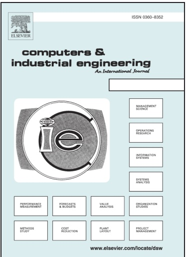
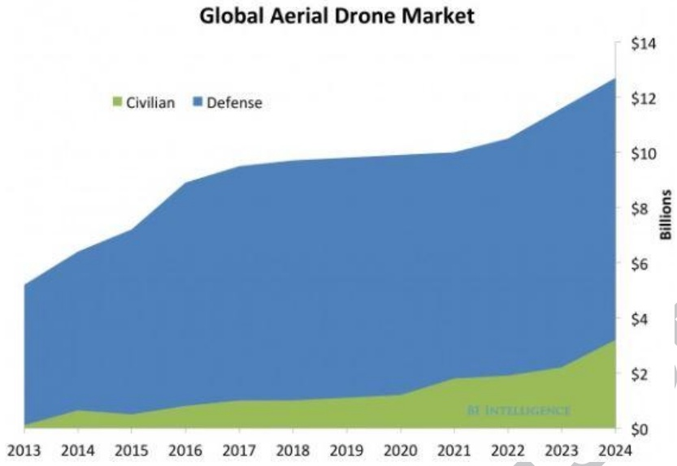
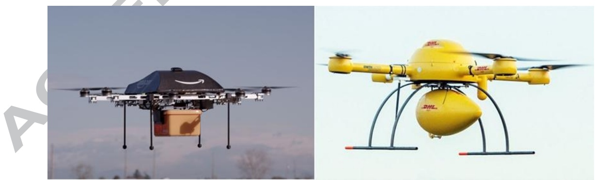
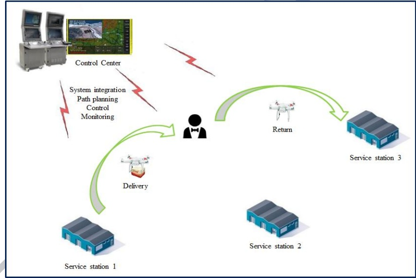
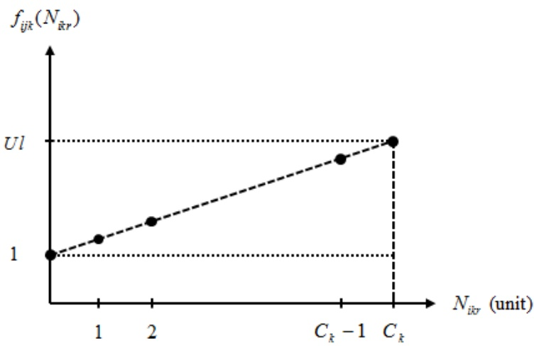
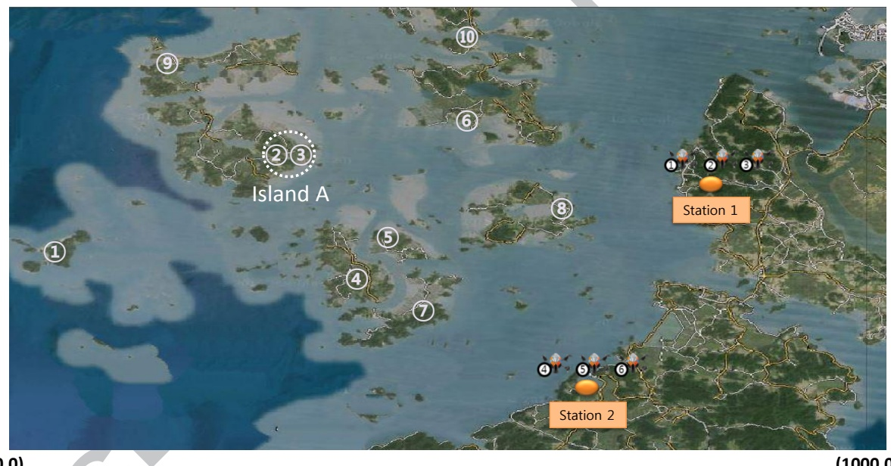

## Accepted Manuscript

Persistent UAV delivery logistics: MILP formulation and efficient heuristic

Byung Duk Song, Kyungsu Park, Jonghoe Kim

PII: S0360-8352(18)30214-6

DOI: [https://doi.org/10.1016/j.cie.2018.05.013](https://doi.org/10.1016/j.cie.2018.05.013)

Reference: CAIE 5219

To appear in: Computers & Industrial Engineering

Received Date: 16 February 2017

Revised Date: 3 January 2018

Accepted Date: 8 May 2018

Please cite this article as: Duk Song, B., Park, K., Kim, J., Persistent UAV delivery logistics: MILP formulation and efficient heuristic, Computers & Industrial Engineering (2018), doi: [https://doi.org/10.1016/j.cie.2018.05.013](https://doi.org/10.1016/j.cie.2018.05.013)

This is a PDF file of an unedited manuscript that has been accepted for publication. As a service to our customers we are providing this early version of the manuscript. The manuscript will undergo copyediting, typesetting, and review of the resulting proof before it is published in its final form. Please note that during the production process errors may be discovered which could affect the content, and all legal disclaimers that apply to the journal pertain.

# Persistent UAV delivery logistics: MILP formulation and efficient heuristic

Byung Duk Songa, Kyungsu Parkband Jonghoe Kimc \*

aSchool of Industrial Engineering

Purdue University

West Lafayette, IN 47907, USA

b Department of Industrial and Systems Engineering,

University of Wisconsin,

Madison, WI 53706, USA

Korea Institute for Defence Analyses

37 Hoegi-ro, Dongdaemun-gu,

Seoul 02455, Republic of Korea

Phone number: +82-2-748-1332

Corresponding author e-mail: sandthero@gmail.com

# Persistent UAV delivery logistics: MILP formulation and efficient heuristic

**Abstract:** The high efficiency, flexibility and low cost of Unmanned Aerial Vehicles (UAVs) present huge application opportunities in various industries. Among those various applications, we focus herein on the use of UAVs in delivery logistics. The UAV logistics system has some fundamental characteristics that distinguish it from the usual ground logistics such as limited flight time, loadable capacity, effect of cargo weight on flight ability, and others. To handle the above issues, we propose a Mixed Integer Linear Programming (MILP) formulation for derivation of persistent UAV delivery schedules. To address the computational issues, a Receding Horizon Task Assignment (RHTA) heuristic is developed and tested with numerical examples for island-area delivery.

**Keywords:** Unmanned aerial vehicle routing problem (UAVRP); UAV delivery; Multiple service stations; Mixed Integer Linear Programming (MILP); Receding Horizon Task Assignment (RHTA) heuristic

## 1. Introduction

UAVs have been the focus of intense study for a decade. Many start-up companies as well as existing enterprises are investigating the opportunities that aerial drones present. Figure 1 plots the Teal Group’s forecast of the fast-growing global aerial drone market. They estimate that by 2024, annual spending on aerial drones, including both civilian and military applications, will be more than US\$ 12 billion. They believe that the civilian side of the market will grow more rapidly, though from a very low base (Teal Group, 2015).

Figure 1. Forecast global UAV market

UAVs are used in various civil fields such as communication relay, delivery, environmental monitoring and disaster relief. Among them, UAV delivery is one of the emerging areas of UAV applications. Whereas ground vehicles encounter many obstacles on the delivery path and also require support to cross otherwise impassable areas such as seas, UAVs are unimpeded the flight path to the destination. In fact, a delivery company, DHL, uses a UAV known as the Parcelcopter to serve customers on islands or in mountainous areas. In these ways, UAVs provide savings in time, effort and cost. Furthermore, as UAVs can effectively avoid traffic congestion, they are used in urban areas to provide quick and precision delivery service. Alibaba tested a UAV delivery service in Beijing, Shanghai and Guangzhou. Amazon developed Amazon Prime Air to provide quick, within-30-minutes delivery service (maximum range: 16 km). Figure 2 shows the delivery UAVs of two prominent international companies.

Figure 2. Amazon Prime Air (left) and DHL Parcelcopter (right)

Also, UAVs can be used for relief delivery to disaster areas, many of which are inaccessible to ground vehicles or even rescuers on foot. Furthermore, there is no worry about secondary damage during the relief delivery mission in the disaster area. Figure 3 shows the use of a UAV for relief delivery to a 2015 Nepal earthquake site.

Figure 3. Relief-delivery using UAV in 2015 Nepal earthquake site

However, with respect to UAV delivery service enhancement, one of the most important issues is how UAVs can be used in an efficient way beyond the development of service components. The vehicle routing problem (VRP), for example, has been studied over the past several decades. The much newer, Unmanned Aerial Vehicle Routing Problem (UAVRP) has, relative to the usual ground vehicle routing, the following unique characteristics. 1) Commercial UAVs have fundamental limitations on their flight duration and loadable capacity; therefore, they cannot conduct long-duration delivery service without replenishing consumables, which is to say fuel (battery charge) and delivery products. 2) The flight time of UAVs delicately depends on the amount of loaded product; therefore, the relationship between the weight of the loaded product and the flight time must be addressed in the UAVRP. 3) UAVs should not be allowed to stay on the ground during idle time between tasks, as this might cause loss of or damage to UAVs and delivery products. For real-world use of UAVs, the UAVRP needs to address these issues. In this paper, we propose a UAV delivery logistics system and mathematical model for scheduling of UAVs based on consideration of their fundamental properties. In the proposed system, UAVs share multiple service stations (these can be the distribution centers of a delivery company) distributed across the field of operation. Thus, they can visit any service station to recharge and reload products. Afterwards, they return to delivery service, and achieve long-duration service in this manner. The flight time of a given UAV between certain points is a function of the amount of loaded product carried during the flight. Also, for prevention of product loss or damage, UAVs are not permitted to land between take-offs and landings at designated service stations. The proposed ideas and limitations are considered to be essential for persistent UAV delivery logistics.

## 2. Literature Review

In this section, we review the research on the VRP for delivery logistics. As noted in the Introduction above, the VRP for delivery efficiency has been continually studied over the past several decades. The first such investigation was that of Dantzig and Ramser (1959), who introduced the truck-dispatching problem for multiple different-capacity vehicles and multiple products as a special case of the traveling salesman problem (TSP) and proposed a procedure for finding the near-optimal solution. According to Eksioglu et al. (2009), routing with uncapacitated vehicles is a very common problem configuration through the 1990s, for example in the research of Jaillet (1988) and Letchford and Eglese (1998). However, after the introduction of faster heuristics, more complex and realistic problems with capacitated vehicles became the common approach. In the capacitated VRP (CVRP), all customers correspond to deliveries, the demands are deterministic, known in advance and unsplitable, and identical, capacitated vehicles are based at a single depot. Toth and Vigo (2002) reviewed the branch-and-bound algorithm developed for the CVRP with either a symmetric or asymmetric cost matrix, showing the change of the solvable boundary. Lysgaard et al. (2004) developed, for the CVRP, the branch-and-cut algorithm, which uses cutting planes and describes separation algorithms for inequalities. In some cases, contrary to the classical VRP, the demand of each customer can be greater than the vehicle capacity, and each customer can be visited more than once. This is called the split delivery VRP. Archetti et al. (2006) and Archetti et al. (2008) proposed, respectively, a tabu search algorithm and an optimization-based heuristic for split delivery capacitated VRP. Gulczynski et al. (2010) considered the minimum delivery amount on the split delivery VRP in order to mitigate split-delivery-incurred customer inconvenience. Yu et al. (2010) combined the location problem with capacitated VRP and solved both simultaneously.

In early 1980s, the concept of the time window was added to the VRP, which problem is referred to as the VRP with time window (VRPTW). In the VRPTW, each demand point should be visited within a given time interval. The time window concept was introduced to the TSP by Christofides et al. (1981), who proposed a branch-and-bound algorithm for the small-scale problem. Cheshire (1992) applied time constraints to the vehicle scheduling problem and presented a heuristic for its solution. Braysy and Gendreau (2005a, 2005b) conducted surveys on the VRPTW in terms of route construction, local search heuristics and metaheuristics. Figliozzi (2012) presented time-dependent VRPs with hard or soft time windows and a solution algorithm. In this research, the author tested the proposed algorithm with a benchmark problem and demonstrated the computation power and solution quality. A study with link capacity also was conducted. Ma et al. (2012) introduced the single-depot VRP with time window and link capacity constraints. In their study, each arc represents a road segment and has a link capacity by which the load of a passing vehicle is restricted.

All of the above-noted studies assumed a single depot in the system. However, since the 1980s, some researchers have investigated multiple-depot VRPs (MDVRPs). In the MDVRP, there are several depots instead of one, and each vehicle belongs to a certain depot and finishes its journey there. The goal is to derive vehicle routes to serve every customer in the system. Laporte et al. (1988) examined an asymmetrical multi-depot VRP and location routing problems, deriving an optimal solution via the branch-and-bound algorithm in small-scale problems. Renaud et al. (1996) and Ho et al. (2008), to address the computational complexity of the MDVRP, developed tabu search and a genetic algorithm, respectively. Tu et al. (2014) suggested a bilevel Voronoi diagram-based metaheuristic for a large-scale MDVRP. Suzuki (2012) investigated a multi-depot VRP based on a limited charge supply for disaster relief logistics.

Now we turn our attention to the UAVRP literature. Due to the huge potentials of UAVs, numerous studies have been published during the past decade. We will focus herein on the issue of persistent UAVRP that allows a UAV to conduct missions persistently. In persistent UAVRP, UAVs perform missions and return to the station (depot) to replenish their consumables; they then take off and perform other missions. In this manner, UAVs can overcome their flight-duration limitation and conduct long-duration missions persistently. Sundar and Rathinam (2014) suggested a mathematical model and algorithm for UAVRP with the presence of refueling depots. In the study, a UAV visits refueling depots for refueling and conducts missions persistently. However, this approach is able to generate routes for only a single UAV, which restricts its potential applicability to real-world problems. The persistent UAVRP with heterogeneous UAVs was treated by Kim et al. (2013), Kim et al. (2014) and Song et al. (2016). In those studies, UAVs share multiple service stations distributed in the field of operation. After recharging, they return to service. A long-duration monitoring and patrolling mission is divided into a set of split tasks, and UAVs cooperate to provide uninterrupted service. However, none of the above studies included delivery context, which meant that UAVs were not constrained by loading capacity and were limited only by the flight duration. Some research focuses on the UAVRP for delivery in order to resolve UAV limitations regarding loadable products and flight duration. Murray and Chu (2015) suggested a flying sidekick approach for UAV parcel delivery. The authors resolve UAV limitations by launching a UAV from a delivery truck, which UAV serves a single task per flight. In this way, the UAV and delivery truck cooperate to perform last-mile parcel delivery. However, the authors do not consider multiple depots or heterogeneous UAVs and trucks. Ferrandez et al. (2016) extend the truck-UAV parcel delivery system by optimizing the locations of multiple launch sites and the number of UAVs per truck. Studies such as this one have proposed approaches whereby UAVs can be utilized in the delivery context. However, to date, the research supporting the potentiality of UAV delivery remains scanty and insufficient.

In the present study, the problem of persistent UAV operation with respect to delivery logistics is addressed. Heterogeneous UAVs are limited by loading capacity as well as flight duration. To overcome such limitations, they are allowed to share multiple stations to replenish their consumables. Also, this study delicately controls for UAV-operational limitations for real-world delivery scenarios. Indeed, in real-world UAV implementations, the flight capabilities of UAVs are hugely affected by the amount of loaded product. By considering those capabilities in deriving UAV schedules, the proposed study can make a significant contribution to realistic delivery operations. Furthermore, each UAV can serve multiple customers as its fuel and loaded products allow. An efficient heuristic called the RHTA as well as a mathematical formulation is developed to derive the optimal or near-optimal delivery schedule in a reasonably short time. To our knowledge, ours is the first study to intensively focus on UAV delivery logistics in their theoretical and practical aspects.

## 3. System Descriptions

In this section, we describe the proposed UAV logistics system and its fundamental properties. Also, we suggest a possible real-world application of UAV logistics.

## 3.1. Persistent UAV logistics service

Commercial UAVs have fundamental flight-duration and loadable-capacity limitations. As such, they cannot continue long in service before having to be recharged and reloaded with new delivery products. In the proposed system, UAVs share multiple service stations distributed in the field of operation for recharging and product-reloading purposes. In this manner, UAVs can provide long-duration logistics service. Figure 4 describes the persistent UAV logistics system. A UAV starts its delivery service from service station 1. After serving customers, it returns to service station 3 for recharging and reloading, preparatory to serving additional customers. In this way, the UAV can serve customers persistently. A control center integrates system information such as UAV locations, charge and product loads, and delivery requests. With this information, the control center derives UAV delivery schedules, controls UAVs and monitors the overall logistics service system.

Figure 4. UAV logistics system

## 3.2. Effect of amount of loaded products on UAV flight time

The flight time of a UAV critically depends on the amount of loaded products. In fact, without consideration of the effect of loaded products, a UAV delivery schedule might not be implementable in real situations. In this study, we developed and applied a weight function to the UAV flight time based on the amount of loaded products. Please refer to Section 4.2. Using this weight function, the proposed mathematical model can derive practical UAV schedules that can be smoothly applied in real-world UAV delivery service situations.

## 3.3. UAV behaviour during inter-task idle time

An important additional issue in the use of UAVs in logistics is that of inter-task idle time. In the case of conventional logistics using ground vehicles, idle time between two connected tasks might not cause any issues, as the vehicle just remains on the ground. However, in the case of UAVs, this could potentially cause loss of or damage to UAVs and/or delivery products. To prevent such problems, it is preferable to keep UAVs flying during inter-task idle time, which approach is the one followed in the proposed system.

## 4. Mixed Integer Linear Programming

MILP was developed to support UAV delivery logistics. In this section, we introduce the developed MILP. We will use two indices $( \mathcal { Q } _ { S S }$ and $\mathcal { Q } _ { S E } )$ for each station to distinguish between departing UAVs and arriving UAVs.

## 4.1. Notations

$i , j$ : Indices for tasks s : Index for stations k : Index for UAVs r : Index of a $\mathrm { U A V ^ { \prime } s } \; r ^ { \mathrm { t h } }$ flight $N _ { J }$ : Number of tasks $N _ { U A V }$ : Number of UAVs in the system $N _ { S T A }$ : Number of service stations $N _ { R }$ : Maximum number of flights per UAV $M$ : Large positive number $( x _ { s } ^ { j } ,   y _ { s } ^ { j } ,   z _ { s } ^ { j } )$ : Start point of task j $( x _ { e } ^ { j } ,   y _ { e } ^ { j } ,   z _ { e } ^ { j } )$ End point of task j $D _ { i j }$ Distance from the finish point of task i to the start point of task j, $D _ { i j }   \neq   D _ { j i }$ $E _ { i }$ Earliest start time of task i $L _ { i }$ Latest start time of task i $P _ { i }$ Processing time of task i or recharge/reload time at station i $\mathcal { Q } _ { k }$ : Maximum traveling time of UAV k $S _ { o k }$ : Initial location (station) of UAV k $T S _ { k }$ : Travel speed of UAV k $A _ { i }$ Demand for task i $C _ { k }$ : Loadable capacity of UAV k $U l$ : ≥1, Upper limit of the weight on the flight time $\varOmega _ { J }$ : = {1, …, NJ}, Set of tasks $\varOmega _ { K }$ = $\{ I ,   . . . ,   N _ { \mathit { U A V } } \}$ , Set of UAVs $\varOmega _ { R }$ = $\{ I ,   . . . ,   N _ { R } \}$ , Set of flight routes

$\mathcal { Q } _ { S S }$ $\begin{array} { r l } { \mathbf { \Lambda } } & { { } = \{ N _ { J } + I ,   N _ { J } + 3 ,   \dots ,   N _ { J } + 2 \cdot N _ { S T A } - I \} } \end{array}$ , set of UAV flight-start stations $\mathcal { Q } _ { S E }$ $\{ N _ { J } + 2 ,   N _ { J } + 4 ,   . . . ,   N _ { J } + 2 \cdot N _ { S T A } \}$ , set of UAV flight-end stations $\varOmega _ { A }$ $\begin{array} { r l } { : } & { { } = ( \mathcal { Q } _ { J } \cup \mathcal { Q } _ { S S } \cup \mathcal { Q } _ { S E } ) = \{ I , . . . , N _ { J } + 2 \cdot N _ { S T A } \} } \end{array}$ , set of all tasks and stations

$w _ { I }$ : Weight between two objectives, total number of served tasks and total traveling distance

$w _ { 2 }$ : Balancing factor between total number of served tasks and total traveling distance

$X _ { i j k r }$ Binary decision variable, $X _ { i j k r } { = 1 }$ if UAV k processes task j or recharges at station j after processing task i or recharging/reloading at station i during the flight; 0 otherwise

$C _ { i k r }$ Real-number decision variable, task $i ^ { \flat } \mathrm { s }$ start time by UAV k during its $r ^ { \mathrm { t h } }$ flight or UAV k’s recharge start time at station $i ;$ otherwise its value is 0

$Y _ { i k r }$ : Binary decision variable, $Y _ { i k r }   =   1$ if task i is assigned to UAV k during its $r ^ { \mathrm { t h } }$ flight; otherwise its value is 0

$N _ { i k r }$ : Integer decision variable, the amount of loaded product after UAV k finishes task i during its $r ^ { \mathrm { t h } }$ flight (total assigned demand on $r ^ { \mathrm { t h } }$ flight if i∈ $:   \mathcal { Q } _ { S S } )$

Note that each station has two indices that are used to distinguish when a UAV starts a trip (flight) from that station and ends a trip (flight) at that station, respectively. Also note that the recharge/reload time at a service station $( P _ { i } )$ is constant. We thus assume that the replenishment process for a UAV is independent of its remaining consumables when it arrives at the station.

## 4.2. Effect of loaded products on UAV flight time

The flight time of a UAV is very significantly affected by the amount of loaded products. Therefore, without consideration of the effect of loaded products, a derived delivery schedule might not be implementable in real situations. In this study therefore, we developed a flight-time weight function based on the currently loaded amount of products. Equation (1) describes the weight function of the flight time when UAV k flies from location $i \; \mathrm { t o }   j$ after finishing task i. In the case of $i { \in } { \mathcal { Q } } _ { S S } ,   N _ { i k r }$ becomes the total assigned demand on the flight. Also, please note that the upper limit of $N _ { i k r }$ is $C _ { k } .$

$$
f _ {i j k} (N _ {i k r}) = \left\{1 + \frac {U l - 1}{C _ {k}} (N _ {i k r}) \right\} \text {for} i \in \Omega_ {J} \cup \Omega_ {S S}, j \in \Omega_ {J} \cup \Omega_ {S E}, k \in \Omega_ {K}\tag{1}
$$

Mikrokopter (2017) points out that, based on experiments and in rough terms, the flight time of UAVs decreases linearly as the payload increases. Accordingly, in equation (1), we assumed that the flight burden increases linearly as the amount of loaded products is increased. Figure 5 provides a graphical representation of this weight function.

Figure 3. Linear weight function imposed on flight time

## 4.3. Mixed Integer Linear Programming

Maximize

$$
w _ {1} \cdot w _ {2} \cdot \sum_ {i \in \Omega_ {J}} \sum_ {k \in \Omega_ {K}} \sum_ {r \in \Omega_ {R}} Y _ {i k r} - (1 - w _ {1}) \cdot \sum_ {i \in \Omega_ {A}} \sum_ {j \in \Omega_ {A}} \sum_ {k \in \Omega_ {K}} \sum_ {r \in \Omega_ {R}} D _ {i j} \cdot X _ {i j k r}\tag{2}
$$

Subject to

$$
\overline {{\sum_ {j \in \Omega_ {J} \cup \Omega_ {S E}} X _ {s _ {o k} , j k 1} = 1 (k \in K)}}\tag{3}
$$

$$
\sum_ {s \in \Omega_ {S S}} \sum_ {j \in \Omega_ {J} \cup \Omega_ {S E}} X _ {s j k r} = 1 \quad (k \in K, r \in R)\tag{4}
$$

$$
\sum_ {s \in \Omega_ {S E}} \sum_ {i \in \Omega_ {\mathcal {J}} \cup \Omega_ {S S}} X _ {i s k r} = 1 \quad (k \in K, r \in R)\tag{5}
$$

$$
\sum_ {i \in \Omega_ {J} \cup \Omega_ {S S}} X _ {i s k r} = \sum_ {i \in \Omega_ {J} \cup \Omega_ {S E}} X _ {s - 1, i k r + 1} \quad (k \in K, r = 1 \dots N _ {R} - 1, s \in \Omega_ {S E})\tag{6}
$$

$$
\sum_ {j \in \Omega_ {A}} X _ {i j k r} - \sum_ {j \in \Omega_ {A}} X _ {j i k r} = 0 (i \in \Omega_ {J}, k \in K, r \in R)\tag{7}
$$

$$
\sum_ {i \in \Omega_ {J} \cup \Omega_ {S S}} X _ {i s k r} = 0 (k \in K, r \in R, s \in \Omega_ {S S})\tag{8}
$$

$$
\sum_ {k \in K} \sum_ {r \in R} Y _ {i k r} \leq 1 \quad (i \in \Omega_ {J})\tag{9}
$$

$$
C _ {s k r} = C _ {s - 1, k r + 1} \quad (k \in K, r = 1... N _ {R} - 1, s \in \Omega_ {S E})\tag{10}
$$

$$
C _ {i k r} + P _ {i} + D _ {i j} / T S _ {k} \cdot f _ {i j k} (N _ {i k r}) - C _ {j k r} \leq M (1 - X _ {i j k r})
$$

$$
(i \in \Omega_ {J} \cup \Omega_ {S S}, j \in \Omega_ {J} \cup \Omega_ {S E}, k \in K, r \in R)\tag{11}
$$

$$
\sum_ {j \in \Omega_ {S E}} C _ {j k r} - (\sum_ {i \in \Omega_ {S S}} C _ {i k r} + P _ {i}) \leq Q _ {k} (k \in K, r \in R)\tag{12}
$$

$$
\sum_ {j \in \Omega_ {J} \cup \Omega_ {S E}} X _ {i j k r} = Y _ {i k r} (i \in \Omega_ {J}, k \in K, r \in R)\tag{13}
$$

$$
C _ {i k r} \leq M \cdot \sum_ {j \in \Omega_ {J} \cup \Omega_ {S E}} X _ {i j k r} \quad (i \in \Omega_ {J} \cup \Omega_ {S S}, k \in K, r \in R)\tag{14}
$$

$$
E _ {i} \cdot Y _ {i k r} \leq C _ {i k r} \leq L _ {i} \cdot Y _ {i k r} \quad (i \in \Omega_ {J}, k \in K, r \in R)\tag{15}
$$

$$
\sum_ {i \in \Omega_ {J}} A _ {i} \cdot Y _ {i k r} \leq C _ {k} \quad (k \in K, r \in R)\tag{16}
$$

$$
N _ {i k r} = \sum_ {j \in \Omega_ {J}} A _ {j} \cdot Y _ {j k r} \quad (i \in \Omega_ {S S}, k \in K, r \in R)\tag{17}
$$

$$
N _ {i k r} - A _ {j} - N _ {j k r} \leq M (1 - X _ {i j k r}) \quad (i \in \Omega_ {J} \cup \Omega_ {S S}, j \in \Omega_ {J}, k \in K, r \in R)\tag{18}
$$

$$
C _ {i k r} \geq 0 (k \in K, r \in R, i \in \Omega_ {A})\tag{19}
$$

$$
X _ {i j k r} \in \{0, 1 \} (k \in K, r \in R, i \in \Omega_ {A}, j \in \Omega_ {A})\tag{20}
$$

$$
Y _ {i k r} \in \{0, 1 \} (k \in K, r \in R, i \in \Omega_ {A})\tag{21}
$$

$$
N _ {i k r} \text {is nonnegative integer} (k \in K, r \in R, i \in \Omega_ {A})\tag{22}
$$

The objective function is in equation (2). The goal of the objective function is to maximize the weighted sum of two objectives, the total number of covered tasks, and the total traveling distance during delivery service. Weight factor w1 is used to provide a balanced solution between two objectives. Scaling factor w2 was applied in order to equally compare the relatively small objective 1 value (the number of customers covered) with the relatively high objective 2 value (total traveling distance). Constraints (3) to (9) control the network flow and task assignment. Constraint (3) ensures that every UAV starts its first flight from its initially located service station. Constraint (4) guarantees that UAV k starts its flight from the starting service station and proceeds to a task or ending service station in the case of an idle UAV. Constraint (5) indicates that UAV k must finish each flight at an ending service station. Constraint (6) links the previous and next flights. By this constraint, if UAV k finishes its $r ^ { \mathrm { t h } }$ flight at service station s, its $r { + 1 } ^ { \mathrm { t h } }$ flight starts at service station s-1. Constraint (7) is used to make sure that a UAV does not finish its flight at a task. Constraint (8) ensures that a UAV cannot finish its flight at the starting station, due to the notational issue related to each station having two indices. Task assignment constraint (9) allows for unserved tasks. Please note that idle UAVs are forced to stay at a station so as to minimize the objective function value without incurring unnecessary traveling distance.

Constraints (10) to (15) concern the start times of each UAV’s actions. Constraint (10) states that the finish time of a $\mathrm { U A V ^ { \prime } s } r ^ { \mathrm { t h } }$ flight is equal to the start time of its $r { + } 1 ^ { \mathrm { t h } }$ flight. Constraint (11) determines the start times of the respective tasks. Please note that the flight time from location i to j is weighted by the function described in equation (1). Constraint (12) ensures that each flight finishes within the UAV’s flight capacity. Accordingly, UAVs are forced to continue flying during service. Constraint (13) links our decision variables. Constraint (14) implies that the value of $C _ { i k r }$ is set to zero if task i is not assigned to UAV k’s $r ^ { \mathrm { t h } }$ flight, and Constraint (15) describes the time window restriction of each task.

According to constraint (16), the assigned delivery demand of each UAV cannot exceed the UAV loadable capacity. Constraint (17) determines the amount of product required for each flight of each UAV. At the start station, each UAV loads as much product as the total demand of the task assigned for the flight. By constraint (18), as the delivery service proceeds, $N _ { i k r }$ decreases. The decision variables of the proposed MILP are prescribed in constraints (19) to (22).

## 5. Solution approach

The MILP is computationally complex. In this section, we will discuss the complexity of the proposed problem and the development of an efficient heuristic, RHTA, as an alternative solution approach to significantly improve computation.

## 5.1. Equivalence with NP-hard problem

The VRP and all of its variants are well-known NP-hard problems. Especially as discussed by Cordeau et al. (2001), the multiple-depot VRP with time window (MDVRPTW) is NP-hard, since it is a generalized version of the VRPTW and is easily transformed to VRPTW. The transforming approach is a widely used methodology to assess the complexity of such problems. For example, Longo et al. (2006) studied the complexity of a capacitated arc routing problem using a transformation to the CVRP, which belongs to the NP-hard class of problem (Toth and Vigo, 2002). Song et al. (2016) also transformed the multiple-depotbased persistent vehicle routing problem to the CVRP. The proposed UAVRP has generalized properties of the MDVRPTW and is easily reduced to the MDVRPTW. As a result, the proposed UAVRP also is NP-hard, which means that only relatively few instances can be solved optimally within a short computing time. Following steps reduce (simplify) the UAVRP to MDVRPTW and demonstrate that the MDVRPTW, which is NP-hard problem, is a special and simplified case of UAVRP.

**Step 1**:Reduce fuel restrictions from the UAVRP

**Step 2**: Reduce the effect of loaded products on UAV flight time from the UAVRP

**Step 3**: Allow only single route for each UAV (set $N _ { R } { = } 1$ for every UAV)

**Step 4**: UAVs cannot share depots. Each UAV will belong to a single home depot and start /finish its single flight at the home depot.

To address the computational tractability of the proposed problem, we developed an efficient heuristic, the RHTA algorithm, as explained in the following section.

## 5.2. Solution Procedure: Receding Horizon Task Assignment Algorithm

To solve complicated VRPs, numerous heuristics have been developed to derive an efficient solution within a reasonable computation time. Bommisetty et al. (1998) developed a two-phase heuristic algorithm for derivation of optimal or near-optimal schedules of vehicles on a large university campus. Bektas (2006) reviewed various kinds of multiple-TSP heuristics that are easily extended to a wide variety of VRPs. To determine a patrol path of an unmanned combat vehicle, Park et al. (2012) developed two-phase heuristics according to which an initial path is constructed in the first phase and subsequently is improved in the second phase.

In this study, we developed an RHTA to handle computational issues and large-scale problems. Alighanbari (2004) first introduced the RHTA and modified it for UAV scheduling and system-design problems. Kim and Morrison (2014) used the RHTA to design a UAV system and to generate an optimal schedule simultaneously. The RHTA in Song et al. (2016) is able to generate a UAV schedule for any status of UAV fleet (e.g., initial location, charge level), thereby enabling real-time scheduling in a dynamic environment. Lee and Morrison (2015) introduced two task types, namely searching area and tracking objects. The RHTAs employed in previous studies have focused on the patrolling and monitoring tasks of UAVs. The RHTA developed in the present study, by contrast, addresses UAV scheduling for delivery service. In the proposed RHTA, a large problem is broken into smaller parts, each of which is optimized by the MILP described in equations (23) and (24). Utilizing the developed RHTA, we can solve large-scale problems not solvable via commercial optimization software such as CPLEX. Also, RHTA provides the flexibility to employ any nonlinear function that reflects system characteristics. For example, we can use the proposed RHTA for a UAV-flight-time nonlinear weight function.

For a given instant in time, let rF(k) be the remaining flight time of UAV k, at(k), the available time of UAV k (within which it will finish its current assignment), P, the maximum petal size, and Mk , the task and station sequence of UAV k; onSta(k) is true if cL(k) is the station, otherwise it is false; tLoad(j) is the amount of loaded cargo before task j, cCap(k), the amount of loaded cargo on UAV k; f(tload,C), the flight-time weight function, st(k), the latest take-off time from a station, and W, the task list to be assigned. A petal is a sequence of tasks to be served by a UAV. The pseudo code of the RHTA is described in the Appendix. The overall procedure is as follows.

**Step 1**: Enumerate all feasible petals for each UAV k and calculate the travel distance for each. A feasible petal for UAV k is a set of tasks for which UAV k is able to serve the petal and return to a service station. (Lines 5-14 in Appendix)

**Step 2**: Solve the MILP for all UAVs to minimize travel distance and select a petal for each UAV. (Line 15 in Appendix; see equations (23) and (24) below.)

**Step 3**: Assign the first task of the petal selected for UAV k to UAV k’s $M _ { k }$ for all UAVs. Update the status of UAV k for charge, loaded product and current location. Eliminate selected tasks from W. (Lines 16-26 in Appendix)

**Step 4**: Send charge- or product-insufficient UAVs to the station and update their status. Return to Step 2 if W is not empty. (Lines 27-31 in Appendix)

**Step 5**: Assign any UAVs not located at a station to a station (Lines 32-34 in Appendix).

Line 15 in the Appendix requires a MILP. Let $p$ be the petal index, $S _ { \mathrm { k p } }$ the required travel distance of petal p by UAV k, and $N _ { k p }$ the total number of feasible petals of UAV k. $A _ { k j p }$ indicates whether $\mathrm{task}_{j} \mathrm{is}$ in petal $p$ of UAV k: $A _ { k j p } = 1$ if task $i j$ is in petal $p$ of UAV k, 0 otherwise. Decision variable $X_{kp} \equiv 1  if$ UAV k selects petal $p ;$ 0 otherwise. The remaining notation is as before.

The MILP for optimization in the RHTA is as follows:

Maximize

$$
w _ {1} \cdot w _ {2} \cdot \sum_ {i \in W} \sum_ {k = 1} ^ {N _ {U A V}} \sum_ {p = 1} ^ {K _ {k p}} A _ {k i p} \cdot X _ {k p} - (1 - w _ {1}) \cdot \sum_ {k = 1} ^ {N _ {U A V}} \sum_ {p = 1} ^ {K _ {k p}} S _ {k p} \cdot X _ {k p}\tag{23}
$$

Subject to

$$
\sum_ {k = 1} ^ {N _ {U A V}} \sum_ {p = 1} ^ {K _ {k p}} A _ {k i p} \cdot X _ {k p} \leq 1 \quad (i \in W)\tag{24}
$$

The objective function (23) maximizes the weighted sum of the two objectives. Constraint (24) ensures that task i in W is selected, at most, one time in all of the petals and UAVs.

## 6. Numerical Experiments

In this section, the proposed MILP and RHTA heuristic are tested and compared for application to the delivery service of the island area. The performances of CPLEX and the RHTA heuristic are compared and discussed in terms of the solution gap and computational power with various sizes of randomly generated problems. All of the experiments were implemented on a personal computer with Intel(R) Core(TM) I7-3770, 3.40GHz and 4.00GB RAM. We used ILOG CPLEX 12.6.2 to solve the MILP in Section 4 as well as to solve the MILP in the RHTA. We implemented the RHTA using NetBeans IDE 8.0 and JDK 1.8. We set the $N _ { R }$ to 5 for the MILP. In delivery service, an efficient delivery schedule attained by minimizing the total traveling distance is important, but most important is service achievement. Furthermore, because the time window was considered in this study, each customer i can be served between $E _ { i }$ and $L _ { i } .$ Therefore, we set the values of $w _ { I }$ and $w _ { 2 }$ to 0.9 and 1000 respectively throughout the numerical experiments in order to provide the delivery service to more customers than would be possible by minimizing the total traveling distance in the objective function.

## 6.1. Product delivery service in island area

A fleet of heterogeneous UAVs and stations along with an effective scheduling methodology can be utilized to conduct product delivery service on an island where the traditional transportation approach would incur huge expense in terms of both time and cost. Therefore, a global logistics company such as DHL uses UAVs for island-area delivery. In this example, we test the proposed MILP and RHTA heuristic for UAV delivery in an island area. The system layout is provided in Figure 6. There are two stations located at coordinates (832, 317, 85), (666, 59, 0), respectively, each of which has three UAVs initially. We assume that the service time at the stations is constant for replenishing charge or loading a UAV with product. The station service time was set to 5 minutes for this experiment. As usual, UAVs have strict limitations on loadable products; however, sometimes, a customer can request delivery products that exceed a UAV’s loadable capacity. Among the islands in Figure 6, island A has a demand greater than the capacity of one UAV. Therefore, we divided this task into two tasks sharing the same location and time constraint.

(0,500)

(1000,500)

(0,0)

Figure 4. System layout of island-area delivery service using UAVs

There are 10 task requests among the delivery service areas; their coordinates, earliest start time, latest start time, processing time and demand are given in Table 1. For example, Task 1 is located at coordinates (54, 239, 0), and it should start between time 10 and 13 with demand 2. This task takes 2 minutes.

Table 1. Task information of UAV delivery example

<table><tbody><tr><td rowspan="2">Task</td><td colspan="3">Delivery point</td><td rowspan="2">Earliest Start time (Ei)</td><td rowspan="2">Latest Start time (Li)</td><td rowspan="2">Task Processing Time (Pi)</td><td rowspan="2">Task Demand (Ai)</td></tr><tr><td>x</td><td>y</td><td>z</td></tr><tr><td>1</td><td>54</td><td>239</td><td>0</td><td>10</td><td>13</td><td>2</td><td>2</td></tr><tr><td colspan="8" rowspan="2">2 313 339 17 15 18 3 6</td></tr><tr></tr><tr><td>3</td><td>313</td><td>339</td><td>17</td><td>15</td><td>18</td><td>3</td><td>6</td></tr><tr><td>4</td><td>380</td><td>213</td><td>60</td><td>25</td><td>28</td><td>1</td><td>1</td></tr><tr><td>5</td><td>407</td><td>239</td><td>0</td><td>30</td><td>32</td><td>2</td><td>2</td></tr><tr><td>6</td><td>527</td><td>374</td><td>0</td><td>33</td><td>35</td><td>2</td><td>2</td></tr><tr><td>7</td><td>512</td><td>186</td><td>58</td><td>35</td><td>38</td><td>1</td><td>2</td></tr><tr><td>8</td><td>646</td><td>307</td><td>32</td><td>42</td><td>45</td><td>1</td><td>1</td></tr><tr><td>9</td><td>185</td><td>430</td><td>85</td><td>46</td><td>48</td><td>1</td><td>4</td></tr><tr><td>10</td><td>512</td><td>468</td><td>13</td><td>51</td><td>54</td><td>2</td><td>2</td></tr></tbody></table>

Six heterogeneous UAVs operate the delivery service. The initial location, maximum speed, maximum flight time and loadable capacity are provided in Table 2.

Table 2. UAV information of UAV delivery example

| UAV | Initial Location | Speed (min) | Qk (min) | Ck (Unit) |
| --- | --- | --- | --- | --- |
| 1 | Station 1 | 180 | 40 | 8 |
| 2 | Station 1 | 150 | 30 | 8 |
| 3 | Station 1 | 120 | 20 | 8 |
| 4 | Station 2 | 180 | 40 | 8 |
| 5 | Station 2 | 150 | 30 | 8 |
| 6 | Station 2 | 120 | 20 | 8 |

The MILP provides the following optimal solution with 8535.3. The UAV system covers 10 tasks with a travel distance of 4647m. UAV 1 departs from station 1 to serve tasks 3 and 8; it then returns to station 1. UAV 2 departs from station 1 to serve tasks 6, 9 and 10; it then returns to station 1. Tasks 1, 4 and 7 are served by UAV 4, which starts and ends at station 2. Tasks 2 and 5 are served by UAV 5. UAVs 3 and 6 are not used. See Table 3. The demand of island A is served by the concerted operation of UAVs 1 and 5.

Table 3. Optimal Schedule of UAVs

| UAV | Optimal Scheduling |
| --- | --- |
| 1 | Station 1→3→8→ Station 1 |
| 2 | Station 1→6→9→10→Station 1 |
| 3 | Station 1 |
| 4 | Station 2→1→4→7→Station 2 |
| 5 | Station 2→2→5→Station 2 |
| 6 | Station 2 |

## 6.2. Performance evaluation of CPLEX and RHTA heuristic

Increased problem size increases problem complexity. Therefore, as problem size grows, the VRP is not solvable with the state-of-the-art MILP solver CPLEX. This trend is the same for UAVRP. However, the proposed RHTA can obtain optimal or near-optimal solutions in a short time for large-scale problems. To test the computational power of the proposed RHTA, we consider 40 cases for various numbers of tasks and task locations. We create 5, 10, 15, and 30 tasks with 3 stations and 6 UAVs. Table 4 provides the results and compares the computational times and objective values of CPLEX and RHTA. The computational time of the MILP increases rapidly as the number of tasks increases. When there are 15 tasks in the system, CPLEX is not able to generate optimal solutions for 8 of 10 cases due to out-of-memory issues. According to the IBM Knowledge Center (2017), the out-of-memory issue almost always occurs when the branch & cut tree of CPLEX becomes so large that insufficient memory remains to solve a continuous LP, QP, or QCP subproblem. In such a situation it terminates the process with an error message. Among 8 out-of-memory cases, we are able to obtain the best feasible solution until when CPLEX ends with an error message in 7 cases. The objective values of best feasible solution are represented in Table 4 with mark \*. Experiment 27 (with 15 tasks) and all cases having 30 tasks, CPLEX is not suitable to find any feasible solution.

Furthermore, CPLEX is not usable for a problem having 30 tasks. A better computing environment might be able to handle this issue. However, if the problem size grows, the same dilemma will arise. In contrast, the proposed RHTA requires less than 0.4 seconds to derive the optimal or near-optimal solution for every case. For the solvable problems using CPLEX, RHTA give 0.175%, 2.224% and 2.252% optimality loss compared to CPLEX solutions (or the best known solution value) for cases having 5, 10 and 15 tasks in average, respectively. Optimality gap is calculated by the equation (25) and rounded to three decimal places.

$$
G a p = \frac {\text {Obj.value(CPLEX) - Obj.value(RHTA)}}{\text {Obj.value(CPLEX)}}\tag{25}
$$

The computational time of the RHTA increases only slowly as the problem size grows; thus, by handling a large-scale problem in a short time, it provides utility for real-time use. Gendreau et al. (2002) compared two types of VRP heuristics and stated that “Typically, classical methods yield solution values between 2% and 10% above the optimum (or the best known solution value), while the best metaheuristic implementation is often less than 0.5%.” Since the computational speed of classical heuristic is much faster than metaheuristic,

classical heuristic is suitable for real-time operation of UAV. RHTA is based on the petal algorithm, one of classical heuristics. It results appropriate optimality loss as a classical heuristic of VRP.

Table 4. Result comparison of CPLEX and RHTA

<table><tbody><tr><td rowspan="3">Experiment</td><td rowspan="3"># of tasks</td><td colspan="2">CPLEX</td><td colspan="2">RHTA</td><td rowspan="3">Gap(%)</td></tr><tr><td>CPU time</td><td>Obj.</td><td>CPU time</td><td>Obj.</td></tr><tr><td>(sec)</td><td>value</td><td>(sec)</td><td>value</td></tr><tr><td>1</td><td rowspan="10">5</td><td>0.91</td><td>4357.4</td><td>0.095</td><td>4357.4</td><td>0.000%</td></tr><tr><td>2</td><td>0.72</td><td>4160.9</td><td>0.092</td><td>4139.8</td><td>0.507%</td></tr><tr><td>3</td><td>1.53</td><td>4027.2</td><td>0.092</td><td>4027.2</td><td>0.000%</td></tr><tr><td>4</td><td>1.82</td><td>4150.9</td><td>0.096</td><td>4150.9</td><td>0.000%</td></tr><tr><td>5</td><td>1.59</td><td>4086.7</td><td>0.092</td><td>4086.7</td><td>0.000%</td></tr><tr><td>6</td><td>1.14</td><td>4130.5</td><td>0.092</td><td>4130.5</td><td>0.000%</td></tr><tr><td>7</td><td>1.95</td><td>3981.8</td><td>0.092</td><td>3981.8</td><td>0.000%</td></tr><tr><td>8</td><td>1.32</td><td>4038.1</td><td>0.093</td><td>3988.1</td><td>1.238%</td></tr><tr><td>9</td><td>1.17</td><td>3946.4</td><td>0.092</td><td>3946.4</td><td>0.000%</td></tr><tr><td>10</td><td>1.19</td><td>3992.9</td><td>0.093</td><td>3992.9</td><td>0.000%</td></tr><tr><td>11</td><td rowspan="10">10</td><td>41.57</td><td>8741.2</td><td>0.145</td><td>8663.5</td><td>0.889%</td></tr><tr><td>12</td><td>174.82</td><td>8530.4</td><td>0.112</td><td>8361.1</td><td>1.985%</td></tr><tr><td>13</td><td>83.7</td><td>8432</td><td>0.11</td><td>8172.5</td><td>3.078%</td></tr><tr><td>14</td><td>473.04</td><td>8539.2</td><td>0.106</td><td>8322.8</td><td>2.534%</td></tr><tr><td>15</td><td>748.06</td><td>8441.9</td><td>0.114</td><td>8377.8</td><td>0.759%</td></tr><tr><td>16</td><td>40.78</td><td>8741.2</td><td>0.109</td><td>8395.9</td><td>3.950%</td></tr><tr><td>17</td><td>107.03</td><td>8362.3</td><td>0.108</td><td>8208.2</td><td>1.843%</td></tr><tr><td>18</td><td>218.91</td><td>8376.3</td><td>0.288</td><td>8236.5</td><td>1.669%</td></tr><tr><td>19</td><td>80.66</td><td>8311.8</td><td>0.108</td><td>8004.3</td><td>3.700%</td></tr><tr><td>20</td><td>165.86</td><td>8331.1</td><td>0.116</td><td>8178.2</td><td>1.835%</td></tr><tr><td>21</td><td rowspan="10">15</td><td rowspan="2">Out of memory</td><td>12399.6*</td><td>0.178</td><td>11757.5</td><td>5.178%</td></tr><tr><td>22</td><td>12712*</td><td>0.146</td><td>12373.2</td><td>2.665%</td></tr><tr><td>23</td><td>4587</td><td>12859.8</td><td>0.152</td><td>12582.7</td><td>2.155%</td></tr><tr><td>24</td><td rowspan="6">Out of memory</td><td>12944.6*</td><td>0.121</td><td>12692.7</td><td>1.946%</td></tr><tr><td>25</td><td>12782.4*</td><td>0.127</td><td>12744.7</td><td>0.295%</td></tr><tr><td>26</td><td>12912.9*</td><td>0.133</td><td>12763.2</td><td>1.159%</td></tr><tr><td>27</td><td>N/A</td><td>0.123</td><td>12586</td><td>-</td></tr><tr><td>28</td><td>12805.5*</td><td>0.312</td><td>12561.9</td><td>1.902%</td></tr><tr><td>29</td><td>12773.2*</td><td>0.226</td><td>12370.4</td><td>3.153%</td></tr><tr><td>30</td><td>5107.31</td><td>12773.2</td><td>0.133</td><td>12542.1</td><td>1.810%</td></tr><tr><td>31</td><td>30</td><td>Out of memory</td><td>N/A</td><td>0.158</td><td>12109.4</td><td>-</td></tr><tr><td>32</td><td rowspan="9"></td><td rowspan="9"></td><td rowspan="9"></td><td>0.135</td><td>11799.3</td><td>-</td></tr><tr><td>33</td><td>0.164</td><td>14153.5</td><td>-</td></tr><tr><td>34</td><td>0.179</td><td>16096.9</td><td>-</td></tr><tr><td>35</td><td>0.24</td><td>21839.3</td><td>-</td></tr><tr><td>36</td><td>0.179</td><td>14285.7</td><td>-</td></tr><tr><td>37</td><td>0.156</td><td>14145.5</td><td>-</td></tr><tr><td>38</td><td>0.325</td><td>22933.1</td><td>-</td></tr><tr><td>39</td><td>0.189</td><td>15864.9</td><td>-</td></tr><tr><td>40</td><td>0.14</td><td>8028.5</td><td>-</td></tr></tbody></table>

## 7. Concluding Remarks

We developed a scheduling model for a UAV system’s provision of persistent delivery service. In the proposed system, UAVs share multiple service stations distributed in the field of operation. At service stations, UAVs replenish their consumables, which is to say, battery charge and delivery products. Afterwards, they return to delivery service. In this manner, the flight-time and loadable-product limitations of UAVs can be overcome and persistent delivery service, thereby, can be achieved. Furthermore, the fundamental properties of UAVs, such as the relationship between loaded product and flight time and behaviour during idle time are considered for effective real-time use. The MILP is developed and tested with an island-area UAV delivery example. However, the proposed MILP cannot be solved for a large-scale problem using the commercial optimization software CPLEX. To handle this computational issue and derive the optimal or near-optimal solution in large-scale problems, the RHTA heuristic was developed. The proposed RHTA successfully derives optimal or near-optimal solutions for large-scale problems in a short time. We expect that the proposed RHTA, by handling numerous service requests and deriving UAV schedules in a short time, will prove to be practical for real-world delivery applications. In this study, the key factors of UAV logistics namely limited flight time, limited loadable products, the effect of loaded product weight on flight time, and UAV behaviour during idle time — were all considered and solved. We hope that this study will contribute to the existing and emerging UAV applications in the present and near future.

Appendix: Pseudo code of RHTA

| Line | Pseudo code to execute |
| --- | --- |
| 1: | Find the travel distance from task i's point or station i to taskj's point or station j using Euclidean distance (Set Dij) Set input variables (# of UAV, # of task, # of station, maximum flight time, travel speed, |
| 2: | process time of tasks, recharge or replacement time, earliest start time of task, latest start time of task, initial location of UAV, available time of UAV, remaining charge time, demand for |

tasks, loadable capacity of UAV, flight-time upper limit of weight)

3: Set $W = W _ { 0 }$ (the set of all tasks)

4: **While** W is not empty and # of assigned tasks > 0 **do**

5: **For** all UAV k do $p { \leftarrow } 1$ 9

**For** all numbers $n _ { c }$ **o**f tasks to visit $n _ { c } { \leftarrow } 1 { , } { \ldots } { , } P$ do

7: **For** all combinations C of $n _ { c }$ tasks **do**

8: **For** all permutations i of tasks $[ w _ { I } ,   \dots ,   w _ { n c } ]$ in C, with $i { \leftarrow } 1 . . . n _ { c } !$ **do**

9: **For** all stations **do**

**if** onSta(k)==true **do** \\ {assign amount of cargo before starting task wi}

$$
\mathrm{tLoad} \left(\mathrm{w} _ {\mathrm{i}}\right) \leftarrow \operatorname{MAX} \sum_ {i = 1} ^ {i = n _ {c}} A \left(w _ {i}\right), C (k));
$$

$$
\text {else} t L o a d (w _ {i}) \leftarrow c C a p (k);
$$

$$
t L o a d (w _ {i + 1}) \leftarrow t L o a d (w _ {i}) - A (w _ {i});
$$

**if** time constraint, capacity constraint, charge constraint are satisfied **do**

**time constraint is satisfied if**

$$
T A (w _ {1}) \leftarrow M A X \left(E (w _ {1}), a t (k) + D (c l (k), w _ {1}) / T S (k) \cdot f (t L o a d (w _ {1}), C (k))\right);
$$

$$
T A (w _ {i}) \leftarrow M A X \left(E (w _ {i}), T A (w _ {i - 1}) + P (w _ {i - 1}) + D (w _ {i - 1}, w _ {i}) / T S (k) \cdot f (t L o a d (w _ {i}), C (k)); \forall i = 2,.., n _ {c} \right.
$$

$$
a t (k) + D (c L (k), w _ {1}) / T S (k) \cdot f (t L o a d (w _ {1}), C (k)) \leq L (w _ {1}) \text {and}
$$

$$
M A X \left(E \left(w _ {i - 1}\right), T A \left(w _ {i - 1}\right)\right) + P \left(w _ {i - 1}\right) + D \left(w _ {i - 1}, w _ {i}\right) / T S (k) \cdot f (\text {tLoad} \left(w _ {i}\right), C (k)) \leq L \left(w _ {i}\right) \forall i = 2, \dots , n _ {c}
$$

**capacity constraint is satisfied if**

$$
t l o a d (w _ {1}) <   = c a p a (k)
$$

**charge constraint is satisfied if**

$$
D (c L (k), w _ {1}) / T S (k) \cdot f (t l o a d (w _ {1}), C (k)) + \sum_ {i = 1} ^ {n _ {c} - 1} D (w _ {i}, w _ {i + 1}) / T S (k) \cdot f (t l o a d (w _ {i}), C (k))
$$

$$
\left. + D \left(W _ {n c}, s\right) / T S (k) \cdot f \left(t l o a d \left(w _ {n c}\right), C (k)\right) + \sum_ {i = 1} ^ {n _ {c}} P \left(w _ {i}\right) \leq r F (k) \right.
$$

$$
\text {and} \quad Q (k) \geq T A (w _ {n c}) + P (w _ {n c}) + D (w _ {n c}, s) / T S (k) \cdot f (t L o a d (w _ {n c}), C (k)) - s t (k)
$$

**if** # of remaining tasks $< = \mathbf { P }$

$$
S _ {i} = D (c L (k), w _ {1}) + \sum_ {i = 1} ^ {n _ {c}} D (w _ {i - 1}, w _ {i}); P _ {i} \leftarrow [ w _ {1},..., w _ {n _ {c}} ];
$$

**else**

$$
S _ {i} = D (c L (k), w _ {1}) + \sum_ {i = 1} ^ {n _ {c}} D (w _ {i - 1}, w _ {i}) + D (w _ {n c}, \text {closest   station}); P _ {i} \leftarrow [ w _ {1},..., w _ {n _ {c}} ];
$$

13: **break;**

$$
i _ {m i n} \leftarrow \operatorname{argmin}; S _ {i}; S _ {v p} \leftarrow S _ {i m i n}; P _ {v p} \leftarrow P _ {i m i n}; p \leftarrow p + 1;
$$

$$
\backslash \{\text {Choose the most feasible permutation}\}
$$

15: solve the optimization model to find minimum cost strategy

16: **for** all UAV k **do** \\ { assign selected task to UAV’s task list}

if $x_{vp} == 1$ do
    if # of remaining tasks &lt;= P and # of assigned tasks from MILP &gt; # of remaining tasks
        $w_{opt} \leftarrow P_{vp}$;
    else
        $w_{opt} \leftarrow P_{vp}$ (1);
        if onSta(k)==true do \\ {assign amount of cargo before starting selected task}
            tLoad($w_i$) $\leftarrow$ MAX($\sum_{i=1}^{i=n_r} A(P_{vp}(i)), C(k)$);
        else $tLoad_{wopt} \leftarrow cCap(k)$
    $M_k \leftarrow [M_k w_{opt}]$; \\ {Adds the task to the mission list of UAV k}
        $rF(k) \leftarrow rF(k)$-sum of travel time and process time of $w_{opt}$;
        \\ {update remaining charge time of UAV k}
        $at(k) \leftarrow$ finish time of last task of $w_{opt}$; \\ {update available time}
        $cL(k) \leftarrow$ last task of $w_{opt}$; \\ {update current location}
    $W \leftarrow W - w_{opt} \backslash \backslash$ {remove the selected task from the list}
    $cCap(k) \leftarrow tLoad_{wopt} - sum\ of\ cargo\ of\ W_{opt}$; \\ {update current amount of cargo of UAV k}
    onSta(k) $\leftarrow$ false; \\ {update whether UAV is on station}
    for all UAV kdo \\ {send exhausted UAV to the nearest station}
        for all w in Wdo
            for all stations do
                if((D(cL(k),w)/TS(k)$f(cCap(k),C(k))+P(w)+D(w,s)/TS(k)\(f(cCap(k)-A(w),C(k)) \ge rF(k)$)
                    or D(cL(k),w)/TS(k)$f(cCap(k),C(k))+at(k) \ge L(w)$ or $cCap(k)==0$) and onSta(k) == false do
    Assign UAVs to closest station
    for all UAV kdo // {send UAV at end of task to station}
        if onSta(k)==false do
            Assign UAVs to closest station

## References

[1] Alighanbari, M. (2004). Task assignment algorithms for team of UAVs in dynamic environments. Master Thesis, Massachusetts Institute of Technology.

[2] Archetti, C., Speranza, M.G., & Hertz, A. (2006). A Tabu Search Algorithm for the Split Delivery Vehicle Routing Problem. Transportation Science, 40(1), 64-73. DOI: 10.1287/trsc.1040.0103.

[3] Archetti, C., Speranza, M.G., & Savelsbergh, M.W. (2008). An Optimization-Based Heuristic for the Split Delivery Vehicle Routing Problem. Transportation Science, 42(1), 22-31. DOI: 10.1287/trsc.1070.0204.

[4] Bektas, T. (2006). The multiple traveling salesman problem: an overview of formulations and solution procedures. Omega, The International Journal of Management Science, 34(3), 209-219. DOI: [10.1016/j.omega.2004.10.004](http://dx.doi.org/10.1016/j.omega.2004.10.004)

[5] Bommisetty, D., Dessouky, M. & Jacobs, L. (1998). Scheduling collection of recyclable material at Northern Illinois University campus using a two-phase algorithm. Computers & Industrial Engineering, 35(3-4), 435-438. DOI: [10.1016/S0360-8352(98)00127-2](http://dx.doi.org/10.1016/S0360-8352%2898%2900127-2)

[6] Braysy, O., & Gendreau, M. (2005a). Vehicle Routing Problem with Time Windows, Part I: Route Construction and Local Search Algorithms. Transportation Science, 39(1), 104-118. DOI: 10.1287/trsc.1030.0056.

[7] Braysy, O., & Gendreau, M. (2005b). Vehicle Routing Problem with Time Windows, Part II: Metaheuristics. Transportation Science, 39(1), 119-139. DOI: 10.1287/trsc.1030.0057.

[8] Cheshire, I.M., Malleson, A.M., & Naccache, P.F. (1982). Adual heuristic for vehicle scheduling. Journal of the Operational Research Society, 33(1), 51-61. DOI: 10.1057/jors.1982.6.

[9] Christofides, N., & Mingozzi, A.,Toth, P. (1981). State-space relaxation procedures for the computation of bounds to routing problems. Networks, 11(2), 145-164. DOI: 10.2307/2581871.

[10] Cordeau,J.F., Laporte, G., & Mercier, A. (2001). A Unified Tabu Search Heuristic for Vehicle Routing Problemswith Time Windows. Journal of the Operational Research Society, 52(8), 928–936. DOI: 10.1057/palgrave.jors.2601163.

[11] Dantzig, G. B., & Ramser, J.H. (1959). The Truck Dispatching Problem. Management Science, 6(1), 80-91. DOI: [10.1287/mnsc.6.1.80.](http://dx.doi.org/10.1287/mnsc.6.1.80)

[12] Eksiogly, B., Vural, A. V., & Reisman, A. (2009). The vehicle routing problem: A taxonomic review. Computers & Industrial Engineering, 57(4), 1472-1493. DOI: 10.1016/j.cie.2009.05.009.

[13] Ferrandez, S. M., Harbison, T., Weber, T., Sturges, R., & Rich, R. (2016). Optimization of a truck-drone in tandem delivery network using k-means and genetic algorithm. Journal of Industrial Engineering and Management, 9(2), 374-388. DOI: 10.3926/jiem.1929.

[14] Figliozzi, M. A. (2012). The time dependent vehicle routing problem with time windows: Benchmark problems, an efficient solution algorithm, and solution characteristics. Transportation Research Part E: Logistics and Transportation Review, 48(3), 616-636. DOI: [10.1016/j.tre.2011.11.006.](http://dx.doi.org/10.1016/j.tre.2011.11.006)

[15] Gendreau, M., Laporte, G., & Potvin,J.-Y. (2002). Metaheuristics for the Capacitated VRP. Chapter 6 in The Vehicle Routing Problem, Toth, P., & Vigo, D., eds.,SIAM Monographs on Discrete Mathematics and Applications, Philadelphia, PA, 129-154.

[16] Gulczynski, D., Golden, B., & Wasil, E. (2012). The split delivery vehicle routing problem with minimum delivery amount. Transportation Research Part E: Logistics and Transportation Review, 46(5), 612-626. DOI[:10.1016/j.tre.2009.12.007.](http://dx.doi.org/10.1016/j.tre.2009.12.007)

[17] Ho, W., Ho, G.T.S., Ji, P., & Lau, H.C.W. (2008). A hybrid genetic algorithm for the multi-depot vehicle routing problem. Engineering Applications of Artificial Intelligence, 21(4), 548-557. DOI: [0.1016/j.engappai.2007.06.001.](http://dx.doi.org/10.1016/j.engappai.2007.06.001)

[18] IBM Knowledge Center. Running out of memory. (2017). [https://www.ibm.com/support/knowledgecenter/en/SSSA5P\_12.6.2/ilog.odms.cplex.help/CPLEX/UsrMan/topics/discr\_optim/mip/troubleshoot/61\_mem\_gone.html.](https://www.ibm.com/support/knowledgecenter/en/SSSA5P_12.6.2/ilog.odms.cplex.help/CPLEX/UsrMan/topics/discr_optim/mip/troubleshoot/61_mem_gone.html) Accessed 17.08.25

[19] Jaillet, P. (1988). A priori solution of a traveling salesman problem in which a random subset of customers are visited. Operations Research, 36(6), 929–936. DOI: [10.1287/opre.36.6.929.](http://dx.doi.org/10.1287/opre.36.6.929)

[20] Kim, J., Song, B.D., & Morrison, J.R. (2013). On the scheduling of systems of heterogeneous UAVs and fuel service stations for long-term mission fulfillment. Journal of Intelligent & Robotic Systems, 70(1), 347-359.DOI: 10.1007/s10846-012-9727-0.

[21] Kim, J., & Morrison, J.R. (2014). On the concerted design and scheduling of multiple resources for persistent UAV operations. Journal of Intelligent & Robotic Systems, 74(1), 479-498. DOI: 10.1007/s10846-013-9958-8.

[22] Laporte, G., Nebert, Y., & Taillefer, S. (1988). Solving a Family of Multi-Depot Vehicle Routing and Location Routing Problems. Transportation Science, 22(3), 161-172. DOI: [10.1287/trsc.22.3.161.](http://dx.doi.org/10.1287/trsc.22.3.161)

[23] Letchford, A.N., & Eglese, R.W. (1998). The rural postman problem with deadline classes.” European Journal of Operational Research, 105(3), 390–400. DOI: [10.1016/S0377-2217(97)00090-8.](http://dx.doi.org/10.1016/S0377-2217%2897%2900090-8)

[24] Lee, S., & Morrison,J.R. (2015). Decision support scheduling for maritime search and rescue planning with a system of UAVs and fuel service stations. Proceedings of the 2015 International Conference on Unmanned Aircraft Systems (ICUAS’15), Denver, USA, June 2015,1168-1177.

[25] Longo, H., Aragao, M. P. & Uchoa, E. (2006). Solving capacitated arc routing problems using a transformation to the CVRP. [10.1016/j.cor.2004.11.020](https://doi.org/10.1016/j.cor.2004.11.020)

[26] Lysgaard, J., Letchford, A.N., & Eglese, R.W. (2004). A new branch-and-cut algorithm for the capacitated vehicle routing problem. Mathematical Programming, 100(2), 423-445. DOI: 10.1007/s10107-003-0481-8.

[27] Ma, H., Cheang, B., Lim, A., Zhang, L., & Zhu, Y. (2012). An investigation into the vehicle routing problem with time windows and link capacity constraints. Omega, The International Journal of Management Science, 40(3), 336-347. DOI: [10.1016/j.omega.2011.08.003](http://dx.doi.org/10.1016/j.omega.2011.08.003)

[28] Mikrokopter. Technical specifications of MK8-3500 standard. (2017). [http://www.mikrokopter.de/en/products/nmk8stden/nmk8techdaten.](http://www.mikrokopter.de/en/products/nmk8stden/nmk8techdaten) Accessed 17.01.25

[29] Murray, C. C., & Chu, A. G. (2015). The flying sidekick traveling salesman problem: Optimization of drone-assisted parcel delivery. Transportation Research Part C: Emerging Technologies, 54, 86-109. DOI: [10.1016/j.trc.2015.03.005.](https://doi.org/10.1016/j.trc.2015.03.005)

[30] Park, C. H., Kim, Y. D. & Jeong, B. J. (2012). Heuristics for determining a patrol path of an unmanned combat vehicle. Computers & Industrial Engineering, 63(1), 150-160. DOI: [10.1016/j.cie.2012.02.007.](http://dx.doi.org/10.1016/j.cie.2012.02.007)

[31] Renaud, J., Laporte, G., & Boctor, F.F. (1996). A Tabu Search Heuristic for the Multi-Depot Vehicle Routing Problem. Computers & Operations Research, 23(3), 229-235. DOI: [10.1016/0305-0548(95)O0026-P.](http://dx.doi.org/10.1016/0305-0548%2895%29O0026-P)

[32] Song, B.D., Kim, J., & Morrison, J.R. (2016). Rolling Horizon Path Planning of an Autonomous System of UAVs for Persistent Cooperative Service: MILP Formulation and Efficient Heuristics. Journal of Intelligent & Robotic Systems, 84(1-4), 241-258. DOI: 10.1007/s10846-015-0280-5.

[33]Sundar, K., & Rathinam, S. (2014). Algorithms for routing an unmanned aerial vehicle in the presence of refueling depots. IEEE Transactions on Automation Science and Engineering, 11(1), 287-294. DOI: [10.1109/TASE.2013.2279544.](https://doi.org/10.1109/TASE.2013.2279544)

[34] Suzuki, Y. (2012). Disaster Relief Logistics With Limited Fuel Supply. Journal of Business Logistics 33(2), 145-157. DOI: 10.1111/j.0000-0000.2012.01047.x.

[35] Teal group. 2015 UAV Market Profile and Forecast. (2015). URL: [http://www.tealgroup.com/index.php/teal-group-news-media/item/press-release-uav-production-will-total-93-billion.](http://www.tealgroup.com/index.php/teal-group-news-media/item/press-release-uav-production-will-total-93-billion) Accessed 17.01.25

[36] Toth, P., & Vigo, D. (2002). Models, relaxations and exactapproaches for the capacitated vehicle routing problem. Discrete Applied Mathematics, 123(1-3), 487-512. DOI[:10.1016/S0166-218X(01)00351-1.](http://dx.doi.org/10.1016/S0166-218X%2801%2900351-1)

[37] Tu, W., Fang, Z., Li, Q., Shaw, S. L., & Chen, B. Y. (2014). A bi-level Voronoi Diagram-based metaheuristic for a large-scale multi-depot vehicle routing problem. Transportation Research Part E: Logistics and Transportation Review, 61, 84-97. DOI: [10.1016/j.tre.2013.11.003.](http://dx.doi.org/10.1016/j.tre.2013.11.003)

[38] Yu, V. F., Lin, S. W., Lee, W. & Ting, C, J. (2010). Simulated annealing heuristic for the capacitated location routing problem. Computers & Industrial Engineering, 58(2), 288-299. DOI: [10.1016/j.cie.2009.10.007](http://dx.doi.org/10.1016/j.cie.2009.10.007)

## Highlights

UAV delivery logistics with multiple recharge/reload stations was considered.

 UAVs visit station, refill consumables and return to service persistently.

 Amount of loaded product effects on the flight time of UAVs during delivery.

• Validity of the proposed model was demonstrated via island area delivery example.

 Performance of mathematical formulation and heuristic were tested and compared.