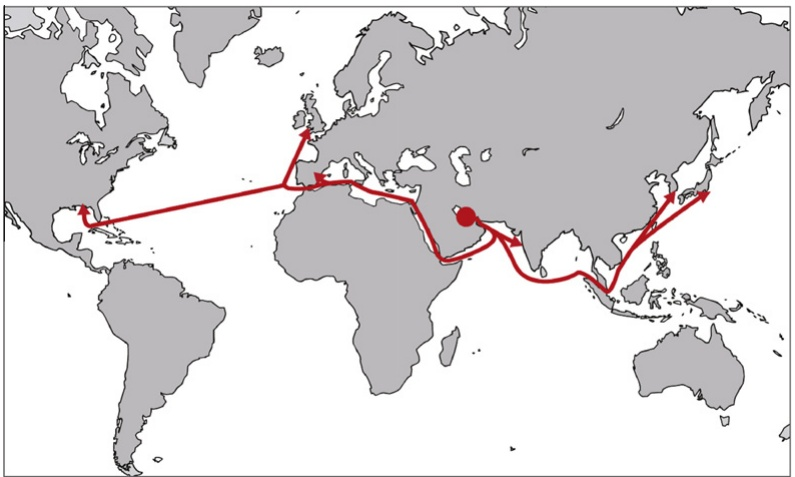
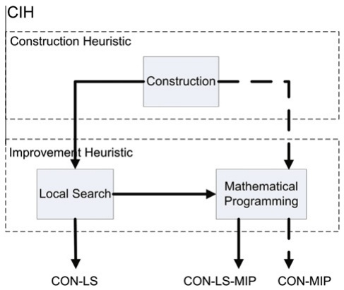
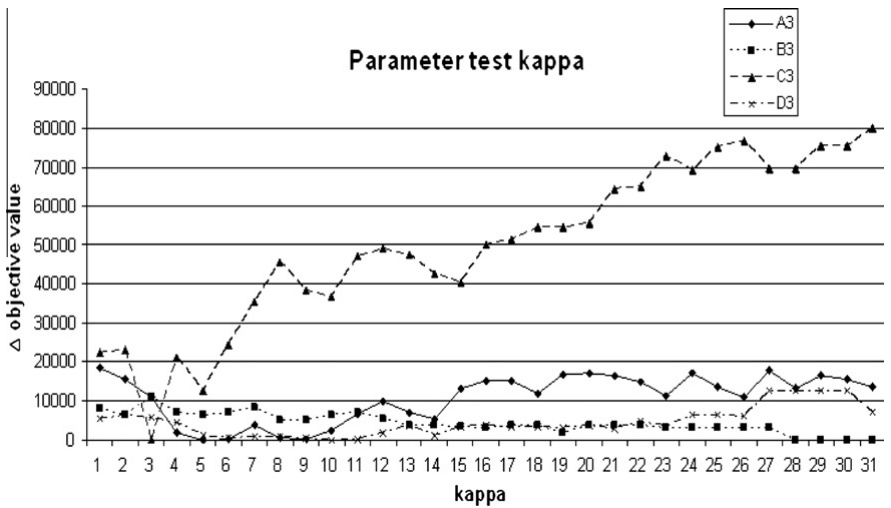

# A construction and improvement heuristic for a liquefied natural gas inventory routing problem

Magnus Stålhane a,⇑, Jørgen Glomvik Rakke a, Christian Rørholt Moe a, Henrik Andersson a, Marielle Christiansen a, Kjetil Fagerholt a,b

a Norwegian University of Science and Technology, Department of Industrial Economics and Technology Management Technology Trondheim, Norway b Norwegian Marine Technology Research Institute (MARINTEK), Trondheim, Norway

## a r t i c l e i n f o

Article history: Received 12 April 2011 Received in revised form 13 September 2011 Accepted 14 September 2011 Available online 24 September 2011

Keywords: Maritime transportation Inventory routing Heuristics

## a b s t r a c t

We present a large scale ship routing and inventory management problem for a producer and distributor of liquefied natural gas (LNG). The problem contains multiple products, inventory and berth capacity at the loading port and a heterogeneous fleet of ships. The goal is to create an annual delivery program to fulfill the producer’s long-term contracts at minimum cost, while maximizing the revenue from selling LNG in the spot market. To solve this problem we have developed a construction and improvement heuristic (CIH).

The CIH is a multi-start local search heuristic that constructs a set of solutions using a greedy insertion procedure. The solutions are then improved using either a first-descent neighborhood search, branchand-bound on a mathematical formulation, or both. Tests on real-life instances show that the CIH provides good solutions in a short amount of time.

\- 2011 Elsevier Ltd. All rights reserved.

## 1. Introduction

During the past decade the demand for energy has soared across the globe and is estimated to increase a further 50% from 2005 to 2030. Natural gas is becoming increasingly important in fulfilling this demand, with its share of the total energy consumption expected to increase from 20% in 2005 to 25% in 2030, EIA (2008). Until recently, natural gas has mainly been transported through pipelines. However, technological advances have made it possible to transport natural gas cost efficiently over greater distances by converting it into liquefied natural gas (LNG) and transporting it in specially designed ships.

More and more countries consider LNG as an alternative way of satisfying their energy demand. The largest suppliers of LNG have customers spread across far-east Asia, Europe and North-America. The increased production is also reflected in the number of LNG ships in service today. The world LNG fleet has grown from 105 ships in 1998 to 257 ships at the start of 2008, and is estimated to expand to about 400 ships by 2015 according to Fearnley (2008). Taking into account that an LNG ship with a capacity of 145000 m3 costs roughly 200–250 million USD to build, and the daily charter rate can be as much as 80000 USD, it is clear that there is a huge amount of money invested in the transportation of LNG. In addition, a spot market similar to that of crude oil is developing. The value of a single shipload of LNG is approximately 20–30 million USD, making this market very profitable. However, to have a stable and predictable income, most LNG producers have tied the majority of their production to longterm delivery contracts, while the remaining quantity is sold in the spot market. In such a complex and shifting environment decision support systems for routing and scheduling of LNG ships become ever more important.

In this paper we present a ship routing and inventory management problem for a producer and distributor of LNG. The producer has a single liquefaction plant with storage tanks and a connected loading port with limited capacity. From the loading port the LNG is shipped by a heterogeneous fleet of ships to customers worldwide to whom the producer has a contractual obligation to deliver LNG, see Fig. 1. All shipments are full shiploads. In addition, the producer wants to utilize any excess LNG by selling it in the spot market. The goal is to create an annual delivery program (ADP) to fulfill the producer’s long-term contract obligations at minimum cost, while maximizing the expected marginal contribution from selling excess LNG in the spot market. An ADP is a complete schedule of every ship’s sailing plan for the coming year.

The problem faced by the producer in this case study is similar to problems faced by other producers of LNG, but also producers of other unrefined products like crude oil. These problems often have one location where the product is extracted with limited storage and berth capacity, and many customers to which it is distributed.

<small>⇑ Corresponding author. Tel.: +47 73590811.</small>

<small>E-mail addresses: [magnus.stalhane@iot.ntnu.no](mailto:magnus.stalhane@iot.ntnu.no) (M. Stålhane), [jorgen.rakke @iot.ntnu.no](mailto:jorgen.rakke@iot.ntnu.no) (J.G. Rakke), [chrism@stud.ntnu.no](mailto:chrism@stud.ntnu.no) (C.R. Moe), [henrik.andersson @iot.ntnu.no](mailto:henrik.andersson@iot.ntnu.no) (H. Andersson), [marielle.christiansen@iot.ntnu.no](mailto:marielle.christiansen@iot.ntnu.no) (M. Christiansen), [kjetil.fagerholt@iot.ntnu.no](mailto:kjetil.fagerholt@iot.ntnu.no) (K. Fagerholt).</small>

Fig. 1. Map showing some of the main sailing routes of the producer.

The fleet is usually fixed and heterogeneous, and each voyage is a round trip, where products are unloaded at one or more ports, before the ship returns empty to the loading port. The main difference between LNG and most other products is the constraint of full ship loads being delivered to only one destination. However, many unrefined products are being extracted in remote locations, with the primary markets located within fairly limited geographical areas. For instance crude oil tankers are fully loaded in the Middle East, and make deliveries to either the US, Western Europe or Japan. Thus the sailing trip may be fairly accurately modelled as one destination when making a schedule for the coming year.

The purpose of this paper is to present a construction and improvement heuristic (CIH) that quickly solves large real world instances of the LNG planning problem described above. The heuristic includes a diversification strategy by constructing a set of initial solutions, and the search for good solutions is intensified by applying branch-and-bound on a mathematical formulation with some variables from the original formulation fixed. We further show that under certain realistic conditions, the heuristic performs much better than the one presented by Rakke et al. (2011) for the same problem.

The paper is outlined as follows. First we present an overview of recent literature in Section 2. In Section 3 we present a more detailed description of the problem studied in this paper, before giving a mathematical formulation of the problem in Section 4. The construction and improvement heuristic is described in Section 5, followed by a computational study in Section 6. Finally, some concluding remarks are given in Section 7.

## 2. Related literature in maritime LNG transportation

The problem described in this paper is also studied by Rakke et al. (2011), who present a rolling horizon heuristic to create good ADPs. The heuristic solves the problem by iteratively solving mixed integer subproblems with shorter time horizons by branch-and-bound, taking into account decisions made in the previous subhorizon. The solution quality is comparable to the one obtained by the CIH described in this paper, but the solution time is much shorter for the CIH. Halvorsen-Weare and Fagerholt (2009) study a similar problem from the LNG business. The main difference is that the cargoes for each long-term contract are pre-generated and given time windows. The problem is decomposed into a routing subproblem and a scheduling master problem where berth, inventory and scheduling decisions are handled. Halvorsen-Weare and Fagerholt (2009) do not consider spot market opportunities.

Two other studies of optimizing the LNG supply chain are done by Grønhaug and Christiansen (2008) and Grønhaug, Christiansen,

Desaulniers, and Desrosiers (2010). The problem has a more complex structure than the one presented here, as it involves more than one production port, inventory constraints both at the production and consumption ports, variable production and sales, and each LNG ship can visit more than one regasification terminal on a given voyage. When it comes to the computational studies, the problem has fewer ships, and a much shorter planning horizon than the large scale problem presented in this paper. Grønhaug and Christiansen (2008) give both an arc flow and path flow formulation of the problem. There the paths are pregenerated, while Grønhaug et al. (2010) use a branch-and-price algorithm to solve the problem.

Andersson, Christiansen, and Fagerholt (2010) present a more general study of the LNG supply chain, and some of its main characteristics. They consider two problems, one for a producer of LNG and one for a vertically integrated company. Mathematical models are presented for each problem and solution approaches to both models are briefly discussed, but no computational results are given.

## 3. Problem description

In this section we give a detailed description of a real planning problem faced by a producer and distributor of LNG. In addition, we explicitly state the assumptions made in order to formulate a mathematical model of the problem.

At the producer’s storage and liquefaction plant, two types of LNG are produced, rich LNG (RLNG) and lean LNG (LLNG). Connected to the plant is a single loading port with one storage tank for each type of LNG, as well as several berths for loading LLNG and one berth for loading RLNG. The inventory levels of the storage tanks should always be between time dependent upper and lower limits. Due to these limitations, ships may potentially wait outside the port for a significant amount of time before loading.

The production rates of LNG are assumed to be fixed, since the producer always aims to produce as much LNG as possible. However, rates may vary, for instance due to maintenance. Since the producer is not the sole supplier to many of its customers, storage on the consumption side is assumed to be unknown and is not taken into account. This means that we assume an infinite storage and berthing capacity at the customer side.

The producer distributes LNG from the loading port to its customers world-wide using a fleet of LNG ships. The fleet is heterogeneous and considered as fixed for the planning horizon. All ships may transport both types of LNG, but only one type at a time.

The ships are always fully loaded at the loading port. During a voyage, it is company practice to visit only one regasification terminal before returning to the loading port. We assume that the sailing time of a voyage is known. The total time of a port-stay is approximated to one day for all ships and ports.

All ships have to be maintained at least once every fifth year, and the rule of thumb is that it should be performed within the last month before this deadline. Maintenance is performed at a drydock along the sailing lane of a voyage, but the ship occupies one berth at the loading port for one day after the maintenance to perform purge and cool-down procedures.

As of today, the producer controls 35 ships, but the size of the fleet is expected to increase significantly in the coming years. In peak periods, we assume that additional ships can be chartered at a daily rate.

There are also compatibility restrictions on which ships can visit which regasification terminals. This is due to ship acceptance policies at the ports, and the fact that some ships are owned by one, or a group of customers, limiting them to visit only their owner’s regasification terminals.

The producer has committed itself to fulfill a set of long-term contracts, each with a duration of 10–25 years. A contract states the annual volume of LNG purchased and the regasification terminal where it is to be delivered. The volumes to be delivered are either specified per month, or simply stated as being delivered fairly evenly spread throughout each year. Since the contracts span many years, there is some flexibility in the volumes that have to be delivered in a given year, but the producer always aims to deliver as closely as possible to the contractual demand.

Since production often is greater than the contractual demands, we assume that the producer has the opportunity to sell excess LNG in the spot market. When planning, we assume that the spot prices are known.

To plan for the coming year, the producer creates an ADP which is a complete annual sailing plan for the entire fleet. The ADP consists of a set of scheduled voyages, where each represents one voyage made by a specific ship from the loading port to a contract’s designated regasification terminal and back again. The voyage starts by loading in the producer’s port at a particular time and finishes when it arrives back at the loading port. The day of delivery at the regasification terminal and the day the ship returns to the loading port are given implicitly by the start time of the scheduled voyage. Each ship typically undertakes anywhere between 5 and 30 such voyages during the planning horizon.

The aim is to create an ADP that fulfills the long-term contractual demands at minimum cost, while maximizing the expected marginal contribution from selling excess LNG in the spot market. The ADP created by the producer will then be subject to negotiations with the customers, who may wish to move certain delivery dates. It is therefore in the interest of the producer to make an initial ADP that the customers are likely to accept and thus it is important that the deliveries are fairly evenly spread throughout the planning horizon.

Even though an ADP is a complete plan for a given year, the producer has expressed the need for a tool that enables it to quickly (within 30 min) produce good ADPs in order to perform ‘‘what-$\mathrm { i f } ^ { \prime }$ scenario analyses. These include, for instance, the evaluation of adding a new contract, the impact of changing the production schedule, the consequences of chartering out a ship, or the effect of customer demands during negotiations.

## 4. Mathematical model

We start this section by defining the mathematical notation. Then the model is presented and described.

Let G be the set of liquefied natural gas types and C be the set of all contracts. The contract set C can be divided into disjoint sets $\mathcal { C } _ { g }$ containing only the contracts with demand for gas type $g .$ The set of long-term contracts is denoted $\mathcal { C } ^ { L T }$ , each element having one defined regasification terminal. Let $\mathcal { C } ^ { S }$ be the set of artificial spot contracts, one element for each $g .$ This set is created in order to model sale of LNG in the spot market as a scheduled voyage. Let $\mathcal { C } ^ { M }$ be the set of artificial maintenance contracts, one element for each g. This set is created to model maintenance as a scheduled voyage. We introduce one maintenance contract for each gas type in order to decide the berth type to use for purge and cool-down operations after the maintenance is performed.

Let V be the set of all ships available, while $\mathcal { V } _ { c }$ represents the ships allowed to serve contract $c .$ The ships operated by the producer are given by $\nu ^ { p }$ , where $\mathcal { V } ^ { P } \subseteq \mathcal { V } .$ In peak periods, additional spot ships may be chartered to serve the contracts or spot market. The ships that need maintenance during the planning horizon is given by the set $\mathcal { V } ^ { M } \subseteq \mathcal { V } ^ { P }$

The set of time periods in the planning horizon is given by $\tau .$ We partition the time periods into time intervals $p ,$ where each p has an earliest time period $\underline { { T } } _ { p }$ and a latest time period ${ \overline { { T } } } _ { p } .$ For instance if each time period t is one day, then $p$ may be one week, month, or year. The set of all time intervals is given by $\mathcal { P }$ and the set of time periods of time interval p is given by $\mathcal { T } _ { p } = \{ \underline { { T } } _ { p } , \dots , \overline { { T } } _ { p } \}$ . The set $\mathcal { P }$ may include overlapping time intervals, for instance both a month and a week within the same month. Let $\mathcal { T } _ { \nu } \subseteq \mathcal { T }$ be the set of time periods where ship v is available to start a voyage, and let $\boldsymbol { \mathcal { T } } _ { \nu } ^ { M }$ be the set of time periods where maintenance may start for all $\nu \in \mathcal { V } ^ { M }$

Let the parameter $T _ { c v }$ be the total time of a scheduled voyage to long-term contract c for ship v. In addition, $T _ { c v }$ gives the duration of the maintenance for $c \in \mathcal { C } ^ { \bar { M } }$ . Since the destination of a scheduled spot voyage is not known in advance, it was considered most robust to set $T _ { c \nu } { = } m a x _ { c ^ { \prime } \in \mathcal { C } ^ { L T } } \{ T _ { c ^ { \prime } \nu } \}$ for all spot contracts.

Parameter $C _ { c \nu } ^ { T }$ represents the transportation and port costs of sailing a scheduled voyage to the regasification terminal of contract c and back again, using ship v. For the spot ships the cost also includes the time charter cost of chartering the ship. The loading capacity of ship v is given by $L _ { \nu }$ and the number of berths available at the loading port for loading gas type $g$ is represented by $B _ { g } .$ Parameter $P _ { g t }$ is the production volume, while $I _ { g t }$ and $\overline { { I } } _ { g t }$ are the lower and upper limits on the capacity of the storage tank at the loading port for gas type $g$ at time period $t .$ The estimated value of having LNG of gas type g left in the storage tanks at the end of the planning horizon is given by $R _ { g } ^ { I } ,$ and $R _ { c } ^ { S }$ represents the revenue of selling one unit of gas type g to spot contract c.

One major advantage with the voyage structure in the formulation is that ‘‘boil-off’’ – the daily evaporation of LNG from the ship’s storage tanks – can be pre-calculated. Boil-off is considered a major challenge in the LNG inventory routing problems by Grønhaug et al. (2010), but does not need to be explicitly handled in our model. The demand $D _ { c p }$ for LNG of contract c in time interval p is adjusted for boil-off. As mentioned, the long-term contracts state a monthly demand or that the annual demand should be fairly evenly spread throughout the year. In the latter case, the annual demand is partitioned into periodic demand corresponding to the length of time interval $p , \mathrm { ~ A ~ }$ cost $C _ { c p } ^ { D }$ is introduced to penalize the under-delivery in time interval $p$ to contract c. Any over-deliveries are implicitly penalized, since they will reduce the amount of LNG the producer is able to sell in the spot market. It is important that the penalty of underdelivery is higher than the revenue in the spot market, to ensure that the long-term contracts are served. It is also important that the penalty of under-delivery over the entire planning horizon is significantly higher than the penalty of each shorter time interval, to even out deviations over the planning horizon.

The binary variable $x _ { c v t }$ represents one scheduled voyage by ship v serving contract c starting in time period $t ,$ and exists only for the days the ship is available. The inventory level of gas type g in time period t is given by $i _ { g t } ,$ while $y _ { c p }$ represents the underdelivery of LNG to contract c in time interval p.

$$
\min \sum_ {c \in \mathcal {C}} \sum_ {v \in \mathcal {V} _ {c}} \sum_ {t \in \mathcal {T} _ {v}} C _ {c v} ^ {T} x _ {c v t} + \sum_ {c \in \mathcal {C} ^ {L T}} \sum_ {p \in \mathcal {P}} C _ {c p} ^ {D} y _ {c p}
$$

$$
- \sum_ {c \in C ^ {S}} \sum_ {v \in \mathcal {V} _ {c}} \sum_ {t \in \mathcal {T} _ {v}} R _ {c} ^ {S} L _ {v} x _ {c v t} - \sum_ {g \in \mathcal {G}} R _ {g} ^ {I} i _ {g | \mathcal {T} |},\tag{4.1}
$$

$$
\sum_ {c \in \mathcal {C} _ {g}} \mathcal {C} ^ {\mathcal {M}} \sum_ {\nu \in \mathcal {V} _ {c}} x _ {c v t}
$$

$$
+ \sum_ {c \in \mathcal {C} ^ {M} \bigcap \mathcal {C} _ {g}} \sum_ {v \in \mathcal {V} ^ {M}} x _ {c v (t - T _ {c v} - 1)} \leqslant B _ {g}, \quad \forall g \in \mathcal {G}, t \in \mathcal {T},\tag{4.2}
$$

$$
\mathbf {i} _ {g t} - \mathbf {i} _ {g (t - 1)} + \sum_ {c \in \mathcal {C} _ {g} \backslash C ^ {M}} \sum_ {v \in \mathcal {V} _ {c}} L _ {v} x _ {c v t} = P _ {g t}, \forall g \in \mathcal {G}, t \in \mathcal {T},\tag{4.3}
$$

$$
I _ {g t} \leqslant i _ {g t} \leqslant \bar {I} _ {g t},
$$

$$
\forall \mathbf {g} \in \mathcal {G}, t \in \mathcal {T},\tag{4.4}
$$

$$
\sum_ {v \in \mathcal {V} _ {c}} \sum_ {t \in \mathcal {T} _ {p}} L _ {v} x _ {c v t} + y _ {c p} \geqslant D _ {c p},
$$

$$
\forall c \in \mathcal {C} ^ {L T}, p \in \mathcal {P},\tag{4.5}
$$

$$
\sum_ {c \in \mathcal {C}} \sum_ {t - T _ {c v} <   \tau \leqslant t} x _ {c v \tau} \leqslant 1,
$$

$$
\forall v \in \mathcal {V} ^ {p}, t \in \mathcal {T} _ {v},\tag{4.6}
$$

$$
\sum_ {c \in C ^ {M}} \sum_ {t \in T _ {\nu} ^ {M}} x _ {c v t} = 1,
$$

$$
\forall \boldsymbol {v} \in \mathcal {V} ^ {M},\tag{4.7}
$$

$$
x _ {c v t} \in \{0, 1 \},
$$

$$
\forall c \in \mathcal {C}, v \in \mathcal {V} _ {c}, t \in \mathcal {T} _ {v},\tag{4.8}
$$

$$
y _ {c p} \geqslant 0,
$$

$$
\forall c \in \mathcal {C}, p \in \mathcal {P}.\tag{4.9}
$$

The objective function (4.1) minimizes the variable costs incurred by the producer. The first term calculates the transportation and port visit costs of sailing the scheduled voyages. The second term penalizes under-delivery to long-term contracts in different time intervals. The third term subtracts the revenue associated with selling LNG in the spot market. Finally, the fourth term subtracts the value of having LNG left in the storage tanks at the end of the planning horizon.

Constraints (4.2) make sure that the number of ships occupying a berth on any given day does not exceed the number of berths. In the second term the time index is adjusted because a scheduled voyage to maintenance contracts occupies a berth after the ship returns to the loading port. These constraints are only defined for the loading port.

Constraints (4.3) and (4.4) make sure that the inventory levels in the storage tanks are between their upper and lower limits. Constraints (4.5) are soft and ensure that the demand of each longterm contract is met in every time interval.

Constraints (4.6) restrict each ship to sail at most one scheduled voyage on any given day. Constraints (4.7) state that every ship that is planned for maintenance will undertake maintenance exactly once. Finally, constraints (4.8) limit the scheduled voyages to be binary on the days the ship is available, while (4.9) make sure the under-deliveries are non-negative.

We now define three expressions that will be used extensively in the following section of the paper. An ADP is considered to be berth-feasible if it does not violate (4.2), inventory-feasible if it does not violate (4.3) and (4.4), and routing-feasible if it does not violate (4.6).

For the remaining of this paper we assume that the length of a time period is one day, and that the set of time intervals $\mathcal { T } _ { p }$ consists of all the months in the planning horizon, as well as one time interval covering the entire planning horizon.

## 5. Solution approach

This section presents the construction and improvement heuristic (CIH) that solves the ADP planning problem presented above. The heuristic uses a multi-start approach where a set of initial solutions are constructed, and then improved by intensifying the search in the neighborhood of each solution. The multi-start heuristic is chosen because it is difficult to design a search operator which will allow the search to investigate a large portion of the feasible region, due to the global inventory- and berth-constraints. Thus a more natural approach is to use a multi-start heuristic to diversify the search by producing a large number of initial solutions, each of which may then be improved using simple search operators.

We start by outlining the construction phase, addressing how ships, contracts and start days are put together to form a feasible set of scheduled voyages. We then describe two different ways in which this initial ADP may be improved. One is based on a local search, while the other is based on the mathematical programming formulation in Section 4.

## 5.1. Construction heuristic

To plan for the coming year, the producer creates an ADP consisting of a set of scheduled voyages S. A scheduled voyage s represents one voyage made by a specific ship from the loading port to a contract’s designated regasification terminal and back again. Let $s = ( c , v , t )$ , where v denotes the ship sailing the voyage, c the contract served and t the day the loading process starts.

The construction heuristic creates a feasible ADP by going through the planning horizon from beginning to end, adding new scheduled voyages to the solution. Algorithm 1 shows the pseudo code for the construction heuristic. Let S be an empty set of scheduled voyages. Further, let M be the set of months in the planning horizon and $T _ { m }$ and $\overline { { T } } _ { m }$ the first and last day of month m. Each iteration starts with the inventory being updated, before the algorithm goes through each contract c in a greedy fashion according to the ordered set of contracts $\mathcal { C } _ { \alpha \beta } ^ { 0 } ,$ ranked according to the contract ranking parameter a and the inventory control parameter b. $\mathcal { C } _ { \alpha \beta } ^ { 0 }$ contains all contracts from $\mathcal { C } ^ { L T }$ and ${ \mathcal { C } } ^ { S } .$

Ships are then selected from the ordered set $\mathcal { V } _ { c } ^ { Q }$ , that may serve the chosen contract c. The ship selected must be available at the loading port at most j days after t, where j is a lookahead parameter. This look-ahead functionality is similar to that recommended by both Ronen (1986) and Atkinson (1994) and tells us how long it is acceptable to wait for a better ship to become available.

Let $T _ { \nu } ^ { R F }$ be the first day it is routing-feasible to send out ship v, and $T _ { c \nu } ^ { I F }$ the first day where it is both berth- and inventory-feasible to load v with the LNG demanded by contract c. Then, the earliest possible start day of a scheduled voyage serving c using v is $T ^ { E } = m a x \left\{ T _ { v } ^ { R F } , T _ { c v } ^ { I F } \right\}$ . When a ship v is found that is able to start within the same month and within j days, a scheduled voyage $( c , \nu , T ^ { E } )$ is added to $\mathcal { S }$ and the algorithm continues with the next contract. Using $T ^ { E }$ , and data input regarding sailing times to the selected contract’s regasification terminal, $T _ { \nu } ^ { R F }$ is updated to be the next day it is routing-feasible to use v.

The berth capacity and inventory levels must also be updated after a new scheduled voyage is added. It must be ensured that there is LNG available to sail the voyage on $T ^ { E }$ , and at the same time make sure that the storage tank will not exceed its capacity between t and $T ^ { E }$

Algorithm 1. CreateADP $( \alpha , \beta , \kappa )$

$\mathcal{S} = \emptyset$
$m = 1$
for $t \in \mathcal{T}$ do
    if $t &gt; \overline{T}_m$ then
        $m = m + 1$
    end if
    for $g \in \mathcal{G}$ do
        $i_{gt} = i_{g(t-1)} + P_{gt}$
    end for
    for $c \in \mathcal{C}_{\alpha\beta}^Q$ do
        for $\nu \in \mathcal{V}_c^Q$ do
            $T^E = max\{T_v^{RF}, T_{cv}^{IF}\}$
            if $T^E \leqslant min\{t + \kappa, \overline{T}_m\}$ then
                $\mathcal{S} = \mathcal{S} \cup (c, \nu, T^E)$
                $T_v^{RF} = T_v^E + T_{cv}$
                update inventory levels and berth capacities
                go to next contract
            end if
        end for
    end for
end for

## 5.1.1. Adjusting monthly demand

Due to the different sizes of the ships and the fact that all cargoes have to be full shiploads, contracts will almost never have their monthly demands met exactly. This may accumulate to large deviations between the amount of LNG delivered and the contractual demands over the entire planning horizon if we do not adjust the remaining monthly demands accordingly. Let $\mathcal { S } _ { c t } \subset \mathcal { S }$ be the set of scheduled voyages starting on day t, serving contract c and let $u ( s )$ be the ship sailing the scheduled voyage s. Further let $D _ { c m }$ and $D _ { c m } ^ { * }$ be the original and updated demand for contract c in month m. After the last day of each month, the next month’s demand is calculated in the following way:

$$
D _ {c (m + 1)} ^ {*} = D _ {c (m + 1)} + \left[ D _ {c m} ^ {*} - \sum_ {t = \overline {{T}} _ {m}} ^ {\overline {{T}} _ {m}} \sum_ {s \in \mathcal {S} _ {c t}} L _ {v (s)} \right].\tag{5.1}
$$

## 5.1.2. Contract ranking

The main objective of our contract ranking is to get the deliveries to each contract fairly evenly spread throughout the planning horizon. We apply two approaches that both consider the remaining demand in the current month, the first uses the remaining volume and the second the remaining percentage of the monthly demand. The reason for considering monthly demands instead of the demand for the entire planning horizon is that some of the contracts have seasonal variations in demand that would not have been adjusted for, if we only considered demand for the entire planning horizon.

## Contract ranking parameter a

We combined the two approaches into one ranking scheme for the contracts. The scheme sorts the contracts on remaining percentage if the difference in remaining percentage is large, and on remaining volume if it is not. More formally, let $\rho _ { c m }$ be the percentage of the monthly demand for contract c that is left to be scheduled for delivery in month m, and $D _ { c m } ^ { * }$ the demand for the contract in the current month. The algorithm for ranking two contracts, $c _ { 1 }$ and $c _ { 2 } ,$ in month m is given in Algorithm 2.

Algorithm 2. Contract ranking scheme

if $|\rho_{c_1m} - \rho_{c_2m}| \leqslant \alpha$ then return argmax$\left\{\rho_{c_1m}D_{c_1m}^*, \rho_{c_2m}D_{c_2m}^*\right\}$   
else return argmax$\{\rho_{c_1m}, \rho_{c_2m}\}$   
end if

## Inventory control parameter b

For most months during the planning horizon the total production will be greater than the total demand of the long-term contracts. This excess LNG may be sold in the spot market. As with the long-term contracts the spot sales should be spread across the planning horizon. The main reason is that only a subset of the ships can take spot cargoes and we therefore want to spread out these voyages to avoid having to charter additional ships.

In order to spread the spot cargoes throughout the planning horizon, one artificial spot contract is added to $\mathcal { C } _ { \alpha \beta } ^ { 0 }$ for each gas type. The demand of these artificial contracts are set to be b times the difference between total production and total adjusted contractual demand for the given month, where $\beta \in [ 0 , 1 ] .$ The parameter b can thus be seen as a parameter controlling the inventory levels at the start of the next month, and the value of $^ { \circ } \beta$ will be varied in the multi-start heuristic.

## 5.1.3. Ship ranking

Each contract in $\mathcal { C } _ { \alpha \beta } ^ { 0 }$ has a queue of ships associated with $\mathbf { i } \mathbf { \bar { \imath } } , \mathcal { V } _ { c } ^ { Q } ,$ which contains an ordered sequence of the ships that are allowed to serve the contract. The ships are ranked according to the total number of contracts the ship may serve, where the ships are sorted in increasing order. Ships which may serve the same number of contracts are sorted in increasing order by their cost to capacity ratio. This approach is similar to the one used in the heuristic described by Ronen (1986), and ensures that less flexible ships are used before more flexible ones, and that the cheapest ships among equally flexible ships are used first.

## 5.1.4. Maintenance

Some ships need to be scheduled for maintenance each year. The maintenance for ship v is required to begin during a given time interval $[ \underline { { T } } _ { \nu } ^ { M } , \overline { { T } } _ { \nu } ^ { M } ]$ . In order to add a scheduled maintenance voyage in the construction heuristic we add a rule to the heuristic ensuring that a ship cannot be selected to sail a normal scheduled voyage that ends after the last day of the maintenance period $\overline { { T } } _ { \nu } ^ { M } .$ , unless maintenance has already been scheduled. Once it is decided to schedule maintenance, it is scheduled as early as possible.

## 5.1.5. The objective function

The objective function presented here is equivalent to objective function (4.1) using the planning horizon and months as time intervals, but will be restated using the symbols defined in Section 5.

Let $\begin{array} { r } { D _ { c } = { \sum _ { m \in \mathcal { M } } } D _ { c m } } \end{array}$ for all $c \in \mathcal { C } ^ { L T }$ be the total demand of contract $c , \mathcal { S } _ { c } \subset \mathcal { S }$ the set of all scheduled voyages serving contract $c ,$ and $\mathcal { S } _ { c m } \subseteq \mathcal { S } _ { c }$ the set of all scheduled voyages serving c in month m. Further, let $C _ { s } ^ { T }$ be the transportation cost associated with voyage s, and let $C _ { c } ^ { D }$ and $C _ { c m } ^ { D }$ be the penalty cost per unit of under-delivery of LNG to contract c for the planning horizon and each month respectively. Finally, $u ( s )$ denotes the ship sailing scheduled voyage s, and $c ^ { S } ( { \pmb g } ) \in { \mathcal C } ^ { S } \bigcap { \mathcal C } _ { \pmb g }$ the spot contract for gas type g. The function used to evaluate the ADP is then given as:

$$
\left| \begin{array}{l} z = \sum_ {s \in \mathcal {S}} C _ {s} ^ {T} + \sum_ {c \in \mathcal {C} ^ {L T}} \sum_ {m \in \mathcal {M}} \max \left\{0, D _ {c m} - \sum_ {s \in \mathcal {S} _ {c m}} L _ {v (s)} \right\} \cdot C _ {c m} ^ {D} \\ + \sum_ {c \in \mathcal {C} ^ {L T}} \max \left\{0, D _ {c} - \sum_ {s \in \mathcal {S} _ {c}} L _ {v (s)} \right\} \cdot C _ {c} ^ {D} \\ - \sum_ {g \in \mathcal {G}} \sum_ {s \in \mathcal {S} _ {c S (g)}} L _ {v (s)} R _ {c S (g)} ^ {S} - \sum_ {g \in \mathcal {G}} R _ {g} ^ {I} i _ {g | T |} \end{array} \right|\tag{5.2}
$$

The first term summarizes the cost associated with each scheduled voyage, while the second penalizes monthly underdelivery to the long-term contracts. The third term penalizes under-delivery to the long-term contracts over the entire planning horizon, and the fourth term subtracts the revenue of selling LNG in the spot market. Finally, the fifth term subtracts the value of having LNG left in the storage tanks on the last day of the planning horizon.

## 5.2. Local search heuristic

Here we present an improvement heuristic which takes a feasible ADP and tries to decrease the value of the objective function described in Section 5.1.5 through a local search. Since the CIH is a multi-start heuristic the goal of the local search is to quickly find better solutions by exploring the neighborhood around a feasible solution. We have implemented five local search operators that each defines a neighborhood $N ( S )$ to a given feasible ADP S. The search is done by going through these operators in a ‘‘first improvement’’ fashion until no more improvements are found. The five neighborhood operators are:

1. Changing contract: $( c , v , t ) \to ( c ^ { \prime } , v , t )$ The ship v starting a scheduled voyage to contract c on day t is assigned another contract $c ^ { \prime } .$

2. Changing ship: $( c , v , t ) \to ( c , v ^ { \prime } , t )$ The contract c served on a scheduled voyage starting day t is assigned another ship $\nu ^ { \prime } .$

3. Swapping contracts: $( c , v , t ) ,   ( c ^ { \prime } , v ^ { \prime } , t ^ { \prime } ) \to   ( c ^ { \prime } , v , t ) ,   ( c , v ^ { \prime } , t ^ { \prime } )$ The contracts of two scheduled voyages are swapped.

4. Swapping ships: $( c , v , t ) ,   ( c ^ { \prime } , v ^ { \prime } , t ^ { \prime } ) \to   ( c , v ^ { \prime } , t ) ,   ( c ^ { \prime } , v , t ^ { \prime } )$ The ships of two scheduled voyages are swapped.

5. Remove a scheduled voyage:

Remove the scheduled voyage (v, c,t) from S.

Since the local search uses the ‘‘first improvement’’ strategy, the sequence in which the scheduled voyages are ordered and tested for each operator will influence the quality of the solution. Each operator sorts the scheduled voyages according to c using the contract ranking $\mathcal { C } _ { \alpha \beta } ^ { 0 } ,$ and then according to t in chronological order. Note that the contract ranking at the end of the planning horizon will be ranked according to fulfillment of the total yearly demand, as deviation from demand in each of the previous months are passed onto the next. For operator $2 ,   \nu _ { c } ^ { Q }$ is used to order the sequence in which ships are inserted into a scheduled voyage. All operators are checked with respect to berth-, inventory-, and routing-feasibility to evaluate if they are feasible.

By construction, there will only be LNG left in the storage tanks at the end of the planning horizon if all the long-term contracts with a demand for a particular gas type are satisfied. We may therefore add additional scheduled voyages at the end of the planning horizon for the artificial spot contracts. Adding these scheduled voyages is basically a multiple-knapsack problem, and we solve it through dynamic programming. The multiple-knapsack problem is NP-hard and thus only non-polynomial algorithms for solving it are known. However, since the number of variables is small, the solution time is negligible.

## 5.3. Mixed integer programming heuristic

In this section we describe a mixed integer programming (MIP) heuristic based on a modified version of the mathematical model presented in Section 4. The idea is to explore more thoroughly the neighborhood around local minima in order to further improve the value of an ADP. Archetti, Bertazzi, Speranza, and Hertz (2011) use a similar approach to improve the solutions of their tabu search heuristic to solve a vehicle routing problem with inventory constraints. The same MIP heuristic as the one presented here is also used by Rakke et al. (2011) as part of their rolling horizon heuristic.

## 5.3.1. Variable generation

In the mathematical model, every feasible $( c , v , t )$ combination is represented by a binary variable $x _ { c v t \bullet }$ Here we suggest creating only a subset of these binary variables based on the set of scheduled voyages S given by the ADP used as input to the model. Recall that $\mathcal { S } _ { c t }$ is the set of scheduled voyages sailing to contract c on day t. For each scheduled voyage going to a long-term contract we keep the contract c and day t fixed, but allow all ships $\nu \in \mathcal { V } _ { c }$ to sail this scheduled voyage. Thus we create the following variables:

$$
x _ {c v t} \in \{\mathbf {0}, 1 \}, \quad \forall c \in \mathcal {C} ^ {L T}, \quad \boldsymbol {v} \in \mathcal {V} _ {c}, \quad t \in \mathcal {T} _ {v}, \quad \mathcal {S} _ {c t} \neq \emptyset .\tag{5.3}
$$

For scheduled voyages going to the artificial spot contracts we allow the new formulation to re-route the voyages to a long-term contract if it is profitable to do so. Therefore we create the following variables:

$$
\begin{array}{l} x _ {c v t} \in \{0, 1 \}, \quad \forall g \in \mathcal {G}, c \in \mathcal {C} _ {g} \setminus C ^ {M}, v \in \mathcal {V} _ {c}, t \\ \qquad \in \mathcal {T} _ {v}, \mathcal {S} _ {c ^ {S} (g) t} \neq \emptyset . \end{array}\tag{5.4}
$$

Maintenance of ships is an area where there is potential for improvement because taking a ship out of commission may have great impact on the ADP. Since maintenance on average only concerns a fifth of the ships and the impact of changing maintenance by only a few days may be substantial, all the variables involving the maintenance contract will be created:

$$
x _ {c v t} \in \{0, 1 \}, \quad \forall c \in \mathcal {C} ^ {M}, \quad \boldsymbol {v} \in \mathcal {V} ^ {M}, \quad t \in \mathcal {T} _ {\nu} ^ {M}.\tag{5.5}
$$

By only creating the variables mentioned above, we limit the size of the problem to a very small fraction of its original size.

## 5.3.2. Additional constraints

For some instances the problem may still be hard to solve using branch-and-bound. To ease the solution process further, additional sets of constraints are added to the formulation. For each scheduled voyage, only one $x _ { c v t }$ variable can be equal to one. The reasoning behind this is that we want to keep the number of scheduled voyages constant. We add the constraints:

$$
\left| \sum_ {v \in V _ {c}} x _ {c v t} = | \mathcal {S} _ {c t} |, \quad \forall c \in \mathcal {C} ^ {L T}, t \in \mathcal {T}, \mathcal {S} _ {c t} \neq \emptyset , \right|\tag{5.6}
$$

$$
\sum_ {\nu \in V _ {c}} x _ {c v t} \leqslant | \mathcal {S} _ {c t} |, \quad \forall c \in \mathcal {C} ^ {S}, t \in \mathcal {T}.\tag{5.7}
$$

The reason why constraints (5.7) are $\leqslant$ constraints is that we have generated some variables in (5.4) which are not part of these constraints. If one of these variables are equal to one, all the variables in one constraint in (5.7) will most likely have to be equal to zero, or the ADP will not be inventory-feasible.

## 5.3.3. Overview of the mixed integer programming heuristic

The MIP heuristic solves a modified version of the formulation presented in Section 4, based on input from a feasible ADP. The objective function (4.1) and constraints (4.2)–(4.7) are all kept, and, in addition, (5.6) and (5.7) are added to the model. Instead of generating variables as stated in (4.8) and (4.9), only the variables given by (5.3)–(5.5) are created. By solving this reduced version of the problem we can find good feasible solutions quickly using branch-and-bound.

Fig. 2. Flowchart showing the different modules of the CIH and how they interact.

## 5.4. Summary of the construction and improvement heuristic

We have presented a CIH to solve the ADP planning problem with respect to the criteria mentioned above. It is a multi-start heuristic where a number of initial solutions are generated by a constructive heuristic. These solutions are then improved by either a local search, and/or by solving a restricted version of the mathematical model presented in Section 4. Fig. 2 shows the flow of data through the different parts of the heuristic. The naming convention of the three different outputs will be used in Section 6, where a computational study of the heuristic is conducted.

## 6. Computational results

In this section we test the CIH to see how suitable it is to solve the ADP planning problem. First we give a short description of the instances used in the computational study. The testing of the parameters a, b and j is then presented, in order to determine the best value range for each parameter. Finally we present the results given by different variants of the CIH on all instances.

The CIH has been implemented in Java version 6.0. The development is done using the Eclipse Ganymede workbench and compiler. Both the full mathematical model and the MIP heuristic were implemented in Xpress-IVE 1.19.00, with Xpress-Mosel 2.4.0, and solved by Xpress-Optimizer 19.00.00. The tests have been performed on a HP DL 160 G5 computer with an Intel Xeon QuadCore E5472 3.0 GHz processor, 16 GB of RAM and running on a Linux operating system. Even though the processors used to run these tests have multiple cores, only single thread versions of the programs have been run, to give running times comparable to using a single core computer.

## 6.1. Test case description

We have tested the CIH on four cases, A, B, C, and D, based on real case data provided by the producer. From these cases we have created 20 instances which are listed in Table 1. For each instance we give the number of ships, number of contracts for each gas type, the length of the planning horizon, the number of berths for each gas type, the inventory to production ratio (I/P), and a range for the number of scheduled voyages needed. The I/P-ratio is calculated as the size of the storage tanks in the loading port divided by the average daily production. This measure was used by Halvorsen-Weare and Fagerholt (2009) and gives an indication of how tightly constrained the problem is with respect to the inventory constraints. The number of scheduled voyages needed is calculated based on the amount of LNG to be shipped and the minimum and maximum ship sizes available in the instance.

The instances in Table 1 are organized such that instances A1, B1, C1, and D1 represent each of the four cases with a one year planning horizon, while the instances numbered 2 – 5 are equivalent, with the exception of the length of the planning horizon.

Case A is tightly constrained with respect to the RLNG inventory, while case C is tightly constrained with regard to inventory for both gas types. On the other hand, case B has a lot of maneuvering room in how to schedule its voyages carrying LLNG, since it will take more than a month to fill up the storage tank.

The cases can be divided into two main scenario classes where cases A and B reflect the current situation, and C and D reflect a future situation when planned production-trains, ships and loading docks all have been completed. The main differences between the cases are: cases A and B have fewer and smaller ships than cases C and D, the production rates are lower, and there is more excess LNG available to sell in the spot market. They also include seasonal variations, the contract demands are of similar volume sizes, and the contract destinations are, on average, situated closer to the producer’s loading port. Cases B and D are down-scaled versions of cases A and C respectively, where some of the ships, contracts, and production volumes are removed. All cases are also used by Rakke et al. (2011), where a comparison between the heuristics is presented.

| Instance | Number of ships | Number LLNG | of contracts RLNG | Planning horizon days | Numbe LLNG | r of berths RLNG | I/PLLNG | RLNG | Number of voyages |
| --- | --- | --- | --- | --- | --- | --- | --- | --- | --- |
| A1 | 34 | 5 | 3 | 366 | 4 | 1 | 9.21 | 6.17 | 310-350 |
| A2 | 34 | 5 | 3 | 244 | 4 | 1 | 9.02 | 6.08 | 200-230 |
| A3 | 34 | 5 | 3 | 182 | 4 | 1 | 9.05 | 5.98 | 140-170 |
| A4 | 34 | 5 | 3 | 121 | 4 | 1 | 9.01 | 5.50 | 100-120 |
| A5 | 34 | 5 | 3 | 91 | 4 | 1 | 9.23 | 5.38 | 80-100 |
| B1 | 16 | 1 | 3 | 366 | 2 | 1 | 44.60 | 11.35 | 110-140 |
| B2 | 16 | 1 | 3 | 244 | 2 | 1 | 44.21 | 11.29 | 75-90 |
| B3 | 16 | 1 | 3 | 182 | 2 | 1 | 44.37 | 11.11 | 50-70 |
| B4 | 16 | 1 | 3 | 121 | 2 | 1 | 44.14 | 10.21 | 40-50 |
| B5 | 16 | 1 | 3 | 91 | 2 | 1 | 45.23 | 10.00 | 30-40 |
| C1 | 46 | 6 | 11 | 365 | 4 | 1 | 6.05 | 6.07 | 310-350 |
| C2 | 46 | 6 | 11 | 243 | 4 | 1 | 6.08 | 6.19 | 200-240 |
| C3 | 46 | 6 | 11 | 181 | 4 | 1 | 6.04 | 6.39 | 160-200 |
| C4 | 46 | 6 | 11 | 120 | 4 | 1 | 6.07 | 6.22 | 100-130 |
| C5 | 46 | 6 | 11 | 90 | 4 | 1 | 6.18 | 5.82 | 70-100 |
| D1 | 30 | 4 | 4 | 365 | 4 | 1 | 9.08 | 9.37 | 200-240 |
| D2 | 30 | 4 | 4 | 243 | 4 | 1 | 9.14 | 9.73 | 130-160 |
| D3 | 30 | 4 | 4 | 181 | 4 | 1 | 9.60 | 9.97 | 100-130 |
| D4 | 30 | 4 | 4 | 120 | 4 | 1 | 9.11 | 9.55 | 70-100 |
| D5 | 30 | 4 | 4 | 90 | 4 | 1 | 9.35 | 8.94 | 50-70 |

## 6.2. Exact solution method

In this section the computational results of the mathematical model given in Section 4 are presented. Each instance was run for a maximum of 24 h (86400 s) and Table 2 shows the computational time (CPU (s)), the optimality gap in percentage (opt. gap) and the difference between the upper and lower bound (UB - LB) given in 1000 USD. Optimality could not be proven for any of the instances within the time limit, though the 3 and 4 month instances are very close. The 6 months instances provide fairly good results, however for the 8 and 12 months instances of cases A, C and D, the best solutions found after 24 h are far from the lower bound. Especially the 12 month instances of these cases have big gaps.

Focusing only on the percentage gap indicates a poor performance on the first 10 instances compared to the last 10 instances. However, the picture is quite different if looking at the difference in value between the upper and lower bounds. It is reasonable that the difference is bigger for the instances with longer planning horizons as more voyages are made, and there are more time intervals for which under-delivery is penalized, resulting in a larger objective value. However, instance A1, which has the biggest percentage gap, is much closer to the optimal solution than instances C1 and C2 which have small percentage gaps. The reason why instances from cases A and B have larger percentage gaps is that these instances have a lot more excess LNG. For cases A and B the income from selling LNG in the spot market is approximately the same as the total costs, and therefore the objective values become close to zero. This makes the percentage gap large, even though the total costs related to the instances are similar to those in cases C and D.

Table 2

Test of the exact solution method.

| Instance | CPU (s) | Opt. gap (%) | UB - LB |
| --- | --- | --- | --- |
| A1 | 86400 | 396.64 | 54641 |
| A2 | 86400 | 20.62 | 20141 |
| A3 | 86400 | 22.28 | 8700 |
| A4 | 86400 | 3.44 | 2492 |
| A5 | 86400 | 3.82 | 3107 |
| B1 | 86400 | 12.24 | 2985 |
| B2 | 86400 | 6.23 | 3279 |
| B3 | 86400 | 6.06 | 1387 |
| B4 | 86400 | 10.63 | 2371 |
| B5 | 86400 | 8.41 | 1464 |
| C1 | 86400 | 7.77 | 112224 |
| C2 | 86400 | 3.66 | 37209 |
| C3 | 86400 | 0.68 | 5514 |
| C4 | 86400 | 0.45 | 2476 |
| C5 | 86400 | 0.22 | 877 |
| D1 | 86400 | 8.66 | 74957 |
| D2 | 86400 | 3.39 | 21499 |
| D3 | 86400 | 1.53 | 7581 |
| D4 | 86400 | 0.51 | 1677 |
| D5 | 86400 | 0.47 | 1132 |

## 6.3. Parameter testing

The CIH is a multi-start heuristic, where the starting points are determined by the values of contract ranking parameter $\alpha ,$ the inventory control parameter b, and the look-ahead parameter j. In this section we test instances A3, B3, C3, and D3 for several combinations of the three parameters to see which are more likely to provide good solutions. We test the following setting for the parameters: $\alpha \in [ 0 , 1 ]$ with increments of 0.025, $\beta \in [ 0 , 1 ]$ with increments of 0.025, and $\kappa \in \{ 1 , \ldots , 3 1 \}$ . Each tested parameter value for a given parameter is tested over all the possible combinations of the other parameter values.

Fig. 3 shows the deviation between the best obtained ADP and the best ADP for that particular j value, for each of the four instances. Which j value performs better differs a lot between the instances, and especially instance C3 is a very sensitive to the j value. However, there is a correspondence between the j values that provide the best ADPs, and the I/P-ratio given in Section 6.1. For instance A3 which has $\mathrm { I / P } _ { 1 }$ ratios of 9.05 and 5.98 the best ADPs are created with j values between 4 and 10. These observations indicate that there is a connection between the $\mathrm { I / P _ { 1 } }$ ratio and the best j values and we therefore use the I/P-ratio as a basis for our j values. This is logical since the $\mathrm { I / P . }$ -ratio gives the number of days before an empty storage tank fills up, and thus gives an indication of the frequency with which voyages need to be scheduled. Since some instances have different I/P-ratios for each gas type, we replace j with $\kappa _ { g }$ in Algorithm 1.

To test what range of $\kappa _ { g }$ provides the best $\mathrm { A D P s } ,$ we tested all four instances with $\kappa _ { g } = \lfloor ( \bar { I } _ { g } - \underline { { I } } _ { g } ) / P _ { g } \rfloor + \sigma _ { g } ,$ where $P _ { g }$ is the daily average production rate of gas type $g ,$ and $\sigma _ { g }   \in   \{ - 5 , \dots , 2 \}$ . These tests did not give any clear indication on what combinations of j values performed better, and it was therefore decided to do the remaining testing with the same r value for both gas types.

For parameter $\beta$ low values seem to be inferior. We therefore limit $\beta$ to the range [0.25, 1] in the remaining tests. This result is reasonable since for instances with much excess LNG, one needs to ship some LNG out to keep the solution inventory-feasible. For instances with little excess LNG, the construction heuristic is less sensitive to the value of the b multiplier, since the demand of the artificial spot contract is so small that it will not be served. The parameter tests did not give any indication of which values of the a parameter are superior, and thus the a parameter will be tested over the range [0,1] in the remaining computational study.

## 6.4. Computational results

In order to evaluate the effect of using the local search and the MIP heuristic to improve the ADP created by the construction heuristic, we decided to test six different variants of the CIH. For each variant the heuristic is run over all the possible combinations of the parameters, and returns the best ADP.

 CON-LS-1: The construction heuristic with the local search, using a granularity of 0.1 for a and b, and $\sigma \in \{ - 5 , \dots , 2 \}$

 CON-LS-2: The construction heuristic with the local search, using a granularity of 0.05 for a and $\beta ,$ and $\sigma \in \{ - 5 , \dots , 2 \}$

 CON-LS-3: The construction heuristic with the local search, using a granularity of 0.025 for a and $\beta ,$ and $\sigma \in \{ - 5 , \ldots , 2 \} .$

 CON-MIP: The best ADP produced by the construction heuristic using a granularity of 0.05 for a and $\beta ,$ and $\sigma \in \{ - 5 , \dots , 2 \}$ , and then run the MIP heuristic.

 CON-LS-1-MIP: The best ADP produced by CON-LS-1, and then run the MIP heuristic.

 CON-LS-2-MIP: The best ADP produced by CON-LS-2, and then run the MIP heuristic.

Fig. 3. Graph showing the variation in the minimal objective value for each j value, compared to the best found objective value, for each of the four instances.

Table 3 shows the computational results for CON-LS-1, CON-LS-2, and CON-LS-3. The computational time (CPU (s)) is given in seconds. The gap between the upper bound found by the CIH and the lower bound obtained by running the mathematical model is given both as a percentage (opt. gap), and as an absolute difference in value (UB - LB) given in 1000 USD. None of the instances were solved to optimality, and thus the quality of the lower bound is not known. We see that the optimality gap is much lower for the CON-LS variants than it is for the mathematical model, see Table 2, even though the running time is much shorter.

CON-LS-3 produces better ADPs than CON-LS-2 in 11 out of 20 instances, and is, on average, 1.3 million USD closer to the lower bound. Especially for instances A2, C2, and C3 the improvements are substantial (more than 4 million USD). Taking into account the fact that CON-LS-3’s running time is still relatively short for all instances, it seems to be worth the additional computational time used, compared to CON-LS-1 and CON-LS-2.

Table 4 shows how the MIP heuristic performs when used on the best solution found by the construction heuristic, CON-LS-1, and CON-LS-2, respectively. The total computational time for each variant is equal to the computational time of CON-LS-3 for the same instance to make the results comparable. The results that give better objective values than CON-LS-3 are marked in bold in the ‘‘opt. gap’’ column. The tests show that in 12 out of 20 instances the ADPs obtained by using the CON-LS-2-MIP have a better objective value than those obtained using only the local search in the same amount of time. For CON-LS-1-MIP the result, 13 out of 20, is almost the same but the instances which are improved are different.

It is interesting to note that using an ADP with a better objective value as a starting point does not necessarily lead to a better ADP after using the MIP heuristic. This can be explained by the fact that since the computational time of CON-LS-1 is much shorter than CON-LS-2, CON-LS-1-MIP spends more time doing branch-and-bound and thus XpressMP is able to find better results. Another explanation is that even though the starting solution for the MIP heuristic is worse for CON-LS-1, it may have a bigger potential for improvement than the solution found by CON-LS-2. This suggests that one may get better results by using the MIP heuristic on several local minima solutions produced by the local search.

Local search heuristic tests.

<table><tr><td rowspan="2">Instance</td><td colspan="3">CON-LS-1</td><td colspan="3">CON-LS-2</td><td colspan="3">CON-LS-3</td></tr><tr><td>CPU (s)</td><td>Opt. gap (%)</td><td>UB - LB</td><td>CPU (s)</td><td>Opt. gap (%)</td><td>UB - LB</td><td>CPU (s)</td><td>Opt. gap (%)</td><td>UB - LB</td></tr><tr><td>A1</td><td>108</td><td>61.00</td><td>25923</td><td>418</td><td>51.91</td><td>23381</td><td>1587</td><td>48.79</td><td>22435</td></tr><tr><td>A2</td><td>45</td><td>19.41</td><td>19149</td><td>171</td><td>19.41</td><td>19149</td><td>642</td><td>14.32</td><td>14757</td></tr><tr><td>A3</td><td>22</td><td>46.88</td><td>15238</td><td>83</td><td>44.83</td><td>14779</td><td>318</td><td>40.36</td><td>13729</td></tr><tr><td>A4</td><td>11</td><td>16.91</td><td>10837</td><td>41</td><td>15.54</td><td>10074</td><td>157</td><td>13.67</td><td>9011</td></tr><tr><td>A5</td><td>6</td><td>18.83</td><td>13375</td><td>23</td><td>18.03</td><td>12895</td><td>87</td><td>15.67</td><td>11434</td></tr><tr><td>B1</td><td>10</td><td>20.10</td><td>4582</td><td>40</td><td>18.92</td><td>4356</td><td>152</td><td>18.92</td><td>4356</td></tr><tr><td>B2</td><td>5</td><td>9.31</td><td>4761</td><td>20</td><td>8.84</td><td>4541</td><td>76</td><td>8.84</td><td>4541</td></tr><tr><td>B3</td><td>3</td><td>18.26</td><td>3745</td><td>11</td><td>18.25</td><td>3744</td><td>42</td><td>18.25</td><td>3744</td></tr><tr><td>B4</td><td>1</td><td>21.32</td><td>4339</td><td>6</td><td>21.32</td><td>4339</td><td>23</td><td>14.54</td><td>3134</td></tr><tr><td>B5</td><td>1</td><td>21.00</td><td>3275</td><td>4</td><td>11.94</td><td>2013</td><td>15</td><td>11.94</td><td>2013</td></tr><tr><td>C1</td><td>124</td><td>2.29</td><td>33028</td><td>474</td><td>2.21</td><td>31858</td><td>1788</td><td>2.21</td><td>31858</td></tr><tr><td>C2</td><td>50</td><td>3.28</td><td>33338</td><td>192</td><td>3.28</td><td>33338</td><td>729</td><td>2.57</td><td>26138</td></tr><tr><td>C3</td><td>28</td><td>3.14</td><td>25529</td><td>109</td><td>3.14</td><td>25526</td><td>410</td><td>2.20</td><td>17924</td></tr><tr><td>C4</td><td>15</td><td>2.62</td><td>14350</td><td>58</td><td>2.62</td><td>14350</td><td>218</td><td>2.39</td><td>13095</td></tr><tr><td>C5</td><td>15</td><td>1.79</td><td>7207</td><td>55</td><td>1.79</td><td>7207</td><td>206</td><td>1.79</td><td>7207</td></tr><tr><td>D1</td><td>37</td><td>2.56</td><td>22155</td><td>141</td><td>2.47</td><td>21345</td><td>530</td><td>2.47</td><td>21345</td></tr><tr><td>D2</td><td>15</td><td>3.04</td><td>19310</td><td>60</td><td>2.99</td><td>18985</td><td>226</td><td>2.99</td><td>18965</td></tr><tr><td>D3</td><td>9</td><td>5.20</td><td>25767</td><td>35</td><td>5.20</td><td>25767</td><td>134</td><td>5.06</td><td>25107</td></tr><tr><td>D4</td><td>4</td><td>4.09</td><td>13429</td><td>17</td><td>3.51</td><td>11526</td><td>66</td><td>3.51</td><td>11526</td></tr><tr><td>D5</td><td>3</td><td>1.11</td><td>2655</td><td>11</td><td>1.11</td><td>2655</td><td>44</td><td>1.11</td><td>2655</td></tr><tr><td>Average</td><td>25.6</td><td>14.11</td><td>15100</td><td>98.45</td><td>12.87</td><td>14591</td><td>372.5</td><td>11.58</td><td>13249</td></tr></table>

Table 4 MIP heuristic tests.

<table><tr><td rowspan="2">Instance</td><td colspan="2">CON-MIP</td><td colspan="2">CON-LS-1-MIP</td><td colspan="2">CON-LS-2-MIP</td></tr><tr><td>Opt. gap (%)</td><td>UB - LB</td><td>Opt. gap (%)</td><td>UB - LB</td><td>Opt. gap (%)</td><td>UB - LB</td></tr><tr><td>A1</td><td>192.44</td><td>45022</td><td>61.00</td><td>25923</td><td>51.91</td><td>23381</td></tr><tr><td>A2</td><td>16.07</td><td>16310</td><td>11.63</td><td>12270</td><td>19.41</td><td>19149</td></tr><tr><td>A3</td><td>166.14</td><td>29804</td><td>25.13</td><td>9590</td><td>37.70</td><td>13071</td></tr><tr><td>A4</td><td>42.74</td><td>22430</td><td>13.22</td><td>8746</td><td>9.35</td><td>6404</td></tr><tr><td>A5</td><td>19.27</td><td>13638</td><td>10.64</td><td>8114</td><td>10.52</td><td>8032</td></tr><tr><td>B1</td><td>47.20</td><td>8776</td><td>16.46</td><td>3869</td><td>18.92</td><td>4356</td></tr><tr><td>B2</td><td>11.24</td><td>5645</td><td>7.94</td><td>4109</td><td>7.82</td><td>4052</td></tr><tr><td>B3</td><td>19.28</td><td>3921</td><td>16.50</td><td>3435</td><td>16.64</td><td>3461</td></tr><tr><td>B4</td><td>33.23</td><td>6158</td><td>17.37</td><td>3652</td><td>17.73</td><td>3718</td></tr><tr><td>B5</td><td>27.13</td><td>4026</td><td>8.58</td><td>1491</td><td>11.65</td><td>1969</td></tr><tr><td>C1</td><td>2.03</td><td>29317</td><td>1.87</td><td>27005</td><td>1.84</td><td>26643</td></tr><tr><td>C2</td><td>2.98</td><td>30333</td><td>2.56</td><td>25993</td><td>2.56</td><td>25993</td></tr><tr><td>C3</td><td>3.74</td><td>30397</td><td>2.85</td><td>23209</td><td>2.82</td><td>22918</td></tr><tr><td>C4</td><td>4.09</td><td>22367</td><td>2.40</td><td>13115</td><td>2.40</td><td>13159</td></tr><tr><td>C5</td><td>2.18</td><td>8793</td><td>0.39</td><td>1578</td><td>0.39</td><td>1578</td></tr><tr><td>D1</td><td>3.67</td><td>31756</td><td>2.56</td><td>22155</td><td>1.59</td><td>13732</td></tr><tr><td>D2</td><td>1.82</td><td>11544</td><td>3.04</td><td>19310</td><td>2.99</td><td>18985</td></tr><tr><td>D3</td><td>5.40</td><td>26760</td><td>5.20</td><td>25767</td><td>5.20</td><td>25767</td></tr><tr><td>D4</td><td>1.06</td><td>3468</td><td>3.26</td><td>10717</td><td>0.81</td><td>2677</td></tr><tr><td>D5</td><td>1.10</td><td>2630</td><td>1.10</td><td>2630</td><td>1.10</td><td>2630</td></tr><tr><td>Average</td><td>30.14</td><td>17655</td><td>10.68</td><td>12634</td><td>11.17</td><td>12084</td></tr></table>

However, such an approach is too time consuming for our purpose. Looking at the average gaps, starting from an ADP generated from the construction heuristic is inferior to starting from an ADP improved by local search.

Table 5 repeats the running times of the different versions of the CIH. The columns named ‘‘Xpress < CIH’’ gives the time it takes for XpressMP to obtain a better solution than the one found by the CIH by solving the mathematical model presented in Section 4. The XpressMP implementation of the full mathematical model was run for a maximum of 86400 s (24 h).

With the exception of instance D3 solved using CON-LS-3, all three CIH variants find better solutions than XpressMP in the same amount of time on all instances. Notice that we here compare the time spent by XpressMP to obtain a specific objective value to the total running time of the CIH algorithm, though the best solution by the heuristics might have been found in a much shorter time.

Even though the CIH outperforms XpressMP given equal running times, the time spent by XpressMP until a better solution is found is still relatively short for most of the 3 and 4 month instances. Here we should keep in mind that XpressMP will continue its tree search, and may find better solutions if given more time. On the other hand, the CIH terminates after the given number of seconds, and is unable to improve on its current best value. Therefore it might be better to use commercial optimization software on small instances if computational time is not an issue.

For case B, XpressMP finds better solutions than the CIH for all instances, though for the B1 and B2 instances it spends a lot of time to do so. For the other 8 and 12 months instances, XpressMP cannot find better solutions than those provided by the CIH, even after 24 h of computational time. This suggests that the CIH is particularly effective when the instances become large and where the inventories are tightly constrained (low I/P ratio).

Table 5

Comparison of computational times.

<table><tr><td rowspan="2">Instance</td><td colspan="2">CON-LS-1</td><td colspan="2">CON-LS-2</td><td colspan="2">CON-LS-3</td></tr><tr><td>CPU (s)</td><td>Xpress &lt; CIH</td><td>CPU (s)</td><td>Xpress &lt; CIH</td><td>CPU (s)</td><td>Xpress &lt; CIH</td></tr><tr><td>A1</td><td>108</td><td>&gt;86400</td><td>418</td><td>&gt;86400</td><td>1587</td><td>&gt;86400</td></tr><tr><td>A2</td><td>45</td><td>&gt;86400</td><td>171</td><td>&gt;86400</td><td>642</td><td>&gt;86400</td></tr><tr><td>A3</td><td>22</td><td>1930</td><td>83</td><td>1930</td><td>318</td><td>1930</td></tr><tr><td>A4</td><td>11</td><td>936</td><td>41</td><td>1806</td><td>157</td><td>1813</td></tr><tr><td>A5</td><td>6</td><td>168</td><td>23</td><td>168</td><td>87</td><td>180</td></tr><tr><td>B1</td><td>10</td><td>9605</td><td>40</td><td>9605</td><td>152</td><td>9605</td></tr><tr><td>B2</td><td>5</td><td>1418</td><td>20</td><td>1418</td><td>76</td><td>1418</td></tr><tr><td>B3</td><td>3</td><td>159</td><td>11</td><td>159</td><td>42</td><td>159</td></tr><tr><td>B4</td><td>1</td><td>33</td><td>6</td><td>33</td><td>23</td><td>76</td></tr><tr><td>B5</td><td>1</td><td>15</td><td>4</td><td>130</td><td>15</td><td>130</td></tr><tr><td>C1</td><td>124</td><td>&gt;86400</td><td>474</td><td>&gt;86400</td><td>1788</td><td>&gt;86400</td></tr><tr><td>C2</td><td>50</td><td>&gt;86400</td><td>192</td><td>&gt;86400</td><td>729</td><td>&gt;86400</td></tr><tr><td>C3</td><td>28</td><td>1944</td><td>109</td><td>1944</td><td>410</td><td>14348</td></tr><tr><td>C4</td><td>15</td><td>337</td><td>58</td><td>337</td><td>218</td><td>337</td></tr><tr><td>C5</td><td>15</td><td>215</td><td>55</td><td>215</td><td>206</td><td>215</td></tr><tr><td>D1</td><td>37</td><td>&gt;86400</td><td>141</td><td>&gt;86400</td><td>530</td><td>&gt;86400</td></tr><tr><td>D2</td><td>15</td><td>&gt;86400</td><td>60</td><td>&gt;86400</td><td>226</td><td>&gt;86400</td></tr><tr><td>D3</td><td>9</td><td>54</td><td>35</td><td>54</td><td>134</td><td>54</td></tr><tr><td>D4</td><td>4</td><td>65</td><td>17</td><td>223</td><td>66</td><td>223</td></tr><tr><td>D5</td><td>3</td><td>31309</td><td>11</td><td>31309</td><td>44</td><td>31309</td></tr></table>

Rakke et al. (2011) compare the results obtained in this paper with their rolling horizon heuristic (RHH). The comparison show that the CIH is much faster than the RHH, while the results comparing solution quality is mixed. For test cases A and B the RHH performs better (on average), while for test instances C and D the reverse is true. On average the solution provided by the CIH is more than 12 million USD better than the solution provided by the RHH for cases C and D, while it is only on average 3 million USD worse on cases A and B. Especially for the largest instances C1 and D1 the CIH solution is more than 60 and 20 million USD better, respectively. This further strenghtens our claim above that the CIH provides very good solutions when the instances are large and inventories are tightly constrained. It should also be noted that cases C and D are based on the future outlook of the producer, which may suggest that the CIH is better suited for use in a future DSS for the producer.

## 7. Concluding remarks

In this paper we have presented a solution method for a large scale ship routing and inventory management problem for a producer and distributor of LNG. The goal is to create an annual delivery program to fulfill the producer’s long-term contracts at minimum cost, while maximizing the revenue from selling LNG in the spot market.

To solve this problem we have proposed a multi-start construction and improvement heuristic (CIH). The computational results show that the CIH creates high quality solutions to real-world instances in a short amount of time. Especially for large instances with tightly constrained inventories the CIH performs much better than other known approaches to the problem.

The short running time of the CIH makes it attractive as a component in a decision support system (DSS). Here users may want to test out different alternatives – e.g. analyze the impact of signing a new contract, chartering out a ship in the fleet, changing the production schedule, and so on. Another component that makes the CIH attractive in such a DSS is the fact that it contains no random components. According to the authors’ experience, most users who are not familiar with operations research will be sceptical of using any DSS which give different results in two runs with the same input data.

If the time allowed for the CIH to produce an ADP was far greater, and the above mentioned concerns were ignored, one could potentially get better solutions by using the MIP-based inprovement heuristic on several instances, and also added random components to the construction phase in a GRASP fashion.

An interesting topic for future research is disruption management. For instance if a ship breaks down, or if production has to be stopped. In such circumstances there is a need to create a new feasible ADP that minimizes both the inconvenience of the customers and the additional cost experienced by the producer.

Robustness is another major issue when the planning horizon spans over an entire year and looking at how an ADP could be created that minimizes the effect of possible disruptions is important. Having an ADP that is robust to unforeseen events may be just as important to the producer as having one that minimizes cost.

## References

Andersson, H., Christiansen, M., & Fagerholt, K. (2010). Transportation planning and inventory management in the LNG supply chain. In P. M. Pardalos, E. Bjørndal, M. Bjørndal, & M. Rönnqvist (Eds.), Energy, natural resources and environmental economics. Energy systems (pp. 427–439). Berlin, Heidelberg: Springer.

Archetti, C., Bertazzi, L., Speranza, M. G., & Hertz, A. (2011). A hybrid heuristic for an inventory routing problem. INFORMS Journal on Computing. [doi:10.1287/ ijoc.1100.0439](http://dx.doi.org/10.1287/ijoc.1100.0439).

Atkinson, J. (1994). A greedy look-ahead heuristic for combinatorial optimization: An application to vehicle scheduling with time windows. Journal of the Operational Research Society, 45(6), 673–684.

EIA (2008). International energy outlook 2008. Tech. rep., US Department of Energy, Energy Information Administration US Department of Energy, Washington, DC 20585.

Fearnley (2008). Fearnleys review 2007. Tech. rep., Fearnresearch, Oslo, Norway.

Grønhaug, R., & Christiansen, M. (2008). Supply chain optimization for the liquefied natural gas business. In L. Bertazzi, J. v. Nunen, & M. Speranza (Eds.), Innovations in distribution logistics. Lecture notes in economics and mathematical systems (pp. 195–218). Springer.

Grønhaug, R., Christiansen, M., Desaulniers, G., & Desrosiers, J. (2010). A branchand-price method for a liquefied natural gas inventory routing problem. Transportation Science, 44(3), 400–415.

Halvorsen-Weare, E. & Fagerholt, K. (2009). Routing and scheduling in a liquefied natural gas shipping problem with inventory and berth constraints. Annals of Operations Research, doi:10.1007/s10479-010-0794-y.

Rakke, J., Stslhåne, M., Moe, C., Andersson, H., Christiansen, M., Fagerholt, K., et al. (2011). A rolling horizon heuristic for creating a liquefied natural gas annual delivery program. Transportation Research Part C, 19(5), 896–911.

Ronen, D. (1986). Short-term scheduling of vessels for shipping bulk or semi-bulk commodities originating in a single area. Operations Research, 34(1), 164–173.