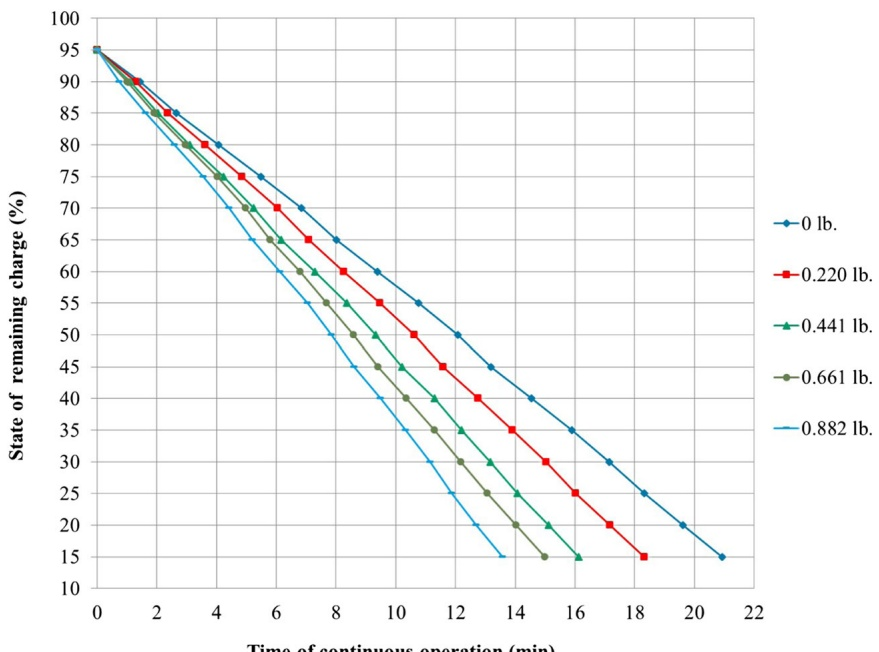
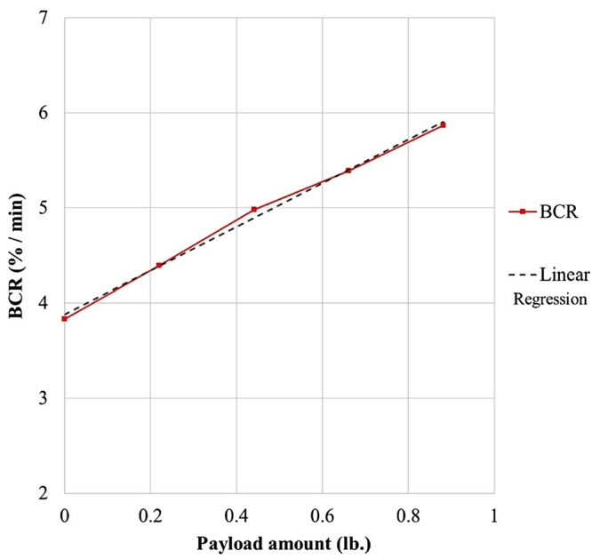
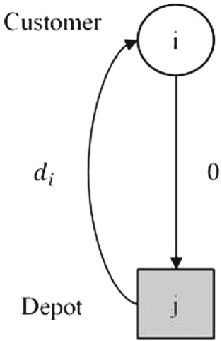
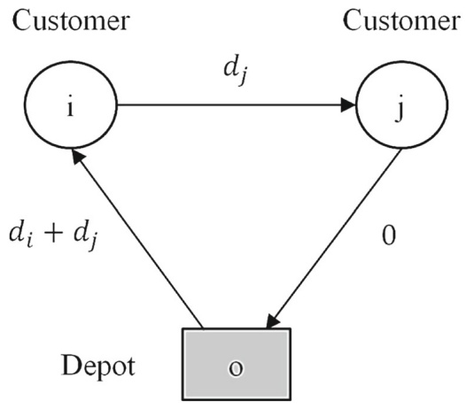
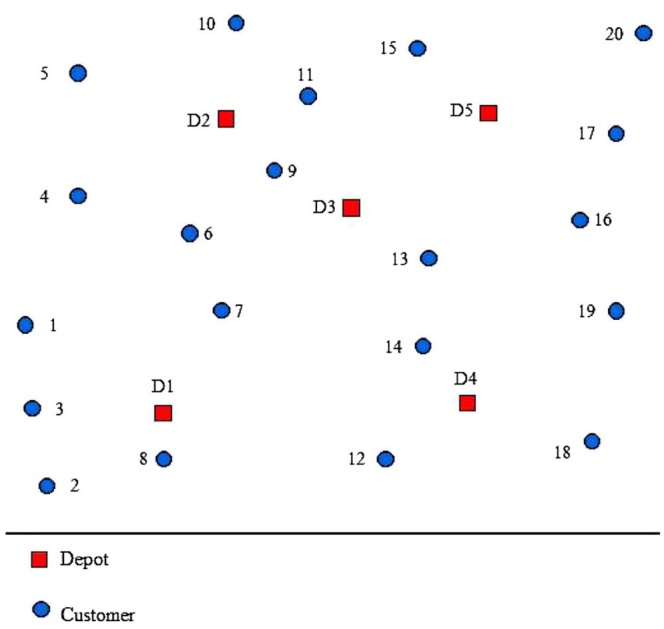
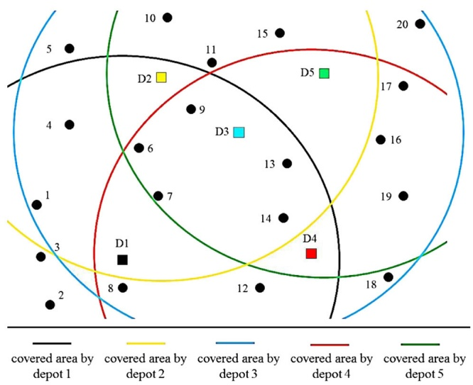
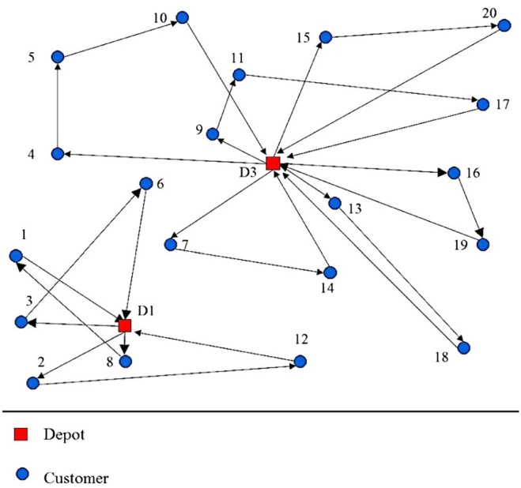

# Drone Delivery Scheduling Optimization Considering Payload-induced Battery Consumption Rates


**Maryam Torabbeigi**<strong><sup>1</sup></strong> **· Gino J. Lim**<strong><sup>1</sup></strong> **· Seon Jin Kim**<strong><sup>2</sup></strong>

Received: 13 February 2019 / Accepted: 25 April 2019 © Springer Nature B.V. 2019

## Abstract

This paper addresses the design of a parcel delivery system using drones, which includes the strategic planning of the system and operational planning for a given region. The amount of payload affects the battery consumption rate (BCR), which can cause a disruption in delivery of goods if the BCR was under-estimated in the planning stage or cause unnecessarily higher expenses if it was over-estimated. Hence, a reliable parcel delivery schedule using drones is proposed to consider the BCR as a function of payload in the operational planning optimization. A minimum set covering approach is used to model the strategic planning and a mixed integer linear programming problem (MILP) is used for operational planning. A variable preprocessing algorithm and primal and dual bound generation methods are developed to improve the computational time for solving the operational planning model. The optimal solution provides the least number of drones and their flight paths to deliver parcels while ensuring the safe return of the drones with respect to the battery charge level. Experimental data show that the BCR is a linear function of the payload amount. The results indicate the impact of including the BCR in drone scheduling, 3 out of 5 (60%) flight paths are not feasible if the BCR is not considered. The numerical results show that the sequence of visiting customers impacts the remaining charge.

**Keywords** Battery consumption rate · Payload amount · Path planning · Drone scheduling · Delivery network

## 1 Introduction

Ground vehicles such as trucks are typically used to deliver parcels across the logistic networks. More recently, large companies such as Amazon, Mercedes-Benz, United Parcel Service, and DHL have plans to utilize drones for delivery purposes [1–5]. The general idea is to deliver packages from a base location to pre-selected destinations by a given fleet of vehicles. UAVs, also known as drones, can deliver packages alone [6–10] or in collaboration with other ground transportation vehicles [11–13]. The scheduling model for the drone delivery problem is similar to the traveling salesman problem [14] when each destination location is served by only one vehicle, and vehicles start and finish their path at the same location [8–10, 15].

<small><span class="docvortex-page-footnote" data-block-type="page_footnote" style="color:#6b7280">\- Gino J. Lim [ginolim@uh.edu](mailto:%20ginolim@uh.edu)</span></small>

Although drones are gaining more attraction for delivery purposes in recent years, limited battery endurance and limited payload amount remain to be drawbacks for practical use [16–20]. An accurate estimate of battery endurance during the planning stage is crucial in optimizing drone delivery schedule. For example, a delivery plan based on underestimated battery endurance may lead to the loss of opportunities to serve more customers. As a result, more drones may be required to satisfy the required delivery demand. The opposite can be much worse because some drones may not be able to return to the base due to lack of battery before completing the planned delivery. The impact of drone failure on the whole network in a delivery application of drones is studied in a few researches [15]. The amount of payload is one of the key factors affecting the flight duration. Therefore, it should be considered in drone scheduling as it impacts the battery endurance.

<small><span class="docvortex-page-footnote" data-block-type="page_footnote" style="color:#6b7280">Maryam Torabbeigi [maryam.torabbeigi@gmail.com](mailto:%20maryam.torabbeigi@gmail.com)</span></small>

Some existing studies have considered the limitation on the total flight time or the payload amount in drone scheduling [9, 15, 21–24] and others considered the impact of carried payload on the total flight time calculation [25–27]. However, these approaches did not address the issue of potential failure of drones to return due to lower than expected battery charge. There are studies focusing on characterizing the energy consumption of drones [28–30], but not in the context of drone scheduling. In order to avoid running out of charge and utilize drones efficiently, the battery consumption rate is included in drone routing in this paper. A Phantom 4 Pro+ [31] is tested to collect flight time and remaining battery charge data. We experimentally show that the BCR is a linear function of carried payload, and it is modeled using linear regression.

<small><span class="docvortex-page-footnote" data-block-type="page_footnote" style="color:#6b7280">Seon Jin Kim [sonjin64@gmail.com](mailto:%20sonjin64@gmail.com)</span></small>

<small><span class="docvortex-page-footnote" data-block-type="page_footnote" style="color:#6b7280">Department of Industrial Engineering, University of Houston, Houston, TX 77204, USA</span></small>

<small><span class="docvortex-page-footnote" data-block-type="page_footnote" style="color:#6b7280">2 Republic of Korea Army, Army Headquarters, Gyerong-di, South Korea</span></small>

A group of drones is considered in this paper to deliver small packages to customers to study the impact of BCR on the fleet scheduling. Two optimization planning models are proposed to design drone-based parcel delivery: strategic planning (SP) and operational planning (OP). The number of delivery bases and their locations are determined by solving the strategic planning model. A set covering problem approach is used to model SP by taking into account the distance between customers and base locations to ensure feasible flights. The OP model aims to minimize the number of drones while considering specifications of drones in drone routing optimization. A mixed integer linear programming (MILP) model for drone routing and scheduling is proposed to determine optimal drone delivery assignments and their paths. The optimal solution provides the least number of drones required to serve all the customers. The variable preprocessing technique, primal and dual bound generation schemes are developed to reduce the computational time. Overall, the contributions of this paper include:

1) proposing the BCR concept in drone delivery application to capture the effect of payload amount on battery endurance and estimate parameters based on case study collected data,

2) proposing two optimization planning models: strategic planning to figure out the optimal locations to open depots, and operational planning to determine drone paths by including limitations of payload amount and battery endurance,

3) providing the solution methodology consisting of a variable preprocessing technique, primal and dual bound generation methods to reduce the computational time.

The rest of this paper is organized as follows: Section 2 explains the collected data from testing a drone and the corresponding linear regression to estimate the battery consumption rate as a function of payload amount. The SP and OP mathematical models are presented in Section 3, and the solution methodology for OP model is provided in Section 4. The numerical results and conclusion are discussed in Sections 5 and 6, respectively.

## 2 Drone Battery Consumption Rate

The BCR can be defined as the amount of charge consumption per unit of time (per minute); it is the rate at which battery charge decreases during the flight. The BCR is estimated as a function of payload based on data collected using a Phantom 4 Pro+ drone [31] with specifications stated in Table 11 in Appendix A. The data include flight time and the state of battery charge over time. Although the power consumption can vary depending on the flight mode (e.g., hovering, forward flight, landing), the difference among different flight modes is negligible [28]. Furthermore, the power consumption in hovering mode is greater than the other flight modes due to effective translational lift [32]. Therefore, the data collected in the hovering mode was used in this paper.

Table 12 in Appendix B shows the flight time duration in minutes for various combinations of battery charge (from 15% to 95%) and payload amount (from 0 lb. to 0.882 lb.). The data are also plotted in Fig. 1, which shows the State Of Charge (SOC) during the flight for different payload amounts. The payload amount is the amount of weights that a drone carries excluding the weight of the drone and its battery. A drone can consume up to 5% of the fully charged battery until it reaches the hovering mode. Therefore, the initial battery charge was set at 95% to be consistent in all experiments conducted in this paper. Another parameter is the minimum remaining battery charge to ensure a safe landing, which is 15% for the drone we used in our experiments. Therefore, the flight time was recorded in the hovering position with the battery charge between 15% and 95% at 5% interval. The experiment was repeated for different amount of payloads: 0, 0.220, 0.441, 0.661, and 0.882 lb.

Table 1 lists the linear regression lines for the data shown in Fig. 1 and the corresponding R-squared values. Since the R-squared values are all higher than 99.9% for all regression lines, we claim that there is approximately a linear relationship between flight time and battery SOC. For each payload amount, the BCR corresponds to the slope of the regression line. For example, the BCR value of 4.39 (%/min) means 4.39% of battery charge decreases in every minute of flight. The regression lines clearly show that the BCR increases as the payload increases. When we increased the payload from 0 to 0.22lb, the BCR was increased by 14.5% (i.e., moved from -3.834 to -4.390). A similar trend was observed for other regression lines as plotted in Fig. 2.

In Fig. 2, the red dots are the calculated BCR values corresponding to different payload amounts, and the dashed line is the regression model used in the optimization model in OP (see Section 3.2). We further analyze the resulting linear regression model:

Fig. 1 The remaining battery level (%) along the flight for different amount of payload (lb.)



$$
B C R = \alpha \cdot p a y l o a d + \beta ,\tag{1}
$$

where $\alpha$ is the slope and $\beta$ is intercept. According to Table 2, the estimated value of α is 2.297 $\scriptstyle { \left( { \frac { \% } { m i n \cdot l b } } \right) }$ and $\beta$ is $3.879\ \left( \frac{\%}{min} \right)$ . The corresponding p-values of the payload and intercept are below 0.000115, which implies that both parameters are statistically significant. The adjusted Rsquared value of the model is greater than 99%. Therefore, we claim that a linear relationship exists between the BCR and the payload amount.

## 3 Problem Description and Formulations

The problem description and the mathematical models are presented in this section. This study focuses on the lightweight parcels so that drones can carry them to customers within the weight capacity of drone. Each day, a fleet of drones pick up parcels from the base depots, deliver them to customers, and then return to the same base.

One may explore similar strategy for satisfying a demand in shareable products [33]. If the demand of a customer is greater than the weight capacity, then the demand can be divided into multiple sub-orders for delivery.

In a drone-induced parcel delivery system, a strategic planning should be made in the facility design phase and operational planning decisions are made for parcel delivery schedule. The SP includes the facility planning and decides about the number and location of depots based on customers’ location and drones’ specifications. The OP includes drone utilization planning and flight path planning, and decides about the number of drones to use for the day, the assignment of customers to drones and order of visiting them. The effect of payload amount on the total flight duration and the remaining battery charge can be considered in the OP.

## 3.1 Strategic Planning (SP)

A drone starts its flight from a base depot, delivers products to customers, and returns to the depot. In the depot, the batteries are replaced or charged, and the payloads are loaded for future flights. Among a set of potential locations, a few of them are chosen to establish base depots and serve all the customers. A customer can be covered by a candidate location if the customer is located within the flight range of a drone. In order to calculate the SOC at each flight stop, the following notation is used:

Table 1 The BCR values for different amount of payloads

| Payload amount (lb.) | Linear regression line | R<sup>2</sup> | BCR (% /min) |
| --- | --- | --- | --- |
| 0 | SOC = -3.834 t + 95.67 | 0.9997 | 3.834 |
| 0.220 | SOC = -4.390 t + 95.88 | 0.9996 | 4.390 |
| 0.441 | SOC = -4.977 t + 95.71 | 0.9996 | 4.977 |
| 0.661 | SOC = -5.388 t + 95.91 | 0.9996 | 5.389 |
| 0.882 | SOC = -5.867 t + 95.32 | 0.9994 | 5.867 |



Fig. 2 The relationship between the BCR and the payload amount

$S O C _ { i }$ state of charge at node i,

$R C _ { k }$ drone k remaining charge on returning to the depot,

$d _ { i }$ customer $i ^ { \prime } s$ demand,

$t _ { i j }$ flight time between node i and j

$$
t _ {i j} = t _ {j i}),
$$

$\alpha _ { k }   ,   \beta _ { k }$ slope and intercept parameters of the linear function to calculate BCR according to Formula (1),

$M i n C h _ { k }$ minimum required battery charge for

$$
(k = 1, 2, \dots)
$$

$$
\begin{array}{l l} \text {Max} P _ {k} & \text {maximum payload capacity of drone k,} \\ & (\mathrm{k=1,2,...}). \end{array}
$$

Figure 3 shows a flight path consisting of one depot and one customer. The battery’s SOC at each stop (depot, customer’s location, and again depot) is calculated through Eqs. 2a–2c by using Formula (1):

Table 2 Linear regression analysis: BCR vs. payload

| Coefficients | Estimate | Std. error | t-value | Pr(> \|t\|) |
| --- | --- | --- | --- | --- |
| Intercept | 3.87886 | 0.04645 | 83.5 | 3.79e-06 |
| Payload | 2.29705 | 0.08603 | 26.7 | 0.000115 |

<sup>\*</sup>Residual standard error: 0.05999 on 3 degrees of freedom

<sup>\*</sup>Multiple R-squared: 0.9958

Adjusted R-squared: 0.9944

$$
S O C _ {j} = 1 0 0,\tag{2a}
$$

$$
S O C _ {i} = S O C _ {j} - t _ {j i} (\alpha_ {k} d _ {i} + \beta_ {k})
$$

$$
\rightarrow S O C _ {i} = 1 0 0 - t _ {j i} (\alpha_ {k} d _ {i} + \beta_ {k}),\tag{2b}
$$

$$
R C _ {k} = S O C _ {i} - t _ {i j} \left(\alpha_ {k} \cdot 0 + \beta_ {k}\right)
$$

$$
\rightarrow R C _ {k} = 1 0 0 - t _ {j i} (\alpha_ {k} d _ {i} + \beta_ {k}) - t _ {i j} \beta_ {k}.\tag{2c}
$$

The drone battery is assumed to be fully charged at the beginning of the flight as stated in equation Eq. 2a. Equation 2b calculates the remaining battery level at location i considering the amount of payload in the flight segment from depot j to customer i to be the customer demand. There is no load on the way back to the depot and the remaining battery level at the end of the path is computed by Eq. 2c.

To avoid running out of charge on landing on the depot and have a feasible flight path, the remaining charge at the end of the flight should be greater than the minimum charge requirement, which leads to the following inequality:

$$
\begin{array}{l}R C _ {k} > M i n C h _ {k} \quad \text {and} \quad t _ {i j} = t _ {j i},\\\rightarrow \quad t _ {i j} (\alpha_ {k} d _ {i} + 2 \beta_ {k}) <   1 0 0 - M i n C h _ {k},\\\rightarrow \quad t _ {i j} <   \frac {1 0 0 - M i n C h _ {k}}{\alpha_ {k} d _ {i} + 2 \beta_ {k}}.\end{array}\tag{3}
$$

The demand of customers changes daily. Finally, inequality Eq. 4 is obtained by replacement of $d _ { i }$ with the drone weight capacity. If inequality Eq. 4 holds, then inequality Eq. 3 holds for different amounts of load.

$$
t _ {i j} <   \frac {1 0 0 - M i n C h _ {k}}{\alpha_ {k} M a x P _ {k} + 2 \beta_ {k}}.\tag{4}
$$

The right-hand side of inequality Eq. 4 depends on the drone specifications and it can be used to calculate the maximum flight range of a drone. A depot can cover multiple customers as long as they are located within this drone maximum flight range. We propose the minimum set covering problem to determine the least number of candidate locations to cover all the customers. The notation used in the SP model is:



Fig. 3 Covering customer i by candidate location j

Sets:

C Set of customers,

S Set of candidate locations for depots.

Parameters:

$f _ { j }$ Fixed cost of opening depot at candidate location j $( j \in S )$

$\theta _ { i j }$ 1, if candidate location j can cover customer i, 0 otherwise $( i \in C , j \in S )$

Variable:

$u _ { j }$ 1, if location j is chosen to open depot, 0 otherwise $( j \in S ) .$

The SP model is a binary linear problem (BLP) aiming at minimizing the cost of opening depots and then the mathematical model can be written as the following minimum set covering problem:

Min

$$
\sum_ {j \in S} f _ {j} u _ {j}\tag{5}
$$

Min

$$
\left| \sum_ {k \in K} h _ {k} \right|
$$

s.t.:

$$
\sum_ {j \in \{C \cup D \}} \sum_ {k \in K} x _ {i j k} = 1,
$$

$$
\sum_ {i \in \{C \cup D \}} \sum_ {k \in K} x _ {i j k} = 1,
$$

$$
\sum_ {i \in C \cup D} x _ {i j k} = \sum_ {i \in \{C \cup D \}} x _ {j i k},
$$

$$
\sum_ {i \in C} x _ {i j k} = \sum_ {i \in C} x _ {j i k},
$$

$$
\sum_ {i \in D} \sum_ {j \in C} x _ {i j k} = h _ {k},
$$

$$
\sum_ {i \in C} \sum_ {j \in D} x _ {i j k} = h _ {k},
$$

$$
\sum_ {i \in \{C \cup D \}} l _ {i j} - \sum_ {i \in \{C \cup D \}} l _ {j i} = d _ {j},
$$

$$
\sum_ {i \in C} \sum_ {j \in \{C \cup D \}} d _ {i} x _ {i j k} \leq M a x P _ {k} h _ {k},
$$

$$
\begin{array}{l l} \text {Subject to:} & \quad \sum_ {j \in S} \theta_ {i j} u _ {j} \geq 1, \qquad \forall i \in C \\ u _ {j} \in \{0, 1 \}. & \quad \forall j \in S \end{array}\tag{6}
$$

The objective function Eq. 5 minimizes the initial cost of opening a depot, while all the customers are covered by at least one open depot (Eq. 6). The parameter $\theta _ { i j }$ is calculated based on drone maximum coverage range.

## 3.2 Operational Planning (OP)

(7)

This section explains assumptions made regarding the types of drones and parcels to deliver, and provides a route planning model. Based on the set of drone center locations given by the SP model in Section 3.1, the OP model finds the optimal assignment of drones to customers and their corresponding flight paths. The limitations on payload amount, battery endurance, BCR and the remaining charge requirement at the end of each flight path are included in the OP model. It is assumed that the batteries are fully charged before departure and battery level will decrease along the path according to BCR calculation provided in Section 2. The following mathematical notation is defined to formulate the optimization model and obtain the routing planning mathematical model:

$$
\left| \forall i \in C \right|\tag{8}
$$

(9)

$$
\forall j \in C\tag{10}
$$

$$
\forall j \in C, \forall k \in K\tag{11}
$$

$$
y _ {i} - y _ {j} + n \sum_ {k \in K} x _ {i j k}\tag{12}
$$

$$
\forall j \in D, \forall k \in K
$$

$$
R C _ {k} \geq M i n C h _ {k}, \forall k \in K\tag{13}
$$

$$
\forall k \in K
$$

$$
\forall k \in K\tag{14}
$$

$$
R C _ {k} \leq S O C _ {i} - t _ {i j k} (\beta_ {k}) + M (1 - x _ {i j k}),
$$

$$
\forall j \in C
$$

$$
\forall k \in K\tag{15}
$$

$$
S O C _ {j} \leq S O C _ {i} - t _ {i j k} (\alpha_ {k} l _ {i j} + \beta_ {k}) + M (1 - x _ {i j k}), \quad \forall i \in \{C \cup D \}, \forall j \in C, i \neq j, \forall k \in K\tag{16}
$$

$$
\forall i \in C, \forall j \in D, \forall k \in K\tag{17}
$$

$$
S O C _ {m} = 100 \%.\tag{18}
$$

$$
\forall i, j \in C \leq n - 1,\tag{19}
$$

$$
x _ {i j k} \in \{0, 1 \}, l _ {i j}, S O C _ {i}, R C _ {k} \geq 0, l _ {i m} = 0,
$$

$$
\forall i, j \in \{C \cup D \}, \forall k \in K,
$$

$$
\forall m \in D.\tag{20}
$$

<div class="docvortex-algorithm" style="white-space: pre-wrap; font-family:monospace;">
Sets:
C          Set of customers,
D          Set of open depots,
K          Set of drones.
Parameters:
M          A large number,
Max $P_k$    Payload capacity of drone $k(k \in K)$,
Min$Ch_k$    Minimum remaining battery level requirement for drone $k (k \in K)$,
$t_{ijk}$      Flight time from node $i$ to node $j$ by drone $k$, $(i, j \in \{C \cup D\}, k \in K)$,
$\alpha_k, \beta_k$    Slope and intercept parameters of the BCR linear regression function for drone $k (k \in K)$.
Variables:
$x_{ijk}$      1 if drone $k$ goes from node $i$ to node $j$, 0 otherwise $(i, j \in \{C \cup D\}, k \in K)$,
$h_k$      1 if drone $k$ is utilized in the network, 0 otherwise $(k \in K)$,
$l_{ij}$      Payload from node $i$ to node $j$, $(i, j \in \{C \cup D\})$,
$SOC_i$      State of charge (remaining battery level) at customer $i$ location $(i \in C)$,
$RC_k$      Remaining charge of drone $k$ at return to depot $(k \in K)$,
$y_c$      The order of sequence of visiting customer $c$ in the path $(c \in C)$.
</div>

The objective function Eq. 7 is to minimize the number of drones used in the network. Equations 8 and 9 ensure that each customer is served only once by exactly one drone. Flow conservation is guaranteed via Eqs. 10 and 11 by which when a drone enters a node, it must leave the node and visit another one until it completes its delivery tour. Equations 12 and 13 show the utilization of drones. Equation 14 is to satisfy customer demand. Equation 15 limits the total payload assigned to a drone up to its capacity. The state of charge of a drone during the flight and at the end of the path is calculated by Eqs. 16 and 17. At the beginning of the path, drone battery is completely charged (100%) and during the path, it will decrease based on travel time and the payload weight carried between each pair of nodes (Eq. 16). The remaining battery level at returning to the depot is also stated in Eq. 17. Parameter M is a sufficiently large positive number that user specifies. On one hand, if the value of M is too large, it can increase the solution time. On the other hand, if the value is too small, the model can lose its optimality. Therefore, finding an appropriate value of M is important. In this paper, the value of M is determined by Formula (20) (explained in Appendix C).

$$
\begin{array}{l} M = 1 0 0 - \underset {k \in K} {\min} \{M i n C h _ {k} \} \\ \qquad + \underset {k \in K} {\max} (\alpha_ {k} M a x P _ {k} + \beta_ {k}) \cdot \underset {i, j \in \{C \cup D \}} {\max} t _ {i j k}. \end{array}\tag{21}
$$

A threshold value for the battery level is considered in Eq. 18 to ensure a safe return to the depot from a flight without running out of battery. Equation 19 is to eliminate any sub-tours in the network [34].

## 4 Solution Approach

The OP model in Section 3.2 is an extended version of Vehicle Routing Problem (VRP), which is known to be hard to solve [35]. Therefore, this section introduces methods to solve the OP model faster. By preprocessing in Section 4.1 we can fix some of the variables to 0 before solving the model so that the solution search space will be reduced, and it reduces the computational time. Section 4.2 introduces a primal bound generation method and Section 4.3 presents multiple dual bound generation methods for the OP model. Whenever the primal and dual bounds are equal, the optimal solution is obtained, otherwise, when the gap between them is less than a threshold value $\epsilon > 0 ,$ the objective function value is close to the optimal value within an accuracy of .

## 4.1 Variable Preprocessing Algorithm

The variable preprocessing procedure is implemented on variable $x _ { i j k }$ . Variable $x _ { i j k }$ has three indexes; i and j are for nodes in the network, and k represents a drone. The dimension of variable $x _ { i j k }$ is $( | C |   +   | D | ) ( | C |   +$ $| D | ) ( | K | )$ . However, our experiments showed that many of them are zeros at the optimal solution. Consequently, the total number of non-zero variables can be less than 2|C| in the case each customer is served by one drone. The preprocessing procedure is introduced through Eqs. 22, 23 and 25.

1) The model is an extension of VRP and Eq. 19 prevents sub-tours in the solution. A self-loop is an edge between a node and itself. Therefore, it is clear there is no self-loop in the solution.

$$
\begin{array}{c} \text {Rule 1:} \forall i, j \in \{C \cup D \}, \forall k \in K: \\ \text {if} \quad i = j, \quad \text {then} \quad x _ {i j k} = 0. \end{array}\tag{22}
$$

2) The total payload capacity is limited to Max $P _ { k }$ for drone k. Thus, if the total demand of two customers exceeds the capacity, then they should be assigned to different drones.

$$
\begin{array}{c} \text {Rule 2:} \forall i, j \in C, \forall k \in K: \\ \text {if} d _ {i} + d _ {j} > M a x P _ {k}, \text {then} x _ {i j k} = 0. \end{array} \tag {23}
$$

Note that if the path “Depot → Customer $i \rightarrow$ Customer j → Depot” is infeasible due to weight capacity, then path “Depot → Customer $j \quad \rightarrow$ Customer $i   \rightarrow   \mathrm { D e p o t } ^ { \prime \prime }$ is also infeasible because the summation of demand in both paths is $d _ { i } + d _ { j }$ , which is greater than drone weight capacity.

A feasible path should satisfy Eq. 18. The remaining battery level at the end of the path depends on time to travel and payload in each segment of the flight. Two customers can be assigned to drone k if the battery level is at least equal to $M i n C h _ { k }$ . In an optimistic case, these two customers are the only customers to be served by drone k. Figure 4 shows a path consisting of two customers. The battery level in each step of the path can be determined by Eqs. 24a–24e. According to Eq. 24d, the remaining charge depends on time to travel between locations, payload, and drone specifications.

$$
S O C _ {o} = 1 0 0,\tag{24a}
$$

$$
\begin{array}{r} S O C _ {i} = S O C _ {o} - t _ {o i k} [ \alpha_ {k} (d _ {i} + d _ {j}) + \beta_ {k} ] \\ = 1 0 0 - t _ {o i k} [ \alpha_ {k} (d _ {i} + d _ {j}) + \beta_ {k} ], \end{array}\tag{24b}
$$

$$
\begin{array}{r l} S O C _ {j} & = S O C _ {i} - t _ {i j k} (\alpha_ {k} d _ {j} + \beta_ {k}) \\ & = 1 0 0 - t _ {o i k} [ \alpha_ {k} (d _ {i} + d _ {j}) + \beta_ {k} ] \\ & \quad - t _ {i j k} (\alpha_ {k} d _ {j} + \beta_ {k}), \end{array}\tag{24c}
$$

$$
\begin{array}{r l} & {R C _ {k} = S O C _ {j} - t _ {j o k} \beta_ {k}} \\ & {\quad = 1 0 0 - t _ {o i k} [ \alpha_ {k} (d _ {i} + d _ {j}) + \beta_ {k} ]} \\ & {\quad - t _ {i j k} (\alpha_ {k} d _ {j} + \beta_ {k}) - t _ {j o k} \beta_ {k},} \end{array}\tag{24d}
$$



Fig. 4 Example of a path consisting of two customers

$$
\begin{array}{r l}R C _ {k} \geq M i n C h _ {k}\\\rightarrow 1 0 0 - t _ {o i k} [ \alpha_ {k} (d _ {i} + d _ {j}) + \beta_ {k}) ]\\- t _ {i j k} (\alpha_ {k} d _ {j} + \beta_ {k}) - t _ {j o k} \beta_ {k} \geq M i n C h _ {k}. (2 4 \mathrm{e})\end{array}
$$

The SP model may choose multiple locations to establish depots. Therefore, the travel time between a depot and a customer should be checked for all the open depots. The feasibility of assigning each pair of customers to open depots regarding the remaining battery level is tested by Eq. 25. The rule 3 states if there is no drone to serve a pair of customers, the corresponding variable $x _ { i j k }$ should be fixed to zero.

Rule 3: ∀ $i , j \in C ,$ $\forall k \in K$

$$
\begin{array}{l} \text {if} \quad \nexists o \in D: \quad t _ {o i k} [ \alpha_ {k} (d _ {i} + d _ {j}) + \beta_ {k} ] \\ + t _ {i j k} (\alpha_ {k} d _ {j} + \beta_ {k}) + t _ {o j k} \beta_ {k} \leq 1 0 0 - M i n C h _ {k}, \\ \text {then} \quad x _ {i j k} = 0. \end{array} \tag {25}
$$

Drones have to return to the launch depot at the end of the flight path. Note that even if the path “Depot → Customer i → Customer j → Depot” is infeasible as a result of insufficient remaining battery level, then path “Depot → Customer j → Customer i → Depot” can be feasible or infeasible as the battery consumption rates in these two paths are not necessarily the same, and depend on travel time between path segments and the payload.

## 4.2 Primal (Upper) Bound Generation

The objective function of the OP model is the minimization of number of drones so every feasible solution provides a primal bound. The location of base centers is determined by solving the SP model. Then, Algorithm 1 is proposed here to find a feasible solution (a primal bound) for OP model.

```txt
Algorithm 1 Primal bound on the number of drones (a feasible solution).
Inputs:
The number and location of base depots (result of SP model with objective function= ω)
Parameters in OP problem
Step 1:
Assign each customer to the nearest depot.
Step 2:
Solve OP problem for each depot.
```

Step 1 assigns customers to the nearest open depot. As we solved a minimum set covering problem in Section 3.1 to find the location of centers; at least one customer is assigned to each depot. In Step 2, the OP problem is solved for each depot to find the number of required drones and their flight paths. The primal bound of the objective function for the OP problem is $\textstyle \sum _ { r = 1 } ^ { \omega } z _ { r }$ , where $z _ { r }$ is the optimal number of drones for depot $\mathbf { r } , r = \{ 1 , 2 , . . . , \omega \}$

## 4.3 Dual Bounds Generation

The OP model is to minimize the objective function. Hence, a lower bound is referred to as dual bound. The dual bounds for a minimization problem are usually found by a relaxation of the original model to a simpler one. We can either optimize over a larger feasible set or substitute the objective function by a term with a lower value everywhere. In the following, we introduce three dual bound generation methods: Lagrangian relaxation (Section 4.3.1), network configuration (Section 4.3.2) based bound, and weight capacity based bound (Section 4.3.3). Each of the methods has its own strengths and weakness in terms of finding a tight dual bound and/or being able to solve the model much faster.

## 4.3.1 Lagrangian Relaxation

Some constraints of an optimization model are harder to satisfy than others. The general idea of a Lagrangian relaxation [36] is to remove the constraints that make the problem hard to solve and move them to the objective function with a penalty cost associated with them. The hard constraints are the most time-consuming constraints and depend on the model structure. Hence, it discourages constraint violation, while the resulting model is much easier to solve. Equation 14 is a hard constraint in the OP model and we move this to the objective function. Accordingly, we relax the corresponding constraints with associated Lagrangian multipliers $\mu   \in   \{ \mu _ { 1 } , . . . , \mu _ { | C | } \}   \geq   0$ The resulting model is stated as:

$$
\begin{array}{l} L (\mu) = \operatorname{Min} \sum_ {k \in K} h _ {k} + \sum_ {j \in C} \mu_ {j} \left(d _ {j} - \sum_ {i \in C \cup D} l _ {i j} + \sum_ {i \in C \cup D} l _ {j i}\right), \\ \text {Subject to:} \quad (8) - (1 3), (1 5) - (2 0). \end{array}\tag{26}
$$

The Lagrangian relaxation model is solved iteratively by updating $\mu$ in each iteration. $\operatorname { A s } L ( \mu )$ is not differentiable at all points, a subgradient algorithm described in Algorithm 2, is used.

The objective function states the number of drones to use, and the value cannot be fractional. Hence, the dual bound obtained by Lagrangian relaxation should be rounded up to the nearest integer that is larger than the resulting optimal objective value if it is fractional.

<div class="docvortex-algorithm" style="white-space: pre-wrap; font-family:monospace;">
Algorithm 2 Subgradient algorithm.
Inputs:
    The number and location of open depots (result of SP problem), Parameters in OP problem, Primal bound obtained from Algorithm 1, $\mu_0$, $\theta$, max_iteration, threshold-value.
While(k &lt; max_iteration or $\Delta\mu &gt;$ threshold-value)
Do {
    Step 1: solve the Lagrangian dual problem Eq. 26 with Eqs. 8–13, 15–20 to obtain the optimal solution;
    Step 2: direction=$d_j - \sum_{i \in C \cup D} l_{ij} + \sum_{i \in C \cup D} l_{ji}$ (gradient of $L(\mu_k)$);
    Step 3: step size =$\theta \cdot \frac{\text{upper\_bound} - L(\mu_k)}{||\text{direction}||}$;
    Step 4: update $\mu$:
        $\mu_{k+1} = max\{0, \quad \mu_k + \text{direction} \cdot \text{step size}\}$;
    Step 5: converged or not? $\Delta\mu = |\mu_k - \mu_{k+1}|$;
    Step 6: k = k +1;
} End While
</div>

## 4.3.2 Network Configuration

Two customers are considered to be incompatible if they cannot be assigned to one drone due to any limitations. This situation happens if either Rule 2 or Rule 3 in Section 4 is true for a pair of customers i and $j ,$ and it is denoted as $i | | j$ . The incompatibility graph represented by $G _ { i n c } =$ $( C , E _ { C } )$ , where C is the set of customers and $E _ { C } \quad = \quad$ $( i , j ) \in C \cdot C : i | | j$ is constructed by rules 2 and 3. In graph $G _ { i n c } ,$ an arc represents a pair of incompatible customers, in which different drones are needed to serve them. Therefore, a complete subgraph with m number of vertices in graph $G _ { i n c }$ shows $m$ incompatible customers, who need different drones to be served. In such a subgraph, m drones are needed to serve the customers in the subgraph because each pair of these customers are incompatible with each other. Therefore, the largest complete subgraph in $G _ { i n c }$ represents the largest subset of customers that all of them are incompatible with each other.

In an undirected graph, a complete subgraph is called a clique and a maximum clique is a clique with the largest possible number of vertices [36]. Therefore, the maximum clique in graph $G _ { i n c }$ shows the largest subset of incompatible customers, that each customer needs a separate drone to be served. The size of the maximum clique in graph $G _ { i n c }$ is a dual bound for the number of required drones. This problem is a well-known problem and there are some algorithms to solve it fast. Here, we use Bron-Kerbosch maximal clique finding algorithm [37].

## 4.3.3 Drone Weight Capacity

The assignment of customers to drones has to meet drone weight capacity. Equation 15 is related to drone capacity limitation in the OP model. This section introduces a dual bound generation based on the drone weight capacity limitation. A new variable is defined and the OP model is relaxed as follow: We define the variable $\begin{array} { r l } { \rho _ { i k } } & { { } = } \end{array}$ $\textstyle \sum _ { j \in \{ C \cup D \} } x _ { i j k }$ as a binary variable that gets value 1 if drone k serves customer i, and 0 otherwise. Equations 8 and 15 in the OP model are simplified and rewritten by variable $\rho _ { i k }$

$$
\begin{array}{l} \text {Constraint Eq. 8}: \sum_ {j \in \{C \cup D \}} \sum_ {k \in K} x _ {i j k} = \sum_ {k \in K} \left(\sum_ {j \in \{C \cup D \}} x _ {i j k}\right) \\ = \sum_ {k \in K} \rho_ {i k} = 1. \end{array} \tag {27}
$$

$$
\begin{array}{l}\text {Constraint Eq. 15}: \quad \sum_ {i \in C} \sum_ {j \in \{C \cup D \}} d _ {i} x _ {i j k} \leq M a x P _ {k} h _ {k}\\\rightarrow \sum_ {i \in C} d _ {i} \left(\sum_ {j \in \{C \cup D \}} x _ {i j k}\right) \leq M a x P _ {k} h _ {k},\\\rightarrow \sum_ {i \in C} d _ {i} \rho_ {i k} \leq M a x P _ {k} h _ {k}.\end{array}\tag {28}
$$

Here, customers have different amounts of demand, and their demand should be prepared and load to drones considering the weight capacity to minimize the number of drones. This problem can be cast as a Bin Packing Problem (BPP) [38] that consists of drones as bins with a capacity of MaxP<sub>k</sub>, and a customer demand as an object with a size of $d _ { i } ,$ , and it is stated as follows:

$$
\text {BPP - weight:} \quad \text {Min} \sum_ {k \in K} h _ {k}\tag{29}
$$

$$
\begin{array}{l l l} \text {Subject to:} & \sum_ {k \in K} \rho_ {i k} = 1 & \forall i \in C \quad (3 0) \\ & \sum_ {i \in C} d _ {i} \rho_ {i k} \leq M a x P _ {k} h _ {k} & \forall k \in K \quad (3 1) \\ & \rho_ {i k}, h _ {k} \in \{0, 1 \} & \forall i \in C, \forall k \in K \end{array}
$$

The objective function Eq. 29 minimizes the number of drones used for delivery. Equation 30 guarantees each customer is served by one drone while the weight capacity of a drone is satisfied through Eq. 31. Feasible region of the OP is a subset of the feasible region of the BPP-weight because the BPP-weight is a relaxed form of the OP model. Hence, the optimal objective function value of the OP model is at least as large as the optimal objective function value of the BPP-weight.

## 5 Numerical Results

This section begins with a case study to demonstrate how the proposed methods work (Section 5.1). Further experiments are conducted to understand the impact of considering BCR with respect to the payload amount in drone scheduling (Section 5.2), and investigate the computational efficiency of the proposed solution approach (Section 5.3). The Bron-Kerbosch Maximal clique finding algorithm [37] is implemented in MATLAB [39]. The other algorithms and the proposed SP and OP models are implemented in GAMS [40] and solved by CPLEX 12.6.3. [41]. All computational experiments were conducted using a Linux server with 24 cores and 384GB RAM.

## 5.1 A Case Study

A random test network having 20 customers and 5 depot candidate locations is shown in Fig. 5, where square nodes are candidate depots and circle nodes represent the customers. A homogeneous fleet of drones similar to the drone used in Section 2 is used to serve the customers. According to the results of Section 2, the linear relationship between BCR and the payload amount is BCR = (2.297)payload + 3.879.

First, the covering range of each depot candidate location is identified as shown in Fig. 6 and Table 13 in Appendix D.



Fig. 5 A random test network with 20 customers and 5 candidate locations



Fig. 6 Covering customers by depot candidate locations

This is determined by the drone battery specifications, the minimum required battery level of 15% and the maximum payload capacity of 1 lb. Second, a subset of candidate locations is determined by the proposed SP model in Section 3.1. As can be seen from Fig. 6, some customers can be covered by just one candidate location (e.g., Customer 2), some others (e.g., Customer 1) can be covered by multiple locations (D1, D2, and D3), and yet others can be covered by all depot candidates such as Customer 9. According to the result of the SP model in Section 3.1, two (D1 and D3) out of five candidate locations are selected to establish depots there. Third, the optimal assignment of customers and drone paths are determined by the OP problem as discussed in Section 3.2. We apply both the primal bound and dual bound generation methods on the objective function (Section 4). This step is important in reducing the computational time; our initial test run of more than 24 hours returned an objective function value of 10 for the problem instance with 18% relative optimality gap, i.e., relative $\mathrm { g a p } = { \frac { P r i m a l B o u n d { - } D u a l B o u n d } { P r i m a l B o u n d } }$ · 100.

## Primal Bound Generation

Step 1: Assign customers to the nearest depot using Algorithm 1. Hence, customers 1, 2, 3, 7, 8, and 12 are assigned to D1 and the rest of them are assigned to D3.

Step 2: Solve OP problem for each depot to get the optimal paths.

The experiments took 20.82 minutes with 0% relative optimality gap to solve the OP problem for both depots. The results are presented in Table 3, in which four drones are assigned to Depot 1 and six drones are needed in D3.

Table 3 Primal bound calculation (a feasible solution) for the case study

<table><tr><td>Depot</td><td>Path</td></tr><tr><td rowspan="6">Depot 1</td><td> $D1 \rightarrow 1 \rightarrow 3 \rightarrow D1$ </td></tr><tr><td> $D1 \rightarrow 2 \rightarrow D1$ </td></tr><tr><td> $D1 \rightarrow 7 \rightarrow 12 \rightarrow D1$ </td></tr><tr><td> $D1 \rightarrow 8 \rightarrow D1$ </td></tr><tr><td> $D3 \rightarrow 4 \rightarrow 5 \rightarrow 10 \rightarrow D3$ </td></tr><tr><td> $D3 \rightarrow 6 \rightarrow 14 \rightarrow D3$ </td></tr><tr><td rowspan="4">Depot 3</td><td> $D3 \rightarrow 9 \rightarrow 19 \rightarrow 13 \rightarrow D3$ </td></tr><tr><td> $D3 \rightarrow 11 \rightarrow 17 \rightarrow 16 \rightarrow D3$ </td></tr><tr><td> $D3 \rightarrow 15 \rightarrow 20 \rightarrow D3$ </td></tr><tr><td> $D3 \rightarrow 18 \rightarrow D3$ </td></tr><tr><td>Primal Bound</td><td>10</td></tr></table>

Dual Bound Generation

Different dual bounds are calculated according to Section 4.3 and the final dual bound on the objective function of OP is the maximum value of them. Table 4 shows the values of the proposed dual bounds. The dual bound based on Lagrangian relaxation is 8.54, which is rounded up because the objective function (number of drones) should be an integer value. The solution of the maximum clique problem has a size of 7, consisting of customers 2, 3, 5, 8, 14, 19, and 20. The final dual bound is $\begin{array} { r } { m a x \{ 9 , \; 7 , \; 8 \} = 9 . } \end{array}$

## Discussions on the Results from the OP Model

The optimal assignment of customers and drone paths is determined as shown in Fig. 7, in which 3 drones are needed in D1 and 6 drones in D3. The drone flight paths start and finish in the same depot and along the flight, they serve 2 or 3 customers. Although a customer might be covered by more than one depot, just one of them can serve the customer in the optimal solution and it is not the closest depot necessarily. For example, in the optimal solution of our case study, customer 6 and 7 are assigned to D1 and

Table 4 Dual bound calculation for the case study

| Dual bound gen- | Dual bound |
| --- | --- |
| eration method | value |
| Lagrangian relaxation | 8.54= 9 |
| Network configuration | 7 |
| BPP-weight | 8 |
| Dual Bound | max{9, 7, 8} = 9 |



Fig. 7 Optimal flight paths- result of OP model for the case study network

D3, respectively; however, they are closer to the D3 and D1, respectively. The primal bound generation assigns each customer to the nearest depot and 10 drones are needed to serve all customers. Using this bound, the optimal solution lowered the drone count to 9, which is 10% improvement from the original bound. Table 5 shows the details of optimal flight paths, which includes the total demand, total travel time, and the remaining battery level at the end of each flight path.

## 5.2 Impact of BCR on the Drone Flight Scheduling

We investigated the impact of considering the BCR on drone flight paths using a reverse path concept and different philosophies of estimating the BCR.

Reverse of a Path

The reverse of a path has an opposite direction of the primary flight path and moves backward. For example, the flight path of drone 1 in Table 5, is $D 1   \rightarrow   8   \rightarrow$ $1 \rightarrow D 1$ and the reverse path is $D 1 \rightarrow 1 \rightarrow 8 \rightarrow D 1$ Although a flight path and its reverse path have the same total flight time and total assigned demand, they are not the same in terms of the BCR calculations. It is due to the fact that the flight distance between location i and j is the same as flight distance between location j and i, but the carrying payload and therefore the BCR on the flight segment can be different by the flight direction. Table 14 in Appendix E shows the optimal flight paths in the case study (Fig. 7) and the reverse of them. By taking into account the threshold value of 15% for the final remaining charge, the reverse of a feasible path might be infeasible as it is for drones 2, 4, 6, 7, and 8, which means more than half of the optimal flight paths (55.6%) are infeasible if the reverse paths are used.

Fixed Total Flight Time Regardless of the Payload Amount

Drones can fly for a limited time before needing to land to recharge. BCR is the rate at which battery charge decreases during the flight (see Section 2) so the higher amount of BCR means the battery level decreases faster and the total flight time will be lower. Therefore, the total flight time has a reverse relationship with the BCR. As mentioned in Section 1, most of the studies in the literature do not consider BCR in scheduling and a fixed value for the limitation of total flight time is included. In this section, the solutions provided by a fixed value for the total flight time are evaluated. Two extreme cases for the total flight time are considered here: flight time based on maximum and minimum carried payload.

On one hand, for a specific drone, the BCR has the lowest value and it can fly longer when it has no payload. On the other hand, the BCR has the highest value if it is fully loaded. For the drone used in Section 2, the total flight time is 13.76 minutes with a payload amount of 1 lb. (maximum payload amount) and it is 21.92 minutes when it does not carry any payload. A subset of nodes in Fig. 7 are taken as a test case (D3 and customers 4, 5, 6, 9, 10, 11, 13, 14, 15, 16, 17, 18, 19, and 20) to expedite the computational experiments for this section. The optimal objective function value of the OP model is 6 for this test case.

Table 5 Optimal drone flight path for the case study

<table><tbody><tr><td rowspan="2">Drone</td><td rowspan="2">Path</td><td rowspan="2">Total demand (lb.)</td><td rowspan="2">Total travel time (min)</td><td rowspan="2">Remaining bat-tery level (%)</td></tr><tr></tr><tr><td>1</td><td>D1 → 8 → 1 → D1</td><td>1 (0.3+0.7)</td><td>11.92</td><td>42.03</td></tr><tr><td>2</td><td>D1 → 2 → 12 → D1</td><td>0.9 (0.5+0.4)</td><td>16.88</td><td>19.93</td></tr><tr><td>3</td><td>D1 → 3 → 6 → D1</td><td>1 (0.6+0.4)</td><td>12.23</td><td>42.21</td></tr><tr><td>4</td><td>D3 → 4 → 5 → 10 → D3</td><td>0.7 (0.3+0.3+0.1)</td><td>18.07</td><td>17.25</td></tr><tr><td>5</td><td>D3 → 7 → 14 → D3</td><td>1 (0.6+0.4)</td><td>12.53</td><td>39.05</td></tr><tr><td>6</td><td>D3 → 9 → 11 → 17 → D3</td><td>1 (0.3+0.4+0.3)</td><td>15.81</td><td>26.84</td></tr><tr><td>7</td><td>D3 → 13 → 18 → D3</td><td>0.6 (0.2+0.4)</td><td>18.35</td><td>19.38</td></tr><tr><td>8</td><td>D3 → 15 → 20 → D3</td><td>1 (0.7+0.3)</td><td>17.28</td><td>18.93</td></tr><tr><td>9</td><td>D3 → 16 → 19 → D3</td><td>0.8 (0.3+0.5)</td><td>14.11</td><td>33.34</td></tr></tbody></table>

Table 6 Optimal paths with the minimum BCR

| Drone | Path | Total demand (lb.) | Total travel time (min) | Remaining battery level (%) |
| --- | --- | --- | --- | --- |
| 1 | $D3 \rightarrow 15 \rightarrow 20 \rightarrow D3$ | 1 | 17.28 | 18.93 |
| 2 | $D3 \rightarrow 19 \rightarrow 18 \rightarrow D3$ | 0.9 | 19.36 | $8.12^a$ |
| 3 | $D3 \rightarrow 4 \rightarrow 9 \rightarrow 11 \rightarrow D3$ | 1 | 14.54 | 23.21 |
| 4 | $D3 \rightarrow 16 \rightarrow 17 \rightarrow 14 \rightarrow D3$ | 1 | 20.12 | $-0.6^a$ |
| 5 | $D3 \rightarrow 13 \rightarrow 6 \rightarrow 5 \rightarrow 10 \rightarrow D3$ | 1 | 21.40 | $-2.18^a$ |

<sup>a</sup>Infeasible flight path

This problem is infeasible with the total flight time of 13.76 minutes because the drone is not able to complete the path $\text{" }D3\ \rightarrow\ cluster\ \rightarrow\ D3 \text{" }$ for some of the customers ( e.g., customer 18 and 20) within the total flight time. In this case, although drones can return to the depot before running out of battery, the energy consumption is considered to be pessimistic and prevents us from serving all the customers. In the other case, the objective function value is 5 with the total flight time of 21.92 minutes and the optimal flight paths are presented in Table 6. These paths can meet the limitation of the total flight time but regarding the remaining charge, most of them (60%) are infeasible and 6 drones will run out of battery before landing at the depot.

## 5.3 Computational Efficiency of Proposed Solution Method

Dual Bound Generation Methods

In this section, the performance of the proposed dual bounds (Section 4.3) is tested on six different problems that have two depots and 11 customers and a homogeneous fleet of drones stated in Table 7. The difference between the test case 1 and the 5 other test cases is the travel time and demand parameters which are a ratio of the test case 1 parameters. The ratio of each test case parameters to the test case 1 are presented in the first section of Table 7. The second section of the table shows the number of variable $x _ { i j k }$ reductions by using preprocessing rules (Section 4.1). Rule 2 and Rule 3 show the incompatibility among customers regarding the drone weight capacity and the remaining charge, respectively. Some of the variable $x _ { i j k }$ are fixed by more than one rule in the preprocessing so the total number of variables fixed by preprocessing algorithm is not necessarily the summation of reductions by three rules.

The obtained dual bounds by using three different dual bound generation methods are presented in Table 8. The larger value for the dual bound is better because it provides a smaller gap between primal and dual bounds. The bold numbers in the table show the largest dual bound value for each test case. As it can be seen, Lagrangian relaxation algorithm has a good performance and can provide the largest dual bound in all the cases except test case number 5. The network configuration and the BPP-weight method give the largest dual bound in 66.7% and 50% of these cases, respectively.

Table 7 Test cases used in comparing the dual bound methods

<table><tr><td rowspan="2">Test case characteristics</td><td colspan="6">Test case</td></tr><tr><td>1</td><td>2</td><td>3</td><td>4</td><td>5</td><td>6</td></tr><tr><td colspan="7">Ratio to the test case 1 for:</td></tr><tr><td>Customer demand</td><td>1</td><td>1.5</td><td>2</td><td>1</td><td>1.5</td><td>2</td></tr><tr><td>Travel time</td><td>1</td><td>1</td><td>1</td><td>0.74</td><td>0.74</td><td>0.74</td></tr><tr><td colspan="7">Number of variables fixed by:</td></tr><tr><td>Rule 1 (self-loop)</td><td>11</td><td>11</td><td>11</td><td>11</td><td>11</td><td>11</td></tr><tr><td>Rule 2 (weight)</td><td>0</td><td>30</td><td>66</td><td>0</td><td>30</td><td>66</td></tr><tr><td>Rule 3 (battery)</td><td>84</td><td>95</td><td>101</td><td>16</td><td>28</td><td>47</td></tr><tr><td>Total</td><td>95</td><td>112</td><td>117</td><td>27</td><td>60</td><td>95</td></tr></table>

Table 8 The bounds obtained by dual bound methods for different test cases

<table><tr><td rowspan="2">Dual bound generation method</td><td colspan="6">Test case</td></tr><tr><td>1</td><td>2</td><td>3</td><td>4</td><td>5</td><td>6</td></tr><tr><td>Lagrangian relaxation</td><td>5</td><td>8</td><td>9</td><td>4</td><td>5</td><td>7</td></tr><tr><td>Network configuration</td><td>5</td><td>8</td><td>9</td><td>2</td><td>5</td><td>7</td></tr><tr><td>BPP-weight</td><td>4</td><td>6</td><td>7</td><td>4</td><td>6</td><td>7</td></tr><tr><td>Dual bound</td><td>5</td><td>8</td><td>9</td><td>4</td><td>6</td><td>7</td></tr><tr><td>Primal bound</td><td>7</td><td>8</td><td>9</td><td>4</td><td>7</td><td>8</td></tr></table>

Table 9 presents the total computational time in seconds to get the dual bound by each dual bound generation method and solve the test case by using that bound. The bold numbers in the table show the lowest total computational time for each test case. Note that for these problems the preprocessing algorithm is not used in running each test case to be able to capture the effect of bound generation methods.

Although Lagrangian relaxation method provides good dual bounds, its computational time is higher than the two other methods for all the test cases and make it ineffective in practice. As it can be seen, the computational time by Lagrangian relaxation increased if the total incompatibility among the customers decreases. For example test cases 4, 5, and 1 that have the highest computational time by Lagrangian relaxation algorithm in Table 9, have the lowest number of variables fixed by the preprocessing algorithm in Table 8 too. In total, the Lagrangian relaxation algorithm is not suggested to be used due to the high computational time especially for the data parameters with low incompatibility.

The dual bound generation methods based on network configuration and the BBP-weight provide better dual bounds in a reasonable time. The computational time for the network configuration problem to find the dual bound has a low variability and depends less on the parameters. Regarding the total computational time, it has the lowest runtime in all the cases except for test case 5 (83.3% of the cases). The computational time of BPP-weight problem is related to the incompatibility among customers regarding the weight capacity of drones. In test case 1 and 4, no variable is fixed by Rule 2 in Table 9 and these cases have the highest computational time by the BPP-weight problem in Table 8. As the number of reduced variables by Rule 2 increases the BPP-weight computational time decreases.

Overall, the computational time of the bound generation methods decreases if the incompatibility among customers increases. The required time to solve each test case based on the obtained dual bound depends on the quality of the dual bound. The higher dual bound is better and results in less computational time to solve the test case. The network configuration dual bound generation method outperforms the two other methods because it provides good dual bounds (the highest bound for 66.7% of the cases), has low computational time (the lowest time in 83.3% of the cases), and depends less on the demand and travel time parameters.

Table 9 Computational time (second) with different dual bound generation methods

<table><tr><td rowspan="2">Dual bound generation methods</td><td rowspan="2">Solved problem</td><td colspan="6">Test case</td></tr><tr><td>1</td><td>2</td><td>3</td><td>4</td><td>5</td><td>6</td></tr><tr><td rowspan="3">Lagrangian relaxation</td><td>Dual bound</td><td>6,901.44</td><td>36.17</td><td>0.45</td><td>25,210.70</td><td>15,906.14</td><td>30.60</td></tr><tr><td>Test case</td><td>880.87</td><td>0.33</td><td>0.24</td><td>18.01</td><td>12,722.80</td><td>0.22</td></tr><tr><td>Total</td><td>7,782.31</td><td>36.50</td><td>0.69</td><td>25,228.71</td><td>28,628.94</td><td>30.82</td></tr><tr><td rowspan="3">Network configuration</td><td>Dual bound</td><td>0.023</td><td>0.019</td><td>0.023</td><td>0.018</td><td>0.018</td><td>0.018</td></tr><tr><td>Test case</td><td>880.87</td><td>0.33</td><td>0.24</td><td>5.41</td><td>12,722.80</td><td>0.22</td></tr><tr><td>Total</td><td>880.89</td><td>0.33</td><td>0.26</td><td>5.42</td><td>12,722.81</td><td>0.23</td></tr><tr><td rowspan="3">BPP-weight</td><td>Dual bound</td><td>0.28</td><td>0.16</td><td>0.15</td><td>0.34</td><td>0.21</td><td>0.11</td></tr><tr><td>Test case</td><td>1280.94</td><td>0.30</td><td>0.30</td><td>18.01</td><td>0.88</td><td>0.22</td></tr><tr><td>Total</td><td>1281.22</td><td>0.46</td><td>0.45</td><td>18.35</td><td>1.09</td><td>0.33</td></tr></table>

Table 10 Effect of preprocessing and bound generation methods on the computational time

<table><tr><td>Problem</td><td>Bounds</td><td>Preprocessing</td><td>Computational time (s)</td><td>MIP objective function value</td><td>Relative optimality gap</td></tr><tr><td rowspan="4">1-6</td><td>N</td><td>N</td><td>3.11</td><td> $4^b$ </td><td>0 %</td></tr><tr><td>Y</td><td>N</td><td>3.10</td><td> $4^b$ </td><td>0 %</td></tr><tr><td>N</td><td>Y</td><td>1.30</td><td> $4^b$ </td><td>0 %</td></tr><tr><td>Y</td><td>Y</td><td>0.93</td><td> $4^b$ </td><td>0 %</td></tr><tr><td rowspan="4">2-10</td><td>N</td><td>N</td><td>3600.00</td><td> $7^a$ </td><td>14.28 %</td></tr><tr><td>Y</td><td>N</td><td>2783.74</td><td> $7^b$ </td><td>0 %</td></tr><tr><td>N</td><td>Y</td><td>42.12</td><td> $7^b$ </td><td>0 %</td></tr><tr><td>Y</td><td>Y</td><td>30.85</td><td> $7^b$ </td><td>0 %</td></tr><tr><td rowspan="4">1-14</td><td>N</td><td>N</td><td>3600.00</td><td> $7^a$ </td><td>14.28 %</td></tr><tr><td>Y</td><td>N</td><td>3600.00</td><td> $6^a$ </td><td>14.28 %</td></tr><tr><td>N</td><td>Y</td><td>1568.43</td><td> $6^b$ </td><td>0 %</td></tr><tr><td>Y</td><td>Y</td><td>12.96</td><td> $6^b$ </td><td>0 %</td></tr></table>

<sup>a</sup>Objective function value for an integer feasible solution

<sup>b</sup>Objective function value for the integer optimal solution

## Computational Efficiency of Preprocessing and Bound Generation Methods

This section examines the computational efficiency of preprocessing and bound generation methods proposed in Section 4. Three randomly generated problems with different sizes are tested here: 1 depot- 6 customers, 2 depots-10 customers, and 1 depot-14 customers. The results are presented in Table 10, with the optimality relative gap of 5% and the CPU run time of 3600 seconds (i.e., 1 hour). The name of each test problem shows the number of depots and number of customers, respectively. The second and third columns show whether bounds on the objective function and variable preprocessing algorithm is used for the problem or not.

The CPLEX solver could not find an optimal solution within 1 hour of running time for the last two test problems. However, both the variable preprocessing and bound generation helped reduce the computational time significantly for all three test problems (70.1% for the case problem with one depot and 6 customers). The first test problem is small size, in which all four problems are able to reach an optimal solution with 0% optimality relative gap. Note that problem “1-6-Y-Y” returned the lowest computational time. For the second case, all four problems gave the objective function of 7; however, problem “2-10-N-N” cannot recognize the optimality and there is still an optimality gap (14.28%). In the third test case, problem $1 - 14 - N - N$ and “1-14- $Y - N ^ { \prime \prime }$ are not able to meet the stopping criteria (relative $\mathrm { g a p } \leq 5 \% )$ within 1 hour of running.

According to the results of Table 10, as the size of the problem increases, it is more important to use the proposed solution algorithm to reduce the computational time and obtain the optimal solution. For the smallest test case (problem “1-6”) even without the bound and the preprocessing algorithms, the optimal solution can be obtained in a few seconds (3.11 seconds). But when the size of problem increases (problems “2-10” and “1-14”), we are not able to get the optimal solution within 1 hour of running without the proposed solution algorithm.

Furthermore, it can be seen that the impact of preprocessing on the computational time reduction is more than the impact of primal and dual bound generation methods. For all three test problems, the computational time for $\text{" }  N-Y  \text{" }$ cases (just using the preprocessing algorithm) is lower than the “Y-N” cases (just using the bound generation algorithm). Using variable preprocessing in comparison to using the bound generation algorithm reduces the computational time 58.06% for the test problem “1-6” and 98.48% for the “2-10” test problem. In problem “1-14”, we are not able to get the optimal solution within 1 hour if we do not use the variable preprocessing technique.

## 6 Conclusion

A delivery application of drones was studied in this paper, in which a group of drones was considered to deliver parcels to customers. A primary focus was given to understand the impact of the drone battery consumption on the design of a drone-based parcel delivery system. Among factors affecting the drone battery consumption, the payload amount and flight time were two factors studied in this paper. Based on actual experiments using a drone, we showed that there is a linear relationship between the BCR and the payload amount. Based on the linear regression model, two planning optimization models were proposed to find the depot locations and drone flight paths for delivery. The SP model was to find the depot locations by optimizing a set covering problem and the OP model was proposed to determine the assignment of customers to depots and flight paths by including the drone battery endurance as constraints in the routing optimization problem. The preprocessing algorithm and several bound generation methods were proposed to improve the computational time. The proposed models and the solution method were implemented in a case study. The numerical results showed that (1) up to 60% of the flight paths generated without considering the BCR ended up fail to complete the delivery trips due to insufficient battery duration, (2) reversing the flight paths for visiting the same subset of customers could result in insufficient battery duration to complete the deliveries.

Our initial test runs revealed that solving the OP model can be computationally challenging as there are more customers to cover. Hence, a primal bound generation algorithm, as well as three different dual bound methods, are developed and their performance was compared. The efficiency of the proposed solution algorithm in reducing the computational time was shown through several randomly generated network. The total computational times of Lagrangian relaxation and the BPP-weight method depend on the incompatibility among the customers. The dual bound by network configuration method computationally outperformed the other two methods. Furthermore, for all test problems, the impact of preprocessing algorithm coupled with the bound generation methods enabled us to solve all test problems, which was not possible without these methods. One can extend this work by including other factors affecting the BCR such as flight speed and environmental conditions.

## Appendix A

Table 11 Phantom 4 Pro+ specifications used in data collection

| Specification | Value |
| --- | --- |
| Drone type | Phantom 4 Pro+ |
| Battery type | LiPo 4S |
| Net weight of drone | 3.06 pounds |
| (including one battery |  |
| and 4 propellers) |  |

## Appendix B

The data was collected when the battery’s SOC was between 95% and 15%. For example, it took 2.35 minutes for the battery charge to drop from 95% to 85% when the payload was 0.22 lb.

Table 12 Flight time data (in minutes) collected with Phantom 4 Pro+

<table><tr><td rowspan="2">Battery&#x27;s SOC (%)</td><td colspan="5">Payload amount</td></tr><tr><td>0 lb.</td><td>0.220 lb.</td><td>0.441 lb.</td><td>0.661 lb.</td><td>0.882 lb.</td></tr><tr><td>95</td><td>0.00</td><td>0.00</td><td>0.00</td><td>0.00</td><td>0.00</td></tr><tr><td>90</td><td>1.45</td><td>1.28</td><td>1.10</td><td>1.01</td><td>0.74</td></tr><tr><td>85</td><td>2.65</td><td>2.35</td><td>2.03</td><td>1.90</td><td>1.61</td></tr><tr><td>80</td><td>4.06</td><td>3.61</td><td>3.11</td><td>2.96</td><td>2.60</td></tr><tr><td>75</td><td>5.48</td><td>4.85</td><td>4.23</td><td>4.02</td><td>3.54</td></tr><tr><td>70</td><td>6.84</td><td>6.05</td><td>5.23</td><td>4.97</td><td>4.42</td></tr><tr><td>65</td><td>8.01</td><td>7.08</td><td>6.16</td><td>5.80</td><td>5.20</td></tr><tr><td>60</td><td>9.39</td><td>8.26</td><td>7.30</td><td>6.80</td><td>6.11</td></tr><tr><td>55</td><td>10.77</td><td>9.46</td><td>8.35</td><td>7.69</td><td>7.04</td></tr><tr><td>50</td><td>12.07</td><td>10.62</td><td>9.33</td><td>8.59</td><td>7.84</td></tr><tr><td>45</td><td>13.19</td><td>11.58</td><td>10.22</td><td>9.41</td><td>8.61</td></tr><tr><td>40</td><td>14.54</td><td>12.75</td><td>11.30</td><td>10.35</td><td>9.50</td></tr><tr><td>35</td><td>15.90</td><td>13.90</td><td>12.19</td><td>11.30</td><td>10.33</td></tr><tr><td>30</td><td>17.15</td><td>15.03</td><td>13.16</td><td>12.18</td><td>11.15</td></tr><tr><td>25</td><td>18.32</td><td>16.02</td><td>14.07</td><td>13.07</td><td>11.88</td></tr><tr><td>20</td><td>19.62</td><td>17.18</td><td>15.12</td><td>14.03</td><td>12.69</td></tr><tr><td>15</td><td>20.93</td><td>18.32</td><td>16.12</td><td>15.00</td><td>13.57</td></tr></table>

## Appendix C

The parameter M should be large enough that does not eliminate any feasible solution. This parameter appears in Constraints (16) and (17).

$C o n s t r a i n t s ( 1 6 ) : \forall i \in \{ C \cup D \} , \forall j \in C , i \neq j , \forall k \in K$ $S O C _ { j } \leq S O C _ { i } - t _ { i j k } ( \alpha _ { k } l _ { i j } + \beta _ { k } ) + M ( 1 - x _ { i j k } ) ,$ $\rightarrow M \geq \frac{SOC_{j}-SOC_{i}+t_{ijk}(\alpha_{k}l_{ij}+\beta_{k})}{1-x_{ijk}}$ $if\;x_{ijk}=1,\quad then\;M\geq0$ $if\;x_{ijk}=0,\quad then$ $M \geq \operatorname* { m a x } _ { i , j , k } \{ S O C _ { j } - S O C _ { i } + t _ { i j k } ( \alpha _ { k } l _ { i j } + \beta _ { k } ) \} .$ $\rightarrow M \geq \max_{j} \{SOC_{j}\} - \min_{i} \{SOC_{i}\} +$ $\max_{i,j,k} \{t_{ijk}\} \cdot \max_{i,j,k} \{\alpha_k l_{ij} + \beta_k\}$ $\rightarrow M \geq 1 0 0 - \operatorname* { m i n } _ { k } \{ M i n C h _ { k } \} +$ $\max_{i,j,k} \{t_{ijk}\} \cdot \max_{k} \{\alpha_k \text {Max} P_k + \beta_k\}$

The same for the Constraint (17).

## Appendix D

In the test case problem, there are 5 candidate locations to open depots. Table 13 shows whether a customer is within the covering range of each candidate location (value of 1) or not (value of 0).

Table 13 Coverage area by each candidate location in the test case problem

<table><tr><td rowspan="2">Customer</td><td colspan="5">Candidate locations</td></tr><tr><td>1</td><td>2</td><td>3</td><td>4</td><td>5</td></tr><tr><td>1</td><td>1</td><td>1</td><td>1</td><td>0</td><td>0</td></tr><tr><td>2</td><td>1</td><td>0</td><td>0</td><td>0</td><td>0</td></tr><tr><td>3</td><td>1</td><td>0</td><td>0</td><td>0</td><td>0</td></tr><tr><td>4</td><td>1</td><td>1</td><td>1</td><td>0</td><td>0</td></tr><tr><td>5</td><td>0</td><td>1</td><td>1</td><td>0</td><td>0</td></tr><tr><td>6</td><td>1</td><td>1</td><td>1</td><td>1</td><td>1</td></tr><tr><td>7</td><td>1</td><td>1</td><td>1</td><td>1</td><td>1</td></tr><tr><td>8</td><td>1</td><td>0</td><td>1</td><td>1</td><td>0</td></tr><tr><td>9</td><td>1</td><td>1</td><td>1</td><td>1</td><td>1</td></tr><tr><td>10</td><td>0</td><td>1</td><td>1</td><td>0</td><td>1</td></tr><tr><td>11</td><td>0</td><td>1</td><td>1</td><td>0</td><td>1</td></tr><tr><td>12</td><td>1</td><td>0</td><td>1</td><td>1</td><td>0</td></tr><tr><td>13</td><td>1</td><td>1</td><td>1</td><td>1</td><td>1</td></tr><tr><td>14</td><td>1</td><td>1</td><td>1</td><td>1</td><td>1</td></tr><tr><td>15</td><td>0</td><td>1</td><td>1</td><td>0</td><td>1</td></tr><tr><td>16</td><td>0</td><td>0</td><td>1</td><td>1</td><td>1</td></tr><tr><td>17</td><td>0</td><td>0</td><td>1</td><td>1</td><td>1</td></tr><tr><td>18</td><td>0</td><td>0</td><td>1</td><td>1</td><td>0</td></tr><tr><td>19</td><td>0</td><td>0</td><td>1</td><td>1</td><td>1</td></tr><tr><td>20</td><td>0</td><td>0</td><td>1</td><td>0</td><td>1</td></tr></table>

## Appendix E

Table 14 Path reverse of optimal solution for the case study

| Path |  | Remaining charge (%) |
| --- | --- | --- |
| Drone 1: | $D1 \rightarrow 8 \rightarrow 1 \rightarrow D1$ | 42.03 |
| Reverse: | $D1 \rightarrow 1 \rightarrow 8 \rightarrow D1$ | 38.14 |
| Drone 2: | $D1 \rightarrow 2 \rightarrow 12 \rightarrow D1$ | 19.93 |
| Reverse: | $D1 \rightarrow 12 \rightarrow 2 \rightarrow D1$ | $14.22^a$ |
| Drone 3: | $D1 \rightarrow 3 \rightarrow 6 \rightarrow D1$ | 42.21 |
| Reverse: | $D1 \rightarrow 6 \rightarrow 3 \rightarrow D1$ | 35.03 |
| Drone 4: | $D3 \rightarrow 4 \rightarrow 5 \rightarrow 10 \rightarrow D3$ | 17.25 |
| Reverse: | $D3 \rightarrow 10 \rightarrow 5 \rightarrow 4 \rightarrow D3$ | $13.52^a$ |
| Drone 5: | $D3 \rightarrow 7 \rightarrow 14 \rightarrow D3$ | 39.05 |
| Reverse: | $D3 \rightarrow 14 \rightarrow 7 \rightarrow D3$ | 34.92 |
| Drone 6: | $D3 \rightarrow 9 \rightarrow 11 \rightarrow 17 \rightarrow D3$ | 26.84 |
| Reverse: | $D3 \rightarrow 17 \rightarrow 11 \rightarrow 9 \rightarrow D3$ | $14.2^a$ |
| Drone 7: | $D3 \rightarrow 13 \rightarrow 18 \rightarrow D3$ | 19.38 |
| Reverse: | $D3 \rightarrow 18 \rightarrow 13 \rightarrow D3$ | $12.93^a$ |
| Drone 8: | $D3 \rightarrow 15 \rightarrow 20 \rightarrow D3$ | 18.93 |
| Reverse: | $D3 \rightarrow 20 \rightarrow 15 \rightarrow D3$ | $7.32^a$ |
| Drone 9: | $D3 \rightarrow 16 \rightarrow 19 \rightarrow D3$ | 33.34 |
| Reverse: | $D3 \rightarrow 19 \rightarrow 16 \rightarrow D3$ | 31.29 |

<sup>a</sup>Infeasible flight path

## References

1. Amazon Inc., Amazon prime air, (access date: July, 2018). [Online]. Available: www.amazon.com/primeair

2. Keeney, T.: How can amazon charge \$1 for drone delivery? (access date: July, 2018). [Online]. Available: [https://ark-invest.com/research/drone-delivery-amazon](https://ark-invest.com/research/drone-delivery-amazon)

3. Mercedes-Benz co., Vans & drones in zurich, (access date: July, 2018). [Online]. Available: [https://www.mercedes-benz.com/en/mercedes-benz/vehicles/transporter/vans-drones-in-zurich/](https://www.mercedes-benz.com/en/mercedes-benz/vehicles/transporter/vans-drones-in-zurich/)

4. McFarland, M.: Ups drivers may tag team deliveries with drones, 2007 (access date: July, 2018). [Online]. Available: [http://money.cnn.com/2017/02/21/technology/ups-drone-delivery/index.html](http://money.cnn.com/2017/02/21/technology/ups-drone-delivery/index.html)

5. DHL, Successful trial integration of dhl parcelcopter into logistics chain, 2016 (access date: July, 2018). [Online]. Available: [http://www.dhl.com/en/press/releases/releases 2016/all/parcel ecommerce/ successful trial integration dhl parcelcopter logistics chain.html](http://www.dhl.com/en/press/releases/releases_2016/all/parcel_ecommerce/successful_trial_integration_dhl_parcelcopter_logistics_chain.html)

6. Omidshafiei, S., Agha-mohammadi, A.-a., Amato, C., Liu, S.- Y., How, J.P., Vian, J.L.: Health-aware multi-uav planning using decentralized partially observable semi-markov decision processes. In: AIAA infotech@ aerospace, 2016 p (1407)

7. Enright, J., Frazzoli, E., Savla, K., Bullo, F.: On multiple uav routing with stochastic targets: Performance bounds and algorithms. In: AIAA Guidance, Navigation, and Control Conference and Exhibit, pp. 5830 (2005)

8. Oberlin, P., Rathinam, S., Darbha, S.: Today’s traveling salesman problem. IEEE Robot. Autom. Mag. 17(4), 70–77 (2010)

9. Kim, S.J., Lim, G.J., Cho, J., Cotˆ e, M.J.: Drone-aided healthcare ´ services for patients with chronic diseases in rural areas. J. Intell. Robot. Syst. 88(1), 163–180 (2017)

10. Kim, Y., Gu, D.-W., Postlethwaite, I.: Real-time optimal mission scheduling and flight path selection. IEEE Trans. Autom. Control 52(6), 1119–1123 (2007)

11. Murray, C.C., Chu, A.G.: The flying sidekick traveling salesman problem: Optimization of drone-assisted parcel delivery. Transportation Research Part C: Emerging Technologies 54, 86–109 (2015)

12. Ha, Q.M., Deville, Y., Pham, Q.D., Ha, M.H.: On the min-cost \` traveling salesman problem with drone. Transportation Research Part C: Emerging Technologies 86, 597–621 (2018)

13. Carlsson, J.G., Song, S.: Coordinated logistics with a truck and a drone, Management Science (2017)

14. Papadimitriou, C.H., Steiglitz, K.: Combinatorial optimization: algorithms and complexity, Courier Corporation (1998)

15. Torabbeigi, M., Lim, G.J., Kim, S.J.: Drone delivery schedule optimization considering the reliability of drones. In: 2018 international conference on unmanned aircraft systems (ICUAS). IEEE, pp. 1048–1053 (2018)

16. Kim, S.J., Lim, G.J.: Drone-aided border surveillance with an electrification line battery charging system, Journal of Intelligent & Robotic Systems, pp. 1–14 (2018)

17. Kim, S., Lim, G.: A hybrid battery charging approach for droneaided border surveillance scheduling. Drones 2(4), 38 (2018)

18. Hong, I., Kuby, M., Murray, A.T.: A range-restricted recharging station coverage model for drone delivery service planning. Transportation Research Part C: Emerging Technologies 90, 198–212 (2018)

19. Yurek, E.E., Ozmutlu, H.C.: A decomposition-based iterative optimization algorithm for traveling salesman problem with drone. Transportation Research Part C: Emerging Technologies 91, 249–262 (2018)

20. Olivares, V., Cordova, F., Sep úlveda, J.M., Derpich, I.: Modeling internal logistics by using drones on the stage of assembly of products. Proc. Comput. Sci. 55, 1240–1249 (2015)

21. Kim, S.J., Ahmadian, N., Lim, G.J., Torabbeigi, M.: A rescheduling method of drone flights under insufficient remaining battery duration. In: 2018 international conference on unmanned aircraft systems (ICUAS). IEEE, pp. 468–472 (2018)

22. Lim, G.J., Kim, S., Cho, J., Gong, Y., Khodaei, A.: Multi-uav pre-positioning and routing for power network damage assessment. IEEE Trans. Smart Grid 9(4), 3643–3651 (2018)

23. Scott, J., Scott, C.: Drone delivery models for healthcare. In: Hawaii international conference on system sciences, pp. 3297–3304 (2017)

24. Kim, S.J., Lim, G.J., Cho, J.: Drone flight scheduling under uncertainty on battery duration and air temperature. Comput. Ind. Eng. 117, 291–302 (2018)

25. Zachariadis, E.E., Tarantilis, C.D., Kiranoudis, C.T.: The loaddependent vehicle routing problem and its pick-up and delivery extension. Transp. Res. B 71, 158–181 (2015)

26. Xiao, Y., Zhao, Q., Kaku, I., Xu, Y.: Development of a fuel consumption optimization model for the capacitated vehicle routing problem. Comput. Oper. Res. 39(7), 1419–1431 (2012)

27. Dorling, K., Heinrichs, J., Messier, G.G., Magierowski, S.: Vehicle routing problems for drone delivery. IEEE Trans. Syst. Man Cybern. Syst 47(1), 1–16 (2017)

28. Abdilla, A., Richards, A., Burrow, S.: Power and endurance modelling of battery-powered rotorcraft. In: 2015 IEEE/RSJ International Conference on Intelligent Robots and Systems (IROS). IEEE, pp. 675–680 (2015)

29. Liu, Z., California, B., Kurzhanskiy, A.: A power consumption model for multi-rotor small unmanned aircraft systems. In: International conference on unmanned aircraft systems (ICUAS), pp. 310–315 (2017)

30. Cheng, F., Hua, W., Pin, C.: Rotorcraft flight endurance estimation based on a new battery discharge model. Chin. J. Aeronaut. 30(4), 1561–1569 (2017)

31. L. SZ DJI Technology Co., Phantom 4 pro, (access date: July, 2018). [Online]. Available: [https://www.dji.com/phantom-4-pro](https://www.dji.com/phantom-4-pro)

32. Handbook: Helicopter flying, FAA-H-8083-21A (2012)

33. Pirhooshyaran, M., Snyder, L.V.: Optimization of inventory and distribution for hip and knee joint replacements via multistage stochastic programming. In: Modeling and optimization: Theory and applications, pp. 139–155. Springer, Cham (2017)

34. Miller, C.E., Tucker, A.W., Zemlin, R.A.: Integer programming formulation of traveling salesman problems. J. ACM 7(4), 326–329 (1960)

35. Caric, T., Gold, H.: Vehicle routing problem. In-Teh, 2008

36. Wolsey, L.A.: Integer programming. IIE Trans. 32(273-285), 2–58 (2000)

37. Bron, C., Kersch, J.: Algorithm 457: finding all cliques of an undirected graph. Commun. ACM 16(9), 575–577 (1973)

38. Korte, B., Vygen, J.: Combinatorial optimization: Theory and algorithms. Algorithms and Combinatorics (2006)

39. MATLAB and Statistics Toolbox Release R2016a The Math-Works, Inc., Natick, MA, USA

40. GAMS Development Corporation. General Algebraic Modeling System (GAMS) Release 24.7.3. Washington, DC, USA, 2016. [Online]. Available: [http://www.gams.com/](http://www.gams.com/)

41. IBM ILOG, CPLEX reference manual, vol. 12.6.3.0, Released: July 2016. [Online]. Available: [http://www.ilog.com](http://www.ilog.com)

**Publisher’s Note** Springer Nature remains neutral with regard to jurisdictional claims in published maps and institutional affiliations.

**Maryam Torabbeigi** is a Ph.D. student in the Department of Industrial Engineering at the University of Houston. She received his M.S. degree in 2015 from the Department of Industrial Engineering at Sharif University of Technology. Her research interest lies in providing schedule, path planning and design of algorithms for the use of manned and unmanned vehicles.

**Gino J. Lim** is Professor, Department Chair, and Hari and Anjali faculty fellow in the Department of Industrial Engineering at the University of Houston. He is a fellow of Institute of Industrial and Systems Engineers (IISE). His research interests are in robust optimization, large-scale optimization models and computational algorithms, operations research applications in health-care, homeland security, and network resiliency. His current research projects include radiation treatment planning, network resiliency, power systems, unmanned aerial vehicles, emergency evacuation planning and management, and CPU-based highperformance computing.

**Seon Jin Kim** Ph.D., is currently Army Officer of South Korea. He received his M.S. degree from Texas A&M University in 2007 and Ph.D. degree in 2018 from the Department of Industrial Engineering at the University of Houston. His current research focuses on scheduling and algorithm design for the use of unmanned aerial vehicles.