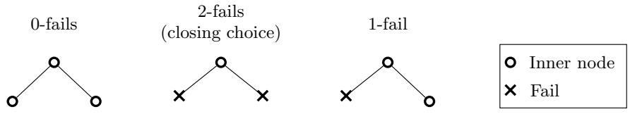
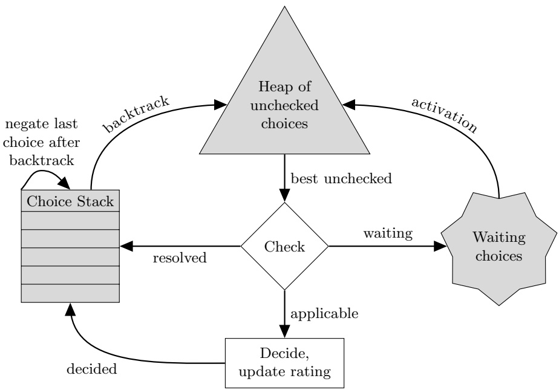
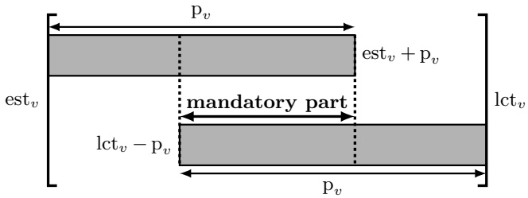
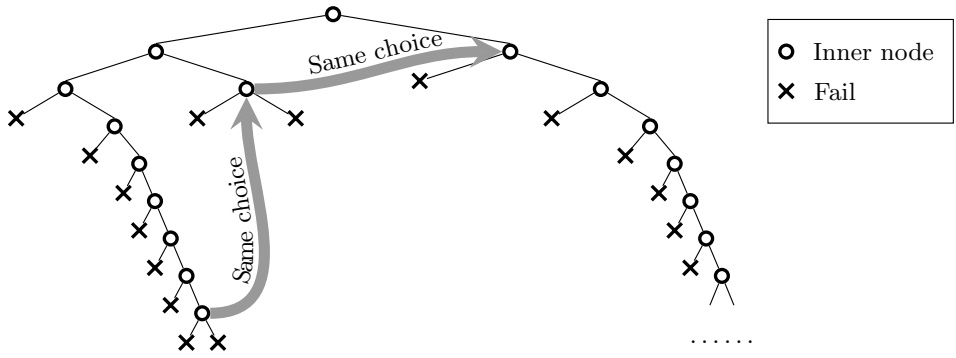

# [Failure-Directed Search for Constraint-Based Scheduling](https://www.researchgate.net/publication/280223626_Failure-Directed_Search_for_Constraint-Based_Scheduling?enrichId=rgreq-5eb74caa3f5e4665d6e191337e9a7f5e-XXX&enrichSource=Y292ZXJQYWdlOzI4MDIyMzYyNjtBUzo3OTkwNDc1MDU5NDg2NzJAMTU2NzUxOTE3OTgyMg%3D%3D&el=1_x_3&_esc=publicationCoverPdf)

**Conference Paper** · May 2015

DOI: 10.1007/978-3-319-18008-3\_30

CITATIONS 66

READS 853

**3 authors:**

[Petr Vilím](https://www.researchgate.net/profile/Petr-Vilim-3?enrichId=rgreq-5eb74caa3f5e4665d6e191337e9a7f5e-XXX&enrichSource=Y292ZXJQYWdlOzI4MDIyMzYyNjtBUzo3OTkwNDc1MDU5NDg2NzJAMTU2NzUxOTE3OTgyMg%3D%3D&el=1_x_5&_esc=publicationCoverPdf) [IBM](https://www.researchgate.net/institution/IBM2?enrichId=rgreq-5eb74caa3f5e4665d6e191337e9a7f5e-XXX&enrichSource=Y292ZXJQYWdlOzI4MDIyMzYyNjtBUzo3OTkwNDc1MDU5NDg2NzJAMTU2NzUxOTE3OTgyMg%3D%3D&el=1_x_6&_esc=publicationCoverPdf)

**23** PUBLICATIONS   **624** CITATIONS


[SEE PROFILE](https://www.researchgate.net/profile/Petr-Vilim-3?enrichId=rgreq-5eb74caa3f5e4665d6e191337e9a7f5e-XXX&enrichSource=Y292ZXJQYWdlOzI4MDIyMzYyNjtBUzo3OTkwNDc1MDU5NDg2NzJAMTU2NzUxOTE3OTgyMg%3D%3D&el=1_x_7&_esc=publicationCoverPdf)

[Philippe Laborie](https://www.researchgate.net/profile/Philippe-Laborie?enrichId=rgreq-5eb74caa3f5e4665d6e191337e9a7f5e-XXX&enrichSource=Y292ZXJQYWdlOzI4MDIyMzYyNjtBUzo3OTkwNDc1MDU5NDg2NzJAMTU2NzUxOTE3OTgyMg%3D%3D&el=1_x_5&_esc=publicationCoverPdf) LocalSolver **58** PUBLICATIONS   **1,761** CITATIONS

[SEE PROFILE](https://www.researchgate.net/profile/Philippe-Laborie?enrichId=rgreq-5eb74caa3f5e4665d6e191337e9a7f5e-XXX&enrichSource=Y292ZXJQYWdlOzI4MDIyMzYyNjtBUzo3OTkwNDc1MDU5NDg2NzJAMTU2NzUxOTE3OTgyMg%3D%3D&el=1_x_7&_esc=publicationCoverPdf)

[Paul Shaw](https://www.researchgate.net/profile/Paul-Shaw-21?enrichId=rgreq-5eb74caa3f5e4665d6e191337e9a7f5e-XXX&enrichSource=Y292ZXJQYWdlOzI4MDIyMzYyNjtBUzo3OTkwNDc1MDU5NDg2NzJAMTU2NzUxOTE3OTgyMg%3D%3D&el=1_x_5&_esc=publicationCoverPdf) [IBM](https://www.researchgate.net/institution/IBM2?enrichId=rgreq-5eb74caa3f5e4665d6e191337e9a7f5e-XXX&enrichSource=Y292ZXJQYWdlOzI4MDIyMzYyNjtBUzo3OTkwNDc1MDU5NDg2NzJAMTU2NzUxOTE3OTgyMg%3D%3D&el=1_x_6&_esc=publicationCoverPdf)

**43** PUBLICATIONS   **3,438** CITATIONS

[SEE PROFILE](https://www.researchgate.net/profile/Paul-Shaw-21?enrichId=rgreq-5eb74caa3f5e4665d6e191337e9a7f5e-XXX&enrichSource=Y292ZXJQYWdlOzI4MDIyMzYyNjtBUzo3OTkwNDc1MDU5NDg2NzJAMTU2NzUxOTE3OTgyMg%3D%3D&el=1_x_7&_esc=publicationCoverPdf)

**Some of the authors of this publication are also working on these related projects:**

Project

Continuously improve the CP Optimizer component of IBM ILOG CPLEX Optimization Studio [View project](https://www.researchgate.net/project/Continuously-improve-the-CP-Optimizer-component-of-IBM-ILOG-CPLEX-Optimization-Studio?enrichId=rgreq-5eb74caa3f5e4665d6e191337e9a7f5e-XXX&enrichSource=Y292ZXJQYWdlOzI4MDIyMzYyNjtBUzo3OTkwNDc1MDU5NDg2NzJAMTU2NzUxOTE3OTgyMg%3D%3D&el=1_x_9&_esc=publicationCoverPdf)

# Failure-directed Search for Constraint-based Scheduling

Petr Vil´ım<sup>1</sup>, Philippe Laborie<sup>2</sup>, and Paul Shaw<sup>3</sup>

1IBM, V Parku 2294/4

148 00 Praha 4 - Chodov, Czech Republic

petr vilim@cz.ibm.com

IBM, 9 rue de Verdun

94253 Gentilly Cedex, France

laborie@fr.ibm.com

3IBM, Les Taissounieres HB2

2681 Route des Dolines, 06560 Valbonne, France

paul.shaw@fr.ibm.com

Abstract. This paper presents a new constraint programming search algorithm that is designed for a broad class of scheduling problems. Failuredirected Search (FDS) assumes that there is no (better) solution or that such a solution is very hard to find. Therefore, instead of looking for solution(s), it focuses on a systematic exploration of the search space, first eliminating assignments that are most likely to fail. It is a “plan B” strategy that is used once a less systematic “plan A” strategy – here, Large Neighborhood Search (LNS) – is not able to improve current solution any more. LNS and FDS form the basis of the automatic search for scheduling problems in CP Optimizer, part of IBM ILOG CPLEX Optimization Studio.

FDS and LNS+FDS (the default search in CP Optimizer) are tested on a range of scheduling benchmarks: Job Shop, Job Shop with Operators, Flexible Job Shop, RCPSP, RCPSP/max, Multi-mode RCPSP and Multi-mode RCPSP/max. Results show that the proposed search algorithm often improves best-known lower and upper bounds and closes many open instances.

Keywords: Constraint Programming, Scheduling, Search, Job Shop, Job Shop with Operators, Flexible Job Shop, RCPSP, RCPSP/max, Multi-mode RCPSP, Multi-mode RCPSP/max, CPLEX, CP Optimizer

## 1 Introduction

Generic search algorithms have become quite successful in constraint programming solvers in recent years, see for example impact-based search [22], weighteddegree heuristics [6] and activity-based search [18]. However, the authors are aware of only one attempt to use such a generic search (in particular impactbased search) for scheduling problems [37].

One of the obstacles for using the search algorithms mentioned above for scheduling is that they make branching decisions of the form $x   =   n   \lor   x   \neq   n ,$ where x is a variable and n is a value from its domain. In case of scheduling the decision x 6= n usually does not propagate at all because the majority of propagation algorithms take into account only minimum and maximum values of domains (see propagation by temporal constraint networks [7], timetable [4, chapters 3.3.1 and 2.1.1] or family of edge-finding algorithms for unary and discrete cumulative resources [35, 36]). A possible solution is to branch on disjunctions as proposed in [37]. However, this approach is hard to generalize from disjunctive resources to other scheduling constraints. Failure-directed search overcomes this problem in a different way: it branches by splitting a domain into two disjoint intervals so that one of the bounds of the domain is always changed.

## 2 Scheduling Using Constraint Programming

In this paper we consider a broad class of scheduling problems with activities, precedences between activities, unary or discrete cumulative resources and also alternatives and optional activities. For a more detailed description on modeling those problems using Constraint Programming (and in particular using IBM ILOG CP Optimizer that implements FDS) please refer to [12, 14]. Here we briefly introduce the main concepts used in this paper.

Interval variable is a decision variable that represents a task/activity with unknown start and end times. It is possible to express the fact that the task is optional and may be left unperformed (e.g. because an alternative task was used instead). More formally domain $D _ { v }$ of an interval variable v is a subset of:

$$
\{\bot \} \cup \{(s, e) | s, e \in \mathrm{Z}, s \leq e \}
$$

Where ⊥ represents the case that the task is left unperformed. When $D _ { v } = \bot$ then we say that v is absent, when $\perp \not \in D _ { v }$ then v is present and otherwise then v is optional.

Precedence models the fact that end/start of some interval variable must be before/after the start/end of another interval possibly with minimum/maximum delay (the delay can be negative). Precedences are propagated by a dedicated global constraint called the Temporal Network as described in [12] (inspired by [7]).

Unary resource (noOverlap) forbids any pair of intervals variables from a given set to overlap (e.g. because all the interval variables require the same machine). There has been a lot of work on propagation of unary resources— we are using the methods described in [35].

Discrete cumulative resource models a machine or any other resource that can process multiple tasks at once but which has a limited capacity for processing tasks simultaneously. In CP Optimizer, cumulative resources are modeled by cumulative function expressions. Again, there are many algorithms for propagating this constraint: we are using Timetable Edge Finding [36] and Timetabling [4, chapters 3.3.1 and 2.1.1].

Alternative models an alternative between several optional intervals. Alternatives are used to model, for example, different modes of a task. Propagation of alternatives is described in [12].

## 3 Choices

Failure-directed search does not operate on decision variables directly, instead it works on a set of binary choices. A choice is an abstraction of anything that needs to be decided in order to obtain a solution. An obvious example of a choice is assigning a value to a variable $( e . g .$ choice between $x = 5$ and $x \neq 5 )$ . However failure-directed search is using domain splitting instead (see $\left. e . g . \left[ 9 \right] \right)$ and the following kinds of choices:

Presence choice: for an interval variable v whether v is present $( \bot \not \in D _ { v } )$ o r absent $( D _ { v }   =   \{ \bot \} )$ . This kind of choice is used only for optional interval variables.

Start time choice: for an interval variable v and a time t whether start $\operatorname { O f } ( v ) \leq$ t or start $\operatorname { t O f } ( v ) > t .$ Function start $\operatorname { O f } ( v )$ returns start time of interval variable v in a solution. Start time choice can be used only on a present interval variable $v ,$ if v is still optional then the presence choice must be applied first (see later).

At the highest level, failure-directed search knows only a set of choices that needs to be decided: it is ignorant of what the choices are doing.

For now we assume that all possible presence choices and start time choices are generated before the search starts. The topic of actual set of choices is further discussed in Section 6.1.

FDS search operates under the assumption that the current problem is infeasible, or alternatively, if there is a solution then it is hard to find (heuristic methods already failed to find it). Therefore it supposes that it will explore the whole search space (to prove infeasibility or optimality) or at least a significant part of it (before a solution is found).

With this assumption in mind, failure-directed search gives up on the idea of guiding the search towards possible solutions. It does exactly the opposite: it drives the search into conflicts in order to prove that the current branch is infeasible. Choices that fail the most are preferred. From two branches of a choice the one that fails the most is preferred. It is the well-known first-fail principle but applied also on the branch ordering.

Let’s assume for a while that it is we, not the search algorithm, who decide how the search space is explored. We are given an infeasible problem, a set of predefined choices and our task is to build a complete but small search tree. We can imagine it as a game: there is a box of bricks (the choices) and the task is to build from them a search tree in a depth-first way. Our task is to repeatedly pick a choice from the box and add it into the tree. When we pick a choice, it is possible that the choice is already decided, in this case we continue picking.

Otherwise the choice is added into the tree and it produces two new branches. Thanks to constraint propagation branches can fail and therefore one of the following three possibilities will happen (see Figure 1):



Fig. 1. Types of internal nodes

0-fails: Neither branch fails. From our tree-builder point of view it is a disappointment because we ended up increasing the number of open branches. Instead of making our tree smaller we ended up increasing it. However at some points, especially near the root node, there is no other way.

2-fails: Both branches fail. In this case lets calls this choice a closing choice because it closes the current branch. As we are looking for a small search tree, closing choice is the best that can happen. Search tree cannot be fully explored without closing choices.

1-fail: Only one branch fails. We did not close the current branch, but at least we did not open a new one. Constraint propagation tightened the bounds, so we have better chances to close the branch next time.

Of course we do not know in advance which of the three possibilities above will happen. Instead FDS uses a system of ratings that reflects recent behavior of a choice.

## 4 Ratings

Ratings are the measure that failure-directed search uses in order to pick the next choice to explore. Smaller ratings are preferred. The algorithm simply picks an available choice with the best rating.

For every available choice $c _ { \gamma }$ the system maintains separate ratings for its positive and negative branch $\mathrm { { 1 e s } ^ { 4 } } \colon$ rat $\mathrm { i n g } ^ { + } [ c ]$ and rating−[c]. Both rati $\mathrm { a g } ^ { + } [ c ]$ and rating−[c] are initially set to 1.0. Rating of choice c is defined as:

$$
\operatorname{rating}[c] = \operatorname{rating}^{+}[c] + \operatorname{rating}^{-}[c]\tag{1}
$$

<small><span class="docvortex-page-footnote" data-block-type="page_footnote" style="color:#6b7280">4 Note the difference between positive/negative branch and left/right branch. When a choice is generated one of the branches is called positive and the second negative and this assignment does not change. It is up to the search algorithm to decide which of the two branches will be explored first and become the left branch of a node.</span></small>

Additionally, for every search depth, d there is average rating of choices on the given depth: avgRating[d]. Its initial value is also 1.0.

Like impact-based search [22], FDS computes an estimate $0   \leq   R   \leq   1$ of the reduction in effort to search the rest of the problem, given a particular assignment. For example, [22] uses the ratios of the search space sizes (using variable domains only) before and after propagation of each decision:

$$
R = \frac {| D _ {x _ {1}} ^ {\prime} | \times \cdots \times | D _ {x _ {n}} ^ {\prime} |}{| D _ {x _ {1}} | \times \cdots \times | D _ {x _ {n}} |}
$$

where $D _ { v }$ and $D ^ { \prime } { } _ { v }$ are the domains of variable v before and after the decision, respectively.

Each time a branch of a choice c is explored its rating rating+[c] or rating−[c] is updated using the estimation of search effort reduction. The computation starts with localRating:

$$
\text {localRating} := \left\{ \begin{array}{l l} 0 & \text {if the branch fails immediately} \\ 1 + R & \text {otherwise} \end{array} \right.\tag{2}
$$

Notice that this measure puts a much greater emphasis on failures than traditional impact-based search, making FDS much more aggressive in seeking out immediate failures during search.

The local rating of a decision depends a lot on the current subproblem. In particular the same decision usually has a higher local rating near the root node than in the depths of the search tree. To compensate for this effect, localRating is normalized using the average rating on the current depth d. With this in mind, the rating of a branch (positive or negative) is updated to:

$$
\text {rating} ^ {+ / -} [ c ] := \alpha \cdot \text {rating} ^ {+ / -} [ c ] + (1 - \alpha) \cdot \frac {\text {localRating}}{\text {avgRating} [ d ]}\tag{3}
$$

Where α is a constant controlling the speed of decay (typical values of α range from 0.9 to 0.99). Note that update of the rating of the branch by (3) has immediate effect on rating[c] according to (1).

As ratings are decaying by factor α, they reflect the recent behavior of the choice. Ratings can change quite quickly, especially when closing decisions are encountered.

## 5 Search Algorithm

The search algorithm is using several data structures to store choices according to their current state, see Figure 2. The state of a choice can be:

Unchecked: The choice was not picked for branching in the current branch. Initially all choices are unchecked. Unchecked choices are stored in a heap that allows fast access to the choice with the best rating.



Fig. 2. Choice states and data structures

Decided: The choice was picked for branching, it was found applicable (i.e. the choice is not resolved or waiting, see below) and one of the branches was applied. The choice remains decided until the search backtracks from the decision about the choice. Decided decisions are kept on a stack in order to facilitate fast backtracking.

Resolved: Again the choice was already picked for branching but it was found to be already resolved. $e . g .$ consider a choice is between start $\operatorname { t O f } ( v ) \leq 5$ and $\mathrm { s t a r t O f } ( v ) > 5$ where v is a present interval variable. If in the current node startOf(v) is known to be in interval [7, 12] then there is no point in branching on the choice. The choice remain resolved until the search backtracks above the point where the choice was found to be resolved. Therefore resolved choices are also kept on the stack.

Waiting: Let’s consider once more the choice between startOf(v) $\leq ~ 5$ and $\mathrm { s t a r t O f } ( v )   >   5$ but this time consider that v is an optional interval variable. The choice does not split the domain of v into two disjunctive subsets: the case v is absent is possible in both branches. For this reason choices like this one can be applied only when v is already present. The choice remains waiting as long as v is optional. In order to be activated at the right time the choice must monitor the status of v. Once v becomes present the choice automatically returns into the heap and becomes unchecked again.

The search proceeds as follows, see Algorithm 1. A choice with the best rating is taken from the heap and its state is checked (line 7). If it is waiting then another choice is taken from the heap. Similarly if the choice is resolved then it is put on the stack and also another choice is drawn. This process continues until an applicable choice is found (line 15). The applicable choice is decided (the branch with the better rating first), put on stack and constraint propagation is run until the fixed point. The process continues this way until constraint propagation finds the current subproblem infeasible (dead end, line 21). In this case the search backtracks: choices are removed from the stack and put back into the heap until the last choice with open branch is found. The choice is switched (the right branch is applied), constraint propagation is run and branch rating is updated.

```vhdl
pick:
    if heap is empty then begin
        solution found;
        add improving objective cut;
        goto backtrack;
    end;
    remove choice c with the best rating from heap;
    if c is waiting then begin
        let c monitor the underlying interval variable;
        goto pick;
    end;
    add c to stack;
    if c is resolved then
        goto pick;
    b := branch of c with the better rating
propagate:
    apply branch b;
    propagate until a fixed point;
    update rating of branch b;
    if not infeasible then goto pick;
backtrack:
    let c is the last choice with open branch on the stack;
    if there is no such c then
        terminate; // whole search space was explored
    put back into the heap all choices from the stack until c;
    b := the unexplored branch of c;
    goto propagate;
```

Algorithm 1. Search algorithm

## 6 Other Components

The previous section describes the basic failure-directed search. However there are more components that contribute to the performance of failure-directed search.

## 6.1 Initial set of choices

FDS as described in so far requires that all possible choices to be generated before the search starts. However it may be more efficient to start with only a subset of choices and generate additional ones when needed. In particula $\mathrm { r } _ { \gamma }$ inspired by search techniques for square packing described in [26, 5], the initial set of choices only makes sure that if they are all decided then every interval variable is either absent or has mandatory part (see Figure 3). Then, if the search gets to a point when all choices have been decided but some decision variables remain unfixed, then either a more traditional depth-first approach can be used to complete the solution, or alternatively more choices can be generated at that point, allowing the search to continue.



Fig. 3. Consider present interval variable v with duration $p _ { v }$ , earliest starting time est<sub>v</sub> and latest completion time $\operatorname { l c t } _ { v } .$ If $\operatorname { l c t } _ { v } - \operatorname { e s t } _ { v }   <   2 \operatorname { p } _ { v }$ then v always occupies interval $[ \mathrm { l c t } _ { v } - \mathrm { p } _ { v } , \mathrm { e s t } _ { v } + \mathrm { p } _ { v } ]$ . This interval is called mandatory part.

## 6.2 Restarts and nogoods

Restarting the search is a widely used technique to improve performance by breaking out of heavy-tailed behavior typical of depth-first search [8, 19]. Similar generic search algorithms also use restarts [22, 18, 24].

The search is restarted for the first time after 100 backtracks. The restart limit is increased by 15% after each restart. These values correspond to the default parameterization of CP Optimizer (parameters RestartFailLimit and RestartGrowthFactor).

Nogoods from restarts are recorded and propagated as described in [15], which is also the same manner in which nogoods are propagated for integer search inside CP Optimizer.

FDS assumes that it will be restarted many times before it fully explores the search space. The only result that remains after each restart is a set of nogoods. The shorter they are, the easier they are to apply. That is the reason why FDS always explores first the branch that is more likely to fail.

## 6.3 Strong branching and shaving

Ratings try to estimate the behavior of choices, but they are still only estimations. At the top of the search tree, where it is most important to pick the right choices, the ratings are most imprecise.

Therefore at the root node of each restart it pays off to pre-evaluate a limited number of best choices to find out their “actual” behavior. FDS tries both branches of a number of best applicable choices from the heap and updates their ratings. After that it picks for branching a choice with a branch with the best localRating as defined by (2).

The process of pre-evaluation of different choices before committing to one of them is not new, see for example strong branching in MIP solvers [1] and shaving in CP (e.g. [29]). Shaving in particular has a different goal: to find a choice that has an infeasible branch and improve the filtering by applying the opposite branch. FDS does a similar thing: if one of the choices evaluated during strong branching has an infeasible branch then the opposite branch is applied and the pre-evaluation process continues with the reduced set of choices.

Finally while evaluating one of the choices, it can happen that some variable x is updated by constraint propagation in similar way in both branches. For example, minimum start time of x is increased from 0 to 7 in one branch and to 10 in the second branch. In this case the minimum start time of x can be increased from 0 to 7 immediately.

## 6.4 Coupling with LNS

As explained earlier, failure-directed search is designed for the case when the problem is infeasible or a solution is very hard to find. As FDS heads first into conflicts, it finds solutions just by a happy accident. If there are many easy-to-find solutions then FDS may not work well.

Therefore FDS is a good “plan B”: when other approaches fail or are not able to improve any more then FDS can explore the whole search space. In another words, it pays off to couple FDS with another “plan A” strategy that is able to find near-optimal solutions and this way limit the search space for FDS.

In CP Optimizer the “plan A” strategy is a self-adapting Large Neighborhood Search (LNS) [11]. It consists of a process of continual relaxation and re-optimization: a first solution is computed and iteratively improved. Each iteration consists of a relaxation step followed by a re-optimization of the relaxed solution. This process continues until some condition is satisfied, typically, when the solution can be proved to be optimal or when a time limit is reached. In CP Optimizer this approach is made more robust by using portfolios of large neighborhoods and completion strategies in combination with Machine Learning techniques to converge on the most efficient neighborhoods and completion strategies for the problem being solved. Furthermore, in case of non-regular objective function (like earliness costs), some completion strategies are guided by a linear relaxation of the problem solved with LP techniques [13].

## 7 Experimental Results

FDS together with LNS are tested on a number of classical scheduling benchmarks listed below. Only instances that are still open are considered. The purpose of the experiments is solely to show that FDS is powerful enough to close number of open problems. A detailed study of individual features of FDS is out of scope of the paper.

```txt
LB := best known lower bound - 1;
checkLB:
    solve with upper bound set to LB and specified time limit;
    if solution found then begin
        terminate; // Optimal solution found
    end;
    if infeasible then begin
        LB := LB+1;
        goto checkLB;
    end;
    terminate; // Time limit was hit. LB is new valid lower bound
```

Algorithm 2. Destructive lower bounds

Experiments are performed on a machine with Intel Core i7 2.60GHz processor (4 cores and hyperthreading) and 16GB RAM using slightly modified<sup>5</sup>IBM ILOG CP Optimizer version 12.6.1. The instances are solved by two different methods:

LNS+FDS: This configuration is just the standard automatic search of CP Optimizer with a parameterization to use two CPU threads (Workers=2) and more aggressive FDS (FailureDirectedSearchEmphasis=0.99). At the beginning, both threads use LNS, but once LNS is not able to improve the current solution for some time (determined automatically by auto-tuning in CP Optimizer) one of the two threads switches from LNS to FDS.

DestructLB: This approach tries to improve best known lower bounds by proving them wrong iteratively, see Algorithm 2. This time only one CPU thread is used and FDS is started immediately<sup>6</sup>. In order to make a fair comparison with the state of the art, the algorithm first tries to confirm the current best known lower bound and only then tries to improve it. The time limit for DestructLB specified in the benchmark description is used for each iteration of the algorithm, the total running time of the algorithm is not limited (this way the result is not biased by the initial value of the lower bound).

Results are summarized in Table 1. Column Instances gives the number of open instances of the benchmark, the Lower bound and Upper bound improvements columns give the number of lower and upper bounds improved by CP Optimizer respectively. The last column represents the number of instances that were closed by CP Optimizer. Detailed lists of improved lower and upper bounds can be found at http://ibm.biz/FDSearch.

<small><span class="docvortex-page-footnote" data-block-type="page_footnote" style="color:#6b7280">5 With minor performance improvements.</span></small>

<small><span class="docvortex-page-footnote" data-block-type="page_footnote" style="color:#6b7280">6In version 12.6.1 IBM ILOG CP Optimizer does not offer yet a public API to run FDS directly and replicate the reported results.</span></small>

| Nu Benchmark set in | mber of L stances i | ower bound Uppe mprovements impr | r bound ovements | Closed instances |
| --- | --- | --- | --- | --- |
| JobShop | 48 | 40 | 3 | 15 |
| JobShopOperators | 222 | 107 | 215 | 208 |
| FlexibleJobShop | 107 | 67 | 39 | 74 |
| RCPSP | 472 | 52 | 1 | 0 |
| RCPSPMax | 58 | 51 | 23 | 1 |
| MultiModeRCPSP (j30) | 552 | No reference | 3 | 535 |
| MultiModeRCPSPMax | 85 | 84 | 77 | 85 |

Table 1. Results summary

## 7.1 Job Shop $( J | | C _ { m a x } )$

For job shop scheduling problems, we focus on the open classical instances of [28] (tail\*, 32 open instances), [2] (abz\*, 3 open instances), [27] (swv\*, 9 open instances) and [38] (yam\*, 4 open instances). The current lower and upper bounds for these instances were gathered from [30] and [31].

In the case of job shop, computation of current best known lower and upper bounds usually took a very long time. e.g. computation of upper bounds in [21] used a time limit of 30000 seconds (8 hours 20 minutes) using a dedicated local search algorithm. FDS is not a local search, it explores the whole search space, so an even bigger time limit would make sense. We decided to use the same time limit of 30000s but two threads in LNS+FDS approach and 10 minutes per iteration for DestructLB.

The DestructLB approach, despite the small time limit, was able to improve lower bounds for 40 of the 48 instances and close 4 instances (improving the upper bound for 2 of them). The LNS+FDS approach closed 15 instances, including the 4 instances already closed by DestructLB. Solve times ranged from 50 minutes (tail12) to 7.5 hours (tail21).

This benchmark illustrates the benefits of the automatic search of CP Optimizer that couples LNS and FDS together using two threads (LNS+FDS). Let’s take a closer look at instance tail19 by Taillard. After 388s LNS finds a solution with makespan 1352 which is only 1.5% from the optimum value of 1332. Such a tight upper bound limits the search space for FDS and at time 1061.2s FDS finds a solution with makespan 1351. This solution is passed to LNS and LNS improves it immediately (in 0.32s) to 1350. LNS continues improving the solution, reaching the optimal value of 1332 at 8518s. In parallel, FDS is systematically exploring the search space while taking advantage of the new upper bounds as they come from LNS. Finally after 12853s in total, FDS proves that there is no better solution and the search stops.

In general, FDS is able to help LNS to escape local minima by providing a new (possibly totally different) solution. LNS can use this solution as a new starting point and further improve it. And in the opposite direction, LNS provides tight upper bounds to FDS and removes from FDS the burden to guide the search towards possible solutions. This way FDS can concentrate only on the fastest way to explore the search space.

## 7.2 Job Shop with Operators

The job shop scheduling problem with operators is an extension of the classical job shop scheduling problem proposed in [3] where each operation also requires an operator to aid in the processing of the operation (beside the machine). An operator can process only one operation at a time and the total number of operators in the shop is limited. The whole set of operators is modelled by a single discrete cumulative resource. Results are compared with the current best known lower and upper bounds provided by the approach described in [17] on the 222 open problems. We used a time limit of 600s for the LNS+FDS approach and 300s per iteration of the DestructLB algorithm. Both LNS+FDS and DestructLB were able to close many instances. In all, 208 instances were closed, with 107 lower bounds and 215 upper bounds being improved.

## 7.3 Flexible Job Shop $( F J | | C _ { \mathrm { m a x } } )$

Flexible job shop scheduling problems are an extension of classical job shop scheduling problems for production environments where it is possible to run an operation on more than one machine. Current lower and upper bounds were taken from [32]<sup>7</sup>. Out of the 107 open instances, the LNS+FDS approach closes 74 instances (resulting in an indirect improvement of 61 lower bounds among these instances) and improves 39 upper bounds. Those results with LNS+FDS were obtained using a time-limit of up to 8h. The DestructLB approach with a time limit of 3600s per iteration was able to additionally improve 10 lower bounds.

## 7.4 RCPSP (PS|prec|C<sub>max</sub>)

For Resource Constrained Project Scheduling Problems (RCPSP), we focus on the 472 open instances of the PSPLib [10]. Current lower and upper bounds were taken from [24].

This benchmark allows direct comparison with the approach of [24] as they also compute destructive lower bounds in exactly the same way on a machine with the same speed. Therefore we used the same time limits as [24]: 10 minutes for LNS+FDS and 10 minutes for one iteration of DestructLB. The DestructLB approach improves 52 lower bounds (by 1, 2 or 3), proves the same lower bound as [24] for 330 instances and is not able to prove the same lower bound within the time limit for 90 instances. We conclude that in terms of lower bounds FDS achieve similar results as [24] despite the fact that FDS does not use use explanations as Schutt et al. does.

<small><span class="docvortex-page-footnote" data-block-type="page_footnote" style="color:#6b7280">7 Note that this page already includes most of the results reported in the present article under the reference [CPO].</span></small>

In terms of upper bounds, LNS+FDS is clearly worse despite using two threads instead of one. Only one upper bound is improved and only in 78 cases the upper bound is the same. No open instance of RCPSP was closed.

## 7.5 RCPSP/max (PS|temp|C<sub>max</sub>)

For Resource Constrained Project Scheduling Problems with minimal and maximal time lags (RCPSP/max), we use the best known lower and upper bounds reported in [25]. We used again a time limit of 10 minutes for both LNS+FDS and DestructLB iteration.

The DestructLB approach improves lower bound for 56 out of 57 open instances and proves optimality for psp j30 73. However as [25] did not compute destructive lower bounds, a direct comparison is not possible.

The LNS+DFS approach improves best upper bounds for 23 instances, for 10 instances it reaches the same upper bound (again proving optimality for psp j30 73) but produces a poorer upper bound for 25 instances. Direct comparison with [25] is again not possible because we used 2 threads on a faster machine.

To summarize, one instance is closed by CP Optimizer and the average gap (defined as (UB − LB)/UB) is reduced from 23.37% to 13.62%.

## 7.6 Multi-mode RCPSP (MPS|prec|C<sub>max</sub>)

Multi-Mode Resource Constrained Project Scheduling Problems are extensions of classical RCPSP allowing for alternative execution modes of the tasks. We worked with the j30\* instances of the PSPLib [33] (all other instances are closed). The bounds reported in [33] include some recent improvements described in [20]. As [33] reports only upper bounds, we worked with all the 552 feasible instances of the problem. We used a time limit of 3600s for LNS+FDS and 600s per iteration for DestructLB. Both LNS+FDS and DestructLB were able to close many instances. In all, 535 instances were closed (almost 97%) and 3 upper bounds are improved.

## 7.7 Multi-mode RCPSP/max (MPS|temp|C<sub>max</sub>)

Multi-Mode Resource Constrained Project Scheduling Problems with minimal and maximal time lags combine the two extensions of the classical RCPSP. We focused on the 85 open instances of the PSPLib (7 in the mm50 group, 79 in the mm100 group) given the lower and upper bounds reported in [34]. These bounds include some recent improvements described in [23].

DestructLB with a time limit of 300s was able to improve 53 lower bounds. LNS+FDS using a time limit of 1800s was able to improve 73 upper bounds. The combination of the two approaches closes 10 instances.

In fact, this benchmark turns out to be very peculiar because the renewable (cumulative) resources are not the hardest part of the problem. We exploited this remark to implement an alternative approach that first solves a MIP relaxation of the problem that exactly handles all constraints except the renewable resources. The MIP model has numerical variables $s _ { i }$ for the start time of each activity i and boolean variables $m _ { i j }$ for selecting the mode of activity i. Renewable resources are relaxed using a basic energy reasoning over the schedule horizon. The MIP is solved using CPLEX 12.6.1. The optimal makespan of the MIP clearly is a lower bound on the makespan of the original problem. In a second step, we find with CP Optimizer the optimal solution to the RCPSP/max problem that uses the optimal mode allocation of the MIP. It turns out that for 83 instances out of 85, the optimal makespan of this problem is equal to the MIP lower bound and thus is an optimal solution to the original problem. For the 2 remaining instances, we re-injected the optimal solution of the RCPSP/max as a warm start into the original Multi-Mode RCPSP/max model using CP Optimizer starting point functionality. The LNS+FDS approach then improves on the starting point and produces a solution with a makespan equal to the MIP lower bound. In conclusion, all 85 open instances were closed.

## 8 Analysis of FDS Behavior

It is still not completely clear why FDS is so successful on some problem instances. Therefore we tried to analyze the behavior of FDS in order to get better understanding. This section summarizes our observations.

One (perhaps not surprising) observation is that FDS produces unbalanced search trees. Left branches often fail immediately or at least they are explored much faster than right branches. Common are long chains of 1-fail nodes ended by a closing node as demonstrated in Figure 4.

An important feature of failure-directed search is that once a closing choice is found, it is likely to be reused again immediately after the backtrack. It is common that the same closing choice is reused several times before it is no longer closing. This way the search can quickly escape even from deep search depths. Similarly 1-fail choices are also usually quickly reused. The behavior of FDS is in this sense very similar to the one of quick shaving [16].



Fig. 4. Reusing closing choices

A choice chosen for branching in a root node after a restart is most likely to be a choice that was recently closing before the restart. As usual, the choice is probably unbalanced, e.g. it could be a choice between start time in interval [1, 4] versus [5, 100]. Therefore when the left branch of the root node is proved infeasible, FDS improves the domain only a little (from [1, 100] to [5, 100]). However as the choice used to be closing, even such a small improvement is probably important. As FDS accumulates those small improvements (and nogoods in general), search space is reduced and constraint propagation becomes stronger.

Heading first into conflict The importance of heading first into conflict can be demonstrated for example on job shop instance tail50. It takes 465 seconds for FDS to prove that there is no solution with makespan 1832 or lower. Lets compare that with reverse branching order: pick the choices as usual (low rating first) but switch the branching order to worse rating first. With this change the same proof takes 1023 seconds.

The reason why branching order is important seems to be the fact that the search is periodically restarted. When low rating branches are explored first then the generated nogoods from restarts are shorter and easier to apply.

Preferring conflicts We perform one more experiment with the same job shop instance, this time to demonstrate the importance of preferring immediate failures in computation of ratings. Lets replace 1 + R by R in formula (2):

$$
\text {localRating} := \left\{ \begin{array}{l l} 0 & \text {if the branch fails immediately} \\ R & \text {otherwise} \end{array} \right.
$$

This new version of localRating resembles much more impact-based search. With this change the proof that used to take 465 seconds does not finish within 24 hours.

## 9 Conclusions

Using failure-directed search we were able to improve the state-of-the-art results for a number of scheduling benchmarks covering disjunctive and cumulative resources, minimum and maximum lags and multiple modes. Results demonstrate that FDS and CP Optimizer’s automatic search (LNS+FDS) can compete with specialized algorithms and even outperform them.

Failure-directed search has been an integral part of the CP Optimizer automatic search algorithm since version 12.6.0.

## References

1. Achterberg, T., Koch, T., Martin, A.: Branching rules revisited. Operations Research Letters 33, 42–54 (2004)

2. Adams, J., Balas, E., Zawack, D.: The shifting bottleneck procedure for job shop scheduling. Management Science 34(3), 391–401 (1988)

3. Agnetis, A., Flamini, M., Nicosia, G., Pacifici, A.: A job-shop problem with one additional resource type. Journal of Scheduling 14, 225–237 (2011)

4. Baptiste, P., Pape, C.L., Nuijten, W.: Constraint-Based Scheduling: Applying Constraint Programming to Scheduling Problems. Kluwer Academic Publishers (2001)

5. Beldiceanu, N., Carlsson, M., Demassey, S., Poder, E.: New filtering for the cumulative constraint in the context of non-overlapping rectangles. Annals of Operations Research 184(1), 27–50 (2011)

6. Boussemart, F., Hemery, F., Lecoutre, C., Sa¨ıs, L.: Boosting systematic search by weighting constraints. In: de Mántaras, R.L., Saitta, L. (eds.) ECAI. pp. 146–150. IOS Press (2004)

7. Dechter, R., Meiri, I., Pearl, J.: Temporal constraint networks. Artificial Intelligence 49(1-3), 61–95 (1991)

8. Gomes, C.P., Selman, B., Crato, N., Kautz, H.: Heavy-tailed phenomena in satisfiability and constraint satisfaction problems. J. Autom. Reason. 24(1-2), 67–100 (2000)

9. Jussien, N., Lhomme, O.: Dynamic domain splitting for numeric CSPs. In: Proc. European Conference on Artificial Intelligence. pp. 224–228 (1998)

10. Kolisch, R., Sprecher, A.: PSPLIB – a project scheduling problem library. European Journal of Operational Research 96, 205–216 (1996), http://www.om-db.wi.tum.de/psplib/main.html

11. Laborie, P., Godard, D.: Self-adapting large neighborhood search: Application to single-mode scheduling problems. In: Proceedings of the 3rd Multidisciplinary International Conference on Scheduling: Theory and Applications (MISTA). pp. 276–284 (2007)

12. Laborie, P., Rogerie, J.: Reasoning with conditional time-intervals. In: Wilson, D., Lane, H.C. (eds.) Proceedings of the 21st International Florida Artificial Intelligence Research Society Conference. pp. 555–560. AAAI Press (2008)

13. Laborie, P., Rogerie, J.: Temporal Linear Relaxation in IBM ILOG CP Optimizer. Journal of Scheduling (2014)

14. Laborie, P., Rogerie, J., Shaw, P., Vil´ım, P.: Reasoning with conditional timeintervals. part II: an algebraical model for resources. In: Lane, H.C., Guesgen, H.W. (eds.) Proceedings of the 22nd International Florida Artificial Intelligence Research Society Conference, May 19-21, 2009, Sanibel Island, Florida, USA. AAAI Press (2009)

15. Lecoutre, C., Sa¨ıs, L., Tabary, S., Vidal, V.: Nogood recording from restarts. In: 20th International Joint Conference on Artificial Intelligence(IJCAI’07). pp. 131–136 (2007)

16. Lhomme, O.: Quick shaving. In: Veloso, M.M., Kambhampati, S. (eds.) AAAI. pp. 411–415. AAAI Press / The MIT Press (2005)

17. Menc´ıa, R., Sierra, M.R., Menc´ıa, C., Varela, R.: A genetic algorithm for job-shop scheduling with operators enhanced by weak lamarckian evolution and search space narrowing. Natural Computing 13, 179–192 (2014)

18. Michel, L., Van Hentenryck, P.: Activity-based search for black-box contraintprogramming solvers. In: Integration of AI and OR Techniques in Contraint Programming for Combinatorial Optimzation Problems, 9th International Conference, CPAIOR 2012. pp. 228–243. Springer (2012)

19. Moskewicz, M.W., Madigan, C.F., Zhao, Y., Zhang, L., Malik, S.: Chaff: Engineering an efficient SAT solver. In: Annual ACM IEEE Design Automation Conference. pp. 530–535. ACM (2001)

20. Muller, L.F.: An adaptive large neighborhood search algorithm for the multi-mode RCPSP. Tech. Rep. Report 3.2011, Department of Management Engineering, Technical University of Denmark (2011)

21. Pardalos, P.M., Shylo, O.V.: An algorithm for the job shop scheduling problem based on global equilibrium search techniques. Computational Management Science 3(4), 331–348 (2006)

22. Refalo, P.: Impact-based search strategies for constraint programming. In: Wallace, M. (ed.) Principles and Practice of Constraint Programming, 10th International Conference, CP 2004. Lecture Notes in Computer Science, vol. 3258, pp. 557–571. Springer (2004)

23. Schnell, A., Hartl, R.F.: Optimizing the multi-mode resource-constrained project scheduling problem with standard and generalized precedence relations by constraint programming and boolean satisfiability solving techniques (2014), working Paper

24. Schutt, A., Feydy, T., Stuckey, P.J.: Explaining time-table-edge-finding propagation for the cumulative resource constraint. In: Gomes, C.P., Sellmann, M. (eds.) Integration of AI and OR Techniques in Constraint Programming for Combinatorial Optimization Problems, 10th International Conference, CPAIOR 2013. Lecture Notes in Computer Science, vol. 7874, pp. 234–250. Springer (2013), http://ww2.cs.mu.oz.au/˜pjs/rcpsp/, accessed on Nov. 1 2014

25. Schutt, A., Feydy, T., Stuckey, P.J., Wallace, M.G.: Solving RCPSP/max by lazy clause generation. Journal of Scheduling 16(3), 273–289 (2013), http://ww2.cs.mu.oz.au/˜pjs/rcpsp/rcpspmax all.html, accessed on Nov. 1 2014

26. Simonis, H., O’Sullivan, B.: Search strategies for rectangle packing. In: Stuckey, P. (ed.) Principles and Practice of Constraint Programming. Lecture Notes in Computer Science, vol. 5202, pp. 52–66. Springer, Springer Berlin Heidelberg (2008)

27. Storer, R., Wu, S., Vaccari, R.: New search spaces for sequencing problems with application to job shop scheduling. Management Science 38(10), 1495–1509 (1992)

28. Taillard, E.: Benchmarks for basic scheduling problems. European Journal of Operations Research 64, 278–285 (1993)

29. Torres, P., Lopez, P.: Overview and possible extensions of shaving techniques for job-shop problems. In: Junker, U., Karisch, S., Tschöke, S. (eds.) Proceedings of 2nd International Workshop on the Integration of AI and OR Techniques in Constraint Programming for Combinatorial Optimization Problems. pp. 181–186 (2000)

30. URL: http://optimizizer.com/jobshop.php, accessed on Nov. 1 (2014)

31. URL: http://tinyurl.com/nl85fhy, accessed on Nov. 1 (2014)

32. URL: http://tinyurl.com/kvm8nuk, accessed on Nov. 1 (2014)

33. URL: http://tinyurl.com/nn2j599, accessed on Nov. 1 (2014)

34. URL: http://tinyurl.com/n8oahua, accessed on Nov. 1 (2014)

35. Vil´ım, P.: Global Constraints in Scheduling. Ph.D. thesis, Charles University in Prague, Faculty of Mathematics and Physics, Department of Theoretical Computer Science and Mathematical Logic (2007)

36. Vil´ım, P.: Timetable edge finding filtering algorithm for discrete cumulative resources. In: Achterberg, T., Beck, J. (eds.) Integration of AI and OR Techniques in Constraint Programming for Combinatorial Optimization Problems. Lecture Notes in Computer Science, vol. 6697, pp. 230–245. Springer Berlin / Heidelberg (2011)

37. Wolf, A.: Impact-based search in constraint-based scheduling. In: Hegering, H., Lehmann, A., Ohlbach, H.J., Scheideler, C. (eds.) Informatik 2008, Beherrschbare Systeme - dank Informatik, Band 2, Beiträge der 38. Jahrestagung der Gesellschaft für Informatik e.V. (GI), 8. - 13. September, in München. LNI, vol. 134, pp. 523–528. GI (2008)

38. Yamada, T., Nakano, R.: A genetic algorithm applicable to large-scale job-shop problems. In: Männer, R., Manderick, B. (eds.) Proc. 2nd International Workshop on Parallel Problem Solving from Nature. pp. 281–290 (1992)