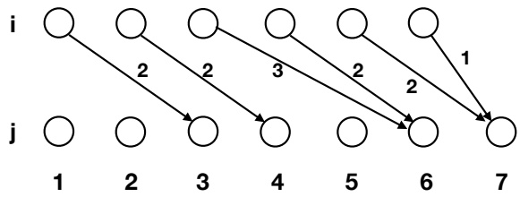
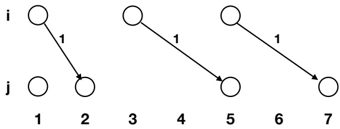
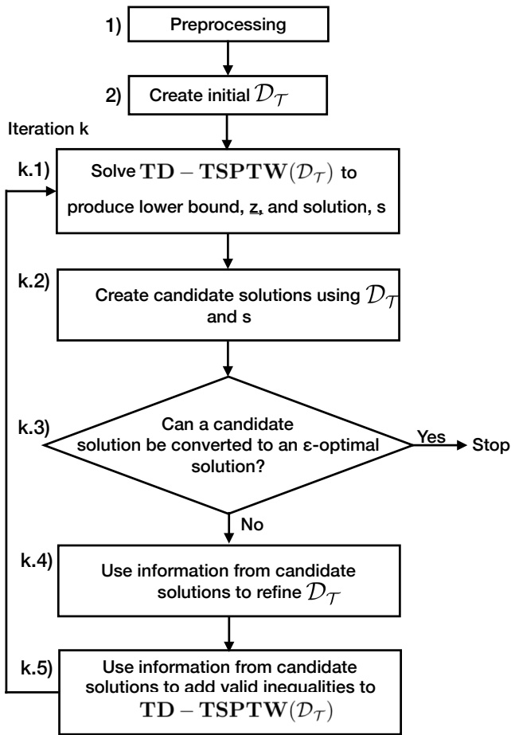
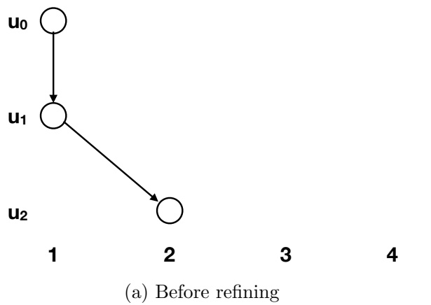
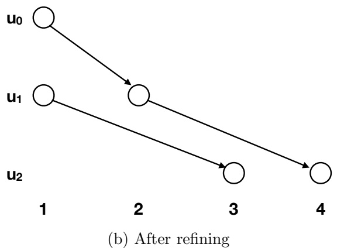
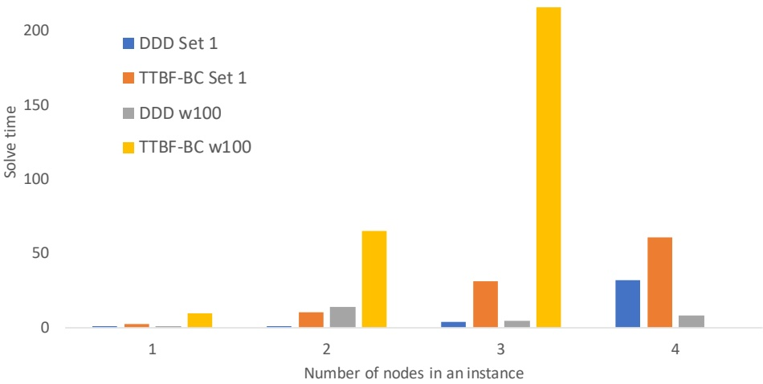
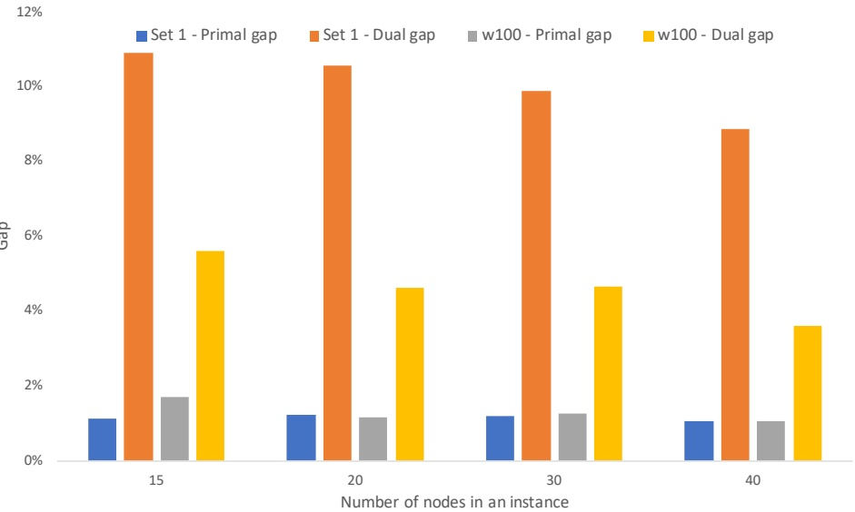
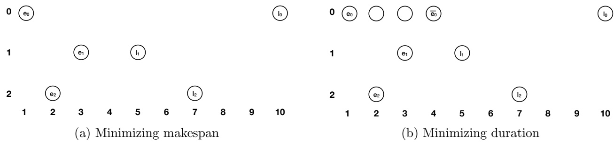

# [Dynamic Discretization Discovery for Solving the Time Dependent Traveling Salesman Problem with Time Windows](https://www.researchgate.net/publication/330506923_Dynamic_Discretization_Discovery_for_Solving_the_Time_Dependent_Traveling_Salesman_Problem_with_Time_Windows?enrichId=rgreq-60a5a485c8a43f4ba86e4a8aee8cff70-XXX&enrichSource=Y292ZXJQYWdlOzMzMDUwNjkyMztBUzo3MTcxMjE3MjYyMDE4NTZAMTU0Nzk4NjU1MTcxNA%3D%3D&el=1_x_3&_esc=publicationCoverPdf)

**Article**  in  Transportation Science · January 2019

DOI: 10.1287/trsc.2019.0911

CITATIONS 55

**4 authors:**

[Vu Duc Minh](https://www.researchgate.net/profile/Vu-Duc-Minh-2?enrichId=rgreq-60a5a485c8a43f4ba86e4a8aee8cff70-XXX&enrichSource=Y292ZXJQYWdlOzMzMDUwNjkyMztBUzo3MTcxMjE3MjYyMDE4NTZAMTU0Nzk4NjU1MTcxNA%3D%3D&el=1_x_5&_esc=publicationCoverPdf) [National Economics University](https://www.researchgate.net/institution/National-Economics-University?enrichId=rgreq-60a5a485c8a43f4ba86e4a8aee8cff70-XXX&enrichSource=Y292ZXJQYWdlOzMzMDUwNjkyMztBUzo3MTcxMjE3MjYyMDE4NTZAMTU0Nzk4NjU1MTcxNA%3D%3D&el=1_x_6&_esc=publicationCoverPdf) **18** PUBLICATIONS   **316** CITATIONS

[SEE PROFILE](https://www.researchgate.net/profile/Vu-Duc-Minh-2?enrichId=rgreq-60a5a485c8a43f4ba86e4a8aee8cff70-XXX&enrichSource=Y292ZXJQYWdlOzMzMDUwNjkyMztBUzo3MTcxMjE3MjYyMDE4NTZAMTU0Nzk4NjU1MTcxNA%3D%3D&el=1_x_7&_esc=publicationCoverPdf)

[Natashia Boland](https://www.researchgate.net/profile/Natashia-Boland-2?enrichId=rgreq-60a5a485c8a43f4ba86e4a8aee8cff70-XXX&enrichSource=Y292ZXJQYWdlOzMzMDUwNjkyMztBUzo3MTcxMjE3MjYyMDE4NTZAMTU0Nzk4NjU1MTcxNA%3D%3D&el=1_x_5&_esc=publicationCoverPdf) [The University of Newcastle, Australia](https://www.researchgate.net/institution/The_University_of_Newcastle_Australia?enrichId=rgreq-60a5a485c8a43f4ba86e4a8aee8cff70-XXX&enrichSource=Y292ZXJQYWdlOzMzMDUwNjkyMztBUzo3MTcxMjE3MjYyMDE4NTZAMTU0Nzk4NjU1MTcxNA%3D%3D&el=1_x_6&_esc=publicationCoverPdf) **105** PUBLICATIONS   **4,111** CITATIONS

[SEE PROFILE](https://www.researchgate.net/profile/Natashia-Boland-2?enrichId=rgreq-60a5a485c8a43f4ba86e4a8aee8cff70-XXX&enrichSource=Y292ZXJQYWdlOzMzMDUwNjkyMztBUzo3MTcxMjE3MjYyMDE4NTZAMTU0Nzk4NjU1MTcxNA%3D%3D&el=1_x_7&_esc=publicationCoverPdf)

READS 1,420

[Mike Hewitt](https://www.researchgate.net/profile/Mike-Hewitt?enrichId=rgreq-60a5a485c8a43f4ba86e4a8aee8cff70-XXX&enrichSource=Y292ZXJQYWdlOzMzMDUwNjkyMztBUzo3MTcxMjE3MjYyMDE4NTZAMTU0Nzk4NjU1MTcxNA%3D%3D&el=1_x_5&_esc=publicationCoverPdf) [Loyola University Chicago](https://www.researchgate.net/institution/Loyola-University-Chicago?enrichId=rgreq-60a5a485c8a43f4ba86e4a8aee8cff70-XXX&enrichSource=Y292ZXJQYWdlOzMzMDUwNjkyMztBUzo3MTcxMjE3MjYyMDE4NTZAMTU0Nzk4NjU1MTcxNA%3D%3D&el=1_x_6&_esc=publicationCoverPdf) **84** PUBLICATIONS   **1,872** CITATIONS

[SEE PROFILE](https://www.researchgate.net/profile/Mike-Hewitt?enrichId=rgreq-60a5a485c8a43f4ba86e4a8aee8cff70-XXX&enrichSource=Y292ZXJQYWdlOzMzMDUwNjkyMztBUzo3MTcxMjE3MjYyMDE4NTZAMTU0Nzk4NjU1MTcxNA%3D%3D&el=1_x_7&_esc=publicationCoverPdf)

[Martin Savelsbergh](https://www.researchgate.net/profile/Martin-Savelsbergh?enrichId=rgreq-60a5a485c8a43f4ba86e4a8aee8cff70-XXX&enrichSource=Y292ZXJQYWdlOzMzMDUwNjkyMztBUzo3MTcxMjE3MjYyMDE4NTZAMTU0Nzk4NjU1MTcxNA%3D%3D&el=1_x_5&_esc=publicationCoverPdf) [Georgia Institute of Technology](https://www.researchgate.net/institution/Georgia-Institute-of-Technology?enrichId=rgreq-60a5a485c8a43f4ba86e4a8aee8cff70-XXX&enrichSource=Y292ZXJQYWdlOzMzMDUwNjkyMztBUzo3MTcxMjE3MjYyMDE4NTZAMTU0Nzk4NjU1MTcxNA%3D%3D&el=1_x_6&_esc=publicationCoverPdf) **274** PUBLICATIONS   **22,953** CITATIONS

[SEE PROFILE](https://www.researchgate.net/profile/Martin-Savelsbergh?enrichId=rgreq-60a5a485c8a43f4ba86e4a8aee8cff70-XXX&enrichSource=Y292ZXJQYWdlOzMzMDUwNjkyMztBUzo3MTcxMjE3MjYyMDE4NTZAMTU0Nzk4NjU1MTcxNA%3D%3D&el=1_x_7&_esc=publicationCoverPdf)

# Dynamic Discretization Discovery for Solving the Time Dependent Traveling Salesman Problem with Time Windows \*†

Duc Minh Vu Université François-Rabelais de Tours, CNRS, LI EA 6300, ROOT ERL CNRS 7002, Tours, France,

Mike Hewitt

Department of Information Systems and Supply Chain Management, Quinlan School of Business, Loyola University Chicago,

Natashia Boland, Martin Savelsbergh

Georgia Institute of Technology, Atlanta, US

We present a new solution approach for the Time Dependent Traveling Salesman Problem with Time Windows. This problem considers a salesman who departs from his home, has to visit a number of cities within a pre-determined period of time, and then returns home. The problem allows for travel times that can depend on the time of departure. We consider two objectives for the problem: (1) a makespan objective that seeks to return the salesman to his home as early as possible, and, (2) a duration objective that seeks to minimize the amount of time he is away from his home. The solution approach is based on an integer programming formu lation of the problem on a time expanded network, as doing so enables time dependencies to be embedded in the definition of the network. However, as such a time expanded network (and thus the integer programming formulation) can rapidly become prohibitively large, the solution approach employs a dynamic discretization discovery framework, which has been effective in other contexts. Our computational results indicate that the solution approach outperforms the best-known methods on benchmark instances and is robust with respect to instance parameters.

Key words : Traveling Salesman Problem, time windows, time dependent travel times, dynamic discretization discovery

History: minor revision :

## 1. Introduction

The Traveling Salesman Problem (TSP) is a classical combinatorial optimization problem. It has been studied by researchers working in a variety of fields, including mathematics, computer science, and operations research. In the TSP, a salesman departs from his home city, must visit a set of other cities, and then returns home. The objective is to minimize the total cost of traveling between cities, given a cost for travel between each city pair. In a logistics context, the salesman is replaced by a vehicle, the home city by a depot, and the cities by customers. Introducing travel time between customer location pairs and a time window for each customer, which requires the vehicle to visit the customer during a pre-specified period of time, gives the Traveling Salesman Problem with Time Windows (TSPTW). The TSPTW is even more relevant to logistics, as customers often request, or are quoted, a delivery time window.

<small>∗ Postprint version</small>

<small>† Please cite as ”Duc Minh Vu, Mike Hewitt, Natashia Boland and Martin Savelsbergh. Dynamic Discretization Discovery for Solving the Time Dependent Traveling Salesman Problem with Time Windows. Transportation Science. 2019. Article in Advance</small>

In this paper, we go beyond the classical TSPTW to allow travel times to depend on the time at which travel commences. This setting is particularly well-suited to logistics systems in urban areas, in which traffic patterns (and hence travel times) vary throughout the day. We present an algorithm for solving the Time Dependent Traveling Salesman Problem with Time Windows (TD-TSPTW) under one of two different objectives. The first objective is to return the vehicle to the depot as soon as possible after the start of the planning horizon. This objective is often referred to as the makespan objective. It has received recent attention in the literature; see, for example, Arigliano et al. (2015) and Montero et al. (2017). The second objective is for the vehicle to spend as little time away from the depot as possible, which is referred to as the duration objective. The TD-TSPTW with the duration objective has not yet been studied.

The algorithm we propose is based on the Dynamic Discretization Discovery (DDD) framework introduced in Boland et al. (2017a), where it was applied to the Service Network Design Problem. While the framework has proven to be effective, it has not yet been adapted to problems with time dependent travel times. With many companies offering tighter and tighter delivery time promises, being able to (effectively) handle travel times that vary throughout the day when plannning delivery routes becomes critical. Urbanization, with the United Nations projecting that by 2050 two-thirds of the world population will live in cities (UN 2014), only exacerbates the issue, as it results in an increase in deliveries (either to individuals or retailers) in densely populated areas where congestion and variations in travel times are common. These trends are prompting research into transportation planning problems that explicitly account for time dependent travel times (Figliozzi, Gendreau et al. 2015).

The primary contribution of the research presented in this paper is a new solution method for the TD-TSPTW with a makespan objective, which outperforms the best known methods (by a wide margin) on two sets of benchmark instances. We further show that the method can be easily modified to effectively solve these instances for a duration objective. A secondary contribution is that the research shows that the DDD framework can be used to develop an algorithm that can handle (a few) problems with time dependent travel times, which suggest that the DDD framework might be used to develop effective algorithms for other transportation planning problems in which travel times are time dependent. While the computational performance of existing methods fo the TD-TSPTW is highly sensitive to the frequency with which travel times change, our results indicate that the new solution method is not. We believe these results highlight a key advantage the DDD framework, which relies on integer programming formulations defined on (partially) time expanded networks: time dependency of travel times can be directly, and naturally, embedded in a time expanded network.

The rest of this paper is organized as follows. Section 2 describes the TD-TSPTW in detail and presents a mathematical programming formulation of it. Section 3 then discusses the relevant literature. Section 4 describes the basis of the algorithm, the partially time-expanded network, and describes how it can be constructed to accommodate time dependent travel times. Section 5 then presents the algorithm that uses partially time-expanded networks to solve instances of the makespan-minimizing TD-TSPTW. Section 6 assesses the computational performance of the algorithm. Then, in Section 7, we turn our attention to the duration objective. Finally, Section 8 summarizes the paper and presents avenues for future work.

## 2. Problem Setting and Formulation

We study a setting in which a vehicle departs from an initial location, called the depot, visits each location in a known set of locations exactly once and during a pre-defined time window, and then returns to the depot. The problem of determining a set of such movements, known as a tour, is referred to as the Traveling Salesman Problem with Time Windows (TSPTW). We consider situations in which the time at which travel occurs impacts the travel time, resulting in a problem that is called the Time Dependent Traveling Salesman Problem with Time Windows (TD-TSPTW).

As is commonly done, we assume travel times adhere to the First-In, First-Out (FIFO) property, meaning that when traveling between two locations, a later departure cannot lead to an earlier arrival, and that travel time is a piecewise linear function of departure time. We first seek to minimize a makespan objective, which seeks a tour that can be completed so as to return to the depot as early as possible after the start of the planning horizon. Under this objective and with the FIFO property, there exists an optimal solution in which the only waiting the vehicle does, if any, is when it arrives at a location before the location’s time window opens. Later, we will discuss how we propose to optimize a duration objective, in which the goal is to complete the tour as quickly as possible after the departure from the depot. Under this objective, the departure time from the depot is flexible, and the tour duration may be minimized by departing from the depot at some time after the start of the planning horizon.

The TD-TSPTW is defined as follows. Let $( N , A )$ denote a directed graph, where the node set $N = \{ 0 , 1 , 2 , . . . , n \}$ includes the depot (node 0) as well as the set of locations (nodes $1 , \ldots , n )$ that must be visited. Associated with each location $i   =   1 , \ldots , n$ is a time window, $[ e _ { i } , l _ { i } ]$ , during which the location must be visited. Note that the vehicle may arrive at location $i \in N \setminus \{ 0 \}$ before the opening time of the window, $e _ { i } ,$ in which case it must wait until the time window opens. There is also a time window, $[ e _ { 0 } , l _ { 0 } ]$ , associated with the depot, which indicates that the tour can depart the depot no earlier than $e _ { 0 }$ and must return to the depot no later than $l _ { 0 }$

The set $A \subseteq N \times N$ consists of arcs that represent travel between locations. Associated with each arc $( i , j ) \in A$ is a piecewise linear travel time function, $\tau _ { i j } ( t )$ , which gives the travel time along arc $( i , j )$ if the traversal of $( i , j )$ commences at time t. Each travel time function has a finite number of breakpoints, (linear pieces), and satisfies the FIFO property, i.e., for all $( i , j ) \in A$ and for times $t , t ^ { \prime }$ with $t \leq t ^ { \prime }$ , it must be that $t + \tau _ { i j } ( t ) \leq t ^ { \prime } + \tau _ { i j } ( t ^ { \prime } )$ . This is equivalent to the requirement that all linear pieces have slope at least −1. Thus, formally, a feasible solution to the TD-TSPTW is a sequence of node-time pairs, $( ( i _ { 0 } , t _ { 0 } ) , ( i _ { 1 } , t _ { 1 } ) , \ldots , ( i _ { n } , t _ { n } ) , ( i _ { n + 1 } , t _ { n + 1 } ) )$ , satisfying $i _ { 0 } = i _ { n + 1 } = 0$ , $\{ i _ { 1 } , \ldots , i _ { n } \} = \{ 1 , \ldots , n \} , \: t _ { 0 } \geq e _ { 0 } , \: t _ { k + 1 } \geq \operatorname* { m a x } \{ e _ { i _ { k + 1 } } , t _ { k } + \tau _ { i _ { k } , i _ { k + 1 } } ( t _ { k } ) \} , t _ { k } \leq l _ { i _ { k } }$ for all $k   =   0 , \ldots , n$ , and $t _ { n + 1 } \leq \ell _ { 0 }$ . The makespan objective minimizes $t _ { n + 1 }$ while the duration objective minimizes $t _ { n + 1 } - t _ { 0 }$

We formulate the TD-TSPTW as an integer program defined on a time-expanded network, $\mathcal { D } = ( \mathcal { N } , \mathcal { A } )$ with finite node set $\mathcal { N }$ and finite arc set $\mathcal { A } .$ As departure times are a continuous quantity, the existence of an integer program defined over a time-expanded network with a finite set of nodes and a finite set of arcs that may be solved to derive a continuous time optimal solution to the TD-TSPTW is not necessarily obvious. However, one can prove its existence by observing that there is a finite number of feasible tours, that each arc travel time function has a finite number of breakpoints, and that there exists an optimal tour that departs from at least one location at a breakpoint.

Therefore, let $\mathcal { N }$ contain nodes $( i , t )$ for $i \in N$ and $t \in { \mathcal { T } } _ { i } .$ , the (finite) set of time points at location i including $e _ { i }$ and $l _ { i } .$ Furthermore, let A contain arcs of the form $( ( i , t ) , ( j , t ^ { \prime } ) )$ with $i \neq j , ( i , j ) \in A$ $t \in \mathcal { T } _ { i } , t ^ { \prime } \in \mathcal { T } _ { j }$ and $t ^ { \prime }   =   \operatorname* { m a x } \{ e _ { j } , t + \tau _ { i j } ( t ) \}$ (the arc embeds any necessary waiting time), and $t ^ { \prime } \leq l _ { j }$ (the vehicle cannot arrive late).

To formulate the integer program, for each arc $( ( i , t ) , ( j , t ^ { \prime } ) ) \in \mathcal { A }$ we define the binary variable $x _ { ( ( i , t ) , ( j , t ^ { \prime } ) ) }$ to indicate whether or not the vehicle travels along that arc. As we optimize two different objectives in this paper, we present the following formulation of the TD-TSPTW that seeks to optimize a generic objective function.

$$
z = \text {minimize} \sum_ {((i, t), (j, t ^ {\prime})) \in \mathcal {A}} c _ {i j} (t) x _ {((i, t), (j, t ^ {\prime}))}
$$

subject to

$$
\sum_ {((i, t), (j, t ^ {\prime})) \in \mathcal {A}} x _ {((i, t), (j, t ^ {\prime}))} = 1, \forall j \in N,\tag{1}
$$

$$
\sum_ {((i, t), (j, t ^ {\prime})) \in \mathcal {A}} x _ {((i, t), (j, t ^ {\prime}))} - \sum_ {((j, \tilde {t}), (i, t)) \in \mathcal {A}} x _ {((j, \tilde {t}), (i, t))} = 0, \forall (i, t) \in \mathcal {N}, i \neq 0\tag{2}
$$

$$
x _ {((i, t), (j, t ^ {\prime}))} \in \{0, 1 \}, \forall ((i, t), (j, t ^ {\prime})) \in \mathcal {A}.\tag{3}
$$

Constraints (1) ensure that the vehicle arrives at each location exactly one time during its time window. Constraints (2) then ensure that the vehicle departs every node at which it arrives (except when it returns to the depot). Finally, Constraints (3) define the decision variables’ domains. We denote this formulation as TD-TSPTW(D) to highlight its use of a time-expanded network.

In this paper, we seek to optimize the following two objectives, with the first representing the makespan of the tour, and the second its duration.

$$
\overline{\sum_{\substack{((i,t),(0,t^{\prime}))\in\mathcal{A}}} (t + \tau_{i0}(t))x_{((i,t),(0,t^{\prime}))}}\tag{4}
$$

$$
\sum_ {((i, t), (0, t ^ {\prime})) \in \mathcal {A}} (t + \tau_ {i 0} (t)) x _ {((i, t), (0, t ^ {\prime}))} - \sum_ {((0, t), (i, t ^ {\prime})) \in \mathcal {A}} t x _ {((0, t), (i, t ^ {\prime}))}.\tag{5}
$$

To represent the makespan objective (4), we set $c _ { i j } ( t ) = 0$ for all $( ( i , t ) , ( j , t ^ { \prime } ) ) \in \mathcal { A } , \; j \neq 0$ and $c _ { i 0 } ( t ) = t + \tau _ { i 0 } ( t )$ for all $( ( i , t ) , ( 0 , t ^ { \prime } ) ) \in \mathcal { A }$ to model that costs are only incurred when returning to the depot. Note that $c _ { i j } ( t )$ is, in this case, both non-negative and non-decreasing in t. To represent the duration objective (5), the makespan cost function is modified by setting $c _ { 0 j } ( t ) : = - t$ for all $( ( 0 , t ) , ( j , t ^ { \prime } ) ) \in \mathcal { A }$ , which is non-positive and non-increasing.

Note that the impact of time windows and time dependent travel times on the feasible region of the TD-TSPTW are embedded in the time-expanded network, D. That the vehicle must depart a location within its time window is handled by ensuring that A does not contain any arcs that arrive at a node outside of its location’s time window. Time dependent travel times are embedded in the arcs, $( ( i , t ) , ( j , t ^ { \prime } ) ) \in \mathcal { A }$ , through the choice of t0.

## 3. Literature review

While our paper is focused on exact methods for the TD-TSPTW under different objectives, we believe it is relevant to review literature on the TSPTW as well. Therefore, we discuss the most relevant work on exact methods for the TSPTW and the TD-TSPTW for both a makespan and duration objective. Before doing so, we recall that finding a feasible solution to the TSPTW (and thus the TD-TSPTW) is NP-Hard (Savelsbergh 1985).

The TSPTW with a makespan objective was first studied in scheduling contexts, with Christofides et al. (1981) and Baker (1983) proposing branch-and-bound-based solution methods.

Other integer programming-based approaches include Langevin et al. (1993), which presents a two-commodity-based flow formulation for the makespan objective, as well as a total travel time objective.

The literature discussed so far assumes that the time to travel between locations is independent of when travel begins (often referred to as time-independent travel times). However, for various reasons, including a greater acknowledgement of the practical realities of logistics distribution in dense urban areas, researchers have begun to examine speeds, and hence travel times, that vary during the planning horizon. Some studies have focused on the Time Dependent Traveling Salesman Problem, with exact methods proposed in Picard and Queyranne (1978), Lucena (1990), Fischetti et al. (1993), Gouveia and Voz (1995), Albiach et al. (2008), Stecco et al. (2008), Méndez-D´ıaz et al. (2011), Bront et al. (2014), Abeledo et al. (2013), and Melgarejo et al. (2015). That said, those works do not ensure that the FIFO property is observed.

In contrast, Ichoua et al. (2003) proposes a travel time function that does enforce this property. This function assumes that travel speeds are constant within a time interval, but can change from one interval to the next. Ghiani and Guerriero (2014) studies properties of this travel time function, as well as proposes generalizations. This travel time function is also used in approaches for solving time dependent variants of the TSP. Related to the first problem we study, Cordeau et al. (2014) proposes an exact method for a TD-TSP based upon this travel time function in which the makespan objective is optimized. Those ideas were then extended to the TD-TSPTW, again with the makespan objective, in Arigliano et al. (2015). More recently, Montero et al. (2017) proposes a new formulation and branch-and-cut algorithm for optimizing the TD-TSPTW under the makespan objective.

We next turn to research that proposes exact methods for optimizing the TSPTW under a duration objective. We first note that few exact methods have been proposed to date, and all presume travel times that are time independent. Kara et al. (2013) presents a new mixed integer programming formulation for instances with asymmetric travel times, whereas Kara and Derya (2015) presents a formulation for instances in which travel times are symmetric. Dynamic programming is another algorithmic strategy researchers have used to optimize the TSPTW under this objective. Tilk and Irnich (2017) extended some of the state space relaxation ideas presented in Baldacci et al. (2011) for optimizing the TSPTW under a travel time objective to develop the best-performing method for the duration objective to date. To the best of our knowledge, this is the first paper to optimize the duration objective when travel times are time dependent.

As we will discuss in more detail later, our approach is driven by the careful choice of timeexpanded networks, in which not all time points are represented at all times. This time-expanded network is then used to formulate and solve an instance of the TD-TSPTW. In that sense, the method proposed by Dash et al. (2012) for optimizing the TSPTW under a travel time objective is similar, as both methods dynamically refine the granularity at which time is modeled. However, the methods differ with respect to when and how this refinement is done. Whereas the method proposed in Dash et al. (2012) refines the time periods modeled in the context of a preprocessing scheme, the method we propose does so throughout, and in a manner that guarantees convergence to an optimal solution to the TD-TSPTW. They also differ in that the method we propose accommodates time dependent travel times, whereas the method proposed by Dash et al. (2012) presumes they are constant. Finally, we note that Mahmoudi and Zhou (2016) also model time-dependent travel times on a time-expanded network, albeit in the context of solving a different problem. Furthermore, they use a dynamic programming approach, which uses dominance to control the computational effort rather than generating the time-expanded network dynamically as we do in this paper.

The algorithm presented in this paper is based upon the same framework as that used in Boland et al. (2017a) and Boland et al. (2017b). Boland et al. (2017a) first proposed this algorithmic framework, albeit in the context of solving a different problem, the Service Network Design Problem. Boland et al. (2017b) then illustrates how this framework may be adapted to solve instances of the TSPTW under a total travel time objective and with time independent travel times. In this paper, we go further by showing how it can be used to solve TSPTWs with time dependent travel times. As is commonly done in the literature, we assume that the FIFO property holds for the arc travel time functions, which implies that it is not possible to arrive at the location at the head of an arc by departing later at the tail of the arc. For the two objectives that we consider, i.e., makespan and duration, this implies that it is never advantageous to wait at a location (other than at the depot in case of the duration objective).

## 4. Partially Time-Expanded Network Formulation and Properties

The formulation of the TD-TSPTW presented in Section 2 relies on a network in which each location is represented at each point in time, rendering it computationally challenging to solve for large networks and fine discretization of time. Thus we propose a solution approach that, instead of generating a time-expanded network in a static, a priori, fashion, does so in a dynamic and iterative manner. In this section, we show how such a network can be used to derive a lower bound on the optimal value of an instance of the TD-TSPTW when a makespan objective is optimized. Subsequently, in the next section, we discuss an algorithm for solving the TD-TSPTW that iteratively refines a partially time-expanded network and produces a sequence of improving lower bounds, as well as upper bounds, until optimality is proved.

A partially time-expanded network, $\mathcal { D } _ { \mathcal { T } }   =   ( \mathcal { N } _ { \mathcal { T } } , \mathcal { A } _ { \mathcal { T } } )$ , is derived from a given subset of the timed nodes, $\mathcal { N } _ { \mathcal { T } } \subseteq \mathcal { N } .$ . Given $\mathcal { N } _ { T }$ , the arc set $\mathcal { A } _ { \mathcal { T } } \subseteq \mathcal { N } _ { \mathcal { T } } \times \mathcal { N } _ { \mathcal { T } }$ consists of arcs of the form $( ( i , t ) , ( j , t ^ { \prime } ) )$ , in which $( i , t ) \in \mathcal { N } _ { \mathcal { T } } , \; ( j , t ^ { \prime } ) \in \mathcal { N } _ { \mathcal { T } } , \; i \neq j ,$ , and $( i , j ) \in A$ . Like $\mathcal { A } ,   \mathcal { A } _ { \mathcal { T } }$ consists of arcs that model travel between locations. We note that we do not require that arc $( ( i , t ) , ( j , t ^ { \prime } ) )$ satisfies $t ^ { \prime }   =   \operatorname* { m a x } \{ e _ { j } , t   +$ $\tau _ { i j } ( t ) \}$ when $i \neq j$ , but only $\begin{array} { r } { t ^ { \prime } \leq \operatorname* { m a x } \{ e _ { j } , t + \tau _ { i j } ( t ) \} } \end{array}$ . In addition, we do not require that $t ^ { \prime } > t .$ In fact, arc $( ( i , t ) , ( j , t ^ { \prime } ) )$ may model negative (or zero) travel time by having $t ^ { \prime }   <   t { \mathrm { ~ ( o r ~ } } t ^ { \prime }   =   t { \mathrm { ) } }$ We call an arc too short if $t ^ { \prime }   <   \operatorname* { m a x } \{ e _ { j } , t   +   \tau _ { i j } ( t ) \}$ . We note that the choice of arc, $( ( i , t ) , ( j , t ^ { \prime } ) )$ , implies that the departure time at i is at least t.

Regarding travel costs, for each $\boldsymbol { a }   =   ( ( i , t ) , ( j , t ^ { \prime } ) ) \in \mathcal { A } _ { \mathcal { T } }$ , we define $\underline { { c } } _ { i j } ( t )$ as the travel cost associated with departing from location i for location $j$ at time t. Like travel times, we set these costs, $\underline { { c } } _ { i j } ( t )$ in such a manner that they under-estimate how the cost of such travel is represented in $\mathcal { D } .$ Specifically, $\underline { { c } } _ { i j } ( t )$ is defined as the minimum cost of travel on $( i , j )$ at any departure time from t until the latest possible time at which $( i , j )$ can be traversed:

$$
\underline {{c}} _ {i j} (t) := \min \left\{c _ {i j} (h) \mid t \leq h \leq l _ {i} \text {and} h + \tau_ {i j} (h) \leq l _ {j} \right\}.\tag{6}
$$

Much of the coming discussion focuses on paths in the time-expanded network. Such a path $p$ is identified as a sequence of timed nodes that it visits. We let $c _ { p }$ represent the cost of path $p$ when evaluated with the function $c _ { i j } ( \cdot )$ , and $\mathcal { G } _ { p }$ the cost when evaluated with the function $\underline { { c } } _ { i j } ( \cdot )$

A crucial definition for our method is that of $\operatorname { T D - T S P T W } ( \mathcal { D } _ { \mathcal { T } } )$ , which we define as the integer program with objective

$$
\min \sum_ {((i, t), (j, t ^ {\prime})) \in \mathcal {A} _ {\mathcal {T}}} \underline {{c}} _ {i j} (t) x _ {((i, t), (j, t ^ {\prime}))}
$$

subject to the constraints (1), (2) and (3) with A replaced by $\mathcal { A } _ { \mathcal { T } }$ and $\mathcal { N }$ replaced by $\mathcal { N } _ { T }$ . We seek to derive a lower bound on $\mathrm { T D } \mathrm { - T S P T W } ( \mathcal { D } )$ by solving instances of $\mathrm { T D - } \mathrm { T S P T W } ( \mathcal { D } _ { \mathcal { T } } )$ . To do so, we construct $\operatorname { T D - T S P T W } ( \mathcal { D } _ { \mathcal { T } } )$ so that it is a relaxation of TD-TSPTW(D). We next list properties of $\mathcal { D } _ { \mathcal { T } }$ and $\{ \underline { { c } } \} _ { \mathcal { A } _ { \mathcal { T } } }$ (the collection of $\underline { { c } } _ { i j } ( t )$ for all $( ( i , t ) , ( j , t ^ { \prime } ) ) \in \mathcal { A } _ { \mathcal { T } } )$ that we maintain in order to ensure that $\mathrm { T D - } \mathrm { T S P T W } ( \mathcal { D } _ { \mathcal { T } } )$ is a relaxation of TD-TSPTW(D).

Property 1. $\forall i \in N$ , the nodes $( i , e _ { i } ) \in \mathcal { N } _ { \mathcal { T } } , ( i , l _ { i } ) \in \mathcal { N } _ { \mathcal { T } }$ are in $\mathcal { N } _ { T }$

Property 2. $\forall ( i , t ) \in \mathcal { N } _ { \mathcal { T } } , e _ { i } \leq t \leq l _ { i }$

Property 3. $\forall ( i , t ) \in \mathcal { N } _ { \mathcal { T } }$ and arc $( i , j ) \in A$ with $t + \tau _ { i j } ( t ) \leq l _ { j }$ , there is a travel arc of the form $( ( i , t ) ( j , t ^ { \prime } ) ) \in \mathcal { A } _ { \mathcal { T } }$ . Furthermore, every arc $( ( i , t ) , ( j , t ^ { \prime } ) ) \in \mathcal { A } _ { \mathcal { T } }$ must have either (1) $t + \tau _ { i j } ( t ) < e _ { j }$ and $t ^ { \prime }   =   e _ { j } , \mathrm { ~ o r ~ ( 2 ) ~ } e _ { j } \leq t ^ { \prime } \leq t + \tau _ { i j } \big ( t \big )$ . Finally, we note that $\mathcal { A } _ { \mathcal { T } }$ only contains arcs $( ( i , t ) , ( j , t ^ { \prime } ) )$ that satisfy $t + \tau _ { i j } ( t ) \leq l _ { j }$

Property 4. $\forall a   =   ( ( i , t ) ( j , t ^ { \prime } ) ) \in \mathcal { A } _ { \mathcal { T } }$ , the cost $\underline { { c } } _ { i j } ( t )$ is given by (6).

In words, Property 1 requires that $\mathcal { N } _ { T }$ contains nodes for the open and close of each location’s time window. Property 2 states that only times within the time window of a location are represented in $\mathcal { N } _ { T }$ . Property 3 ensures two conditions: (1) for every node $( i , t ) \in \mathcal { N } _ { \mathcal { T } }$ , there is a copy of every arc $( i , j )$ that emanates from i in D and can be traversed starting at time t, and, (2) the travel time associated with each arc $( ( i , t ) , ( j , t ^ { \prime } ) ) \in \mathcal { A } _ { \mathcal { T } }$ under-estimates the travel time of the arc $( i , j )$ it models dispatching at time t. Property 4 ensures something similar, but with respect to travel costs. As the arc $( ( i , t ) , ( j , t ^ { \prime } ) ) \in \mathcal { A } _ { \mathcal { T } }$ only implies that the vehicle dispatches on arc $( i , j )$ at a time $h \geq t ,$ we underestimate the cost of doing so by considering the smallest cost of doing so between t and the latest time at which such a dispatch could occur.

We illustrate Properties 3 and 4 in Figures 1a and 1b, where Figure 1a displays the time needed to travel from location i to location $j$ for different departure times, and the number next to each arc indicates the cost associated with such travel (for ease of presentation, we assume that the time points in the time-expanded network occur at integers). Figure 1b then illustrates how, for a given node set $\mathcal { N } _ { T }$ , arcs from i to $j$ are created, and the costs, $\underline { { c } } _ { i j } ( t )$ , associated with those arcs. We note that because arc $( ( i , 6 ) , ( j , 7 ) )$ has cost 1, all copies in $\mathcal { D } _ { T }$ have that cost as well.

(a) Full time-expanded network, D; $c _ { i j } ( t )$

(b) Partially time-expanded network, $\mathcal { D } _ { \mathcal { T } } ; \underline { { c } } _ { i j } ( t )$

Figure 1 Properties 3, 4 for arc $( i , j ) \in A .$ . Numbers next to arcs indicate either real costs, $c _ { i j } ( t )$ , or underestimates, $\underline { { c } } _ { i j } ( t )$

We next prove that TD- $\cdot \mathrm { T S P T W } ( \mathcal { D } _ { \mathcal { T } } )$ does indeed provide a lower bound when $\mathcal { D } _ { T }$ and $\{ \underline { { c } } \} _ { \mathcal { A } _ { \mathcal { T } } }$ satisfy the above four properties.

Lemma 1. If $\mathcal { D } _ { T }$ and $\{ \underline { { c } } \} _ { \mathcal { A } _ { \mathcal { T } } }$ satisfy Properties 1, 2, 3, and $4 ,$ then the objective function value of an optimal solution to $\mathit { T D - T S P T W } ( \mathcal { D } _ { \mathcal { T } } )$ is a lower bound on the objective function value of an optimal solution to TD-TSPTW(D).

Proof of Lemma 1 To prove this lemma we show that each path in the complete time-expanded network, D, can be mapped to a path in $\mathcal { D } _ { T }$ of equal or lesser cost. Note that p need not represent travel from the depot to all locations and then back to the depot.

To be precise, suppose that $p \; = \; ( ( u _ { 0 } , t _ { 0 } ) , ( u _ { 1 } , t _ { 1 } ) , \ldots , ( u _ { m } , t _ { m } ) )$ is a path in $\mathcal { D } ,$ so $( ( u _ { i - 1 } , t _ { i - 1 } ) , ( u _ { i } , t _ { i } ) ) \in \mathcal { A }$ for each $i = 1 , \ldots , m$ . We first show that there exists a path $p ^ { \prime } =$ $\left( ( u _ { 0 } , t _ { 0 } ^ { \prime } ) , ( u _ { 1 } , t _ { 1 } ^ { \prime } ) ,   \ldots , ( u _ { m } , t _ { m } ^ { \prime } ) \right)$ that satisfies the following conditions:

$( u _ { k } , t _ { k } ^ { \prime } )   \in   \mathcal { N } _ { \mathcal { T } }$ with $t _ { k } ^ { \prime } \leq t _ { k }$ , for all $k   =   0 , \ldots , m ,$ ;

• the arc $\begin{array} { r } { ( ( u _ { k } , t _ { k } ^ { \prime } ) , ( u _ { k + 1 } , t _ { k + 1 } ^ { \prime } ) ) \in \mathcal { A } _ { \mathcal { T } } } \end{array}$ for all $k   =   0 , \ldots , m - 1$ ; and

• and $\underline { { c } } _ { u _ { k } u _ { k + 1 } } ( t _ { k } ^ { \prime } ) \leq c _ { u _ { k } u _ { k + 1 } } ( t _ { k } )$ for all $k   =   0 , \ldots , m - 1$

Our proof is by induction on k. First, consider $k = 0$ . By Property 1, we have that node $( u _ { 0 } , e _ { 0 } )   \in   \mathcal { N } _ { \mathcal { T } }$ Thus, by setting $t _ { 0 } ^ { \prime } = e _ { 0 }$ , we have that $e _ { 0 } = t _ { 0 } ^ { \prime } \leq t _ { 0 } ,$ as D does not contain nodes $( u _ { 0 } , \bar { t } )$ with $t < e _ { 0 }$ Next, note that $\underline { { c } } _ { u _ { 0 } u _ { 1 } } ( t _ { 0 } ^ { \prime } )   \leq   c _ { u _ { 0 } u _ { 1 } } ( t _ { 0 } )$ by Property 4 and since $t _ { 0 }$ is one of the time points considered when the value $\underline { { c } } _ { u _ { 0 } u _ { 1 } } ( t _ { 0 } ^ { \prime } )$ was determined. This can be seen by observing that $t _ { 0 } + \tau _ { u _ { 0 } u _ { 1 } } ( t _ { 0 } ) \leq t _ { u _ { 1 } } \leq$ $l _ { u _ { 1 } }$ , and thus $t _ { 0 } \leq l _ { u _ { 1 } } - \tau _ { u _ { 0 } u _ { 1 } } ( t _ { 0 } )$

Next, assume $k = i$ is true. We prove that our conditions hold for $k = i + 1$ . By the inductive assumption, there exists a path $\left( ( u _ { 0 } , t _ { 0 } ^ { \prime } ) , ( u _ { 1 } , t _ { 1 } ^ { \prime } ) , \ldots , ( u _ { i } , t _ { i } ^ { \prime } ) \right) \in \mathcal { D } _ { \mathcal { T } }$ , satisfying the above conditions, and hence $( u _ { i } , t _ { i } ^ { \prime } )   \in   \mathcal { N } _ { \mathcal { T } }$ with $t _ { i } ^ { \prime } \leq t _ { i }$ . By Property 3 we have that the arc $\begin{array} { r } { ( ( u _ { i } , t _ { i } ^ { \prime } ) , ( u _ { i + 1 } , t _ { i + 1 } ^ { \prime \prime } ) ) \in \mathcal { A } _ { \mathcal { T } } } \end{array}$ with $\begin{array} { r } { t _ { i + 1 } ^ { \prime \prime } \leq t _ { i } ^ { \prime } + \tau _ { u _ { i } u _ { i + 1 } } ( t _ { i } ^ { \prime } ) \leq t _ { i } + \tau _ { u _ { i } u _ { i + 1 } } ( t _ { i } ) } \end{array}$ , by the FIFO property. Thus $t _ { i + 1 } ^ { \prime \prime } \leq t _ { i + 1 }$ , and the first and second condition are verified. Similar to our base case, and by Property 4, as $t _ { i } ^ { \prime } \leq t _ { i }$ , it must be that $\underline { { c } } _ { u _ { i } u _ { i + 1 } } ( t _ { i } ^ { \prime } ) \leq c _ { u _ { i } u _ { i + 1 } } ( t _ { i } )$ . As we have shown that for every travel arc connecting nodes in $p$ there is a travel arc connecting the corresponding nodes in $p ^ { \prime }$ that is of equal or lesser cost, we have that the cost of $p ^ { \prime }$ is no greater than that of p: $\underline { { c } } _ { p ^ { \prime } } \leq c _ { p }$

As noted, the above refers to any path $p$ in $\mathcal { D } ,$ including those from which a feasible solution to TD-TSPTW(D) can be derived. In that case, a feasible solution to $\mathrm { T D - } \mathrm { T S P T W } ( \mathcal { D } _ { \mathcal { T } } )$ can be derived from the travel arcs connecting nodes in the corresponding path $p ^ { \prime }$ in $\mathcal { D } _ { T }$ . As we have shown that $\underline { { c } } _ { p ^ { \prime } } \leq c _ { p }$ we have that solving the $\mathrm { T D - } \mathrm { T S P T W } ( \mathcal { D } _ { \mathcal { T } } )$ to optimality provides a lower bound on the optimal value of TD-TSPTW(D). 

For a given set of timed nodes $\mathcal { N } _ { T }$ , many different arc sets may satisfy Property 3, yielding better or worse lower bounds. We thus introduce Property $5 ,$ which states that $\mathcal { D } _ { T }$ contains only arcs that are as long as possible.

Property 5. $\forall a   =   \left( ( i , t ) , ( j , t ^ { \prime } ) \right) \in \mathcal { A } _ { \mathcal { T } }$ , there is no $( j , t ^ { \prime \prime } ) \in \mathcal { N } _ { \mathcal { T } }$ with $t ^ { \prime }   <   t ^ { \prime \prime }   \leq   t + \tau _ { i j } ( t )$

While we do not prove it, it is not difficult to see that Property 5 strengthens the lower bound obtained by solving $\operatorname { T D - T S P T W } ( \mathcal { D } _ { \mathcal { T } } )$ as it reduces the feasible region of that integer program.

Having established that $\mathrm { T D - } \mathrm { T S P T W } ( \mathcal { D } _ { \mathcal { T } } )$ provides a lower bound on the optimal value, we now consider conditions under which it can be detected to also provide an upper bound, i.e., to prove optimality. In order to do so, we first make some observations about the structure of solutions to $\mathrm { T D - } \mathrm { T S P T W } ( \mathcal { D } _ { \mathcal { T } } )$ . Any feasible solution for $\mathrm { T D - } \mathrm { T S P T W } ( \mathcal { D } _ { \mathcal { T } } )$ must induce a path starting and ending at location $0 ,$ together with set of disjoint simple cycles in $\mathcal { D } _ { \mathcal { T } }$ , with each location in N appearing in exactly one cycle or appearing once in the path. We refer to the disjoint cycles as subtours. If the solution to $\mathrm { T D - } \mathrm { T S P T W } ( \mathcal { D } _ { \mathcal { T } } )$ does not induce any subtours in $\mathcal { D } _ { \mathcal { T } }$ then it must correspond to a path. When the time discretization used to create $\mathcal { D } _ { T }$ is sparse, subtours may well appear in the optimal solution to $\mathrm { T D - } \mathrm { T S P T W } ( \mathcal { D } _ { \mathcal { T } } )$ . Even if they don’t, and so every location appears exactly once in the path corresponding to the optimal solution, the path may not correspond to a TD-TSPTW solution that is feasible with respect to time windows, since, when the correct travel times are used, the path may violate the time window constraints.

We now discuss conditions under which a solution to $\mathrm { T D - } \mathrm { T S P T W } ( \mathcal { D } _ { \mathcal { T } } )$ proves optimality: if the travel time functions are non-decreasing and if an optimal solution to TD- $\mathrm { { \cdot T S P T W ( \mathcal { D } _ { \mathcal { T } } ) } }$ consists of arcs that accurately model travel time, then it is also an optimal solution to TD-TSPTW(D). We next prove this result.

Lemma 2. Consider instances of the TD-TSPTW(D) having arc cost functions non-decreasing with time, $i . e . ]$ , having $c _ { i j } ( t ) \leq c _ { i j } ( t ^ { \prime } )$ whenever $t \leq t ^ { \prime }$ . Let $\mathcal { D } _ { \mathcal { T } }$ and $\{ \underline { { c } } \} _ { \mathcal { A } _ { \mathcal { T } } }$ satisfy Properties $I { - } 4$ and consider a path $p ^ { \prime } = ( ( u _ { 0 } , t _ { 0 } ^ { \prime } ) , ( u _ { 1 } , t _ { 1 } ^ { \prime } ) , \ldots , ( u _ { n } , t _ { n } ^ { \prime } ) , ( u _ { n + 1 } , t _ { n + 1 } ^ { \prime } ) )$ that corresponds to an optimal solution to the $\mathit { T D - T S P T W } ( \mathcal { D } _ { \mathcal { T } } )$ , in which $t _ { i } ^ { ' }   =   m a x \{ e _ { u _ { i } } , t _ { i - 1 } ^ { ' }   +   \tau _ { u _ { i - 1 } u _ { i } } ( t _ { i - 1 } ^ { ' } ) \}$ for all $i   =   1 , \ldots , n   +   1$ and $u _ { n + 1 } = u _ { 0 }$ . An optimal solution to TD-TSPTW(D) can be derived from $p ^ { \prime }$

Proof of Lemma 2 By the supposition that $t_{i + 1}^{'} = max\{ e_{u_{i + 1}},t_{i}^{'} + \tau_{u_{i}u_{i + 1}}(t_{i}^{'}) \}$ for all $i   =   0 , \ldots , n$ we have that the corresponding travel arcs, $( ( u _ { i } , t _ { i } ^ { \prime } ) , ( u _ { i } , t _ { i + 1 } ^ { ' } ) )$ , are in $\mathcal { A } ,$ and hence $p ^ { \prime }$ also defines a feasible path in $\mathcal { D } .$ As shown in Lemma 1, the cost of this path, $\mathcal { C } _ { p ^ { \prime } } ,$ is a lower bound on the cost, $c _ { p ^ { * } }$ , of the path $p ^ { * }$ corresponding to an optimal solution of TD-TSPTW(D). As travel costs are non-decreasing in $t ,$ we have that $\underline { { c } } _ { i j } ( t ) = c _ { i j } ( t )$ , and, $\underline { { c } } _ { p ^ { \prime } } = c _ { p ^ { \prime } }$ . As such, we have a path $p ^ { \prime } ,$ from which a feasible solution to TD-TSPTW(D) can be derived that has cost equal to the value of a lower bound on the objective function value of an optimal solution to TD-TSPTW(D). Hence, the solution derived from $p ^ { \prime }$ is optimal. 

For cases where arc costs are non-decreasing, such as the makespan objective, Lemma 2 suggests a sufficient condition for when a path, $p ^ { \prime } ,$ corresponding to an optimal solution of the TD-$\mathrm { T S P T W } ( \mathcal { D } _ { \mathcal { T } } )$ can be used to derive an optimal solution of the TD-TSPTW. Namely, that the arcs connecting nodes in the path accurately model travel times.

In the case of the duration objective, the arc costs only fail to be non-decreasing for arcs leaving the depot, location $0 ;$ all other arcs have non-decreasing cost functions. Thus, by adding one more condition to $\mathcal { D } _ { \mathcal { T } }$ , that $( 0 , t )   \in   \mathcal { N } _ { \mathcal { T } }$ for all t at which a feasible tour may start, the proof of Lemma 2 can easily be adapted to show that the same result holds for the duration objective.

Having detailed the theoretical properties of an appropriately-constructed partially timeexpanded network, we next present an algorithm for solving the TD-TSPTW(D) that relies on such networks.

## 5. DDD-TD-TSPTW Algorithm

The algorithm we use to solve the TD-TSPTW(D) iteratively refines a partially time-expanded network, $\mathcal { D } _ { T }$ , until it can be used to produce a provably optimal solution to the TD-TSPTW(D). In this section, we describe how this algorithm, which we call DDD-TD-TSPTW, works at a high-level. We organize our discussion around the flow chart for the algorithm that is presented in Figure 2. That flow chart illustrates the steps the algorithm takes during its execution. The individual steps are then discussed in detail in the following subsections.The final subsection discusses correctness of the algorithm.

Figure 2 Flow chart of DDD-TD-TSPTW

## 5.1. Preprocessing

The algorithm employs preprocessing techniques derived from those seen in the literature (Desrochers et al. 1992, Desrosiers et al. 1995, Dash et al. 2012) on routing problems with time windows to both prune arcs from A and tighten time windows. Montero et al. (2017) also adapted these techniques to the TD-TSPTW. We present them here for the sake of completeness. These techniques are based on computing the values $\Delta _ { i j } ( t )$ , which denote the earliest time the vehicle can depart location $j ,$ assuming it had previously departed from location i at time t. We note that if travel times satisfy the triangle inequality, then we can set $\Delta _ { i j } ( t ) = \operatorname* { m a x } \{ e _ { j } , t + \tau _ { i j } ( t ) \}$ . If they do not, then we can compute these $\Delta$ values by solving shortest path problems (note the FIFO property is important for the validity of those $\Delta$ values).

We first present rules that use these $\Delta$ values to update time windows at locations. The first two rules we present are applicable to all variants of the TSPTW and TD-TSPTW (time dependency is encoded in the computation of $\Delta _ { i j } ( t ) )$ . The first rule recognizes that the vehicle cannot depart from k earlier than it can arrive there from another location, and sets $e _ { k } =$ max $\left\{ e _ { k } , \operatorname* { m i n } \left\{ l _ { k } , \operatorname* { m i n } _ { i \in \mathcal { N } \setminus k } \Delta _ { i k } ( e _ { i } ) \right\} \right\}$ . The second rule recognizes that the vehicle can only depart a location at times that enable it to reach another location during its time window, and sets $\begin{array} { r } { l _ { k }   =   \operatorname* { m i n } \left\{ l _ { k } , \operatorname* { m a x } \left\{ e _ { k } , \operatorname* { m a x } _ { i \in \mathcal { N } \backslash k } \operatorname* { m a x } _ { t } \{ \Delta _ { k i } ( t ) \leq l _ { i } \} \right\} \right\} } \end{array}$

The next two rules are only valid for variants of the TD-TSPTW in which waiting at a location (other than for its time window to open) is not beneficial. The first rule recognizes that it is not necessary for the vehicle to depart from location $k$ to another location only to wait for that location’s time window to open, and sets

$$
e _ {k} = \max \{e _ {k}, \min \{l _ {k}, \min _ {i \in \mathcal {N} \backslash k} \max _ {t} \{\Delta_ {k i} (t) \leq e _ {i} \} \} \}.
$$

Similarly, the second rule recognizes that the vehicle need not depart from location k later than the latest time at which it can arrive there, and sets

$$
l _ {k} = \min \{l _ {k}, \max \{e _ {k}, \max _ {i \in \mathcal {N} \backslash k: \Delta_ {i k} (e _ {i}) \leq l _ {k}} \Delta_ {i k} (l _ {i}) \} \}.
$$

Next, we analyze the time windows at pairs of locations in order to prune arcs from A. For example, if there is no time at which the vehicle can depart from i for $j$ and arrive during $j ^ { \prime } s$ time window, then we denote the sequence $i \rightarrow j$ as infeasible. Due to the FIFO property, this is easily checked by testing if $\Delta _ { i j } ( e _ { i } ) > \ell _ { j }$ . We can then conclude that $j$ must be visited before $i ,$ which we denote by $j \prec i$ . Based on such a precedence relationship, we eliminate $( i , j )$ from $A .$ Similarly, we also analyze the relationships between time windows at three locations. If both the sequence of locations $i \rightarrow j \rightarrow k$ and $k \rightarrow i \rightarrow j$ are infeasible, then we can remove arc $( i , j )$ from $A .$ If the sequence of locations $i \to k \to j$ is also infeasible, then we can conclude that $j \prec i$ . Finally, we note that precedences are transitive, i.e. if $i \prec j$ and $j \prec k$ then we can conclude that $i \prec k .$ . We present the preprocessing scheme in Algorithm 1.

## 5.2. Creating Initial $\mathcal { D } _ { \mathcal { T } }$

After preprocessing, the algorithm creates the initial partially time-expanded network, $\mathcal { D } _ { \mathcal { T } } =$ $( \mathcal { N } _ { \mathcal { T } } , \mathcal { A } _ { \mathcal { T } } )$ . To do $\mathrm { s o } ,$ it creates the node set $\mathcal { N } _ { \mathcal { T } }   =   \cup _ { i \in N } \{ e _ { i } , l _ { i } \}$ , ensuring that $\mathcal { D } _ { T }$ satisfies Properties 1 and 2. Then, having created those nodes, the algorithm creates the arc set $\mathcal { A } _ { T }$ to ensure that $\mathcal { D } _ { T }$ satisfies Property 3 (all necessary arcs are created and have travel times that may under, but never over, estimate the actual travel times), 4 (arc costs may under, but never over, estimate actual arc costs), and 5 (each created arc is as long as possible). Note that arcs satisfying these properties can be created because of the set of nodes included $\mathcal { N } _ { T }$

Algorithm 1 PREPROCESSING
Require: Graph $G = (N, A)$ and time windows $[e_i, l_i], \forall i \in N$
Set $P = \emptyset$ {P is the set of known precedence relationships.}
while changes found do
    Update time windows per rules discussed above
    for all $(i, j) \in A$ do
        Check if $i \to j$ is infeasible and add $j \prec i$ to P if so.
    end for
    for all $(i, j, k) \in N$ do
        Check if $i \to j \to k$, $k \to i \to j$, and $i \to k \to j$, are all infeasible and add $j \prec i$ to P if so.
        Check if $i \to j \to k$, and $k \to i \to j$ are both infeasible and if so, remove arc $(i, j)$ from A
    end for
    Add transitive closure of precedences to P so that it contains all precedence pairs (if $i \prec j$ and $j \prec k$ then $i \prec k$)
    Remove all arc $(j, i)$ from A if arc $(i, j) \in P$
    Remove all arcs $(i, k)$ from A if there is j such that $(i, j), (j, k) \in P$
    Remove all arcs $(i, 0)$ and $(0, j)$ from A if $(i, j) \in P$
end while

## 5.3. Solve TD-TSPTW(DT )

As shown in Lemma 1, solving the integer program TD-TSPTW $( \mathcal { D } _ { \mathcal { T } } )$ for a partially time-expanded network $\mathcal { D } _ { T }$ that satisfies Properties 1–4 will yield a lower bound on the objective function value of an optimal solution of $\mathrm { T D } \mathrm { - T S P T W } ( \mathcal { D } )$ . We note that $\operatorname { T D - T S P T W } ( \mathcal { D } _ { \mathcal { T } } )$ need not be solved to optimality to produce a lower bound on TD-TSPTW(D). Instead, any lower bound on the optimal value of $\mathrm { T D - } \mathrm { T S P T W } ( \mathcal { D } _ { \mathcal { T } } )$ is in turn a lower bound on the optimal value of TD-TSPTW(D). As a result, the solution of $\mathrm { T D - } \mathrm { T S P T W } ( \mathcal { D } _ { \mathcal { T } } )$ can be terminated early and the algorithm will still be able to produce a valid lower bound.

As discussed earlier, an integer solution of $\mathrm { T D - } \mathrm { T S P T W } ( \mathcal { D } _ { \mathcal { T } } )$ (whether optimal or not) may induce subtours and, even if it doesn’t, the path it induces may violate time windows when the correct travel times are used. If neither of these cases occurs, then the solution must induce a feasible solution to the TD-TSPTW, which can be evaluated using the costs for the correct travel times, and so provide an upper bound on the value of the TD-TSPTW.

Next, we describe an enhancement to the algorithm that seeks feasible solutions to the TD TSPTW more aggressively, in order to improve the upper bound earlier in the DDD algorithm.

## 5.4. Creating candidate solutions

To find a high-quality primal solution to TD-TSPTW(D), at each iteration the DDD algorithm generates two “primal” partially time-expanded networks, $\bar { \mathcal { D } } _ { \mathcal { T } } ^ { i } = ( \mathcal { N } _ { \mathcal { T } } , \bar { \mathcal { A } } _ { \mathcal { T } } ^ { i } )$ for $i = 1 , 2$ , and then solves $\mathrm { T D - } \mathrm { T S P T W } ( \bar { \mathcal { D } } _ { \mathcal { T } } ^ { i } )$ for each i. The two primal networks have the same node set, $\mathcal { N } _ { T }$ , (which is the same as the lower bound network), but differ in their arc set, $\bar { \mathcal { A } } _ { T } ^ { i }$ , for $i   =   1 , 2 ,$ respectively.

The first arc set, $\bar { \mathcal { A } } _ { \mathcal { T } } ^ { 1 }$ , consists of arcs $( ( i , t ) , ( j , t ^ { \prime } ) )$ that model travel times that are at least as long as the correct time (i.e., that satisfy $t ^ { \prime } \geq t + \tau _ { i j } ( t ) )$ . Specifically, for each $( i , t ) \in \mathcal { N } _ { \mathcal { T } }$ and each arc $( i , j ) \in A$ , the smallest $t ^ { \prime \prime }$ such that $( j , t ^ { \prime \prime } ) \in \mathcal { N } _ { \mathcal { T } }$ and $t ^ { \prime \prime } \geq t + \tau _ { i j } ( t )$ is found and the arc $( ( i , t ) , ( j , t ^ { \prime \prime } ) )$ is added to $\bar { \mathcal { A } } _ { T } ^ { 1 }$ . As a result, any feasible solution to $\mathrm { T D - } \mathrm { T S P T W } ( \bar { \mathcal { D } } _ { \mathcal { T } } ^ { 1 } )$ may be used to generate a feasible solution to TD-TSPTW(D). Unlike the first, the second arc set, $\bar { \mathcal { A } } _ { \mathcal { T } } ^ { 2 }$ , includes arcs that are too short. However, it does not include arcs $( ( i , t ) , ( j , t ^ { \prime } ) )$ that model non-positive travel times (i.e., with $t ^ { \prime } \leq t )$ . As a result, feasible solutions to $\mathrm { T D - } \mathrm { T S P T W } ( \bar { \mathcal { D } } _ { \mathcal { T } } ^ { 2 } )$ cannot include subtours. Specifically, $\bar { \mathcal { A } } _ { \mathcal { T } } ^ { 2 }$ includes all arcs $( ( i , t ) , ( j , t ^ { \prime } ) ) \in \mathcal { A } _ { \mathcal { T } }$ such that $t ^ { \prime } > t .$ Furthermore, for each arc in $\mathcal { A } _ { \mathcal { T } }$ with $t ^ { \prime } \leq t ,$ the smallest value $t ^ { \prime \prime } > t$ such that $( j , t ^ { \prime \prime } ) \in \mathcal { N } _ { \mathcal { T } }$ is found and the arc $( ( i , t ) , ( j , t ^ { \prime \prime } ) )$ is added to $\bar { \mathcal { A } } _ { T } ^ { 2 }$ . We note that in both cases, the time point $t ^ { \prime \prime }$ must exist. This is because we maintain throughout the algorithm both that all arcs $( ( i , t ) , ( j , t ^ { \prime } ) ) \in \mathcal { A } _ { \mathcal { T } }$ are such that $t + \tau _ { i j } ( t ) \leq l _ { j }$ and that $( j , l _ { j } ) \in \mathcal { N } _ { \mathcal { T } }$ for all $j \in N$

We refer to any integer solution to the TD-TSPTW over a partially time-expanded model as a candidate solution to the TD-TSPTW.

## 5.5. Checking whether a candidate solution can be converted

DDD-TD-TSPTW attempts to convert each candidate solution to a solution to the TD-TSPTW(D). As noted, candidates derived by solving $\mathrm { T D - } \mathrm { T S P T W } ( \bar { \mathcal { D } } _ { \mathcal { T } } ^ { 1 } )$ , are guaranteed to yield a feasible solution to TD-TSPTW(D). However, candidates derived either by solving TD-$\operatorname { T S P T W } ( \mathcal { D } _ { \mathcal { T } } )$ or $\mathrm { T D - } \mathrm { T S P T W } ( \bar { \mathcal { D } } _ { \mathcal { T } } ^ { 2 } )$ are not. As discussed earlier, there are two reasons why a candidate derived by solving $\operatorname { T D - T S P T W } ( \mathcal { D } _ { \mathcal { T } } )$ cannot be converted to a feasible solution to the TD-TSPTW(D). Both result from how DDD-TD-TSPTW creates and refines partially time-expanded networks, $\mathcal { D } _ { T }$

First, the presence of arcs $( ( i , t ) , ( j , t ^ { \prime } ) ) \in \mathcal { A } _ { \mathcal { T } }$ with $t ^ { \prime } \leq t$ allow solutions to $\mathrm { T D - } \mathrm { T S P T W } ( \mathcal { D } _ { \mathcal { T } } )$ to induce subtours. Thus, when evaluating whether the candidate solution can be converted, DDD-TD-TSPTW first determines whether there is a subtour. If there is, then due to the flow balance constraints, (Constraints (2)), there must be at least two such subtours.

Second, $\mathcal { A } _ { T }$ can contain arcs $( ( i , t ) , ( j , t ^ { \prime } ) )$ with $t ^ { \prime }   <   t + \tau _ { i j } ( t )$ . These arcs enable the solution to induce a sequence of locations which, under the actual travel times, violate a time window (i.e. the earliest the vehicle could arrive at some location, given that sequence, is at a time after the end of its time window). In fact, the candidate may contain multiple such infeasible sequences. While a solution to $\mathrm { T D - T S P T W } ( \bar { \mathcal { D } } _ { \mathcal { T } } ^ { 2 } )$ will not contain subtours, it may yield infeasible location sequences.

Next, consider a solution that induces neither a subtour nor an infeasible location sequence. In this case, the solution corresponds to some sequence of nodes, $( ( v _ { 0 } , t _ { 0 } ) , \ldots , ( v _ { n } , t _ { n } ) , ( v _ { n + 1 } , t _ { n + 1 } ) )$ each in $\mathcal { N } _ { T }$ , which starts and ends at the depot and in which every location appears exactly once. The solution thus prescribes a Hamiltonian path $( v _ { 0 } , v _ { 1 } , \ldots , v _ { n } , v _ { n + 1 } )$ . In addition, because the path is feasible, there are dispatch times $t _ { 0 } ^ { ' } , \ldots , t _ { n } ^ { ' }$ such that $e _ { v _ { i } } \leq t _ { i } ^ { ' } \leq l _ { v _ { i } } , \; t _ { 0 } ^ { ' } = e _ { v _ { 0 } }$ , and $t _ { i + 1 } ^ { ' } =$ max $\{ e _ { v _ { i + 1 } } , t _ { i } ^ { ' } + \tau _ { v _ { i } v _ { i + 1 } } ( t _ { i } ^ { ' } ) \}$ . With these, $( ( v _ { 0 } , t _ { 0 } ^ { ' } ) , \dots , ( v _ { i } , t _ { i } ^ { ' } ) , \dots , ( v _ { n + 1 } , t _ { n + 1 } ^ { ' } ) )$ prescribes a solution to the TD-TSPTW(D) with makespan objective value $t _ { n + 1 } ^ { ' }   =   t _ { n } ^ { ' }   +   \tau _ { n 0 } ( t _ { n } ^ { ' } )$ , in which the vehicle departs each location within its time window and as early as possible.

Whenever a candidate solution can be converted to a solution to the TD-TSPTW(D), we compare the objective function value of the resulting solution to the lower bound to determine whether it is within the given optimality tolerance. Finally, we note that when solving $\operatorname { T D - T S P T W } ( \mathcal { D } _ { \mathcal { T } } )$ $\mathrm { T D - T S P T W } ( \bar { \mathcal { D } } _ { \mathcal { T } } ^ { 1 } )$ , or $\mathrm { T D - T S P T W } ( \bar { \mathcal { D } } _ { \mathcal { T } } ^ { 2 } )$ we can collect all integer solutions found by the solver (including those that are not optimal) to test for conversion to a feasible solution to the TD-TSPTW(D).

## 5.6. Refining $\mathcal { D } _ { T }$

As noted above, it is the presence of arcs $( ( i , t ) , ( j , t ^ { \prime } ) ) \in \mathcal { A } _ { \mathcal { T } }$ with $t ^ { \prime } < t + \tau _ { i j } ( t )$ that cause TD-$\mathrm { T S P T W } ( \mathcal { D } _ { \mathcal { T } } )$ to yield an optimal solution that cannot be converted to a feasible solution to TD-TSPTW(D). Thus, one way to remove the presence of such solutions from the feasible region of $\operatorname { T D - T S P T W } ( \mathcal { D } _ { \mathcal { T } } )$ is to lengthen such “too short” arcs. In doing so, we strengthen the relaxation, $\mathrm { T D - } \mathrm { T S P T W } ( \mathcal { D } _ { \mathcal { T } } )$ . Of course, to ensure Lemma 1 remains valid, and the algorithm produces a valid lower bound on TD-TSPTW(D) at each iteration, we must lengthen these arcs in such a way that $\mathcal { D } _ { \mathcal { T } }$ retains Properties 1, 2, 3, and 4.

We lengthen arcs based on their presence in a solution $s = ( ( v _ { 0 } , t _ { 0 } ) , \ldots , ( v _ { n + 1 } , t _ { n + 1 } ) )$ , in which $v _ { 0 } = v _ { n + 1 } = 0$ and present a detailed description of how we do so in Algorithm 2. Algorithm 2 operates on a sequence of nodes visited by a path in $\mathcal { D } _ { T }$ . Thus, when a solution does not contain a subtour, the path it prescribes can be the input to the algorithm. However, when a solution does contain a subtour, Algorithm 2 is called for a path derived from each subtour.

Algorithm 2 examines each arc $( ( u _ { i } , t _ { i } ) , ( u _ { i + 1 } , t _ { i + 1 } ) )$ prescribed by the solution s to see if it is both too short $( \mathrm { e . g . } t _ { i + 1 }   <   t _ { i }   +   \tau _ { u _ { i } u _ { i + 1 } } ( t _ { i } ) )$ and can be lengthened while ensuring the vehicle arrives within the time window at the location at the head of the arc $( \mathrm { e . g . } e _ { u _ { i + 1 } } \leq t _ { i } + \tau _ { u _ { i } u _ { i + 1 } } ( t _ { i } ) \leq l _ { u _ { i + 1 } } )$ To lengthen this arc, Algorithm 2 calls the Add-Node procedure detailed in Algorithm 3. This procedure updates any arcs that can be lengthened given the new node as well as creates new arcs, all while ensuring that $\mathcal { D } _ { T }$ continues to satisfy the necessary properties.

Algorithm 2 LENGTHEN-ARCS-PATH($p'$)
Require: Path $p' = ((u_0, t_0), \ldots, (u_k, t_k), (u_{k+1}, t_{k+1}), \ldots, (u_m, t_m)), (u_i, t_i) \in \mathcal{N}_{\mathcal{T}}$
    for $i \leftarrow 0$ to $m-1$ do
        $t \leftarrow t_i$ {Consider departure from $u_i$ at $t_i\}$
        for $j \leftarrow i+1$ to $m$ do
            $t' \leftarrow \max\{e_{u_j}, t + \tau_{u_{j-1}u_j}(t)\}$
            if $t' &gt; l_j$ then
                Break
            end if
            Call Add-Node($(u_j, t'))$
            $t \leftarrow t'$
        end for
    end for

Algorithm 3 ADD-NODE($j, t'$)
Require: Node ($j, t'$)
if ($j, t'$) $\in \mathcal{N}_{\mathcal{T}}$ then
    Return
end if
$\mathcal{N}_{\mathcal{T}} \leftarrow \mathcal{N}_{\mathcal{T}} \cup (j, t')$
for all $k \in N$ such that $t' + \tau_{jk}(t') \leq l_k$ do
    $t = \text{argmax}\{\bar{t} | (k, \bar{t}) \in \mathcal{N}_{\mathcal{T}}, \bar{t} \leq t' + \tau_{jk}(t')\}$.
    Add $((j, t')(k, t))$ to $\mathcal{A}_{\mathcal{T}}$ with cost $\underline{c}_{jk}(t')$
end for
for all $a \in \mathcal{A}_{\mathcal{T}}$ such that $a = ((i, t), (j, t''))$, $t'' &lt; t'$ and $t + \tau_{ij}(t) \geq t'$ do
    Delete arc $((i, t), (j, t''))$ from $\mathcal{A}_{\mathcal{T}}$
    Add arc $((i, t), (j, t'))$ to $\mathcal{A}_{\mathcal{T}}$ with cost $\underline{c}_{ij}(t)$.
end for

Algorithm 2 does more than just lengthen arcs that are in the current solution and “too short.” In particular, after adding a node $( u _ { j } , t ^ { \prime } )$ , Algorithm 2 adds arcs and nodes to enable the vehicle to follow the path (in time and space) prescribed by the sequence of locations $( u _ { j } , u _ { j + 1 } , \ldots , u _ { m } )$ starting at $u _ { j }$ at time t0. We illustrate this in Figures 3a and 3b. Here, Algorithm 2 is called with the path $p   =   ( ( u _ { 0 } , 1 ) , ( u _ { 1 } , 1 ) , ( u _ { 2 } , 2 ) )$ where $\tau _ { u _ { 0 } u _ { 1 } } ( t )   =   1 , \tau _ { u _ { 1 } u _ { 2 } } ( t )   =   2$ for all t. As the arc $( ( u _ { 0 } , 1 ) , ( u _ { 1 } , 1 ) )$ prescribed by the solution is too short, Algorithm 2 creates node $( u _ { 1 } , 2 )$ so that the arc may be lengthened. However, because the original path continues on to location $u _ { 2 } .$ , the procedure also creates the node $( u _ { 2 } , 4 )$ and arc $( ( u _ { 1 } , 2 ) , ( u _ { 2 } , 4 ) )$ so the vehicle can visit the same sequence of locations, now on arcs that model true travel times.

In addition, Algorithm 2 considers sub-paths that begin at intermediate nodes in the path that is being examined. Continuing with our example, Algorithm 2 considers the sub-path that departs from $u _ { 1 }$ at time 1 and consists of the arc $( ( u _ { 1 } , 1 ) , ( u _ { 2 } , 2 ) )$ . As this arc is too short, the algorithm creates node $( u _ { 2 } , 3 )$ and replace arc $( ( u _ { 1 } , 1 ) , ( u _ { 2 } , 2 ) )$ with one that models the actual travel time, $( ( u _ { 1 } , 1 ) , ( u _ { 2 } , 3 ) )$ . As will be discussed later in this section, lengthening one arc in each iteration guarantees correctness of the algorithm. However, we have found that these “opportunistic” addings of arcs and nodes have been computationally beneficial. We hypothesize that this is because each lengthened arc renders the sets $\mathcal { N } _ { \mathcal { T } } , \mathcal { A } _ { \mathcal { T } }$ to be closer approximations of the sets $\mathcal { N } , \mathcal { A }$ that are used to formulate the TD-TSPTW(D), which in turn strengthens the bound produced by solving the $\operatorname { T D - T S P T W } ( \mathcal { D } _ { \mathcal { T } } )$ at an iteration.

We note that we can prune arcs from the network, $\mathcal { D } _ { T }$ , whenever a candidate solution can be converted to a feasible solution that has a lower objective function value than the best found so far. Specifically, when a new feasible solution with makespan objective function value z is found we perform the following steps: (1) we remove arcs $( ( i , t ) , ( j , t ^ { \prime } ) )$ with $t + \tau _ { i j } ( t ) \geq z ,$ and, (2) we update $l _ { 0 } = z - 1$ and then repeat the preprocessing algorithm described earlier. We note that this preprocessing may result in an instance of the $\mathrm { T D - } \mathrm { T S P T W } ( \mathcal { D } _ { \mathcal { T } } )$ that is infeasible, in which case we can conclude that the best feasible solution found so far is optimal.

Figure 3 Refining $\mathcal { D } _ { \mathcal { T } } , \tau _ { u _ { 0 } u _ { 1 } } ( \cdot )   =   1 , \tau _ { u _ { 1 } u _ { 2 } } ( \cdot )   =   2$

## 5.7. Adding valid inequalities to TD-TSPTW(DT )

As noted above, there are two reasons a candidate solution cannot be converted to an optimal solution to the TD-TSPTW(D). While refining the network $\mathcal { D } _ { \mathcal { T } }$ removes a given solution from the feasible region of $\mathrm { T D - } \mathrm { T S P T W } ( \mathcal { D } _ { \mathcal { T } } )$ , we can also render sets of solutions with similar attributes infeasible with the use of valid inequalities. Specifically, recall that DDD-TD-TSPTW may determine that the solution, s, to the $\mathrm { T D - } \mathrm { T S P T W } ( \mathcal { D } _ { \mathcal { T } } )$ contains sub-tours of the form, $( v _ { i } , \ldots , v _ { k } )$ , in which $v _ { j }   \neq   v _ { j + 1 } , j   =   i , \ldots , k - 1$ and $v _ { i } = v _ { k }$ . In this case, the algorithm can use valid inequalities to prevent the subtour from appearing in solutions to future instances of $\operatorname { T D - T S P T W } ( \mathcal { D } _ { \mathcal { T } } )$ . Specifically, for each subtour, let M represent the locations, $( v _ { i } , \ldots , v _ { k } )$ , visited in the subtour. Then DDD-TD-TSPTW adds valid inequalities of the form

$$
\left| \sum_ {(i, j) \in A \cap (M \times M)} \sum_ {t, t ^ {\prime}: ((i, t), (j, t ^ {\prime})) \in \mathcal {A} _ {\mathcal {T}}} x _ {((i, t), (j, t ^ {\prime}))} \leq | M | - 1. \right.\tag{7}
$$

to the instance of $\operatorname { T D - T S P T W } ( \mathcal { D } _ { \mathcal { T } } )$ solved in all subsequent iterations. Note that M consists of locations $N .$ , rather than in $\mathcal { N } _ { T }$ , and thus the inequality can be applied to the IP for any network, $\mathcal { D } _ { \mathcal { T } } ;$ Constraint (7) does not only rule out a subtour consisting of locations in M that begins at a specific time t, it rules out all timed copies of such a subtour.

Similarly, as noted above, DDD-TD-TSPTW may determine that the solution prescribes a sequence of locations, $( v _ { i } , \ldots , v _ { k } )$ , that cannot appear in a feasible solution to TD-TSPTW. As for subtours, DDD-TD-TSPTW uses valid inequalities to prevent this sequence of locations from appearing in solutions to future instances of $\mathrm { T D - } \mathrm { T S P T W } ( \mathcal { D } _ { \mathcal { T } } )$ solved by the algorithm. Specifically, let M represent such a sequence of locations, $( v _ { i } , \ldots , v _ { k } )$ . The path-based valid inequalities of the form

$$
\sum_ {i = 0} ^ {k - 1} \sum_ {t, t ^ {\prime}: ((v _ {i}, t), (v _ {i + 1}, t ^ {\prime})) \in \mathcal {A} _ {\mathcal {T}}} x _ {((v _ {i}, t), (v _ {i + 1}, t ^ {\prime}))} \leq | M | - 2\tag{8}
$$

are added to the IP. Like the subtour inequalities above, Constraints (8) are determined by locations in $N ,$ and thus can be applied for any network $\mathcal { D } _ { T }$ . Similarly, Constraints (8) forbid all timed copies of the sequence $( v _ { i } , \ldots , v _ { k } )$

## 5.8. Correctness of DDD-TD-TSPTW

We next discuss why DDD-TD-TSPTW will terminate in a finite number of iterations with an optimal solution (to some pre-specified tolerance $\epsilon )$ of the TD-TSPTW(D), as well as a proof that that solution is optimal. First, we note that when DDD-TD-TSPTW terminates, it does so with a solution that is optimal, because the solution to $\operatorname { T D - T S P T W } ( \mathcal { D } _ { \mathcal { T } } )$ is feasible for TD-TSPTW(D). Second, we note that when the algorithm does not terminate in an iteration, the network $\mathcal { D } _ { T }$ is refined by identifying an arc $( ( i , t ) , ( j , t ^ { \prime } ) )$ such that $t ^ { \prime } < t + \tau _ { i j } ( t )$ and $e _ { j } \leq t + \tau _ { i j } ( t ) ) \leq l _ { j }$ . This implies that $( j , t   +   \tau _ { i j } ( t ) ) \in \mathcal { N }$ and $( ( i , t ) , ( j , t   +   \tau _ { i j } ( t ) ) ) \in \mathcal { A } .$ . Then, the node $( j , t   +   \tau _ { i j } ( t ) )$ is added to $\mathcal { N } _ { T }$ and the arc $( ( i , t ) , ( j , t   +   \tau _ { i j } ( t ) ) )$ is added $\mathcal { A } _ { \mathcal { T } }$ . Given that nodes are never removed from $\mathcal { N } _ { T }$ nor arcs from $\mathcal { A } _ { T }$ , after a finite number of iterations of DDD-TD-TSPTW, $\mathcal { N } _ { \mathcal { T } }   =   \mathcal { N }$ and $\mathcal { A } _ { \mathcal { T } }   =   \mathcal { A } .$ At that iteration, by solving $\mathrm { T D - } \mathrm { T S P T W } ( \mathcal { D } _ { \mathcal { T } } )$ , DDD-TD-TSPTW is in fact solving TD-TSPTW(D), and will terminate after doing so.

## 6. Computational Results

In this section, we assess the performance of the proposed DDD algorithm when solving TD-TSPTW with a makespan objective. We first benchmark its performance against the approach proposed in Montero et al. (2017), the best-performing method in the literature. We then analyze its performance in greater detail to understand how its components impact its performance. We finish this section with an assessment of its performance on a new set of instances that are larger than what has been considered in the literature to date. DDD-TD-TSPTW is implemented in $\mathrm { C } { + } { + }$ , and all experiments run on a workstation with a Intel(R) Xeon (R) CPU E5-4610 v2 2.30GHz processor running the Ubutu Linux 14.04.3 Operating System. The algorithm repeatedly solves integer programs, and the implementation used Gurobi 6.5.0 to do so. All parameter values for Gurobi other than the following two were left at their default values: (1) the Threads parameter was set to limit Gurobi to one thread of execution, and, (2) the $\mathrm { M I P G a p }$ parameter was set so that Gurobi would terminate when it found a solution with a provable optimality gap no greater than $1 0 ^ { - 4 }$ . The stopping conditions for the implementation of the algorithm were a one hour time limit and a provable optimality gap of $\epsilon   =   1 0 ^ { - 4 }$

## 6.1. Instances

The algorithm is first tested on two sets of instances from the literature, which were proposed in Cordeau et al. (2014) for the TD-TSP, extended to the TD-TSPTW in Arigliano et al. (2015), and used to test the methods proposed in Arigliano et al. (2015) and Montero et al. (2017). We note that Arigliano et al. (2015) added time windows in a way that guaranteed the existence of a feasible solution. Instances in both sets vary in the number of locations the vehicle must visit $( n   =   1 5 , 2 0 , 3 0 , 4 0 )$ . In these instances, customers are randomly distributed across three concentric circlular zones wherein the innermost zone represents a city center, the middle zone represents the outskirts of a city, and the outermost zone represents a residential area. Traffic density, and thus travel speed on an arc, depends in part on the zone in which the arc originates. These instances also vary in the value of a parameter $\Delta$ that represents the degradation in travel speed due to traffic density. Smaller values of $\Delta$ reflect greater congestion and longer travel times. Regarding time-dependency of travel times, these instances model a day that is divided into three periods. The first and third represent morning and evening rush hours whereas the second represents the middle of the day when traffic is lighter. Instances in both sets also vary depending on two traffic patterns. We refer the reader to Cordeau et al. (2014) for a detailed description of how the instances were created and their characteristics. Finally, we note that to facilitate the use of these instances when solving the Duration objective, we multiplied the problem data by 100 and then rounded them to yield integral data.

Recall that the travel time function proposed in Ichoua et al. (2003) assumes that travel speeds are constant within a time interval, but can change from one interval to the next. The primary difference between the two sets of instances is the number of such breakpoints. The first set, which we refer to as Set $I ,$ has only three time intervals and consists of 952 instances. (It is reported that there are 960 instances, but, as experienced also by Montero et al. (2017), eight are missing.) The second set, which we refer to as w100, as in Montero et al. (2017), has 73 time intervals. This set does have 960 instances. While Montero et al. (2017) evaluated the performance of their algorithm on a subset of 216 of these instances, we assess the performance of our method on all of them. We note that Montero et al. (2017) observed that the number of “breakpoints” that segment time into intervals was a reliable indicator of how difficult it was to solve an instance with their algorithm.

Throughout the next discussion, we benchmark against the results reported in Montero et al. (2017) for their branch-and-cut method, which they label as TTBF-BC, and refer to the results as such. Their results were achieved on a Workstation with an Intel Core i7-2600 3.4GHz CPU and 16Gb of RAM. Their approach is also an integer programming-based approach and they used CPLEX 12.5 as a solver.

We denote the number of instances in a class by “Inst”, the number of instances solved by “Slv” and the time needed to solve those instances by “Time.” All reported times are in seconds, and these times are averages of the runtime required for instances that were solved.

## 6.2. Benchmark results

We first compare the performance of DDD-TD-TSPTW and that of TTBF-BC on both sets of instances. The results can be found in Table 1. We see that DDD-TD-TSPTW solved all instances of Set 1, where as TTBF-BC struggled with a few of them, and that DDD-TD-TSPTW is faster. Furthermore, DDD-TD-TSPTW is able to solve all w100 instances, and in far less time. We note that the solution times reported for DDD-TD-TSPTW on w100 instances includes times for instances that TTBF-BC did not solve.

| Instance set Traffic pattern | T Inst | TBF-Slv | BC Time | DDD Inst | -TD-T Slv | SPTW Time |
| --- | --- | --- | --- | --- | --- | --- |
| A | 478 | 470 | 31.99 | 478 | 478 | 12.91 |
| Set 1 |  |  |  |  |  |  |
| B | 474 | 470 | 20.44 | 474 | 474 | 8.79 |
| A | 108 | 107 | 100.13 | 480 | 480 | 1.31 |
| Set w100 |  |  |  |  |  |  |
| B | 108 | 107 | 93.10 | 480 | 480 | 1.14 |

Table 1 Performance on Arigliano et al. (2015) instances

We also note that the time TTBF-BC requires to solve instances from Set w100 is often three to four times greater, on average, than when solving instances from Set 1. DDD-TD-TSPTW, however, does not exhibit this behavior; the time it requires to solve an instance from w100 is less than, on average, the time required to solve an instance from Set 1. We attribute this to DDD-TD-TSPTW operating on a time-expanded network, as the traveling speed between locations changing based on the dispatch time only requires updating the appropriate arc in that time-expanded network. Finally, we note that while we adjusted the problem data to get integral values, the tours produced by DDD-TD-TSPTW yielded the same objective function values as reported in Montero et al. (2017) when evaluated with the original problem data.

We next focus on how the solve time for each method changes as the number of locations in an instance increases. To do so, we illustrate averages in Figure 4, by number of locations, of the time each method needs to solve instances from each set. We note that Montero et al. (2017) did not report results for their method when applied to instances from Set w100 with 40 nodes. We see that the growth rate in solve times is much smaller for DDD-TD-TSPTW than for TTBF-BC.

TTBF-BC is a branch-and-cut method, and there is typically a strong correlation between the root node gap of the search tree and the solve time, with smaller gaps leading to faster solve times and fewer nodes explored (typically). The results in Montero et al. (2017) indicate that this root node gap is much larger for instances from w100 than those from Set 1. This suggests that the greater the number of time intervals in an instance, the weaker its linear programming relaxation and resulting dual bound, and the less likely TTBF-BC is to solve the instance.

DDD does not have a root gap in the sense that TTBF-BC does. However, it is iterative in nature, and at every iteration produces a dual bound and often a primal solution. As a result, we can calculate a gap between the dual bound produced in the first and last iterations of DDD-TD-TSPTW execution. Specifically, if $L B _ { 1 }$ represents the first dual bound produced, and $L B ^ { * }$ the last, then we calculate “Dual $\mathrm { g a p } ^ { \mathrm { \textquotesingle } }$ as $\left( \left( L B ^ { * } - L B _ { 1 } / L B ^ { * } \right) \right)$ . Similarly, we can calculate a gap in objective function value between the first and last primal solutions found. Specifically, we calculate “Primal $\mathrm { g a p } ^ { \mathrm { \textquotesingle } }$ as $( ( U B _ { 1 } - U B ^ { * } ) / U B _ { 1 } )$ , where $U B _ { 1 }$ is the objective function value of the first primal solution found and $U B ^ { * }$ is the objective function value of the last primal solution found. We illustrate these gaps, by locations in an instance and instance set in Figure 5. We observe that these gaps are not greatly impacted by the number of locations in an instance. If anything, the dual gap is decreasing. Interestingly, unlike the root gap produced by TTBF-BC, the dual gap is smaller for instances from the w100 set.

Figure 4 Solve times by number of locations

Another instance characteristic that is often considered to be a predictor of how challenging an instance is to solve is the width of the time windows at the locations to be visited. For each instance in Set 1, we calculated the average time window width, $\begin{array} { r } { w = \frac { \sum _ { i = 0 } ^ { n } ( l _ { i } - e _ { i } ) } { n } } \end{array}$ , after preprocessing. We then computed the correlation coefficient between this average for an instance and the time DDD-TD-TSPTW needed to solve that instance over all instances in Set 1. The correlation coefficient is 0.01, suggesting that the time DDD-TD-TSPTW needs to solve an instance does not depend on time window width. As all locations have time windows of the same width in Set w1 $[ \mathit { 0 0 } ,$ we do not perform such an analysis for this set of instances.

Finally, we study how the performance of DDD-TD-TSPTW depends on the level of congestion (as represented by the parameter $\Delta )$ . To do so, we report in Table 2 the average time DDD-TD-TSPTW needed to converge to the optimal solution for instances that model the same level of congestion. We see that instances with a congestion level of 90 have the largest solve times, on average. However, there does not appear to be a clear relationship between congestion level and DDD-TD-TSPTW solve times.

Figure 5 Gaps by number of locations

| ∆ | 70 | 80 | 90 | 98 |
| --- | --- | --- | --- | --- |
| Set 1 Set w100 | 7.021.11 | 9.771.2 | 17.041.3 | 9.591.28 |

Table 2 DDD-TD-TSPTW solve time by level of congestion

We conclude from these results that DDD-TD-TSPTW is superior to TTBF-BC at solving instances with a makespan objective, and is robust with respect to instance parameters. We next turn to a more detailed analysis of how DDD-TD-TSPTW performs.

## 6.3. Detailed analysis of DDD-TD-TSPTW performance

In this section, we seek to analyze which components of DDD-TD-TSPTW contribute to its performance. Fundamentally, we focus on three components: (1) the “Base” algorithm that iteratively solves instances of $\operatorname { T D - T S P T W } ( \mathcal { D } _ { \mathcal { T } } )$ and refines $\mathcal { D } _ { T }$ until a provably −optimal solution can be found, (2) the valid inequalities (VI) that are added, and, (3) the “Primal” IPs, $\mathrm { T D - } \mathrm { T S P T W } ( \bar { \mathcal { D } } _ { \mathcal { T } } ^ { i } )$ for i = 1 and i = 2, that are solved in order to speed up the discovery of high-quality primal solutions. To understand which components are impactful, we executed DD-TD-TSPTW in four configurations:

• “Base:” DD-TD-TSPTW is executed, but valid inequalities are not generated or added, and Primal IPs, TD-TSPTW $( \bar { \mathcal { D } } _ { \mathcal { T } } ^ { i } )$ , are not solved.

$\text{" Base + VI\text{" }}$ Above, but valid inequalities are generated and added

$\text{" Base + Pirmal: " }$ DDD-TD-TSPTW is executed and Primal IPs are solved.

• “Base + VI + Primal:” The full algorithm described above.

Then, for each set of instances and configuration we determined statistics like those discussed above. We also calculated the average number of iterations (Iter) the configuration needed to converge to a provably − optimal solution (when it was able to do so). We report the results in Table 3.

<table><tbody><tr><td rowspan="2">Method</td><td rowspan="2" colspan="3">Set 1 - 952 instances Slv Time Iter</td><td rowspan="2" colspan="3">Set w100 - 960 instances Slv Time Iter</td></tr><tr></tr><tr><td>Base Base + VI Base + Primal Base + VI + Primal</td><td>950948952952</td><td>101.19110.4224.6810.94</td><td>17.4615.994.144.62</td><td>960960960960</td><td>3.944.093.181.22</td><td>9.979.653.284.11</td></tr></tbody></table>

Table 3 Performance of different method configurations

We see that the base algorithm is quite effective, particularly on the instances from Set w100. However, it is quite a bit slower on instances from Set 1. At the same time, the results indicate that the valid inequalities that are added do not signficantly impact the performance of DDD-TD-TSPTW. This is likely due to the fact that few inequalities are added. Specifically, when solving instances from Set 1, DDD-TD-TSPTW added, on average, only 5.08 sub-tour-based inequalities and 14.93 infeasible sequence inequalities. Fewer of each were added when DDD-TD-TSPTW solved instances from Set w100 ; only 2.34 sub-tour-based and 10.97 infeasible sequence inequalities. On the other hand, the Primal IPs dramatically reduce the time and number of iterations DDD-TD-TSPTW needs to solve instances, particularly those from Set 1. We partially attribute this to the fact that DDD-TD-TSPTW is able to quickly produce strong dual bounds (as seen in Figure 5). As such, once the algorithm finds a (near-)optimal primal solution, it can accurately assess the solutions’ quality and terminate. We also attribute this to the fact that improved primal solutions enable DDD-TD-TSPTW to prune arcs from $\mathcal { D } _ { T }$ , which in turn reduces the time need to solve subsequent instances of the $\operatorname { T D - T S P T W } ( \mathcal { D } _ { \mathcal { T } } )$ . That said, we see that the addition of the Primal IPs alone does not provide the best performance; both the valid inequalities and Primal IPs are necessary to achieve the fastest run-times.

Similarly, we report in Table $4 ,$ for each set of instances and configuration, the average number of nodes in the partially time-expanded network $( | \mathcal { N } _ { \mathcal { T } } | )$ when DDD-TD-TSPTW terminates. Given that nodes are added at each iteration (when arcs are lengthened), it is not surprising to see that the Primal IPs enabled DDD-TD-TSPTW to converge with fewer nodes.

Relatedly, as DDD-TD-TSPTW draws on three sources to generate primal solutions, we next study which source yields the best solution the most often. Specifically, we report in Table 5, by instance set, the percentage of instances in which the best primal solution was derived by solving $\operatorname { T D - T S P T W } ( \mathcal { D } _ { \mathcal { T } } )$ , by solving $\mathrm { T D - } \mathrm { T S P T W } ( \bar { \mathcal { D } } _ { \mathcal { T } } ^ { 1 } )$ , and by solving $\mathrm { T D - } \mathrm { T S P T W } ( \bar { \mathcal { D } } _ { \mathcal { T } } ^ { 2 } )$ . We see that the primal partially time-expanded networks often yield the best solution. However, we also note that the relaxation $\mathrm { T D - } \mathrm { T S P T W } ( \mathcal { D } _ { \mathcal { T } } )$ produces the best solution much more often for Set w100 than it does Set 1. We also see that while each primal partially time-expanded network contributes to the search for good solutions, $\bar { \mathcal { D } } _ { \mathcal { T } } ^ { 1 }$ does so slightly more often.

<table><tbody><tr><td rowspan="2">Nodes</td><td rowspan="2">Base</td><td rowspan="2">Base + VI</td><td rowspan="2">Set 1 Base + Primal</td><td rowspan="2">Base + VI + Primal</td><td rowspan="2">Base</td><td rowspan="2">Base + VI</td><td rowspan="2">Set w100 Base + Primal</td><td rowspan="2">Base + VI + Primal</td></tr><tr></tr><tr><td>15</td><td>62.40</td><td>56.73</td><td>66.39</td><td>37.32</td><td>89.34</td><td>91.17</td><td>99.80</td><td>83.56</td></tr><tr><td>20</td><td>133.47</td><td>127.03</td><td>125.52</td><td>72.96</td><td>146.50</td><td>144.61</td><td>158.58</td><td>124.30</td></tr><tr><td>30</td><td>407.33</td><td>384.03</td><td>312.85</td><td>201.27</td><td>300.50</td><td>298.70</td><td>339.35</td><td>249.88</td></tr><tr><td>40</td><td>998.76</td><td>970.51</td><td>637.00</td><td>437.38</td><td>497.08</td><td>474.78</td><td>460.80</td><td>306.87</td></tr></tbody></table>

Table 4 Network size $( | \mathcal { N } _ { \mathcal { T } } | )$ at termination, by configuration

|  | TD-TSPTW(DT) | TD-TSPTW(D¯T1 ) | TD-TSPTW(D¯T2 ) |
| --- | --- | --- | --- |
| Set 1 | 4.21% | 53.76% | 42.04% |
| Set w100 | 23.41% | 39.95% | 36.64% |

Table 5 % of best solutions found, by source

Of course, there may have been instances in which the optimal solution was found by solving $\operatorname { T D - T S P T W } ( \bar { \mathcal { D } } _ { \mathcal { T } } ^ { 1 } )$ simply because it was solved before $\mathrm { T D - } \mathrm { T S P T W } ( \bar { \mathcal { D } } _ { \mathcal { T } } ^ { 2 } )$ . As a result, we next ran DDD-TD-TSPTW again, with only one of the Primal IPs enabled, and report the corresponding results in Table 6 (and for ease of comparison we repeat the results when both primal IPs were used). We see that when only one of the Primal IPs is solved, DDD-TD-TSPTW is still able to

<table><tbody><tr><td rowspan="2">Which Primal IP</td><td rowspan="2" colspan="3">Set 1 - 952 instances Slv Time Iter</td><td rowspan="2" colspan="3">Set w100 - 960 instances Slv Time Iter</td></tr><tr></tr><tr><td>Both TD-TSPTW(D¯T1 ) TD-TSPTW(D¯T2 )</td><td>952952952</td><td>10.9414.0126.79</td><td>4.627.815.83</td><td>960960960</td><td>1.221.373.01</td><td>4.116.685.13</td></tr></tbody></table>

Table 6 Performance when using only one Primal IP

solve each instance, although it requires more time and iterations. We also see that just solving $\mathrm { T D - } \mathrm { T S P T W } ( \bar { \mathcal { D } } _ { \mathcal { T } } ^ { 1 } )$ , in which the travel time of each arc is modeled as being at least as long as its actual travel time and thus its solution is feasible for the TD-TSPTW(D), is slightly more effective. However, we conclude that it is best to solve both Primal IPs, as that yields the best results.

## 6.4. Performance on larger instances

Having benchmarked and analyzed the performance of DDD-TD-TSPTW on instances from the literature, we next turn our attention to how well the algorithm performs when solving instances with greater numbers of locations. To do so, we generated instances with a method similar to the one described in Arigliano et al. (2015), albeit with either 60, 80, or 100 customer locations. Like the benchmark instances, we generated locations in concentric circular zones. For a given instance, all customers were assigned time windows of the same width, and we considered six values for that width when generating an instance: 40, 60, 80, 100, 120, and 150. We considered the two traffic patterns (A and B) used to generate the w100 set of instances and the same four values for the congestion parameter $\Delta .$ All told, there are four parameter values that determine a class of instance: (1) the number of locations, (2) the time window width, (3) the traffic pattern, and, (4) the value of $\Delta .$ For each class of instance, we randomly generated five instances. In summary, we generated 240 instances for each number of locations, and 720 instances in total.

We executed DDD-TD-TSPTW for one hour and with a 1% optimality tolerance and report summary statistics based on the results of these experiments in Table 7. As in our previous tables, we report on the number of instances solved as well as the time and number of iterations DDD-TD-TSPTW needed, on average, to solve an instance to within a 1% optimality tolearnce. In addition, we also report the average optimality gap, calculated as $( ( U B ^ { * } - L B ^ { * } ) / U B ^ { * } )$ , reported by the algorithm for those instances it could not solve (“Gap unsolved”).

| Locations | Inst | Slv | Time | Iter | Gap unsolved |
| --- | --- | --- | --- | --- | --- |
| 6080100 | 240240240 | 239235227 | 54.26239.15321.48 | 3.784.584.69 | 1.56%2.84%11.13% |

Table 7 Performance on instances with more customer locations

We see that while DDD-TD-TSPTW is able to solve nearly all of the instances with 60 or 80 locations, it takes much more time to do so than the instances from the literature with 40 locations. As the number of iterations to converge is roughly the same, we conclude that the increased time is due to the fact that the integer programs the algorithm solves at an iteration are larger, and therefore, harder to solve. We also observe that for the few instances DDD-TD-TSPTW could not solve, the optimality gap at the end of the one hour runtime was quite small (less than 3% on average). While we conclude from these results that DDD-TD-TSPTW performs well on instances with 60 or 80 locations, we see that it begins to struggle on instances with 100 locations. In addition to solving fewer instances, the optimality gap of those unsolved is quite large. That said, we also believe that as the performance of integer programming solvers improves, DDD-TD-TSPTW will be able to solve more of the instances with 100 locations.

## 7. Duration objective

We next study how DDD-TD-TSPTW can be used to minimize the total time spent away from the depot (the duration objective). Mathematically, this corresponds to the objective function

$$
\left| \sum_ {((i, t), (0, t ^ {\prime})) \in \mathcal {A}} (t + \tau_ {i 0} (t)) x _ {((i, t), (0, t ^ {\prime}))} - \sum_ {((0, t), (i, t ^ {\prime})) \in \mathcal {A}} t x _ {((0, t), (i, t ^ {\prime}))}. \right.
$$

Recall that when optimizing the makespan objective with travel times that adhere to the FIFO property, there exists an optimal solution in which the only waiting the vehicle may need to do is when it arrives at a location before its time window opens. Because of this, when creating and refining partially time-expanded networks, DDD-TD-TSPTW did not need to add nodes to $\mathcal { N } _ { T }$ that model waiting. With the duration objective, the situation is similar with regards to waiting at locations other than the depot, but it may be beneficial not to depart from the depot as early as possible, i.e., to wait at the depot. However, by changing how DDD-TD-TSPTW creates the initial partially time-expanded network, ${ \mathcal { D } } _ { { \mathcal { T } } } ,$ it can be used to optimize this objective as well.

Specifically, before creating the initial partially time-expanded network, we calculate the latest time, $\overline { { e } } _ { 0 }$ , at which the vehicle might depart from the depot in a feasible solution, i.e.,

$$
\bar {e} _ {0} = \min _ {i \in N \backslash \{0 \}} \max _ {t} \{\Delta_ {0 i} (t) \leq l _ {i} \}.
$$

As with the makespan objective, we add to $\mathcal { N } _ { T }$ the nodes $( i , e _ { i } )$ and $( i , l _ { i } )$ for all locations (including the depot). Now, however, we also add to $\mathcal { N } _ { T }$ the nodes $( 0 , t ) , t = e _ { 0 } + \epsilon , e _ { 0 } + 2 \epsilon , \ldots , \bar { e } _ { 0 }$ . Here,  represents the unit of time we consider when modeling the vehicle waiting at the depot. We illustrate the initial node sets, $\mathcal { N } _ { \mathcal { T } } ,$ for each objective and an example with two locations in Figures 6a and 6b. In this example, $l _ { 1 } = 5$ and $l _ { 2 } = 7 ,$ whereas $\tau _ { 0 1 } ( \cdot ) = 1$ and $\tau _ { 0 2 } ( \cdot ) = 2$ . As a result, the latest time at which the vehicle can depart the depot in a feasible solution, ${ \overline { { e } } } _ { 0 }   .$ , is 4.

$I_{0}$

Figure 6 Initial $\mathcal { N } \tau$

In addition to the arcs normally created to form $\mathcal { A } _ { T }$ , we also add arcs of the form $( ( 0 , t ) , ( 0 , t ^ { \prime } ) )$ , with t and $t ^ { \prime }$ consecutive time points in $\mathcal { T } _ { 0 } ,$ to represent waiting at the depot. The cost underestimate, $\underline { { c } } _ { i j } ( t )$ for each $( ( i , t ) , ( j , t ^ { \prime } ) ) \in \mathcal { A } _ { \mathcal { T } }$ , is set exactly as for the makespan objective, except in the case that $i = 0$ . For the new, waiting, arcs, as there is no penalty for waiting at the depot, we associate the cost $\underline { { c } } _ { 0 0 } ( t )   =   0$ for all $t   =   e _ { 0 }   +   1 , \ldots , \bar { e } _ { 0 }$ . We also set $\underline { { c } } _ { 0 i } ( t )   =   - t$ for all $( ( 0 , t ) , ( i , t ^ { \prime } ) ) \in \mathcal { A } _ { \mathcal { T } }$ with $i \neq 0 .$ Thus, for each arc leaving the depot, the cost “underestimate” is accurate.

With this definition of $\mathcal { D } _ { \mathcal { T } }$ and $\mathcal { L } _ { \mathcal { A } _ { \mathcal { T } } }$ , it is not difficult to prove that $\mathrm { T D - } \mathrm { T S P T W } ( \mathcal { D } _ { \mathcal { T } } )$ yields a lower bound on the original problem for the duration objective. The proof of Lemma 1 may be adapted by only considering paths in D that correspond to feasible tours. (The current proof of Lemma 1 is more general, but the restriction to feasible tours is sufficient to yield the lower bound result.) Only the $k = 0$ case of the induction needs to be modified. In this case, since the path corresponds to a feasible tour, it’s first arc $( ( u _ { 0 } , t _ { 0 } ) , ( u _ { 1 } , t _ { 1 } ) )$ has $u _ { 0 } = 0$ and $t _ { 0 } \leq l _ { 0 }$ . Thus, we can set $\underline { { c } } _ { u _ { 0 } u _ { 1 } } ( t _ { 0 } ^ { ' } ) = - t _ { 0 } ^ { \prime } = - t _ { 0 } = c _ { u _ { 0 } u _ { 1 } } ( t _ { 0 } )$ . The remainder of the proof is the same. It is, furthermore, not difficult to verify that if the solution to $\mathrm { T D - } \mathrm { T S P T W } ( \mathcal { D } _ { \mathcal { T } } )$ , with $\mathcal { D } _ { T }$ and $\mathcal { L } _ { \mathcal { A } _ { \mathcal { T } } }$ constructed as described above, uses only arcs of the correct length, then, similar to Lemma 2, it must provide an optimal solution to the problem with the duration objective.

To optimize the duration objective we adapted DDD-TD-TSPTW in three other ways. First, the Primal $\mathrm { I P s ,   T D - T S P T W } ( \bar { \mathcal { D } } _ { \mathcal { T } } ^ { 1 } )$ and $\mathrm { T D - } \mathrm { T S P T W } ( \bar { \mathcal { D } } _ { \mathcal { T } } ^ { 2 } )$ are solved with a duration objective (the networks are created the same way). Second, when solving $\operatorname { T D - T S P T W } ( \mathcal { D } _ { \mathcal { T } } )$ returns a solution, $( ( v _ { 0 } , t _ { 0 } ) , \ldots , ( v _ { n } , t _ { n } ) )$ that does not contain a sub-tour, we evaluate its duration under all potential departure times from the depot. As waiting at locations other than the depot is not necessary in an optimal solution to the TD-TSPTW(D), this can be done by enumerating departure times from the depot and evaluting that tour in a greedy fashion for each departure time. Third, when a new feasible solution with objective function value $z$ is found, we update the close of the time window at the depot, $l _ { 0 } ,$ to limit the search to solutions with a lower objective function value. Specifically, we set $l _ { 0 }$ to $z - 1 + t _ { 0 }$ , where $t _ { 0 }$ represents the departure time of the vehicle from the depot in that solution. We then repeat the preprocessing algorithm with this new value for $l _ { 0 }$

To test the effectiveness of DDD-TD-TSPTW when solving instances with the Duration objective, we consider the same set of instances as those reported on above. We note that as we have adjusted the data associated with each instance to integral values, it was natural to set $\epsilon = 1$ . We report statistics regarding DDD-TD-TSPTW’s ability to solve instances with either objective in Table 8. We see that while DDD-TD-TSPTW can no longer solve every instance from each set, it can solve nearly all of them. We also note that it takes DDD-TD-TSPTW longer to solve instances when optimizing this objective. However, we also note that by running DDD-TD-TSPTW for two hours (instead of one), it was able to solve all instances from both sets, with the remaining 22 instances from Set 1 requiring 3,647.47 seconds, on average, and the remaining 5 instances from Set w100 requiring 3,688.40 seconds, on average.

<table><tr><td rowspan="2">Objective</td><td colspan="3">Set 1 - 952 instances</td><td colspan="3">Set w100 - 960 instances</td></tr><tr><td>Slv</td><td>Time</td><td>Iter</td><td>Slv</td><td>Time</td><td>Iter</td></tr><tr><td>makespan</td><td>952</td><td>10.94</td><td>4.62</td><td>960</td><td>1.22</td><td>4.11</td></tr><tr><td>duration</td><td>930</td><td>143.45</td><td>9.77</td><td>955</td><td>106.20</td><td>9.87</td></tr></table>

Table 8 Performance of DDD-TD-TSPTW on different objectives

One of the primary challenges with this objective is that the additional nodes added to $\mathcal { N } _ { T }$ require DDD-TD-TSPTW to solve larger integer programs at each iteration. To illustrate, we present in Table 9, for each objective, the average size of both the partially time-expanded network, $\mathcal { D } _ { T }$ , when DDD-TD-TSPTW begins (labeled “Initial”) and ends (labeled “Final”). We see that optimizing the duration objective with DDD-TD-TSPTW by adding to $\mathcal { N } _ { T }$ a node for each possible departure time from the depot often leads to over twice as many nodes in both networks.

<table><tbody><tr><td></td><td colspan="2">Set 1 - 952 instances</td><td colspan="2">Set w100 - 960 instances</td></tr><tr><td>Objective</td><td>Initial |NT|</td><td>Final |NT|</td><td>Initial |NT|</td><td>Final |NT|</td></tr><tr><td>makespan</td><td>53.34</td><td>188.80</td><td>53.50</td><td>191.15</td></tr><tr><td>duration</td><td>111.88</td><td>452.24</td><td>94.50</td><td>438.89</td></tr></tbody></table>

Table 9 Network size in first and last iterations, for different objectives

## 8. Conclusions and Future Work

In this paper, we presented an algorithm, DDD-TD-TSPTW, based on the Dynamic Discretiza tion Discovery (DDD) framework that can solve instances of the TD-TSPTW when either one of two objectives is to be optimized: (1) a makespan objective, and (2) a duration objective. This algorithm differs from existing applications of the DDD framework in that it can acccommodate time dependent travel times. In addition, the techniques underlying this algorithm can be used to apply DDD to other transportation planning problems in which travel times are time dependent. The results of our computational study on benchmark instances indicate that the algorithm we proposed outperforms the best performing algorithm in the literature. We also saw that, unlike existing methods, the algorithm we propose is robust with respect to all instance parameters, particularly the degree of travel time variability.

In the case of the duration objective, the ratio of number of nodes in the final time-expanded node to the number of nodes in the initial time-expanded network is approximately the same as the ratio for the makespan objective, yet both numbers for the duration objective are about double their counterpart for the makespan objective. This motivates a scheme that adds time-expanded network nodes at the depot dynamically, instead of in an a priori and enumerative fashion. Such a scheme may accelerate solution for the duration objective case, and is a topic for future study.

The success of DDD-TD-TSPTW is, in part, due to the fact that the combination of a makespan objective and travel times satisfying the FIFO property, implies that the travel costs are non-decreasing in t, which meant that the cost underestimate $\underline { { c } } _ { i j } ( t )$ is never an underestimate, but always accurate. For other objectives, e.g., minimizing total travel time, this is no longer the case, and additional techniques are necessary to ensure acceptable computational performance. We are currently investigating this setting. Other related problems we intend to study are those in which travel times are stochastic.

## ACKNOWLEDGMENT

While working on the project, the first author was a postdoctoral researcher at the Loyola Uni versity of Chicago, Chicago, USA. We would like to thank the authors of Arigliano et al. (2015) and Montero et al. (2017) for the exchange of test instances and ideas. This material is based upon work supported by the National Science Foundation under Grant No. CMMI-1435625.

## References

Hernán G. Abeledo, Ricardo Fukasawa, Artur Alves Pessoa, and Eduardo Uchoa. The time dependent traveling salesman problem: polyhedra and algorithm. Mathematical Programming Computation, 5(1): 27–55, 2013.

José Albiach, José Mar´ıa Sanchis, and David Soler. An asymmetric TSP with time windows and with timedependent travel times and costs: An exact solution through a graph transformation. European Journal of Operational Research, 189(3):789–802, 2008.

Anna Arigliano, Gianpaolo Ghiani, Antonio Grieco, and Emanuela Guerriero. Time dependent traveling salesman problem with time windows: Properties and an exact algorithm. Technical report, Optimization Online, 2015.

Edward K. Baker. Technical note - an exact algorithm for the time-constrained traveling salesman problem. Operations Research, 31(5):938–945, 1983.

Roberto Baldacci, Aristide Mingozzi, and Roberto Roberti. New route relaxation and pricing strategies for the vehicle routing problem. Operations Research, 59(5):1269–1283, 2011.

Natashia Boland, Mike Hewitt, Luke Marshall, and Martin Savelsbergh. The continuous-time service network design problem. Operations Research, 65(5):1303–1321, 2017a.

Natashia Boland, Mike Hewitt, Duc Minh Vu, and Martin Savelsbergh. Solving the traveling salesman problem with time windows through dynamically generated time-expanded networks. In 14th Conference on Integration of Artificial Intelligence and Operations Research Techniques in Constraint Programming, volume Lecture Notes in Computer Science. Springer, 2017b.

Juan José Miranda Bront, Isabel Méndez-D´ıaz, and Paula Zabala. Facets and valid inequalities for the time dependent travelling salesman problem. European Journal of Operational Research, 236(3):891–902, 2014.

Nicos Christofides, Aristide Mingozzi, and Paolo Toth. State-space relaxation procedures for the computation of bounds to routing problems. Networks, 11(2):145–164, 1981.

Jean-François Cordeau, Gianpaolo Ghiani, and Emanuela Guerriero. Analysis and branch-and-cut algorithm for the time-dependent travelling salesman problem. Transportation Science, 48(1):46–58, 2014.

Sanjeeb Dash, Oktay Günlük, Andrea Lodi, and Andrea Tramontani. A time bucket formulation for the traveling salesman problem with time windows. INFORMS Journal on Computing, 24(1):132–147, 2012.

Martin Desrochers, Jacques Desrosiers, and Marius Solomon. A new optimization algorithm for the vehicle routing problem with time windows. Operations Research, 40(2):342–354, 1992.

Jacques Desrosiers, Yvan Dumas, Marius M. Solomon, and François Soumis. Chapter 2 time constrained routing and scheduling. In Network Routing, volume 8 of Handbooks in Operations Research and Management Science, pages 35 – 139. Elsevier, 1995. doi: https://doi.org/10.1016/S0927-0507(05)80106-9. URL http://www.sciencedirect.com/science/article/pii/S0927050705801069.

Miguel Andres Figliozzi. The time dependent vehicle routing problem with time windows: Benchmark problems, an efficient solution algorithm, and solution characteristics. Transportation Research Part E: Logistics and Transportation Review, (3):616 – 636. ISSN 1366-5545.

Matteo Fischetti, Gilbert Laporte, and Silvano Martello. The delivery man problem and cumulative matroids. Operations Research, 41(6):1055–1064, 1993.

Michel Gendreau, Gianpaolo Ghiani, and Emanuela Guerriero. Time-dependent routing problems: A review. Computers & Operation Research, 64:189–197, 2015.

Gianpaolo Ghiani and Emanuela Guerriero. A note on the ichoua, gendreau, and potvin (2003) travel time model. Transportation Science, 48(3):458–462, 2014.

Luis Gouveia and Stefan Voz. A classification of formulations for the (time-dependent) traveling salesman problem. European Journal of Operational Research, 83(1):69 – 82, 1995.

Soumia Ichoua, Michel Gendreau, and Jean-Yves Potvin. Vehicle dispatching with time-dependent travel times. European Journal of Operational Research, 144(2):379–396, 2003.

Imdat Kara and Tusan Derya. Formulations for minimizing tour duration of the traveling salesman problem with time windows. Procedia Economics and Finance, 26:1026 – 1034, 2015.

Imdat Kara, Ozge Nimet Koc, Fulya Altparmak, and Berna Dengiz. New integer linear programming formulation for the traveling salesman problem with time windows: minimizing tour duration with waiting times. Optimization, 62(10):1309–1319, 2013.

André Langevin, Martin Desrochers, Jacques Desrosiers, Sylvie Gélinas, and François Soumis. A twocommodity flow formulation for the traveling salesman and the makespan problems with time windows. Networks, 23(7):631–640, 1993.

Abilio Lucena. Time-dependent traveling salesman problem-the deliveryman case. Networks, 20(6):753–763, 1990.

Monirehalsadat Mahmoudi and Xuesong Zhou. Finding optimal solutions for vehicle routing problem with pickup and delivery services with time windows: A dynamic programming approach based on state– space–time network representations. Transportation Research Part B: Methodological, 89:19–42, 2016.

Penélope Aguiar Melgarejo, Philippe Laborie, and Christine Solnon. A time-dependent no-overlap constraint: Application to urban delivery problems. In Integration of AI and OR Techniques in Constraint Programming - 12th International Conference, CPAIOR 2015, Barcelona, Spain, May 18-22, 2015, Proceedings, pages 1–17, 2015.

Isabel Méndez-D´ıaz, Juan José Miranda Bront, Paolo Toth, and Paula Zabala. Infeasible path formulations for the time-dependent TSP with time windows. In Proceedings of the 10th Cologne-Twente Workshop on graphs and combinatorial optimization. Extended Abstracts, Villa Mondragone, Frascati, Italy, June 14-16, 2011, pages 198–202, 2011.

Agustın Montero, Isabel Méndez-Dıaz, and Juan José Miranda-Bront. An integer programming approach for the time-dependent traveling salesman problem with time windows. Computers & Operations Research, 88:280–289, 2017.

Jean-Claude Picard and Maurice Queyranne. The time-dependent traveling salesman problem and its application to the tardiness problem in one-machine scheduling. Operations Research, 26(1):86–110, 1978.

Martin Savelsbergh. Local search in routing problems with time windows. Annals of Operations Research, 4(1):285–305, 1985.

Gabriella Stecco, Jean-François Cordeau, and Elena Moretti. A branch-and-cut algorithm for a production scheduling problem with sequence-dependent and time-dependent setup times. Comput. Oper. Res., 35(8):2635–2655, August 2008.

Christian Tilk and Stefan Irnich. Dynamic programming for the minimum tour duration problem. Transportation Science, 51(2):549–565, 2017.

UN. Our urbanizing world. Technical report, United Nations Department of Economic and Social Affairs, 2014.