SUBMISSION TO IEEE INTERNET OF THINGS JOURNAL

# Routing and Scheduling for Hybrid Truck-Drone Collaborative Parcel Delivery with Independent and Truck-Carried Drones

Desheng Wang, Peng Hu, Jingxuan Du, Pan Zhou, Tianping Deng, Menglan Hu

Abstract—The enabling Internet-of-Things (IoT) technology has inspired a large number of novel platforms and applications. One popular IoT platform is Unmanned aerial vehicles (UAV, also known as drone). Benefitting from the intrinsic flexibility, convenience, and low cost, UAVs have great potentials to be utilized in various civil applications, including parcel delivery. However, suffering from limited payloads and battery capacities, it is uneconomical for UAVs to perform parcel delivery tasks independently. To conquer the drawbacks of low payloads and battery capacities, people propose to employ both trucks and drones to construct truck-drone parcel delivery systems. However, previous works only leverage either independent drones or truck-carried drones to collaborate with trucks. In contrast, in this paper we propose to simultaneously employ trucks, truck-carried drones, and independent drones to construct a more efficient truck-drone parcel delivery system. We claim that such a hybrid parcel delivery system can fully exploit the complementary benefits of the three platforms. We propose a novel routing and scheduling algorithm, referred to as Hybrid Truck-Drone Delivery algorithm (HTDD), to solve the hybrid parcel delivery problem, wherein M drones carried by M trucks, together with N independent drones, cooperate to deliver parcels to customers distributed in a wide region. Experimental results show that our algorithm outperforms the existing solutions which employ either independent drones or truck-carried drones.

Index Terms—Unmanned aerial vehicle, drone delivery, vehicle routing problem, truck-drone cooperation.

## I. INTRODUCTION

THE enabling Internet-of-Things (IoT) technology has inspired a large number of novel platforms and applications [1], [2], [3], [4]. One popular IoT platform is the Unmanned Aerial Vehicle (UAV, also known as drone). Benefitting from the intrinsic flexibility, convenience, low cost, and capability for rapid deployment, UAVs have great potentials to be utilized in various civil and military applications, including wide-area inspection, logistics distribution, pollution monitoring, and aerial imaging [5], [6], [7].

In recent years, an increasing number of enterprises, including Amazon, DHL and Federal Express, have been testing the viability of incorporating drone delivery into their commercial package delivery services [8]. Such innovative delivery-by-drone systems are expected to require less human efforts than traditional parcel delivery systems since low-cost UAVs equipped with multiple sensors are capable of delivering parcels automatically, thereby providing new opportunities to greatly reduce the expenses and thus revolutionize the parcel delivery industry.

However, suffering from limited payloads and battery capacities, it is uneconomical for UAVs to perform parcel delivery tasks independently. To conquer the drawbacks of low payloads and battery capacities, people propose to simultaneously employ both trucks and drones to construct truck-drone cooperative parcel delivery systems. Benefiting from the portable transceiver functionality and advanced signal processing techniques, the success of UAV communications can realize omnipresent coverage and support massive dynamic connections, which help to enable practical truck-drone collaborative parcel delivery. The optimization problem in truck-drone cooperation has attracted much research attention in recent years. There are two types of drones involved with truck-drone parcel delivery, namely independent drones and truck-carried drones [9].

A few prior work employed large independent drones, which may co-work with trucks, to deliver packages from a depot to customers  $[10]$ ,  $[11]$ ,  $[12]$ . Due to limited payloads and battery capacities of drones, such approaches cannot enable the drones to serve remote customers in an economic and efficient way. Accordingly, several articles studied truck-carried drone delivery problems  $[13]$ ,  $[7]$ ,  $[14]$ . In such solutions, trucks can only carry small or micro UAVs which are quite cheap and flexible, but constrained by very low payloads and battery capacities. Actually, all the previous papers only leverage either independent drones or truck-carried drones to collaborate with trucks. In contrast, in this paper we propose to simultaneously employ both independent drones and truck-carried drones, together with trucks, to construct a more efficient truck-drone collaborative parcel delivery system.

The three platforms have complementary benefits and drawbacks. Trucks are quite expensive, but have extremely large capacities and driving distances. Independent drones are less expensive to purchase and use, but suffer from limited payload capacities and driving distances. Truck-carried drones are very cheap and flexible, but constrained by extremely low payloads and service ranges. In order to serve customers in a wide area, such small UAVs can only be carried on trucks, which poses great restrictions in their usage. In this case, in this paper we propose a novel hybrid truck-drone cooperative parcel delivery system which simultaneously involve the three platforms. We claim that such a hybrid parcel delivery system can fully exploit the complementary benefits of the three platforms. To the best of our knowledge, we are the first attempt to take the full advantages of simultaneously employing the three platforms.

<small>D. Wang, P. Hu, J. Du, P. Zhou, T. Deng, and M. Hu are with the School of Electronic Information and Communications, Huazhong University of Science and Technology, Wuhan, China. E-mail: humenglan@hust.edu.cn. M. Hu is the corresponding author.</small>

<small>This work was supported in part by the National Natural Science Foundation of China under Grant 61502193, 61872415, 61471408, 61401169, and 61972448, and in part by the National High Technology Project under Grant 2018ZX03001009.</small>

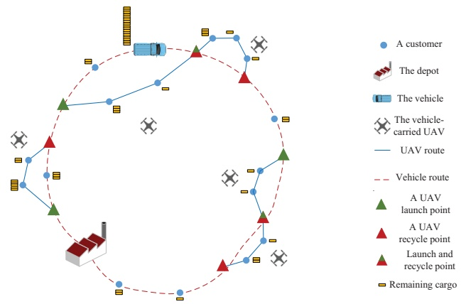

Fig. 1. Illustration of truck-drone cooperative parcel delivery.

This paper investigates a novel hybrid truck-drone cooperative parcel delivery problem, wherein M trucks, each carrying one UAV, together with N independent UAVs, cooperate to deliver parcels to customers distributed in a wide region. With three kinds of delivery platforms involved, the routing problem is quite challenging. The first challenge lies in efficiently and fairly dividing the customers among the three types of vehicles. In addition, given customers partitioned, the routing problem is another challenge. Since truck-carried drones operate relying on trucks, the routing decisions should be carefully made with joint considerations on scheduling such that the collaboration between trucks and truck-carried drones are elegantly addressed. This includes 4 issues for each pair of truck and its carried drone: 1) How to partition customers between them? 2) How to select locations for the truck to launch and recycle the drone? 3) How to plan routes for them? 4) how to synchronize them?.

To this end, we contribute a novel routing and scheduling algorithm, referred to as Hybrid Truck-Drone Delivery algorithm (HTDD), to solve the hybrid parcel delivery problem. The main contributions of this work are summarized as follows:

The hybrid truck-drone cooperative parcel delivery problem for the dense logistics network is presented. As the formulated delivery problem of the truck-carried UAV with trucks seems very restrictive, the flight range of the truck-carried UAV is within an elliptical range which is referred to as a flight segment to facilitate this complicated problem. By making full use of this geometry method, there are an appropriate number of customers selected for the truck-carried UAVs and two or more APs for the truck in the flight segment. Comparing with the truck-carried UAVs, the independent UAVs have the larger payloads and remarkable flight endurance in the delivery. While the predominant features of truck-carried UAVs are high mobility, low cost and easy to operate. To balance the independent UAVs and trucks makespans and optimize the global delivery routes, we apply a scheduling strategy to redistribute the delivery tasks which the total time can be minimized.

The remainder of the paper is organized as follows: Section 2 discusses related work on the vehicle routing problem and UAV parcel delivery problem. Section 3 formulates the hybrid truck-drone cooperative parcel delivery problem. Section 4 describes the proposed algorithm in detail. Section 5 presents a performance evaluation study, with conclusions following in Section 6.

## II. RELATED WORK

A large number of studies on optimization approaches for UAV-based civil applications have been reported in the literature. Otto et al. [9] provided a comprehensive survey on this topic. Motlagh et al. [8] reviewed low-altitude UAV-based IoT applications, with an emphasis on UAV surveillance and communications. Another work [11] investigated an automated drone delivery system in which drones can lift multiple packages within a service area. Besides, [15] provided an exhaustive review of various 5G techniques based on UAV platforms and categorized different domains including physical layer, network layer, and joint communication, computing, and caching. According to the surveys [9], [8], [16], we can observe that UAVs are superior in various civil applications, such as sensing and delivery, and have been widely deployed in reality in recent few years.

Recently, the routing problems for UAV-based parcel delivery have received much attention. Choi et al. [11] dealt with an automated UAV delivery system. In the system, they assumed that UAVs can lift multiple packages within its maximum payload and serve recipients in a service area of given radius, which indicated that such services are becoming practical. To minimize cost or delivery time ulteriorly, [14] proposed the only drone delivery problems (DDPs), while considering battery weight, payload weight, and drone reuse, and implemented them as mixed integer linear programs. Inspired by the above literatures, the use of drone to perform multiple missions per sortie has translated into reality in the delivery system. Nevertheless, due to constrained battery capacities, the hovering time of UAVs is still insufficient, prohibiting them from independently serve a wide area.

Given the limited hovering time of UAVs, to construct large-scale UAV delivery systems, researchers consider to simultaneously use both trucks and drones. Recently, the optimization problem for truck-drone cooperative parcel delivery has received much attention. Mathew et al. [13] presented a novel adaptation of a heterogeneous carrier-vehicle system. It mainly used for cooperative deliveries in urban environments. Murray et al. [17] formulated a Flying Sidekick Traveling Salesman Problem (FSTSP) for truck-drone parcel delivery. The authors presented simple heuristics based on VRP formulations for two truck-drone parcel delivery problems. Ponza [18] proposed an improved mathematical formula and simulated annealing solution to solve FSTSP. Savuran et al., [19] determined the UAV take-off and land-on locations with a route based on the Genetic Algorithm (GA) which minimizes the total tour length. To investigate the time and energy associated to a truck-drone delivery network, Ferrandez et al. [20] optimized the drone travel time and travel distances, as well as provided new heuristic solutions for path planning. Campbell et al. [7] derived continuous approximation models for travel cost and travel time of hybrid truck-drone delivery to facilitate a strategic analysis of the design for drone delivery systems. Another work [21] derived a number of worst-case results on VRP with drones, i.e., the maximum savings that can be obtained from using drones. Notice that all the aforementioned studies on UAV-based delivery optimization only employ either independent UAVs or truck-carried UAVs. In contrast, in this paper we propose to simultaneously employ both independent UAVs and truck-carried UAVs to construct a more efficient UAV-based parcel delivery system.

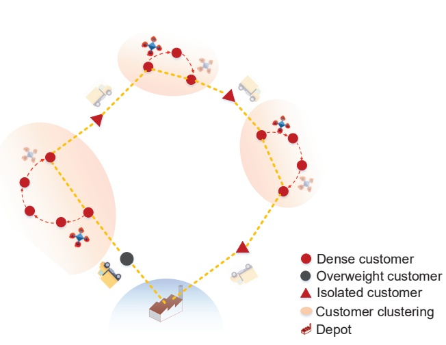

Fig. 2. Illustration of customer clustering.

It may be noticed that all the aforementioned papers on the routing of UAV-based delivery deal with Traveling Salesman Problems (TSP) [22] and Vehicle Routing problems (VRP) [23]. The classical VRPs customarily consider one type of vehicles. When we consider two types of vehicles, the routing problems are so-called Two-Echelon Vehicle Routing Problems (2E-VRP) [24]. The 2E-VRP literature aims to find a set of primary and secondary routes in a two-echelon distribution system such that two types of vehicles (primary and secondary vehicles) can serve all customers while the system cost is optimized. Based on the 2E-VRP model, few recent works studied the routing problem for truck-drone cooperative sensing. Luo et al. [25] proposed two heuristics to solve the problem: the first heuristic builds a complete tour for all customers and splits it by ground truck routes; the second constructs the ground truck tour and allocates UAV flights to the tour. Hu et al. [5] proposed to utilize a truck carrying multiple UAVs to perform sensing tasks over a target area. Peng et al. [26] proposed a route optimization method for a carrier-launched UAV system based on the hybrid genetic algorithms. In [5] and [26] the truck must wait while the UAVs are serving the customers. Accordingly, Hu et al. [27] addressed a truck-assisted much-drone sensing problem wherein the UAVs are allowed to be launched and recycled at different locations to promote the efficiency.

## III. PROBLEM FORMULATION

As shown in Fig. 1, we consider a hybrid parcel delivery network comprising of one depot, a set of customers and multiple trucks together with two types of UAVs. In this scenario, M trucks, each carrying one drone, together with N independent drones, cooperate to deliver parcels from the depot to the customers distributed in a wide region. That is, every customer must be served either by a truck or by a drone. The M trucks with M truck-carried drones depart from the depot and sequentially visit customers. When the trucks temporarily stay at an anchor point (AP), the truck-carried UAV is launched to server nearby customers. Meanwhile, the N independent UAVs take off directly from the depot and deliver parcels to the customers.

The following parameter notations are employed by the problem formulation. Let $S = \{1, 2, ..., c\}$ denote the set of all customers and $S_{ap}$ denotes the set of APs that may be visited by the truck. Analogously, the parameters $S_{su}$ and $S_{lu}$ represent the subset of customers served by the truck-carried UAV and the independent UAV respectively. Considering the existence of a single physical depot location, 0 and $c + 1$ both represent the same depot but are duplicated to represent the starting and returning point. Thus, the parameter $S_{all} = \{0, 1, 2, ..., c + 1\}$ denotes the set of all nodes in the network. Let $M = \{M_1, M_2, ..., M_c\}$ denote the parcel weight of customers, where the $M_1$ represents the parcel weight of first customer. The speed of truck, truck-carried UAV and the independent UAV are denoted as $V_{vh}$, $V_{su}$ and $V_{lu}$ respectively. Besides, let $M_{max}^{su}$ and $M_{max}^{lu}$ represent the maximum payloads of the truck-carried UAV and independent UAV. $D_{max}^{su}$ and $D_{max}^{lu}$ denote the flight endurance of the truck-carried UAV and the independent UAV respectively. In general, the objective is to jointly optimise customer allocations, route planning, and route assignments for the trucks and drones such that all the demands of the customers are satisfied while the total finish time is minimized.

The routing problem of $M$ trucks with limited payload capacities can be modeled as capacitated vehicle routing problems (CVRP). Our hybrid parcel delivery problem thus consists of CVRP as a sub-problem. Since CVRPs are NP-hard and have been comprehensively addressed in the last decades, we simply apply heuristic solutions [23] to address CVRPs. With $M$ trucks involved, their routes can be denoted as $R_0 = \{R_1, R_2, ..., R_r, ..., R_M\}$, where $R_r (r = 1, 2, ..., M)$ represents $M$ different routes. To improve the efficiency of UAVs package delivery, the customers in the region are clustered according to the customers density by adopting the Density clustering-Based Algorithm DBSCAN. The result of clustering is denoted as the set $C = \{C_1, C_2, ..., C_k\}$, where $C_1$ represents the first cluster which contains a certain number of customers. The partial customers who are far away from other customers are addressed as isolated customers. The customers are marked as overweight customers whose parcels weight exceed the truck-carried UAV payloads, as shown in Fig. 2.

TABLEI NOTATION AND TERMINOLOGY

| Notation | Definition |
| --- | --- |
| S | a set of customers to be served |
| $S_{su}$ | a set of customers to be served by the truck-carried UAV |
| $S_{lu}$ | a set of customers to be served by the independent UAV |
| $S_{vh}$ | a set of customers to be served by the truck |
| $S_{ap}$ | a set of APs |
| $V_{vh}$ | the speed of the truck |
| $V_{su}$ | the speed of the truck-carried UAV |
| $V_{lu}$ | the speed of the independent UAV |
| $M_{max}^{su}$ | the maximum payload of the truck-carried UAV |
| $D_{max}^{su}$ | the hovering distance of the truck-carried UAV |
| $M_{max}^{lu}$ | the maximum payload of the independent UAV |
| $D_{max}^{lu}$ | the hovering distance of the independent UAV |
| C | the result of clustering customers |
| seg | the result of segmenting customers of the clusters |
| $l_{vh}^{segi}$ | the truck's route length in a flight segment |
| $l_{su}^{segi}$ | the truck-carried UAV's route length in a flight segment |
| $l_{R_{lu}^{i}}$ | a route length of the independent UAV |
| $l_{R_{vh}^{i}}$ | a route length of the truck |
| $\rho_{vh}$ | unit travelling cost of the truck |
| $\rho_{lu}$ | unit flying cost of the independent UAV |
| $y_{R_{lu}^{i}}(n_{p},n_{q})$ | binary indicating whether $n_{p}$ is next to $n_{q}$ in $R_{lu}^{i}$ |
| $z(R_{vh}^{i},segi)$ | binary indicating whether $Seg_{i}$ is assigned to $R_{vh}^{i}$ |
| $d_{np,n_{q}}$ | the euclidean distance between $n_{p}$ and $n_{q}$ |
| $T^{segi}$ | the total time in one flight segment |
| $R_{vh}$ | the routes of the truck |
| $R_{lu}$ | the routes of the independent UAV |
| $T_{lu}$ | the total time of the independent UAV |
| $T_{vh}$ | the total time of the truck |
| Z | the overall objective function |

## A. The cost in the flight segment

To allocate the parcels to trucks and UAVs properly, a set of flight segments are constructed which contain two or more APs for the truck and multiple customers served by the truck-carried UAV. The set of flight segment are denoted as  $seg = \{seg_{1}, seg_{2}, ..., seg_{m}\}$ , where  $seg_{1}$  represents first segment according to the payloads and endurance. Thus, the routes of the truck are denoted as  $R_{vh}$ . The routes of the truck-carried UAVs and the truck in the flight segments are denoted as set  $R_{su}^{seg} = \{R_{su}^{seg_{1}}, R_{su}^{seg_{2}}, ..., R_{su}^{seg_{m}}\}$  and set  $R_{vh}^{seg} = \{R_{vh}^{seg_{1}}, R_{vh}^{seg_{2}}, ..., R_{vh}^{seg_{m}}\}$ , where  $R_{su}^{seg_{1}}$  represents the routes of truck-carried UAVs and  $R_{vh}^{seg_{1}}$  represents the routes of truck in the first segment.

In addition, an auxiliary decision variable is required. The formula $y_{vh}(n_p, n_q) \in \{0, 1\}$ equals one if the customer node $n_p$ is right next to customer $n_q$. The purpose of this variable is to denote whether the route of truck covers the customers nodes. So, let $y_{vh}^{seg_i}(n_p, n_q)$ where $n_p$ and $n_q \in seg_i$ denote, whether the customer $n_p$ is right next to the customer $n_q$ for the truck's route in the flight segment $seg_i$ ($y_{vh}^{seg_i}(n_p, n_q) = 1$) or not ($y_{vh}^{seg_i}(n_p, n_q) = 0$). In addition, $d_{n_p n_q}$ represents the distance between $n_p$ and $n_q$. Hence, the route length of the truck and the truck-carried UAV in the flight segment are defined as follows:

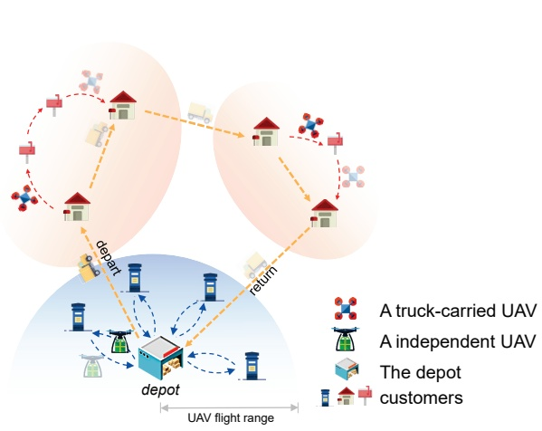

Fig. 3. Illustration of global delivery.

$$
l _ {v h} ^ {s e g _ {i}} = \sum_ {n _ {p} \in s e g _ {i}} \sum_ {n _ {q} \in s e g _ {i}} y _ {v h} ^ {s e g _ {i}} (n _ {p}, n _ {q}) d _ {n _ {p} n _ {q}}\tag{1}
$$

$$
l _ {s u} ^ {s e g _ {i}} = \sum_ {n _ {p} \in s e g _ {i}} \sum_ {n _ {q} \in s e g _ {i}} y _ {s u} ^ {s e g _ {i}} (n _ {p}, n _ {q}) d _ {n _ {p} n _ {q}}\tag{2}
$$

The time consumption of the truck-carried UAV and the truck in the flight segment  $seg_{i}$  are denoted as  $T_{su}^{seg_{i}}$  and  $T_{vh}^{seg_{i}}$  respectively. Since the total time of the delivery in the flight segment  $seg_{i}$  is the longest delivery time of the truck-carried UAV and the truck, the total time consumption is defined as follows:

$$
T ^ {s e g _ {i}} = m a x \{T _ {s u} ^ {s e g _ {i}}, T _ {v h} ^ {s e g _ {i}} \} = m a x \{\frac {l _ {s u} ^ {s e g _ {i}}}{V _ {s u}}, \frac {l _ {v h} ^ {s e g _ {i}}}{V _ {v h}} \}\tag{3}
$$

According to the literature [28], the relationship between payload and energy consumption of the UAV can be expressed by Equation (4). In Equation (4), let  $\eta$  denote the conversion efficiency of the motor; the parameter  $\gamma$  is the lift ratio; the energy loss of the drone battery is expressed as e; the parameters i and j are the customer nodes. We assume that the drone has the self-weight  $w_{d}$  and payload  $G_{i}$ . To facilitate the problem, we ignore the change of weight of the truck-carried UAVs when they drop parcels at different customers. Therefore, the energy consumption of the truck-carried UAV and truck in the segment are as shown Equation (5).

$$
W _ {i j} = (w _ {d} + G _ {i}) \frac {d _ {i j} P}{3 7 0 \eta \gamma (P - e)}\tag{4}
$$

$$
Z _ {s g e _ {i}} = (w _ {d} + G _ {i}) \frac {l _ {s u} ^ {s e g _ {i}} P}{3 7 0 \eta \gamma (P - e)} + \rho_ {v h} l _ {v h} ^ {s e g _ {i}}\tag{5}
$$

SUBMISSION TO IEEE INTERNET OF THINGS JOURNAL

## B. The cost in the global routes

In the global routes construction, customers in the segments and some isolated customers are assigned to the independent UAV for the global routes optimization. Let  $R_{lu} = \{R_{lu}^{1}, R_{lu}^{2}, ..., R_{lu}^{n}\}$  represent the routes for the independent UAV, where  $R_{lu}^{1}$  represents the first route delivered by the independent UAV. The total distance of the independent UAV and the time consumption are defined as follows:

$$
l _ {R _ {l u} ^ {i}} = \sum_ {n _ {p} \in S _ {l u}} \sum_ {n _ {q} \in S _ {l u}} y _ {R _ {l u} ^ {i}} (n _ {p}, n _ {q}) d _ {n _ {p} n _ {q}}\tag{6}
$$

$$
T _ {l u} = \sum_ {R _ {l u} ^ {i} \in R _ {l u}} \frac {l _ {R _ {l u} ^ {i}}}{V _ {l u}}\tag{7}
$$

The energy consumption of the independent UAV is defined as follows:

$$
Z _ {l u} = \rho_ {l u} \times l _ {R _ {l u} ^ {i}}\tag{8}
$$

For global analysis of the truck routes, the total distance is composed of two parts: the travel distance between APs and the travel distance in the flight segment. Let  $y_{R_{vh}^{i}}(n_{p}, n_{q})$  denote whether the two APs  $n_{p}$  and  $n_{q}$  are adjacent in the route  $R_{vh}^{i}(y_{R_{vh}^{i}}(n_{p}, n_{q}) = 1)$  or not ( $y_{R_{vh}^{i}}(n_{p}, n_{q}) = 0$ ), where  $R_{vh}^{i}$  represent the route travelled by the truck, and  $n_{p}, n_{q} \in S_{ap}$ . We utilize  $x(n_{p}, n_{q})$  to indicate whether the two APs are within the same flight segment ( $x(n_{p}, n_{q}) = 0$ ) or not ( $x(n_{p}, n_{q}) = 1$ ). Therefore, the distance between APs in the route  $R_{vh}^{i}$  can be formulated as follows:

$$
l _ {v h} ^ {a p} = \sum_ {n _ {p} \in S _ {a p}} \sum_ {n _ {q} \in S _ {a p}} y _ {R _ {v h} ^ {i}} (n _ {p}, n _ {q}) x (n _ {p}, n _ {q}) d _ {n _ {p} n _ {q}}\tag{9}
$$

The energy consumption of the truck between APs is defined as follows:

$$
Z _ {a p s} = \rho_ {v h} l _ {v h} ^ {a p}\tag{10}
$$

Let $z(R_{vh}^{i}, seg_{i})$ where $R_{vh}^{i} \in R_{vh}$ and $seg_{i} \in seg$ denote, whether the segment $seg_{i}$ is assigned to the route $R_{i}$ ($z(R_{vh}^{i}, seg_{i}) = 1$) or not ($z(R_{vh}^{i}, seg_{i}) = 0$). Besides, the total travel time of the truck $T_{vh}$ comprises two parts: the travel time between APs and the time in the flight segment. As a result, the total distance and the travel time of truck are defined as follows:

$$
l _ {R _ {v h} ^ {i}} = \sum_ {s e g _ {i} \in s e g} z (R _ {v h} ^ {i}, s e g _ {i}) l _ {v h} ^ {s e g _ {i}} + l _ {v h} ^ {a p}\tag{11}
$$

$$
T _ {v h} = \sum_ {R _ {v h} ^ {i} \in R _ {v h}} (\frac {l _ {v h} ^ {a p}}{V _ {v h}} + \sum_ {s e g _ {i} \in s e g} z (R _ {v h} ^ {i}, s e g _ {i}) T ^ {s e g _ {i}})\tag{12}
$$

## C. Global Problem Formation

The total energy consumption of the delivery system is expressed as follows:

$$
Z _ {a l l} = \sum_ {s e g _ {i} \in s e g} Z _ {s g e _ {i}} + Z _ {a p s} + Z _ {l u}\tag{13}
$$

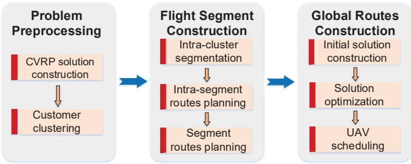

Fig. 4. Flowchart of HTDD

Since the independent UAV and the truck can deliver the packages to the customers at the same time, the time while the truck and independent UAV have served all customers in the region and return to the depot is defined as  $max\{T_{lu}, T_{vh}\}$ . With the above analysis, the hybrid truck-UAV cooperative parcel delivery problem can be formulated as follows:

$$
Z = \min \{\max \{T _ {l u}, T _ {v h} \} \}\tag{14}
$$

s.t.

$$
l _ {s u} ^ {s e g _ {i}} \leq D _ {m a x} ^ {s u} \quad \forall s e g _ {i} \in s e g\tag{15}
$$

$$
l _ {R _ {l u} ^ {i}} \leq D _ {m a x} ^ {l u} \quad \forall R _ {l u} ^ {i} \in R _ {l u}\tag{16}
$$

$$
\sum_ {c _ {i} \in S _ {s u}} p (c _ {i}, R _ {s u} ^ {\text {seg} _ {i}}) M _ {i} \leq M _ {m a x} ^ {s u} \quad \forall R _ {s u} ^ {\text {seg} _ {i}} \in R _ {s u} ^ {\text {seg}} (1 7)
$$

$$
\sum_ {c _ {j} \in S _ {l u}} p (c _ {j}, R _ {l u} ^ {i}) M _ {i} \leq M _ {m a x} ^ {l u} \quad \forall R _ {l u} ^ {i} \in R _ {l u}\tag{18}
$$

Table I summarizes the notations and terminology used through the paper, Constraint (11) and (12) guarantee that the length of a route cannot exceed the limit of flight endurance of the UAV (including truck-carried UAV and the independent UAV). In constraint (17), the first term $p(c_i, R_{su}^{seg_i})$ is an auxiliary decision variable, which belongs to 0, 1. For the routes of truck-carried UAV, the parameter $p(c_i, R_{su}^{seg_i})$ equals one if the customer node is on the segment. Constraint (17) and (18) ensure that the total weight of all customers' parcels on each route will not exceed the UAV's payloads limit.

## IV. THE ALGORITHM

This section describes the algorithm designed to solve the problem how to efficiently exploit the complementary capabilities of the multiple vehicle types to deliver parcels. The conventional approach can only solve problems with a very small number of customer nodes. That is because the hybrid truck-drone cooperative parcel delivery problem is NP-hard as it generalizes other known NP-hard problems, such as the Capacitated VRP (CVRP). It would become much more difficult to explore the solution space as the size of the instance increases, which means the massive problem cannot be solved by the corresponding approach. In this case, efficient heuristic algorithms are developed.

To improve efficiency of the delivery and conquer the limit of UAV coverage, the $M$ trucks with $M$ UAVs is employed to depart from the depot, successively serve the customers and return to the depot. In the whole delivery process, the truck-carried UAV can visit multiple customers within the UAVs' flight range after being launched from the truck. Meanwhile, the N independent UAVs take off from the depot and deliver parcels to the customers independently, as is shown in Fig.3. The procedure to solve the combinatorial problem is given below:

The HTDD comprises three steps, as shown in Fig. 4: 1) problem preprocessing; 2) flight segment construction; 3) global routes construction. To simplify combinatorial optimization problem firstly, the parcels of customers are delivered by the trucks due to the large number of customers in the region. Thus, the multiple routes of the truck are constructed according to the payloads limit of the truck, which can be viewed as a CVRP. After solving the CVRP, customers on the each route are selected to be delivered by the truck-carried UAV or the truck.

Additionally, by using the DBSCN algorithm, the customers are clustered to construct flight segment to enhance the ability of UAVs' delivery. To select the suitable number of customers served by the UAVs, the range of the flight segment is adjusted by the parameters. Meanwhile, the rational locations of takeoff and landing are selected for the truck-carried UAV in the segment. Finally, the independent UAVs are utilized to cooperate with the truck for delivery. To obtain the optimal global routes, the algorithm utilizes a modified iterative local search algorithm to search the neighborhood of the initial solution. Furthermore, delivery tasks are redistributed to balance the time of the UAVs and the trucks. The above UAV scheduling improves the efficiency of the UAVs and reduces the cost of delivery.

## A. Problem Preprocessing

1) CVRP Solution Construction: At the beginning of the algorithm, the procedure starts by solving a CVRP that assigns M trucks to visit all customers in the region. In a CVRP, it aims to find M or less truck routes to visit each customer exactly once while the total trip distance is minimum. Accordingly, the CVRP has been the subject of intensive research since the 1960s. Numerous exact methods are presented in the literature.

To obtain the initial solution of multiple routes, the Clarke and Wright savings algorithm (C-W algorithm) is applied to solving the CVRP [24]. Particularly, the basic idea of this algorithm is to calculate the distance from a customer to the depot  $d_{0i}(i = 1, 2, ..., N)$ , as well as to generate N loops for N customers. By merging the loops in the route, the total length of the route is minimized. However, if the total parcel weight of the route exceeds the payloads of the truck, the combination process is terminated, and a new route is merged by the loop. By repeating this process, multiple routes of the truck are obtained, which greatly simplifies the combinatorial problem and improves the efficiency.

Additionally, the tabu search algorithm is used to optimize the solution. 1) inter-route optimization: from the initial solution $R = \{R_1, R_2, ..., R_r, ..., R_M\}$, two routes are randomly selected to be adjusted by adopting the interpolation, exchange, or 2-opt\* algorithm. 2) intra-route optimization: the selected customers are adjusted randomly by the 2-opt algorithm. In this way, we can obtain the optimal solution by means of multiple iterations.

Algorithm 1: dbscan()
Input: $S = \{1, 2, ..., c\}$;
Output: $C = \{C_1, C_2, ..., C_k\}$, Noise nodes set $S_N$;
$C, S_{ap} \leftarrow \varnothing$;
$k \leftarrow 0, \varepsilon \leftarrow M_{max}^{su}, minPts \leftarrow 2, S' \leftarrow S$;
for $c_i \in S$ do
    $c_i \leftarrow unvisited$;
for $c_i \in S', c_i = unvisited$ do
    obtain the number $neps$ of the customers in the $\varepsilon$ neighborhood of $c_i$;
    if $neps &lt; minPts$ then
        $c_i \leftarrow visited$;
        $S_N \leftarrow S_N \cup \{c_i\}$;
    else
        $k \leftarrow k + 1$;
        create a new cluster $C_k$ and add all the customers in the $\varepsilon$ neighborhood of $c_i$ to it;
        for $c_j \in C_k, c_j = unvisited$ do
            obtain the number $neps$ of customers in the $\varepsilon$ neighborhood of $c_j$;
            if $neps &gt; minPts$ then
                $c_j \leftarrow visited$;
                add the new customers in the $\varepsilon$ neighborhood of $c_i$ to $C_k$;
            else
                $c_j \leftarrow visited$;
    $C \leftarrow C \cup C_k$;
return $C = \{C_1, C_2, ..., C_k\}, S_N$;

2) Clustering Customers: To improve the efficiency of delivery, the DBSCAN algorithm is applied to clustering the customers on each route $R_1, R_2, ..., R_r, ..., R_M$. Considering that the truck-carried UAV's payloads and flight endurance are limited, the overweight customers and the isolated customer must be delivered by the truck, which should be placed in set $S_{ap}$. The DBSCAN algorithm accepts a radius value $\text{Eps}(\varepsilon)$ based on a defined distance measure and a value $minPts$ for the number of minimal points that should occur within Eps radius [29]. Some concepts and terms to explain the DBSCAN algorithm can be defined as follows:

Neighborhood: It is determined by a distance function (e.g., Manhattan Distance, Euclidean Distance) for two points p and q, which is denoted by  $d(p,q)$ .

Eps-neighborhood: The Eps-neighborhood of a point $p$ is defined by $\{q \in S | d(p, q) \leq Eps\}$

Core object: A core object refers to such point that its neighborhood of a given radius (Eps) has to contain at least a minimum number (minPts) of other points.

Noise object: We define noise as the set of points in the set S not belonging to any cluster.

Let  $\mathrm{Eps}(\varepsilon)$  equal to the flight range of the truck-carried UAV  $D_{max}^{su}$ . Moreover, let minPts equal to two, which ensures that the Eps-neighborhood of a core point contains at least two customers. The noise nodes are the isolated customers by definition, who are not belong to any cluster in the region.

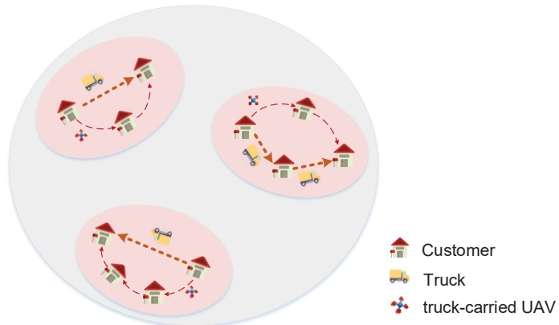

Fig. 5. Illustration of flight segment construction.

The clustering procedure is explained in Algorithm 1. Firstly, all customer nodes in the region whose parcels are not overweight are set to be unvisited and denoted by $S'$. Secondly, an unvisited customer node is randomly selected from $S'$ and set to be visited. if its neighborhood of $D_{max}^{su}$ contains at least two customers, the customer node is marked as the core point. The core point forms a cluster with other nodes in the Eps-neighborhood $D_{max}^{su}$, and the nodes in the cluster are set to be visited. Otherwise, the node is marked as a noise point which represents the isolated customer. This process are repeated until there is no unvisited node in $S'$. Finally, the set $S'$ is divided into cluster set $C = C_1, C_2, \ldots, C_K$ and isolated customer set $S_N$. Generally speaking, all the customers $S$ in the region are divided into three parts: overweight customers; isolated customers; several clusters. The time complexity of DBSCAN is $O(N \times T)$ where $T$ is the time to find required points in Eps domain. The next step is to select propel customers and plan routes for the truck-carried UAV in consideration of its maximum distance and weight capacity.

## B. Flight Segment Construction

The truck-carried UAV is employed in conjunction with the truck to optimize the time of delivery. The procedure of segmentation comprises the following three steps: intra-cluster segmentation, intra-segment planning routes, segment planning routes. In a cluster, some segments are constructed with the available APs and the proper customers by calculating the flight range and capacity of a truck-carried UAV. Then, the special customers are allocated to the truck-carried UAV and two suitable customer locations are selected to be the APs in a segment, where the truck stops and launches the truck-carried UAV. At the same time, we can obtain the optimal routes for the truck and the truck-carried UAV in a segment after solving the TSP. Moreover, the heuristic algorithm is used to allocate the parcels of customers and optimize the routes of the truck-carried UAVs with the truck. The result of flight segment construction is shown in Fig. 5.

1) Intra-cluster Segmentation: There are two APs A and B in the ellipse as shown in Fig. 6. A truck-carried UAV is launched from point A and returns at point B, which the truck travels from A to B in the meantime. The solid line between A and B is the travel route of the truck, and the dotted line is the flight route of the truck-carried UAV. Due to the flight endurance  $D_{max}^{su}$ , the flight range of the truck-carried UAV is within an elliptical range. Such flight range is referred to as flight segment, which consists of at least two APs and proper customers served by the truck-carried UAV. The parameters of the ellipse are as follows:

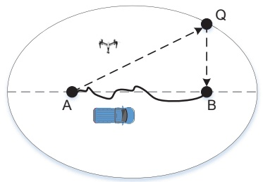

Fig. 6. Illustration of a flight segment.

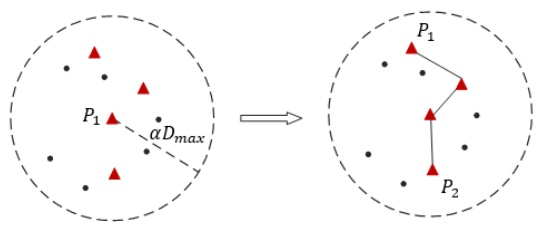

Fig. 7. Illustration of multiple APs in a circle.

$$
d _ {Q A} ^ {A} + d _ {Q B} ^ {B} = D _ {m a x} ^ {s u}, d _ {A B} ^ {A} <   D _ {m a x} ^ {s u}\tag{19}
$$

We adjust the parameters of the ellipse, where the parameters  $\alpha$  and  $\beta$  are used to adjust the size of a flight segment. Therefore, the number of customers in the flight segment is moderate by adjusting the parameters as follows:

$$
d _ {A B} ^ {v} = \alpha D _ {m a x} ^ {s u}, | d _ {Q A} ^ {v} + d _ {Q B} ^ {v} | = \beta D _ {m a x} ^ {s u}, 1 \geqslant \beta > \alpha > 0\tag{20}
$$

The procedure of segment is explained in Algorithm 2. The time complexity of obtaining flight-segment is $O(i*k)$ where $i$ is the number of customers in the cluster; $k$ is the number of segments. The customers in the cluster $C_i$ is denoted as $S_i = \{1, 2, ..., N_i\}$, in which the customers marked as unvisited are denoted with the parameter $S_{unv}$. The customer with the maximum parcel weight in $S_{unv}$ is regarded as an initial customer node $P_1$, which is treated as a focus of the ellipse. Consequently, seeking another focus (AP) to determine the flight segment proves to be vital in Algorithm 2. It includes the following steps:

a) Taking $P_{1}$ as the center and $\alpha D_{max}^{su}$ as the radius to draw a circle, in which another focus are included.

b) If there exists one or more APs in a circle, as shown in Fig.7, the nearest neighbor method is used to connect these APs in sequence. The two endpoints are denoted as  $P_{1}$  and  $P_{2}$  respectively. Otherwise, new APs should be selected from unvisited customer and three situations are discussed:

\- No Unvisited Customer: The radius of the circle is expanded until an unvisited customer is sought which is

SUBMISSION TO IEEE INTERNET OF THINGS JOURNAL

Algorithm 2: obtain_flight-segment()
Input: $S_i = \{1, 2, ...N_i\}$ in the $C_i$;
Output: $Seg = \{Seg_1, Seg_2, ..., Seg_k\}$;
begin initialize $\alpha, \beta$;
$k \leftarrow 0$ $Seg \leftarrow \varnothing$ $S_i \leftarrow C_i$ $S_c \leftarrow \varnothing$ $S'_{ap} \leftarrow S_{ap}$;
for $C_i \in S_i$ do
    $S_i \leftarrow \text{unvisited}$;
$Sunv \leftarrow S_i$ ;
while $Sunv \neq \varnothing$ do
    $P_1 \leftarrow M_{max}$;
    form a circle with $P_1$ as center and $\alpha D_{max}^{su}$ as radius;
    obtain customers in the circle with $S_c$;
    obtain number of customers in the circle with $t$;
    $S_{temp1} \leftarrow S_c \cap S'_{ap}$;
    if $S_{temp1} \neq \varnothing$ then
        for $c_j \in S_{temp1}$ do
            $k \leftarrow k + 1$;
            $P_2 \leftarrow c_j$;
            $Seg_k \leftarrow S_{ellipse}$; $Seg_k \leftarrow \text{visited}$;
    else
        $S_{temp2} \leftarrow S_c \cap S_{unv}$;
        if $S_{temp2} = \varnothing$ then
            expand radius to $D_{max}^{su}$, repaeat;
            obtain customers in the circle $S'_c$;
            $S_{temp2} \leftarrow S_c \cap S_{unv}$;
            if $S_{temp2} \neq \varnothing$ then
                $t = 0$;
                $k \leftarrow k + 1$;
                select the closest customer to $P_1$ as $P_2$;
                $Seg_k \leftarrow S_{ellipse}$; $Seg_k \leftarrow \text{visited}$;
            else
                $t = 1$;
                $k \leftarrow k + 1$;
                $P_2 \leftarrow S_{temp2}$;
                $Seg_k \leftarrow S_{ellipse}$; $Seg_k \leftarrow \text{visited}$;
            continue;
        else
            $t \geq 2$;
            $k \leftarrow k + 1$;
            Constitutive $P_2 \leftarrow maxS_{ellipse}$;
            $Seg_k \leftarrow S_{ellipse}$; $Seg_k \leftarrow \text{visited}$;
return $Seg = Seg_1, Seg_2, ..., Seg_k$;

denoted as $P_{2}$

\- Only One Unvisited Customer: The only one unvisited customer is denoted as $P_{2}$.

\- Multiple Unvisited Customers: Many ellipses are obtained, of which foci are the unvisited customer and $P_{1}$. Comparing the amount of the unvisited customers in each ellipse, $P_{1}$ and $P_{2}$ construct the largest amount ellipse.

c) We mark all customers in the flight segments as visited and remove them from  $S_{unv}$ . If  $S_{unv}$  becomes empty, it means that all the customers are assigned into flight segments.

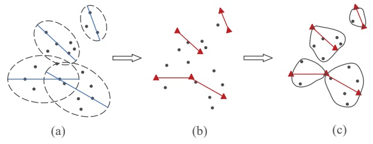

Fig. 8. Illustration of segment construction.

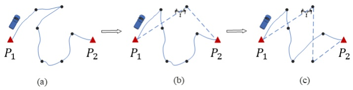

Fig. 9. Assignment of customers in a flight segment.

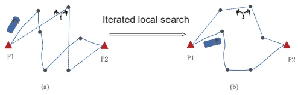

Fig. 10. Illustration of final routes in a flight segment.

Otherwise, treating  $P_{1}$  and  $P_{2}$  as the new initial customer respectively and repeating the step a) until  $S_{unv}$  is empty. Then, the set of segment is obtained.

d) Considering that different flight segments may contain the same customer, it is necessary to redistribute the customer to the flight segment. By calculating the distance from customer to the two APs in each flight segment, customers are assigned to the proper flight segment at a minimum cost, as shown in Fig. 8.

2) Intra-Segment Planning Routes: After redistributing the customers to the flight segment, the problem of path planning in a flight segment need to be solved. Notice that all the customers in a segment are reachable for the truck-carried UAV according to our definition. In a segment, we assume that all the customers are visited by the truck firstly, which can be regarded as an open-loop TSP, as shown in Fig.9 (a). The difference between open-loop TSP and TSP is only the terminal point, which the flow of the solution is similar.

Insertion method was proposed by Rosenkrantz [30], which is an efficient and low-complexity algorithm for solving TSP problem. Thus, we can solve open-loop TSP with the insertion method and get an initial route of truck $R_{vh}$ in a segment. Then, the procedure considers each UAV-eligible customer and determines the savings associated with removing that customer from its position in the truck's route until the truck-carried UAV's payloads and flight endurance exceed the permission, as shown in Figure.9 (b) and (c).

To optimize the initial solutions  $R_{vh}^{seg}$  and  $R_{su}^{seg}$ , the iterated local search (ILS) algorithm continuously performs a local search on the neighborhood of the current solution, as shown in the Fig.10. Then, ILS perturbs the solution and re-seeks the local optimal solution until reaches a certain number of iterations. To expand the range of local search, three types of neighborhood structures are employed: inter-route insertion, inter-route swap, and 2-opt\*, as shown in Algorithm 3. The time complexity of planning segment-route(seg) is equals to the complexity of solving TSP which is $O(2^n n^2)$, where $n$ is the customers in a segment.

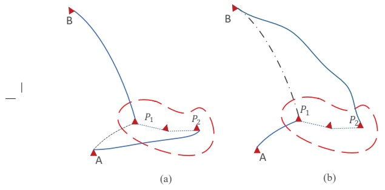

Fig. 11. Illustration of routes between flight segments.

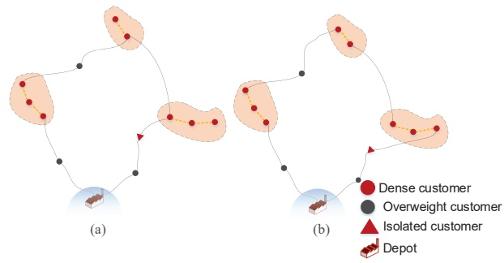

Fig. 12. Adjustment of flight segment routes.

3) Segment Planning Routes: After the procedure of clustering and segmentation, all the customers in the region are divided into some segments and isolated customers. To minimize the delivery time and reduce the energy costs, the segments, isolated customers, overweight customer nodes and depot are connected to form the global routes, which can be regarded as the TSP, as shown in Fig. 11(a). To uniformly denote flight segments, the algorithm abstracts the flight segment as a flight segment node. Notice that the flight segment contains two endpoint as the APs, which the flight segment node is located at the farthest node from the depot.

By solving TSP [31], the shortest path between all the segments and customer nodes in the region are constructed. There is a possible scenario where only one endpoint of the segment connects to the path. Therefore, the routes adjacent for the segments need to be optimized as follows: The cost of adjusting the previous path of the segment is defined as  $\Delta d_{1} = d_{AP_{2}} - d_{AP_{1}}$ ; the cost of adjusting the next path of the segment is defined as  $\Delta d_{2} = d_{BP_{2}} - d_{BP_{1}}$ , as shown in Figure. 12.(a) and (b). If  $\Delta d_{1} \leq \Delta d_{2}$ , the previous path of the segment is adjusted to connect to the other endpoint of the segment; otherwise the next path of the segment is adjusted. The global routes between segment and customer nodes after adjustment and optimization is shown in Fig. 11 (b).

Algorithm 3: $plan\_segment-route(seg)$
begin initialize $R_{vh}^{seg}$, $R_{su}^{seg}$;
for $seg_i \in seg$ do
    $T_{vh}^{seg_i}$, $T_{su}^{seg_i} \leftarrow 0$;
    $R_{vh}^{seg_i}$, $R_{su}^{seg_i} \leftarrow \varnothing$;
    $S_{vh}^{seg_i} \leftarrow seg_i$, $S_{su}^{seg_i} \leftarrow \varnothing$;
    $(T_{vh}^{seg_i}$, $R_{vh}^{seg_i}) \leftarrow solveTSP(S_{vh}^{seg_i})$;
    while $T_{su}^{seg_i} &lt; T_{vh}^{seg_i}$ do
        for $c_i \in S_{vh}^{seg_i}$ do
            $S_{temp} \leftarrow S_{vh}^{seg_i} \setminus \{c_i\}$;
            $T_{temp} \leftarrow solveTSP(S_{temp})$;
            select the smallest $T_{temp}$ and the corresponding customer $c_j$;
        $S'_{vh} \leftarrow S_{vh}^{seg_i}$, $S'_{su} \leftarrow S_{su}^{seg_i}$;
        $S_{vh}^{seg_i} \leftarrow S_{vh}^{seg_i} \setminus \{c_j\}$;
        $S_{su}^{seg_i} \leftarrow S_{su}^{seg_i} \cup \{c_j\}$;
        $(T_{vh}^{seg_i}$, $R_{vh}^{seg_i}) \leftarrow solveTSP(S_{vh}^{seg_i})$;
        $(T_{su}^{seg_i}$, $R_{su}^{seg_i}) \leftarrow solveTSP(S_{su}^{seg_i})$;
        if $UAVConstrain(R_{su}^{seg_i}) = 0$ then
            $(T_{vh}^{seg_i}$, $R_{vh}^{seg_i}) \leftarrow solveTSP(S'_{vh})$;
            $(T_{su}^{seg_i}$, $R_{su}^{seg_i}) \leftarrow solveTSP(S'_{su})$;
            break;
        $R_{vh}^{seg} \leftarrow R_{vh}^{seg} \cup R_{vh}^{seg_i}$;
        $R_{su}^{seg} \leftarrow R_{su}^{seg} \cup R_{su}^{seg_i}$;
return $R_{vh}^{seg}$, $R_{su}^{seg}$;

## C. Global Routes Construction

In this section, the algorithm adds the independent UAVs to cooperate with the truck for delivery. As far as we are concerned, planning the routes for the independent UAVs is actually a Distance-Constrained Capacitated Vehicle Routing Problem (DCVRP) [32]. The set of independent UAVs, based on a central depot, has a maximum weight capacity and can travel up to an allowed maximum distance. With the aim of reducing the delivery time of the vehicle system, the problem is to schedule the propel customers to the fleet of independent UAVs. To rationally allocate parcels to the independent UAVs and optimize the global delivery routes, the improved C-W algorithm and iterative local search algorithm are utilized.

1) Initial Solution Construction: As shown in the Fig.13, a circle is drawn with center at the depot and radius equal to the parameter  $D_{max}^{lu}/2$ , which represents the flight range of the independent UAV. Besides, we abstract the dot to represent the isolated customer or other proper AP whose parcel weight are less than or equal to  $M_{max}^{lu}$  and triangles represent customers whose parcels exceed  $M_{max}^{lu}$ . Therefore, the dots in the circle are placed in the set  $S_{lu}$  which is the candidate set for the independent UAVs. The dashed lines are the independent UAV flight routes, and the solid lines are the truck routes.

By using the nearest insertion algorithm to construct the initial routes, the algorithm reassigns individual customers to either the independent UAV or the truck to reduce the total delivery time. The nearest insertion method is easily programmed to run in a time proportional to $n^2$. As is shown in algorithm 4, it firstly selects a customer in the unserved candidate set $S_{lu}$, who has the shortest distance to the depot 0. The depot and the customer $i$ are supposed to form a loop $L$, and all the customers in the loop are regarded as served. The total weight of customer parcels in the loop and the total distances of the loop are denoted by $M_L$ and $D_L$ respectively. Then, each customer will be inserted in turn to the loop that gives the minimum additional cost or distance at that instance. Whenever the $M_L$ and $D_L$ exceed the permit of the independent UAV, the operation of insertion will terminate. Finally, the route of the independent UAV can be constructed by solving TSP [31]. Repeating this procedure, all the available independent UAVs are expected to be employed in the delivery. Obviously, the remainder customers and the segments are able to construct the new routes by the truck, which the consume of the total system is presumed to be decreased. The time complexity of global routes construction is $O\left(N^{*}2^{n}n^{2}\right)$, where $N$ is the number of independent UAVs and $n$ is the number of customers in one loop.

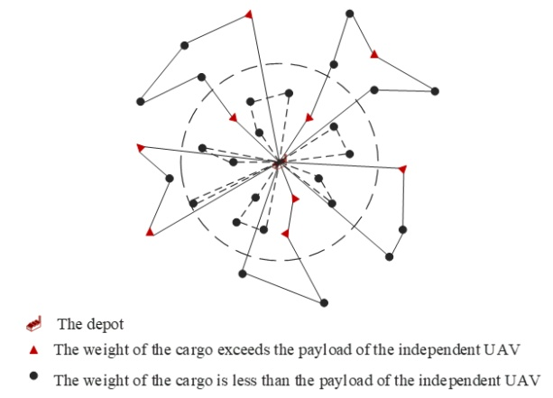

Fig. 13. Illustration of nodes that can be served by an independent UAV.

To balance the travel time of the truck and the independent UAV after constructing the initial solution, some customers from the independent UAV routes are selected to be delivered by the truck, as shown in the Fig.14. The specific algorithm is shown below:

Step 1 calculates the truck remaining capacity $M_r^{res}$ in each route of the truck.

$$
M _ {r} ^ {r e s} = M _ {m a x} ^ {v} - M _ {(R _ {r})}\tag{21}
$$

Step 2 chooses the route with the least increment of the route length as the final insertion result. For a customer $s_k$ in $S_{lu}$ whose weight is $m_k$, the procedure finds all routes with $M_r^{res} \geqslant m_k$ in $R_r$ ($r = 1, 2, ..., M$). If no route is found, it constructs a new route of the truck with $s_k$ by executing step 1). Otherwise, the routes of candidates are obtained. At the same time, we insert $s_k$ into each candidate route, as well as to replan the route by using the method of solving CVRP.

Step 3 repeats the steps 1 and 2, customers served by the independent UAV are reallocated to the truck until the UAV's flight time $T_{lu}$ is greater than the truck's travel time  $T_{v}$ . By comparing the current solution  $\max\{T_{lu}, T_{v}\}$  with the last solution  $\max\{T_{lu}', T_{v}'\}$  with the objective function  $z_{2}$ , the procedure chooses the solution with the shortest time as a final solution.

Algorithm 4: Global Routes Construction
begin initialize independent UAV customers = $S_{lu}$;
vehicle system customers = $C \setminus S_{lu}$;
depot 0 , loop $L \leftarrow \varnothing$;
number of independent UAVs $N$;
for $i \in S_{lu}, N \neq \varnothing$ do
    select $i$ which $d(0, i)$ is minimum ;
    $i \leftarrow served$;
    form a loop $L$ with depot, $i$;
    while $D_L &lt; D_{max}^{lu}$ and $M_L &lt; M_{max}^{lu}$ do
        for $j \in S_{lu}$ do
            select $j$ which is nearest to $i$;
            add it to loop $L, j \leftarrow served$;
        for $v \in S_{lu}$ do
            calculate $d = d(i, v) + d(v, j) - d(i, j)$;
            select $v$ which $d$ is minimum;
            add it to loop $L, v \leftarrow served$;
    $N \leftarrow N - 1$;
    solve the TSP (customers in each loop $L$);
update $C \setminus S_{lu}$;
solve the CVRP ($C \setminus S_{lu}$);

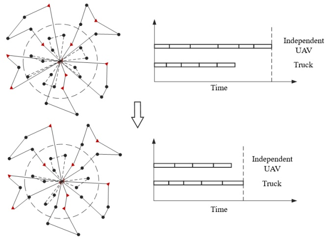

Fig. 14. Illustration of a balanced schedule.

2) Solution Optimization: To obtain the optimal global solution, a modified iterative local search algorithm is utilized to search the neighborhood of the initial solution. In one iteration, the methods of inter-route insertion and inter-route exchange update the routes to get $T_{lu}'$ and $T_v'$. If $\max\{T_{lu}, T_v\} < \max\{T_{lu}', T_v'\}$, the initial solution $\{R_{lu}, R_v\}$ is updated, otherwise it does not reserve the solution. The local optimal solution $\{R_{lu}^{best}, R_v^{best}\}$ is obtained by repeating the iterative process many times. Additionally, by way of inter-route exchange, the new optimal local solution $\{R_{lu}^*, R_v^*\}$ is obtained. If the solution is better than $\{R_{lu}^{best}, R_v^{best}\}$, the original local optimal solution is updated  $\{R_{lu}^{best}, R_{v}^{best}\} = \{R_{lu}^{*}, R_{v}^{*}\}$ . After a certain number of perturbations, if no better solution is found, the algorithm stops and obtain the final solution  $\{R_{lu}^{best}, R_{v}^{best}\}$ .

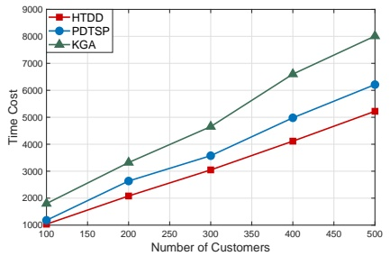

(a) Time cost

Fig. 15. Results with varying the number of customers.

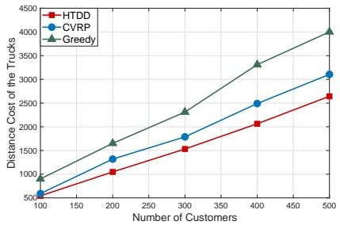

(b) Distance cost of the trucks

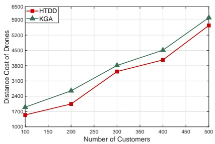

(c) Distance cost of drones

## V. PERFORMANCE EVALUATION

An evaluation study is presented in this section to assess the performance of HTDD. We use Java to implement a simulator which randomly generates a number of customers. In the simulation, HTDD iterates 50 times to yield a solution. To understand the merits of our proposed algorithm, we compare it with two baseline algorithms: parallel drone scheduling TSP algorithm (PDSTSP) [17] and K-means and Genetic Algorithm (KGA) [33]. The PDSTSP heuristic consists of two classical operation research problems: one is the traveling salesman problems (TSP) which exists to sequence customers assigned to the delivery truck, the other is the problem of scheduling the remaining customers to the UAVs which is equivalent to the parallel identical scheduling problem with a minimal completion time objective. The PDSTSP starts from by assuming that the UAVs aim to serve all proper customers, the remaining customers are expected to be served by the truck. KGA uses to optimize the time of truck-drone in delivery network. The algorithm obtains the minimal time of delivery by utilizing K-means clustering to obtain the launch location and the genetic algorithm to work out the truck route as a TSP. The scenarios of the two algorithms are appropriate for truck-drone cooperative parcel delivery.

We pay special attention to two performance indicators. The first is the time cost of the solution. It is defined by the total time which the truck leaves the depot and launches the UAV to serve all customers. In other words, it is the cost of a solution, of which the definition is given in Section III. Indubitably, less value of the time consumed means higher efficiency. The second metric is the distance of the solution. In fact, it can be divided into two parts: the distance traveled by the truck and the flight distance of two kinds of UAVs. Similarly, the smaller the distance is, the lower the system costs.

Customers are distributed randomly in a region and a number of alternative APs uniformly located around the customers. The parameters of the truck and drones are set as follows: the weight of the drones is set as 2 kg with a maximum payload of 3 kg and the maximum flying distance is 7 kilometers under maximum payload condition. Besides, it is estimated that the variable operating cost of trucks is 0.484 per km after considering maintenance cost, depreciation cost and salaries. At first, we only vary the number of customers in the range [100, 500] to study the impact of the number of customers. The results are represented in Fig. 15. Second, the number of customers are fixed as 300 and we vary the capacity of the independent UAV in the range of [100, 1000] to study the effect of capacity. The corresponding results are shown in Fig. 16. Finally, we employ a truck equipped with one truck-carried UAV to serve 300 customers, which an independent UAV is launched from the depot and deliver parcels to the customers with the different UAVs' endurance. The results are presented in Fig. 17.

Figs. 15a - 15c present the effect of the number of customers on the performance of the algorithm. It can be observed from Fig. 15a that HTDD outperforms the other two algorithms significantly, in terms of the time consumption, especially when the number of customers is relatively large. In addition, HTDD also requires the shortest traveling distance for both the truck and UAVs. HTDD performs better than PDTSP and KGA in the truck-drone cooperation in our model, which shows the advantage of algorithms in the truck-drone cooperation.

As shown in Figs. 16a, the delivery time of the system is changing when the UAVs own the different capacity. Both two algorithms perform well when the capacity of UAVs increases. However, the time gradient of HTDD in the experiment decreases faster when applied to truck-drone cooperation. Figs. 16b - 16c show distance of the truck and the UAVs when capacity of the UAVs are changed. We are able to conclude that our algorithm can save more energy resources than KGA.

Fig. 17a shows that when the maximum flying distance of the UAVs increases, the total time cost decreases since the drones can deliver more parcels in one trip. This also help to reduce the distance costs for both the truck and UAVs, as shown in Fig. 17b and Fig. 17c. However, in our experiment settings, when the maximum flight distance increases, a more powerful and heavier battery needs to be carried, which leads to a smaller payload capacity. Accordingly, in Fig. 17b, We can observe that when the maximum flight distance of the UAV is greater than 5 km, the distance cost of trucks starts to increase, which means the payload capacity of drones becomes a performance bottleneck. At the meanwhile, the total time in Fig. 17a is relative stable, which means the increase of maximum flying distance can compensate the decrease of payload capacity. Generally speaking, comparable to the case when varying the maximum Fight Distance of UAV, both HTDD and KGA are likely to make UAVs complete more work when the battery capacity of UAVs increases. However, we observe that the use of the HTDD is less sensitive to the change of battery capacity. HTDD is capable of constructing better solutions when the battery capacity is restricted.

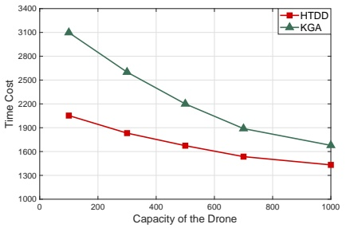

(a) Time cost

Fig. 16. Results with varying drones capacities.

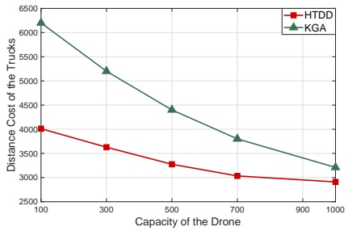

(b) Distance cost of the trucks

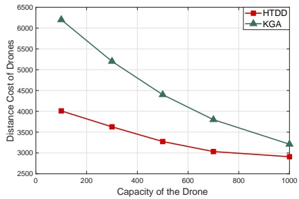

(c) Distance cost of drones

## VI. CONCLUSIONS

While extensive research efforts have focused on the technical aspects of UAVs, this paper seeks to provide new algorithms designed to optimize the operational elements of a delivery-by-drone logistics system referred to as Hybrid Truck-Drone Delivery Algorithm (HTDD). The system seeks to coordinate a traditional delivery truck with a UAV launched from the truck, as well as to employ an independent UAV. Solutions to this problem enable the benefits of UAVs in cases where direct flights from distribution centers to customers are impractical due to the UAV limited flight endurance. In cases where a significant proportion of customers are far away from the distribution center, solutions to the proposed provide great assignments of a delivery truck with two types of UAVs to customers. Simple yet effective heuristic solution frameworks for solving large-sized instances of the HTDD are proposed. These solution approaches are validated via an extensive numerical analysis, which also indicate that these delivery-by-UAVS systems might be made more efficient.

## REFERENCES

[1] M. Chen, Y. Miao, Y. Hao, and K. Hwang, “Narrow band internet of things,” IEEE Access, vol. 5, pp. 20 557–20 577, 2017.

[2] C. Cai, M. Hu, D. Cao, X. Ma, Q. Li, and J. Liu, “Self-deployable indoor localization with acoustic-enabled iot devices exploiting participatory sensing,” IEEE Internet of Things Journal, 2019.

[3] H. Jiang, C. Cai, X. Ma, Y. Yang, and J. Liu, “Smart home based on wifi sensing: a survey,” IEEE Access, vol. 6, pp. 13317–13325, 2018.

[4] C. Cai, M. Hu, X. Ma, K. Peng, and J. Liu, “Accurate ranging on acoustic-enabled iot devices,” IEEE Internet of Things Journal, 2019, DOI: 10.1109/JIOT.2018.2879371.

[5] M. Hu, W. Liu, K. Peng, X. Ma, W. Cheng, J. Liu, and B. Li, “Joint routing and scheduling for vehicle-assisted multi-drone surveillance,” IEEE Internet of Things Journal, 2018, DOI: 10.1109/JIOT.2018.2878602.

[6] I. Colomina and P. Molina, “Unmanned aerial systems for photogrammetry and remote sensing: A review,” ISPRS Journal of Photogrammetry and Remote Sensing, vol. 92, pp. 79–97, 2014.

[7] J. F. Campbell, I. Sweeney, C. Donald, J. Zhang, D. Pan et al., “Strategic design for delivery with linked transportation assets: Trucks and drones,” 2018.

[8] N. H. Motlagh, T. Taleb, and O. Arouk, “Low-altitude unmanned aerial vehicles-based internet of things services: Comprehensive survey and future perspectives,” IEEE Internet of Things Journal, vol. 3, no. 6, pp. 899–922, 2016.

[9] A. Otto, N. Agatz, J. Campbell, B. Golden, and E. Pesch, “Optimization approaches for civil applications of unmanned aerial vehicles (uavs) or aerial drones: A survey,” Networks, vol. 72, no. 4, pp. 411–458, 2018.

[10] M. Tavana, K. Khalili-Damghani, F. J. Santos-Arteaga, and M.-H. Zandi, "Drone shipping versus truck delivery in a cross-docking system with multiple fleets and products," Expert systems with applications, vol. 72, pp. 93–107, 2017.

[11] Y. Choi and P. M. Schonfeld, “Optimization of multi-package drone deliveries considering battery capacity,” Tech. Rep., 2017.

[12] M. W. Ulmer and B. W. Thomas, “Same-day delivery with heterogeneous fleets of drones and vehicles,” Networks, vol. 72, no. 4, pp. 475–505, 2018.

[13] N. Mathew, S. L. Smith, and S. L. Waslander, “Planning paths for package delivery in heterogeneous multirobot teams,” IEEE Transactions on Automation Science and Engineering, vol. 12, no. 4, pp. 1298–1308, 2015.

[14] K. Dorling, J. Heinrichs, G. G. Messier, and S. Magierowski, “Vehicle routing problems for drone delivery,” IEEE Transactions on Systems, Man, and Cybernetics: Systems, vol. 47, no. 1, pp. 70–85, 2017.

[15] B. Li, Z. Fei, and Y. Zhang, “Uav communications for 5g and beyond: Recent advances and future trends,” IEEE Internet of Things Journal, 2018.

[16] C. Yuan, Y. Zhang, and Z. Liu, “A survey on technologies for automatic forest fire monitoring, detection, and fighting using unmanned aerial vehicles and remote sensing techniques,” Canadian journal of forest research, vol. 45, no. 7, pp. 783–792, 2015.

[17] C. C. Murray and A. G. Chu, “The flying sidekick traveling salesman problem: Optimization of drone-assisted parcel delivery,” Transportation Research Part C: Emerging Technologies, vol. 54, pp. 86–109, 2015.

[18] A. Ponza, “Optimization of drone-assisted parcel delivery,” 2016.

[19] H. Savuran and M. Karakaya, “Route optimization method for unmanned air vehicle launched from a carrier,” Lecture Notes on Software Engineering, vol. 3, no. 4, p. 279, 2015.

[20] S. Mourelo Ferrandez, T. Harbison, T. Webwer, R. Sturges, and R. Rich, "Optimization of a truck-drone in tandem delivery network using k-means and genetic algorithm," Journal of Industrial Engineering and Management, vol. 9, no. 2, pp. 374–388, 2016.

[21] X. Wang, S. Poikonen, and B. Golden, “The vehicle routing problem with drones: Several worst-case results,” Optimization Letters, vol. 11, no. 4, pp. 679–697, 2017.

[22] K. L. Hoffman, M. Padberg, and G. Rinaldi, “Traveling salesman problem,” in Encyclopedia of operations research and management science. Springer, 2013, pp. 1573–1578.

[23] S. N. Kumar and R. Panneerselvam, “A survey on the vehicle routing problem and its variants,” Intelligent Information Management, vol. 4, no. 03, p. 66, 2012.

[24] R. Cuda, G. Guastaroba, and M. G. Speranza, “A survey on two-echelon routing problems,” Computers & Operations Research, vol. 55, pp. 185–199, 2015.

[25] Z. Luo, Z. Liu, and J. Shi, “A two-echelon cooperated routing problem for a ground vehicle and its carried unmanned aerial vehicle,” Sensors, vol. 17, no. 5, p. 1144, 2017.

[26] K. Peng, W. Liu, Q. Sun, X. Ma, M. Hu, D. Wang, and J. Liu, "Wide-

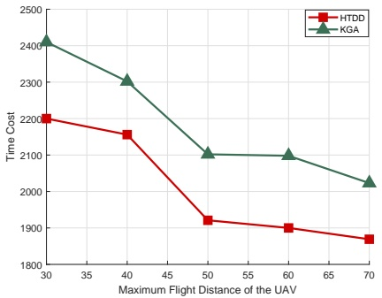

(a) Time cost

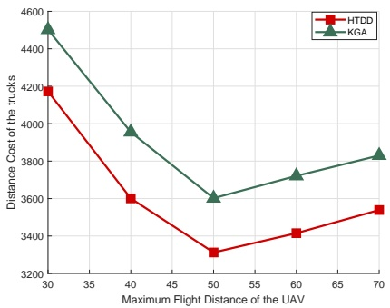

(b) Distance cost of the trucks

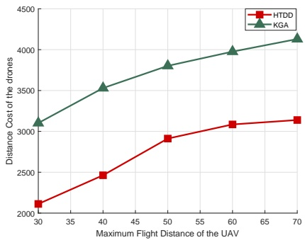

(c) Distance cost of drones

Fig. 17. Results when varying the Maximum Flight Distance of the UAV.

area vehicle-drone cooperative sensing: Opportunities and approaches," IEEE ACCESS., vol. 7, pp. 1818–1828, 2019.

[27] M. Hu, W. Liu, J. Lu, R. Fu, K. Peng, X. Ma, and J. Liu, “On the joint design of routing and scheduling for vehicle-assisted multi-uav inspection,” Future Generation Computer Systems, vol. 94, pp. 214–223, 2019.

[28] Y. Liu, J. Shi, G. Wu, Z. Liu, and W. Pedrycz, “Two-echelon routing problem for parcel delivery by cooperated truck and drone,” 2019.

[29] D. Birant and A. Kut, “St-dbscan: An algorithm for clustering spatial–temporal data,” Data & Knowledge Engineering, vol. 60, no. 1, pp. 208–221, 2007.

[30] D. J. Rosenkrantz, R. E. Stearns, and P. M. Lewis, II, “An analysis of several heuristics for the traveling salesman problem,” SIAM journal on computing, vol. 6, no. 3, pp. 563–581, 1977.

[31] S. Lin and B. W. Kernighan, “An effective heuristic algorithm for the traveling-salesman problem,” Operations research, vol. 21, no. 2, pp. 498–516, 1973.

[32] T. Tlili, S. Faiz, and S. Krichen, “A hybrid metaheuristic for the distance-constrained capacitated vehicle routing problem,” Procedia-Social and Behavioral Sciences, vol. 109, no. 2014, pp. 779–783, 2014.

[33] S. M. Ferrandez, T. Harbison, T. Weber, R. Sturges, and R. Rich, "Optimization of a truck-drone in tandem delivery network using k-means and genetic algorithm," Journal of Industrial Engineering and Management, vol. 9, no. 2, p. 374, 2016.