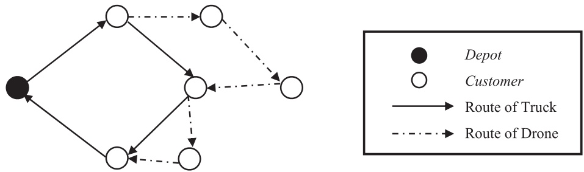
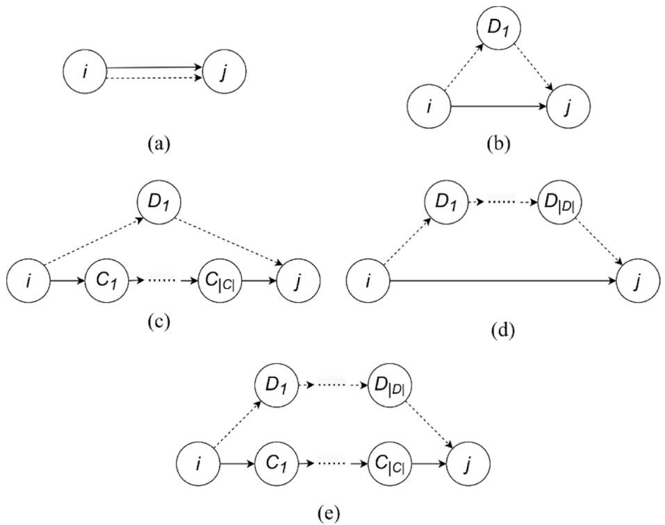
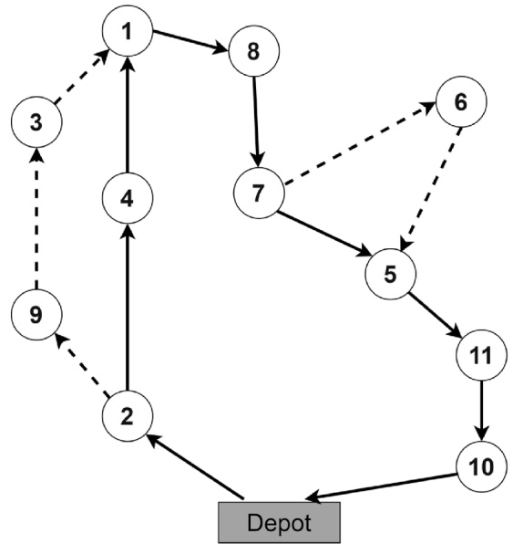
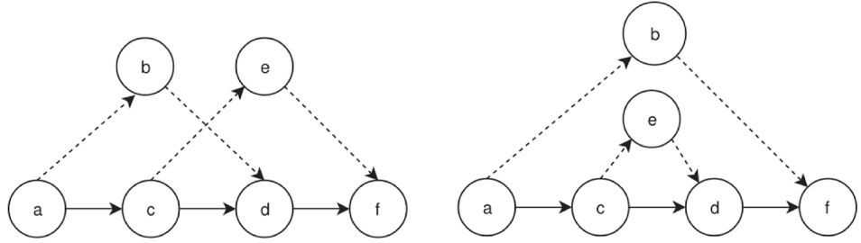
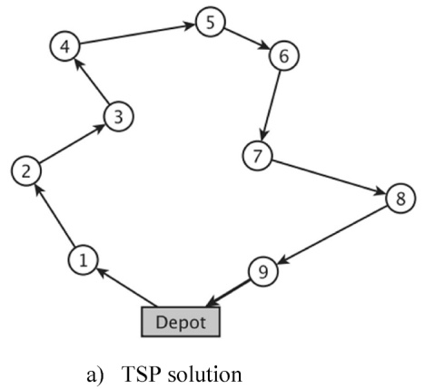
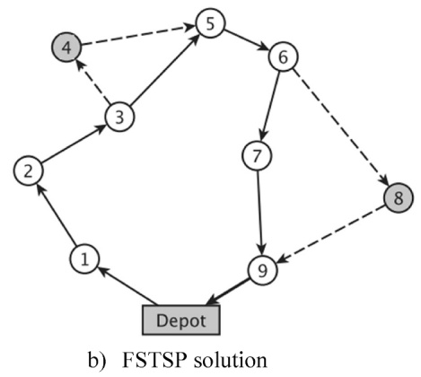
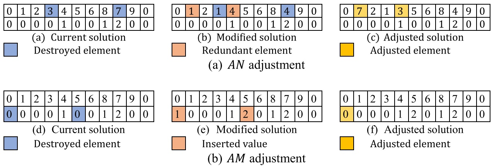
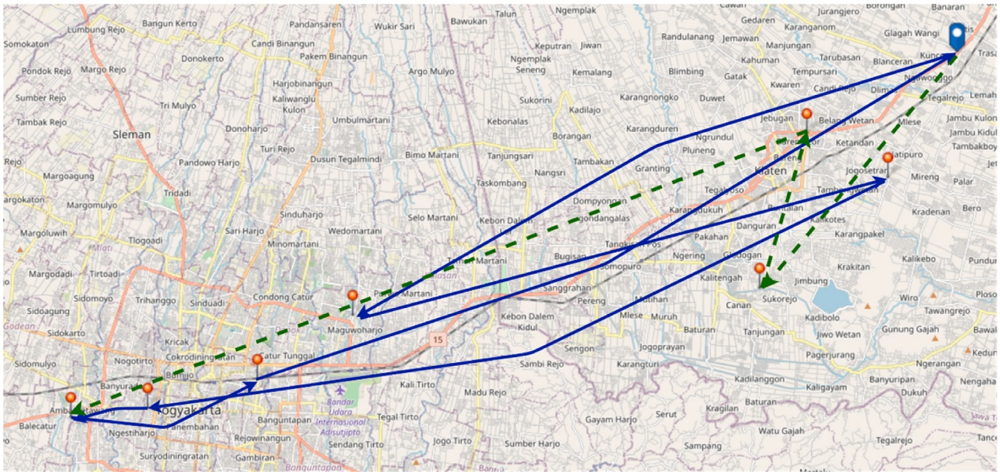
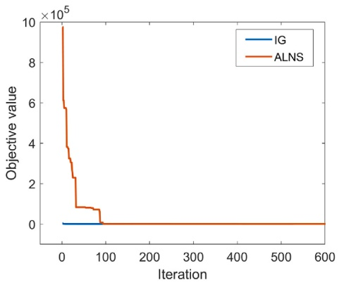
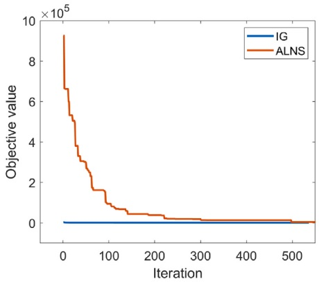

# An adaptive large neighborhood search heuristic for the flying sidekick traveling salesman problem with multiple drops

Setyo Tri Windras Mara , Achmad Pratama Rifai , Bertha Maya Sopha

Department of Mechanical and Industrial Engineering, Faculty of Engineering, Universitas Gadjah Mada, Special Region of Yogyakarta, 55284, Indonesia

## A R T I C L E I N F O

Keywords: Flying sidekick traveling salesman problem Multi-visit Adaptive large neighborhood search Truck-drone system Last-mile delivery Logistics

## A B S T R A C T

Drones are the latest trend in commercial logistics research, especially in the context of last-mile delivery. Combining a drone and a truck offers numerous distinctive capabilities that introduce new opportunities to enhance the performance of the last-mile delivery system even further. To deal with the challenges of routing optimization for the combined system, the present paper proposes a new mathematical formulation and a new heuristic approach based on Adaptive Large Neighborhood Search (ALNS) for the Flying Sidekick Traveling Salesman Problem (FSTSP) with multiple drops (multi-drop FSTSP). The effectiveness of the proposed approach was demonstrated in several test instances, some of which are based on a real case delivery problem in Indonesia. It appears that the proposed ALNS approach performs better than the state-of-the-art method adapted from the previous literature.

## 1. Introduction

In the near future, receiving a daily delivery package from a drone will not be a peculiar situation. Drones, or sometimes also called Unmanned Aerial Vehicles (UAVs), are the latest trend in commercial logistics research, especially when it comes to the last-mile delivery system. Ever since Amazon launched its Prime Air service, numerous companies have put their attention and effort to assess the feasibility of drones as a transportation mode, such as the DHL which has introduced a “parcelcopter” program (Murray and Chu, 2015).

Although critics have pointed out that the implementation of a drone into a logistics system is mainly motivated by publicity goals, one cannot deny that the delivery mode itself has numerous exciting potentials. Compared to other existing transportation modes such as trucks, the drone offers different capabilities that introduce new opportunities to enhance the performance of a last-mile delivery system even further. As noted by Wohlsen (2014) and Ha et al. (2018), drones can avoid congestions in traditional road networks by traveling through the air. This ability practically let the drone travel purely at the Euclidean distance basis, which makes it generally faster than trucks and has relatively lower transportation costs than a truck. Those advantages are particularly interesting for the last-mile delivery system, which has long been indicated as the most expensive echelon within a logistics network (Aized and Srai, 2014). On the other hand, Ha et al. (2018) also noted that the implementation of drones has several shortcomings, mainly due to its battery and load restriction, which lead to interesting challenges for the logistics research community.

Designing an effective and efficient process is the key issue of the last-mile delivery system (Agatz et al., 2008). Several models have been presented to represent the potential situation of the implementation of drones within a last-mile delivery system. One of the popular strategies is the scenario to combine the trucks with drones to take advantages of both vehicles, which becomes the main focal point of the present paper. The most primitive form of model in this context is the Flying Sidekick Traveling Salesman Problem (FSTSP). FSTSP was introduced in the breakthrough work of Murray and Chu (2015) as a generalization of the classical Traveling Salesman Problem (TSP) with the main objective of minimizing the delivery time. The cooperation of a single drone and a single truck was formulated so that the drone can execute a sortie operation from the truck to serve customer demands. Following Murray and Chu (2015), the sortie can be defined as an operation to serve a customer node using a drone. This operation begins by launching the drone from a launching node and ends by the retrieval of the drone at a rendezvous node, in which both nodes can be placed at a depot or a customer node. In this regard, during a sortie, the truck separately performs a trip toward the rendezvous node. Fig. 1 presents the visual representation of a sortie operation.

This present paper focuses on the extension of FSTSP. Recently, an innovative model extending the FSTSP has been presented by Gonzalez-R et al. (2020). Their proposed model discussed the possibility of a drone to make several customer visits within a single sortie, which they named a Truck-drone Team Logistics (TDTL) system. For simplicity, we will call such a system a multi-drop FSTSP in this paper. Here, we present a new mathematical formulation for the multi-drop FSTSP which extends the TDTL model of Gonzalez-R et al. (2020). Our model considers the setup time to launch and retrieve the drone, which was neglected in Gonzalez-R et al. (2020). We report the ability of our proposed mathematical formulation to attain the optimal solution for instances with up to eight customers. Since the model is not able to solve large-size instances, this article also proposes a heuristic solution based on ALNS for solving the larger instances of multi-drop FSTSP. The proposed heuristic has considered the unique characteristics of multi-drop FSTSP and has been examined through several test instances (including several empirical instances) and contrasted with the state-of-the-art approach available in the literature in order to evaluate its efficiency and effectiveness.

<small>\* Corresponding author.</small>

<small>E-mail addresses: [achmad.p.rifai@ugm.ac.id](mailto:achmad.p.rifai@ugm.ac.id) (A.P. Rifai), [bertha\_sopha@ugm.ac.id](mailto:bertha_sopha@ugm.ac.id) (B.M. Sopha).</small>

The remainder of this paper is structured as follows. Section 2 pre-sents a literature review of the related articles. Section 3 describes the formulation of multi-drop FSTSP, while Section 4 defines the solution representation. Then, the proposed ALNS is completely presented in Section 5. Section 6 reports the results of numerical analysis based on two instance sets and an empirical case study in Indonesia. Finally, Section 7 presents the conclusions and future research directions.

## 2. Literature review

In this section, the related articles are reviewed to assess the contributions of this study. The main focuses of this review are the literature on drone routing as well as its solution approaches.

## 2.1. Model development

Incorporating drones into a last-mile delivery system presents many novel opportunities and has attracted vast attention from the research community. For example, several literature surveys on this topic have been written in the last few years (see Barmpounakis et al., 2016; Coutinho et al., 2018; Otto et al., 2018; Khoufi et al., 2019; Rojas Viloria et al., 2021; Macrina et al., 2020; Chung et al., 2020; Kitjacharoenchai et al., 2020; Poikonen and Campbell, 2021; Moshref-Javadi and Winkenbach, 2021). Khoufi et al. (2019) described that there are three different focuses of the implementation of drones into the last-mile delivery system. Firstly, there is “trajectory optimization” which refers to the problem of the control system to identify the feasible trajectory that satisfies dynamic and kinematic constraints. Secondly, in a physically less-detailed model, there is “path and motion planning” that refers to the effort to ensure the safety of the drone during its operations in order to prevent collisions. Lastly, in the most macroscopic view which becomes the focal point of this article, the path of drones should be optimal with regard to the operational costs. The latter point deals with the classes of routing problems, which answer the question of how to manage the implementation of drones to visit specific places and execute specific tasks.

To this date, several models of routing problems have been presented to represent the potential situation of the implementation of drones within the last-mile delivery system. In this regard, the surveys from Chung et al. (2020) and Macrina et al. (2020) shared a similar perspective in classifying the routing problems with drones, where routing models can be separated into two classes: (1) using drones only (see Dorling et al., 2016) and (2) using the cooperation of trucks and drones. The scenario of combining trucks and drones becomes our main point of discussion. By combining drones and trucks, one can obtain the speed and distance efficiency of drones, while also taking advantage of the truck’s larger capacity. This combination leads to a routing problem with synchronization which deals with a situation when one vehicle needs to wait for the arrival of other vehicles to continue the tour progression (Drexl, 2012).

The earliest model in this context is the FSTSP from Murray and Chu (2015). The FSTSP represents a situation in which a truck is compli mented with one drone that can execute sortie operations with Euclidean distances. Murray and Chu (2015) proposed a mathematical model based on a mixed-integer linear programming formulation as well as a heuristic approach. Murray and Chu (2015) also described another possible implementation of drone-truck combination in the same paper, namely Parallel Drone Scheduling Traveling Salesman Problem (PDSTSP). In the PDSTSP, the drone and truck operate separately with different clusters of customers. The drone mainly serves customers within a limited area (due to its battery limitation) and returns to the depot after performing a delivery service, while the truck is focused on the customers outside the operational area of the drone. Separately, Agatz et al. (2018) also proposed a similar model to the FSTSP, namely the Traveling Salesman Problem with Drone (TSP-D). The main feature that distinguishes TSP-D from FSTSP is the possibility for the drone to return to its launching point. Agatz et al. (2018) presented a mathematical formulation for TSP-D based on a set of granular feasible operations of cooperation between a truck and drone. The developed TSP-D was to minimize the total completion time of the delivery mission and they reported the optimal solutions for instances with up to 12 nodes, along with several fast heuristics for the larger-scale instances. Based on the formulation of Agatz et al. (2018), Bouman et al. (2018) presented a dynamic programming approach for TSP-D. They reported the ability of this approach to solve instances with 20 nodes, while also discussing an interesting preprocessing technique to restrict the number of truck nodes that can be visited during a single operation. Bouman et al. (2018) reported that the restriction has little impact on the overall solution quality while reducing the total computational time significantly. However, this restriction may prevent the searching process to find the true optimal solution. Ha et al. (2018) extended the FSTSP model with a different objective function to obtain the minimum operational cost (min-cost TSP-D). This work provides a basis for the future economic analysis of drone implementation to the last-mile logistics, by considering the impact of delivery and waiting costs of the truck-drone system, instead of minimizing the task completion time as in the classical FSTSP. Then, Dell’Amico et al. (2019) presented the state-of-the-art formulation for FSTSP, which involved the improved objective function to obtain better lower bounds for the problem and two-index variables. By conducting extensive numerical experiments, they showed that their two-index formulation is superior to the original formulation from Murray and Chu (2015).

Fig. 1. FSTSP with sorties.

More recently, other model variants based on FSTSP and TSP-D have also been introduced. Tu et al. (2018) proposed a mathematical formulation of the Traveling Salesman Problem with Multiple Drones (TSP-MD) to model a situation in which a truck is equipped with multiple drones. They developed an ALNS-based heuristic that used Simulated Annealing (SA) as the master search. By comparing their solution approach to the greedy randomized adaptive search procedure proposed by Ha et al. (2018), they proved the superiority of their proposed approach. Murray and Raj (2020) extended this idea of TSP-MD by proposing a multiple-FSTSP which extends the TSP-MD by considering the opportunities of employing several different types of drones. This aspect may impact the travel speeds, payload capacities, service times, and endurance of each drone. Dell’Amico et al. (2021a) have also proposed a new formulation for the FSTSP with multiple identical drones. They emphasized the importance of considering the order of setup operations in the situation where multiple drones are launched or collected at the same node. In this regard, Dell’Amico et al. (2021a) presented a set of novel formulations for the FSTSP with multiple identical drones and provided a comparison study to analyze those formulations. Luo et al. (2021) then discussed the extension of the FSTSP with multiple drones, in which each drone can serve multiple nodes in a single sortie. They proposed a MIP model for the FSTSP with multiple drones to minimize the makespan required by the truck and the drones to serve all customers. They addressed the large-scale instances using a multi-start tabu search algorithm. Schermer et al. (2019a) addressed a similar concept with multiple trucks and multiple drones per truck, along with a matheuristic algorithm as the solution approach. Another interesting model was proposed by Jeon et al. (2021), who discussed the extension of FSTSP to consider a backhaul operation. In their model, the launched drone can collect a pick-up order from a customer node after it performs a delivery order within a sortie. They note that this simple addition can increase the utilization of drone, by reducing the number of empty flights.

The studies from Wang et al. (2017) and Poikonen et al. (2017) introduced the Vehicle Routing Problem with Drones (VRP-D) which mimics the condition when there are multiple trucks and drones, along with several proofs of worst-case theorems. Then, the VRP-D was formally defined into a mathematical programming model by three separate studies from Kitjacharoenchai et al. (2019), Sacramento et al. (2019), and Wang and Sheu (2019). Kitjacharoenchai et al. (2019) and Sacramento et al. (2019) developed the formulation of VRP-D based on the FSTSP from Murray and Chu (2015). In their proposed timeminimization Multiple Traveling Salesman Problem with Drones (MTSP-D), Kitjacharoenchai et al. (2019) assumed unlimited capacity of all trucks in carrying multiple drones and packages. On the other hand, Sacramento et al. (2019) presented a VRP-D model to minimize the total operational cost under the restriction of a maximum duration for all routes. They considered the presence of vehicle capacity and endurance constraint of drones, then developed an ALNS-based heuristic with several tailored destroy and repair operators for the VRP-D. Separately, Wang and Sheu (2019) presented an arc-based model that can be transformed into a path-based model by exploiting the special problem structure. As a solution method, they developed an exact branch-and-price algorithm. A comparison between the branch-and-price algorithm and the commercial solver Gurobi was performed and indicated that their proposed algorithm was superior. Compared to the works of Kitjacharoenchai et al. (2019) and Sacramento et al. (2019), the work of Wang and Sheu (2019) considered the ability of drones to execute a multi-drop sortie, that generated additional search space to the problem. Schermer et al. (2019b) considered the VRP-D with en-route operations, which is defined as a situation where the launch and retrieval processes of the drone may occur at non-customer locations. They proposed a hybrid algorithm of variable neighborhood search and tabu search to solve the considered problem. Similar problem was also discussed by Masone et al. (2022), who proposed a multi-drone VRP with edge launches. Additionally, several works (Di Puglia Pugliese et al., 2020; Coindreau et al., 2021; Das et al., 2021; Kuo et al., 2022) have also considered the presence of customer time windows in the delivery missions, which might influence the feasibility of the optimal solution for a model without time windows.

Another work from Ulmer and Thomas (2018) considered a slightly different model where a set of trucks perform a delivery mission, and a set of drones can resupply the trucks within their original trips. This model is termed as Same-day Delivery Routing Problem and is noted to be suitable for handling dynamic requests from the customers, so that the trucks do not need to return to the depot to pick up the requested goods. The work of Ulmer and Thomas (2018) was recently expanded by Dayarian et al. (2020), Ulmer and Streng (2019), and Chen et al. (2022). All in all, we conclude that numerous recent works have attempted to extend the original model of FSTSP and TSP-D to various directions. We refer the readers to the recent surveys of Macrina et al. (2020) and Moshref-Javadi and Winkenbach (2021) who performed a classification review on this context.

In this paper, we are mainly interested in expanding the idea of Gonzalez-R et al. (2020). Gonzalez-R et al. (2020) presented a model named TDTL that extends the FSTSP with the ability of the drone to make multiple drops within a sortie. By assuming a complete autonomy of the drone to travel within the area and limited battery life, Gonzalez-R et al. (2020) developed a mathematical formulation for the TDTL using a mixed-integer programming approach. Using a branch-and-cut solver from Gurobi, they showed that their formulation can attain the optimal solutions for instances with a size of up to 10 customers. Another related work is from Poikonen and Golden (2020), who developed a multi-visit k-Drone Routing Problem (k-MVDRP) to capture the situation where a single truck is occupied with k drones and each drone, similar to the work of Gonzalez-R et al. (2020), which visits multiple customers. Poikonen and Golden (2020) formally defined their k-MVDRP model by extending the integer programming formulation of TSP-D from Agatz et al. (2018). Compared to the works of Gonzalez-R et al. (2020) and Poikonen and Golden (2020), our presented model here differs in the following aspects. First, our multi-drop FSTSP can be seen as the extension of the TDTL model from Gonzalez-R et al. (2020), in which we integrate the calculation of setup time to launch and retrieve the drone in a sortie, which was assumed to be irrelevant in Gonzalez-R et al. (2020). Second, our model is similar to the k-MVDRP of Poikonen and Golden (2020) when k = 1. However, Poikonen and Golden (2020) assumed that during a sortie, the truck can only move from the launching node to the rendezvous node that is adjacent to the launching one. This assumption is relaxed in our model so that the truck can also visit several nodes during a sortie before these vehicles are synchronized.

## 2.2. Solution approach

The main drawback of a mathematical programming formulation is its computational efficiency in solving some complex optimization problems, such as the routing problems with drones. Therefore, numerous studies have been dedicated to proposing solution approaches for routing problems with drones. As a generalization of the classical TSP, the FSTSP is also NP-hard. As the scale of the problem grows, the computational cost of FSTSP increases exponentially. The FSTSP model of Murray and Chu (2015), for instance, is able to find the optimal solution for only up to six customer nodes, while the more efficient TSP-D model of Agatz et al. (2018) can obtain the optimal solution for up to 12 customers. Meanwhile, designing the last-mile delivery system is a big issue in logistics research. According to the survey by Aized and Srai (2014), the operation of the last echelon of the logistics network can account for up to 75% of the total cost of the supply chain network. Thus, the importance of efficient optimization methods for the last-mile delivery system, such as a heuristic solution, is undeniable.

In the most basic form of routing problems with drones, namely FSTSP and TSP-D, several proven heuristic approaches have been pre-sented. Murray and Chu (2015) proposed a local search heuristic based on a ‘route first, cluster second’ approach. They constructed a TSP route for all nodes with truck first, then iteratively assigned the UAV-eligible nodes to the UAV with the classical savings algorithm. Four different approaches to construct the initial TSP solution were considered: integer programming, savings algorithm, nearest neighbor algorithm, and sweep algorithm. Ponza (2016) has also developed a classical SA heuristic for the FSTSP, proposed a special solution representation for FSTSP heuristics, and presented some valid prohibited situations of the drone and truck combination. de Freitas and Penna (2018) presented a Randomized Variable Neighborhood Descent (VND) heuristic for the FSTSP, which then became a basis for the work of de Freitas and Penna (2020). de Freitas and Penna (2020) developed a hybrid approach by combining the heuristic solution of Murray and Chu (2015) with the Variable Neighborhood Search algorithm, using the VND proposed in de Freitas and Penna (2018) as the local search mechanism. Furthermore, de Freitas and Penna (2020) also presented a set of 24 new instances based on the classical TSPLIB library (Reinelt, 1991). Ha et al. (2020) pre-sented a Memetic Algorithm with Population Management for both FSTSP and min-cost TSP-D. When compared to the best-known solutions from Murray and Chu (2015), Ha et al. (2018), and de Freitas and Penna (2020), the Memetic Algorithm with Population Management was found to perform better. Another possible approach is to decompose the problem into several simpler subproblems. This decomposition approach was employed by Es Yurek and Ozmutlu (2018). They decompose the TSP-D into a two-stage algorithm, which determines the truck route in the first stage, and then determines the drone route as a customer assignment in the second stage. More recently, Dell’Amico et al. (2021b) presented an exact branch-and-bound algorithm for the FSTSP, in which their proposed algorithm was found to be effective for small instances with up to 14 customers. Moreover, Dell’Amico et al. (2021b) also extended their branch-and-bound algorithm to be a subroutine within a simple heuristic framework for FSTSP.

Within the context of multi-drop FSTSP, however, the research of heuristic development is still far from exhausted. Gonzalez-R et al. (2020) proposed an Iterative Greedy Search (IG) based on the SA algorithm as a solution approach for larger-scale problems. The IG proposal was equipped with an innovative solution representation that consists of two tuples, as well as a set of local search moves to destroy and construct the feasible solution. In retrospect, this study intends to propose a new heuristic solution approach for the multi-drop FSTSP based on the ALNS frameworks. The ALNS was firstly introduced by Røpke and Pisinger (2006) as an extension of the Large Neighborhood Search (LNS) (Shaw, 1998) and its potential has been demonstrated to obtain near-optimal solutions for other related combinatorial optimization problems, such as vehicle routing problem (Pisinger and Ropke, 2007) and locationrouting problem (Koç, 2016). Furthermore, the ALNS also has been proven to be effective to solve other subclasses of routing problems with drones, such as TSP-MD (Tu et al., 2018) and VRP-D (Sacramento et al., 2019), which motivates us to implement the ALNS framework to develop our proposal.

## 3. Problem description

This paper focuses on the routing optimization for the multi-drop FSTSP, a generalization of the FSTSP that was firstly introduced by Murray and Chu (2015). This problem is formulated in a graph $G   =   ( V ,$ $A ) _ { 1 }$ , where $V = \{ 0 , 1 , \cdots , n \}$ is a set of n customer nodes along with a node {0} to denote the depot node, while A is a set of arcs that links two pairs of nodes i and j. Technically speaking, FSTSP is an operation of two vehicles with distinct characteristics: a truck and a drone, with a mission to satisfy all demands from a set of customers $N = \{ 1 , . . , n \}$ before returning to the depot. In order to serve all demands $c _ { n } ,$ the truck has a restriction to follow a road network. Meanwhile, the drone travels between two nodes i and j through the air within Euclidean distances. Thus, due to the differences between the travel distance of truck $( d _ { i \rightarrow j } ^ { \mathcal { T } } )$ and drone $( d _ { i \rightarrow j } ^ { \mathcal { D } } )$ , each vehicle also generally has a different travel time denoted by $\tau _ { i \rightarrow j } ^ { \mathcal { T } }$ and $\tau _ { i \rightarrow j ; } ^ { \mathcal { D } }$ respectively.

In the multi-drop FSTSP, the movement within a tour is not restricted to a sequence of deliveries with truck. The presence of drone yields several other forms of possible delivery sequences. Hereinafter, inspired by the study of Agatz et al. (2018), this sequence of deliveries will be addressed as an operation. Let us denote $O P _ { k }$ as the k-th operation in the set of all possible feasible operations. An operation $O P _ { k }$ can be defined as a pair of paths $\{ \mathcal { T } _ { k } , \mathcal { D } _ { k } \}$ , in which $\mathcal { T } _ { k }$ is a sequence of nodes that must be visited by truck in the $O P _ { k } ,$ while $\mathcal { D } _ { k }$ is a sequence of nodes that must be visited by drone in $O P _ { k }$ with a sortie.

In order to formally define the operation, let us define $V d \subseteq V$ as the nodes that can be served by the drone. Within a single operation $O P _ { k } , \mathbf { a }$ path of truck $\mathcal { T } _ { k }$ consists of the following nodes: (1) one start node $i \in V ,$ (2) one end node $j \in V ,$ and (3) one array of non-negative nodes $C \subseteq N ,$ where $i \neq j$ when $i , j \neq 0$ and $i , j$ are not contained in $C .$ Similarly, the path of drone $\mathcal { D } _ { k }$ consists of the following nodes: (1) one launch node $i \in V ,   ( 2 )$ one retrieval node $j \in V \backslash \{ i \}$ , and one array of non-negative nodes $D \subseteq V   d .$ Furthermore, all these conditions must hold: $i \neq j$ when $i ,   j \neq 0 ,$ i and j are not contained in $C \cup D ,$ and $C \cap D = \varnothing$ (no intersection between nodes in $C$ and $D )$ . Hence, one can decode the operation $O P _ { k }$ as an array $[ i , j , C , D ]$ and construct five different forms of valid operations as depicted in Fig. 2, where the straight and dotted lines represent the arcs associated with the truck and drone, respectively.

Here, we also can easily notice in Fig. 2 that this study extends $\mathcal { T } _ { k }$ by considering the nodes visited by a drone sortie to be an array, instead of a single node such in the TSP-D (see Agatz et al., 2018). Therefore, in this regard, a sortie is being executed by launching the drone from the truck in a launch node i to sequentially visit all customer nodes in D. Then, after serving all the nodes in $D_{z}$ the drone must return to the truck in the retrieval node j before it runs out of battery. During a sortie, the truck may visit and serve other customers in $C ,$ as long as it arrives at the retrieval node j before the drone runs out of battery. Neither the truck nor the drone is able to continue the tour from $j$ separately. Thus, if the arrival time of drone at j is earlier than the arrival time of truck $\mathbf { a t } { j } ,$ the waiting time of drone $w _ { r } ^ { \mathcal { D } }$ is calculated, otherwise, if the truck arrives at j earlier, the waiting time of truck $w _ { r } ^ { \mathcal { T } }$ is calculated. During the launching and retrieving steps, respectively, the drone has a pre-defined setup time $s ^ { L }$ and retrieve time $s ^ { R } ,$ Those values are calculated to take into account the times for a truck driver (or a dedicated drone operator) to prepare the drone, load the parcel, and attach the drone back to the truck after finishing a sortie. Furthermore, the ability of the drone to perform a sortie is limited by the endurance parameter $\varepsilon .$ Following Ha et al. (2018), this constraint is defined as in Equation (1), where, as we recall, $\tau _ { i \rightarrow j } ^ { D }$ is defined as the travel time of drone from node i to node j.

$$
\tau_ {i \rightarrow D _ {1}} ^ {\mathscr {D}} + \sum_ {i = 1} ^ {| D | - 1} \tau_ {D _ {i} \rightarrow D _ {i + 1}} ^ {\mathscr {D}} + \tau_ {D _ {| D |} \rightarrow j} ^ {\mathscr {D}} + w _ {r} ^ {\mathscr {D}} \leq \varepsilon\tag{1}
$$

Using the previous explanation of operations, a delivery tour thus can be regarded as a sequence of feasible operations $[OP_1,\cdots OP_k]$ . Consequently, among all the valid operations that can be derived from the graph, the optimal solution of the tour can be evaluated by: (i) calculating the cost function $t _ { k }$ of each operation $k ,$ (ii) selecting a set of chosen operations to create a complete solution, (iii) calculating the sum of the cost functions of all chosen operations. The calculation of the operation’s cost function can be defined in Equations (2)-(4), where $t ( \mathcal { T } _ { k } )$ defines the time of truck to finish its corresponding tasks within operation $k - \mathrm{th}, t(\mathcal{D}_k)$ defines the analogous time needed for drone.

$$
\begin{array}{l} t _ {k} = t (O P _ {k}) \\ \quad = \left\{ \begin{array}{c c} \max \{t (\mathcal {T} _ {k}), t (\mathscr {D} _ {k}) \} & \text {if} O P _ {k} \text {contains at least one drone node,} \\ t (\mathcal {T} _ {k}) & \text {otherwise} \end{array} \right. \end{array}\tag{2}
$$

Fig. 2. Valid forms of operations.

$$
t (\mathcal {T} _ {k}) = \left\{\begin{array}{c}s ^ {L} + \tau_ {i \rightarrow C _ {1}} ^ {\mathcal {T}} + \sum_ {i = 1} ^ {| C | - 1} \tau_ {C _ {i} \rightarrow C _ {i + 1}} ^ {\mathcal {T}} + \tau_ {C _ {| C |} \rightarrow j} ^ {\mathcal {T}} + s ^ {R} \quad \text {if} D \neq \varnothing \text {and} | C | > 1\\s ^ {L} + \tau_ {i \rightarrow C _ {1}} ^ {\mathcal {T}} + \tau_ {C _ {1} \rightarrow j} ^ {\mathcal {T}} + s ^ {R} \quad \text {if} D \neq \varnothing \text {and} | C | = 1\\\tau_ {i \rightarrow j} ^ {\mathcal {T}} \quad \text {otherwise}\end{array}\right.\tag{3}
$$

$$
t (\mathscr {D} _ {k}) = \left\{\begin{array}{c c}s ^ {L} + \tau_ {i \rightarrow D _ {1}} ^ {\mathscr {D}} + \sum_ {i = 1} ^ {| D | - 1} \tau_ {D _ {i} \rightarrow D _ {i + 1}} ^ {\mathscr {D}} + \tau_ {D _ {| D |} \rightarrow j} ^ {\mathscr {D}} + s ^ {R}&\text {if} | D | > 1\\s ^ {L} + \tau_ {i \rightarrow D _ {1}} ^ {\mathscr {D}} + \tau_ {D _ {1} \rightarrow j} ^ {\mathscr {D}} + s ^ {R}&\text {otherwise}\end{array}\right.\tag{4}
$$

The discussion continues to the formulation of integer programming model. Following Agatz et al. (2018) and Poikonen and Golden (2020), the multi-drop FSTSP can be formulated as a set partitioning formulation. This formulation can be constructed using the following steps: (i) generating all possible operations $[ i , j , C , D ]$ a priori, (ii) evaluating the feasibility of these operations according to the forms in $\mathrm { F i g . } 2$ and endurance constraint in Equation (1), resulting in a set of k feasible operations, (iii) evaluating the cost function $t _ { k }$ of each feasible operation $k ,$ and (iv) selecting a subset of feasible operations $\left[ OP_{1}, \cdots OP_{k} \right]$ to cover all customers, to minimize the total completion time of the selected operations (Agatz et al., 2018).

Then, in order to construct the integer programming formulation, we introduce the following sets. Let $K = \left[ OP_{1}, \cdots OP_{k} \right]$ represents a set of k feasible operations, where this set K must contain all the feasible operations that can be generated from graph G in order to guarantee the optimality of the solution. From set K, one can derive several subsets as follows:

(i) $K ( { \pmb \nu } ) { \subset } K$ as a set of all feasible operations that contains node ${ \pmb { \nu } } \in V ,$

(ii) $K ^ { - }$ (v)⊂K as a set of feasible operations with a start or launch node at ${ \pmb v } \in V ,$

(iii) $K ^ { + } ( { \pmb { \mathscr { v } } } ) { \subset } K$ as a set of feasible operations with an end or rendezvous node at ${ \pmb v } \in V ,$

(iv) $K ^ { \mathcal { T } } ( \pmb { \nu } ) { \subset } K$ as a set of feasible operations that visits node v ∈ V with the truck, and.

(v) $K ^ { \mathcal { D } } ( \pmb { \nu } ) { \subset } K$ as a set of feasible operations that visits node $\nu \in$ $V d \backslash \{ 0 \}$ with the drone.

In a similar sense, for each subset of nodes S⊂V, let us also denote $K ^ { + } ( { \mathcal { S } } ) { \subset } K$ as a set of feasible operations with an end node that contained in S and a start node contained in $V / \{ S \}$ . For clarity purpose, note that each S represents a combination of nodes that can be possibly constructed from the set of all customers $N ,$ where the length of S varies from 1 to |N|, i.e. $\pmb { S } = [ ( 1 ) , ( 2 ) , ( 3 ) , ( 1 , 2 ) , \cdots , ( 1 , 2 , \cdots , | { \pmb N } | ) ]$

Moreover, this formulation contains two decision variables. The variable $x _ { k }$ represents the chosen active operations, which has a value of 1 if operation k is active, and 0 otherwise. On the other hand, the auxiliary variable $Y _ { \gamma }$ serves as an indication of whether a node v is selected as a start node in at least one active operation. Finally, the formal definition of the integer programming model is presented in Equations (5)-(15) and a summary of the notations required to develop this model is given in Appendix 1.

Objective function

$$
\min M = \sum_ {k \in K} t _ {k} x _ {k}\tag{5}
$$

Subject to:

$$
\sum_ {k \in K (v)} x _ {k} \geq 1 \quad \forall v \in V \backslash \{0 \}\tag{6}
$$

$$
\sum_ {k \in K ^ {\mathcal {D}} (v)} x _ {k} \leq 1 \quad \forall v \in V d \backslash \{0 \}\tag{7}
$$

$$
\sum_ {k \in K ^ {\mathcal {Z}} (v)} x _ {k} \leq 2 \left(1 - \sum_ {k \in K ^ {\mathcal {Z}} (v)} x _ {k}\right) \quad \forall v \in V d \backslash \{0 \}\tag{8}
$$

$$
\sum_ {k \in K ^ {+} (v)} x _ {k} \leq n Y _ {v} \quad \forall v \in V\tag{9}
$$

$$
\sum_ {k \in K ^ {+} (v)} x _ {k} = \sum_ {k \in K ^ {-} (v)} x _ {k} \quad \forall v \in V\tag{10}
$$

$$
\sum_ {k \in K ^ {+} (S)} x _ {k} \geq Y _ {v} \quad \forall S \subset V \backslash \{0 \}, v \in S\tag{11}
$$

$$
\sum_ {k \in K ^ {+} (0)} x _ {k} \geq 1\tag{12}
$$

$$
Y _ {0} = 1\tag{13}
$$

$$
x _ {k} \in \{0, 1 \} \quad \forall k \in K\tag{14}
$$

$$
Y _ {v} \in \{0, 1 \} \quad \forall v \in V\tag{15}
$$

The objective function (5) aims to find a tour that minimizes the total completion time. This is achieved by simultaneously calculating the sum of completion time from the chosen operations. Equations (6) ensure that all nodes are covered at least once. Equations (7) regulate that all the nodes in $V d \backslash \{ 0 \}$ can be visited by the drone at most once. Equations (8) guarantee that a customer node that has been served by a drone will not be served again by truck, and vice versa. Equations (9) ensure that a node v can be set as a start node if there is an active operation that ended at v. Equations (10)-(12) ensure the continuity of the selected operations to warrant the property of Hamiltonian graph in the generated tour. Equations (10) guarantee that the selected operation which is ended in v will be continued by another operation which is started in v. Equations (11) serve to connect the selected operations, by ensuring that the truck will not enter the previously-visited customer nodes, while Equation (12) limits the number of operations that finished at the depot node as one. Equation (13) guarantees the depot as the tour’s starting point by ensuring that node {0} is visited. Finally, Equations (14)-(15) define the domain of decision variables. For replicability purpose, the source code of this formulation is available upon request.

## 4. Solution representation

Designing a clear but efficient solution representation is one of the major tasks in the design process of the heuristic solution. Hence, the paper deploys a specially designed solution representation scheme for multi-drop FSTSP heuristics which is similar to the work of Gonzalez-R et al. (2020).

This scheme consists of two array lists: an array of nodes $A N = \{ A N _ { 0 } ,$ $\overline{AN_{1}}, \cdots, \overline{AN_{n}}, \overline{AN_{n+1}} \}$ and an array of vehicle modes $AM = \left\{ AM_{0},AM_{1},\cdots \right\}$ $\left\{ A M _ { n } , A M _ { n + 1 } \right\}$ . Excluding two columns for a depot and its duplication, the former consists of a permutation of customers set $N = \{ 1 , . . , n \}$ that represents the tour order, while the latter consists of numbers that are selected from a set $A M = \{ 0 , 1 , 2 \}$ , where $^ \circ 0 ^ { \prime }$ constitutes that the corresponding node is visited by both truck and drone, while $^ * 1 ^ { \prime }$ and $^ { \circ } 2 ^ { \prime }$ mean that the node is visited by drone-only and truck-only, respectively. Each number on a single box of AM (i.e. $A M _ { 1 1 }   =   2 )$ regulates the selection of vehicle mode to serve the customer node presented in the corresponding $AN(\mathrm{i.e.} \; AN_{11} = 10$ so that node 10 will be served with a truck). For better understanding, Fig. 3 illustrates an example of the proposed scheme when $n = 1 1$ , alongside the solution derived from the scheme. It is important to note that the first and last columns of the scheme correspond to the depot.

The decoding process of the solution representation is quite straightforward. Algorithm 1 formally defines the decoding process of the scheme. The scheme itself generally has four rules as follows:

1. Starting from the depot (first column), the last position of the truck and drone is noted.

2. If the next column of AM contains ‘0′, then the corresponding AN column is visited by both the truck and the drone together. This means that if a drone is currently in the middle of a sortie (lastpositionoftruck ∕= lastpositionofdrone), then the next AN column will be the retrieve node r for the sortie. Otherwise, it corresponds to a normal TSP delivery with a truck, while the drone is inactively attached to the truck.

| $AN \rightarrow$ | 0 | 2 | 9 | 3 | 4 | 1 | 8 | 7 | 6 | 5 | 11 | 10 | 0 |
| --- | --- | --- | --- | --- | --- | --- | --- | --- | --- | --- | --- | --- | --- |
| $AM \rightarrow$ | 0 | 0 | 1 | 1 | 2 | 0 | 0 | 2 | 1 | 0 | 0 | 2 | 0 |

Fig. 3. Solution representation scheme and the derived solution.

3. If the next column of AM contains $\text{" } \mathbf{1} \text{" },$ then the corresponding AN column is visited only by the drone, which means that the AN column will be a visit node j.

4. Lastly, if the next column of AM contains $\mathbf { ^ { \prime } 2 ^ { \prime } } ,$ , then the corresponding AN column will a ‘call the truck’ move. Depending on the situation, the move can represent either of these scenarios:

a) If (lastpositionoftruck = lastpositionofdrone) is satisfied, then the AN column will be visited by the truck as in a normal TSP delivery with a truck,

b) Else, if (lastpositionoftruck = lastpositionofdrone) is not satisfied, then the truck will visit the AN column, while the drone is at the middle of a sortie operation.

Algorithm 1. Decoding the Solution Representation

Input: $AN,AM,n$
Set $LastPos_{Truck} = 0$ and $LastPos_{Drone} = 0$
For $i = 0 : (n+1)$
    If $AM_i = 0$
        If $LastPos_{Truck} = LastPos_{Drone}$
            Both truck and drone move from $LastPos_{Truck}$ to $AN_i$
        Else
            Truck moves from $LastPos_{Truck}$ to $AN_i$
            Drone moves from $LastPos_{Drone}$ to $AN_i$
        End if
        Set $LastPos_{Truck} = AN_i$
        Set $LastPos_{Drone} = AN_i$
    Else if $AM_i = 1$
        Drone moves from $LastPos_{Drone}$ to $AN_i$
        Set $LastPos_{Drone} = AN_i$
    Else if $AM_i = 2$
        If $LastPos_{Truck} = LastPos_{Drone}$
            Both truck and drone move from $LastPos_{Truck}$ to $AN_i$
            $LastPos_{Truck} = AN_i$
            $LastPos_{Drone} = AN_i$
        Else
            Truck moves from $LastPos_{Truck}$ to $AN_i$
            $LastPos_{Truck} = AN_i$
        End if
    End if
Output: Decoded solution

Furthermore, we discuss the advantages of this scheme to be implemented. First, the scheme is able to easily cope with two prohibited conditions (Fig. 4) that have been defined by Ponza (2016). Second, compared to another scheme from Ponza (2016), this scheme is practically more efficient. The efficiency of the scheme used here can be illustrated by representing an example case that is taken from de Freitas and Penna (2020) as shown in Fig. 5. Fig. 6 and Fig. 7 demonstrate the deployed scheme and the benchmark scheme from Ponza (2016) for both 5A and 5B cases, where array list TT represents the truck tour, array list DD represents nodes that are visited by drone only, and array list DR represents the corresponding retrieve node for the current sortie. Looking at the representations from Fig. 6 and Fig. 7, it is easy to recognize that to represent a similar case, the scheme deployed here only needs a $[ ( n   +   2 ) , 2 ]$ matrix, while the scheme of Ponza (2016) needs a $[ ( n   +   2 ) , 3 ]$ matrix.

## 5. Adaptive large Neighborhood search (ALNS)

In this study, an ALNS is deployed as a framework to develop a heuristic solution for multi-drop FSTSP. The LNS, as the basis of the ALNS itself, was firstly developed by Shaw (1998). LNS has emerged as an effective method for solving optimization problems with strict constraints. However, under these conditions, the searching process using heuristic methods is often trapped in a local optimum and fails to find a globally optimum solution. Hence, to overcome this problem and find a better solution, searching in larger search space is required (Pisinger and Ropke, 2007). As an extension of the classical LNS, ALNS consists of embedding destroy and repair operators with an adaptive selection procedure (Pisinger and Ropke, 2010). One of the main benefits of the adaptive adjustment in ALNS is the balance preservation between intensification and diversification of the searching process. Additionally, it records the performance of each destroy and repair operator in each iteration so that the historically well-performed operators will obtain a higher probability to be selected in the next iteration.

## 5.1. Basic structure of ALNS

The ALNS works by iteratively applying a destroy and a repair operator to improve the considered solution. Algorithm 2 presents the pseudocode of the ALNS algorithm, where s\* is the best feasible solution with the highest objective value M\*, while all the notations required to develop this algorithm are summarized in Appendix 2. The algorithm starts with the generation of an initial solution, in which random initialization is used in the proposed algorithm. Afterwards, the evaluation is performed by measuring the objective value, described in Equation (5). The algorithm then performs iterations to modify the initial solution into new solutions that are expected to have better objective value.

Algorithm 2. Adaptive Large Neighborhood Search

Input: $V, N, A, \tau$, and ALNS parameters
$s \leftarrow$ InitialSolution()
$M \leftarrow$ Calculate the objective value of $s$
Set $s^* \leftarrow s$ and $M^* \leftarrow M$
Initialize weights $\omega^-$ and $\omega^+$
While $T_c &gt; T_0$ do:
    Choose destroy operator $q$ and repair operator $r$ from $Q$ and $R$
    $s' \leftarrow r(q(s))$
    $M' \leftarrow$ Calculate the objective value of $s'$
    $Pr = exp\left(\frac{-(M' - M)}{BZxT_c}\right)$
    $rand = U(0,1)$
    If $M' \leq M$
        If $M' \leq M^*$
            Set $s^* \leftarrow s'$ and $M^* \leftarrow M'$
        End if
        Set $s \leftarrow s'$ and $M \leftarrow M'$
    Else if $rand &lt; Pr$
    $s \leftarrow s', M \leftarrow M'$
    End if
    Update $\omega^-$ and $\omega^+$
    $T_{c+1} \leftarrow \alpha \times T_c$
    If $M' \leq M^{AR_s}$
        Insert $s'$ to archive $AR_s$
        Remove $s_{arc} \in AR_s$ with the worst $M$
    End if
End while
Output: $s^*, M^*$

where N is a set of n customer nodes, V denotes set of all nodes, A denotes the arcs i, j ∈ V alongside its corresponding distance $( d _ { i \rightarrow j } ^ { \mathcal { T } } , d _ { i \rightarrow j } ^ { \mathcal { D } } )$ and travel time $( \tau _ { i \rightarrow j } ^ { \mathcal { T } } ,   \tau _ { i \rightarrow j } ^ { \mathcal { D } } )$ , while M is the objective value, which is the function of a solution s as calculated in Equation (5). Archive $A R _ { s }$ consists of elite solutions which have good objective value. This archive is used during the repair process and is updated in each iteration. The main building block of solution modification is the destroy-repair operations. Unlike its predecessor that only considers one destroy and one repair operator, the ALNS consists of a set of destroy and a set of repair operators. For each iteration, a destroy operator $q \in Q$ and repair operator $r \in R$ are selected from a set $( Q , R )$ to provide a new solution $s ^ { ' } .$ . The selection of operators is performed using a roulette wheel selection by calculating the weight of destroy operator $\omega ^ { - }$ and the weight of repair operator ω+ which consider the historical performance of each operator. Thus, the operators which contribute positively to generating better solution previously will have a higher probability to be selected.

Similar to the initial solution, every newly generated solution will be evaluated, and its objective value is measured. Afterward, the algorithm

Fig. 4. Two Prohibited Conditions (Ponza, 2016).

Fig. 5. Example cases of TSP and FSTSP (de Freitas and Penna, 2020).

Solution Representation for Case 5A

| AN→ | 0 | 1 | 2 | 3 | 4 | 5 | 6 | 7 | 8 | 9 | 0 |
| --- | --- | --- | --- | --- | --- | --- | --- | --- | --- | --- | --- |
| AM→ | 0 | 0 | 0 | 0 | 0 | 0 | 0 | 0 | 0 | 0 | 0 |

Solution Representation for Case 5B

| AN→ | 0 | 1 | 2 | 3 | 4 | 5 | 6 | 8 | 7 | 9 | 0 |
| --- | --- | --- | --- | --- | --- | --- | --- | --- | --- | --- | --- |
| AM→ | 0 | 0 | 0 | 0 | 1 | 0 | 0 | 1 | 2 | 0 | 0 |

Fig. 6. Demonstration of the proposed scheme in the example case.

Solution Representation for Case 5A

| TT→ | 0 | 1 | 2 | 3 | 4 | 5 | 6 | 7 | 8 | 9 | 0 |
| --- | --- | --- | --- | --- | --- | --- | --- | --- | --- | --- | --- |
| DD→ | 0 | 0 | 0 | 0 | 0 | 0 | 0 | 0 | 0 | 0 | 0 |
| DR→ | 0 | 0 | 0 | 0 | 0 | 0 | 0 | 0 | 0 | 0 | 0 |

Solution Representation for Case 5B

| TT → | 0 | 1 | 2 | 3 | 5 | 6 | 7 | 9 | 10 | - | - |
| --- | --- | --- | --- | --- | --- | --- | --- | --- | --- | --- | --- |
| DD → | 0 | 0 | 0 | 4 | 0 | 8 | 0 | 0 | 0 | - | - |
| DR → | 0 | 0 | 0 | 5 | 0 | 9 | 0 | 0 | 0 | - | - |

Fig. 7. Demonstration of benchmark scheme on the example case.

must determine whether accept the newly generated solution or use the previous solution. As outlined by Ropke and Pisinger (2006), the acceptance criterion in ALNS follows the Metropolis criterion where a new solution is accepted based on probability ${ { P r } } ,$ as described in Equation (16).

$$
P r = \left\{ \begin{array}{c} \exp \left(\frac {- (M ^ {\prime} - M)}{B Z x T _ {c}}\right) \quad \text {for} M ^ {\prime} - M > 0 \\ 1 \quad \text {for} M ^ {\prime} - M \leq 0 \end{array} \right.\tag{16}
$$

where $B Z$ is Boltzmann constant, and $T _ { c }$ is the current temperature. In every iteration $, T _ { c }$ decreases gradually by multiplying the $T _ { c }$ with the cooling rate parameter $\alpha ,$ where $0 < \alpha < 1$ . The lower the $T _ { c }$ value is, the lower the probability of accepting a worse solution is. Therefore, this criterion allows for a wider exploration in the early stage of the searching process by accepting a new solution $s ^ { ' } ,$ even if it has a worse objective value than the previous solution. This criterion aims to reduce the possibility of getting trapped in a local optimum. The iterations continue until the termination criteria is reached which are when the final temperature $T _ { 0 }$ has been reached, or when there is no more improvement after $I _ { n }$ iterations.

## 5.2. Adaptive mechanism

The selection of destroy-repair operators is performed adaptively, based on the mechanism outlined by Pisinger and Ropke (2010). The roulette wheel is used to select the operators based on the probabilities of a destroy operator $Q _ { c }$ and repair operator $R _ { c } ,$ which are influenced by their weight $\omega ^ { - }$ and $\omega ^ { + } ,$ , as described in Eqs. (17) and (18). In every iteration $i ,$ the weights of all operators in Q and R are separately cumulated and normalized, then, a random uniform number $[ 0 , 1 ]$ is generated to define which destroy and repair operators will be deployed in this iteration by considering the probability of selection of the operators. The weights of operators $\omega ^ { - }$ and $\omega ^ { + }$ are also updated in every iteration according to their historical performance (see Equation (19)).

$$
P r (c ^ {-}) = \omega_ {c} ^ {-} / \sum_ {q \in Q} \omega_ {q} ^ {-} \quad \forall c \in Q\tag{17}
$$

$$
P r (c ^ {+}) = \omega_ {c} ^ {+} / \sum_ {r \in R} \omega_ {r} ^ {+} \quad \forall c \in R\tag{18}
$$

$$
\omega_ {i + 1} ^ {-} = \lambda \left(\omega_ {i} ^ {-}\right) + (1 - \lambda) \left(\eta_ {i}\right)\tag{19}
$$

$$
\eta_ {i} = \left\{ \begin{array}{c l} & \Omega_ {1}, \quad \text {if} \mathrm{M} _ {i} \leq \mathrm{M} ^ {*} \\ & \Omega_ {2}, \quad \text {if} \mathrm{M} _ {i} \leq \mathrm{M} _ {i - 1} \\ \Omega_ {3}, & \text {if} \mathrm{M} _ {i} > \mathrm{M} _ {i - 1} \bigwedge U (0, 1) <   P r \\ & \Omega_ {4}, \quad \text {if} \mathrm{M} _ {i} > \mathrm{M} _ {i - 1} \end{array} \right.\tag{20}
$$

where $\omega _ { i + 1 } ^ { - }$ is the weight of destroy operator $c ^ { - }$ for the upcoming iteration and $\omega _ { i } ^ { - }$ is its current weight. Decay λ is a parameter that controls the sensitivity or weight to change. Higher value of λ allows only small change of the weight values. Otherwise, a lower value of λ prompts a more aggressive weight update of a method, driven by its historical performance. The update for the weight of repair operator $\omega _ { i + 1 } ^ { + }$ 1 follows the same procedure as above. The parameters $\eta _ { i }$ indicates the performance of the selected destroy or repair operators in the current iteration. It is determined simply based on the objective-based weight adjustment parameter Ω according to Equation (20).

## 5.3. Destroy operators

Several destroy operators are proposed to deal with the characteristics of the multi-drop FSTSP. Since the solution representation consists of two array lists (see Fig. 3), the destroy process of a solution can be performed on the AN array only, the AM array only, or both arrays. For each iteration $c _ { \flat }$ the number of parts to be destroyed $N D _ { c }$ is determined by a destroy schedule which is described in Equations (21) and (22), where n is the length of the solution (number of customers) and $f _ { c }$ is a decreasing linear function that is influenced by the maximum $f _ { 1 }$ and minimum $f _ { 0 }$ number of destroyed parts, the current iteration $c ,$ and the total number of iterations I. In this regard, the term ‘destroyed parts’ corresponds to the customer nodes that are deleted from the current solution, which then will be inserted back by the repair operators in Subsection 5.4. Additionally, this destroy schedule allows a large part of the solutions to be destroyed in earlier iterations (exploration phase). Then, the size of destroyed parts is gradually reduced as the iteration continues (exploitation phase).

$$
f _ {c} = f _ {1} - (f _ {1} - f _ {0}) (i _ {c} / I) \quad \forall c \in \{1, \dots , I \}\tag{21}
$$

$$
N D _ {c} = n (f _ {c}) \quad \forall c \in \{1, \dots , I \}\tag{22}
$$

## 5.3.1. Random removal (RD)

The RD is the simplest operator to be deployed. It is performed by randomly selecting the parts to be removed. This operator is helpful to escape from a condition when the searching process keeps delivering the same new solution that may lead to premature convergence.

## 5.3.2. Worst truck distance removal (WTD)

The WTD operator removes the parts with the largest distance traveled by the truck. In general, this operator aims to reduce the travel time of the truck. Therefore, it is applied only for the nodes served by the truck. This operator helps to re-route the nodes if the AN array only or both arrays are deleted. In addition, the nodes may be assigned to the drone if the AM is also destroyed.

## 5.3.3. Worst drone distance removal (WDD)

A similar procedure is performed for the WDD destroy. However, this operator removes the parts with the largest drone travel distance instead. This operator aims to reduce the travel time of the drone, as well as satisfy the endurance constraint of the drone.

## 5.3.4. Block destroy removal (BD)

As the name implies, the block operator removes all parts in the whole selected block. The operator starts by randomly selecting two points $\nu _ { 1 }$ and $\nu _ { 2 }$ where $\nu _ { 1 } , \nu _ { 2 } { \in } N$ and $\nu _ { 1 } < \nu _ { 2 }$ . Afterward, the parts between those two points are deleted by randomly choosing either the AN, the AM, or both arrays.

## 5.4. Repair operators

The repair operators act as building blocks by performing insertion to the nodes that have been destroyed. Each repair process follows the type of destroy, either by inserting the AN, AM, or both arrays.

## 5.4.1. Random repair (RR)

Similar to its destroy counterpart, the random repair simply performs the insertion of destroyed parts in a randomly selected position. Both random destroy and repair operators are maintained to prevent the algorithm to be trapped in local optima when other operators fail to diversify the new solutions.

## 5.4.2. Archive repair (AR)

Archive-based repair operator is an intensification method to improve the new solutions gradually and it aims to preserve good properties of the best solutions found in the previous iterations. The archive consists of a set of solutions with lower objective value (higher fitness in this case). Whenever a new solution has a lower objective value than the elite solution, it is recorded in the archive by replacing the solution with the highest objective value among all the archived solutions. At first, a solution in the archive is selected randomly for this repair operator. Afterward, the solution modification process is conducted by inserting the parts of the selected archive, which correspond to the index of destroyed parts, into the current destroyed solution. Al<u>gorithm 3 describes the pseudocode of this archive repair operator.</u>

Algorithm 3. Archive Repair Operator

| 1: | Input: $s, AR_s, ND_c$ |
| --- | --- |
| 2: | Randomly select a solution $s_{arc} \in AR_s$ |
| 3: | rand = U(0,1) |
| 4: | If rand ≤ 0.33 |
| 5: | For i = 1 : $\|ND_c\|$ |
| 6: | j = i-th node in $ND_c$ |
| 7: | k = $AM_j$ of $s_{arc}$ |
| 8: | Insert k to $AM_j$ of s |
| 9: | End for |
| 10: | Else if rand > 0.33 and rand ≤ 0.67 |
| 11: | For i = 1 : $\|ND_c\|$ |
| 12: | j = i-th node in $ND_c$ |
| 13: | k = $AN_j$ of $s_{arc}$ |
| 14: | Insert k to $AN_j$ of s |
| 15: | End for |
| 16: | Else |
| 17: | For i = 1 : $\|ND_c\|$ |
| 18: | j = i-th node in $ND_c$ |
| 19: | k = $AM_j$ of $s_{arc}$ |
| 20: | l = $AN_j$ of $s_{arc}$ |
| 21: | Insert k to $AM_j$ and l to $AN_j$ of s |
| 22: | End for |
| 23: | End if |
| 24: | Perform solution adjustment $s' \leftarrow s$ |
| 25: | Output:$s'$ |

where s stands for the currently incomplete solution and $s _ { a r c }$ is a random solution member of the archive $A R _ { s }$ . The insertion may result in redundancy or infeasible solutions. Therefore, the undestroyed parts of the solution are adjusted to satisfy the constraints. The adjustment for the AN array is performed by assigning the parts with redundant value with the value that has not been assigned. It should be noted that the AN array is a permutation that represents the customer nodes, except the first and last nodes that represent the depot. Therefore, each customer must be assigned to the AN exactly once. Fig. 8 explains the procedure for solution adjustment. The adjustment for the AM array is performed when the first and last parts of the solution have the value of either 1 or 2 since it represents the depot. Here, the AM array of those parts is adjusted by simply changing the value to 0. This adjustment procedure is also performed for the solution produced after the random repair.

## 5.4.3. Least distance repair $d_{i - 1 \to i} (LDR - I)$

Two distance-based repair operators are proposed in this study by considering the relation of distance and the travel time in minimizing the completion time of the delivery mission. The first operator least distance $d _ { i - 1 , i }$ is executed by considering the distance between the removed node v and its predecessor node v − 1, either by the drone $d _ { i \rightarrow j } ^ { \mathcal { D } }$ or the truck $d _ { i \rightarrow j ^ { * } } ^ { \mathcal { T } }$ Algorithm 4 shows the pseudocode of the least distance $d _ { i - 1 \rightarrow i }$ operator, where $\gamma$ is the set of destroyed parts and $a \in \gamma .$ The random value rand represents the type of destroy that will be deployed. It randomly selects whether to destroy AN array only, AM only, or both arrays. After each step, the selected node b is removed from the set of destroyed parts γ.

## 5.4.4. Least distance repair $d _ { i \rightarrow i + 1 }$ (LDR-2)

The least distance $d _ { i \rightarrow i + 1 }$ repair operator is conducted in the same manner as the previous LDR-1 operator, except that the distance is calculated between the removed nodes and its successor nodes. Both distance-based repair operators aim to find the optimal positions which may result in a less-traveled distance, either by the drone or the truck. However, as the consequence, the later nodes might have a longer distance to be traveled, since the pools of destroyed parts γ continuously <u>decrease when the nodes have been assigned to the earlier parts.</u>

Algorithm 4. Least Distance $d _ { i - 1 \rightarrow i }$ Operator

Input: $s, \gamma, d, ND_c$
For $a = 1 : ND_c$
    $rand = U(0, 1)$
    If $rand \leq 0.33$
        Find the node $a$ with $min(d_{a-1 \to b}) \forall b \in \gamma \setminus \{a\}$
        $AM_b = AM_{a-1}$
        Insert $b$ to $s'$ at the position of $a$
        Set $\gamma \in \gamma \setminus \{b\}$
    Else if $rand &gt; 0.33$ and $rand \leq 0.67$
        If $d_{a-1,a}^D &lt; d_{a-1,a}^{\mathcal{T}}$
            $AM_a = D$
        Else
            $AM_a = \mathcal{T}$
        End if
        Set $\gamma \in \gamma \setminus \{a\}$;
    Else if $rand &gt; 0.67$
        Find the node $a$ with $min(d_{a-1 \to b}) \forall b \in \gamma \setminus \{a\}, AM_b \in \{D, \mathcal{T}\}$;
        Insert $b$ to $s'$ at the position of $a$;
        Set $\gamma \in \gamma \setminus \{b\}$;
    End if
End for
Output:$s'$

## 5.4.5. Hill climbing (HR)

The hill-climbing heuristic acts as a method for refining the current solution s by exploring its local neighborhood. A simple swap operator between two removed nodes is performed to generate a new solution $s ^ { ' } ,$ and if the number of destroyed parts is bigger than two, then the nodes are randomly selected. Furthermore, since hill-climbing is an iterative method, this repair operator is computationally more exhaustive than the other approaches. Therefore, the number of iterations is kept low to prevent a longer running time.

Fig. 8. The procedure for solution adjustment.

## 6. Numerical experiments

## 6.1. Computational setting

This section presents the numerical analysis performed to test the performance of ALNS. The Iterated Greedy (IG) heuristic, adopted from Gonzalez-R et al. (2020), was employed here as the benchmark algorithm. The IG was developed based on the iterative process of destruction and reconstruction of solutions which is integrated within the scheme of SA. In addition, we also compared the effectiveness and efficiency of the proposed heuristic with the exact solution which is obtained from the branch-and-cut algorithm of the commercial solver Gurobi.

All heuristics algorithms were coded and implemented in MATLAB R2019a, whereas the MIP model was solved by Gurobi 9.0 run in Python 3.6. The experiments were performed on a personal computer with processor Intel® Core™ i7-10700 with 2.90 GHz base frequency and turbo frequency up to 4.8 GHz, 32 GB of DDR4 RAM, and a graphic card NVIDIA RTX 2080 Super 8 GB DDR6 with 3072 CUDA® Cores. Only a single core of the computer was used for the experiments. The experiments were executed on three different datasets with various sizes of instances and based on the preliminary tests, the parameters of ALNS for all datasets were set as shown in Table 1, where the parameters of IG were set based on the study of Gonzalez-R et al. (2020). To ensure a fair comparison between all methods, we set the time limit of the benchmark method to be the same as the computation time of ALNS.

This section is then organized as follows. First, the effect of destroy and repair operators of ALNS is evaluated to ensure that the insertion of each operator provides a positive impact on the performance of ALNS. Afterward, the ALNS is implemented to solve a set of empirical instances from a real case study of the retail delivery problem in Indonesia. Then, the performance of ALNS is demonstrated in the two benchmark datasets from Ha et al. (2018) and the TSPLIB instances (de Freitas and Penna, 2020; Reinelt, 1991) for further evaluation. Finally, some managerial insights are presented as the lessons learned from the experiments.

## 6.2. Analysis of ALNS operators

In this subsection, we conducted experiments for analyzing the impact of each operator in our proposed ALNS. It must be noted that the framework of ALNS comprises a set of destroy operators in Q, as well as a set of repair operators in R. Therefore, analyzing the contribution of each operator will be interesting to see the effectiveness of our approach.

For this purpose, we arbitrarily ran the proposed ALNS in the Ha et al. (2018) dataset. We solved each instance using nine different scenarios, each with one removed operator and ten times replication. Table 2 depicts the results of this experiment, which consist of the average increase in objective value (constitutes to the decreasing quality of solution for a minimization problem), the p-value of t-test, description of the test, and the computational time. The t-test is performed over $\Delta _ { M }$ criterion, which is the deviation between the obtained objective value of a scenario (including using all operators) with the best-known solution. The results showed that in each scenario, removing a single operator can lead to a worse objective value with a range of 5.55% to 25.98%. Furthermore, the results of paired sample t-test indicate that there is a significant difference between using all operators and each scenario of removing one operator. Therefore, it can be concluded that each operator significantly has a positive contribution to the searching process throughout the search space.

Table 1

Parameter settings.

<table><tr><td>Algorithm</td><td>Parameter</td><td>Meaning</td><td>Value</td></tr><tr><td rowspan="8">ALNS</td><td> $T_1$ </td><td>Initial temperature</td><td>200</td></tr><tr><td> $T_0$ </td><td>Final temperature</td><td>1</td></tr><tr><td> $\alpha$ </td><td>cooling rate</td><td>0.99999</td></tr><tr><td> $BZ$ </td><td>Boltzmann constant</td><td>0.1</td></tr><tr><td> $\Omega_1, \Omega_2, \Omega_3,$ </td><td>weight adjustment parameters</td><td>0.3,0.15,0.0,</td></tr><tr><td> $\lambda$ </td><td>decay parameter</td><td>0.9</td></tr><tr><td> $f_1$ </td><td>initial destroy ratio</td><td>0.75</td></tr><tr><td> $f_0$ </td><td>final destroy ratio</td><td>0.25</td></tr><tr><td rowspan="3">IG</td><td> $T_1$ </td><td>Initial temperature</td><td> $\frac{\left(1^*\left(\sum_{i,j\in A}\tau_{i\to j}^{\mathcal{L}}+\sum_{i,j\in A}\tau_{i\to j}^{\mathcal{Z}}\right)\right)}{n-1}$ </td></tr><tr><td> $T_0$ </td><td>Final temperature</td><td>0</td></tr><tr><td> $\alpha$ </td><td>cooling rate</td><td>0.995</td></tr></table>

The BD operator is found to be the most impactful destroy operator. The removal of this operator increased the objective value by 25.95%. This finding largely stems from the ability of BD operator to alter a large part of the solution in the early iterations. Thus, this operator can expand the searching process significantly, compared to the other destroy operators such as the RD, the WTD, and the WDD.

Meanwhile, in terms of the repair operators, the LDR-1 operator has the largest effect. Removing the LDR-1 operator led to the decrease in the quality of solution by 22.43% on average. The strategy to insert nodes with less distance in the destroyed part seems to be an effective strategy to minimize the completion time of the delivery mission since the distance between two nodes naturally relates to the time required to traverse the corresponding arc. This finding is confirmed by the fact that the LDR-2 operator also provides a good impact on the quality of solution, although in a lower magnitude.

Additionally, the destroy operators work with three different mechanisms, namely destroying the AN array only, AM only, or both arrays (AN + AM). Therefore, we are interested in analyzing the impact of these three mechanisms on the improvement of the solutions. Table 3 presents the average increase in objective value and computation time of each scenario by removing a mechanism. In this experiment, in line with the results from the previous experiment, we used all four destroy and five repair operators. Here, the results indicated that removing any destroy mechanism potentially increase the objective value of the solution, thus reducing the solution quality. It is also shown that removing the destroying AN and AN +AM mechanisms decrease the running time by 0.53% and 18.91% respectively, while removing the destroying AM mechanism increases the computational time by 12.27%. This mainly implies that modifying the AN array to be feasible is more complex than the modification of AM array. Thus, it takes a longer time to repair when AN array is destroyed. Nevertheless. considering the impact of each mechanism on the quality of the solution produced, it is more beneficial to include all the destroying mechanisms and operators in the proposed ALNS.

Table 2

Impact of removing each operator in ALNS.

| Removed operator | Average increase of objective value | p-value | description | Average increase of running time |
| --- | --- | --- | --- | --- |
| RD | 9.25% | $1 \times 10^{-12}$ | $H_0$ is rejected, ALNS with all operators performs better | 1.93% |
| WTD | 7.23% | $9.3 \times 10^{-12}$ | $H_0$ is rejected, ALNS with all operators performs better | -5.24% |
| WDD | 8.21% | $2.3 \times 10^{-13}$ | $H_0$ is rejected, ALNS with all operators performs better | -4.92% |
| BD | 25.98% | $4.7 \times 10^{-14}$ | $H_0$ is rejected, ALNS with all operators performs better | 1.00% |
| RR | 9.43% | $4.5 \times 10^{-17}$ | $H_0$ is rejected, ALNS with all operators performs better | 5.25% |
| AR | 5.55% | $4.2 \times 10^{-8}$ | $H_0$ is rejected, ALNS with all operators performs better | 4.37% |
| LDR-1 | 22.43% | $2.2 \times 10^{-24}$ | $H_0$ is rejected, ALNS with all operators performs better | -2.01% |
| LDR-2 | 12.03% | $5.4 \times 10^{-17}$ | $H_0$ is rejected, ALNS with all operators performs better | -2.19% |
| HR | 16.35% | $8.7 \times 10^{-25}$ | $H_0$ is rejected, ALNS with all operators performs better | -11.24% |

Table 3

Impact of removing each destroy mechanism in ALNS.

| Removed mechanism | AN | AM | AN+AM |
| --- | --- | --- | --- |
| Average increase of objective value | 29.12% | 17.52% | 17.27% |
| Average increase of running time | -0.53% | 12.27% | -18.91% |

## 6.3. Case study

In this sub-section, this study attempts to test the implementation of the multi-drop FSTSP model on the empirical instances based on a real case study. This case study captures the logistics network of the retail company in the city of Yogyakarta, Indonesia. The network consists of one dedicated depot and a set of 100 branches of retailers. Hence, to illustrate the scalability of our proposed heuristic, this study presents a set of instances based on this case study with various network sizes. To mimic the real-life urban situation, it is assumed that all retailers are eligible to be visited by the drone (Vd = V) and the demands are pre-sented in a form of a small-size package, which implies the ability of the drone to make a multi-visit sortie (Poikonen and Golden, 2020). Furthermore, the problem parameters were set to the following values. The speeds of the drone and truck were set respectively at 35 km/h and 50 km/h, while the drone’s battery capacity is 24 min. Then, the launch times and retrieve times for the drone were 30 s and 40 s, respectively. These values are adapted from the study of de Freitas and Penna (2020).

The computational experiment for each instance was conducted with 10 repetitions. Table 4 presents the results of computational experiments for the case study dataset. $M ^ { \star }$ denotes the best-obtained objective value over 10 runs, M is the average objective value, σ is the standard deviation, and run is computational time in seconds. The gap percentage Δ is used as a relative performance measure. $\Delta _ { M }$ is the gap of the bestobtained objective between ALNS and the benchmark methods which is calculated as in Equation (23).

$$
\Delta_ {M ^ {*}} = \left(M _ {A L N S} ^ {*} - M _ {Z} ^ {*}\right) / M _ {Z} ^ {*}\tag{23}
$$

where $M _ { Z } ^ { \infty }$ and $M _ { A L N S } ^ { ^ \pm }$ are the best objective value obtained by the benchmark method Z and ALNS, respectively. $\Delta _ { M }$ denotes the gap of average objective value, formulated with the same procedure as $\Delta _ { M }$ . In the case of comparison against the optimal value, only $\Delta _ { M }$ is measured. Negative values of both $\Delta _ { M }$ and $\Delta _ { \overline { { M } } }$ metrics indicate that ALNS outperforms the benchmark methods by obtaining a lower objective function value (higher fitness value) than the benchmark method.

From Table 4, it is shown that Gurobi can only solve instances with n up to 8. The requirement to execute preprocessing tasks in our integer programming formulation, i.e. to calculate the $t _ { k }$ of each operation $k ,$ find which operations are feasible, and creating the subtour set $S ,$ turns out to be a memory-consuming task. When dealing with instances with $n > 8 ,$ our formulation became intractable, and our workstation ran out of memory. This finding confirms our decision to develop a heuristic method for this multi-drop FSTSP model. Furthermore, it is also shown that all considered heuristics can achieve the optimal solution for instances with $n \leq 8 ,$ which verified the performance of these methods.

The results in Table 4 also show the superiority of ALNS. The ALNS obtains the average $\Delta _ { M }$ of − 10.6% and average $\Delta _ { \overline { { M } } }$ of − 7.3% as compared to IG. Initially, these two algorithms perform similarly within the same computational time on instances with a size of up to 30 customers. Then, as the problem size grows, the gap between these algorithms enlarges too and the ALNS consistently returns better quality solutions. Hence, it is safe to say that the experiments have confirmed that the performance of ALNS is superior to the benchmark algorithm. Furthermore, Fig. 9 displays an illustration of feasible solutions for the case study with $n = 7 ,$ where the blue dot denotes the depot, red dots denote the customer nodes, while blue and green lines respectively denote the truck and drone routes. From Fig. 9, it can be seen that the drone (green lines) visits multiple locations during a single sortie, while the truck also executes several delivery services.

## 6.4. Results of additional experiments

The numerical results on the case study dataset in Subsection 6.2 have demonstrated the effectiveness of the proposed ALNS in obtaining solutions with acceptable quality. Then, for further evaluation, we performed additional experiments using two different datasets. The first dataset is provided by Ha et al. (2018) which contains 65 instances with three sizes: 10, 50, and 100 customers. The parameters assumed the following properties from Ha et al. (2018). The speeds of the drone and truck were set uniformly at 40 km/h. The battery capacity was 24 min. The launch and retrieve times were respectively set to 30 and 40 s. The second dataset is selected from TSPLIB dataset (Reinelt, 1991). This approach was first done by de Freitas and Penna (2020), and this dataset comprises 25 instances with 51 to 200 customer nodes. The dataset is modified by adding some information to suit the multi-drop FSTSP. Similar to the previous datasets, the speeds of the drone and truck were respectively set at 35 km/h and 50 km/h, while the battery capacity was set as 24 min. The launch and retrieve times were 30 s and 40 s, respectively. Based on the finding in Subsection 6.2, all destroy and repair operators of the proposed ALNS are included in this experiment. Table 5 presents the results of computational experiments for Ha et al. (2018) dataset, while Table 6 presents the results of computational experiments for TSPLIB dataset.

Here, our computational results again showed the superiority of the proposed ALNS to the benchmark method. The results on Ha et al. (2018) dataset showed that improvements in both M\* and M metrics were obtained by ALNS compared to the IG from Gonzalez-R et al. (2020), with the average $\Delta _ { M }$ is recorded at − 10.8% and average $\Delta _ { M }$ at − 9.6%, which seems to be quite similar to the results from Subsection $6 . 2$ since the size of problems in this dataset is similar to the case study dataset. In line with the results on the Ha et al. (2018), Table 6 shows that, again, ALNS obtained better solutions compared to the benchmark algorithm in the TSPLIB dataset. The average $\Delta _ { M }$ is recorded at − 12.9%, while the average $\Delta _ { M }$ is at − 15.7%. All in all, these results confirm that, within the same computational time, the proposed ALNS performs better than the IG from Gonzalez-R et al. (2020) as a heuristic algorithm for the multi-drop FSTSP.

Fig. 10 depicts the convergence curves of both ALNS and IG in some selected instances with different complexity sizes: n = 51 (eil51) and n = 100 (kroB100). Note that in the same computation time, the number of iteration in IG is significantly fewer than in ALNS. This is caused by the employment of some constructive-based local search in the IG (Gonzalez-R et al., 2020), which consume significantly higher computing time than the destroy-repair operator of ALNS in generating new solutions. For convenience, the curve of ALNS is cut at the same number of iterations as IG.

Fig. 10 also shows that IG has faster convergence than the ALNS due to the better initial solution. This is because IG uses a constructive algorithm for generating the initial solution, while the proposed ALNS uses random initiation. Furthermore, Fig. 10 also indicates that as the complexity increase, more iterations are needed to reach the convergence as the search process using ALNS requires only 100 iterations to gain stability in instance eil51 with $n = 5 1$ , while requires more than 300 iterations in instance kroB100 with $n = 1 0 0$ . However, the ALNS does not require a longer computation time to reach the same objective

Table 4

Results for the case study dataset.

| Instance | n | Gurobi 9.0 M | gap | run | IG (Gonza M* | lez-R et al., M | 2020)σ | ALNS M* | M | σ | run | vs. ExactΔM | vs. IGΔM* | ΔM |
| --- | --- | --- | --- | --- | --- | --- | --- | --- | --- | --- | --- | --- | --- | --- |
| 2 | 6 | 33.40 | 0 | 0.74 | 33.40 | 33.40 | 0.00 | 33.40 | 33.40 | 0.00 | 46.70 | 0.0% | 0.0% | 0.0% |
| 3 | 6 | 59.42 | 0 | 1.15 | 59.42 | 59.42 | 0.00 | 59.42 | 59.42 | 0.00 | 49.24 | 0.0% | 0.0% | 0.0% |
| 4 | 6 | 60.77 | 0 | 2.05 | 60.77 | 60.77 | 0.00 | 60.77 | 60.77 | 0.00 | 48.28 | 0.0% | 0.0% | 0.0% |
| 5 | 6 | 13.55 | 0 | 48,55 | 13.55 | 13.55 | 0.00 | 13.55 | 13.55 | 0.00 | 48.59 | 0.0% | 0.0% | 0.0% |
| 6 | 7 | 72.89 | 0 | 90.72 | 72.89 | 72.89 | 0.00 | 72.89 | 72.89 | 0.00 | 49.54 | 0.0% | 0.0% | 0.0% |
| 7 | 7 | 16,89 | 0 | 777,09 | 16.89 | 16.89 | 0.00 | 16.89 | 16.89 | 0.00 | 50.46 | 0.0% | 0.0% | 0.0% |
| 8 | 7 | 86.37 | 0 | 26.91 | 86.37 | 86.37 | 0.00 | 86.37 | 86.37 | 0.00 | 48.62 | 0.0% | 0.0% | 0.0% |
| 9 | 7 | 32.07 | 0 | 22.06 | 32.07 | 32.07 | 0.00 | 32.07 | 32.07 | 0.00 | 49.46 | 0.0% | 0.0% | 0.0% |
| 10 | 7 | 26.51 | 0 | 12.64 | 26.51 | 26.51 | 0.00 | 26.51 | 26.51 | 0.00 | 49.25 | 0.0% | 0.0% | 0.0% |
| 11 | 8 | 32.75 | 0 | 108.12 | 32.75 | 32.75 | 0.00 | 32.75 | 32.75 | 0.00 | 53.98 | 0.0% | 0.0% | 0.0% |
| 12 | 8 | 35.85 | 0 | 65.45 | 35.85 | 36.07 | 0.49 | 35.85 | 35.85 | 0.00 | 53.77 | 0.0% | 0.0% | -0.6% |
| 13 | 8 | 24,95 | 0 | 9135,33 | 24.95 | 24.95 | 0.00 | 24.95 | 24.95 | 0.00 | 50.68 | 0.0% | 0.0% | 0.0% |
| 14 | 8 | 63.07 | 0 | 5191.83 | 63.07 | 63.07 | 0.00 | 63.07 | 63.07 | 0.00 | 49.59 | 0.0% | 0.0% | 0.0% |
| 15 | 8 | 33.15 | 0 | 274.96 | 33.15 | 33.15 | 0.00 | 33.15 | 33.26 | 0.34 | 50.43 | 0.0% | 0.0% | 0.3% |
| 16 | 9 | - | - | - | 29.34 | 29.39 | 0.11 | 29.34 | 29.34 | 0.00 | 48.50 | - | 0.0% | -0.2% |
| 17 | 9 | - | - | - | 19.70 | 19.70 | 0.00 | 19.70 | 19.70 | 0.00 | 53.95 | - | 0.0% | 0.0% |
| 18 | 9 | - | - | - | 21.71 | 21.71 | 0.00 | 21.71 | 21.71 | 0.00 | 52.13 | - | 0.0% | 0.0% |
| 19 | 9 | - | - | - | 21.29 | 21.29 | 0.00 | 21.29 | 21.29 | 0.00 | 56.44 | - | 0.0% | 0.0% |
| 20 | 9 | - | - | - | 23.97 | 23.97 | 0.00 | 23.97 | 23.97 | 0.00 | 52.75 | - | 0.0% | 0.0% |
| 21 | 10 | - | - | - | 35.03 | 35.16 | 0.09 | 33.75 | 35.06 | 2.71 | 49.86 | - | -3.6% | -0.3% |
| 22 | 10 | - | - | - | 22.94 | 22.94 | 0.00 | 22.94 | 22.94 | 0.00 | 50.76 | - | 0.0% | 0.0% |
| 23 | 10 | - | - | - | 24.97 | 24.97 | 0.00 | 24.97 | 24.97 | 0.00 | 54.32 | - | 0.0% | 0.0% |
| 24 | 10 | - | - | - | 61.67 | 61.67 | 0.00 | 61.67 | 61.67 | 0.00 | 51.74 | - | 0.0% | 0.0% |
| 25 | 10 | - | - | - | 40.91 | 43.15 | 0.87 | 40.91 | 42.75 | 2.28 | 49.33 | - | 0.0% | -0.9% |
| 26 | 20 | - | - | - | 22.66 | 22.66 | 0.00 | 22.66 | 22.66 | 0.00 | 51.93 | - | 0.0% | 0.0% |
| 27 | 20 | - | - | - | 36.74 | 37.44 | 0.29 | 36.01 | 36.80 | 0.66 | 56.34 | - | -2.0% | -1.7% |
| 28 | 20 | - | - | - | 72.70 | 72.70 | 0.00 | 72.70 | 72.70 | 0.00 | 51.71 | - | 0.0% | 0.0% |
| 29 | 20 | - | - | - | 31.38 | 33.16 | 0.68 | 31.38 | 31.87 | 0.40 | 53.07 | - | 0.0% | -3.9% |
| 30 | 20 | - | - | - | 31.94 | 32.42 | 0.52 | 31.94 | 32.28 | 0.86 | 53.86 | - | 0.0% | -0.5% |
| 31 | 30 | - | - | - | 28.70 | 28.74 | 0.06 | 28.70 | 28.70 | 0.00 | 55.88 | - | 0.0% | -0.1% |
| 32 | 30 | - | - | - | 34.48 | 34.48 | 0.00 | 34.48 | 34.48 | 0.00 | 56.55 | - | 0.0% | 0.0% |
| 33 | 30 | - | - | - | 76.18 | 76.18 | 0.00 | 76.18 | 76.18 | 0.02 | 57.69 | - | 0.0% | 0.0% |
| 34 | 30 | - | - | - | 47.63 | 47.63 | 0.00 | 47.63 | 47.65 | 0.04 | 56.96 | - | 0.0% | 0.0% |
| 35 | 30 | - | - | - | 33.06 | 34.10 | 0.61 | 33.06 | 33.68 | 0.99 | 57.50 | - | 0.0% | -1.2% |
| 36 | 40 | - | - | - | 44.64 | 47.80 | 1.58 | 45.53 | 48.27 | 2.43 | 63.33 | - | 2.0% | 1.0% |
| 37 | 40 | - | - | - | 66.61 | 71.17 | 3.20 | 65.23 | 72.94 | 5.11 | 61.51 | - | -2.1% | 2.5% |
| 38 | 40 | - | - | - | 33.62 | 35.00 | 0.80 | 31.20 | 33.00 | 1.06 | 61.74 | - | -7.2% | -5.7% |
| 39 | 40 | - | - | - | 40.32 | 41.39 | 0.58 | 37.19 | 40.15 | 1.52 | 63.22 | - | -7.8% | -3.0% |
| 40 | 40 | - | - | - | 30.73 | 31.76 | 0.41 | 32.99 | 33.58 | 0.47 | 63.86 | - | 7.4% | 5.7% |
| 41 | 50 | - | - | - | 40.48 | 49.29 | 4.79 | 34.50 | 36.86 | 0.94 | 67.09 | - | -14.8% | -25.2% |
| 42 | 50 | - | - | - | 48.32 | 53.94 | 2.53 | 42.08 | 45.67 | 3.29 | 67.07 | - | -12.9% | -15.3% |
| 43 | 50 | - | - | - | 49.55 | 52.93 | 2.43 | 44.39 | 47.11 | 2.22 | 66.47 | - | -10.4% | -11.0% |
| 44 | 50 | - | - | - | 45.58 | 49.93 | 2.22 | 42.46 | 44.39 | 1.74 | 67.34 | - | -6.8% | -11.1% |
| 45 | 50 | - | - | - | 50.10 | 54.18 | 3.86 | 39.07 | 57.65 | 17.83 | 65.84 | - | -22.0% | 6.4% |
| 46 | 60 | - | - | - | 59.17 | 63.59 | 4.26 | 49.81 | 52.78 | 1.96 | 71.81 | - | -15.8% | -17.0% |
| 47 | 60 | - | - | - | 76.91 | 84.86 | 5.01 | 55.36 | 69.54 | 10.97 | 72.25 | - | -28.0% | -18.0% |
| 48 | 60 | - | - | - | 54.63 | 65.38 | 12.59 | 39.65 | 55.14 | 20.81 | 71.53 | - | -27.4% | -15.7% |
| 49 | 60 | - | - | - | 53.18 | 58.56 | 2.54 | 42.87 | 53.14 | 14.15 | 71.24 | - | -19.4% | -9.3% |
| 50 | 60 | - | - | - | 59.50 | 71.29 | 9.63 | 44.75 | 59.13 | 12.77 | 70.93 | - | -24.8% | -17.1% |
| 51 | 70 | - | - | - | 78.12 | 83.64 | 6.18 | 58.26 | 71.03 | 15.70 | 77.31 | - | -25.4% | -15.1% |
| 52 | 70 | - | - | - | 63.05 | 74.70 | 5.74 | 57.49 | 62.71 | 3.88 | 76.61 | - | -8.8% | -16.0% |
| 53 | 70 | - | - | - | 86.12 | 98.66 | 8.87 | 69.70 | 89.21 | 17.32 | 76.80 | - | -19.1% | -9.6% |
| 54 | 70 | - | - | - | 60.82 | 69.71 | 3.98 | 50.51 | 58.91 | 10.13 | 76.71 | - | -17.0% | -15.5% |
| 55 | 70 | - | - | - | 73.30 | 76.26 | 2.21 | 58.78 | 66.48 | 6.36 | 76.54 | - | -19.8% | -12.8% |
| 56 | 80 | - | - | - | 75.34 | 83.38 | 5.57 | 57.73 | 68.40 | 9.51 | 81.73 | - | -23.4% | -18.0% |
| 57 | 80 | - | - | - | 71.37 | 97.09 | 12.65 | 52.11 | 71.63 | 18.40 | 81.42 | - | -27.0% | -26.2% |
| 58 | 80 | - | - | - | 78.33 | 93.28 | 7.44 | 59.79 | 79.16 | 12.20 | 82.34 | - | -23.7% | -15.1% |
| 59 | 80 | - | - | - | 85.39 | 94.50 | 5.38 | 62.23 | 81.23 | 17.36 | 81.97 | - | -27.1% | -14.0% |
| 60 | 80 | - | - | - | 79.97 | 94.85 | 11.47 | 58.25 | 71.45 | 13.50 | 81.75 | - | -27.2% | -24.7% |
| 61 | 90 | - | - | - | 91.12 | 109.73 | 11.08 | 69.91 | 92.62 | 14.65 | 87.22 | - | -23.3% | -15.6% |
| 62 | 90 | - | - | - | 97.90 | 108.35 | 7.63 | 64.17 | 84.52 | 17.78 | 87.19 | - | -34.5% | -22.0% |
| 63 | 90 | - | - | - | 88.78 | 101.74 | 10.36 | 61.35 | 77.88 | 12.57 | 88.41 | - | -30.9% | -23.5% |
| 64 | 90 | - | - | - | 87.27 | 98.05 | 7.42 | 61.24 | 86.13 | 11.85 | 87.42 | - | -29.8% | -12.2% |
| 65 | 90 | - | - | - | 101.04 | 113.73 | 8.00 | 71.53 | 101.20 | 18.13 | 87.20 | - | -29.2% | -11.0% |
| 66 | 100 | - | - | - | 120.00 | 134.96 | 10.37 | 76.12 | 109.72 | 22.05 | 93.02 | - | -36.6% | -18.7% |
| 67 | 100 | - | - | - | 113.66 | 125.39 | 6.31 | 74.17 | 83.52 | 10.37 | 92.86 | - | -34.7% | -33.4% |
| 68 | 100 | - | - | - | 118.28 | 129.46 | 9.82 | 72.64 | 96.94 | 16.02 | 92.96 | - | -38.6% | -25.1% |
| 69 | 100 | - | - | - | 105.03 | 113.45 | 6.66 | 69.77 | 92.08 | 13.98 | 93.41 | - | -33.6% | -18.8% |
| 70 | 100 | - | - | - | 125.65 | 136.97 | 6.83 | 75.39Average | 105.00 | 20.46 | 92.97 | - | -40.0%-10.6% | -23.3%-7.3% |

Fig. 9. Illustration of solution for the case study with $n = 7 .$

as $\mathbf { I G } ,$ bolstered up by its ability to explore large neighborhood of search space. Additionally, with the same computational time, there more number of iterations in the proposed ALNS than in $\mathbf { I G } ,$ thus enabling small improvement along the way. Therefore, it can be concluded that the proposed ALNS can obtain better solutions than IG with the same computational time.

## 6.5. Statistical analysis

For further comparison between the ALNS and IG (Gonzalez-R et al., 2020), a paired sample t-test is performed. The significance level is set at 0.05, which means that if the null hypothesis is rejected with p-value less than 0.05, there is a significant difference between the results of both algorithms. The null $H _ { 0 }$ and alternative $H _ { 1 }$ hypotheses are as follows.

$$
H _ {0}: \mu_ {A L N S} ^ {\varepsilon} = \mu_ {I G} ^ {\varepsilon}\tag{24}
$$

$$
H _ {1}: \mu_ {A L N S} ^ {\varepsilon} \neq \mu_ {I G} ^ {\varepsilon}\tag{25}
$$

where $\mu _ { A L N S } ^ { \varepsilon }$ με stands for the mean obtained by the ALNS, $\mu _ { I G } ^ { \varepsilon }$ stands for the mean of the IG on criterion $\varepsilon ( \Delta _ { M ^ { ^ { * } } }   ,   \Delta _ { \overline { { { M } } } } ) .$ . Unlike in the previous subsection, the $\Delta _ { M }$ is calculated as the deviation between the bestobtained objective value of an algorithm with the best-known solution, which is the minimum objective value found by all algorithms. The $\Delta _ { M }$ is calculated as the deviation between the average objective value of an algorithm with the best known objective value. Table 7 presents the results of the paired t-tests.

The results show that the proposed ALNS significantly outperforms IG both in $\Delta _ { M }$ and $\Delta _ { M }$ in all datasets. Therefore, it can be concluded that, besides generating a better minimum solution, the ALNS also performs better in producing solutions in each repetition with significantly better average objective M in all datasets. Furthermore, this proves that the ALNS has better robustness than the IG in generating solutions, supported by the lower value of σ.

## 6.6. Managerial insights

This subsection aims to discuss several insights from the presented results. Small-size retails (also called minimarkets) are integral parts of the daily lifestyles of Indonesians. Since 2012, the grocery shopping habits of Indonesian markets have altered from the bulk-size and infrequent purchase to the smaller but frequent purchase. The market size of small retails in Indonesia has been progressively thriving and overtaking the competitors, such as supermarkets and hypermarkets (Snapcart, 2017). Also, this circumstance has been indicated by the surging number of small retails throughout the country itself. A report from FitchRatings (2016) suggested that more than 1200 new small retails were opened within the country in 2015 only. Thus, this phenomenon makes the case study in Subsection 6.2 becomes a fascinating illustration of the managerial implications that can be pointed out from the multi-drop FSTSP.

Here, an additional experiment is executed. We study again 70 instances from the case study dataset under two different situations: (1) the multi-drop FSTSP with one truck and one drone, and (2) the classical TSP. In order to perform the comparison analysis, we deploy the proposed ALNS for the multi-drop FSTSP and the commercial software Gurobi to solve the classical TSP with an objective function to minimize the total travel time. The results are then presented in Table 8. For each value of $[ n ,$ we present the average value of several aspects derived from the results of all instances with size n. These aspects are the optimal completion time (time) of TSP and multi-drop FSTSP, the distance traveled by truck $( \overline { { d i s t } } _ { G V } )$ and drone $( \overline { { d i s t } } _ { U A V } ) _ { , }$ , the total distance traveled by a truck-drone cooperat<u>ion sys</u>tem in the multi-drop FSTSP $( \overline { { d i s t } } _ { T O T A L } ) ,$ the total sortie executed (#sortie), and the total customer nodes served with drone (#DN) as well as its proportion to the value of n.

From Table 8, several interesting conclusions can be derived. First, one can expect to finish the delivery mission in less time by utilizing a combination of truck and drone compared to the single-vehicle model employed in the TSP. According to our experiments, the multi-drop FSTSP can result in up to 71.08% reduction on the average completion time of delivery mission (from 163.32 min to 47.23 min), where reduction in the total completion time of delivery mission will lead to higher productivity and more efficient utilization of the transportation resources. All in all, this finding confirms the statement of Murray and Chu (2015) that the main benefit of future implementation of a truckdrone cooperation system is the total completion time reduction of the delivery operation. This benefit can be traced from the ability to execute a parallel delivery through a sortie operation which exploits the fact that drones are generally faster than the truck and can travel without any obstacle on the air (Ha et al., 2018; Wohlsen, 2014).

Related to the previous point, the improvement of completion time in the multi-drop FSTSP is also found to be larger than the FSTSP or TSP-D model which assumes that a drone can only visit a single node per sortie. In order to illustrate this point, we borrow the results from Ha et al. (2020) who presented the time-minimization TSP-D results of TSPLIB and Ha et al. (2018) datasets using a hybrid genetic algorithm with local search procedures (see Table 3 and Table 4). Comparing the results from Ha et al. (2020) and the results from multi-drop FSTSP (using ALNS), it is easy to point out that the results of multi-drop FSTSP are superior to the single-drop FSTSP in all instances, with a margin between 17.6% and 46.2%. This finding is obvious since the multi-drop

Table 5

Results for Ha et al. (2018) dataset.

| Instance | n | Ha et al. (2020) M* | IG (Gonza M* | lez-R et al., M | 2020)σ | ALNS M* | M | σ | run | vs. Ha et al. (2020)ΔM | vs. IGΔM* | ΔM |
| --- | --- | --- | --- | --- | --- | --- | --- | --- | --- | --- | --- | --- |
| A1 | 10 | - | 47.92 | 48.06 | 0.33 | 47.92 | 48.33 | 0.50 | 48.72 | - | 0.0% | 0.6% |
| A2 | 10 | - | 49.01 | 49.06 | 0.09 | 49.01 | 49.01 | 0.00 | 47.99 | - | 0.0% | -0.1% |
| A3 | 10 | - | 46.02 | 46.02 | 0.00 | 46.02 | 46.57 | 1.10 | 48.45 | - | 0.0% | 1.2% |
| A4 | 10 | - | 48.88 | 48.88 | 0.00 | 48.88 | 48.97 | 0.27 | 48.06 | - | 0.0% | 0.2% |
| A5 | 10 | - | 46.02 | 46.02 | 0.00 | 46.02 | 46.29 | 0.82 | 48.13 | - | 0.0% | 0.6% |
| B1 | 50 | 115.65 | 96.47 | 100.09 | 2.60 | 80.68 | 86.94 | 5.11 | 64.21 | -30.2% | -16.4% | -13.1% |
| B2 | 50 | 118.39 | 93.24 | 98.79 | 3.67 | 75.26 | 79.30 | 2.91 | 64.10 | -36.4% | -19.3% | -19.7% |
| B3 | 50 | 116.21 | 92.38 | 99.72 | 3.29 | 77.57 | 86.30 | 5.61 | 63.97 | -33.3% | -16.0% | -13.5% |
| B4 | 50 | 118.71 | 94.61 | 101.31 | 3.84 | 75.96 | 85.66 | 4.68 | 64.13 | -36.0% | -19.7% | -15.4% |
| B5 | 50 | 115.78 | 93.80 | 98.30 | 2.90 | 80.13 | 88.75 | 6.00 | 64.06 | -30.8% | -14.6% | -9.7% |
| B6 | 50 | 114.31 | 87.57 | 96.49 | 4.49 | 74.92 | 81.82 | 5.43 | 64.28 | -34.5% | -14.5% | -15.2% |
| B7 | 50 | 115.52 | 94.57 | 98.65 | 3.73 | 78.66 | 86.74 | 6.86 | 63.87 | -31.9% | -16.8% | -12.1% |
| B8 | 50 | 117.90 | 98.10 | 102.50 | 2.47 | 81.87 | 85.55 | 2.99 | 64.03 | -30.6% | -16.5% | -16.5% |
| B9 | 50 | 117.64 | 91.09 | 96.04 | 2.95 | 79.69 | 85.17 | 3.46 | 63.77 | -32.3% | -12.5% | -11.3% |
| B10 | 50 | 117.38 | 92.29 | 97.17 | 3.37 | 75.08 | 89.05 | 5.50 | 63.75 | -36.0% | -18.7% | -8.4% |
| C1 | 50 | 215.07 | 196.01 | 208.19 | 7.20 | 179.69 | 197.55 | 19.80 | 63.77 | -16.5% | -8.3% | -5.1% |
| C2 | 50 | 209.23 | 187.45 | 196.24 | 5.24 | 171.22 | 192.36 | 19.72 | 63.66 | -18.2% | -8.7% | -2.0% |
| C3 | 50 | 212.02 | 203.96 | 210.62 | 5.37 | 183.75 | 203.48 | 15.49 | 63.57 | -13.3% | -9.9% | -3.4% |
| C4 | 50 | 212.08 | 203.74 | 211.71 | 5.14 | 188.11 | 199.91 | 11.30 | 63.94 | -11.3% | -7.7% | -5.6% |
| C5 | 50 | 223.06 | 204.30 | 219.36 | 6.26 | 202.58 | 216.44 | 10.59 | 63.25 | -9.2% | -0.8% | -1.3% |
| C6 | 50 | 234.01 | 218.41 | 232.06 | 8.80 | 204.48 | 228.71 | 17.41 | 63.54 | -12.6% | -6.4% | -1.4% |
| C7 | 50 | 222.27 | 208.61 | 217.20 | 5.63 | 187.70 | 213.20 | 13.61 | 63.79 | -15.6% | -10.0% | -1.8% |
| C8 | 50 | 234.26 | 217.08 | 234.57 | 11.30 | 199.58 | 217.97 | 9.47 | 63.56 | -14.8% | -8.1% | -7.1% |
| C9 | 50 | 226.01 | 218.25 | 227.63 | 6.59 | 212.29 | 225.26 | 9.05 | 63.73 | -6.1% | -2.7% | -1.0% |
| C10 | 50 | 226.17 | 212.84 | 224.71 | 5.83 | 195.19 | 222.29 | 14.61 | 63.72 | -13.7% | -8.3% | -1.1% |
| D1 | 50 | 306.39 | 294.90 | 307.19 | 7.16 | 293.18 | 315.03 | 24.05 | 63.09 | -4.3% | -0.6% | 2.6% |
| D2 | 50 | 313.93 | 307.14 | 323.50 | 9.41 | 305.89 | 323.45 | 15.48 | 62.96 | -2.6% | -0.4% | 0.0% |
| D3 | 50 | 295.86 | 291.74 | 299.66 | 7.76 | 271.29 | 307.93 | 22.71 | 63.15 | -8.3% | -7.0% | 2.8% |
| D4 | 50 | 323.72 | 312.76 | 323.77 | 6.13 | 307.13 | 339.28 | 21.09 | 64.05 | -5.1% | -1.8% | 4.8% |
| D5 | 50 | 321.46 | 307.04 | 321.03 | 6.75 | 287.74 | 316.83 | 23.89 | 63.47 | -10.5% | -6.3% | -1.3% |
| D6 | 50 | 313.21 | 286.51 | 296.99 | 7.90 | 289.94 | 316.36 | 19.97 | 63.49 | -7.4% | 1.2% | 6.5% |
| D7 | 50 | 316.65 | 292.74 | 307.18 | 6.59 | 296.95 | 322.69 | 25.24 | 63.10 | -6.2% | 1.4% | 5.0% |
| D8 | 50 | 293.76 | 284.30 | 292.26 | 6.32 | 278.61 | 311.86 | 25.25 | 63.58 | -5.2% | -2.0% | 6.7% |
| D9 | 50 | 317.85 | 308.73 | 315.67 | 7.37 | 300.09 | 327.56 | 16.76 | 63.25 | -5.6% | -2.8% | 3.8% |
| D10 | 50 | 305.51 | 288.40 | 299.46 | 7.00 | 265.26 | 281.91 | 13.90 | 63.29 | -13.2% | -8.0% | -5.9% |
| E1 | 100 | 187.67 | 143.51 | 163.66 | 12.68 | 124.75 | 131.94 | 5.64 | 91.39 | -33.5% | -13.1% | -19.4% |
| E2 | 100 | 187.21 | 152.38 | 163.25 | 7.44 | 122.38 | 130.43 | 5.21 | 91.14 | -34.6% | -19.7% | -20.1% |
| E3 | 100 | 188.09 | 149.31 | 170.79 | 12.81 | 125.55 | 134.87 | 7.65 | 91.54 | -33.2% | -15.9% | -21.0% |
| E4 | 100 | 186.23 | 144.72 | 163.88 | 14.26 | 119.50 | 131.64 | 6.84 | 91.34 | -35.8% | -17.4% | -19.7% |
| E5 | 100 | 187.71 | 155.95 | 165.87 | 8.56 | 122.22 | 128.80 | 5.87 | 91.30 | -34.9% | -21.6% | -22.3% |
| E6 | 100 | 189.16 | 146.57 | 160.13 | 6.83 | 120.27 | 128.14 | 4.23 | 91.35 | -36.4% | -17.9% | -20.0% |
| E7 | 100 | 190.39 | 152.45 | 165.15 | 7.20 | 123.83 | 132.29 | 5.06 | 91.21 | -35.0% | -18.8% | -19.9% |
| E8 | 100 | 189.02 | 150.88 | 163.83 | 12.21 | 115.02 | 126.54 | 8.02 | 91.23 | -39.1% | -23.8% | -22.8% |
| E9 | 100 | 189.76 | 151.72 | 167.23 | 12.13 | 115.79 | 121.64 | 3.75 | 91.39 | -39.0% | -23.7% | -27.3% |
| E10 | 100 | 189.45 | 153.15 | 168.55 | 11.97 | 120.19 | 128.81 | 5.69 | 91.36 | -36.6% | -21.5% | -23.6% |
| F1 | 100 | 322.94 | 301.77 | 363.73 | 36.52 | 262.72 | 307.08 | 20.70 | 91.01 | -18.6% | -12.9% | -15.6% |
| F2 | 100 | 308.74 | 325.81 | 366.06 | 32.78 | 266.57 | 313.09 | 24.27 | 90.64 | -13.7% | -18.2% | -14.5% |
| F3 | 100 | 309.67 | 314.13 | 344.29 | 24.06 | 277.65 | 307.71 | 22.25 | 90.86 | -10.3% | -11.6% | -10.6% |
| F4 | 100 | 311.37 | 333.96 | 357.35 | 17.77 | 281.26 | 308.05 | 20.51 | 91.26 | -9.7% | -15.8% | -13.8% |
| F5 | 100 | 314.82 | 320.06 | 351.12 | 21.51 | 274.74 | 304.42 | 14.50 | 90.85 | -12.7% | -14.2% | -13.3% |
| F6 | 100 | 294.38 | 285.15 | 332.18 | 26.00 | 239.46 | 291.62 | 25.54 | 91.15 | -18.7% | -16.0% | -12.2% |
| F7 | 100 | 311.41 | 313.03 | 375.28 | 109.76 | 279.02 | 319.84 | 32.49 | 91.12 | -10.4% | -10.9% | -14.8% |
| F8 | 100 | 323.74 | 319.08 | 354.73 | 25.13 | 269.17 | 290.90 | 29.32 | 91.05 | -16.9% | -15.6% | -18.0% |
| F9 | 100 | 315.56 | 340.43 | 359.82 | 14.55 | 284.50 | 319.31 | 33.13 | 91.35 | -9.8% | -16.4% | -11.3% |
| F10 | 100 | 312.70 | 301.89 | 345.35 | 36.47 | 258.92 | 304.01 | 24.62 | 91.69 | -17.2% | -14.2% | -12.0% |
| G1 | 100 | 417.92 | 461.63 | 508.18 | 58.26 | 395.07 | 448.54 | 53.18 | 90.76 | -5.5% | -14.4% | -11.7% |
| G2 | 100 | 389.64 | 382.77 | 442.83 | 30.71 | 389.40 | 422.84 | 16.92 | 90.84 | -0.1% | 1.7% | -4.5% |
| G3 | 100 | 411.47 | 492.41 | 535.98 | 44.51 | 431.76 | 488.19 | 29.92 | 90.75 | 4.9% | -12.3% | -8.9% |
| G4 | 100 | 433.09 | 474.70 | 587.78 | 141.64 | 399.27 | 453.62 | 42.66 | 90.96 | -7.8% | -15.9% | -22.8% |
| G5 | 100 | 421.05 | 447.81 | 540.03 | 167.88 | 418.10 | 456.93 | 29.80 | 91.17 | -0.7% | -6.6% | -15.4% |
| G6 | 100 | 415.46 | 497.21 | 539.16 | 31.51 | 391.57 | 462.69 | 45.34 | 91.30 | -5.7% | -21.2% | -14.2% |
| G7 | 100 | 409.32 | 433.63 | 511.47 | 55.40 | 384.77 | 442.56 | 29.41 | 90.39 | -6.0% | -11.3% | -13.5% |
| G8 | 100 | 406.51 | 451.82 | 538.47 | 113.64 | 409.04 | 459.03 | 37.23 | 90.99 | 0.6% | -9.5% | -14.8% |
| G9 | 100 | 428.16 | 440.57 | 598.45 | 129.35 | 405.94 | 468.88 | 34.07 | 91.07 | -5.2% | -7.9% | -21.6% |
| G10 | 100 | 426.82 | 449.11 | 522.05 | 49.10 | 419.91Average | 472.63 | 36.32 | 90.37 | -1.6%-17.6% | -6.5%-10.8% | -9.5%-9.6% |

Table 6

Results for TSPLIB dataset.

| Instance | n | Ha et al. (2020) M* | IG (Gonzal M* | ez-R et al., 2 M | 020)σ | ALNS M* | M | σ | run | vs. Ha et al. (2020)ΔM | vs. IGΔM* | ΔM |
| --- | --- | --- | --- | --- | --- | --- | --- | --- | --- | --- | --- | --- |
| berlin52 | 52 | 198 | 102.33 | 108.08 | 4.82 | 91.67 | 98.37 | 5.29 | 65.67 | -53.7% | -10.4% | -9.0% |
| bier127 | 127 | 3499.11 | 2507.40 | 2761.65 | 293.45 | 2562.97 | 2666.09 | 61.39 | 107.39 | -26.8% | 2.2% | -3.5% |
| ch130 | 130 | 182.86 | 99.06 | 111.23 | 9.03 | 70.60 | 74.40 | 2.70 | 109.42 | -61.4% | -28.7% | -33.1% |
| d198 | 198 | 460.16 | 342.02 | 379.82 | 26.82 | 251.27 | 290.04 | 44.34 | 151.02 | -45.4% | -26.5% | -23.6% |
| eil51 | 51 | 13.45 | 5.35 | 5.56 | 0.13 | 5.03 | 5.22 | 0.17 | 69.90 | -62.6% | -6.1% | -6.1% |
| eil76 | 76 | 16.9 | 6.81 | 7.08 | 0.15 | 6.51 | 6.81 | 0.28 | 84.53 | -61.5% | -4.4% | -3.8% |
| kroA100 | 100 | 539.91 | 352.14 | 395.20 | 68.01 | 295.12 | 337.63 | 38.78 | 90.86 | -45.3% | -16.2% | -14.6% |
| kroA150 | 150 | 688.35 | 419.61 | 672.75 | 169.84 | 370.70 | 424.13 | 33.64 | 120.42 | -46.1% | -11.7% | -37.0% |
| kroA200 | 200 | 806.87 | 557.27 | 598.05 | 20.89 | 408.02 | 496.48 | 54.45 | 153.75 | -49.4% | -26.8% | -17.0% |
| kroB100 | 100 | - | 345.93 | 399.94 | 45.79 | 314.56 | 365.11 | 76.18 | 90.85 | - | -9.1% | -8.7% |
| kroB150 | 150 | 656.36 | 420.06 | 582.41 | 218.93 | 396.47 | 469.21 | 53.06 | 120.77 | -39.6% | -5.6% | -19.4% |
| kroB200 | 200 | 799.64 | 645.37 | 826.46 | 92.69 | 429.09 | 526.78 | 102.13 | 154.10 | -46.3% | -33.5% | -36.3% |
| kroC100 | 100 | 544.68 | 327.13 | 351.59 | 22.32 | 287.61 | 339.22 | 24.56 | 90.49 | -47.2% | -12.1% | -3.5% |
| kroD100 | 100 | 544.88 | 331.35 | 429.33 | 127.42 | 312.69 | 357.06 | 33.66 | 90.44 | -42.6% | -5.6% | -16.8% |
| kroE100 | 100 | 576.97 | 353.28 | 411.91 | 64.44 | 321.81 | 367.93 | 33.41 | 90.50 | -44.2% | -8.9% | -10.7% |
| lin105 | 105 | 377.95 | 235.56 | 260.44 | 16.48 | 197.44 | 225.06 | 26.80 | 93.41 | -47.8% | -16.2% | -13.6% |
| pr107 | 107 | 1032.64 | 701.65 | 876.59 | 153.71 | 638.88 | 757.78 | 145.34 | 95.33 | -38.1% | -8.9% | -13.6% |
| pr124 | 124 | 1615.88 | 1151.09 | 1543.38 | 568.85 | 1144.21 | 1327.47 | 164.50 | 107.06 | -29.2% | -0.6% | -14.0% |
| pr136 | 136 | 2397.25 | 1892.04 | 2027.04 | 150.99 | 1909.36 | 2164.96 | 173.74 | 113.34 | -20.4% | 0.9% | 6.8% |
| pr144 | 144 | 1675.75 | 1267.37 | 1651.31 | 711.44 | 1197.87 | 1399.69 | 262.87 | 120.92 | -28.5% | -5.5% | -15.2% |
| pr152 | 152 | 1969.8 | 1422.49 | 1878.59 | 585.49 | 1391.87 | 1692.15 | 209.72 | 121.35 | -29.3% | -2.2% | -9.9% |
| rat99 | 99 | 37.45 | 15.93 | 16.65 | 0.39 | 13.38 | 14.54 | 0.54 | 155.23 | -64.3% | -16.0% | -12.6% |
| rat195 | 195 | 71.5 | 44.30 | 50.20 | 2.62 | 29.53 | 31.31 | 1.50 | 95.30 | -58.7% | -33.3% | -37.6% |
| rd100 | 100 | 217 | 125.96 | 141.33 | 8.72 | 95.12 | 99.77 | 4.01 | 91.73 | -56.2% | -24.5% | -29.4% |
| st70 | 70 | 21 | 8.62 | 9.23 | 0.30 | 7.63Average | 8.32 | 0.34 | 80.75 | -63.7%-46,2% | -11.5%-12,9% | -9.8%-15.7% |

(a)

(b)

Fig. 10. Convergence curves on TSPLIB instances: (a) eil51, (b) kroB100.

Table 7

Results of paired t-tests.

<table><tbody><tr><td rowspan="2">Dataset</td><td rowspan="2">ΔM* p-value</td><td rowspan="2">description</td><td rowspan="2">ΔM p-value</td><td rowspan="2">description</td></tr><tr></tr><tr><td>Case study</td><td>2.1×10-8</td><td>H0 is rejected, ALNS performs better</td><td>0.003</td><td>H0 is rejected, ALNS performs better</td></tr><tr><td>Ha et al. (2018)</td><td>1.6×10-5</td><td>H0 is rejected, ALNS performs better</td><td>1.6×10-5</td><td>H0 is rejected, ALNS performs better</td></tr><tr><td>TSPLIB</td><td>2.3×10-17</td><td>H0 is rejected, ALNS performs better</td><td>1.1×10-20</td><td>H0 is rejected, ALNS performs better</td></tr></tbody></table>

FSTSP model allows the drone to serve multiple nodes within a single sortie as long as it does not violate the endurance constraint. This means that a single sortie can be more efficient, as there is no need to incur the setup time to launch and retrieve the drone per single customer node. Consequently, the searching process of our algorithm tends to exploit this ability by utilizing the drone sorties to the maximum extent, as the multi-visit sorties generally have a positive impact on the completion time of the mission (see the increasing values of #DN and %DN in Table 7). In this regard, Poikonen and Golden (2020) presented an interesting discussion on the eligibility of executing multi-visit sortie.

Poikonen and Golden (2020) pointed out that in 2013, 86% of packages delivered by Amazon are weighted less than 2.3 kg. Meanwhile, several commercial drones that can carry higher payloads do exist, which implies that the technological advancements needed to execute the multi-visit sortie would be ready in the near future.

Table 7 also shows another benefit that can be obtained from the multi-drop FSTSP, namely the reduction of truck traveled distance. Our experiments show that the truck travels 66.7% less in the multi-drop FSTSP than in the TSP scenario. It is also shown that the total distance traveled by two vehicles in the multi-drop FSTSP (truck-drone cooperation system) is also 24.37% shorter than the total distance traveled by truck in TSP (from 153.32 km to 51.06 km). A reduction in the total distance traveled by truck may reduce several operational expenses, such as the fuel costs and maintenance costs of the truck. This is based on the assumption that the truck travel cost is generally larger than that of a drone (Ha et al., 2018). In order to illustrate this point, we can borrow the estimation presented in Sacramento et al. (2019) that the travel cost of a drone is generally around 10% of the travel cost of a truck within the same distance. Thus, we can naively calculate the total travel cost of the multi-drop FSTSP in Table 7 with a simple formula $( \overline { { d i s t } } _ { G V } + ( \overline { { d i s t } } _ { U A V } x 0 . 1 ) )$ , which returns to be 62.46% cheaper than the total travel cost of the TSP scenario.

Table 8

Results of experiments for managerial insights.

| n | TSP time* | distGV | Multi-drop time* | FSTSP distGV | distUAV | distTOTAL | #sortie | #DN | %DN |
| --- | --- | --- | --- | --- | --- | --- | --- | --- | --- |
| 6 | 103.74 | 97.39 | 47,72 | 40.91 | 23.05 | 63.96 | 1.20 | 3.80 | 63.33 |
| 7 | 99.01 | 92.95 | 46,95 | 38.45 | 22.61 | 61.06 | 1.00 | 4.20 | 60.00 |
| 8 | 107.02 | 100.47 | 37,95 | 32.94 | 34.10 | 67.04 | 1.60 | 5.00 | 62.50 |
| 9 | 115.36 | 108.29 | 23,20 | 19.17 | 27.85 | 47.02 | 1.00 | 6.40 | 71.11 |
| 10 | 97.65 | 91.67 | 36,85 | 31.52 | 33.99 | 65.51 | 1.40 | 6.60 | 66.00 |
| 20 | 132.31 | 124.21 | 38,94 | 36.57 | 51.50 | 88.07 | 2.20 | 15.80 | 79.00 |
| 30 | 159.87 | 150.08 | 44,01 | 42.57 | 56.48 | 99.04 | 2.80 | 22.60 | 75.33 |
| 40 | 176.19 | 165.41 | 42,43 | 50.31 | 59.48 | 109.79 | 2.40 | 30.60 | 76.50 |
| 50 | 193.70 | 181.84 | 40,50 | 50.41 | 77.04 | 127.46 | 3.60 | 38.80 | 77.60 |
| 60 | 197.98 | 185.86 | 46,49 | 49.21 | 73.70 | 122.91 | 3.00 | 46.40 | 77.33 |
| 70 | 216.18 | 202.95 | 58,95 | 68.83 | 100.90 | 169.73 | 4.40 | 53.40 | 76.29 |
| 80 | 221.89 | 208.30 | 58,02 | 73.50 | 106.65 | 180.15 | 4.20 | 62.20 | 77.75 |
| 90 | 229.43 | 215.38 | 65,64 | 89.52 | 119.28 | 208.79 | 5.60 | 70.00 | 77.78 |
| 100 | 236.13 | 221.67 | 73,62 | 90.94 | 121.92 | 212.85 | 5.80 | 76.00 | 76.00 |
| Average | 163.32 | 153.32 | 47.23 | 51.06 | 64.90 | 115.96 | 2.87 | 31.56 | 72.61 |

In short, we conclude that the implementation of the multi-drop FSTSP model may lead to several benefits for the firms. The deployment of a drone to incorporate the truck in a delivery mission, as well as the possibility to perform multi-visit sorties, leads to a reduction in the total completion time of the delivery, as well as higher productivity and utilization of transportation resources. However, we also must note that the main drawback of this scenario is obvious: the firms must procure the drone. This will lead to a larger capital cost to acquire drones, as well as several additional operational costs of the drone itself, such as battery cost, maintenance cost, and the salary of the operators. Therefore, further economic analysis of the multi-drop FSTSP model is required and the scalability of the truck-drone combination model such as VRP-D with multiple drops is compelling to be explored.

## 7. Conclusion

In this paper, a mathematical model and a heuristic approach are presented for the multi-drop FSTSP. The ALNS is proposed as a heuristic approach for the multi-drop FSTSP since the exact approach becomes intractable as the size of the problem increases. The proposed heuristic has considered the unique characteristics of multi-drop FSTSP and has been examined through several test instances (including several empirical instances) and contrasted with the IG algorithm from Gonzales-R et al. (2020) in order to evaluate its efficiency and effectiveness.

From the extensive computational experiments, it appears that the ALNS approach is able to obtain solutions with acceptable quality for instances with up to 200 customer nodes. Numerical experiments on three different datasets have shown that the ALNS can obtain similar

## Appendix

results to the exact solution in small-size instances and consistently outperforms the IG algorithm from Gonzalez-R et al. (2020) within the same computational time. Furthermore, analysis on the operators used in the ALNS is also performed and several managerial insights are also derived from the computational results.

Finally, further research should focus on several aspects to extend the study of multi-drop FSTSP. First, incorporating uncertainty into the multi-drop FSTSP model can be an interesting direction. Although traveling through the air without obstacles, the drone is still subjected to fluctuation in travel speed that will affect its travel time between nodes (Poikonen and Golden, 2020). A similar condition is also applied to the truck, which is subjected to several obstacles such as the traffic jam. In this regard, the development of a solution approach for the multi-drop FSTSP with uncertainty would be a good example of advancements. Second, the commercial solver Gurobi can only solve the small instances with up to n = 8. Therefore, developing an exact approach to solving larger instances using several potential approaches such as dynamic programming (see Bouman et al., 2018) could be a potential avenue for future research. Last, another interesting possibility is to assess the financial applicability and scalability of the multi-drop FSTSP approach. Although our experiments show that the approach may lead to a cheaper total travel cost, we must also note that the firms must procure the drone first, which will lead to a larger capital cost to acquire drones and several forms of operational costs.

## CRediT authorship contribution statement

**Setyo Tri Windras Mara:** Conceptualization, Data curation, Formal analysis, Investigation, Methodology, Resources, Software, Validation, Visualization, Writing – original draft, Writing – review & editing. **Achmad Pratama Rifai:** Data curation, Formal analysis, Investigation, Methodology, Resources, Software, Validation, Visualization, Writing – original draft, Writing – review & editing. **Bertha Maya Sopha:** Project administration, Writing – original draft, Writing – review & editing.

## Declaration of Competing Interest

The authors declare that they have no known competing financial interests or personal relationships that could have appeared to influence the work reported in this paper.

<table><tr><td colspan="2">Notations and sets</td></tr><tr><td>n</td><td>Number of customers</td></tr><tr><td>k</td><td>Index of operation</td></tr><tr><td>G</td><td>Graph</td></tr><tr><td>N</td><td>A set of n customer nodes</td></tr><tr><td>V</td><td> $N \cup \{0\}$  to denote the depot node</td></tr><tr><td>A</td><td>Arcs  $i,j \in V$ </td></tr><tr><td>Vd</td><td>Subset of nodes that can be served by drone,  $Vd \subseteq V$ </td></tr><tr><td>K</td><td>A set of k feasible operations</td></tr><tr><td> $OP_k$ </td><td>k-th operation</td></tr><tr><td> $\mathcal{T}_k$ </td><td>A sequence of nodes that must be visited by truck in the  $OP_k$ </td></tr><tr><td> $\mathcal{D}_k$ </td><td>A sequence of nodes that must be visited by drone D in  $OP_k$ </td></tr><tr><td>C</td><td>Array of non-negative nodes for truck path</td></tr><tr><td>D</td><td>Array of non-negative nodes for drone path</td></tr><tr><td>S</td><td>Subset of nodes,  $S \subseteq V$ </td></tr><tr><td>K(v)</td><td>A set of all feasible operations that contains node v</td></tr><tr><td> $K^-(v)$ </td><td>A set of feasible operations with a start or launch node at v</td></tr><tr><td> $K^+(v)$ </td><td>A set of feasible operations with an end or rendezvous node at v</td></tr><tr><td> $K^\mathcal{T}(v)$ </td><td>A set of feasible operations that visits v with the truck</td></tr><tr><td> $K^\mathcal{D}(v)$ </td><td>A set of feasible operations that visits v with the drone</td></tr><tr><td colspan="2">Parameters</td></tr><tr><td> $c_n$ </td><td>Demand of customers</td></tr><tr><td> $d_{i\to j}^\mathcal{T}$ </td><td>Travel distance of truck</td></tr><tr><td> $d_{i\to j}^\mathcal{G}$ </td><td>Travel distance of drone</td></tr><tr><td> $\tau_{i\to j}^\mathcal{T}$ </td><td>Travel time of truck</td></tr><tr><td> $\tau_{i\to j}^\mathcal{G}$ </td><td>Travel time of drone</td></tr><tr><td> $w_r^\mathcal{T}$ </td><td>Waiting time of truck</td></tr><tr><td> $w_r^\mathcal{D}$ </td><td>Waiting time of drone</td></tr><tr><td> $s^L$ </td><td>Setup time</td></tr><tr><td> $s^R$ </td><td>Retrieve time</td></tr><tr><td>ε</td><td>Endurance</td></tr><tr><td> $t_k$ </td><td>Cost function of each operation k, indicates the completion time</td></tr><tr><td> $t(\mathcal{T}_k)$ </td><td>The time of truck to finish its corresponding tasks within operation k-th</td></tr><tr><td> $t(\mathcal{D}_k)$ </td><td>The time of drone to finish its corresponding tasks within operation k-th</td></tr><tr><td colspan="2">Decision variables</td></tr><tr><td> $x_k$ </td><td>The chosen active operations, which has a value of 1 if operation k is active, and 0 otherwise</td></tr><tr><td> $Y_v$ </td><td>Indicates whether a node v is selected as a start node in at least one active operation. It has a value of 1 if the node v is selected, and 0 otherwise</td></tr></table>

Appendix 2 . Summary of notations for developing the heuristic algorithm

| Notation | Description |
| --- | --- |
| S* | The best feasible solution |
| S' | A new solution |
| M | Objective value |
| M' | New objective value |
| M* | Optimal objective value |
| Q | Set of destroy operators |
| R | Set of repair operators |
| ω- | Weight of destroy operator |
| ω+ | Weight of repair operator |
| ηI | The performance of the selected destroy/repair operators in the current iteration I |
| Pr | Probability of selection |
| Tc | Current temperature |
| T1 | Initial temperature |
| T0 | Final temperature |
| α | Cooling rate |
| BZ | Boltzmann constant |
| Ω1,Ω2,Ω3 | Weight adjustment parameters |
| λ | Decay parameter |
| f1 | Initial destroy ratio |
| f0 | Final destroy ratio |
| IT | Number of iterations at a temperature |
| P | Probability |
| fc | A decreasing linear function |
| NDc | Number of parts to be destroyed |
| γ | Set of destroyed parts |
| ARs | Archive of solutions for archive repair |
| RD | Destroy operator - Random removal |
| WTD | Destroy operator - Worst truck distance removal |
| WDD | Destroy operator - Worst drone distance removal |
| BD | Destroy operator - Block destroy removal |
| RR | Repair operator - Random repair |
| AR | Repair operator - Archive repair |
| LDR-1 | Repair operator - Least distance repair di-1→i |
| LDR-2 | Repair operator - Least distance repair di→i+1 |
| HR | Repair operator - Hill climbing |

## References

Agatz, N., Bouman, P., & Schmidt, M. (2018). Optimization approaches for the traveling salesman problem with drone. Transportation Science, 52(4), 965–981. [https://doi.org/10.1287/trsc.2017.0791](https://doi.org/10.1287/trsc.2017.0791)

Agatz, N. A., Fleischmann, M., & Van Nunen, J. A. (2008). E-fulfillment and multi-channel distribution–A review. European Journal of Operational Research, 187(2), 339–356. [https://doi.org/10.1016/j.ejor.2007.04.024](https://doi.org/10.1016/j.ejor.2007.04.024)

Aized, T., & Srai, J. S. (2014). Hierarchical modelling of Last Mile logistic distribution system. The International Journal of Advanced Manufacturing Technology, 70(5–8), 1053–1061. [https://doi.org/10.1007/s00170-013-5349-3](https://doi.org/10.1007/s00170-013-5349-3)

Barmpounakis, E. N., Vlahogianni, E. I., & Golias, J. C. (2016). Unmanned Aerial Aircraft Systems for transportation engineering: Current practice and future challenges. International Journal of Transportation Science and Technology, 5(3), 111–122. [https://doi.org/10.1016/j.ijtst.2017.02.001](https://doi.org/10.1016/j.ijtst.2017.02.001)

Bouman, P., Agatz, N., & Schmidt, M. (2018). Dynamic programming approaches for the traveling salesman problem with drone. Networks, 72(4), 528–542. [https://doi.org/10.1002/net.21864](https://doi.org/10.1002/net.21864)

Chen, X., Ulmer, M. W., & Thomas, B. W. (2022). Deep Q-learning for same-day delivery with vehicles and drones. European Journal of Operational Research, 298(3), 939–952. [https://doi.org/10.1016/j.ejor.2021.06.021](https://doi.org/10.1016/j.ejor.2021.06.021)

Chung, S. H., Sah, B., & Lee, J. (2020). Optimization for drone and drone-truck combined operations: A review of the state of the art and future directions. Computers & Operations Research, 123, Article 105004. [https://doi.org/10.1016/j.cor.2020.105004](https://doi.org/10.1016/j.cor.2020.105004)

Coindreau, M. A., Gallay, O., & Zufferey, N. (2021). Parcel delivery cost minimization with time window constraints using trucks and drones. Networks, 78(4), 400–420. [https://doi.org/10.1002/net.22019](https://doi.org/10.1002/net.22019)

Coutinho, W. P., Battarra, M., & Fliege, J. (2018). The unmanned aerial vehicle routing and trajectory optimisation problem, a taxonomic review. Computers & Industrial Engineering, 120, 116–128. [https://doi.org/10.1016/j.cie.2018.04.037](https://doi.org/10.1016/j.cie.2018.04.037)

Das, D. N., Sewani, R., Wang, J., & Tiwari, M. K. (2021). Synchronized Truck and Drone Routing in Package Delivery Logistics. IEEE Transactions on Intelligent Transportation Systems, 22(9), 5772–5782. [https://doi.org/10.1109/TITS.2020.2992549](https://doi.org/10.1109/TITS.2020.2992549)

Dayarian, I., Savelsbergh, M., & Clarke, J. P. (2020). Same-day delivery with drone resupply. Transportation Science, 54(1), 229–249. [https://doi.org/10.1287/trsc.2019.0944](https://doi.org/10.1287/trsc.2019.0944)

Dell’Amico, M., Montemanni, R., & Novellani, S. (2019). Drone-assisted deliveries: New formulations for the flying sidekick traveling salesman problem. Optimization Letters, 1–32. [https://doi.org/10.1007/s11590-019-01492-z](https://doi.org/10.1007/s11590-019-01492-z)

Dell’Amico, M., Montemanni, R., & Novellani, S. (2021). Modeling the flying sidekick traveling salesman problem with multiple drones. Networks. [https://doi.org/10.1002/net.22022](https://doi.org/10.1002/net.22022)

Dell’Amico, M., Montemanni, R., & Novellani, S. (2021). Algorithms based on branch and bound for the flying sidekick traveling salesman problem. Omega, 104, Article 102493. [https://doi.org/10.1016/j.omega.2021.102493](https://doi.org/10.1016/j.omega.2021.102493)

Di Puglia Pugliese, L., Guerriero, F., & Macrina, G. (2020). Using drones for parcels delivery process. Procedia Manufacturing, 42, 488–497. [https://doi.org/10.1016/j.promfg.2020.02.043](https://doi.org/10.1016/j.promfg.2020.02.043)

Dorling, K., Heinrichs, J., Messier, G. G., & Magierowski, S. (2016). Vehicle routing problems for drone delivery. IEEE Transactions on Systems, Man, and Cybernetics: Systems, 47(1), 70–85. [https://doi.org/10.1109/TSMC.2016.2582745](https://doi.org/10.1109/TSMC.2016.2582745)

Drexl, M. (2012). Synchronization in vehicle routing—a survey of VRPs with multiple synchronization constraints. Transportation Science, 46(3), 297–316. https://doi.org[10.1287/trsc.1110.0400](https://doi.org/10.1287/trsc.1110.0400)

Yurek, E. E., & Ozmutlu, H. C. (2018). A decomposition-based iterative optimization algorithm for traveling salesman problem with drone. Transportation Research Part C: Emerging Technologies, 91, 249–262. [https://doi.org/10.1016/j.trc.2018.04.009](https://doi.org/10.1016/j.trc.2018.04.009)

FitchRatings (2016). Fitch: Indonesian Mini Markets to Outpace Growth of Larger Stores. https://www.fitchratings.com/site/pr/1003361/ (Accessed March 29, 2020).

de Freitas, J. C., & Penna, P. H. V. (2018). A randomized variable neighborhood descent heuristic to solve the flying sidekick traveling salesman problem. Electronic Notes in Discrete Mathematics, 66, 95–102. [https://doi.org/10.1016/j.endm.2018.03.013](https://doi.org/10.1016/j.endm.2018.03.013)

de Freitas, J. C., & Penna, P. H. V. (2020). A variable neighborhood search for flying sidekick traveling salesman problem. International Transactions in Operational Research, 27(1), 267–290. [https://doi.org/10.1111/itor.12671](https://doi.org/10.1111/itor.12671)

Gonzalez-R, P. L., Canca, D., Andrade-Pineda, J. L., Calle, M., & Leon-Blanco, J. M. (2020). Truck-drone team logistics: A heuristic approach to multi-drop route planning. Transportation Research Part C: Emerging Technologies, 114, 657–680. [https://doi.org/10.1016/j.trc.2020.02.030](https://doi.org/10.1016/j.trc.2020.02.030)

Ha, Q. M., Deville, Y., Pham, Q. D., & H\`a, M. H. (2018). On the min-cost traveling salesman problem with drone. Transportation Research Part C: Emerging Technologies, 86, 597–621. [https://doi.org/10.1016/j.trc.2017.11.015](https://doi.org/10.1016/j.trc.2017.11.015)

Ha, Q. M., Deville, Y., Pham, Q. D., & H\`a, M. H. (2020). A hybrid genetic algorithm for the traveling salesman problem with drone. Journal of Heuristics, 26(2), 219–247. [https://doi.org/10.1007/s10732-019-09431-y](https://doi.org/10.1007/s10732-019-09431-y)

Jeon, A., Kang, J., Choi, B., Kim, N., Eun, J., & Cheong, T. (2021). Unmanned Aerial Vehicle Last-Mile Delivery Considering Backhauls. IEEE Access, 9, 85017–85033. [https://doi.org/10.1109/ACCESS.2021.3087751](https://doi.org/10.1109/ACCESS.2021.3087751)

Khoufi, I., Laouiti, A., & Adjih, C. (2019). A survey of recent extended variants of the traveling salesman and vehicle routing problems for unmanned aerial vehicles. Drones, 3(3), 66. [https://doi.org/10.3390/drones3030066](https://doi.org/10.3390/drones3030066)

Kitjacharoenchai, P., Ventresca, M., Moshref-Javadi, M., Lee, S., Tanchoco, J. M., & Brunese, P. A. (2019). Multiple traveling salesman problem with drones: Mathematical model and heuristic approach. Computers & Industrial Engineering, 129, 14–30. [https://doi.org/10.1016/j.cie.2019.01.020](https://doi.org/10.1016/j.cie.2019.01.020)

Kitjacharoenchai, P., Min, B. C., & Lee, S. (2020). Two echelon vehicle routing problem with drones in last mile delivery. International Journal of Production Economics, 225, Article 107598. [https://doi.org/10.1016/j.ijpe.2019.107598](https://doi.org/10.1016/j.ijpe.2019.107598)

Koç, Ç. (2016). A unified-adaptive large neighborhood search metaheuristic for periodic location-routing problems. Transportation Research Part C: Emerging Technologies, 68, 265–284. [https://doi.org/10.1016/j.trc.2016.04.013](https://doi.org/10.1016/j.trc.2016.04.013)

Kuo, R. J., Lu, S. H., Lai, P. Y., & Mara, S. T. W. (2022). Vehicle routing problem with drones considering time windows. Expert Systems with Applications, 191. [https://doi.org/10.1016/j.eswa.2021.116264](https://doi.org/10.1016/j.eswa.2021.116264)

Luo, Z., Poon, M., Zhang, Z., Liu, Z., & Lim, A. (2021). The Multi-visit Traveling Salesman Problem with Multi-Drones. Transportation Research Part C: Emerging Technologies, 128, Article 103172. [https://doi.org/10.1016/j.trc.2021.103172](https://doi.org/10.1016/j.trc.2021.103172)

Macrina, G., Pugliese, L. D. P., Guerriero, F., & Laporte, G. (2020). Drone-aided routing: A literature review. Transportation Research Part C: Emerging Technologies, 120, Article 102762. [https://doi.org/10.1016/j.trc.2020.102762](https://doi.org/10.1016/j.trc.2020.102762)

Masone, A., Poikonen, S., & Golden, B. L. (2022). The multivisit drone routing problem with edge launches: An iterative approach with discrete and continuous improvements. Networks, December 2021, 1–23. 10.1002/net.22087.

Moshref-Javadi, M., & Winkenbach, M. (2021). Applications and Research avenues for drone-based models in logistics: A classification and review. Expert Systems with Applications, 177(March), Article 114854. [https://doi.org/10.1016/j.eswa.2021.114854](https://doi.org/10.1016/j.eswa.2021.114854)

Murray, C. C., & Chu, A. G. (2015). The flying sidekick traveling salesman problem: Optimization of drone-assisted parcel delivery. Transportation Research Part C: Emerging Technologies, 54, 86–109. [https://doi.org/10.1016/j.trc.2015.03.005](https://doi.org/10.1016/j.trc.2015.03.005)

Murray, C. C., & Raj, R. (2020). The multiple flying sidekicks traveling salesman problem: Parcel delivery with multiple drones. Transportation Research Part C: Emerging Technologies, 110, 368–398. [https://doi.org/10.1016/j.trc.2019.11.003](https://doi.org/10.1016/j.trc.2019.11.003)

Otto, A., Agatz, N., Campbell, J., Golden, B., & Pesch, E. (2018). Optimization approaches for civil applications of unmanned aerial vehicles (UAVs) or aerial drones: A survey. Networks, 72(4), 411–458. [https://doi.org/10.1002/net.21818](https://doi.org/10.1002/net.21818)

Pisinger, D., & Ropke, S. (2007). A general heuristic for vehicle routing problems. Computers & Operations Research, 34(8), 2403–2435. [https://doi.org/10.1016/j.cor.2005.09.012](https://doi.org/10.1016/j.cor.2005.09.012)

[Pisinger, D., & Ropke, S. (2010). Large neighborhood search. In Handbook of metaheuristics (pp. 399–419). Boston, MA: Springer](http://refhub.elsevier.com/S0957-4174%2822%2900951-4/h0195).

Poikonen, S., & Campbell, J. F. (2021). Future directions in drone routing research. Networks, 77(1), 116–126. [https://doi.org/10.1002/net.21982](https://doi.org/10.1002/net.21982)

Poikonen, S., & Golden, B. (2020). Multi-visit drone routing problem. Computers & Operations Research, 113, Article 104802. [https://doi.org/10.1016/j.cor.2019.104802](https://doi.org/10.1016/j.cor.2019.104802)

Poikonen, S., Wang, X., & Golden, B. (2017). The vehicle routing problem with drones: Extended models and connections. Networks, 70(1), 34–43. [https://doi.org/10.1002/net.21746](https://doi.org/10.1002/net.21746)

[Ponza, A. (2016). Optimization of drone-assisted parcel delivery. University of Padua. Ph.D. thesis](http://refhub.elsevier.com/S0957-4174%2822%2900951-4/h0215).

Reinelt, G. (1991). TSPLIB—A traveling salesman problem library. ORSA Journal on Computing, 3(4), 376–384. [https://doi.org/10.1287/ijoc.3.4.376](https://doi.org/10.1287/ijoc.3.4.376)

Rojas Viloria, D., Solano-Charris, E. L., Munoz-Villamizar, ˜ A., & Montoya-Torres, J. R. (2021). Unmanned aerial vehicles/drones in vehicle routing problems: A literature review. International Transactions in Operational Research, 28(4), 1626–1657. [https://doi.org/10.1111/itor.12783](https://doi.org/10.1111/itor.12783)

Ropke, S., & Pisinger, D. (2006). An adaptive large neighborhood search heuristic for the pickup and delivery problem with time windows. Transportation Science, 40(4), 455–472. [https://doi.org/10.1287/trsc.1050.0135](https://doi.org/10.1287/trsc.1050.0135)

Sacramento, D., Pisinger, D., & Ropke, S. (2019). An adaptive large neighborhood search metaheuristic for the vehicle routing problem with drones. Transportation Research Part C: Emerging Technologies, 102, 289–315. [https://doi.org/10.1016/j.trc.2019.02.018](https://doi.org/10.1016/j.trc.2019.02.018)

Schermer, D., Moeini, M., & Wendt, O. (2019a). A matheuristic for the vehicle routing problem with drones and its variants. Transportation Research Part C: Emerging Technologies, 106, 166–204. [https://doi.org/10.1016/j.trc.2019.06.016](https://doi.org/10.1016/j.trc.2019.06.016)

Schermer, D., Moeini, M., & Wendt, O. (2019b). A hybrid VNS/Tabu search algorithm for solving the vehicle routing problem with drones and en route operations. Computers & Operations Research, 109, 134–158. [https://doi.org/10.1016/j.cor.2019.04.021](https://doi.org/10.1016/j.cor.2019.04.021)

Shaw, P. (1998). Using constraint programming and local search methods to solve vehicle routing problems. In International conference on principles and practice of constraint programming (pp. 417–431). Berlin, Heidelberg: Springer. [https://doi.org/10.1007/3-540-49481-2\_30](https://doi.org/10.1007/3-540-49481-2_30).

Snapcart (2017). Rise of Minimarkets: Indonesia’s Purchase Shift from Super and Hypermarkets to Minimarkets. https://snapcart.global/rise-minimarkets-indonesia/(Accessed March 29, 2020).

[Tu, P. A., Dat, N. T., & Dung, P. Q. (2018). Traveling salesman problem with multiple drones. In In Proceedings of the Ninth International Symposium on Information and Communication Technology (pp. 46–53)](http://refhub.elsevier.com/S0957-4174%2822%2900951-4/h0260).

Ulmer, M. W., & Streng, S. (2019). Same-Day delivery with pickup stations and autonomous vehicles. Computers and Operations Research, 108, 1–19. [https://doi.org/10.1016/j.cor.2019.03.017](https://doi.org/10.1016/j.cor.2019.03.017)

Ulmer, M. W., & Thomas, B. W. (2018). Same-day delivery with heterogeneous fleets of drones and vehicles. Networks, 72(4), 475–505. [https://doi.org/10.1002/net.21855](https://doi.org/10.1002/net.21855)

Wang, X., Poikonen, S., & Golden, B. (2017). The vehicle routing problem with drones: Several worst-case results. Optimization Letters, 11(4), 679–697. [https://doi.org/10.1145/3287921.3287932](https://doi.org/10.1145/3287921.3287932)

Wang, Z., & Sheu, J. B. (2019). Vehicle routing problem with drones. Transportation Research Part B: Methodological, 122, 350–364. [https://doi.org/10.1016/j.trb.2019.03.005](https://doi.org/10.1016/j.trb.2019.03.005)

Wohlsen, M. (2014). The Next Big Thing You Missed: Amazon’s Delivery Drones Could Work–they Just Need Trucks. https://www.wired.com/2014/06/the-next-big-thingyou-missed-delivery-drones-launched-from-trucks-are-the-future-of-shipping/(Accessed March 29, 2020).