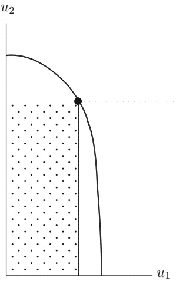
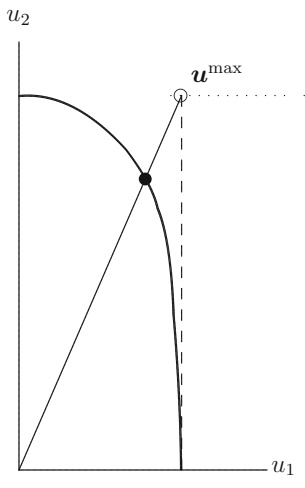
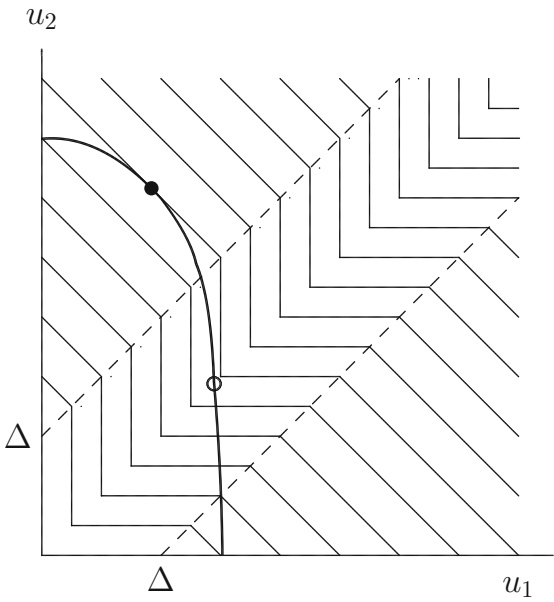
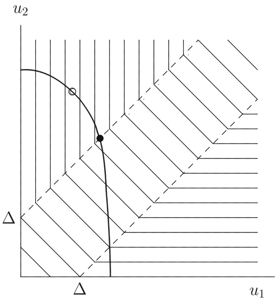

**ORIGINAL - SURVEY OR EXPOSITION**

# A guide to formulating fairness in an optimization model

**Violet Xinying Chen**<strong>1</strong> **· J. N. Hooker**<strong>2</strong>

Accepted: 24 February 2023 / Published online: 7 April 2023

© The Author(s), under exclusive licence to Springer Science+Business Media, LLC, part of Springer Nature 2023

## Abstract

Optimization models typically seek to maximize overall benefit or minimize total cost. Yet fairness is an important element of many practical decisions, and it is much less obvious how to express it mathematically. We provide a critical survey of various schemes that have been proposed for formulating ethics-related criteria, including those that integrate efficiency and fairness concerns. The survey covers inequality measures, Rawlsian maximin and leximax criteria, convex combinations of fairness and efficiency, alpha fairness and proportional fairness (also known as the Nash bargaining solution), Kalai–Smorodinsky bargaining, and recently proposed utility-threshold and fairness-threshold schemes for combining utilitarian with maximin or leximax criteria. The paper also examines group parity metrics that are popular in machine learning. We present what appears to be the best practical approach to formulating each criterion in a linear, nonlinear, or mixed integer programming model. We also survey axiomatic and bargaining derivations of fairness criteria from the social choice literature while taking into account interpersonal comparability of utilities. Finally, we cite relevant philosophical and ethical literature where appropriate.

**Keywords** Fairness · Distributive justice

## 1 Introduction

There is growing interest in incorporating fairness-related criteria into optimization models. Practical applications in health care, disaster management, telecommunications, facility location, and other areas increasingly raise issues related to the fair allocation of resources. Yet it is far from obvious how to formulate such ethical concerns mathematically. While it is normally straightforward to formulate an objective function that reflects efficiency or cost, fairness can be understood in multiple ways, with no generally accepted method for representing any of them in a mathematical idiom. While methods for formulating fairness concerns frequently appear in research papers, they are often discussed and selected in an ad hoc manner.

<small>We thank two anonymous reviewers for extensive comments on earlier drafts of the paper.</small>

<small>B Violet Xinying Chen vchen3@stevens.edu</small>

<small>J. N. Hooker jh38@andrew.cmu.edu</small>

<small>1 Stevens Institute of Technology, Hoboken, USA</small>

<small>Carnegie Mellon University, Pittsburgh, USA</small>

We therefore undertake to provide a survey and assessment of a broad range of fairness criteria that can be incorporated into an optimization model. We focus on a representative selection of what appear to be the most interesting, best known, or most useful mathematical formulations of fairness in the literature, with particular emphasis on those that incorporate efficiency as well as fairness. We do not attempt to impose a single definition of fairness because different definitions are appropriate for different contexts. Our aim, rather, is to elucidate the fairness concepts implicit in mathematical formulations that have been proposed. We present these fairness formulations in clusters, each characterizing a different type of fairness concept, to guide systematic comparisons among them and assist the selection of a fitting formulation in practice. In addition, we indicate how to convert each formulation to a linear, nonlinear, or mixed integer programming model.

Specifically, we cover several inequality metrics, some of the more popular group parity measures used in machine learning, Rawlsian maximin and leximax criteria, various convex combinations of these with efficiency criteria, alpha fairness and proportional fairness (the latter also known as the Nash bargaining solution), the Kalai–Smorodinsky bargaining solution, and recently proposed fairness-threshold and fairness-threshold criteria for combining utilitarianism with maximin and leximax criteria.

In the interest of brevity, we omit some fairness criteria that are designed for particular domains or difficult to optimize. These include several of the fairness measures developed specifically for telecommunications networks (cited in Sect. 4.1). We also omit entropy-based metrics from the economics literature due to the computational challenge they pose, such as the Theil index (Theil, 1967; Cowell & Kuga, 1981) and the related Atkinson index (Atkinson, 1975). Finally, we cover only the best known of the many statistical bias based metrics that have been proposed for machine learning, as described in Sect. 5.

To our knowledge, there is no existing survey of this kind. Karsu and Morton (2015) discuss several models in their excellent survey of inequality-averse optimization, along with applications and some underlying mathematical theory. A recent survey by De-Arteaga et al. (2022) summarizes popular fairness measures applicable to detecting and mitigating algorithmic bias, with an emphasis on practical applications in business analytics. Ogryczak et al. (2014) survey fairness criteria that have been used in communication networks and location models, with a discussion of their properties and relationship with leximax criteria. Our contribution differs from these in that it aims for broad coverage of fairness concepts while providing a practical guide for the analyst who wishes to incorporate fairness concerns into an optimization model of a given application. It accordingly includes a focus on how to formulate the various criteria for computationally tractable solution by mathematical programming software. It also covers fairness formulations developed since the earlier surveys, as well as fairness measures from machine learning.

While we make no attempt to resolve underlying philosophical issues, we provide references to relevant philosophical and ethical literature as specific fairness criteria are considered. General philosophical surveys of fairness concepts can be found in Bartneck et al. (2021), Binns (2018), Coeckelbergh (2022), Hellman (2011), Lamont and Favor (2017), and Roemer (1996). In addition, Schminke et al. (2015) and Colquitt and Rodell (2015) discuss fairness concepts from an empirical and organizational perspective.

We begin below by stating a generic optimization problem that provides a framework for the discussion to follow. In particular, we suppose that each fairness criterion we consider is encapsulated in a social welfare function (SWF) that serves as the objective function or a constraint of the optimization model. We next briefly review results from social choice theory that derive certain SWFs from axioms of rational choice, taking into account the degree of interpersonal comparability of utilities. We also note bargaining procedures that can be seen as justifying certain SWFs. The fairness criteria we study in subsequent sections (aside from the convex combinations in Sect. 7) are summarized in Tables 1, 2and 3, which indicate the section of the paper that deals with each. The two concluding sections of the paper draw on the foregoing discussion to suggest some general guidelines for selecting a fairness criterion for a given application. The “Appendix” presents optimization models for all of the SWFs listed in the tables.

Table 1 Summary of fairness criteria, part 1

| Criterion | Nonlin? | Integer? | Comments |
| --- | --- | --- | --- |
| Inequality measures |  |  |  |
| Relative range (Sect.4.1) | No | No | The spread between min and max utilities, normalized by the mean |
| Relative mean deviation (Sect.4.1) | No | No | The normalized average deviation from the mean. Takes in account all utilities, rather than only the two extremes as in relative range |
| Coefficient of variation (Sect.4.1) | Yes | No | The normalized standard deviation |
| Jain's index (Sect.4.1) | Yes | No | A well-known metric developed for telecommunication networks. It is a strictly monotone function of the coefficient of variation |
| Gini coefficient (Sect.4.2) | No | No | Perhaps the best known measure of inequality. Proportional to the area between the Lorenz curve and a diagonal line representing perfect equality. Lies in the interval [0,1], with 0 indicating perfect equality |
| Hoover index (Sect.4.2) | No | No | The fraction of total utility that must be redistributed to achieve perfect equality. Also related to the Lorenz curve, and proportional to the relative mean deviation |
| Groupparity measures |  |  |  |
| Demographic parity (Sect.5.1) | No | No | The parity of selection rates for a benefit across two groups |
| Equalized odds (Sect.5.2) | No | No | The parity of selection rates among qualified (or unqualified) individuals across two groups |
| Accuracy parity (Sect.5.3) | No | No | The parity of accuracy rates (fraction of individuals correctly selected or rejected) across two groups |
| Predictive rate parity (Sect.5.4) | Yes | Yes | The parity of qualification rates among selected across two groups |

The second and third columns indicate whether the fairness model introduces nonlinearity or integer variables

Table 2 Summary of fairness criteria, part 2

<table><tr><td>Criterion</td><td>Nonlin?</td><td>Integer?</td><td>Comments</td></tr><tr><td colspan="4">Fairness for the disadvantaged</td></tr><tr><td>Maximin (Sect. 6.1)</td><td>No</td><td>No</td><td>Maximizes the minimum utility.Based on the Rawlsian principle that inequality is justified only to the extent that it improves the welfare of the worst off. Once maximin is obtained, does not consider the welfare of other disadvantaged individuals</td></tr><tr><td>Leximax (Sect. 6.1)</td><td>No</td><td>No</td><td>Maximizes the welfare of the worst off, then the second worst off, and so forth. Considers the welfare of all disadvantaged individuals but requires solving a sequence of optimization problems</td></tr><tr><td>McLoone index (Sect. 6.2)</td><td>No</td><td>Yes</td><td>Compares total utility of those below the median to what they would enjoy if brought up to the median. Concerned only with the welfare of the lower half</td></tr><tr><td colspan="4">Combining efficiency and fairness—Classical methods</td></tr><tr><td>Alpha fairness (Sect. 8.1)</td><td>Yes</td><td>No</td><td>Parameter  $\alpha$  regulates fairness vs efficiency, with  $\alpha = 0$  corresponding to a pure utilitarian and  $\alpha = \infty$  to a pure maximin criterion</td></tr><tr><td>Proportional fairness (Sect. 8.1)</td><td>Yes</td><td>No</td><td>Special case of alpha fairness with  $\alpha = 1$ , also known as the Nash bargaining solution, and used in engineering applications. Has been justified with axiomatic and bargaining arguments</td></tr><tr><td>Kalai–Smorodinsky bargaining (Sect. 8.2)</td><td>No</td><td>No</td><td>Maximizes minimum relative concession by maximizing equal fraction of each party’s potential gain. Has been defended as outcome of a bargaining procedure and tends to favor those with greater opportunity</td></tr></table>

## 2 Generic optimization problem

Optimization has long been used to support decision making, and many practical optimization problems involve the allocation of resources. For example, policymakers must allocate health resources in the Covid-19 pandemic, and airline crew schedulers allocate flight tasks. In these applications, optimization offers the useful flexibility of including constraints, such as resource capacity, to restrict feasible decisions. In recent years, optimization also has been extensively studied in artificial intelligence, especially in machine learning, where optimization models are often core components.

Table 3 Summary of fairness criteria, part 3

<table><tr><td>Criterion</td><td>Nonlin?</td><td>Integer?</td><td>Comments</td></tr><tr><td colspan="4">Combining efficiency and maximin fairness—Threshold methods</td></tr><tr><td>Efficiency threshold (Sect. 9.1)</td><td>No</td><td>Yes</td><td>Uses a maximin criterion until fairness cost of fairness becomes too great, and then switches some parties to a utilitarian criterion. The break point is controlled by parameter Δ, selected so that parties within Δ of the lowest utility are seen as sufficiently disadvantaged to receive greater priority</td></tr><tr><td>fairness threshold (Sect. 9.2)</td><td>No</td><td>No</td><td>Uses a utilitarian criterion until unfairness becomes too great, and then switches some parties to a maximin criterion. The parameter Δ is selected so that parties already more than Δ above the lowest utility are not seen as deserving greater utility if the other utilities remain unchanged</td></tr><tr><td colspan="4">Combining efficiency and leximax fairness—Threshold methods</td></tr><tr><td>Efficiency threshold, predefined priorities (Sect. 10.1)</td><td>No</td><td>Yes</td><td>Maximizes an efficiency threshold function that combines utilitarian and maximin criteria, then applies a leximax criterion to optimal solutions if one or more have a utility spread of Δ or less. Assumes that priorities of the parties can be fixed in advance</td></tr><tr><td>Efficiency threshold, no predefined priorities (Sect. 10.2)</td><td>No</td><td>Yes</td><td>Solves a sequence of optimization problems in which the kth problem determines the kth smallest utility in the socially optimal solution. Each problem assumes the smallest k - 1 utilities have been fixed and maximizes a SWF that combines utilitarian and maximin criteria while giving the kth worst-off party priority that is regulated by Δ</td></tr></table>

Conventional optimization models typically strive for efficiency by maximizing total benefit or minimizing total cost in some sense. Benefit can be measured in many different ways, such as profit, revenue, output, or health outcomes obtained, and cost can be measured by labor, materials, and resources invested or undesirable outputs generated. The common thread in these models is that the benefits and/or costs are dispersed across stakeholders. However, by pursuing an efficiency goal, a conventional optimization model may lead to an unfair distribution of benefits and costs among the stakeholders. Some may receive less than they should, and some more then they should, relative to the others. The task before us is to incorporate fairness into a given optimization model by reformulating the objective function and/or adding constraints.

We begin by supposing that the given optimization model has the form $\operatorname* { m a x } _ { { \pmb x } } \{ f ( { \pmb x } )$ $\pmb { x }   \in   \{ S _ { x } \}$ , where $S _ { x }$ is the feasible set and $f ( { \pmb x } )$ measures the efficiency of the solution x in a desired sense. We also assume that the solution x results in a distribution of utilities $\pmb { u }   =   ( u _ { 1 } , \dots , u _ { n } )$ to stakeholders $1 , \ldots , n ,$ respectively, and we are concerned about the fairness of the distribution. These stakeholders could be individuals, groups, organizations, geographic regions, or other entities. Their utilities are determined by a vector-valued utility function $\pmb { u } = \pmb { U } ( \pmb { x } ) = ( U _ { 1 } ( \pmb { x } ) , \dots , U _ { n } ( \pmb { x } ) )$ whose value depends on x. These utilities could be measured in terms of profit, negative cost, health outcomes, or some other benefit the stakeholders receive.

In the discussion to follow, various fairness criteria are represented by social welfare functions $W ( \pmb { u } )$ . Formally, a social welfare function (SWF) aggregates a utility vector u into a scalar value representing the desirability of the distribution u. A wide variety of fairness concepts can be formulated by selecting suitable SWFs. In particular, SWFs can be designed to balance fairness with efficiency.

One can use a SWF to introduce fairness into a problem by formulating a welfare optimizing model or a welfare constraining model. A welfare maximizing model replaces the original objective function $f ( { \pmb x } )$ with $W ( \pmb { u } )$ and therefore maximizes social welfare, while a welfare constraining model maximizes the original objective function $f ( { \pmb x } )$ subject to a lower bound on $W ( \pmb { u } )$ . A welfare maximizing model has the generic form

$$
\max _ {\boldsymbol {u}, \boldsymbol {x}} \left\{W (\boldsymbol {u}) \mid \boldsymbol {u} = U (\boldsymbol {x}), \boldsymbol {x} \in S _ {x} \right\}\tag{1}
$$

and a welfare constraining model has the form

$$
\max _ {\boldsymbol {u}, \boldsymbol {x}} \left\{f (\boldsymbol {x}) \mid W (\boldsymbol {u}) \geq \mathrm{LB}, \boldsymbol {u} = \boldsymbol {U} (\boldsymbol {x}), \boldsymbol {x} \in S _ {x} \right\}\tag{2}
$$

where LB is a lower bound on social welfare, representing the minimum acceptable level of fairness.

We use a simple medical triage problem to exemplify both models, starting with a welfare maximizing model. There are n patients who require treatment, but subject to a limited budget B. Patient i receives treatment when binary variable $x _ { i } = 1$ , and the cost of treatment is $c _ { i }$ . The resulting utility $u _ { i }$ experienced by patient i, measured in quality-adjusted life years (QALYs), is $a _ { i }$ without treatment and $a _ { i }   +   b _ { i }$ with treatment. Thus the utility function is given by $U _ { i } ( { \pmb x } ) = a _ { i } + b _ { i } x _ { i }$ for $i = 1 , \ldots , n$ . If the original objective function $f ( { \pmb x } )$ measures total QALYs that result from the treatment decisions, maximizing $f ( { \pmb x } )$ may divert all resources away from patients who are the most expensive to treat. Physicians may wish to avoid this by replacing $f ( { \pmb x } )$ with a SWF that takes into account the distribution of utilities across patients. This leads to the welfare maximizing model

$$
\max _ {\boldsymbol {u}, \boldsymbol {x}} \left\{W (\boldsymbol {u}) \Bigg | \begin{array}{l} \sum_ {i} c _ {i} x _ {i} \leq B \\ u _ {i} = a _ {i} + b _ {i} x _ {i}, x _ {i} \in \{0, 1 \}, \text {all} i \end{array} \right\}
$$

The choice of social welfare function $W ( \pmb { u } )$ should reflect how fairness and efficiency are to be understood and balanced in this context.

A welfare constraining model is appropriate when $f ( { \pmb x } )$ measures a type of benefit or cost different from that distributed to stakeholders. In the above example, the original objective $f ( { \pmb x } )$ may represent the negation of total cost rather than total QALYs generated. A clinic may wish to minimize cost subject to a lower bound on the social welfare that results from the distribution of health benefits to patients. The clinic’s problem is formulated in the welfare constraining model

$$
\max _ {\boldsymbol {u}, \boldsymbol {x}} \left\{- \sum_ {i} c _ {i} x _ {i} \Bigg | \begin{array}{l} \sum_ {i} c _ {i} x _ {i} \leq B, W (\boldsymbol {u}) \geq L B \\ u _ {i} = a _ {i} + b _ {i} x _ {i}, x _ {i} \in \{0, 1 \}, \text {all} i \end{array} \right\}
$$

Another example might arise when a bank uses machine learning to estimate credit risk when processing mortgage loan applications. The bank may wish to minimize risk while seeking a fair distribution of loans to applicants. Let $x _ { i }$ denote the approved loan amount to applicant i (possibly zero), where $x _ { i }$ is at most the requested loan amount $a _ { i }$ . Since the approved loan is the primary benefit of interest to an applicant, we can define his/her expected utility as $u _ { i } = U _ { i } ( x _ { i } ) = p _ { i } x _ { i }$ , with $p _ { i }$ denoting the likelihood of loan approval. We suppose the bank is able to determine $p _ { i }$ all for applicants, perhaps with a separate estimation model. For an approved loan of amount $x _ { i }$ , the bank is subject to risk $R _ { i } ( x _ { i } )$ , where $R _ { i }$ is a risk function based on applicant $i ^ { \circ } \mathbf { s }$ profile. The bank’s objective is to grant loans within the available budget $B ,$ so that the overall risk is minimized and the utility distribution among applicants is reasonably fair. The resulting welfare constraining model is

$$
\min _ {\boldsymbol {u}, \boldsymbol {x}} \left\{\sum_ {i} R _ {i} \left(x _ {i}\right) \Bigg | \begin{array}{l} \sum_ {i} x _ {i} \leq B, W (\boldsymbol {u}) \geq \mathrm{LB} \\ u _ {i} = p _ {i} x _ {i}, x _ {i} \in [ 0, a _ {i} ], \text {all} i \end{array} \right\}
$$

where the social welfare function W(u) reflects how fairness should be interpreted in this context. The lower bound LB should be the minimum acceptable level of fairness. Alternatively, when the bank aims to grant loans to achieve the fairest utility distribution to applicants while restricting the risks to a reasonable level, a welfare maximizing model subject to budget and risk constraints is appropriate.

Welfare maximizing models have the advantage that they allow one to regulate the tradeoff between efficiency and fairness by using a SWF that is designed for this purpose. On the other hand, welfare constraining models may be preferable when there is no suitable SWF that incorporates the original objective as well as fairness, or when one wishes to impose a minimum acceptable level of fairness.

To simplify notation, we will suppose henceforth that the constraint $\pmb { u } = U ( \pmb { x } )$ is encoded in constraints represented by $( { \pmb u } , { \pmb x } ) \in S$ , so that problems (1) and (2) respectively become

$$
\max _ {\boldsymbol {u}, \boldsymbol {x}} \left\{W (\boldsymbol {u}) \mid (\boldsymbol {u}, \boldsymbol {x}) \in S \right\}\tag{3}
$$

$$
\max _ {\boldsymbol {u}, \boldsymbol {x}} \left\{f (\boldsymbol {x}) \mid W (\boldsymbol {u}) \geq \mathrm{LB}, (\boldsymbol {u}, \boldsymbol {x}) \in S \right\}\tag{4}
$$

Thus $( { \pmb u } , { \pmb x } ) \in S$ if and only if $\pmb { u } = U ( \pmb { x } )$ and $\pmb { x } \in S _ { \pmb { x } }$

A major element of this paper is showing (in the “Appendix”) how to write the optimization problem (3) or (4) in a form suitable for one of the highly advanced mathematical programming solvers now available. Naturally, the difficulty of (3) and (4) depends to a great degree on the nature of the constraints that describe the feasible set S. We focus here on any computational difficulties introduced by incorporating fairness. In particular, we indicate for each SWF in Tables 1, 2 and 3 whether formulating it adds nonlinearities or integer variables to an optimization model. Thus, for example, if the constraints $( { \pmb x } , { \pmb u } )   \in   S$ are linear, the resulting model is a linear programming (LP) problem if the SWF adds no nonlinearities or integer variables, and it is a mixed integer/linear programming (MILP) if the SWF adds only integer variables. Powerful solvers exist for LP and MILP models, as well as for some types of nonlinear models. Specifics are discussed in the “Appendix”.

## 3 Axiomatic and bargaining derivations

Certain social welfare functions discussed below have interesting axiomatic or bargaining derivations. These derivations, however, rely on assumptions that may limit their applicability to practical modeling situations. In particular, the classical axiomatic results assume that utilities can be meaningfully compared across individuals only to a limited degree.

The use of a social welfare function presupposes a certain amount of interpersonal comparability, and different SWFs presuppose different types of comparability. In fact, by adopting certain additional axioms, one can show that assuming a given type of interpersonal comparability necessarily results in a SWF of a particular form, such as utilitarian, maximin, or proportional fairness (Roberts, 1980; Gaertner, 2009).

Interpersonal comparability is characterized by defining an invariance transformation $\pmb { \phi } ( \pmb { u } ) = ( \phi _ { 1 } ( u _ { 1 } ) , \dots , \phi _ { n } ( u _ { n } ) )$ . This is a transformation of utility vectors that does not alter the social ranking of the vectors. Thus u is preferable to $\pmb { u } ^ { \prime }$ if and only if it remains preferable after applying an invariance transformation; that is, $W ( { \pmb u } ) > W ( { \pmb u } ^ { \prime } )$ if and only if $W ( \pmb { \phi } ( \pmb { u } ) ) > W ( \pmb { \phi } ( \pmb { u } ^ { \prime } ) )$ . For example, unit comparability corresponds to an invariance transformation $\phi ( u )$ of the form $\phi _ { i } ( u _ { i } )   =   \beta u _ { i }   +   \gamma _ { i }$ , where $\beta   >   0$ is independent of i. Thus gains and losses of utility can be compared across individuals, but the relative level of utilities cannot. Level comparability corresponds to an invariance transformation of the form $\pmb { \phi } ( \pmb { u } ) = ( \phi _ { 0 } ( u _ { 1 } ) , \dots , \phi _ { 0 } ( u _ { n } ) )$ , where $\phi _ { 0 }$ is strictly increasing. This allows the relative utility levels of different individuals to be compared. That is, one can say meaningfully that one individual enjoys more utility than another.

Given two additional axioms, unit comparability implies that the SWF must be utilitarian, which means that that it is simply the total utility $\sum _ { i } u _ { i }$ . One axiom is anonymity, which says that interchanging individuals has no effect on the ranking of utility vectors. Thus $W ( \pmb { u } )   >   W ( \pmb { u } ^ { \prime } )$ if and only if W $\mathbf { \nabla } ^ { \prime } ( \pmb { u } _ { \pi } ) > \mathbf { \nabla } W ( \pmb { u } _ { \pi } ^ { \prime } )$ , where $\pmb { u } _ { \pi }$ is a permutation of the utilities in u. The second is a strict Pareto axiom, which requires that $W ( { \pmb u } ) \geq W ( { \pmb u } ^ { \prime } ) { \mathrm { ~ i f ~ } } { \pmb u } \geq { \pmb u } ^ { \prime }$ , and $W ( \pmb { u } ) > W ( \pmb { u } ^ { \prime } )$ if in addition $u _ { i } > u _ { i } ^ { \prime }$ for some i .

Given these same two axioms, level comparability implies that the social welfare criterion must be either maximin or minimax, meaning that $W ( \pmb { u } )$ is either mini $\{ u _ { i } \}   \mathrm { o r - m a x } _ { i } \{ u _ { i } \}$ . We obtain the maximin criterion in particular (famously defended by John Rawls and discussed below in Sect. 6.1) if we adopt an additional axiom that a maximin outcome is preferable to a minimax outcome.1

It is important to note that the unit comparability assumption implies not only that utilities across persons have unit comparability, but that they have no greater degree of comparability, and similarly for level comparability (Hooker, 2013). Thus, the utilitarian principle is derived from the rather strict premise that the relative level of utility across individuals cannot be meaningfully compared. This already rules out a Rawlsian criterion, which requires identifying the smallest individual utility. Similarly, the maximin principle is derived from the premise that gains and losses in individual utilities cannot be meaningfully quantified, which rules out a utilitarian criterion.

Interpersonal comparability is also restricted in the classical proof of the Nash bargaining solution (Nash, 1950), also known as proportional fairness (Sect. 8.1). Here the assumption is scale invariance, which corresponds to an invariance transformation $\phi$ of the form $\phi _ { i } ( u _ { i } ) =$ $\beta _ { i } u _ { i }$ , where each $\beta _ { i }   >   0 .$ . This already rules out both utilitarian and Rawlsian criteria. The

<small>1 We assume, with no significant loss of generality for present purposes, that social welfare is a function solely of the utility vector u. If we formulate social welfare as a function of x and the utility functions U then i (x), we need an independence axiom to derive the utilitarian result. An additional separability axiom is required to prove the maximin/minimax result.</small>

Nash bargaining solution can be derived if we also assume anonymity and Pareto axioms, along with the independence of irrelevant alternatives. The last essentially says that if $u ^ { * }$ is the Nash bargaining solution for a given feasible set of utilities, it remains the solution if the set is reduced without excluding $u ^ { * }$ . If we replace this independence axiom with a monotonicity property (discussed in Sect. 8.2), while retaining scale invariance, we obtain the Kalai–Smorodinsky bargaining solution (Kalai & Smorodinsky, 1975).

Full interpersonal comparability tends to be assumed in practical optimization models, since utility is often identified with profit, negative cost, or other forms of benefit that are routinely compared across individuals. The classical axiomatic results surveyed here are therefore not directly applicable in such cases. Nonetheless, one must bear in mind that utilitarian and Rawlsian criteria presuppose at least unit and level comparability, respectively, and other SWFs may presuppose greater degrees of interpersonal comparability.

A more recent axiomatic result of Lan and Chiang (2011) does not explicitly rely on an interpersonal noncomparability assumption. It states that a SWF satisfying certain axioms must belong to a certain broad family of functions, where specific members of this family include alpha fairness (of which proportional fairness is a special case) as well as maximin and minimax criteria. As we note in Sect. 8.1, an axiom of partition is key to the result and is rather difficult to assess in a practical context. In such cases, it may be more natural to judge the plausibility of an SWF itself than the set of axioms that lead to it.

Bargaining justifications have also been given for certain SWFs. For example, Harsanyi (1977), Rubinstein (1982), and Binmore et al. (1986) show that the Nash solution is the (asymptotic) outcome of certain rational bargaining procedures. Similar arguments can be advanced for the Kalai–Smorodinsky bargaining solution. Sections 8.1 and 8.2 describe the bargaining procedures in greater detail. They typically assume that there is a default position at which bargaining starts, and to which the parties revert if negotiation fails. The default position has an influence on the outcome of bargaining even when it succeeds, and a unfair starting point may lead to an outcome that parties consider unfair. Aside from this, it is a fundamental philosophical question as to whether procedural justice (which one might claim is achieved by a fair negotiation process) can be relied upon to produce substantive justice (a fair outcome) (Nozick, 1974; Rawls, 1971; Scanlon, 2003; Cropanzana et al., 2007). These considerations must be taken into account when assessing a bargaining argument for a particular SWF.

## 4 Inequality measures

Equality is not the same concept (or cluster of concepts) as fairness, but there are contexts in which one may wish to achieve fairness by reducing the level of inequality. No philosophical consensus exists on the relationship between equality and fairness. Views range from the assertion that fairness imposes an irreducible obligation to promote equality for its own sake, even at the cost of reducing total utility, to the claim that fairness requires equality only when greater equality would lead to greater total utility (Frankfurt, 2015; Parfit, 1997; Scanlon, 2003). In any event, an inequality metric can be appropriate in a context where a specifically egalitarian distribution is the primary goal, or where it is believed that greater fairness can be achieved by reducing inequality.

Inequality measures have been used for fairness-related optimization in a broad range of applications. Examples of these papers are summarized in Karsu and Morton (2015). More recently, inequality measures are also considered in the growing area of algorithmic fairness.

For instance, Leonhardt et al. (2018) study Gini coefficient type measures for estimating the disparity in user satisfaction and recommendation quality of recommender systems. Speicher et al. (2018) and Sühr et al. (2019) respectively adopt a generalized entropy index to evaluate the degree of unfairness in predictors trained by machine learning and in two-sided matching platforms.

Several statistics have been proposed for measuring inequality (Cowell, 2000; Jenkins & Van Kerm, 2011), and we discuss some of the best-known ones: the relative range, relative mean deviation, coefficient of variation, Jain’s index, the Gini coefficient, and the Hoover index. Linearized optimization models are presented in the “Appendix”. The McLoone index can also be regarded as a measure of inequality, but we consider it in the next section as measuring fairness for the disadvantaged.

Since greater inequality is viewed as less fair, thus less desirable, SWFs in this section are written as the negation of the inequality measure. All of the inequality measures we consider are normalized by the mean utility and are therefore unchanged after multiplying the utilities by a common positive scalar. Thus, increasing everyone’s utility (by the same factor) has no effect on social welfare as measured by the criteria in this section. This is a distinction from the SWFs we review in Sects. 6–10, which consider overall absolute welfare levels.

## 4.1 Measures of relative dispersion

The relative range of utilities is an inequality metric that, when negated, yields the SWF

$$
W (\boldsymbol {u}) = - (1 / \bar {u}) \big (u _ {\max} - u _ {\min} \big)
$$

where $u_{\max} = \max_{i} \{ u_{i} \}, u_{\min} = \min_{i} \{ u_{i} \}$ , and $\begin{array} { r } { \bar { u } \; = \; ( 1 / n ) \sum _ { i } u _ { i } } \end{array}$ . Although the SWF is nonlinear, it is a ratio of affine functions and can therefore be linearized using the change of variable employed in linear-fractional programming (Charnes & Cooper, 1962). The “Appendix” shows how this and the other inequality metrics considered here can be reformulated using a similar change of variable.

Another dispersion metric is the relative mean deviation, which measures inequality more comprehensively by considering all utilities rather than only the minimum and maximum. The SWF is

$$
W (\boldsymbol {u}) = - (1 / \bar {u}) \sum_ {i} | u _ {i} - \bar {u} |
$$

and can be linearized.

The coefficient of variation is the normalized standard deviation. It may be appropriate when large deviations from the mean are disproportionately significant, but it has the possible drawback of introducing an irreducibly nonlinear objective function. The SWF is

$$
\left| W (\boldsymbol {u}) = - \frac {1}{\bar {u}} \left[ \frac {1}{n} \sum_ {i} (u _ {i} - \bar {u}) ^ {2} \right] ^ {\frac {1}{2}} \right|
$$

Although the numerator is nonaffine, the change of variable mentioned earlier yields a convex objective function (as noted in the “Appendix”).

Jain’s index (Jain et al., 1984) is perhaps the best-known of the several fairness measures that have been developed specifically for telecommunications. It is given by the SWF

$$
W (\boldsymbol {u}) = \bar {u} ^ {2} \Bigl (\frac {1}{n} \sum_ {i} u _ {i} ^ {2} \Bigr) ^ {- 1} = \frac {1}{1 + c _ {v} ^ {2}}
$$

where $c _ { v }$ is the coefficient of variation. Larger values of the index indicate greater equality, with 1 corresponding to perfect equality and $1 / n$ to perfect inequality. Since the index is a strictly decreasing function of $c _ { v } ,$ , it can be maximized by maximizing the SWF given above for the coefficient of variation. Other metrics developed specifically for networks and telecommunications include QoE fairness (Georgopoulos et al., 2013; Hoßfeld et al., 2018), TCP fairness (Pokhrel et al., 2016), G’s fairness index, and Bossaert’s fairness index (Mehta, 2020).

## 4.2 Gini coefficient and Hoover index

The Gini coefficient is by far the best known measure of inequality, as it is routinely used to measure income and wealth inequality (Gini, 1912; Yitzhaki & Schechtman, 2013). It is proportional to the area between the Lorenz curve and a diagonal line representing perfect equality and therefore vanishes under perfect equality. The Lorenz curve plots the cumulative proportion of wealth or benefits in the bottom $q \%$ of the population, thus indicating the degree of inequality via its deviation from the perfect equality line. Different utility distributions can, of course, have the same Gini coefficient. The SWF is $W ( \pmb { u } ) = - G ( \pmb { u } )$ , where

$$
G (\boldsymbol {u}) = \frac {1}{2 \bar {u} n ^ {2}} \sum_ {i, j} | u _ {i} - u _ {j} |
$$

Again due to linear-fractional programming, the Gini criterion can be linearized.

The Hoover index is also related to the Lorenz curve, as it is proportional to the maximum vertical distance between the Lorenz curve and a diagonal line representing perfect equality (Hoover, 1936). It is also proportional to the relative mean deviation and can be interpreted as the fraction of total utility that would have to be redistributed to achieve perfect equality. The SWF is

$$
W (\boldsymbol {u}) = - \frac {1}{2 n \bar {u}} \sum_ {i} | u _ {i} - \bar {u} |
$$

The Hoover index can be minimized by solving the same model as for the relative mean deviation.

## 5 Group parity measures

The mathematical formulation of fairness has become a major issue in the field of machine learning, because machine learning algorithms are employed to make high-stake decisions and require precisely coded criteria for assessing whether those decisions are fair. The focus of fair machine learning has been primarily on mitigating biases against historically disadvantaged groups and ensuring that certain minority groups, often defined by law, receive fair treatment (Angwin et al., 2016; Dieterich et al., 2016; Chouldechova, 2017). The AI community has seized upon traditional statistical measures of classification errors to evaluate inequality in classification performance among groups. These measures are often referred to as group parity measures, even though they actually measure the degree of disparity rather than parity. Like the previous inequality measures, group parity measures focus on equality as a proxy of fairness, but a key difference between the two is that group parity measures compare equality between two specified groups instead of among individuals generally.

In a typical scenario, a machine is trained to make yes-no decisions as to who receives a certain benefit, such as a mortgage loan, a job interview, parole, and so forth. A large training set is used to train the machine to select appropriate individuals as reliably as possible, based on various features they possess. The aim is to predict who will pay their mortgage, become a valued employee, or avoid future crimes. These tasks conventionally use supervised learning methods to train predictive models from labelled data with a standard efficiencydriven objective to maximize prediction accuracy. In particular, majority of the literature on fair machine learning studies fairness in classification, and we focus on this setup as well.

A fairness test compares decisions for a minority or protected group with those for the remainder of the population. Four statistics are defined for the two groups:

TP (true positives): the number of individuals correctly selected for a benefit.

FP (false positives): the number of individuals incorrectly selected.

TN (true negatives): the number of individuals correctly rejected.

FN (false negatives): the number of individuals incorrectly rejected.

Various metrics involving these four statistics are compared between the minority group and the rest of the population, each yielding a measure of parity between the groups.

We will set $a _ { i } = 1$ when individual i should be selected, and $a _ { i } = 0$ otherwise. We let N be an index set for individuals in the protected group, and $N ^ { \prime }$ for those in the remainder of the population. Rather than a vector u of utilities distributed across individuals, we have a vector $\boldsymbol { \delta } = ( \delta _ { 1 } , \ldots , \delta _ { n } )$ of individual $0 { - } 1$ decisions, where $\delta _ { i } = 1$ indicates that individual i is selected. We can view social welfare as a function $W ( \pmb { \delta } )$ of these decisions rather than a function $W ( \pmb { u } )$ of utilities. Of course, one could view $\delta$ as a simplified representation of utilities in which each individual receives utility 0 or 1. A typical fair machine learning model applies $W ( \pmb { \delta } )$ to seek fairness by bounding $W ( \pmb { \delta } )$ rather than maximizing $W ( \pmb { \delta } )$ . Therefore, the model is trained using an optimization problem (4) that maximizes some other objective, e.g. an efficiency objective based on the classification accuracy, subject to these bounds.

Unfortunately, it is unclear how the group parity implications of a decision vector δ should be measured. There are a wide variety of classification error metrics, some of which are pairwise incompatible, with no consensus on which is most suitable for any given application (e.g. Kleinberg et al., 2016; Friedler et al., 2016). In addition, the focus on classification error affords a rather narrow perspective on the fairness problem, because the underlying concern is generally fairness in a broader sense with respect to utilities. More explicitly, discrimination against a protected group is often undesirable because the resulting classification disparity between groups leads to an unfair distribution of utilities. Finally, there is no obvious criterion for which groups should be designated as protected, unless one is content to recognize only those sanctioned by law.

The AI community might well consider the option of training machines to maximize a more comprehensive measure of social welfare, such as one of those discussed in later sections, to better align fairness concepts with social well-being. We are already beginning to see some movement in this direction (Heidari et al., 2018; Corbett-Davies $\&$ Goel, 2018; Heidari et al., 2019; Hu $\&$ Chen, 2020). The classification vector $\delta$ can be viewed as a set of decision variables on which utilities depend, perhaps as given by a utility function $\pmb { u } = \pmb { U } ( \pmb { \delta } )$ Then social welfare is assessed by a function $W ( \pmb { u } )$ as in model (3). In the simplest case, one could set $U _ { i } ( \delta _ { i } ) = c _ { i } \delta _ { i } + d _ { i }$ , where $c _ { i } + d _ { i }$ is the utility experienced by individual i if selected, and $d _ { i }$ if not selected. Of course, legal requirements may dictate that bounds are placed directly on one of the parity measures.

In any event, the discussion below is restricted to fairness metrics $W ( \pmb { \delta } )$ defined directly in terms of the classification decision vector δ. We consider four of the best known group parity metrics: demographic parity, equalized odds, accuracy parity, and predictive rate parity. For brevity, we refer to individuals in the protected group as minority individuals, and those in the remainder of the population as majority individuals. As in Sect. 4, we view the SWF as the negation of disparity so as to pose the problem as one of maximizing social welfare.

These four measures are among a large number of fairness metrics that have been proposed for machine learning. Verma and Rubin (2018) provide a comprehensive survey of fairness metrics in classification, many of which are similar to those discussed here. Beyond these, the Matthews correlation coefficient (Matthews, 1975; Chicco & Jurman, 2020) is often regarded as the most comprehensive measure of classification accuracy, but it corresponds to a complicated, nonconvex SWF that could be quite difficult to optimize. Counterfactual fairness (Kusner et al., 2017; Russell et al., 2017) is another useful scheme that aims to avoid undesirable confounding factors for evaluating fairness in classification, and it is unclear at this point how to incorporate this scheme into an optimization model. Beyond fairness in classification, recent research has also seen progress on fairness in unsupervised learning (e.g., Abraham et al., 2019, Deepak & Abraham, 2020) and reinforcement learning (e.g., Weng, 2019, Siddique et al., 2020). We do not discuss these machine learning frameworks, as they are difficult to interpret as optimization models even without any fairness consideration.

## 5.1 Demographic parity

The simplest group parity metric is based on demographic parity, also known as proportional/statistical parity. It is achieved when the fraction of minority individuals selected is the same as the fraction of majority individuals selected. It is defined by comparing the ratio

$$
(\mathrm{TP} + \mathrm{FP}) / (\mathrm{TP} + \mathrm{FP} + \mathrm{TN} + \mathrm{FN})
$$

across the two groups. The social welfare function is $W ( \pmb { \delta } ) = 1 - | B ( \pmb { \delta } ) |$ , where

$$
B (\boldsymbol {\delta}) = \frac {1}{| N |} \sum_ {i \in N} \delta_ {i} - \frac {1}{| N ^ {\prime} |} \sum_ {i \in N ^ {\prime}} \delta_ {i}\tag{5}
$$

Thus $0 \leq W ( \pmb { \delta } ) \leq 1$ , and complete parity is obtained when $W ( \pmb { \delta } ) = 1$

Since Dwork et al. (2012) proposed the use of demographic parity for fairness in classification, it has been widely studied and applied. Despite its popularity, critics of demographic parity view the measure as unsuitable for most practical purposes because it requires strict equality of outcomes. For example, it would discriminate against a minority group that happens to be more qualified for loans than the majority on the average, since it requires that a minority individual receive a loan with no greater probability than a majority individual.

## 5.2 Equalized odds

The equalized odds metric is based on two related but distinct criteria. One is that the fraction of qualified minority persons selected is the same as the fraction of qualified majority persons selected (Hardt et al., 2016). The other is that the fraction of unqualified minority persons selected is the same as the fraction of unqualified majority persons selected (Zafar et al., 2017). The former is also known as equality of opportunity and is defined by comparing the ratio $\mathrm { T P } / ( \mathrm { T P } + \mathrm { F N } )$ . It has the SWF $W ( \pmb { \delta } ) = 1 - | B ( \pmb { \delta } ) |$ across the two groups, where

$$
B (\delta) = \frac {\sum_ {i \in N} a _ {i} \delta_ {i}}{\sum_ {i \in N} a _ {i}} - \frac {\sum_ {i \in N ^ {\prime}} a _ {i} \delta_ {i}}{\sum_ {i \in N ^ {\prime}} a _ {i}}\tag{6}
$$

The latter criterion is based on the ratio $\mathrm{FP} / (\mathrm{FP} + \mathrm{TN})$ and again has the SWF $W ( \pmb { \delta } )   =$ $1 - | B ( \pmb { \delta } ) |$ , but with

$$
B (\delta) = \frac {\sum_ {i \in N} (1 - a _ {i}) \delta_ {i}}{\sum_ {i \in N} (1 - a _ {i})} - \frac {\sum_ {i \in N ^ {\prime}} (1 - a _ {i}) \delta_ {i}}{\sum_ {i \in N ^ {\prime}} (1 - a _ {i})}\tag{7}
$$

## 5.3 Accuracy parity

The two-sided evaluation in equalized odds can be obviated simply by measuring the fraction of predictions that are accurate, which is the ratio

$$
(\mathrm{TP} + \mathrm{TN}) / (\mathrm{TP} + \mathrm{TN} + \mathrm{FP} + \mathrm{FN})
$$

The SWF is $W ( \pmb { u } ) = 1 - | B ( \pmb { \delta } ) |$ , where

$$
B (\delta) = \frac {1}{| N |} \sum_ {i \in N} \left(a _ {i} \delta_ {i} + (1 - a _ {i}) (1 - \delta_ {i})\right) - \frac {1}{| N ^ {\prime} |} \sum_ {i \in N ^ {\prime}} \left(a _ {i} \delta_ {i} + (1 - a _ {i}) (1 - \delta_ {i})\right)\tag{8}
$$

Accuracy parity is less studied than the previous two measures, perhaps because it does not distinguish between true positives and true negatives. It is less often used in the design of fair classifiers than as a tool to evaluate existing classifiers. For example, Berk et al. (2018) list accuracy parity as one of the meaningful fairness definitions in criminal justice risk assessment.

## 5.4 Predictive rate parity

When one wishes to compare what fraction of individuals selected from each group should have been selected, the relevant measure is predictive rate parity, defined as $\mathrm{TP} / (\mathrm{TP} + \mathrm{FP})$ The SWF is $W ( \pmb { \delta } ) = | 1 - B ( \pmb { \delta } ) |$ , with

$$
B (\boldsymbol {\delta}) = \frac {\sum_ {i \in N} a _ {i} \delta_ {i}}{\sum_ {1 \in N} \delta_ {i}} - \frac {\sum_ {i \in N ^ {\prime}} a _ {i} \delta_ {i}}{\sum_ {1 \in N ^ {\prime}} \delta_ {i}}\tag{9}
$$

This disparity measure results in a difficult optimization problem, as explained in the “Appendix”. Predictive parity is primarily considered in risk assessment contexts, such as recidivism prediction (Dieterich et al., 2016; Chouldechova, 2017) and child maltreatment screening (Chouldechova et al., 2018).

## 6 Fairness for the disadvantaged

Rather than focus solely on inequality, fairness measures can prioritize the disadvantaged. Far and away the most famous of such measures is the difference principle of Rawls (1999), a maximin criterion that is based on careful philosophical argument and debated in a vast literature (surveyed in Freeman, 2003, Richardson & Weithman, 1999). The difference principle can be plausibly extended to a lexicographic maximum principle. There is also the McLoone index, which is a statistical measure that emphasizes the lot of the less advantaged.

## 6.1 Maximin and leximax criteria

The Rawlsian difference principle states that inequality should exist only to the extent that it is necessary to improve the lot of the worst-off. It is defended with a social contract argument that, in its simplest form, maintains that the structure of society must be negotiated in an “original position” in which people do not yet know their station in society. Rawls argues that one can rationally assent to the possibility of ending up on the bottom only if one would have been even worse off in any other social structure, whence an imperative to maximize the lot of the worst-off. The principle is intended to apply only to the design of social institutions, and only to the distribution of “primary goods,” which are goods that any rational person would want. Yet it can be adopted as a general criterion for distributing utility, namely a maximin criterion that maximizes the simple SWF $W ( \boldsymbol { u } ) \; = \; \operatorname* { m i n } _ { i } \{ u _ { i } \}$ . This objective is readily linearized.

The maximin criterion has been a popular fairness measure in the technical as well as the philosophical literature. Early works on fair resource allocation, such as bandwidth allocation, often choose the maximin criterion to seek the best possible performance for the worst-off service among services competing for bandwidth (Luss, 1999; Ogryczak & Sliwi ´ ´ nski, 2002; Ogryczak et al., 2008). Recent research has applied the criterion to more diverse problem contexts. For example, Stelmakh et al. (2018) design an algorithm for making paper-reviewer assignment that maximizes the review quality of the most disadvantaged paper, and Nanda et al. (2020) formalize a maximin fairness measure for ridesharing. Samorini et al. (2021) use the maximin criterion in medical appointment scheduling to ensure that disadvantaged groups are not subjected to excessive waiting times. Here the criterion is applied to groups rather than individuals. This is consonant with Rawls’ original theory, which applies it to social classes. The objective function minimizes a linear combination of the worst group waiting time and other cost measures, as discussed in Sect. 7. In addition, the Rawlsian view of fairness is gaining recognition in machine learning as an alternative to the dominant statistical bias based group parity metrics (Hashimoto et al., 2018; Heidari et al., 2019; Shah et al., 2021).

The maximin criterion can force equality even when doing so is very costly in terms of total utility. Suppose, for example that S is defined only by a budget constraint $\textstyle \sum _ { i } x _ { i } \leq B$ (with $\pmb { x } \geq \pmb { 0 } )$ and utility functions $u _ { i }   =   a _ { i } x _ { i }$ . Then the maximin solution equalizes the utilities, with each individual experiencing utility $\textstyle u _ { 0 }   =   B / \sum _ { i } ( 1 / a _ { i } )$ . If individual $k ^ { \prime } \mathbf { s }$ welfare is very expensive to provide, perhaps due to an incurable disease, then $a _ { k }$ is very small, and individual k consumes almost all the resources, $u _ { 0 } / a _ { k }$ . The utility of everyone else is reduced to the same low level $u _ { 0 }$ that can be achieved for individual $k .$ One might impose an upper bound $d _ { k }$ on individual $k ^ { \prime } \mathbf { s }$ resource consumption, but then the maximin criterion is satisfied by reducing everyone’s utility even more, namely to individual $k ^ { \prime } \mathbf { s }$ utility $a _ { k } d _ { k }$ . This leaves unused resources $\textstyle B - d _ { k } a _ { k } \sum _ { i } ( 1 / a _ { i } )$ , but the maximin criterion provides no incentive to distribute them.

The maximin criterion can be plausibly extended to lexicographic maximization (leximax), which can remove the problem of leftover resources in the previous example. Leximax is achieved by first maximizing the smallest utility subject to resrouce constraints, then the second smallest, and so forth. While this can avoid leftover resources, it does not avoid the possibly high cost of equality in the absence of constraints that prevent it. As noted in the “Appendix”, a leximax solution can be computed by solving a sequence of optimization problems.

## 6.2 McLoone index

The McLoone index compares the total utility of individuals at or below the median utility to the utility they would enjoy if all were brought up to the median utility. The index is 1 if nobody’s utility is strictly below the median, and it approaches 0 if the utility distribution has a very long lower tail (on the assumption that all utilities are positive.) The McLoone index benefits the disadvantaged by rewarding equality in the lower half of the distribution, but it is unconcerned by the existence of very rich individuals in the upper half. The SWF is

$$
W (\boldsymbol {u}) = \frac {1}{| I (\boldsymbol {u}) | \bar {u}} \sum_ {i \in I (\boldsymbol {u})} u _ {i}
$$

where $\tilde { u }$ is the median of utilities in u and $I ( \pmb { u } )$ is the set of indices of utilities at or below the median, so that $I ( \pmb { u } ) = \{ i \mid u _ { i } \leq \tilde { u } \}$

The McLoone criterion can be formulated with 0–1 variables and a fractional objective function. This objective function can, in turn, be linearized by a change of variable, resulting in an MILP model if the feasible set S is a polyhedron.

## 7 Convex combinations

We now move to schemes that combine efficiency and fairness. The most obvious approach is to maximize a convex combination of the two:

$$
W (\boldsymbol {u}) = (1 - \lambda) \sum_ {i} u _ {i} + \lambda \Phi (\boldsymbol {u})
$$

where $\Phi ( { \pmb u } )$ is a fairness measure and the utilitarian sum measures efficiency. A perennial problem with convex combinations is that it is difficult to interpret $\lambda ,$ particularly when $\Phi ( { \pmb u } )$ is measured in units other than utility. For example, if we use the Gini coefficient $G ( \pmb { u } )$ as a measure of unfairness, then we must combine utility with a dimensionless quantity $\Phi ( { \pmb u } )   =   1 - G ( { \pmb u } )$ . Larger values of λ give greater weight to equality, but in a practical situation it is unclear how to attribute any meaning to a chosen value of $\lambda .$

Eisenhandler and Tzur (2019) use a product rather than a convex combination of total utility and $1 - G ( \pmb { u } )$ , which nicely reduces to an SWF that is easily linearized:

$$
W (\boldsymbol {u}) = \sum_ {i} u _ {i} - \frac {1}{n} \sum_ {i <   j} | u _ {j} - u _ {i} |
$$

Yet we again have a convex combination of total utility and an equality metric (one that is proportional to the negative mean absolute difference); in particular, it is a convex combination in which $\lambda = 1 / 2$ . This may be reasonable for the intended application, but one may ask why this particular value of $\lambda$ is suitable, and whether other values should be used in other contexts. Aside from this are the general issues raised by using equality as a surrogate for fairness.

Mostajabdaveh et al. (2019) use a linear combination that is equivalent to $\textstyle \sum _ { i } u _ { i } + \mu ( 1 -$ $G ( \pmb { u } ) ) \sum _ { i } u _ { i }$ , where $\mu \in [ 0 , 1 ]$ . This at least combines quantities measured in the same units. Yet we again have the problem of justifying a weight $\mu$ . In fact, this combination is equivalent to the convex combination implied by the Eisenhandler and Tzur criterion, except that $\lambda$ is $\mu / ( 1 + \mu )$ rather than $\frac { 1 } { 2 }$

One can combine utility with the Rawlsian maximin criterion by using the convex combination

$$
W (\boldsymbol {u}) = (1 - \lambda) \sum_ {i} u _ {i} + \lambda \min _ {i} \{u _ {i} \}\tag{10}
$$

This, like the proposal of Mostajabdaveh et al, combines quantities that are measured in the same units. Yet it is again unclear how to select a suitable value of λ. Note that if we index utilities so that $u _ { 1 } \leq \dots \leq u _ { n }$ , (10) is simply a weighted sum $\begin{array} { r } { u _ { 1 } + ( 1 - \lambda ) \sum _ { i > 1 } u _ { i } } \end{array}$ that gives somewhat more weight to the lowest utility. Yet how much more is appropriate?

One can refine criterion (10) by giving gradually decreasing weights $w _ { 1 } > w _ { 2 } > \cdots > w _ { n }$ to the utilities in an SWF of the form

$$
W (\boldsymbol {u}) = \sum_ {i} w _ {i} u _ {i}\tag{11}
$$

where, again, $u _ { 1 } \leq \dots \leq u _ { n }$ . This obviously requires that many weights be assigned rather than one. In addition, since we do not know how to index the utilities by size in advance, we have the difficult modeling challenge of ensuring that weight $w _ { i }$ is assigned to the ith smallest utility. There is a long line of work studying this formulation as the objective function for multi-criteria decision making (e.g., Yager, 1997; Ogryczak & Sliwi ´ ´ nski, 2003). Hu and Chen (2020) provide a novel perspective on this SWF in machine learning: they view (11) as the objective function in a classifier training model and establish its correspondence with the commonly studied fairness constrained loss-minimization training models.

In some contexts, it may be possible to obtain weights for optimization purposes by eliciting preferences from relevant stakeholders. Various methods are described in Gralla et al. (2014); Carland et al. (2018); Yılmaz and Kabak (2020), and Hasnain et al. (2021). An alternate approach, proposed by Argyris et al. (2022), does not rely on a single set of weights given in advance. Rather, it requires that the resulting distribution of benefits be at least as fair as a “reference” distribution, perhaps representing a floor on the degree of acceptable fairness. Since stakeholders have different views on fairness, the reference distribution must be at least as fair as what is required by any of their fairness concepts. These concepts are expressed as weighted ordered averages of utilities, which allow a continuum of fairness criteria ranging from pure utilitarian to pure maximin. Since the full range rarely allows direct comparison with the reference distribution, the stakeholders must agree on a narrower range. The resulting dominance constraints are formulated in an MILP model.

It may occasionally be useful to combine equality with a second fairness criterion, rather than with efficiency. This possibility is explored by Rea et al. (2021). They define both fairness criteria in terms of the deviations between the amount of resources that stakeholders request and the amount they actually receive. The equality criterion measures the extent to which these deviations are equal. The second criterion is similar but gives greater weight to deviations corresponding to stakeholders who are seen as entitled to a closer match between request and allocation. This approach requires two types of weights, one that defines the convex combination of the two fairness criteria, and a set of weights that indicate the relative entitlement of the stakeholders.

## 8 Alpha fairness and Kalai–Smorodinksy bargaining

Alpha fairness and Kalai–Smorodinksy bargaining provide alternative and perhaps more satisfactory means of combining fairness and efficiency than convex combinations. Alpha fairness regulates the combination with a continuous parameter α, where larger values of α signify a greater emphasis on fairness. A famous special case is the Nash bargaining solution, which corresponds to $\alpha   =   1$ . Kalai–Smordinsky bargaining, proposed as an alternative to Nash bargaining, allots the parties the largest possible fraction of their potential utility while observing fairness by equalizing that fraction across parties.

## 8.1 Alpha fairness and Nash bargaining

Alpha fairness (Mo & Walrand, 2000; Verloop et al., 2010) is represented by a family of SWFs having the form

$$
W _ {\alpha} (\boldsymbol {u}) = \left\{ \begin{array}{l l} \frac {1}{1 - \alpha} \sum_ {i} u _ {i} ^ {1 - \alpha} & \text {for} \alpha \geq 0, \alpha \neq 1 \\ \sum_ {i} \log (u _ {i}) & \text {for} \alpha = 1 \end{array} \right.
$$

These SWFs form a continuum that stretches from a utilitarian criterion $( \alpha = 0 )$ to a maximin criterion as $\alpha \to \infty$ . Bertsimas et al. (2012) study worst-case fairness/efficiency trade-offs implied by this criterion.

The parameter α can be interpreted as quantifying the fairness/efficiency trade-off, because utility $u _ { j }$ must be reduced by $( u _ { j } / u _ { i } ) ^ { \alpha }$ units to compensate for a unit increase in $u _ { i } \; ( < u _ { j } )$ while maintaining constant social welfare. This gives priority to less-advantaged parties, as we desire, with $\alpha$ indicating how much priority. Yet it is not obvious what kind of trade-off, and therefore what value of $\alpha ,$ is appropriate for a given application. There is no apparent interpretation of $\alpha$ independent of its role in the SWF.

As noted in Sect. 3, axioms given by Lan and Chiang (2011) imply that an SWF must belong to a family of functions of which alpha fairness is a member (see also Lan et al., 2010). The functions in this family have logarithmic or power law form and include unnormalized Theil and Atkinson indices (which are logarithmically based) as well as the maximin criterion and alpha fairness. These functional forms are primarily determined by an axiom of partition that may be stated as follows. There exists a mean function (Kolmogorov, 1930) h such that for any partition $( \pmb { u } _ { 1 } , \pmb { u } _ { 2 } )$ of u and any two distributions u and $u ^ { \prime }$

$$
\frac {W (t \boldsymbol {u})}{W (t \boldsymbol {u} ^ {\prime})} = h \Big (\frac {W (\boldsymbol {u} _ {1})}{W (\boldsymbol {u} _ {1} ^ {\prime})}, \frac {W (\boldsymbol {u} _ {2})}{W (\boldsymbol {u} _ {2} ^ {\prime})} \Big)\tag{12}
$$

where $t \; > \; 0$ is an arbitrary scalar. Lan and Chiang show that, in this context, $h ( y _ { 1 } , y _ { 2 } )$ must be the geometric or a power mean of $y _ { 1 }$ and $y _ { 2 }$ , from which their main result follows. Condition (12) can be seen as related to ratio scale comparability (Roberts, 1980), which differs from unit comparability in that the invariance transformation is $\phi _ { i } ( u _ { i } ) = \beta u _ { i }$ rather than $\phi _ { i } ( u _ { i } ) = \beta u _ { i } + \gamma _ { i }$ . It is unclear how one might assess whether the rather abstract axiom of partition is appropriate for a particular practical application.

Proportional fairness results from setting $\alpha   =   1$ and is often measured by the product $\Pi _ { i } u _ { i }$ rather than its logarithm. Maximizing proportional fairness yields the Nash bargaining solution (Nash, 1950), which should not be confused with the Nash equilibrium of game theory. It corresponds to selecting a point u in the feasible set that maximizes the volume of the hyperrectangle with opposite corners at u and the origin. This is illustrated in Fig. 1a, where each point on the plot represents the utility outcomes for two parties that result from some distribution of resources. The set of feasible utility vectors is the area under the curve. The Nash bargaining solution is the black dot, which is the feasible point that maximizes the area of the shaded rectangle. Proportional fairness is frequently used in engineering, such as for bandwidth allocation in telecommunication networks and traffic signal timing (Mazumdar et al., 1991; Kelly et al., 1998).

(a)

(b)

Fig. 1 a Nash bargaining solution for two parties. b Kalai–Smorodinsky bargaining solution for two parties. In both cases, the default position is the origin

As remarked in Sect. 3, there are axiomatic and bargaining justifications for proportional fairness. Nash’s (1950) axiomatic proof relies on an assumption of scale invariance that may be unrealistic for practical applications. Harsanyi (1977), Rubinstein (1982), and Binmore et al. (1986) show that proportional fairness is the (asymptotic) outcome of certain rational bargaining procedures. The procedures assume that the parties begin with a default utility allocation $\pmb { d } = ( d _ { 1 } , \dots , d _ { n } )$ on which they fall back if bargaining fails, in which case the SWF is $\textstyle \prod _ { i } ( u _ { i } - d _ { i } )$ . An unfair starting point d could lead to an unfair outcome even under a bargaining procedure that is considered fair. This is, of course, not an issue if nothing more than a fair procedure is desired.

The most straightforward result is Harsanyi’s, which is based on a bargaining procedure proposed by Zeuthen (1930). In the current round of a two-party negotiation, let $u _ { i }$ be the utility party 1 would receive under party $i ^ { \flat } \mathbf { s }$ last offer, and let $p _ { 2 }$ be party $\mathrm { { 1 s } }$ estimate of the probability that party 2 will stick with its last offer rather than accept party 1’s last offer. It is assumed that party 1 will stick with its last offer only if the expected utility $( 1 - p _ { 2 } ) u _ { 1 }   +   p _ { 2 } d _ { 1 }$ of doing so is at least the utility $u _ { 2 }$ party 1 would receive from party $2 ^ { \circ } \mathbf { s }$ last offer. Party $2 ^ { \circ } \mathbf { s }$ decision is analogous. If there is a minimum distance between offers, the utilities converge to the Nash bargaining solution. The suitability of this bargaining procedure must be assessed for a particular application.

A potential issue with proportional fairness, and alpha fairness in general, is that it can assign equality the same social welfare as arbitrarily extreme inequality. In a 2-player situation, for example, the distribution $\pmb { u } = ( 1 , 1 )$ has the same social welfare value as $( t , T )$ where

$$
t = \left\{ \begin{array}{l l} 1 / T, & \text {if} \alpha = 1 \\ \left(2 - T ^ {1 - \alpha}\right) ^ {1 / (1 - \alpha)}, & \text {if} \alpha > 1 \text {and} T ^ {1 - \alpha} <   2 \end{array} \right.
$$

Thus for $\alpha = 1$ , we have $t \rightarrow 0$ has $T \to \infty$ , and for $\alpha > 1 , t \rightarrow 2 ^ { 1 / ( 1 - \alpha ) }$ as $T \to \infty$ , even when social welfare is held fixed. Alpha fairness therefore judges an egalitarian solution to be no better than a solution in which one party has infinitely more wealth than the other. This anomaly does not arise when $0 \leq \alpha < 1$

## 8.2 Kalai–Smorodinsky bargaining

The Kalai–Smorodinsky (K–S) bargaining solution provides parties the largest possible fraction of their “ideal” utility, subject to the condition that the fraction is the same for all parties (Kalai & Smorodinsky, 1975). A party’s ideal utility is the maximum feasible utility that party could receive if the utilities of the other parties were ignored. Increases in utility are measured with respect to the default utility allocation.

One motivation for the K–S criterion is that it maximizes total utility while maintaining fairness for all parties, where fairness takes into account the fact that allocating utility to some parties is more costly than to others. This perspective can be suitable in bargaining contexts, as when labor and management negotiate wages (Alexander, 1992). They may see a solution as fair when the two parties make the same relative concession. A technical motivation for the criterion is that it has a monotonicity property that the Nash solution lacks: when the feasible set is enlarged, the negotiated utilities of the parties never decrease. This property is not necessarily desirable, as when enlargement allows one player to enjoy much greater utility at a small cost to other parties. In any event, the K–S bargaining solution is defended by Thompson (1994) and is arguably consistent with the contractarian ethical philosophy developed by Gauthier (1983).

Mathematically, the objective is to find the largest scalar $\beta$ such that $\pmb { u } = ( 1   -   \beta ) \pmb { d }   +   \beta \pmb { u } ^ { \mathrm { m a x } }$ is a feasible utility vector, where each $u _ { i } ^ { \mathrm { m a x } }$ is the maximum of $u _ { i }$ over all feasible utility vectors u. The bargaining solution is the vector u that maximizes $\beta .$ Figure 1b illustrates the idea for two parties when the default position $d$ is the origin. The K–S solution (black dot) is the highest point at which the diagonal line intersects the feasible set. Formally, the SWF for K–S bargaining might be defined

$$
W (\boldsymbol {u}) = \left\{ \begin{array}{l l} \sum_ {i} u _ {i}, & \text {if} \boldsymbol {u} = (1 - \beta) \boldsymbol {d} + \beta \boldsymbol {u} ^ {\max} \text {for some} \beta \text {with} 0 \leq \beta \leq 1 \\ 0, & \text {otherwise} \end{array} \right.
$$

where $\boldsymbol { u } _ { i } ^ { \operatorname* { m a x } } = \operatorname* { m a x } _ { \boldsymbol { x } , \boldsymbol { u } } \{ u _ { i } \mid ( \boldsymbol { u } , \boldsymbol { x } ) \in S \}$ for each $i .$

Kalai and Smorodinsky show that their solution can be derived from the same axioms as proportional fairness if the independence of irrelevant alternatives is replaced by the monotonicity property mentioned above. The proof again relies on scale invariance. A bargaining justification might be given by arguing that it is rational for each player to minimize relative concession, and repeated rounds of bargaining will lead under suitable conditions to an equilibrium in which their relative concessions are equal and minimized.

On the other hand, the K–S scheme may allocate far more utility to an individual whose welfare is easily improved than to one who is less fortunate. For example, it may allocate treatment resources to persons suffering from the common cold to provide them the same fraction of their maximum health potential as patients with chronic kidney failure. The K–S model offers no means to prevent this kind of outcome by adjusting the trade-off between fairness and efficiency, as is possible with alpha fairness.

More generally, one can ask why the potential utility that fortune or fate has granted to some individuals should necessarily be relevant to a fair allocation. Perhaps fairness sometimes demands a contrasting approach: rather than rewarding fortunate individuals strictly in proportion to their potential, we should give greater emphasis to improving the lot of those in less fortunate circumstances (Dworkin, 1981a, 1981b, 2000; Barry, 1988).

## 9 Threshold criteria with maximin fairness

Williams and Cookson (2000) suggest two ways to combine utilitarian and maximin objectives using threshold criteria. One, based on a efficiency-driven threshold on utilities, begins with a maximin criterion but switches to a utilitarian criterion when the cost of fairness becomes too great. The other, based on a fairness-driven threshold on utilities, begins with utilitarianism and switches to a maximin criterion when unfairness becomes too great.

We consider these criteria and their extensions in some detail because they provide a contrasting alternative to classical criteria. They also introduce a fairness/efficiency trade-off parameter $\Delta$ than may be easier to interpret in practice than α in alpha fairness, as well as a natural way to assess fairness across groups of different sizes. On the other hand, there is no known axiomatic or bargaining justification for these criteria. They also inherit limitations of the maximin criterion for assessing fairness, a matter addressed in the next section.

The threshold criteria were originally defined only for two persons, and it is not obvious how to extend them to multiple parties. Hooker and Williams (2012) provide an n-person extension of the efficiency-threshold criterion, formulate it as a mixed integer programming problem, study its polyhedral properties, and apply it to a healthcare provision problem. Elçi et al. (2022) suggest an n-person extension of the fairness-threshold criterion. It is more straightforward to formulate and can, in fact, yield a linear programming model.

The trade-off parameter $\Delta$ is interpreted differently for an efficiency threshold than for a fairness threshold. When an efficiency threshold is used, parties with utility within $\Delta$ of the worst-off are regarded as disadvantaged and deserving of special priority. When a fairness threshold is used, parties whose utility is already more than $\Delta$ above the lowest are not regarded as deserving greater utility if the other utilities remain unchanged. Thus, the parameter $\Delta$ can be connected to a practical situation in a way that $\alpha$ in the alpha fairness criterion cannot: it allows the user to specify how deprived an individual must be, relative to the worst-off individual, to warrant special consideration. Naturally, stakeholders must still arrive at a consensus as to what value of $\Delta$ would be reasonable.

## 9.1 Efficiency-threshold criterion

The 2-person efficiency-threshold model of Williams and Cookson uses a maximin criterion when the two utilities are sufficiently close to each other, specifically $| u _ { 1 } - u _ { 2 } | \leq \Delta$ , and otherwise it uses a utilitarian criterion. This is illustrated in Fig. 2, where the feasible set is the area under the curve. The maximin solution (open circle) requires a substantial sacrifice from person 2. As a result, the utilitarian solution (black dot) earns slightly more social welfare and is the preferred choice. The SWF can be written

$$
W (u _ {1}, u _ {2}) = \left\{ \begin{array}{l l} u _ {1} + u _ {2}, & \text {if} | u _ {1} - u _ {2} | \geq \Delta \\ 2 \min \{u _ {1}, u _ {2} \} + \Delta , & \text {otherwise} \end{array} \right.
$$

The maximin criterion is modified from the standard formula min $\{ u _ { 1 } , u _ { 2 } \}$ to ensure continuity of the SWF as one shifts between the utilitarian and the maximin objective.

Hooker and Williams (2012) generalize the SWF to n parties as follows. The utility $u _ { i }$ of party i belongs to the fair region if $u _ { i } - u _ { m i n } \leq \Delta$ and otherwise to the utilitarian region, where $u_{\min} = \min_{i} \{ u_{i} \}$ . A party whose utility is in the fair region is considered sufficiently disadvantaged to deserve priority. The generalized SWF $W ( \pmb { u } )$ counts all utilities in the fair region as equal to $u _ { \mathrm { m i n } }$ , so that they are treated in solidarity with the worst-off, and all other utilities as themselves. Copies of $\Delta$ are added to the SWF to ensure continuity of $W ( \pmb { u } )$

Fig. 2 Contours for the fairness-threshold SWF

$$
\left| W (\boldsymbol {u}) = (n - 1) \Delta + \sum_ {i = 1} ^ {n} \max \left\{u _ {i} - \Delta , u _ {\min} \right\} \right|\tag{13}
$$

The parameter  regulates the fairness/efficiency trade-off, with $\Delta = 0$ corresponding to a purely utilitarian objective and $\Delta = \infty$ to a purely maximin objective.

Hooker and Williams extend the threshold function (13) to problems in which utility is distributed to groups of different sizes, using a simple modification that is not available for SWFs hitherto considered. The resulting SWF assesses fairness by comparing the average utility of individuals in each group, while assessing efficiency by considering the total utility allotted to each group (which depends on the group size). This is useful when allocating resources to geographic regions, demographic groups, organizations, and so forth. Let $s _ { i }$ and $u _ { i }$ respectively denote the number of individuals in group i and the utility of each individual in the group. The function $W ^ { g } ( \pmb { u } )$ considers a group $i$ to be in the fair region when its per capita $u _ { i }$ is within $\Delta$ of $u _ { m i n }$

$$
W ^ {g} (\boldsymbol {u}) = \Bigl (\sum_ {i} s _ {i} - 1 \Bigr) \Delta + \sum_ {i} s _ {i} \max \left\{u _ {i} - \Delta , u _ {\min} \right\}\tag{14}
$$

Hooker and Williams also formulate mixed integer programming models for maximizing $W ( \pmb { u } )$ and $W ^ { g } ( \pmb { u } )$ . The practicality of the models is verified with experiments on a healthcare resource allocation instance of realistic size.

Gerdessen et al. (2018) make several observations regarding properties of the SWF (13). In particular, the solutions obtained by varying $\Delta$ need not all lie on the Pareto frontier defined by the convex combination (10) of utilitarian and maximin objectives. This is in fact to be expected, because the convex combination balances total utility with only the welfare of the worst-off party, while (13) takes into account how many parties are disadvantaged (i.e, in the fair region).

Fig. 3 Contours for the fairness-threshold SWF

The efficiency-threshold criterion also escapes an anomaly that, as noted earlier, characterizes alpha fairness. It cannot assign equality the same social value as arbitrarily extreme inequality. In a 2-person context, for example, an egalitarian distribution $\pmb { u } = ( 1 , 1 )$ can have the same social value as a distribution in which one party has no utility and the other $\Delta + 2$ but the gap can be no greater than this.

A weakness of the efficiency-threshold criteria (13) and (14) is that the actual utility levels of the disadvantaged parties, other than the very worst-off, have no effect on the value of the SWF. As a result, many solutions that deliver the same social welfare differ greatly with respect to fairness. This problem is addressed in Sect. 10 by combining a utilitarian with a leximax criterion.

## 9.2 Fairness-threshold criterion

Williams and Cookson define the 2-person fairness-threshold SWF to be utilitarian when $| u _ { 1 } - u _ { 2 } | \leq \Delta$ and otherwise maximin. In Fig. 3, the utilitarian solution (open dot) is unfair to person 1, and the welfare-maximizing solution is more egalitarian (black dot).

$$
W (u _ {1}, u _ {2}) = \left\{ \begin{array}{l l} 2 \min \{u _ {1}, u _ {2} \} + \Delta , & \text {if} | u _ {1} - u _ {2} | \geq \Delta \\ u _ {1} + u _ {2}, & \text {otherwise} \end{array} \right.
$$

Elçi et al. (2022) generalize this SWF to n parties in a manner similar to the Hooker– Williams approach. The main difference is that utility $u _ { i }$ belongs to the fair region if $u _ { i } \mathrm { ~ - ~ }$ $u _ { m i n } \geq \Delta$ , otherwise it is in the utilitarian region. Yet we continue to count utilities in the fair region as equal to $u _ { m i n }$ and those in the utilitarian region utilities as themselves. This

yields the SWFs

$$
\left| W (\boldsymbol {u}) = n \Delta + \sum_ {i = 1} ^ {n} \min \{u _ {i} - \Delta , u _ {\min} \} \right|\tag{15}
$$

$$
W ^ {g} (\boldsymbol {u}) = \Bigl (\sum_ {i = 1} ^ {n} s _ {i} \Bigr) \Delta + \sum_ {i = 1} ^ {n} s _ {i} \min \{u _ {i} - \Delta , u _ {\min} \}\tag{16}
$$

As before, $W ^ { g } ( \pmb { u } )$ is designed for distribution over groups.

These SWFs have two main effects. One is that a utilitarian criterion is applied to everyone whose utility is within $\Delta$ of the lowest. The other is that increasing a utility that is already more than $\Delta$ greater than the lowest adds nothing to social welfare if the other utilities remain unchanged. Like the efficiency-threshold criterion, the fairness-threshold criterion can equate solutions that have very different fairness characteristics.

## 10 Threshold criteria with leximax fairness

As pointed out in the previous section, threshold-based combinations that rely on maximin fairness are sensitive to the utility level of only the very worst-off party. The resulting SWFs equate distributions that can differ substantially in their fairness characteristics. This tends to become a problem in practice when the constraint set severely restricts the maximum utility of some individual. The solution will almost certainly assign this person the maximum utility, regardless of what the rest of the problem is like. The fairness situation of other disadvantaged parties become irrelevant, so long as their utilities are within  of the lowest. As a result, fairness plays almost no role in the solution. This situation can be addressed to some degree by replacing maximin fairness with leximax fairness. We consider two proposals for doing so, both extensions of the efficiency-threshold based approach in Hooker and Williams (2012). One assumes that utility recipients can be ranked by priority in advance. The other makes no such assumption and obtains a socially optimal distribution by maximizing a sequence of SWFs, each of which combines utility and a maximin criterion.

## 10.1 Predetermined preference order

McElfresh and Dickerson (2018) propose a method for combining utilitarian and leximax criteria in the context of kidney exchange. It relies on the assumption that the parties can be given a preference ordering in advance. It first maximizes a SWF that combines utilitarian and maximin criteria in a way that treats the most-preferred party as the worst-off. If all optimal solutions of this problem lie in the utilitarian region, a utilitarian criterion is used to select one of the optimal solutions. (Here, a utility vector u is said to be in the fair region if maxi $\{ u _ { i } \} - \operatorname* { m i n } _ { i } \{ u _ { i } \} \leq \Delta$ , and otherwise in the utilitarian region.) Otherwise a leximax criterion is used for all of the optimal solutions, subject to the preference ordering $\mathbf { ( i . e . }$ maximize $u _ { 1 }$ first, then $u _ { 2 }$ etc.). If we index the parties in order of decreasing preference, the SWF is

$$
W (\boldsymbol {u}) = \left\{ \begin{array}{l l} n u _ {1}, & \text {if} | u _ {i} - u _ {j} | \leq \Delta \text {for all} i, j \\ \sum_ {i} u _ {i} + \operatorname{sgn} (u _ {1} - u _ {i}) \Delta , & \text {otherwise} \end{array} \right.\tag{17}
$$

McElfresh and Dickerson state that $W ( \pmb { u } )$ has continuous contours, but this is true only for $n \: = \: 2$ . For a counterexample with $n \: = \: 3$ , we note that $W ( 0 , 0 , \Delta   +   \epsilon )   =   \epsilon$ and $W ( 0 , \epsilon , \Delta + \epsilon ) = 2 \epsilon - \Delta$ for arbitrarily small $\epsilon \: > \: 0$ . Thus a slight change in the utility distribution could bring about a large and unexpected change in the measurement of social welfare.

Two additional issues should be considered. One is the need for preassigned priorities. While it is possible to specify in advance a preference ranking of parties in some applications, such as the kidney exchange problem, this is not possible in many applications. Also the leximax criterion is not used until optimal solutions of the SWF are already obtained, and then applied only to the optimal solutions. It may be preferable to use a leximax criterion when considering all feasible distributions, rather than those that are already optimal in some sense.

## 10.2 A sequence of social welfare functions

Chen and Hooker (2020, 2022) avoid assuming a pre-determined preference ordering of recipients by maximizing a sequence of social welfare functions $W _ { 1 } ( { \pmb u } ) , \dots ,   W _ { n } ( { \pmb u } )$ . The SWFs successively give priority to the worst-off recipient, the second worst-off, and so forth, while in each case considering the impact on total utility by means of a threshold criterion. The first function $W _ { 1 } ( \pmb { u } )$ is identical to the Hooker–Williams function in (15), and the remainder are defined as follows:

$$
\begin{array}{c} W _ {k} (\boldsymbol {u}) = \sum_ {i = 1} ^ {k - 1} (n - i + 1) u _ {\langle i \rangle} + (n - k + 1) \min \left\{u _ {\langle 1 \rangle} + \Delta , u _ {\langle k \rangle} \right\} \\ \qquad + \sum_ {i = k} ^ {n} \left(u _ {\langle i \rangle} - u _ {\langle 1 \rangle} - \Delta\right) ^ {+}, k = 2, \dots , n \end{array}
$$

where $\gamma ^ { + } = \operatorname* { m a x } \{ 0 , \gamma \}$ , and where $u _ { \langle 1 \rangle } , \ldots , u _ { \langle n \rangle }$ are $u _ { 1 } , \ldots , u _ { n }$ in nondecreasing order.

The parameter $\Delta$ again regulates the efficiency/fairness trade-off by giving preference to individuals whose utility is within $\Delta$ of the lowest, with greater weight to the more disadvantaged. Specifically, the weight assigned an individual in the fair region is equal to the number of individuals in that region with the same or greater utility, while individuals in the utilitarian region receive unit weight. One may question how this particular weighting can be justified, as well as why it should depend only on the ranking of utilities $u _ { i }$ in the fair region by magnitude rather than on their actual values (except for the very smallest $u _ { i } .$ which determines the fair region). Chen and Hooker answer the latter question by observing that this value independence is necessary to ensure continuity of the SWF. They provide a similar SWF for groups of individuals having different sizes.

A socially optimal distribution $( u _ { \langle 1 \rangle } ^ { * } , \ldots , u _ { \langle n \rangle } ^ { * } )$ is obtained by letting $u _ { \langle i \rangle } ^ { * }$ be the value of $u _ { \langle i \rangle }$ in an optimal solution that maximizes $W _ { i } ( \dot { \pmb { u } } )$ , for $i = 1 , \ldots , n$ . The models and solution procedure are presented in the ${ } ^ { \circ } \mathrm { A }$ ppendix”, which also gives valid inequalities for the models. The procedure is used to solve healthcare resource and earthquake shelter location problems of realistic size in a matter of seconds for a given value $\Delta$

## 11 General guidelines

There is no one best approach to formulating fairness in an optimization model. Fairness is a collection of concepts, many of them rather vague, that can be found in popular culture, academic literature, and legal settings. Nonetheless, the various formulations surveyed here have characteristics that may be more or less suitable for the type of fairness one wishes to achieve in a given context. We conclude with an overview of these characteristics to assist one in exploring the fairness landscape. We encourage the reader to consult the more detailed discussion provided earlier, and perhaps cited literature, before settling on a choice of model for a particular application.

Inequality metrics (Sect. 4) are of limited applicability because they take no account of absolute welfare levels. Even if relative welfare is all that matters, there may be an ethical difference between a distribution with extremes at the bottom end and one with extremes at the top end, and inequality measures do not distinguish these. Nonetheless, inequality measures can be appropriate if they truly represent the only criterion of interest. The relative range suits applications in which one simply wants to avoid extreme outliers. The relative mean deviation measures dispersion across the entire distribution. It is proportional to the Hoover index, which is the fraction of total utility that must be redistributed to achieve perfect equality. The coefficient of variation and Gini coefficient have the advantage that they are widely used, and there is a general appreciation of what they say about a distribution. Jain’s index yields the same utility distribution as the coefficient of variation. All of these measures but the coefficient of variation and Jain’s index have simple linear models.

In machine learning, fairness is widely defined based on the inequality in classification outcomes across groups. These group parity measures (Sect. 5) judge whether a protected subpopulation, such as a minority group, receives a fair distribution of yes and no decisions, as for example in the granting of mortgage loans, job interviews, school admissions, or parole. These measures do not attempt to take account of overall welfare and assess fairness in a rather restricted sense. Some of the group parity metrics are pairwise incompatible, and there is no consensus as to which are appropriate for a given application. To take some examples, demographic parity compares the fraction of individuals accepted in the two groups. It is often too strict because it fails to recognize group differences in qualifications. Equalized odds compares the fraction of qualified (or unqualified) individuals accepted. Accuracy parity compares the fraction of individuals correctly classified (by acceptance or rejection). Predictive rate parity compares the fraction of selected individuals who are correctly selected. The computational tractability of minimizing bias varies widely. The first three SWFs mentioned here have easy linear models. The fourth poses an extremely difficult mixed integer/nonlinear programming problem.

Fairness criteria can reflect concern for the disadvantaged as well as inequality (Sect. 6). A famous example is the Rawlsian difference principle, which gives rise to the maximin criterion. It is backed by a highly developed social contract argument that can have considerable intuitive appeal. However, the principle is intended only for the design of social institutions and can have surprising implications when applied to welfare distribution in general. For example, if improving the welfare of certain individuals is very expensive, perhaps due to incurable disease, the maximin principle can require a massive resource transfer that reduces everyone else to the same level of suffering. Limiting the transfer does not help, because it reduces utility even further and, worse, can allow some resources to go unused. The latter difficulty can be remedied by extending the maximin to a leximax principle. A very different option is to use the McLoone index, a statistical criterion that measures the extent to which those in the lower half of the utility distribution are deprived. It appears in discussions of educational equality and other public policy matters.

Pure fairness measures can be appropriate when there is no need to balance fairness against the overall welfare of the population. However, practical situations frequently call for both fairness and efficiency to be explicitly considered. One way to strive for both is simply to maximize a convex combination of the two (Sect. 7). Yet it is unclear how to adjust their relative weights, particularly when they are measured in different units.

Alpha fairness and Kalai–Smorodinsky bargaining offer more principled solutions to the fairness-efficiency trade-off (Sect. 8). The parameter α in alpha fairness regulates the tradeoff on a scale that ranges from a purely utilitarian to a purely maximin criterion. Axiomatic justifications have been offered for this SWF, as well as bargaining justifications when $\alpha = 1$ (proportional fairness, or the Nash bargaining solution). However, these justifications are perhaps less relevant to practice than the mere fact that one can continuously adjust the trade-off to suit the occasion. Alpha fairness has, in fact, seen fairly wide employment in engineering, despite the nonlinearity of the SWF. Yet while α can be interpreted in terms of welfare-preserving utility transfers, it is still unobvious how to justify any particular choice for its value. Also, alpha fairness can assign the same social welfare to equality as to extreme inequality (when $\alpha \geq 1 )$ , although this becomes a practical issue only for certain types of problem constraints.

The Kalai–Smorodinsky solution avoids this last issue entirely but poses another. It is suitable for bargaining situations when the parties concerned see equal relative concessions to be fair, as when buyer and seller negotiate a price, or labor and management negotiate wages. However, it may be unsuitable when some individuals have less utility potential due to physical impairment or some other factor beyond their control. In such cases, fairness may require special consideration for those who suffer misfortune, as in several other schemes considered here. Also K–S bargaining offers no parameter to adjust the fairness-efficiency trade-off.

Threshold SWFs (Sect. 9) combine utilitarian and maximin criteria using a parameter $\Delta$ that may be easier to interpret in practice than the α of alpha fairness. They can assess fairness across groups of different sizes, and they avoid the alpha fairness model’s anomaly of sometimes regarding equality as ethically equivalent to extreme inequality. An efficiencythreshold model is suitable when fairness is the initial concern, but one does not wish to pay too high a cost for fairness. This may occur, for example, in health-related or politically sensitive contexts. The parameter $\Delta$ is chosen so that disadvantaged parties whose utility is within  of the lowest are seen as deserving special priority. The SWF has a mixed integer model that is readily solved in practice. A fairness-threshold model is better suited for situations in which efficiency is the initial concern, but one does not want to create excessive inequality. This may be the situation in traffic management, telecommunications, or disaster recovery. In this context, the parameter $\Delta$ has a somewhat different meaning: it is chosen in such a way that one wishes to recognize no social benefit in improving the lot of well-off individuals whose utility is already more than $\Delta$ greater than the lowest, if the other utilities remain unchanged. The SWF has a linear model.

Threshold models that combine efficiency with the maximin criterion inherit the tendency of the latter to ignore the actual utility levels of the disadvantaged other than the very worstoff. This may result in less sensitivity to fairness than desired, particularly when the utility of some individuals is severely limited a priori by the constraint set. Two fairness-threshold models address this issue by combining efficiency with a leximax instead of a maximin criterion (Sect. 10). One assumes a predefined preference ordering for the parties, which may be suitable for some situations, such as organ transplants. However, the SWF is discontinuous, so that arbitrarily small changes in the utilities can result in large changes in social welfare. Another model makes no assumptions regarding preference, but it maximizes a sequence of SWFs to balance efficiency and leximax fairness. It uses the same parameter  as maximinbased utility-threshold model. The sequential SWFs are continuous and have mixed integer models that are readily solved in practice. However, the complexity of both of these threshold models may impede acceptance by stakeholders. At this writing, no fairness-threshold models have been developed to combine efficiency with leximax fairness, although it appears that this could be done along similar lines.

## 12 In summary

Optimization models that incorporate social welfare functions provide a framework for pursuing a fair utility distribution. A fairness-capturing SWF can serve as the objective to be optimized, or it can be used to constrain the feasible solutions. Decision makers must, however, select a utility function and SWF that reflect the desired fairness perspective. The goal of this survey has been to help structure this selection process by arranging SWFs into categories and subcategories, interpreting each of these, and providing formulations of the SWFs that are suitable for an optimization model.

When the fairness goal is to distribute utilities as equally as possible, one can select an inequality metric (Sect. 4) or, in machine learning, a group parity metric (Sect. 5). When the fairness goal is to avoid unacceptably low utilities, one can select a SWF that reflects concern for the disadvantaged (Sect. 6). When both fairness and efficiency goals are important, one can consider SWFs that combine these (Sects. 7–10) and select one that encodes an acceptable principle for balancing them.

The selection and modeling of fairness criteria comprise a relatively new research direction for the optimization community, one that requires not only new mathematical formulations but interaction with additional fields of study. While traditional optimization modeling relies on concepts from economics, engineering, and management, fairness modeling brings ethics and philosophy into the picture. This new collaboration may also be mutually beneficial, as previous collaborations have been. The formulation, solution, and structural analysis of optimization models may help clarify fairness concepts, even as these activities receive guidance from the work of ethicists and philosophers.

## Declaration

**Conflict of interest** Both authors certify that they have no affiliations with or involvement in any organization or entity with any financial interest or non-financial interest in the subject matter or materials discussed in this manuscript.

## Appendix: Optimization models

We present here what appear to be the most practical available optimization models of the social welfare functions discussed in the foregoing text. We focus on welfare maximizing models, but we indicate how a welfare constraining model would differ in cases where the SWF does not incorporate efficiency.

## Inequality measures

Relative range We assume with little loss of generality that the constraint set implies $\bar { u } > 0$ Then since the SWF is a ratio of affine functions, the formulation of $W ( \pmb { u } )$ in a welfare maximizing model can be linearized using the same change of variable as in linear-fractional programming (Charnes $\&$ Cooper, 1962). Thus we introduce a scalar variable t and write $\pmb { u } = \pmb { u } ^ { \prime } / t$ and $\pmb { x } = \pmb { x } ^ { \prime } / t$ , which yields the optimization model

$$
\underset { \begin{array}{c} \boldsymbol {u} _ {\min} ^ {\prime}, u _ {\max} ^ {\prime}, t \\ u _ {\min} ^ {\prime}, u _ {\max} ^ {\prime} \end{array} } {\min} \left\{u _ {\max} ^ {\prime} - u _ {\min} ^ {\prime} \left| \begin{array}{c} u _ {\min} ^ {\prime} \leq u _ {i} ^ {\prime} \leq u _ {\max} ^ {\prime}, \text {all} i \\ \bar {u} ^ {\prime} = 1, t \geq 0, (\boldsymbol {u} ^ {\prime}, \boldsymbol {x} ^ {\prime}) \in S ^ {\prime} \end{array} \right. \right\}
$$

where $u _ { \mathrm { m i n } } ^ { \prime } , u _ { \mathrm { m a x } } ^ { \prime }$ are regarded as variables along with $x ^ { \prime } , u ^ { \prime }$ , and t . $\mathrm { I f } \: ( \hat { \boldsymbol { x } } ^ { \prime } , \hat { \boldsymbol { u } } ^ { \prime } , \hat { u } _ { \mathrm { m i n } } ^ { \prime } , \hat { u } _ { \mathrm { m a x } } ^ { \prime } , \hat { t } )$ solves this problem, then $\boldsymbol { u } = \hat { \boldsymbol { u } } ^ { \prime } / \hat { t }$ is a distribution that minimizes the relative range. The tractability of this model depends on whether the constraints defining S become harder after the change of variable. The easiest case arises when the constraints are linear, as in linearfractional programming. If the original constraints are $A { \pmb u } + B { \pmb x } \leq { \pmb b } ,$ , they become another linear system $A \boldsymbol{u}' + B \boldsymbol{x}' \leq t \boldsymbol{b}$ after the variable change. More generally, if the original constraints have the form $\pmb { g } ( \pmb { u } , \pmb { x } ) \leq \pmb { b }$ for homogeneous $g$ , they retain essentially the same form $\pmb { g } ( \pmb { u } ^ { \prime } , \pmb { x } ^ { \prime } ) \leq t \pmb { b }$ after the variable change.

A welfare constraining model is simpler, because the SWF can be linearized without a change of variable:

$$
\frac{\max_{\substack{\boldsymbol{x},\boldsymbol{u}\\ u_{\min},u_{\max}}}\left\{f(\boldsymbol{x})\middle | \begin{array}{c}u_{\min}\leq u_{i}\leq u_{\max},\text{all} i\\ u_{\max} - u_{\min}\leq \mathrm{UB}\cdot \bar{u}, (\boldsymbol{u},\boldsymbol{x})\in S \end{array} \right\}}{\hskip 28.4527pt\text{}}
$$

Here, UB is the desired upper bound on the relative range. The the model is linear if $f ( { \pmb x } )$ is linear and S is polyhedral.

Relative mean deviation This SWF can be linearized in a welfare maximizing model by using the same change of variables as above:

$$
\min _ {\boldsymbol {x} ^ {\prime}, \boldsymbol {u} ^ {\prime}, \boldsymbol {v}, t} \left\{\sum_ {i} v _ {i} \Big | \begin{array}{l} - v _ {i} \leq u _ {i} ^ {\prime} - \bar {u} ^ {\prime} \leq v _ {i}, \text {all} i \\ \bar {u} ^ {\prime} = 1, t \geq 0, (\boldsymbol {u} ^ {\prime}, \boldsymbol {x} ^ {\prime}) \in S ^ {\prime} \end{array} \right\}\tag{18}
$$

where $v _ { 1 } , \ldots , v _ { n }$ are new variables. The welfare constraining model is

$$
\frac {\max _ {\boldsymbol {x} , \boldsymbol {u} , \boldsymbol {v}} \left\{f (\boldsymbol {x}) \left| \begin{array}{c} - v _ {i} \leq u _ {i} - \bar {u} \leq v _ {i} , \text {all} i \\ \sum_ {i} v _ {i} \leq \mathrm{UB} \cdot \bar {u} , (\boldsymbol {u} , \boldsymbol {x}) \in S ^ {\prime} \end{array} \right. \right\}}{\hline}\tag{19}
$$

where UB is the desired upper bound on the relative mean deviation.

Coefficient of variation Although the numerator of the SWF is nonlinear, we can use the same change of variable to formulate the welfare maximizing model as

$$
\left. \min _ {\boldsymbol {x} ^ {\prime}, \boldsymbol {u} ^ {\prime}, t} \left\{\left[ \frac {1}{n} \sum_ {i} \left(u _ {i} ^ {\prime} - \bar {u} ^ {\prime}\right) ^ {2} \right] ^ {\frac {1}{2}} \mid \begin{array}{c} \bar {u} ^ {\prime} = 1, t \geq 0 \\ \left(\boldsymbol {u} ^ {\prime}, \boldsymbol {x} ^ {\prime}\right) \in S ^ {\prime} \end{array} \right\} \right.\tag{20}
$$

We can obtain an optimal solution by solving the problem without the exponent $\frac { 1 } { 2 }$ . If the feasible set $S ^ { \prime }$ is convex, this yields a convex nonlinear programming problem in which all local optima are global optima. If S is defined by linear constraints, it can be solved by particularly efficient quadratic programming algorithms that are available in many state-of-the-art optimization packages.

The welfare constraining model is

$$
\frac {\max _ {\boldsymbol {x} , \boldsymbol {u}} \left\{f (\boldsymbol {x}) \Bigg | \begin{array}{c} \frac {1}{n} \sum_ {i} (u _ {i} - \bar {u}) ^ {2} \leq (\mathrm{UB} \cdot \bar {u}) ^ {2} \\ (\boldsymbol {u} , \boldsymbol {x}) \in S \end{array} \right\}}{\hline}\tag{21}
$$

where UB is the desired upper bound on the coefficient of variation. Since the feasible set is not, in general, convex (even if S is convex and $\pmb { u } \geq \pmb { 0 } )$ , this nonlinear optimization problem may be difficult to solve.

Jain’s index Because Jain’s index is a strictly decreasing function of the coefficient of variation, it can be maximized by solving the same model (20) as for the latter. The welfare constraining model is (21) with UB set equal to $( \mathbf { L } \mathbf { B } ^ { - 1 } \stackrel { \cdot } { - } 1 ) ^ { 1 / 2 }$ , where LB is the desired lower bound on Jain’s index. Note that UB is a real number because we can suppose $\mathbf { L B } \leq 1$ due to the fact that Jain’s index is at most 1.

Gini coefficient Again applying the change of variable from linear-fractional programming, the Gini criterion can be linearized in a welfare maximizing model as follows:

$$
\min _ {\boldsymbol {x} ^ {\prime}, \boldsymbol {u} ^ {\prime}, V, t} \left\{\frac {1}{2 n ^ {2}} \sum_ {i, j} v _ {i j} \left| \begin{array}{c} - v _ {i j} \leq u _ {i} ^ {\prime} - u _ {j} ^ {\prime} \leq v _ {i j}, \text {all} i, j \\ \bar {u} ^ {\prime} = 1, t \geq 0, (\boldsymbol {u} ^ {\prime}, \boldsymbol {x} ^ {\prime}) \in S ^ {\prime} \end{array} \right. \right\}
$$

where $v _ { i j }$ is a new variable for all $i , j$ . The welfare constraining model is

$$
\boxed \max _ {\boldsymbol {x}, \boldsymbol {u}, V} \left\{f (\boldsymbol {x}) \Bigg | \begin{array}{c} - v _ {i} \leq u _ {i} - u _ {j} \leq v _ {i}, \text {all} i, j \\ \frac {1}{n} \sum_ {i} v _ {i} \leq \mathrm{UB} \cdot 2 \bar {u} n ^ {2}, (\boldsymbol {u}, \boldsymbol {x}) \in S \end{array} \right\}
$$

where UB is the desired upper bound on the Gini coefficient.

Hoover index The Hoover index can be minimized by solving the same model (18) as for the relative mean deviation. The welfare constraining model is (19) with UB is set to $2 n \mathrm { U B ^ { \prime } }$ where $\mathbf { U B ^ { \prime } }$ is the desired upper bound on the Hoover index.

## Group parity metrics

The welfare maximizing problem for group parity metrics has the form

$$
\min _ {\boldsymbol {\delta}, \boldsymbol {x}} \left\{| B (\boldsymbol {\delta}) | \Bigg | (\boldsymbol {\delta}, \boldsymbol {x}) \in S, \boldsymbol {\delta} \in \{0, 1 \} ^ {n} \right\}
$$

where $| B ( \pmb { \delta } ) |$ is the desired measure of disparity. This is easily linearized:

$$
\min _ {\boldsymbol {\delta}, \boldsymbol {x}, v} \left\{v \mid - v \leq B (\boldsymbol {\delta}) \leq v, (\boldsymbol {\delta}, \boldsymbol {x}) \in S, \boldsymbol {\delta} \in \{0, 1 \} ^ {n} \right\}\tag{22}
$$

The welfare constraining model has the form

$$
\max _ {\boldsymbol {\delta}, \boldsymbol {x}} \left\{f (\boldsymbol {x}) \Big | | B (\boldsymbol {\delta}) | \leq \mathrm{UB}, (\boldsymbol {\delta}, \boldsymbol {x}) \in S, \boldsymbol {\delta} \in \{0, 1 \} ^ {n} \right\}
$$

which is linearized:

$$
\left. \min _ {\boldsymbol {\delta}, \boldsymbol {x}} \left\{f (\boldsymbol {x}) \mid - \mathrm{UB} \leq B (\boldsymbol {\delta}) \leq \mathrm{UB}, (\boldsymbol {\delta}, \boldsymbol {x}) \in S, \boldsymbol {\delta} \in \{0, 1 \} ^ {n} \right\} \right.\tag{23}
$$

where UB is the desired upper bound on disparity.

Demographic parity This metric is incorporated into (22) and (23) by replacing $B ( \pmb { \delta } )$ with the disparity measure (5). Since $B ( \pmb { \delta } )$ is linear, this results in MILP problems if the objective $f ( { \pmb x } )$ and constraints $( \pmb { \delta } , \pmb { x } ) \in S$ are linear. Existing classification algorithms in machine learning rarely use $0 { - } 1$ variables $\delta _ { i }$ due to the computational burden they impose. One alternative strategy is to use continuous relaxations of the bounds on $B ( \pmb { \delta } )$ . For instance, Zafar et al. (2017) define a convex proxy for demographic parity by replacing the discrete variables δ with the continuous decision boundaries of the trained model, and Olfat and Aswani (2018) substitute the decision boundaries with covariance matrices to formulate a stronger but non-convex proxy of demographic parity. Another strategy is to treat a given classification algorithm as a black box and design separate pre-processing or post-processing schemes to attain fairness guarantees. As an example, Agarwal et al. (2018) develop a systematic approach that reduces fair classification to a sequence of cost-sensitive classifications. They derive theoretical guarantees on the generated classifier for a variety of fairness measures including demographic parity, equalized odds and accuracy parity.

Equalized odds This criterion replaces $B ( \pmb { \delta } )$ in (22) and (23) with the expression in (6) or (7), both of which are linear. As in the case of demographic parity, these exact formulations are rarely used to train classification models. Hardt et al. (2016) design post-processing schemes to adjust the outcomes of unfair classifiers to attain equalized odds guarantees. Zafar et al. (2017) study an in-processing perspective and propose tractable proxies for (6) and (7) by replacing δ with continuous approximations.

Accuracy parity Here, $B ( \pmb { \delta } )$ is given by (8), which is again a linear expression. Continuous approximations of $\delta$ can be used if desired.

Predictive rate parity In this case, the expression (9) for $B ( \pmb { \delta } )$ poses a difficult optimization problem because variables occur in the denominator. A change of variables similar to that in linear–fractional programming is unhelpful in the welfare maximization model (22) for two reasons. One is that the two ratios in $B ( \pmb { \delta } )$ give rise to two scaling factors $t , t ^ { \prime }$ that create a nonconvex bilinear term $t t ^ { \prime }$ even in a linear constraint set. The other is that rescaling destroys the integrality of the 0–1 variables $\delta _ { i }$ . Furthermore, the welfare constraining model (23) cannot be linearized because the common denominator of the two ratios is nonlinear. We therefore appear to have two irreducibly difficult problems in nonlinear integer programming.

## Fairness for the disadvantaged

Minimax criterion The welfare maximizing model is simply

$$
\max _ {\boldsymbol {x}, \boldsymbol {u}, w} \left\{w \mid w \leq u _ {i}, \text {all} i; (\boldsymbol {u}, \boldsymbol {x}) \in S \right\}
$$

The welfare constraining model is

$$
\max _ {\boldsymbol {x}, \boldsymbol {u}} \left\{f (\boldsymbol {x}) \mid u _ {i} \geq \text {LB}, \text {all} i; (\boldsymbol {u}, \boldsymbol {x}) \in S \right\}
$$

where LB is the smallest acceptable individual utility.

Leximax criterion A leximax solution for the welfare maximizing problem can computed by solving a sequence of optimization problems

$$
\max _ {\boldsymbol {x}, \boldsymbol {u}, w} \left\{w \middle | \begin{array}{c} w \leq u _ {i}, u _ {i} \geq \hat {u} _ {i _ {k - 1}}, i \in I _ {k} \\ (\boldsymbol {u}, \boldsymbol {x}) \in S \end{array} \right\}\tag{24}
$$

for $k = 1 , \ldots , n$ , where $( \hat { \pmb x } , \hat { \pmb u } )$ is an optimal solution of problem k, $\hat { u } _ { i _ { 0 } } = - \infty$ , and $i _ { k }$ is defined so that

$$
\hat {u} _ {i _ {k}} = \min _ {i \in I _ {k}} \{\hat {u} _ {i} \}, \text {with} I _ {k} = \{1, \dots , n \} \setminus \{i _ {1}, \dots , i _ {k - 1} \}
$$

If there are two or more utilities $\hat { u } _ { i }$ that achieve the minimum mi $\mathsf { n } _ { i \in I _ { k } } \{ \hat { u } _ { i } \}$ , it is necessary to enumerate all solutions that result from breaking the tie to be assured of finding a leximax soution. Ogryczak and Sliwi ´ ´ nski (2006) showed how to obtain a leximax solution with a single optimization model, but it is impractical for most purposes due to the very large coefficients required in the objective function.

We can suppose that the welfare constraining problem requires the rth smallest utility to be at least $\mathbf { L B } _ { r }$ . To contruct one possible model of the problem, we let binary variable $y _ { i j } = 1$ when $u _ { i }   \leq u _ { j }$ and binary variable $z _ { i r } = 1$ when $u _ { i }$ is the r th smallest utility. In the model below, all the indices $i , j , r$ range over $\{ 1 , \ldots , n \}$

$$
\left| \max _ {\boldsymbol {x}, \boldsymbol {u}, \boldsymbol {y}, z} \left\{f (\boldsymbol {x}) \left| \begin{array}{c} u _ {i} \leq u _ {j} + M \left(1 - y _ {i j}\right), \text {all} i, j \\ y _ {i i} = 1, \text {all} i; \quad y _ {i j} + y _ {j i} = 1, \text {all} i, j \text {with} i \neq j \\ \sum_ {r} z _ {i r} = 1, \sum_ {r} r z _ {i r} = \sum_ {j} y _ {j i}, \text {all} i \\ u _ {i} \geq \sum_ {r} \mathrm{LB} _ {r} z _ {i r}, \text {all} i; \quad (\boldsymbol {u}, \boldsymbol {x}) \in S \\ y _ {i j}, z _ {i r} \in \{0, 1 \}, \text {all} i, j, r \end{array} \right. \right\} \right|
$$

where M is an upper bound on the possible difference between any two utilities $u _ { i } , u _ { j }$

McLoone index We can formulate the McLoone index by means of a mixed integer programming (MIP) problem with a fractional objective function, by using standard $\mathrm{big-}M$ modeling techniques from integer programming. The model uses 0–1 variables $\delta _ { i }$ , where $\delta _ { i } = 1$ when $i \in I ( { \pmb u } )$ . The constant M is a large number chosen so that $u _ { i }   <   M$ for all i . The model is

$$
\frac{\max_{\substack{\boldsymbol{x},\boldsymbol{u},m\\ \boldsymbol{y},z,\delta}}\left\{\frac{\sum_{i}y_{i}}{\sum_{i}z_{i}}\left| \begin{array}{c}m - M\delta_{i}\leq u_{i}\leq m + M(1 - \delta_{i}),\text{all} i\\ y_{i}\leq u_{i},y_{i}\leq M\delta_{i},\delta_{i}\in\{0,1\},\text{all} i\\ z_{i}\geq 0,z_{i}\geq m - M(1 - \delta_{i}),\text{all} i\\ \sum_{i}\delta_{i}\leq \frac{1}{2} n,(\boldsymbol{u},\boldsymbol{x})\in S \end{array} \right. \right\}}{\sum_{i}n}
$$

where the new variable m represents the median, variable $y _ { i }$ is $u _ { i }$ if $\delta _ { i } = 1$ and 0 otherwise, and variable $z _ { i }$ is m if $\delta _ { i } = 1$ and 0 otherwise in the optimal solution. The objective function can be linearized by using the same change of variable as in linear-fractional programming:

$$
\left| \max _ {\substack {\boldsymbol {x} ^ {\prime}, \boldsymbol {u} ^ {\prime}, m ^ {\prime} \\ \boldsymbol {y} ^ {\prime}, z ^ {\prime}, t, \delta}} \left\{\sum_ {i} y _ {i} ^ {\prime} \left| \begin{array}{c} u _ {i} ^ {\prime} \geq m ^ {\prime} - M \delta_ {i}, \text {all} i \\ u _ {i} ^ {\prime} \leq m ^ {\prime} + M (1 - \delta_ {i}), \text {all} i \\ y _ {i} ^ {\prime} \leq u _ {i} ^ {\prime}, y _ {i} ^ {\prime} \leq M \delta_ {i}, \delta_ {i} \in \{0, 1 \}, \text {all} i \\ z _ {i} ^ {\prime} \geq 0, z _ {i} ^ {\prime} \geq m ^ {\prime} - M (1 - \delta_ {i}), \text {all} i \\ \sum_ {i} z _ {i} ^ {\prime} = 1, t \geq 0, \sum_ {i} \delta_ {i} \leq \frac {1}{2} n, (\boldsymbol {u} ^ {\prime}, \boldsymbol {x} ^ {\prime}) \in S ^ {\prime} \end{array} \right. \right\} \right.
$$

The model is an MILP problem when the constraints defining S are linear.

The welfare constraining model can be linearized without a change of variables, as follows:

$$
\frac {\max _ {\substack {\boldsymbol {x} , \boldsymbol {u} , m \\ \boldsymbol {y}, z , \delta}} \left\{f (\boldsymbol {x}) \left| \begin{array}{c} m - M \delta_ {i} \leq u _ {i} \leq m + M (1 - \delta_ {i}), \text {all} i \\ y _ {i} \leq u _ {i}, y _ {i} \leq M \delta_ {i}, \delta_ {i} \in \{0, 1 \}, \text {all} i \\ z _ {i} \geq 0, z _ {i} \geq m - M (1 - \delta_ {i}), \text {all} i \\ \sum_ {i} y _ {i} \geq \mathrm{LB} \cdot \sum_ {i} z _ {i}, \sum_ {i} \delta_ {i} \leq \frac {1}{2} n, (\boldsymbol {u}, \boldsymbol {x}) \in S \end{array} \right. \right\}}{\sum_ {i} y _ {i} \geq \mathrm{LB} \cdot \sum_ {i} z _ {i}, \sum_ {i} \delta_ {i} \leq \frac {1}{2} n, (\boldsymbol {u}, \boldsymbol {x}) \in S}
$$

Here LB is the desired lower bound on the McLoone index.

## Alpha fairness and Kalai–Smorodinsky bargaining

Alpha fairness and proportional fairness The problem of maximizing the alpha fairness SWF is

$$
\left| \max _ {\boldsymbol {x}, \boldsymbol {u}} \left\{\frac {1}{1 - \alpha} \sum_ {i} u _ {i} ^ {1 - \alpha} \mid (\boldsymbol {u}, \boldsymbol {x}) \in S \right\} \right|
$$

When $\alpha = 1$ (representing proportional fairness), the objective function becomes $\sum _ { i }$ log $( u _ { i } )$ The model is irreducibly nonlinear, but it is concave for all $\alpha \geq 0$ . Thus any local optimum is a global optimum if the feasible set is convex. The problem can be solved to optimality by such efficient algorithms as the reduced gradient method, which is a generalization of the simplex method for LP. The fact that the objective function has a simple closed-form gradient simplifies solution. Maximizing alpha fairness may therefore be tractable for reasonably large instances, particularly if the constraints defining S are linear.

Kalai–Smorodinsky bargaining The optimization problem for the K–S criterion is

$$
\max _ {\beta , \boldsymbol {x}, \boldsymbol {u}} \left\{\beta \mid \boldsymbol {u} = (1 - \beta) \boldsymbol {d} + \beta \boldsymbol {u} ^ {\max}, (\boldsymbol {u}, \boldsymbol {x}) \in S, \beta \leq 1 \right\}
$$

## Threshold criteria with maximin fairness

Efficiency-threshold criterion Hooker and Williams (2012) formulate a mixed integer (MIP) model for this criterion and prove its validity (a nontrivial result). They introduce innocuous auxiliary constraints $u _ { i } - u _ { j } \leq M$ for all $i , j ,$ , where M is a large number, to ensure MIP representability. The model for maximizing the group-oriented SWF $W ^ { g }$ is

$$
\frac {\max _ {\boldsymbol {x} , \boldsymbol {u} , \delta , \boldsymbol {v} , w , z} \left\{\left(\sum_ {i} s _ {i}\right) \Delta + \sum_ {i} s _ {i} v _ {i} \left| \begin{array}{c} u _ {i} - \Delta \leq v _ {i} \leq u _ {i} - \Delta \delta_ {i} , \text {all} i \\ w \leq v _ {i} \leq w + (M - \Delta) \delta_ {i} , \text {all} i \\ u _ {i} - u _ {i} \leq M , \text {all} i , j \\ u _ {i} \geq 0 , \delta_ {i} \in \{0 , 1 \} , \text {all} i \\ (\boldsymbol {u}, \boldsymbol {x}) \in S \end{array} \right. \right\}}{\hline}\tag{25}
$$

The model for individuals is obtained by setting $s _ { i } = 1$ for all i . This is an MILP problem when the constraints $( { \pmb u } , { \pmb x } ) \in S$ are linear. Hooker and Williams prove that this representation of $W ^ { g } ( \pmb { u } )$ is sharp (i.e., its continuous relation describes the convex hull of the feasible set) and is therefore the tightest possible linear model. Sharpness may, of course, be lost when the constraints $( { \pmb u } , { \pmb x } ) \in S$ are added. The practicality of the model was verified with experiments on a healthcare resource allocation instance of realistic size.

Fairness-threshold criterion Elçi et al. (2022) provide a model for the fairness-threshold SWF and prove its validity. The model is linear if the feasible set S is a polyhedron.

$$
\max _ {\boldsymbol {x}, \boldsymbol {u}, \boldsymbol {v}, w, z} \left\{n \Delta + \sum_ {i} v _ {i} \left| \begin{array}{c} v _ {i} \leq w \leq u _ {i}, \text {all} i \\ v _ {i} \leq u _ {i} - \Delta , \text {all} i \\ w \geq 0 \\ (\boldsymbol {u}, \boldsymbol {x}) \in S \end{array} \right. \right\}
$$

The formulation for the group SWF $W ^ { g } ( \pmb { u } )$ is the same, except that the objective function is

$$
\Big (\sum_ {i} s _ {i} \Big) \Delta + \sum_ {i} s _ {i} v _ {i}
$$

## Threshold criteria with leximax fairness

Predetermined preference order While McElfresh and Dickerson (2018) compute a solution of their model using an algorithm that is specialized to kidney exchange, a general mixed integer model of the problem can be stated as follows:

$$
\left| \max_{\substack{\boldsymbol {u},\boldsymbol{x}\\ w_{1},w_{2}\\ \boldsymbol {y},\phi ,\delta}}\left\{w_{1} + w_{2}\left| \begin{array}{l}w_{1}\leq nu_{1}, w_{1}\leq M\phi \\ w_{2}\leq \sum_{i}(u_{i} + y_{i}), w_{2}\leq M(1 - \phi)\\ u_{i} - u_{j} - \Delta \leq M(1 - \phi), \text{all} i,j\\ y_{i}\leq \Delta ,y_{i}\leq -\Delta +M\delta_{i},u_{i} - u_{1}\leq M(1 - \delta_{i}),\text{all} i\\ (\boldsymbol {u},\boldsymbol {x})\in S;\phi ,\delta_{i}\in \{0,1\}, \text{all} i \end{array} \right. \right\} \right|
$$

where M is a large number.

A sequence of social welfare functions Chen and Hooker (2022) obtain a socially optimal distribution for their criterion by first solving a problem $P _ { 1 }$ given by

$$
\max _ {\boldsymbol {u}, \boldsymbol {x}} \left\{W _ {1} (\boldsymbol {u}, \boldsymbol {x}) \mid | u _ {i} - u _ {j} | \leq M, \text {all} i, j; (\boldsymbol {u}, \boldsymbol {x}) \in S \right\}\tag{26}
$$

and then solving problems $P _ { k }$ for $k \geq 2$ given by

$$
\max _ {\boldsymbol {u}, \boldsymbol {x}} \left\{ \begin{array}{c c} & u _ {i _ {j}} = \bar {u} _ {i _ {j}}, j = 1, \dots , k - 1 \\ W _ {k} (\boldsymbol {u}, \boldsymbol {x}) & u _ {i} \geq \bar {u} _ {i _ {k - 1}}, u _ {i} - \bar {u} _ {i _ {1}} \leq M, i \in I _ {k} \\ & (\boldsymbol {u}, \boldsymbol {x}) \in S \end{array} \right\}\tag{27}
$$

The indices $i _ { j }$ are defined so that $u _ { i j }$ is the utility determined by solving $P _ { j }$ . In particular, $u _ { i _ { j } }$ is the utility with the smallest value among the unfixed utilities in an optimal solution obtained by solving $P _ { j }$ . Thus

$$
i _ {j} = \arg \min _ {i \in I _ {j}} \{u _ {i} ^ {[ j ]} \}
$$

where $\pmb { u } ^ { [ j ] }$ is an optimal solution of $P _ { j }$ and $I _ { j }   =   \{ 1 , \ldots , n \} \setminus \{ i _ { 1 } , \ldots , i _ { j - 1 } \}$ . We denote by $\bar { u } _ { i _ { j } }   =   u _ { i _ { j } } ^ { [ j ] }$ the solution value obtained for $u _ { i j }$ in $P _ { j }$ . We need only solve $P _ { k }$ for $k =$ $1 , \ldots , K + { \dot { 1 } }$ , where K is the largest k for which $\bar { u } _ { i _ { k } } \leq \bar { u } _ { i _ { 1 } } + \Delta$ . The solution of the social welfare problem is then

$$
u _ {i} = \left\{ \begin{array}{l} \bar {u} _ {i} \quad \text {for} i = i _ {1}, \dots , i _ {K - 1} \\ u _ {i} ^ {[ K ]} \text {for} i \in I _ {K} \end{array} \right.
$$

The mixed integer model for solving $P _ { 1 }$ with groups is (25). Using notation similar to that in (24), the model for solving $P _ { k }$ with groups, $k \geq 2$ , is

$$
\max_{\substack{\boldsymbol {x},\boldsymbol {u},\delta ,\epsilon \\ \boldsymbol {v},w,\tau ,z}}\left\{z\left| \begin{array}{c}z\leq \big(\sum_{i\in I_{k}}s_{i} - 1\big)\tau +\sum_{i\in I_{k}}s_{i}v_{i}\\ 0\leq v_{i}\leq M\delta_{i}, i\in I_{k}\\ v_{i}\leq u_{i} - \hat{u}_{i_{1}} - \Delta +M(1 - \delta_{i}), i\in I_{k}\\ \tau \leq \hat{u}_{i_{1}} + \Delta ,\tau \leq w, w\geq \hat{u}_{i_{1}}\\ w\leq u_{i}\leq w + M(1 - \epsilon_{i}), i\in I_{k}\\ u_{i} - \hat{u}_{i_{1}}\leq M,i\in I_{k}\\ \sum_{i\in I_{k}}\epsilon_{i} = 1;\delta_{i},\epsilon_{i}\in \{0,1\} ,i\in I_{k}\\ (\boldsymbol {u},\boldsymbol {x})\in S \end{array} \right\} \right.\tag{28}
$$

While this is not a sharp model in general for $k \geq 2 ,$ Chen and Hooker identify valid inequalities that can strengthen the linear relaxation of $P _ { k }$ :

$$
\begin{array}{l} z _ {k} \leq \sum_ {i \in I _ {k}} s _ {i} u _ {i} \\ z _ {k} \leq \Big (\sum_ {j \in I _ {k}} s _ {i} \Big) u _ {j} + \beta \sum_ {j \in I _ {k} \setminus \{i \}} s _ {j} (u _ {j} - \bar {u} _ {i _ {k - 1}}), i \in I _ {k} \end{array}\tag{29}
$$

(30)

where

$$
\beta = \frac {M - \Delta}{M - (\bar {u} _ {i _ {k - 1}} - \bar {u} _ {i _ {1}})} = \Big (1 - \frac {\Delta}{M} \Big) \Big (1 - \frac {\bar {u} _ {i _ {k - 1}} - \bar {u} _ {i _ {1}}}{M} \Big) ^ {- 1}
$$

## References

Abraham, S.S., Deepak, P., & Sundaram, S. S. (2019). Fairness in clustering with multiple sensitive attributes. arXiv preprint [arXiv:1910.05113](http://arxiv.org/abs/1910.05113)

Agarwal, A., Beygelzimer, A., Dudík, M., Langford, J., & Wallach, H. (2018). A reductions approach to fair classification. In International conference on machine learning, PMLR (pp. 60–69).

Alexander, C. (1992). The Kalai–Smorodinsky bargaining solution in wage negotiations. Journal of the Operational Research Society, 43, 779–786.

Angwin, J., Larson, J., Mattu, S., & Kirchner, L. (2016). Machine bias: There’s software used across the country to predict future criminals. And it’s biased against blacks. ProPublica 23 May.

Argyris, N., Karsu, Ö., & Yavuz, M. (2022). Fair resource allocation: Using welfare-based dominance constraints. European Journal of Operational Research, 297, 560–578.

Atkinson, A. B. (1975). The economics of inequality. Clarendon Press.

Barry, B. (1988). Equal opportunity and moral arbitrariness. In N. E. Bowie (Ed.), Equal opportunity (pp. 23–44). Westview Press.

Bartneck, C., Lütge, C., Wagner, A., & Welsh, S. (2021). An introduction to ethics in robotics and AI. Springer.

Berk, R., Heidari, H., Jabbari, S., Kearns, M., & Roth, A. (2018). Fairness in criminal justice risk assessments: The state of the art. Sociological Methods & Research, 1, 42.

Bertsimas, D., Farias, V., & Trichakis, N. (2012). On the efficiency-fairness trade-off. Management Science, 58, 2234–2250.

Binmore, K., Rubinstein, A., & Wolinsky, A. (1986). The Nash bargaining solution in economic modeling. RAND Journal of Economics, 17, 176–188.

Binns, R. (2018). Fairness in machine learning: Lessons from political philosophy. In Proceedings of machine learning research (pp. 1–11).

Carland, C., Goentzel, J., & Montibeller, G. (2018). Modeling the values of private sector agents in multiechelon humanitarian supply chains. European Journal of Operational Research, 269, 532–543.

Charnes, A., & Cooper, W. W. (1962). Programming with linear fractional functionals. Naval Research Logistics Quarterly, 9, 181–186.

Chen, V., & Hooker, J. N. (2020). A just approach balancing Rawlsian leximax fairness and utilitarianism. In Proceedings of the AAAI/ACM conference on AI, ethics, and society (pp. 221–227).

Chen, V., & Hooker, J. N. (2022). Combining leximax fairness and efficiency in an optimization model. European Journal of Operational Research, 299, 235–248.

Chicco, D., & Jurman, G. (2020). The advantages of the Matthews correlation coefficient (MCC) over F1 score and accuracy in binary classification evaluation. BMC Genomics, 21, 1–13.

Chouldechova, A. (2017). Fair prediction with disparate impact: A study of bias in recidivism prediction instruments. Big Data, 5(2), 153–163.

Chouldechova, A., Benavides-Prado, D., Fialko, O., & Vaithianathan, R. (2018). A case study of algorithmassisted decision making in child maltreatment hotline screening decisions. In Conference on fairness, accountability and transparency, PMLR (pp. 134–148).

Coeckelbergh, M. (2022). The political philosophy of AI. Polity Press.

Colquitt, J. A., & Rodell, J. B. (2015). Measuring justice and fairness. In R. S. Cropanzano & M. L. Ambrose (Eds.), Oxford handbook of justice in the workplace (pp. 187–202). Oxford University Press.

Corbett-Davies, S., & Goel, S. (2018). The measure and mismeasure of fairness: A critical review of fair machine learning. arXiv preprint [arXiv:1808.00023](http://arxiv.org/abs/1808.00023)

Cowell, F. A. (2000). Measurement of inequality. In A. B. Atkinson & F. Bourguignon (Eds.), Handbook of income distribution (Vol. 1, pp. 89–166). Elsevier.

Cowell, F. A., & Kuga, K. (1981). Additivity and the entropy concept: An axiomatic approach to inequality measure. Journal of Economic Theory, 25, 131–143.

Cropanzana, R., Bowen, D. E., & Gilliland, S. W. (2007). The management of organizational justice. Academy of Management Perspectives, 21, 34–48.

De-Arteaga, M., Feuerriegel, S., & Saar-Tsechansky, M. (2022). Algorithmic fairness in business analytics: Directions for research and practice. Production and Operations Management, 31(10), 3749–3770.

Deepak, P., & Abraham, S. S. (2020). Representativity fairness in clustering. In: WebSci (pp. 202–211).

Dieterich, W., Mendoza, C., & Brennan, T. (2016). COMPAS risk scales: Demonstrating accuracy equity and predictive parity. Technical report, Northpointe Inc. Research Department, 8 July.

Dwork, C., Hardt, M., Pitassi, T., Reingold, O., & Zemel, R. (2012). Fairness through awareness. In Proceedings of the 3rd innovations in theoretical computer science conference (pp. 214–226).

Dworkin, R. (1981a). What is equality? Part 1: Equality of resources. Philosophy and Public Affairs, 10, 185–246.

Dworkin, R. (1981b). What is equality? Part 2: Equality of welfare. Philosophy and Public Affairs, 10, 283–345.

Dworkin, R. (2000). Sovereign virtue. Harvard University Press.

Eisenhandler, O., & Tzur, M. (2019). The humanitarian pickup and distribution problem. Operations Research, 67, 10–32.

Elçi, Ö., Hooker, J. N., & Zhang, P. (2022). Structural properties of equitable and efficient distributions. Technical report, Carnegie Mellon University, submitted.

Frankfurt, H. G. (2015). On inequality. Princeton University Press.

Freeman, S. (Ed.). (2003). The Cambridge companion to Rawls. Cambridge University Press.

Friedler, S. A., Scheidegger, C., & Venkatasubramanian, S. (2016). On the (im)possibility of fairness. arXiv preprint [arXiv:1609.07236](http://arxiv.org/abs/1609.07236)

Gaertner, W. (2009). A primer in social choice theory. Oxford University Press.

Gauthier, D. (1983). Morals by agreement. Oxford University Press.

Georgopoulos, P., Elkhatib, Y., Broadbent, M., Mu, M., & Race, N. (2013). Towards network-wide QoE fairness using openflow-assisted adaptive video streaming. In Proceedings of the 2013 ACM SIGCOMM workshop on future human-centric multimedia networking (pp. 15–20).

Gerdessen, J. C., Kanellopoulos, A., & Claassen, G. (2018). “Combining equity and utilitarianism”: Additional insights into a novel approach. International Transactions in Operational Research, 25, 983–1000.

Gini, C. (1912). Variabilità e mutabilità. P. Cuppini, reprinted 1955 in E. Pizetti abd T. Salvemini (Eds.) Memorie di metodologica statistica, Rome: Libreria Eredi Virgilio Veschi.

Gralla, E., Goentzel, J., & Fine, C. (2014). Assessing trade-offs among multiple objectives for humanitarian aid delivery using expert preferences. Production and Operations Management, 23, 978–989.

Hardt, M., Price, E., & Srebro, N. (2016). Equality of opportunity in supervised learning. In Proceedings of 30th international conference on neural information processing (pp. 3323–3331).

Harsanyi, J. C. (1977). Rational behavior and bargaining equilibrium in games and social situations. Cambridge University Press.

Hashimoto, T., Srivastava, M., Namkoong, H., & Liang, P. (2018). Fairness without demographics in repeated loss minimization. In International conference on machine learning, PMLR (pp. 1929–1938).

Hasnain, T., Orgut, I. S., & Ivy, J. S. (2021). Elicitation of preference among multiple criteria in food distribution by food banks. Production and Operations Management, 30, 4475–4500.

Heidari, H., Ferrari, C., Gummadi, K. P., & Krause, A. (2018). Fairness behind a veil of ignorance: A welfare analysis for automated decision making. In Advances in neural information processing systems (pp. 1265–1276).

Heidari, H., Loi, M., Gummadi, K.P., & Krause, A. (2019). A moral framework for understanding fair ML through economic models of equality of opportunity. In Proceedings of the conference on fairness, accountability, and transparency (pp. 181–190).

Hellman, D. (2011). When is discrimination wrong? Harvard University Press.

Hooker, J. N. (2013). Moral implications of rational choice theories. In C. Lütge (Ed.), Handbook of the philosophical foundations of business ethics (pp. 1459–1476). Springer.

Hooker, J. N., & Williams, H. P. (2012). Combining equity and utilitarianism in a mathematical programming model. Management Science, 58, 1682–1693.

Hoover, E. M. (1936). The measurement of industrial localization. Review of Economics and Statistics, 18, 162–171.

Hoßfeld, T., Skorin-Kapov, L., Heegaard, P. E., & Varela, M. (2018). A new QoE fairness index for QoE management. Quality and User Experience, 3, 1–23.

Hu, L., & Chen, Y. (2020). Fair classification and social welfare. In Proceedings of the 2020 conference on fairness, accountability, and transparency (pp. 535–545).

Jain, R., Chiu, D. M., & Hawe, W. (1984). A quantitative measure of fairness and discrimination for resource allocation in shared computer systems. Technical report, TR–301, Eastern Research Laboratory, DEC, Hudson, MA.

Jenkins, S. P., & Van Kerm, P. (2011). The measurement of economic inequality. In B. Nolan, W. Salverda, & T. M. Smeeding (Eds.), The Oxford handbook of economic inequality. Oxford University Press.

Kalai, E., & Smorodinsky, M. (1975). Other solutions to Nash’s bargaining problem. Econometrica, 43, 513–518.

Karsu, O., & Morton, A. (2015). Inequality averse optimization in operational research. European Journal of Operational Research, 245, 343–359.

Kelly, F. P., Maulloo, A. K., & Tan, D. K. H. (1998). Rate control for communication networks: Shadow prices, proportional fairness and stability. Journal of the Operational Research Society, 49(3), 237–252.

Kleinberg, J., Mullainathan, S., & Raghavan, M. (2016). Inherent trade-offs in the fair determination of risk scores. arXiv preprint [arXiv:1609.05807](http://arxiv.org/abs/1609.05807)

Kolmogorov, A. N. (1930). Sur la notion de la moyenne. G. Bardi, tip. della R. Accad. dei Lincei.

Kusner, M.J., Loftus, J., Russell, C., & Silva, R. (2017). Counterfactual fairness. In Proceedings of advances in neural information processing systems.

Lamont, J., & Favor, C. (2017). Distributive justice. In E. N. Zalta & U. Nodelman (Eds.), Stanford Encyclopedia of philosophy. Stanford University.

Lan, T., & Chiang, M. (2011). An axiomatic theory of fairness in resource allocation. Technical report, Princeton University.

Lan, T., Kao, D., Chiang, M., & Sabharwal, A. (2010). An axiomatic theory of fairness in network resource allocation. In Proceedings of the 29th conference on information communications (INFOCOM) (pp. 1343–1351).

Leonhardt, J., Anand, A., & Khosla, M. (2018). User fairness in recommender systems. Companion Proceedings of the Web Conference, 2018, 101–102.

Luss, H. (1999). On equitable resource allocation problems: A lexicographic minimax approach. Operations Research, 47(3), 361–378.

Matthews, B. W. (1975). Comparison of the predicted and observed secondary structure of T4 phage lysozyme. Biochimica et Biophysica Acta (BBA)-Protein Structure, 405, 442–451.

Mazumdar, R., Mason, L., & Douligeris, C. (1991). Fairness in network optimal flow control: Optimality of product forms. IEEE Transactions on Communications, 39(5), 775–782.

McElfresh, C., & Dickerson, J. (2018). Balancing lexicographic fairness and a utilitarian objective with application to kidney exchange. In 32nd AAAI conference on artificial intelligence (pp. 1161–1168).

Mehta, R. (2020). Recursive quadratic programming for constrained nonlinear optimization of session throughput in multiple-flow network topologies. Engineering Reports, 2, 1–14.

Mo, J., & Walrand, J. (2000). Fair end-to-end window-based congestion control. IEEE/ACM Transactions on Networking, 8, 556–567.

Mostajabdaveh, M., Gutjahr, W. J., & Sibel Salman, F. (2019). Inequity-averse shelter location for disaster preparedness. IISE Transactions, 51(8), 809–829.

Nanda, V., Xu, P., Sankararaman, K. A., Dickerson, J., & Srinivasan, A. (2020). Balancing the tradeoff between profit and fairness in rideshare platforms during high-demand hours. In Proceedings of the AAAI conference on artificial intelligence (pp. 2210–2217).

Nash, J. (1950). The bargaining problem. Econometrica, 18, 155–162.

Nozick, R. (1974). Anarchy, state, and Utopia. Blackwell.

Ogryczak, W., Luss, H., Pióro, M., Nace, D., & Tomaszewski, A. (2014). Fair optimization and networks: A survey. Journal of Applied Mathematics, 2014, 1–25.

Ogryczak, W., & Sliwi ´ ´ nski, T. (2002). On equitable approaches to resource allocation problems: The conditional minimax solutions. Journal of Telecommunications and Information Technology, 3, 40–48.

Ogryczak, W., & Sliwi ´ ´ nski, T. (2003). On solving linear programs with the ordered weighted averaging objective. European Journal of Operational Research, 148(1), 80–91.

Ogryczak, W., & Sliwi ´ ´ nski, T. (2006). On direct methods for lexicographic min–max optimization. In O. Gervasi, V. Kumar, C. Tan, et al. (Eds.), Computational science and its applications (ICCSA). LNCS 3982 (pp. 802–811). Springer.

Ogryczak, W., Wierzbicki, A., & Milewski, M. (2008). A multi-criteria approach to fair and efficient bandwidth allocation. Omega, 36(3), 451–463. Special Issue on Multiple Criteria Decision Making for Engineering.

Olfat, M., & Aswani, A. (2018). Spectral algorithms for computing fair support vector machines. In International conference on artificial intelligence and statistics (pp. 1933–1942).

Parfit, D. (1997). Equality and priority. Ratio, 10, 201–221.

Pokhrel, S. R., Panda, M., Vu, H. L., & Mandjes, M. (2016). TCP performance over Wi-Fi: Joint impact of buffer and channel losses. IEEE Transactions on Mobile Computing, 15, 1279–1291.

Rawls, J. (1971). A theory of justice. Oxford University Press.

Rawls, J. (1999). A theory of justice (revised). Harvard University Press (original edition 1971).

Rea, D., Froehle, C., Masterson, S., Stettler, B., Fermann, G., & Pancioli, A. (2021). Unequal but fair: Incorporating distributive justice in operational allocation models. Production and Operations Management, 30, 2304–2320.

Richardson, H. S., & Weithman, P. J. (Eds.). (1999). The philosophy of Rawls (Vol. 5). Garland.

Roberts, K. W. S. (1980). Interpersonal comparability and social choice theory. Review of Economic Studies, 47, 421–439.

Roemer, J. E. (1996). Theories of distributive justice. Harvard University Press.

Rubinstein, A. (1982). Perfect equilibrium in a bargaining model. Econometrica, 50, 97–109.

Russell, C., Kusner, M. J., Loftus, J. R., & Silva, R. (2017). When worlds collide: Integrating different counterfactual assumptions in fairness. In Proceedings of 31st international conference on neural information processing systems (pp. 6417–6426).

Samorini, M., Harris, S. L., Blount, L. G., Lu, H., & Santoro, M. A. (2021). Overbooked and overlooked: Machine learning and racial bias in medical appointment scheduling. Manufacturing and Service Operations Management, published online

Scanlon, T. M. (2003). The diversity of objections to inequality. In T. M. Scanlon (Ed.), The difficulty of tolerance: Essays in political philosophy (pp. 202–218). Cambridge University Press.

Schminke, M., Johnson, M., & Rice, D. (2015). Justice and organizational structure: A review. In R. S. Cropanzano & M. L. Ambrose (Eds.), Oxford handbook of justice in the workplace (pp. 541–560). Oxford University Press.

Shah, K., Gupta, P., Deshpande, A., & Bhattacharyya, C. (2021). Rawlsian fair adaptation of deep learning classifiers. arXiv preprint [arXiv:2105.14890](http://arxiv.org/abs/2105.14890)

Siddique, U., Weng, P., & Zimmer, M. (2020). Learning fair policies in multi-objective (deep) reinforcement learning with average and discounted rewards. In International conference on machine learning, PMLR (pp. 8905–8915).

Speicher, T., Heidari, H., Grgic-Hlaca, N., Gummadi, K. P., Singla, A., Weller, A., & Zafar, M. B. (2018). A unified approach to quantifying algorithmic unfairness: Measuring individual & group unfairness via inequality indices. In Proceedings of the 24th ACM SIGKDD international conference on knowledge discovery & data mining (pp. 2239–2248).

Stelmakh, I., Shah, N. B., & Singh, A. (2018). Peerreview4all: Fair and accurate reviewer assignment in peer review. arXiv preprint [arXiv:1806.06237](http://arxiv.org/abs/1806.06237)

Sühr, T., Biega, A. J., Zehlike. M., Gummadi, K. P., & Chakraborty, A. (2019). Two-sided fairness for repeated matchings in two-sided markets: A case study of a ride-hailing platform. In Proceedings of the 25th ACM SIGKDD International Conference on Knowledge Discovery & Data Mining (pp. 3082–3092).

Theil, H. (1967). Economics and information theory. North-Holland.

Thompson, W. (1994). Cooperative models of bargaining. In R. J. Aumann & S. Hart (Eds.), Handbook of game theory (Vol. 2, pp. 1237–1284). North-Holland.

Verloop, I. M., Ayesta, U., & Borst, S. (2010). Monotonicity properties for multi-class queueing systems. Discrete Event Dynamic Systems, 20, 473–509.

Verma, S., & Rubin, J. (2018). Fairness definitions explained. In Proceedings of the international workshop on software fairness (FairWare) (pp. 1–7).

Weng, P. (2019). Fairness in reinforcement learning. arXiv preprint [arXiv:1907.10323](http://arxiv.org/abs/1907.10323) Williams, A., & Cookson, R. (2000). Equity in health. In A. J. Culyer & J. P. Newhouse (Eds.), Handbook of health economics. Elsevier.

Yager, R. (1997). On the analytic representation of the leximin ordering and its application to flexible constraint propagation. European Journal of Operational Research, 102(1), 176–192.

Yılmaz, H. Y., & Kabak, O. (2020). Prioritizing distribution centers in humanitarian logistics using type-2 fuzzy MCDM approach. Journal of Enterprise Information Management, 33, 1199–1232.

Yitzhaki, S., & Schechtman, E. (2013). More than a dozen alternative ways of spelling Gini. In The Gini methodology (pp. 11–31). Springer.

Zafar, M. B., Valera, I., Rodrigues, M. G., & Gummadi, K. P. (2017). Fairness beyond disparate treatment and disparate impact: Learning classification without disparate mistreatment. In Proceedings of 26th international conference on World Wide Web (pp. 1171–1180).

Zeuthen, F. (1930). Problems of monopoly and economic warfare. Routledge & Kegan Paul.

**Publisher’s Note** Springer Nature remains neutral with regard to jurisdictional claims in published maps and institutional affiliations.

Springer Nature or its licensor (e.g. a society or other partner) holds exclusive rights to this article under a publishing agreement with the author(s) or other rightsholder(s); author self-archiving of the accepted manuscript version of this article is solely governed by the terms of such publishing agreement and applicable law.