# Solving Vehicle Routing Problem with Drones Based on a Bi-level Heuristic Approach\*

Jian Yang, Haobin Yang, Zonghan He, Qi Zhao and Yuhui Shi

Department of Computer Science and Engineering

Southern University of Science and Technology (SUSTech), Shenzhen, China

yangj33@sustech.edu.cn, {11810816, 11812917}@mail.sustech.edu.cn, {zhaoq, shiyh}@sustech.edu.cn

**Abstract—Unmanned Aerial Vehicles (UAVs), or drones, have the potential to be applied to delivery services, which are expected to bring economic benefits. One of the key issues is planning routes for vehicles and drones with specific constraints and objectives, known as Vehicle Routing Problem with Drones (VRPD). This paper considers a scenario involving multiple trucks, multiple UAV stations, and UAVs within each station to serve the customers. A bi-level approach that combines the Brain Storm Optimization algorithm and Adaptive Large Neighborhood Search is proposed by designing the solution representation, new solution generation mechanism, and other operations. The experimental results show that the proposed method has the ability to solve the problem and deserves further development.**

**Index Terms—Vehicle Routing Problem with Drones, Brain Storm Optimization, Adaptive Large Neighborhood Search, Bilevel Heuristic Optimization**

## I. INTRODUCTION

Delivery services have become a vital infrastructure in modern society. Deliveries using Unmanned Aerial Vehicles (UAVs), or drones, can reduce the delivery time costs due to the relatively higher flexibility of drones and thus significantly improve the quality of delivery services. It also leads to lower economic costs by saving human resources and fuel consumption of on-ground vehicles (trucks). One difficulty of applying drones to delivery services is to plan the delivery routes to reach one or more specific objectives under given constraints. This original problem is referred to as Vehicle Routing Problem (VRP), or Traveling Salesman Problem (TSP) if there is only one vehicle. In particular, the routing problem involving drones is called Vehicle Routing Problem with Drones (VRPD) [1].

In recent years, many models, exact algorithms, and heuristic algorithms have been developed for the VRPD. Murray and Chu proposed two different modes for truckdrone delivery problems [2]. The flying sidekick TSP (FSTSP) employs one drone with a truck. The truck is responsible for transportation and launching or retrieving drone simultaneously in the delivery process. The second mode is the parallel drone scheduling TSP (PDSTSP), which utilizes a single truck and multiple drones during the delivery process. In this mode, the truck and drones are working separately. The service scope of the drones is limited by a specific flight range, while the truck can serve all the customers in the problem. All the vehicles start from a depot and return to it after delivery in these problems. The objective is to minimize the time required to service all customers. Murray and Chu solved these problems using a Mixed Integer Linear Programming (MILP) and a heuristic algorithm.

Ham extends the PDSTSP by considering multiple depots, trucks, and drones with the constraints of the time window, drop-pickup, and m-visit [3]. The problem is modeled as a parallel machine scheduling (PMS) problem. The authors proposed a constraint programming approach to minimize the tour time. Saleu et al. developed an iterative two-step heuristic for the PDSTSP [4]. In the first step, customers are assigned to the truck or the drones, while the second step solves the route optimization problem of trucks and drones using dynamic programming. Dell’Amico et al. proposed metaheuristic algorithms for the above model, which solves the PDSTSP on a large-scale scenery and obtains improved solutions in 28 academic instances in the literature [5].

In particular, based on the PDSTSP, Kim and Moon proposed the traveling salesman problem with a drone station (TSP-DS) [6]. This work introduces drone stations for parking, charging, and parcel transfer for UAVs. It is placed in a densely populated area by assumption. In our opinion, models that introduce drone stations combine the advantages of both FSTSP and PDSTSP modes. On the one hand, flight ranges of drones in FSTSP is extended as the truck travels, compared with those of PDSTSP. With drone stations built in remote area, the flight ranges will also be extended. On the other hand, operations of trucks and drones in PDSTSP is decoupled so the trucks need not stop and wait, unlike FSTSP. With drone stations managing parcels and drones, the trucks will also be decoupled from drones. The authors divided the problem into an independent traveling salesman (TSP) and a parallel machine scheduling (PMS) problem, which was solved by a MILP approach. Furthermore, the experiment showed that when most customers are far from the distribution centers, TSP-DS shows better results than the PDSTSP. However, only one truck and one drone station are considered in this work.

This paper proposes an extended version of the TSP-DS model and solves it with a bi-level heuristic approach. By treating the problem as a task assignment and a vehicle routing problem, the proposed method first assigns the tasks to the drones and vehicles and then solves the VRP problem for the trucks under the guidance of an objective function that minimizes the sum of customer waiting times. The solution representation and the operations such as the solution mutation and crossover are introduced. The results show that the proposed method has the potential to solve the related problem and deserves further development.

<small>This work is supported in part by the Science and Technology Innovation Committee Foundation of Shenzhen under the Grant No. JCYJ20200109141235597 and ZDSYS201703031748284, National Science Foundation of China under grant number 61761136008, Shenzhen Peacock Plan under Grant No. KQTD2016112514355531, and Program for Guangdong Introducing Innovative and Entrepreneurial Teams under grant number 2017ZT07X386. Correspondence: shiyh@sustech.edu.cn.</small>

The rest of this paper is arranged as follows: Section 2 defines the VRPD problem with multi-trucks and multi-drone stations. Section 3 introduces the proposed bi-level approach for this problem. Section 4 gives the test results of the proposed method and compares it with a single-level ALNS-based method. Section 5 reaches a conclusion.

## II. PROBLEM STATEMENTS

## A. Assumptions

This paper assumes that the system consists of a depot, several trucks, UAV stations, and UAVs. All delivery transportation starts from the depot, and parcels are bounded to customer locations. A fixed number of trucks are available to carry parcels. Several UAV stations with some UAVs are set in densely populated communities. With the help of UAV stations, trucks do not need to visit all customers because they can unload some parcels at the UAV stations, and UAVs are responsible for finishing the delivery. Each customer should be served exactly once, either by a drone or a truck.

UAVs have a limited flight range from their UAV stations. Customers out of any UAV station range, which can only be served by a truck, are referred to as Truck-Only Customers (TOCs). Other customers can be served by either a UAV or a truck, referred to as UAV-Serviceable Customers (USCs). If someone is served by a truck, it is called Truck-Responsible Customer (TRC), and otherwise UAV-Responsible customer (URC). For simplicity, this paper assumes the flight range areas of different UAV stations do not overlap, so each UAV-serviceable customer corresponds to a single UAV station. Further, each UAV can carry only a parcel in one trip, so it needs to return to the UAV station to get the next parcel before heading towards the next customer. Fig.1 shows an example of the delivery scenario with one depot, two UAV stations, and three trucks.

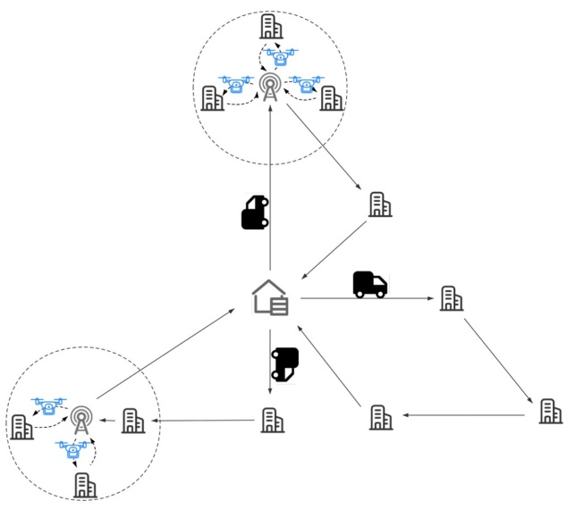

Fig. 1. A delivery scenario

## B. Objective

In this paper, L is used to indicate the corresponding locations. Specifically, $L _ { d } = \{ d \}$ is the set of depot. $L _ { s }$ is the set of UAV stations. The customer location set is defined as $L _ { c }   =   L ^ { t o c } \cup L ^ { u s c }$ , where $L ^ { t o c }$ is the set of truck-only customers and $\begin{array} { r } { L ^ { u s c } = \cup _ { s \in L ^ { s } } \big ( L _ { s } ^ { u s c } \big ) } \end{array}$ is the union of the UAV serviceable customers in every UAV stations. $L _ { s } ^ { u s c }$ is the set of customers serviceable by UAVs within the UAV station s. V is defined as the set of trucks (vehicles). $U = \cup _ { s \in L _ { s } } ( U _ { s } )$ is defined as the set of $\mathbf { U A V s } ,$ where $U _ { s }$ is the set of UAVs within the UAV station $s   \in   L _ { s } .$ The truck location set is denoted as $L _ { v } ,$ obviously, $L _ { v } = L _ { d } \cup L _ { s } \cup L _ { c }$

In the literature, the objectives may include minimizing economic cost, energy consumed, number of drones, time cost, maximizing covered area, customer satisfaction, etc. The constraints may include limited energy (battery or fuel) available for every tour of drones, limited flight range of drones, limited weights a drone can carry, and time windows of service, etc. [7]. The objective function of most works in this field is to minimize the tour, which is calculated as the latest return time of all vehicles at depot [8]. However, it ignores customer satisfaction. In this paper, we use the sum of customer waiting time as the objective function from the perspective of customer satisfaction [9], i.e.:

$$
t = \sum_ {t o c \in L ^ {t o c}} t _ {t o c} + \sum_ {s \in L ^ {s}} \sum_ {u s c \in L _ {s} ^ {u s c}} t _ {u s c}\tag{1}
$$

where $t _ { t o c }$ is the waiting time for a truck-only customer toc $\in \quad L ^ { t o c }$ , and $t _ { u s c }$ is the waiting time for a UAV-serviceable customer usc $\in   L _ { s } ^ { u s c }$ of UAV station $s   \in   L ^ { s }$ The waiting time is defined as the time passed for a parcel from the depot to the customer. It includes the transportation time of the truck and possibly the delivery time of the UAV if a customer is UAV-responsible. Including the waiting time for an available UAV and then the time spent on the UAV trip. This objective is equivalent to achieving a minimal average reaching time for all customers.

Fig.2 shows a feasible solution for a delivery scenario with two trucks, two UAV stations, and three UAVs, which serve eight USCs and five TOCs. We refer to the journey between a pair of adjacently visited locations as one ”trip”, which corresponds to one arrow in Fig.2. It should be noted that when calculating the total customer waiting time, the travel time of a truck or UAV along one trip needs to be superimposed by the number of customers waiting for this trip. For example, the time taken by the truck trip from the depot to the UAV station #1 should be counted eight times because the TOCs #2, #3, #5 and five USCs in UAV station #1 are waiting before being served. The time spent on the UAV trip from the UAV station #1 to its corresponding USC customer #4 should be counted twice because the USC customers #4 and #5 are waiting for this UAV trip. For how many times a trip should be counted is given by the ×n symbol attached with the arrows in Fig.2.

## III. APPROACH

We decompose the problem into two steps, task assignment and path planning. Then solve it with a bi-level heuristic approach. Specifically, at the task assignment level, we decide which kind of vehicle (a truck or a drone) to serve the drone-serviceable customers. Then plan the path of vehicles and UAVs at the next level. Denote $s _ { a }$ is the task assignment solution, and $s _ { r }$ is the routing solution. The corresponding bi-level optimization model can be represented as:

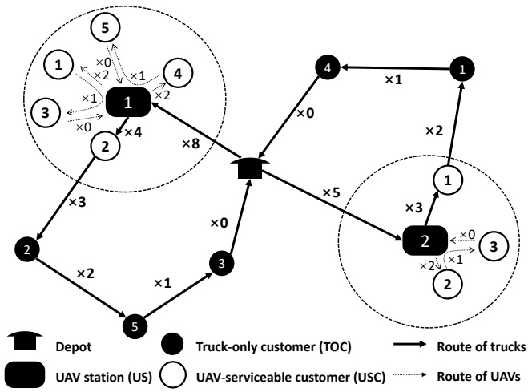

Fig. 2. Calculation of the sum of customer waiting times

$$
\begin{array}{l} (s _ {a} ^ {*}, s _ {r} ^ {*}) = \underset {(s _ {a}, s _ {r})} {\arg \min} t (s _ {a}, s _ {r}) \\ \mathbf {s . t .} \quad s _ {r} \in \underset {s _ {r}} {\arg \min} t (s _ {a}, s _ {r}) \end{array}\tag{2}
$$

Assume the number of USCs is $n ,$ the task assignment solution $s _ { a }$ can be represented by a bit string $s _ { a } = \{ b _ { 1 } , b _ { 2 } , . . . b _ { n } \}$ where $b _ { i } \: = \: 1$ means the i-th USC is assigned for trucks to serve and $b _ { i }   =   0$ when assigned to drones. The routing solution $s _ { r }$ contains the routes of trucks and drones, denoted as $R ^ { v }$ and $R ^ { d }$ . Trucks routes $R ^ { v }   =   \{ r ^ { v _ { 1 } } , r ^ { v _ { 2 } } , \ldots \}$ consists of route of each truck, where $r ^ { v _ { i } }$ represents the route for truck $v _ { i } .$ Drones routes $R ^ { d } \; = \; \{ R ^ { s _ { 1 } } , R ^ { s _ { 2 } } , . . . \}$ consists of routes of drones that belongs to each drone station, where $R ^ { s _ { k } } = \{ r _ { s _ { k } } ^ { d _ { 1 } } , r _ { s _ { k } } ^ { d _ { 2 } } , . . . \}$ represents those of station $s _ { k } ,$ and $r _ { s _ { k } } ^ { d _ { i } }$ represents the route of drone $d _ { i }$ of station $s _ { k }$ . Each route is a sequence of location nodes. As mentioned, we will solve this problem in a bi-level heuristic approach, i.e., the task assignment to determine $s _ { a } ,$ then determine the routes for trucks $s _ { r }$ based on corresponding assignment.

## A. Task Assignment

The task assignment is to allocate the UAV-serviceable customers to trucks or drones. To take advantage of the population-based algorithm and keep the diversity of the population, we adopt the Brain Storm Optimization (BSO) as the search framework [10]. The BSO algorithm is a swarm intelligence algorithm based on a collective human activity, i.e., the brainstorming process. Through convergence and divergence operations iteratively, a “good enough” optimal solution can be found in the search space. It has been proposed and widely developed in recent years [11]–[13]. It also has been applied to solve many theoretical problems and some real-world applications [14]–[17]. The BSO algorithm has three types of operations: clustering, new individual generation, and selection. New solutions will be generated from the population clustered in the solution space or objective space [18]. A general procedure of the BSO algorithm is shown in Alg.1.

Algorithm 1 The BSO Procedure
Randomly generate $n$ potential solutions (individuals);
Evaluate the generated $n$ solutions;
while not terminated do
    Clustering: Cluster $n$ individuals into $m$ clusters by a clustering algorithm;
    New individuals generation: randomly select one or two cluster(s) to generate $n$ new individuals;
    Selection: Select among individuals and produce the next generation of the population.

The assignment operation is as shown in Alg.2. When generating new $s _ { a }$ from one chosen solution, a random number of bits in the original $s _ { a }$ is reversed. In generating new $s _ { a }$ from two solutions, a merge-bits “crossover” is applied, i.e., each bit is determined by randomly choose the bit from one of the parent solutions with 70% probability to choose from the better parent. After the new solution is generated, some nodes need to be removed from the truck path, and some nodes need to be added to the truck paths from the drone nodes. That means the routes need to be reconstructed for the subsequent iterations. The detail will be explained in the followed section.

Algorithm 2 Assignment Operation
function ASSIGNMENTOPERATION(chosen_sol)
    $n \leftarrow$ the number of solutions in chosen_sol
    if $n = 1$ then
        $s_a, s_r \leftarrow chosen\_sol$
        $s'_a \leftarrow \text{BITSFLIPPING}(s_a)$
        $s'_r \leftarrow$ Construct new routes from $s_r$ in accordance with $s'_a$
    else
        $s_{a1}, s_{r1}, s_{a2}, s_{r2} \leftarrow chosen\_sol$
        $s'_a \leftarrow \text{MERGE-BITS}(s_{a1}, s_{a2})$
        $r_{ref} \leftarrow$ Select one of $s_{r1}$ and $s_{r2}$ by distance of $s_a$ and $s'_a$
        $s'_r \leftarrow$ Construct new routes from $r_{ref}$ in accordance with $s'_a$
    $s' \leftarrow \{s'_a, s'_r\}$
    return $s'$

## B. Routing and Scheduling

The objective of the problem is to minimize the sum of waiting time of all customers. For a given task assignment $s _ { a }$ of UAV-serviceable customers, there is no relationship between the truck routes and the UAV scheduling. Furthermore, the UAVs in different UAV stations operate independently. Therefore, the problem can be divided into two sub-problems: a vehicle routing problem (VRP) and a UAV scheduling problem for each station. They are solved separately, as shown in Alg.3.

1) Vehicle Routing Problem: The vehicle routing problem is to find a optimal truck routes according to a given task assignment scheme. Here we use the Adaptive Large Neighborhood Search (ALNS) to optimize the routes iteratively.

A simulated annealing framework is used to control the searching progress. The random removal, worst removal, and regret heuristics insertion operators described by [19] are applied. Since the given assignment is obtained by modifying the assignment of an existing solution (the ”parent solution”), which has a relatively optimized trucks routes compatible with its assignment, to avoid unnecessary time consumption, it is natural to initialize the truck routes with the help of the parent solution’s trucks routes. The initial solution of our ALNS is constructed from the $R ^ { v }$ of the old solutions. The construction is achieved through modifying the old $R ^ { v }$ to match the new $s _ { a } ,$ , as shown in Fig.3.

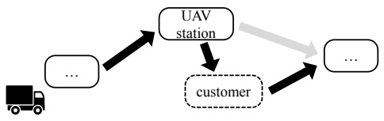

e (a) Adding a USC into truck routean UAV-servable customer from truc

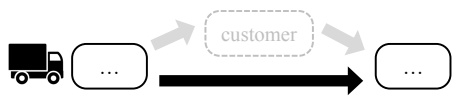

(b) Removing a USC from truck route

Fig. 3. Route construction for new $s _ { a }$

If the $s _ { a }$ is generated from one old solution, the new $R ^ { v }$ is directly constructed from the $R ^ { v }$ of the old solution. If the $s _ { a }$ is generated from two old solutions, the Hamming distance between the two old $s _ { a }$ and the newly-generated $s _ { a }$ is calculated. The $R ^ { v }$ of the solution with a shorter distance will be used to construct the new $R ^ { v }$ . In the construction, due to the difference between the old $s _ { a }$ and the newly-generated $s _ { a } ,$ some customer nodes originally served by UAVs need serving by trucks and vice versa. These customer nodes can be denoted as drone-to-truck nodes and truck-to-drone nodes. To match the newly-generated $s _ { a } ,$ for the truck-to-drone nodes, they are directly removed from the truck paths, and for the drone-to-truck nodes, since all the drone-to-truck nodes are the drone-serviceable nodes that are close to the drone station, a simple method is to insert all these nodes around the corresponding drone station in the truck routes.

2) Drone Scheduling: As analyzed before, for a UAV u in a station, the objective value contributed by the first customer will be its own flight time. The second customer needs to wait for the UAV to serve the first customer and return, so the objective contributed by the second customer includes a double flight time of the first customer, besides its own flight time. Generally, the i-th customer served by u will wait for a double flight time of all the previous customers, besides its own flight time. It is clear that, assuming the UAV serves n customers, the flight time of the i-th served customer $( 1 \leq i \leq n )$ will be counted for $2 ( n - i )$ + 1 times in the total objective. Therefore, simply sorting URCs (of a specified assignment solution) according to their distances to the UAV station, and serving the near URCs in priority, will lead to the best drones paths. This is an exact method, and costs $O ( n )$ time per planning if the sorting is pre-computed during geographic data input.

Algorithm 3 Path Planning
function PATHPLANNING(s)
    $R^v, R^d \leftarrow R^v, R^d$ from $s$
    $R'^v \leftarrow \text{VRP}_{ALNS}(R^v)$
    $R'^d \leftarrow \text{DRONESCHEDULE}(R^d)$
    $s' \leftarrow \text{NEW SOLUTION } s'$ FROM $R'^v$ AND $R'^d$
    RETURN $s'$

## A - bl  f kC. The Proposed Algorithm

According to the above description, the proposed algorithm is shown in Alg.4. The outer layer of the algorithm is task assignment based on the BSO algorithm. The iterations according to the BSO will be carried out after initializing a population of $s _ { a } .$ . For each newly generated $s _ { a } ,$ , the corresponding vehicle route planning and UAV scheduling will be performed. The relatively optimal solution will be obtained as the output when the termination condition is reached.

Algorithm 4 The Proposed Algorithm
Input: Population Size $N$
function MAIN
    population $P \leftarrow \emptyset$
    while $P$ size not reach $N$ do
        $s_a \leftarrow$ Randomly generate one assignment
        $s_r \leftarrow$ Construct routes in accordance with $s_a$
        $s \leftarrow \{s_a, s_r\}$
        $P \leftarrow P \cup \{s\}$
    Evaluate $N$ groups of $s$ in $P$
    new population $NP \leftarrow \emptyset$
    while not terminated do
        Cluster $P$ in solution space or objective space
        while $NP$ size not reach $N$ do
            chosen_sol $\leftarrow \emptyset$
            if $rand &lt; p_{one}$ then
                $s \leftarrow$ choose one solution from $P$
                chosen_sol $\leftarrow \{s\}$
            else
                $s1, s2 \leftarrow$ choose two solutions from $P$
                chosen_sol $\leftarrow \{s1, s2\}$
            $s' \leftarrow$ ASSIGNMENTOPERATION($chosen\_sol$)
            $s' \leftarrow$PATHPLANNING($s'$)
            $NP \leftarrow NP \cup \{s'\}$
        Update $P$ from $NP$
    return Best Solution $s$ in $P$

## IV. RESULTS

We implemented and compared the performances of three different methods. The first one uses the proposed bi-level architecture, where the outer level uses the original BSO framework and the inner level uses the ALNS algorithm to search for routes of trucks. The second one is similar to the first one, except the outer level uses the Objective Space version of BSO, BSO-OS for short, as the search framework. The third method uses a single-level architecture, which adopts the ALNS to search for the entire solution. We applied the above methods to three scenarios with 60, 100, and 150 customers. Each method on each scene was tested 30 times to get the statistical results.

The parameters are configured as follows. The first and second method maintains a population of 50 solutions and searches for no more than 100 iterations in the outer level with mostly 400 iterations in the inner level. The third method searches for $2   \times   1 0 ^ { 6 }$ iterations. The iterations in the above methods will terminate if the best objective has not been updated for 20% of its corresponding maximum number of iterations.

In the original BSO version, $K   =   5$ for the K-Means algorithm and it repeats the clustering operation for 10 times. The best solution of each cluster has a probability of $p _ { b e s t } = 4 5 \%$ to be selected as a parent to generate new solutions. The BSO-OS classified the solutions according to their objective values, where the top $p e r c _ { e }   =   2 0 \%$ are clustered as elitists and have a probability of $p _ { e } = 8 0 \%$ to be selected as a parent. Both versions of BSO frameworks generate new solutions according to one old solution by a probability of $p _ { o n e }   =   8 0 \%$ . The ALNS uses the simulated annealing framework, which has an initial probability of 50% to accept a solution whose objective is $w _ { i n i t } = 1 0 \%$ worse than the initial one, and implements an exponentially decreased temperature function that decreased to $t _ { f i n a l } = 0 .$ 1% of initial temperature after the max number of iterations. Table I summarizes the key parameters of the tests.

TABLE I CONFIGURATIONS

| Original BSO | BSO-OS | ALNS-SA |
| --- | --- | --- |
| K pbest pone | perce pe pone | winit tfinal |
| 5 45% 80% | 20% 80% 80% | 10% 0.1% |

Fig.4 shows the best result among the 30 times of repeated tests with the proposed methods. The solid points of different colors represent different locations, where the black spot at the center represents the depot, and the lime, blue, and salmon ones represent UAV stations, truck-only customers, and UAV-serviceable customers. The dashed circles mark the flight range of the UAV stations. Routes of different trucks are plotted by arrows with different colors, while routes of UAVs routes are not plotted because they always return to the stations before heading towards the next customers. The results show that each truck is likely to be assigned to serve locations within a range of depot directions. The results also show the preference for trucks to serve UAV stations as soon as possible, which leads to the vast number of UAV-responsible customers waiting for less time.

Table II shows the statistical results of the experiments. The minimum, average, maximum, standard error of the 30 repeated experiments for each combination of scene and method are provided. The best value of each line is printed in bold style, which shows that the BSO-OS + ALNS method behaves better than the others.

Fig.5 shows the convergence curves of experiments of different scenes and methods. It can be concluded that the BSO-OS + ALNS method has better exploration ability, compared with the BSO-Original method.

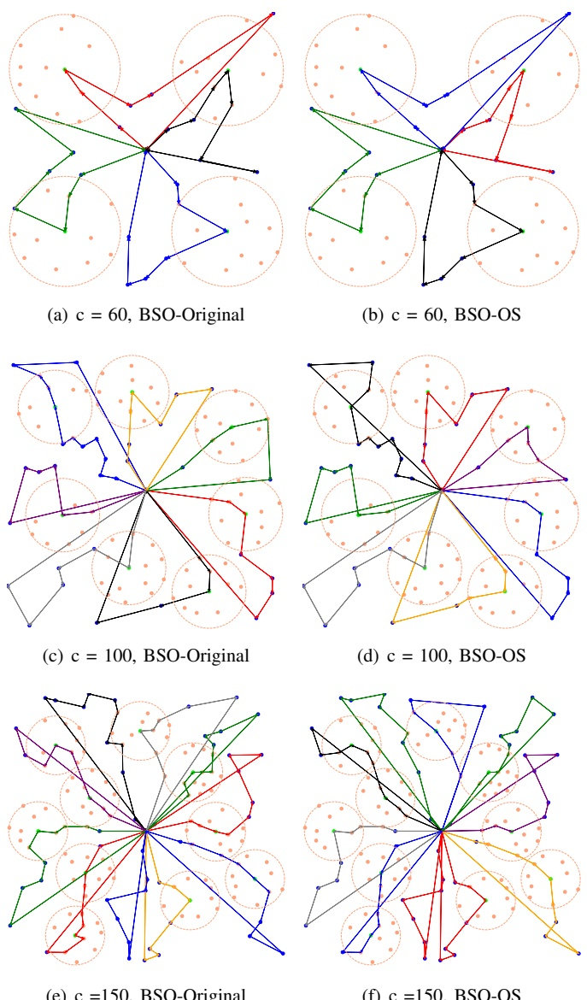

Fig. 4. Visualization for one searched solution with the proposed approach

TABLE II STATISTICAL RESULTS

| No. of customers | BSO-Original + ALNS | BSO-OS + ALNS | ALNS |
| --- | --- | --- | --- |
| min | 2820.556 | 2820.041 | 2820.041 |
| avg | 2841.635 | 2821.592 | 2831.037 |
| 60 |  |  |  |
| max | 2866.144 | 2838.886 | 2938.084 |
| std | 10.523 | 3.782 | 24.208 |
| min | 5849.222 | 5809.648 | 5809.648 |
| avg | 5915.287 | 5817.652 | 5978.271 |
| 100 |  |  |  |
| max | 5956.724 | 5861.195 | 6259.884 |
| std | 24.434 | 9.607 | 191.254 |
| min | 9694.211 | 9503.725 | 9601.444 |
| avg | 9767.243 | 9532.052 | 9929.743 |
| 150 |  |  |  |
| max | 9853.864 | 9604.845 | 10336.836 |
| std | 39.888 | 22.540 | 306.900 |

## V. CONCLUSION

The paper extends the TSP-DS model for VRPD to a version that contains multi-trucks and multi-drone-stations. Moreover, a bi-level heuristic algorithm is proposed to solve this problem. The BSO algorithm is employed for the task assignment for the outer level, and the ALNS is adopted for the vehicle routing in the inner level. Massive test results show that the proposed method can solve this problem effectively. Furthermore, the BSO-OS version performs better than the BSO-Original and single-level ALNS algorithms, which can be further developed.

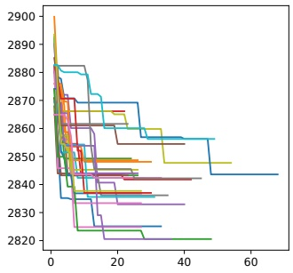

(a) c = 60, BSO-Original

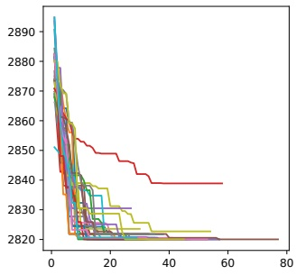

(b) c = 60, BSO-OS

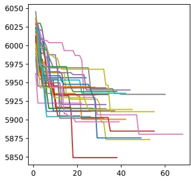

(c) c = 100, BSO-Original

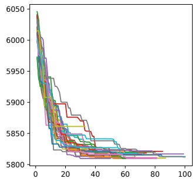

(d) c = 100, BSO-OS

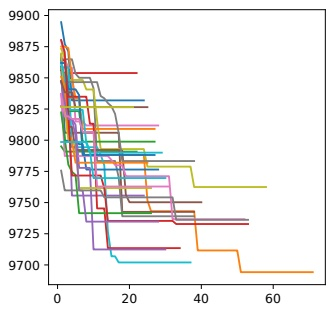

(e) c = 150, BSO-Original

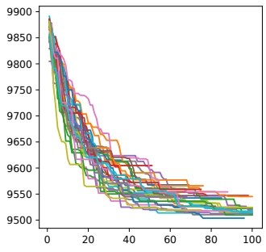

(f) c = 150, BSO-OS

Fig. 5. Convergence curves of the proposed approach

In the future, more experiments need to be conducted so the current approach can be compared with more advanced methods as well as wider ranges of parameters settings. In addition, mathematical models for the extended problem needs to be built so it can be solved by exact methods such as mixed integer programming.

## REFERENCES

[1] Z. Wang and J.-B. Sheu, “Vehicle routing problem with drones,” Transportation Research Part B: Methodological, vol. 122, pp. 350–364, Apr. 2019.

[2] C. C. Murray and A. G. Chu, “The flying sidekick traveling salesman problem: Optimization of drone-assisted parcel delivery,” Transportation Research Part C: Emerging Technologies, vol. 54, pp. 86–109, 2015.

[3] A. M. Ham, “Integrated scheduling of m-truck, m-drone, and mdepot constrained by time-window, drop-pickup, and m-visit using constraint programming,” Transportation Research Part C: Emerging Technologies, vol. 91, pp. 1–14, 2018.

[4] R. G. M. Saleu, L. Deroussi, D. Feillet, N. Grangeon, and A. Quilliot, “An iterative two-step heuristic for the parallel drone scheduling traveling salesman problem,” Networks. An International Journal, vol. 72, no. 4, pp. 459–474, 2018.

[5] M. Dell’Amico, R. Montemanni, and S. Novellani, “Matheuristic algorithms for the parallel drone scheduling traveling salesman problem,” Annals of Operations Research, vol. 289, no. 2, pp. 211–226, 2020.

[6] S. Kim and I. Moon, “Traveling salesman problem with a drone station,” IEEE Transactions on Systems, Man, and Cybernetics: Systems, vol. 49, no. 1, pp. 42–52, 2019.

[7] D. Rojas Viloria, E. L. Solano-Charris, A. Munoz-Villamizar, and ˜ J. R. Montoya-Torres, “Unmanned aerial vehicles/drones in vehicle routing problems: A literature review,” International transactions in operational research, vol. 28, no. 4, pp. 1626–1657, 2021.

[8] M. Moshref-Javadi and M. Winkenbach, “Applications and Research avenues for drone-based models in logistics: A classification and review,” Expert Systems with Applications, vol. 177, 2021.

[9] M. Moshref-Javadi, A. Hemmati, and M. Winkenbach, “A truck and drones model for last-mile delivery: A mathematical model and heuristic approach,” Applied Mathematical Modelling, vol. 80, pp. 290–318, 2020.

[10] Y. Shi, “An optimization algorithm based on brainstorming process,” International Journal of Swarm Intelligence Research (IJSIR), vol. 2, no. 4, pp. 35–62, 2011.

[11] L. Ma, S. Cheng, and Y. Shi, “Enhancing learning efficiency of brain storm optimization via orthogonal learning design,” IEEE Transactions on Systems, Man, and Cybernetics: Systems, 2020.

[12] L. Ma, M. Huang, S. Yang, R. Wang, and X. Wang, “An adaptive localized decision variable analysis approach to large-scale multiobjective and many-objective optimization,” IEEE Transactions on Cybernetics, 2021.

[13] J. Yang and Y. Shi, “Attention-oriented brain storm optimization for multimodal optimization problems,” in 2021 IEEE Congress on Evolutionary Computation (CEC), 2021, pp. 1968–1975.

[14] J. Yang, Y. Shen, and Y. Shi, “Visual fixation prediction with incomplete attention map based on brain storm optimization,” Applied Soft Computing, vol. 96, p. 106653, Nov. 2020.

[15] A. Aldhafeeri and Y. Rahmat-Samii, “Brain storm optimization for electromagnetic applications: Continuous and discrete,” IEEE Transactions on Antennas and Propagation, vol. 67, no. 4, pp. 2710–2722, 2019.

[16] J. Yang and Y. Shi, “Automatic synthesizing multi-robot cooperation strategies based on Brain Storm Robotics,” Applied Soft Computing, p. 14, 2022.

[17] Y. Shen, M. Liu, J. Yang, Y. Shi, and M. Middendorf, “A hybrid swarm intelligence algorithm for vehicle routing problem with time windows,” IEEE access : practical innovations, open solutions, vol. 8, pp. 93 882–93 893, 2020.

[18] Y. Shi and Ieee, “Brain storm optimization algorithm in objective space,” in IEEE Congress on Evolutionary Computation (CEC), ser. IEEE Congress on Evolutionary Computation, 2015, Conference Proceedings, pp. 1227–1234.

[19] D. Pisinger and S. Ropke, “A general heuristic for vehicle routing problems,” Computers & Operations Research, vol. 34, no. 8, pp. 2403–2435, Aug. 2007.