# Automated Design of Search Algorithms based on Reinforcement Learning

Wenjie Yia,∗, Rong Qua

aSchool of Computer Science, University of Nottingham, Nottingham, UK

## Abstract

Automated algorithm design has attracted increasing interest recently from the evolutionary computation community. The main design decisions include how to design selection heuristics on the population and evolution operators in the search algorithms. Most existing studies, however, have focused on the automated design of evolution operators, neglecting the automated de sign of selection heuristics for evolution and for replacement, not to mention considering all of the design decisions. This limited the scope of the algo rithms under consideration. This study aims to systematically investigate the automated design of search algorithms by exploring the impact of indi vidual algorithmic components within a general search framework and the synergy among these multiple algorithmic components and specifically, automatically design search algorithms by utilising a reinforcement learning technique. Comprehensive computational experiments are conducted on dif ferent benchmark instances of the capacitated vehicle routing problem with time windows to evaluate the effectiveness and generality of the proposed method. This study contributes to knowledge discovery in automated algorithm design using machine learning by exploring the impact of individual algorithmic component towards significantly enhanced generality of automatically designed search algorithms.

<small>∗Corresponding author</small>

<small>Email addresses: wenjie.yi@nottingham.ac.uk (Wenjie Yi), rong.qu@nottingham.ac.uk (Rong Qu)</small>

Keywords: Automated algorithm design, Reinforcement learning, Vehicle routing problem with time windows

## 1. Introduction

Many complex combinatorial optimisation problems (COPs) are NP-hard optimisation problems, to which search algorithms show great potential find ing high-quality solutions within a reasonable computational time. However, when designing a highly specialised search algorithm, human experts are required to make a large number of design decisions, such as how to select individuals to produce new solutions and how to apply suitable evolution operators during different stages of the evolutionary process. In addressing this issue, automated algorithm design has attracted considerable attention recently in the evolutionary computation community [1], [2].

A general combinatorial optimisation problem (GCOP) model has re cently been built to define the design of search algorithms itself as a COP, to which the solutions are new general-purpose algorithms composed of basic algorithmic components [3]. With the basic algorithmic components in the GCOP model, the AutoGCOP framework has been built for automated design of local search algorithms [4] and another framework, GSF, has been further developed to support the automated design of both local search algorithms and population-based algorithms [5]. The GSF is composed of five modules, where basic evolution operators or heuristics can be selected and composed into new search algorithms. The Selection for Evolution, Evolution and Selection for Replacement modules contribute the most to the algorithm performance. Based on the design space on algorithmic components, the automated algorithm design problem can be defined into the following three key research issues:

• Learning on evolution operators: to automatically select and apply suitable evolution operators in the Evolution module during the optimi sation process while fixing components in other modules. The decision variables in the search space of algorithms are evolution operators.

• Learning on selection heuristics: to automatically select and apply suitable selection heuristics (decision variables in the search space) in the Selection for Evolution/Replacement modules during the optimisation process while fixing components in the Evolution module.

• Learning on evolution operators and selection heuristics simultaneously: the decision variables are defined as pair of evolution operators and selection heuristics, automatically selected and applied during the optimisation process.

The first issue, i.e. learning on evolution operators, has been extensively investigated in the literature, as evolution operators are considered as the most important algorithmic component in designing evolutionary algorithms. Examples include genetic algorithm for the travelling salesman problem (TSP) [6], hyper-heuristics for unmanned aerial vehicles [7], the set covering problem [8], the set packing problem [9], the exam timetabling problem and the capacitated vehicle routing problem [10], and several COPs within the HyFlex framework [11].

Learning on selection heuristics, including “selection for evolution” heuristics (e.g., tournament selection and roulette wheel selection) and “selection for replacement” heuristics (e.g., comma-selection and plus-selection), has attracted less attention compared to that of evolution operators. However, they are also important components for designing successful search algorithms, i.e. determining how individuals should be combined to produce new candidate solutions. Example algorithms include the genetic programming based hyper-heuristics for the NK-landscape benchmark problem [12] and the grammatical evolution based hyper-heuristics for the 0-1 Knapsack problem [13].

Furthermore, there is a lack of literature regarding learning on evolution operators and selection heuristics simultaneously within a general framework of algorithms. This expands the design space into a high-dimensional one, thus posing new challenges to machine learning.

This study aims to systematically investigate the automated design of search algorithms within the unified GSF with basic algorithmic components, aiming to acquire transferable or reusable knowledge in automated algorithm design. To effectively cope with the high-dimensional algorithm design space, we propose an advanced reinforcement learning technique with maximum entropy mechanisms, tested on the capacitated vehicle routing problem with time windows (CVRPTW), one of the most extensively investigated COPs. The contributions of this study can be summarised as follows:

• This study systematically explores the design space of algorithms within different modules of the GSF with controlled experiments against that of ad hoc design space without a framework usually considered in the literature.

This study proposes an advanced reinforcement learning technique with a maximum entropy mechanism to tackle the above-mentioned problem of automated algorithm design which is defined into a new learning problem with a continuous state space and a high-dimensional discrete action space.

• The analysis on comprehensive experiments on the CVRPTW benchmark instances demonstrate the effectiveness and generality of the pro posed method transferring knowledge discovered into solving new instances.

The remainder of this study is organised as follows. Section 2 briefly presents the related work on automated design of search algorithms with the corresponding reinforcement learning techniques. Section 3 details the proposed method based on an advanced reinforcement learning technique. Experimental analysis concerning different design spaces is presented in Section 4. Finally, Section 5 concludes with a summary and discussions of future work.

## 2. Related Work

This section reviews the related work on automated design of search algorithms to solve COPs with the support of reinforcement learning techniques.

## 2.1. Automated Design of Search Algorithms

Within the unified general search framework (GSF) [5], automated design of search algorithms is systematically investigated as three key research issues: learning on evolution operators, on selection heuristics, and on evolution operators and selection heuristics simultaneously.

Most studies on learning to automatically select suitable evolution operators to be applied during different stages of the optimisation process are conducted within a template of a specific search algorithm such as genetic algorithm (GA) [6], [13], [14], [15] , memetic algorithm [16], [17], iterated local search [18], [19], [20], iterated greedy algorithm [21], variable neighbourhood search (VNS) [22], [23]. For example, GA with an adaptive operator selection mechanism showed to be effective on the TSP [6], [14], the job sequencing and tool switching problem [13], the hub location problem [15], etc. VNS with an adaptive operator selection mechanism also obtained promising results on the TSP [23] and the vehicle routing problem (VRP) [22], etc.

Learning on automatically determining the most suitable selection heuris tic at different stages of the optimisation process has received much less attention when solving COPs, albeit some successful preliminary attempts across different problems [12], [13]. There is limited work on investigating learning on evolution operators and selection heuristics simultaneously. One possible reason is due to the significantly increased algorithm design space, which presents new challenges to machine learning.

Overall, the majority of the existing studies have focused more on learning on evolution operators but often neglected other design decisions, not to mention considering them simultaneously. Existing studies also aim to determine different configurations within templates of specific existing search algorithms. Therefore, the outputs are variants of these existing search al gorithms, rather than newly designed algorithms. In addition, the operators involved in these templates are designed based on different experience of human experts, being either problem-specific ones or the manually selected basic operators for different COPs. Unlike existing studies, we proposed GSF [5] which supports the compositions of the most basic algorithmic components, i.e. evolution operators and selection heuristics within five modules in evolutionary algorithms. Therefore, the outputs are different types of new search algorithms. In other words, many of the existing search algorithms represent a subset of the possible output of the GSF.

In this study, with the support of GSF, we aim to systematically explore different design spaces (i.e. evolution operator, selection heuristic, and both) to automatically design search algorithms.

## 2.2. Reinforcement Learning for Automated Algorithm Design

Within the context of automated algorithm design, reinforcement learning (RL) [24], including simple tabular RL methods, such as Q-learning [25], and deep RL methods such as Deep Q-network (DQN) [26] and Proximal Policy Optimisation (PPO) [27], have obtained promising results for solving different COPs.

The most common tabular RL used in assisting algorithm design is Qlearning. It has been successfully applied to design a GA variant for TSP [6] and the job sequencing and tool switching problem [13], a Memetic Algorithm variant for the quadratic assignment problem [28], a VNS variant for VRP [29], and a Simulated Annealing variant for the mixed-model assembly line sequencing problem [30].

Regarding deep RL methods, value-based methods (e.g., DQN) showed to effectively learn to design algorithms automatically for solving VRP and TSP [31], and the container terminal truck routing problem and online 2D strip packing problem [32]. Policy-based RL methods (e.g., PPO) have demon strated the superiority of designing search algorithms for solving VRP [5].

In the existing studies on Q-learning, the number of features used to rep resent the state is limited and insufficient for learning. More advanced RL techniques are required to handle the continuous state space represented by key features involving sufficient and useful information. To tackle this issue, researchers have attempted to utilise deep RL techniques such as DQN (a typical value-based technique) and PPO (a typical policy-based technique) However, the dimension of action space in their learning environment is rela tively small. Therefore, it is worth investigating the advantages of both value based and policy-based RL methods, as value-based RL methods present better sample efficiency (i.e. make good use of every single piece of experience to generate and rapidly improve the policy) but are unstable, while policy based RL methods are more stable but are of low sample efficiency (i.e. fail to learn anything useful from many samples of experience).

The automated algorithm design problem investigated in this study con sists of a continuous state space and a high-dimensional discrete action space. This motivates advanced RL which inherits the advantages of both of valuebased and policy-based RL techniques. In this research, a maximum entropy mechanism is employed to encourage exploration in the early stage of the learning process and exploitation in the later stage. It achieves this by adding an entropy term to the RL objective function, which maximises the accumulated reward and entropy of the policy.

## 3. Proposed Method

## 3.1. Algorithmic Components within General Search Framework (GSF)

The basic evolution operators considered in this study are listed in Table 1. Figure 1 represents the solution encoding of a CVRPTW with nine customers and three vehicles, and Figure 2 further provides the illustration of the evolution operators listed in Table 1. Note that these basic evolu tion operators, such as exchange, insert and remove, can be adopted and adjusted to automate the design of algorithms for different COPs. In this study, CVRPTW is used as a case study. The selection for evolution and for replacement heuristics are listed in Table 2 and Table 3, respectively. These all represent the most basic operators and heuristics in the literature.

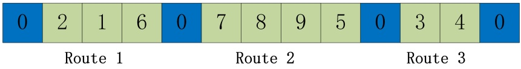

Figure 1: Solution encoding of a CVRPTW with nine customers and three vehicles

## 3.2. Proposed Method for Automated Algorithm Design within GSF

Before introducing the proposed Actor-Critic with Entropy (ACE) method, a modified soft actor critic (SAC) method [33] for discrete action space, the problem of algorithm design is firstly defined as a new reinforcement learning task in this section. Reinforcement learning is often modelled as a Markov Decision Process (MDP) $M = \left( S , A , p , r \right)$ . In each timestep, the RL agent

Table 1: $O _ { E } \colon$ Evolution operators for CVRPTW [5]

| Operator | Description |
| --- | --- |
| ochg in | Exchange m and n nodes in the same route in a solution |
| ochg bw | Exchange m and n nodes from different routes in a solution |
| oins in | Insert m nodes to other positions of the same route in a so-lution |
| oins bw | Insert m nodes to different routes in a solution |
| oruin recreat | The m nodes within a pre-determined distance d to the base customer x are removed from the solution, where d is set based on the distance between x and the furthest node from x. If there exist feasible routes which can accommodate the removed nodes, the insertion position with the minimum wait-ing time is selected. Otherwise, a new route is created. |
| otwo opt | Exchange two nodes in the same route in a solution |
| otwo opt∗ | Swap the end sections (with m nodes) of two routes in a solution to create two new routes |

Table 2: $H _ { S E } ;$ heuristics in selection for evolution module [5]

| Heuristic | Description |
| --- | --- |
| h1 | h1tb/h1tw : tournament selection of the best/worst of v ∈ {1,··· ,nPop} individuals as parent candidates. nPop refers to the population size. The probability of selecting each in-dividual i as parent candidate p0i = 1/nPop. When v = 1: random selection. When v = nPop: greedy selection of the best/worst individual. |
| h2 | Random selection (When v = 1) |
| h3 | Rank selection of the best previous position as parent based on individual's personal archive (When v = nPop) |
| h4 | Proportionate roulette wheel selection of an individual i as par-ent with a probability proportional to its fitness. |
| h5 | Ranking selection of an individual i as parent according to the probability proportional to the its rank (ascending order based on the fitness function). |
| h6 | Select the current individual itself as parent. |

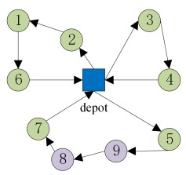

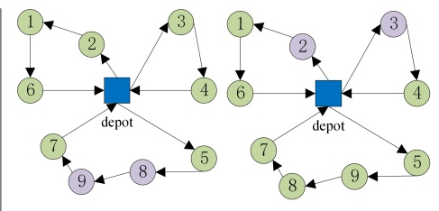

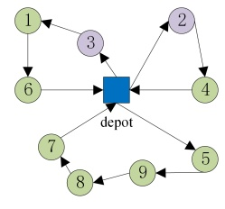

(b) $\rho _ { c h g \_ b w }$ (m = n = 1)

(a) $o _ { c h g \_ i n } ( m = n = 1 )$ , otwo opt

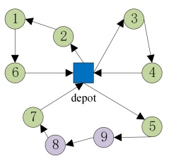

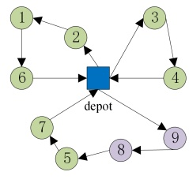

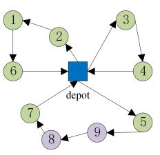

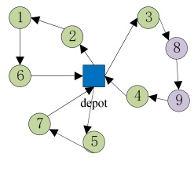

(c) $o _ { i n s \_ i n } ( m = 2 )$

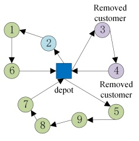

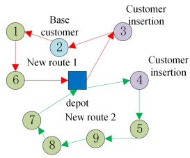

(d) $o _ { i n s \_ b w } ( m = 2 )$

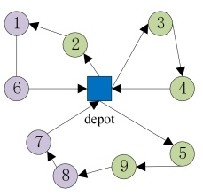

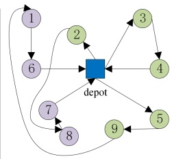

(f) $o _ { t w o \_ o p t * } ( m = 2 )$

Figure 2: Illustration of evolution operators in Table 1

interacts with the environment to obtain information of the current state $s _ { t } \in S$ , where S is the state space, and then chooses an action $a _ { t } \in A$ , according to the policy $\pi \left( a _ { t } \left| s _ { t } \right. \right)$ , where A is the set of available actions. After that, the agent receives a reward $r _ { t } \left( s _ { t } , a _ { t } \right)$ and the environment moves to the next state based on the policy π, i.e $s _ { t + 1 } \sim \pi \left( s _ { t + 1 } \left| s _ { t } \right. , a _ { t } \right)$ . The goal of the RL agent is to learn a policy that maximises the expected accumulated reward.

Table 3: $H _ { S R } ;$ heuristics in Selection for replacement module [5]

| Heuristic | Description |
| --- | --- |
| $h_{7}$ | Comma-selection ($nPop, \lambda$). Select $nPop$ individuals only from the offspring population $A_{O}$. $nPop$ and $\lambda$ refer to the current population size and the offspring population size, respectively. |
| $h_{8}$ | Plus-selection ($nPop, \mu + \lambda$). Select individuals from both the parent population $A_{P}$ and the offspring population $A_{O}$. $nPop$, $\mu$ and $\lambda$ refer to the current population size, parent population size and the offspring population size, respectively. |

Within GSF, the new reinforcement learning task is defined in this study for automated algorithm design as shown in Figure 3. The states are defined by search-dependent and instance-dependent features. The actions are de fined by evolution operators and/or selection heuristics. Different from other RLs, the reward scheme is designed to maximise the expected accumulated reward r and the expected entropy of the policy $\mathcal { H }$ as shown in Equation (1). The entropy term can help the agent to learn a more robust and flexible policy by exploring more actions to prevent the agent from being stuck in local optima.

$$
r _ {\pi} \left(s _ {t}, a _ {t}\right) = r \left(s _ {t}, a _ {t}\right) + \alpha \cdot \mathcal {H} \left[ \pi \left(\cdot \mid s _ {t}\right) \right]\tag{1}
$$

The entropy $\mathcal { H } \left[ \pi \left( \cdot \mid s _ { t } \right) \right]$ essentially introduces a noise to reinforcement learning weighted by a coefficient α. Higher values of α give more chances to actions which are rarely or never selected; while lower values of α emphasise on utilising the actions with good historical performance. As α decreases, more emphasis is given on the accumulated reward r compared to the entropy of the policy H. In other words, as α decreases, the learning process focuses more on exploitation than exploration.

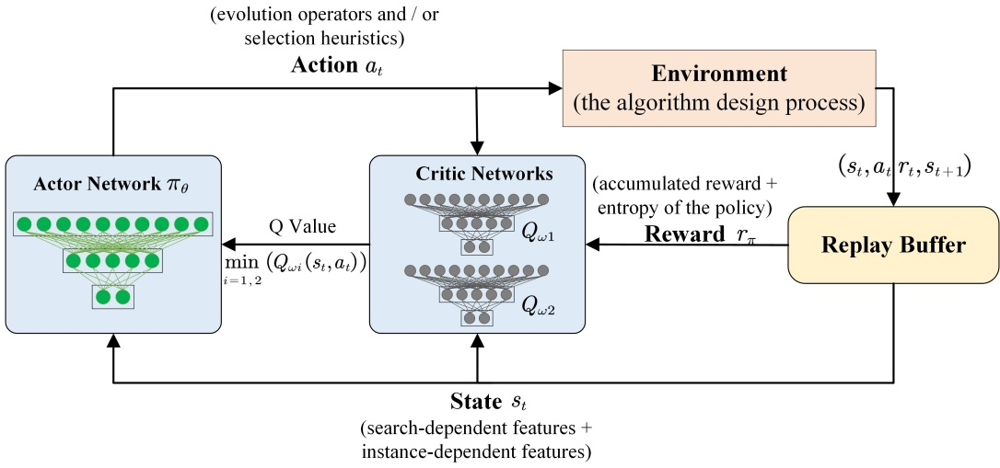

Figure 3: Proposed reinforcement learning method (ACE) for automated algorithm design within GSF

Three entropy coefficient adjustment schemes are proposed as follows, and evaluated in Section 4 to strike a balance between exploration and exploitation in the learning.

• fixed scheme (FS): the entropy coefficient α is set to a fixed value, i.e. $\alpha = 0 . 5$

• linear adaptive scheme (LAS): decrease α linearly, i.e. $\alpha _ { t + 1 } = \alpha _ { t } { \cdot } 0 . 9 9 9 8$

• non-linear adaptive scheme (NLAS): decrease α nonlinearly, i.e. with a neural network

Apart from the maximum entropy mechanism to balance exploration and exploitation, the proposed ACE method is enhanced with two mechanisms as shown in Figure 3. Firstly, an actor-critic architecture, $\pi$ is devised with one policy network (Actor), and two separate critic networks $Q _ { \omega _ { 1 } }$ and $Q _ { \omega _ { 2 } }$ (with the same structure) are used simultaneously to eliminate overestimation. The minimum of $Q _ { \omega _ { 1 } }$ and $Q _ { \omega _ { 2 } }$ is chosen exporting the Q value. Secondly, the experience replay buffer is utilised to break the correlations between the stored experience $( s _ { t } , a _ { t } , r _ { t } , s _ { t + 1 } )$ and reuse collected experience multiple times.

The pseudocode of ACE-GSF is shown in Algorithm 1. Specifically, an action is selected based on the current policy network (i.e. Actor network $\pi _ { \theta } \Big )$ (Line 6, Algorithm 1) from the set of three key components of search algorithms, namely: selection for evolution heuristic, evolution operator, and selection for replacement heuristic. By performing the selected action, a selection heuristic $h _ { i } \left( i = 1 , 2 , . . . , 6 \right)$ from $H _ { S E }$ (shown in Table 2) is used to select parent population; an evolution operator from $O _ { E }$ (shown in Table 1) is used to generate offspring population; and then a selection heuristic $h _ { i } \left( i = 7 , 8 \right)$ from $H _ { S R }$ (shown in Table 3) is used to update the population (Line 7, Algorithm 1). The reward are observed based on Equation (5) and Equation (6) and the corresponding experience $( s _ { t } , a _ { t } , r _ { t } , s _ { t + 1 } )$ is stored in the replay buffer (Line 8, Algorithm 1). A random minibatch of experiences $\left[ s _ { j } , a _ { j } , r _ { j } , s _ { j + 1 } \right] _ { J }$ (J denotes the size of the sampled minibatch) is sampled to train the critic networks by minimising the loss function shown in Equation (2)(Line 9-10, Algorithm 1). After that, the actor network is updated by minimising the loss function shown in Equation (4) (Line 10, Algorithm 1). The entropy coefficient $\alpha$ is then updated based on the pre-defined adjustment scheme (i.e FS/LAS/NLAS) (Line 11, Algorithm 1). The process is iterated at each timestep until the end of the episode. In the process, the target

networks are updated using a soft update strategy : $\omega_1^- \leftarrow \tau\omega_1 + (1 - \tau)\omega_1^-$, $\omega_2^- \leftarrow \tau\omega_2 + (1 - \tau)\omega_2^-$, where $\tau$ is a parameter that is typically chosen to be close to 1 (Line 12, Algorithm 1).

Algorithm 1 Pseudocode of ACE-GSF
Initialise critic networks $Q_{\omega_1}$, $Q_{\omega_2}$, target critic networks $Q_{\omega_{1^-}}$, $Q_{\omega_{2^-}}$, actor network $\pi_\theta$, replay buffer $D$, the number of episode $NoE$, the number of timesteps $NoT$, population $P$, initial state $s_0$
for episode $k = 1$ to $NoE$ do
    initialise $s_0$
    for timestep $t = 1$ to $NoT$ do
        observe the current state $s_t$ based on state features
        select an action based on the current policy $a_t = \pi_\theta(s_t)$
        execute the selected action $a_t$ (i.e. a combination of algorithmic components from three main modules in GSF) on the current population
        observe reward $r_t$ and next state $s_{t+1}$, store experience $(s_t, a_t, r_t, s_{t+1})$ in $D$
        sample random minibatch of experiences $[s_j, a_j, r_j, s_{j+1}]_J$ from $D$
        update two critic networks $Q_{\omega_i}$, $i = 1, 2$, the actor network $\pi_\theta$
        update entropy coefficient $\alpha$ based on the selected adjustment scheme
        every $N$ timesteps, update the target critic networks
    end for
end for

The critic networks $Q_{\omega_1}$, $Q_{\omega_2}$ are updated using temporal difference algorithm. The loss function is shown in Equation (2) and the temporal difference target $y_j$ is shown in Equation (3). The actor network $\pi_\theta$ is updated by min-

imising the loss function shown in Equation (4).

$$
L = \frac {1}{J} \sum_ {j = 1} ^ {J} \left(y _ {j} - Q _ {\omega_ {i}} \left(s _ {j}, a _ {j}\right)\right) ^ {2}\tag{2}
$$

$$
y _ {j} = r _ {j} + \gamma (\min _ {i = 1, 2} Q _ {\omega_ {i} ^ {-}} (s _ {j + 1}, a _ {j + 1}) - \alpha \log \pi_ {\theta} (a _ {j + 1} | s _ {j + 1})),\tag{3}
$$

$$
a _ {j + 1} \sim \pi_ {\theta} (\cdot | s _ {j + 1})
$$

$$
L _ {\pi} (\theta) = \frac {1}{J} \sum_ {j = 1} ^ {J} \left(\alpha \log \pi_ {\theta} \left(a _ {j} \mid s _ {j}\right) - \min _ {i = 1, 2} Q _ {\omega_ {i}} \left(s _ {j}, a _ {j}\right)\right)\tag{4}
$$

## 3.2.1. State Representation

The state should provide sufficient information on the environmental status to support accurate selection of the action. In this study, two groups of features [34], including ten search-dependent features, which identify the key attributes of the search process, and seven instance-dependent features, which describe the properties of the problem instance, are employed to represent the state since the problem domain of this study is identical as the reference [34] and these features have been systematically investigated. Although feature identification and selection showed to be one of the current key research issues in developing successful machine learning, they are not the focus of this study. Therefore, only a brief description of the employed features is provided. Please refer to [34] for the detailed identification process and calculation process.

The search-dependent features include the search stage, fitness improvement, the standard deviation/mean/skewness/kurtosis/amplitude of fitness, and the lower (Q1)/median (Q2)/upper (Q3) quartile of fitness.

The instance-dependent features include the number of available vehicles, vehicle capacity, average customer demand, average service time, average time-window size, average time-window overlaps between customers, and the percentage of time-constrained customers.

## 3.2.2. Action Representation

With regards to learning on evolution operators and selection heuristics, the set of possible actions in each state is defined in Table 1, Tables 2 and $^ { 3 , }$ respectively. Regarding learning on both, pair of evolution operators in Table 1 and selection heuristics in Tables 2-3 is defined as the action.

## 3.2.3. Reward Scheme

ACE is designed to learn a policy of a high reward while acting as randomly as possible. In other words, ACE maximises the accumulated reward and entropy of the policy simultaneously.

The first objective, as shown in Equations (5) and (6), is calculated based on the fitness improvement of the current population (i.e $f _ { c u r r e n t } )$ over the initial population $\left( \mathrm { i . e } \quad f _ { i n i t i a l } \right)$ . When population fitness is above a certain threshold $( \mathrm { i . e } \quad C )$ , which indicates that the search process enters the later stages of evolution, a larger reward is assigned for the same fitness improve ment with a log function. The second objective of maximising the entropy of the policy is calculated based on the term $\mathcal { H } \left[ \pi \left( \cdot \mid s _ { t } \right) \right]$ . These two objectives are aggregated into a single objective function, i.e. minimising the sum of them.

$$
f _ {1} = \frac {f _ {\text {current}}}{f _ {\text {initial}}}\tag{5}
$$

$$
r _ {\pi} \left(s _ {t}, a _ {t}\right) = \left\{ \begin{array}{c} - f _ {1} + \alpha \cdot \mathcal {H} \left[ \pi \left(\cdot \mid s _ {t}\right) \right], i f f _ {1} > C \\ - f _ {1} - \log_ {1 0} \left(f _ {1}\right) + \alpha \cdot \mathcal {H} \left[ \pi \left(\cdot \mid s _ {t}\right) \right], i f f _ {1} \leqslant C \end{array} \right.\tag{6}
$$

## 4. Experiments and Discussions

The proposed ACE methods are applied on the basic algorithmic components in three main modules within GSF: Selection for Evolution, Evolution, and Selection for Replacement. One of the extensively investigated COPs, CVRPTW, is selected as the benchmark problem to evaluate the perfor mance of the proposed method. All experiments have been conducted using a computer with Intel(R) Xeon(R) W-2123 CPU@ 3.60 GHz processors, and with 32.0 GB of memory. The proposed methods are implemented in Java environment with IntelliJ IDEA 2020.3.3 as the development tool. Java is chosen since it is also used in other widely adopted frameworks in relevant literature, e.g. HyFlex for hyper heuristics, thus supports flexible further extensions in future work.

The experimental investigations aim to address two research issues: (1) the effectiveness of the learning models when tackling the design space of selection heuristics; (2) the effectiveness and generality of the learning models on the whole algorithm design space, i.e considering the design of both evolution operators and selection heuristics. To address the first issue, three ACE variants with different entropy coefficient adjustment schemes are validated in section 4.2. On both selection heuristics and evolution operators, three ACE variants are assessed in section 4.3.1. The experiments considering only evolution operators are conducted in the comparison to serve as the baseline. To analyse the generality of the learning models, the trained policies are applied to the same and different types of problem instances in section 4.3.2.

## 4.1. Problem Definition and Dataset

The CVRPTW considered in this study has two objectives as shown in Equation (7), where NV is number of vehicles used and T D is the total travelled distance. These two objectives are transformed into a single objective with a penalty weight factor, where $c = 1 0 0 0$ assigns a higher priority to the first objective [19]. In CVRPTW, vehicles must serve every customer within their specified time windows, while satisfying the capacity constraints.

$$
M i n f (s) = c \times N V + T D\tag{7}
$$

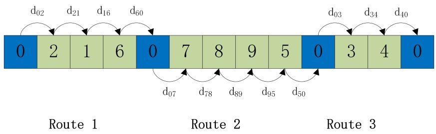

Figure 4: Solution decoding of a CVRPTW with nine customers and three vehicles

Figure 4 presents the solution decoding of a CVRPTW with nine customers and three vehicles. Based on Equation (7), the fitness of this example CVRPTW solution can be calculated as follow:

$$
M i n f (s) = c \times 3 + (d _ {0 2} + d _ {2 1} + \dots + d _ {4 0})\tag{8}
$$

The investigation is conducted on the Solomon benchmark dataset [35] which consists of six groups, namely R1, R2, C1, C2, RC1, RC2. Customers in R1 and R2 instances are distributed randomly while customers in C1 and C2 instances are clustered. RC1 and RC2 instances contain a combination of randomly distributed and clustered customers. Sets of type 1/type 2 have narrow/wide time windows and small/large vehicle capacity, respectively. CVRPTW remains a challenge to current state-of-the-art research.

The selected instances in this study are representatives of different types of CVRPTW instances, including type-R1, type-R2, type-RC1 and type-RC2. Type-C1 and type-C2 instances are not included in this study since they are relatively easily tackled by existing heuristic approaches, even the random search approach. In our preliminary experiments, our proposed method always achieved the best-known solutions in the literature on type-C1 and type-C2 instances.

## 4.2. Learning on Selection Heuristics

The proposed method, namely ACE, is applied to automate algorithm design by learning to adapt appropriate selection heuristics (including selection for evolution heuristics and selection for replacement heuristics).

## 4.2.1. Learning on Selection for Evolution Heuristics

With learning on the design space of only selection for evolution heuristics, three ACE variants with different entropy coefficient settings, namely ACE FS, ACE NLAS and ACE LAS with a fixed/non-linear/linear entropy coefficient adjustment scheme respectively, are investigated. We fixed the components in the other two modules as: $o _ { i n s \_ b w }$ for the Evolution module and $h _ { 8 }$ for Selection for Replacement module. These two components are the most frequently called evolution operator [34] and the most adopted selection for replacement heuristic in the literature.

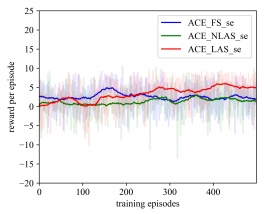

(a) R101

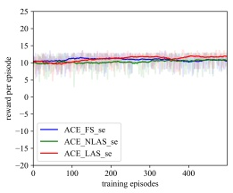

(b) R102

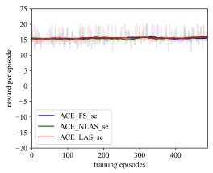

(c) R103

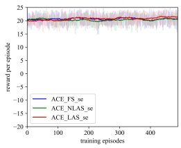

(d) R104

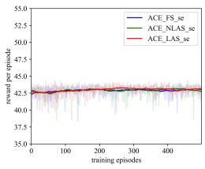

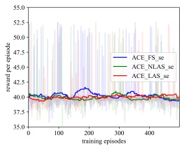

(e) R201

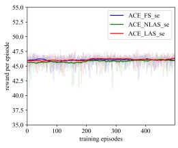

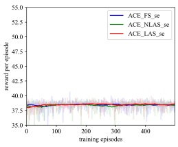

(f) R202

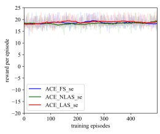

(g) R203

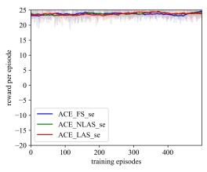

(h) R204

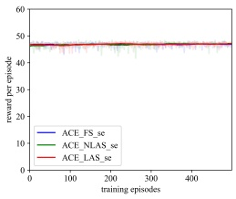

(i) RC101

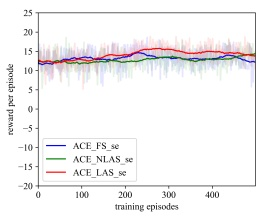

(m) RC201

(j) RC102

(l) RC104

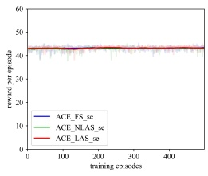

(n) RC202

(k) RC103

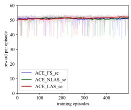

(o) RC203

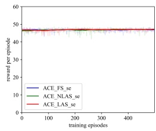

(p) RC204

Figure 5: Performance comparison during the training process (learning on selection for evolution heuristics, i.e. se)

As shown in Figure 5, results on different type of CVRPTW instances show that learning on selection for evolution heuristics alone has no significant impact on the performance of search algorithms throughout the training process. One possible reason is that although selection for evolution heuris tics determine which individual should be combined to produce new solutions, it would not have so much impact if the algorithmic component in the Evo lution module is fixed. In other words, there is limited scope for evolution. This supports human experience in designing search algorithms and results reported in the literature, i.e. the selection heuristics have less impact on the performance of search algorithms and therefore there is no need to focus on the design of these.

As shown in Tables 4-7, the performance of RL-based methods (i.e. three ACE variants) is slightly but not significantly better than that of the non-learning method during the testing process. Note that “non-learning” method in Tables 4-7 refers to the search algorithm with all fixed components in all modules $( h _ { 1 } ,   o _ { i n s \_ b w } ,   h _ { 8 } )$ , and column $\mathrm { { ` G A P ` } }$ is the gap between the attained best fitness (BEST) and the best-known solutions in the literature to demon strate the overall performance. This indicates that learning on selection for evolution heuristic has little impact on the algorithm performance, which is consistent with the findings during the training process shown in Figure 5.

## 4.2.2. Learning on Selection for Replacement Heuristics

Similarly, the effectiveness of the ACE method on the design space of only selection for replacement heuristics is validated with the ACE FS, ACE - NLAS, ACE LAS and non-learning method. The components in other two modules are fixed as: $o _ { i n s \_ b w }$ for Evolution module and $h _ { 1 }$ for Selection for Evolution module, which are the most frequently called evolution operator [34] and the most adopted selection for evolution heuristic in the literature.

Table 4: Performance comparison during the testing process (learning on selection for evolution heuristics, i.e. se), type-R1

|  | R101 | R102 | R103 | R104 |
| --- | --- | --- | --- | --- |
| Best-known Solutions | 20645.79 [36] | 18486.12 [37] | 14292.68 [38] | 10007.24 [39] |
| AVG | 21019.62 | 18783.83 | 15336.91 | 11419.82 |
| SD | 226.28 | 215.70 | 208.64 | 461.40 |
| ACE FS se |  |  |  |  |
| BEST | 20918.92 | 18706 | 14437.66 | 11083.57 |
| GAP | 1.32% | 1.19% | 1.01% | 10.76% |
| AVG | 21006.91 | 18761.66 | 15344.38 | 11333.54 |
| SD | 230.78 | 213.22 | 205.63 | 405.13 |
| ACE NLAS se |  |  |  |  |
| BEST | 20887.4 | 18660.31 | 14459.78 | 11082.82 |
| GAP | 1.17% | 0.94% | 1.17% | 10.75% |
| AVG | 21030.97 | 18973.67 | 15386.93 | 11594.02 |
| SD | 233.23 | 427.03 | 23.66 | 495.97 |
| ACE LAS se |  |  |  |  |
| BEST | 20914.45 | 18669.80 | 15345.42 | 11098.03 |
| GAP | 1.30% | 0.99% | 7.37% | 10.90% |
| AVG | 20957.89 | 18769.97 | 15342.55 | 11373.85 |
| SD | 30.37 | 215.69 | 207.39 | 443.38 |
| Non-learning |  |  |  |  |
| BEST | 20901.02 | 18675.05 | 14448.89 | 11085.36 |
| GAP | 1.24% | 1.02% | 1.09% | 10.77% |

Table 5: Performance comparison during the testing process (learning on selection for evolution heuristics, i.e. se), type-R2

|  | R201 | R202 | R203 | R204 |
| --- | --- | --- | --- | --- |
| Best-known Solutions | 5252.37 [40] | 4191.7 [41] | 3939.54 [42] | 2825.52 [43] |
| AVG | 5479.97 | 5214.98 | 4168.84 | 3936.29 |
| SD | 41.04 | 290.99 | 30.00 | 25.70 |
| ACE FS se |  |  |  |  |
| BEST | 5398.13 | 4317.59 | 4111.00 | 3891.49 |
| GAP | 2.78% | 3% | 4.35% | 37.73% |
| AVG | 5469.77 | 5171.22 | 4166.85 | 3932.16 |
| SD | 25.33 | 335.45 | 32.48 | 22.07 |
| ACE NLAS se |  |  |  |  |
| BEST | 5392.77 | 4316.40 | 4087.81 | 3878.91 |
| GAP | 2.67% | 2.97% | 3.76% | 37.28% |
| AVG | 5444.77 | 5096.12 | 4159.70 | 3923.55 |
| SD | 11.32 | 376.51 | 23.47 | 18.34 |
| ACE LAS se |  |  |  |  |
| BEST | 5413.81 | 4307.61 | 4111.65 | 3891.72 |
| GAP | 3.07% | 2.77% | 4.37% | 37.73% |
| AVG | 5533.63 | 5384.61 | 4252.69 | 4020.82 |
| SD | 24.47 | 49.37 | 23.49 | 19.65 |
| Non-learning |  |  |  |  |
| BEST | 5481.47 | 5287.09 | 4184.90 | 3989.41 |
| GAP | 4.36% | 26.13% | 6.23% | 41.19% |

Table 6: Performance comparison during the testing process (learning on selection for evolution heuristics, i.e. se), type-RC1

|  | RC101 | RC102 | RC103 | RC104 |
| --- | --- | --- | --- | --- |
| Best-known Solutions | 15696.94 [44] | 13554.75 [44] | 12261.67 [45] | 12135.487 [46] |
| AVG | 17074.88 | 15223.6 | 13126.46 | 11926.51 |
| SD | 432.50 | 481.39 | 469.69 | 486.41 |
| ACE FS se |  |  |  |  |
| BEST | 16734.77 | 14627.56 | 12342.64 | 11223.87 |
| GAP | 6.61% | 7.91% | 0.66% | 0.79% |
| AVG | 17030.73 | 15258.4 | 12930.19 | 11968.47 |
| SD | 420.36 | 471.00 | 511.73 | 477.55 |
| ACE NLAS se |  |  |  |  |
| BEST | 16758.36 | 14619.93 | 12364.56 | 11190.65 |
| GAP | 6.76% | 7.86% | 0.84% | 0.50% |
| AVG | 16802.26 | 14617.32 | 12742.95 | 11433.27 |
| SD | 15.93 | 27.55 | 458.11 | 400.82 |
| ACE LAS se |  |  |  |  |
| BEST | 16766.4 | 14557.79 | 12347.93 | 11197.41 |
| GAP | 6.81% | 7.4% | 0.70% | 0.56% |
| AVG | 17105.48 | 15194.24 | 13210.88 | 12059.4 |
| SD | 478.03 | 481.82 | 401.69 | 419.97 |
| Non-learning |  |  |  |  |
| BEST | 16745.33 | 14597.72 | 12341.12 | 11171.26 |
| GAP | 6.68% | 7.69% | 0.65% | 0.32% |

Table 7: Performance comparison during the testing process (learning on selection for evolution heuristics, i.e. se), type-RC2

|  | RC201 | RC202 | RC203 | RC204 |
| --- | --- | --- | --- | --- |
| Best-known Solutions | 5406.91 [39] | 4367.09 [47] | 4049.62 [47] | 3798.41 [39] |
| AVG | 5682.11 | 5462.07 | 4345.10 | 3977.98 |
| SD | 46.89 | 34.51 | 284.60 | 25.68 |
| ACE FS se |  |  |  |  |
| BEST | 5538.27 | 5400.92 | 4172.10 | 3934.86 |
| GAP | 2.43% | 23.71% | 3.02% | 3.59% |
| AVG | 5689.10 | 5458.57 | 4247.98 | 3979.04 |
| SD | 70.65 | 32.83 | 38.42 | 25.79 |
| ACE NLAS se |  |  |  |  |
| BEST | 5550.42 | 5382.51 | 4173.24 | 3928.85 |
| GAP | 2.65% | 23.29% | 3.05% | 3.43% |
| AVG | 5617.92 | 5394.25 | 4211.85 | 3946.07 |
| SD | 17.79 | 22.38 | 25.11 | 11.12 |
| ACE LAS se |  |  |  |  |
| BEST | 5580.24 | 5332.49 | 4159.75 | 3924.74 |
| GAP | 3.21% | 22.15% | 2.72% | 3.32% |
| AVG | 5683.60 | 5431.68 | 4238.98 | 3973.20 |
| SD | 55.43 | 42.20 | 38.76 | 28.32 |
| Non-learning |  |  |  |  |
| BEST | 5594.09 | 5347.23 | 4163.38 | 3905.85 |
| GAP | 3.46% | 22.48% | 2.81% | 2.83% |

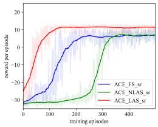

(a) R101

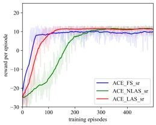

(b) R102

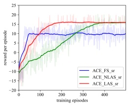

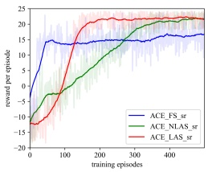

(c) R103

(d) R104

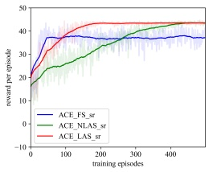

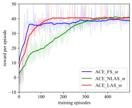

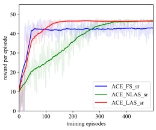

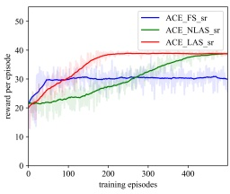

(e) R201

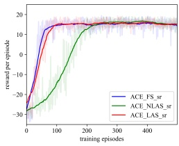

(f) R202

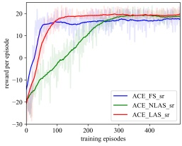

(g) R203

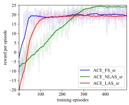

(h) R204

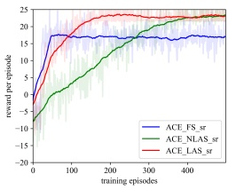

(i) RC101

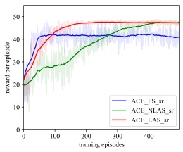

(m) RC201

(j) RC102

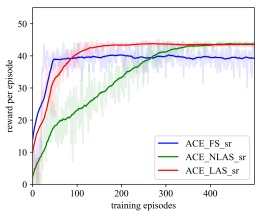

(n) RC202

(k) RC103

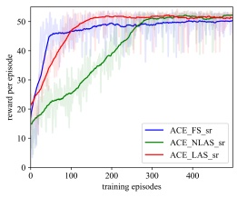

(o) RC203

(l) RC104

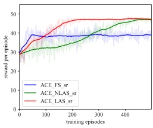

(p) RC204

Figure 6: Performance comparison during the training process (learning on selection for replacement heuristics, i.e. sr)

As shown in Figure 6, the proposed ACE methods are able to learn on selection for replacement heuristics throughout the training process. However, as Tables 8-11 show, the RL-based methods (i.e. three ACE variants)

have slightly but not significantly better performance than the non-learning method on all instances during the testing process. This indicates that selection for replacement heuristic has little impact on the algorithm performance although ACE methods have a relatively good learning performance. One possible explanation is that the action space is relatively small thus presents limited scope for learning.

Table 8: Performance comparison during the testing process (learning on selection for replacement heuristics, i.e. sr), type-R1

|  | R101 | R102 | R103 | R104 |
| --- | --- | --- | --- | --- |
| Best-known Solutions | 20645.79 [36] | 18486.12 [37] | 14292.68 [38] | 10007.24 [39] |
| AVG | 20953.99 | 18705.20 | 15253.01 | 11337.15 |
| SD | 30.14 | 29.10 | 343.92 | 406.37 |
| ACE FS sr |  |  |  |  |
| BEST | 20905.51 | 18659.77 | 14521.65 | 11097.61 |
| GAP | 1.26% | 0.94% | 1.60% | 10.90% |
| AVG | 21039.63 | 18757.65 | 15296.03 | 11202.98 |
| SD | 311.39 | 222.57 | 279.64 | 302.91 |
| ACE NLAS sr |  |  |  |  |
| BEST | 20885.40 | 18669.78 | 14458.03 | 11070.86 |
| GAP | 1.16% | 0.99% | 1.16% | 10.63% |
| AVG | 20941.11 | 18686.76 | 15287.74 | 11158.34 |
| SD | 29.51 | 17.75 | 234.07 | 219.93 |
| ACE LAS sr |  |  |  |  |
| BEST | 20893.87 | 18628.8 | 14440.08 | 11057.46 |
| GAP | 1.20% | 0.77% | 1.03% | 10.49% |
| AVG | 20957.89 | 18769.97 | 15342.55 | 11373.85 |
| SD | 30.37 | 215.69 | 207.39 | 443.38 |
| Non-learning |  |  |  |  |
| BEST | 20901.02 | 18675.05 | 14448.89 | 11085.36 |
| GAP | 1.24% | 1.02% | 1.09% | 10.77% |

Table 9: Performance comparison during the testing process (learning on selection for replacement heuristics, i.e. sr), type-R2

|  | R201 | R202 | R203 | R204 |
| --- | --- | --- | --- | --- |
| Best-known Solutions | 5252.37 [40] | 4191.7 [41] | 3939.54 [42] | 2825.52 [43] |
| AVG | 5485.78 | 5307.81 | 4184.56 | 3972.95 |
| SD | 17.39 | 40.18 | 29.26 | 27.01 |
| ACE FS sr |  |  |  |  |
| BEST | 5442.47 | 5220.64 | 4130.73 | 3928.06 |
| GAP | 3.62% | 24.55% | 4.85% | 39.02% |
| AVG | 5532.74 | 5193.71 | 4155.69 | 3927.74 |
| SD | 28.14 | 292.15 | 26.95 | 23.88 |
| ACE NLAS sr |  |  |  |  |
| BEST | 5484.73 | 4290.74 | 4112.68 | 3884.60 |
| GAP | 4.42% | 2.36% | 4.4% | 37.48% |
| AVG | 5462.73 | 4860.06 | 4141.74 | 3912.04 |
| SD | 41.66 | 432.75 | 29.79 | 16.42 |
| ACE LAS sr |  |  |  |  |
| BEST | 5391.18 | 4313.70 | 4079.64 | 3886.11 |
| GAP | 2.64% | 2.91% | 3.56% | 37.54% |
| AVG | 5533.63 | 5384.61 | 4252.69 | 4020.82 |
| SD | 24.47 | 49.37 | 23.49 | 19.65 |
| Non-learning |  |  |  |  |
| BEST | 5481.47 | 5287.09 | 4184.90 | 3989.41 |
| GAP | 4.36% | 26.13% | 6.23% | 41.19% |

Table 10: Performance comparison during the testing process (learning on selection for replacement heuristics, i.e. sr), type-RC1

|  | RC101 | RC102 | RC103 | RC104 |
| --- | --- | --- | --- | --- |
| Best-known Solutions | 15696.94 [44] | 13554.75 [44] | 12261.67 [45] | 12135.487 [46] |
| AVG | 17138.92 | 15075.5 | 13010.12 | 11932.74 |
| SD | 495.57 | 489.15 | 480.12 | 487.54 |
| ACE FS sr |  |  |  |  |
| BEST | 16729.1 | 14581.41 | 12380 | 11191.67 |
| GAP | 6.58% | 7.57% | 0.97% | 0.50% |
| AVG | 17131.87 | 15335.74 | 13220.6 | 12009.46 |
| SD | 504.41 | 434.11 | 382.15 | 453.92 |
| ACE NLAS sr |  |  |  |  |
| BEST | 16695.41 | 14574.36 | 12381.99 | 11176.33 |
| GAP | 6.36% | 7.52% | 0.98% | 0.37% |
| AVG | 16789.31 | 14632.69 | 12408.88 | 11264.29 |
| SD | 36.77 | 28.55 | 33.79 | 226.67 |
| ACE LAS sr |  |  |  |  |
| BEST | 16720.35 | 14577.61 | 12360.48 | 11188.16 |
| GAP | 6.52% | 7.55% | 0.81% | 0.47% |
| AVG | 17105.48 | 15194.24 | 13210.88 | 12059.4 |
| SD | 478.03 | 481.82 | 401.69 | 419.97 |
| Non-learning |  |  |  |  |
| BEST | 16745.33 | 14597.72 | 12341.12 | 11171.26 |
| GAP | 6.68% | 7.69% | 0.65% | 0.32% |

Table 11: Performance comparison during the testing process (learning on selection for replacement heuristics, i.e. sr), type-RC2

|  | RC201 | RC202 | RC203 | RC204 |
| --- | --- | --- | --- | --- |
| Best-known Solutions | 5406.91 [39] | 4367.09 [47] | 4049.62 [47] | 3798.41 [39] |
| AVG | 5664.16 | 5476.56 | 4252.20 | 4010.41 |
| SD | 33.7 | 31.81 | 36.96 | 28.62 |
| ACE FS sr |  |  |  |  |
| BEST | 5609.33 | 5422.93 | 4167.97 | 3962.13 |
| GAP | 3.74% | 24.22% | 2.92% | 4.31% |
| AVG | 5663.75 | 5432.35 | 4308.48 | 3970.37 |
| SD | 54.65 | 50.32 | 216.30 | 20.95 |
| ACE NLAS sr |  |  |  |  |
| BEST | 5584.09 | 5341.78 | 4138.31 | 3929.21 |
| GAP | 3.28% | 22.36% | 2.19% | 3.44% |
| AVG | 5624.67 | 5438.88 | 4217.56 | 3967.57 |
| SD | 33.25 | 42.35 | 31.91 | 18.10 |
| ACE LAS sr |  |  |  |  |
| BEST | 5536.72 | 5331.38 | 4141.87 | 3925.76 |
| GAP | 2.40% | 22.12% | 2.28% | 3.35% |
| AVG | 5683.60 | 5431.68 | 4238.98 | 3973.20 |
| SD | 55.43 | 42.20 | 38.76 | 28.32 |
| Non-learning |  |  |  |  |
| BEST | 5594.09 | 5347.23 | 4163.38 | 3905.85 |
| GAP | 3.46% | 22.48% | 2.81% | 2.83% |

## 4.3. Learning on Selection Heuristics and Evolution Operators

## 4.3.1. Effectiveness of the Learning Models

Experimental results on the training process are shown in Figure 7 to investigate the effectiveness of extending the search space from evolution operators alone to both selection heuristics and evolution operators.

As shown in Figure 7, despite having a worse starting point, all the ACE methods on the search space of both selection heuristics and evolution operators (both) outperform those on the search space of evolution operators alone (operator). This demonstrates the positive synergy between selection heuristics and evolution operators. In other words, proper collaboration between selection heuristics and evolution operators significantly improves the performance of search algorithms. More importantly, this indicates that human experience can help with algorithm design within a limited design space, i.e. using human expertise to fix the other components besides evolution operators leads to a better starting point, but machine learning outperforms within a larger algorithm design space and therefore has more potential to design better algorithms and attain better solutions.

Concerning learning on the search space of both selection heuristics and evolution operators, ACE LAS both performs better than the others, and ACE FS both and ACE NLAS both demonstrate competitive performance during the training process. This shows that the adaptive coefficient adjustment scheme can guide the agent to explore new actions at the early stage of the search process while also exploit the best actions at the later stage. The advantage of ACE LAS both over ACE NLAS both is that the simple lin ear coefficient adjustment is much less time-consuming, and therefore more computational time can be used to evolve the population and enhance the search performance.

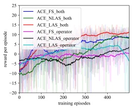

(a) R101

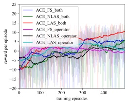

(b) R102

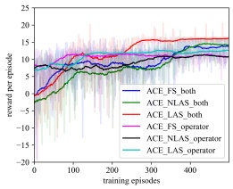

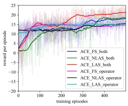

(c) R103

(d) R104

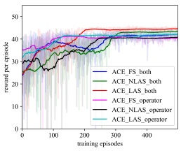

(e) R201

(f) R202

(g) R203

(h) R204

(i) RC101

(m) RC201

(j) RC102

(n) RC202

(k) RC103

(o) RC203

(l) RC104

(p) RC204

Figure 7: Performance comparison during the training process (learning on evolution operators vs. learning on both selection heuristics and evolution operators)

Regarding the performance of ACE variants during the testing process,

Table 12: Performance comparison during the testing process (learning on evolution operators vs. learning on both selection heuristics and evolution operators), type-R1

|  | R101 | R102 | R103 | R104 |
| --- | --- | --- | --- | --- |
| Best-known Solutions | 20645.79 [36] | 18486.12 [37] | 14292.68 [38] | 10007.24 [39] |
| AVG | 20864.64 | 19267.41 | 15252.24 | 11630.38 |
| SD | 395.65 | 516.22 | 150.05 | 483.08 |
| ACE FS both |  |  |  |  |
| BEST | 20653.99 | 18522.27 | 14613.02 | 11049.23 |
| GAP | 0.04% | 0.20% | 2.24% | 10.41% |
| AVG | 21119.96 | 19148.23 | 15222.18 | 11471.89 |
| SD | 506.19 | 466.2739 | 200.952 | 482.93 |
| ACE NLAS both |  |  |  |  |
| BEST | 20653.76 | 18500.85 | 14350.38 | 11044.7 |
| GAP | 0.04% | 0.08% | 0.40% | 10.37% |
| AVG | 20663.25 | 19193.66 | 15161.89 | 11069.15 |
| SD | 7.22 | 446.35 | 269.76 | 19.38 |
| ACE LAS both |  |  |  |  |
| BEST | 20652.27 | 18491.29 | 14348.23 | 11022.37 |
| GAP | 0.03% | 0.03% | 0.39% | 10.14% |
| AVG | 20664.24 | 18653.01 | 15255.71 | 11092.17 |
| SD | 13.08 | 339.90 | 7.28 | 20.39 |
| ACE FS operator |  |  |  |  |
| BEST | 20653.76 | 18498.31 | 15243.27 | 11059.56 |
| GAP | 0.04% | 0.07% | 6.65% | 10.52% |
| AVG | 20663.64 | 18512.82 | 15131.34 | 11126.13 |
| SD | 9.26 | 12.75 | 293.55 | 205.91 |
| ACE NLAS operator |  |  |  |  |
| BEST | 20653.99 | 18491.88 | 14400.16 | 11033.77 |
| GAP | 0.04% | 0.03% | 0.75% | 10.26% |
| AVG | 20788.71 | 18522.37 | 15129.87 | 11090.62 |
| SD | 288.5524 | 14.02 | 305.60 | 35.27 |
| ACE LAS operator |  |  |  |  |
| BEST | 20653.76 | 18504.07 | 14353.07 | 11061.15 |
| GAP | 0.04% | 0.097% | 0.42% | 10.53% |
| AVG | 20957.89 | 18769.97 | 15342.55 | 11373.85 |
| SD | 30.37 | 215.69 | 207.39 | 443.38 |
| Non-learning |  |  |  |  |
| BEST | 20901.02 | 18675.05 | 14448.89 | 11085.36 |
| GAP | 1.24% | 1.02% | 1.09% | 10.77% |

Table 13: Performance comparison during the testing process (learning on evolution operators vs. learning on both selection heuristics and evolution operators), type-R2

|  | R201 | R202 | R203 | R204 |
| --- | --- | --- | --- | --- |
| Best-known Solutions | 5252.37 [40] | 4191.7 [41] | 3939.54 [42] | 2825.52 [43] |
| AVG | 5351.79 | 5177.05 | 4065.49 | 3844.57 |
| SD | 35.72 | 22.12 | 28.78 | 21.66 |
| ACE FS both |  |  |  |  |
| BEST | 5278.02 | 5146.30 | 4010.91 | 3796.73 |
| GAP | 0.49% | 22.77% | 1.81% | 34.37% |
| AVG | 5353.24 | 5169.60 | 4051.64 | 3836.50 |
| SD | 36.00 | 22.24 | 30.32 | 25.38 |
| ACE NLAS both |  |  |  |  |
| BEST | 5284.13 | 5129.79 | 4006.80 | 3807.09 |
| GAP | 0.60% | 22.38% | 1.71% | 34.74% |
| AVG | 5320.87 | 5050.10 | 4026.06 | 3825.20 |
| SD | 15.84 | 266.36 | 14.00 | 8.44 |
| ACE LAS both |  |  |  |  |
| BEST | 5277.71 | 4255.46 | 3999.29 | 3806.12 |
| GAP | 0.48% | 1.52% | 1.52% | 34.71% |
| AVG | 5318.49 | 5115.03 | 4033.03 | 3825.06 |
| SD | 10.21 | 168.85 | 11.77 | 8.62 |
| ACE FS operator |  |  |  |  |
| BEST | 5298.13 | 4361.74 | 3997.63 | 3782.99 |
| GAP | 0.87% | 4.06% | 1.48% | 33.89% |
| AVG | 5316.34 | 5065.46 | 4029.42 | 3816.46 |
| SD | 10.57 | 258.14 | 16.08 | 8.64 |
| ACE NLAS operator |  |  |  |  |
| BEST | 5298.88 | 4331.64 | 3998.09 | 3796.79 |
| GAP | 0.89% | 3.34% | 1.49% | 34.38% |
| AVG | 5314.33 | 5113.26 | 4077.97 | 3818.40 |
| SD | 14.89 | 192.43 | 58.36 | 11.47 |
| ACE LAS operator |  |  |  |  |
| BEST | 5287.98 | 4265.06 | 4017.52 | 3795.08 |
| GAP | 0.68% | 1.75% | 1.98% | 34.31% |
| AVG | 5533.63 | 5384.61 | 4252.69 | 4020.82 |
| SD | 24.47 | 49.37 | 23.49 | 19.65 |
| Non-learning |  |  |  |  |
| BEST | 5481.47 | 5287.09 | 4184.90 | 3989.41 |
| GAP | 4.36% | 26.13% | 6.23% | 41.19% |

Table 14: Performance comparison during the testing process (learning on evolution operators vs. learning on both selection heuristics and evolution operators), type-RC1

|  | RC101 | RC102 | RC103 | RC104 |
| --- | --- | --- | --- | --- |
| Best-known Solutions | 15696.94 [44] | 13554.75 [44] | 12261.67 [45] | 12135.487 [46] |
| AVG | 17550.06 | 15508.28 | 13474.65 | 12232.91 |
| SD | 467.96 | 464.78 | 430.80 | 23.29 |
| ACE FS both |  |  |  |  |
| BEST | 16677.82 | 14521.81 | 12443.92 | 12176.53 |
| GAP | 6.25% | 7.13% | 1.49% | 9.35% |
| AVG | 17708.71 | 15444.12 | 13315.13 | 12235.36 |
| SD | 312.92 | 511.43 | 223.25 | 24.31 |
| ACE NLAS both |  |  |  |  |
| BEST | 16705.59 | 14552.96 | 12321.2 | 12171.33 |
| GAP | 6.43% | 7.36% | 0.49% | 9.30% |
| AVG | 17555.36 | 15332.23 | 13273.83 | 12032.23 |
| SD | 473.81 | 383.64 | 287.95 | 407.30 |
| ACE LAS both |  |  |  |  |
| BEST | 16648.09 | 14516.89 | 12365.86 | 11168.88 |
| GAP | 6.06% | 7.10% | 0.85% | 0.3% |
| AVG | 17271.06 | 15480.25 | 13348.91 | 12072.58 |
| SD | 478.25 | 205.12 | 17.19 | 333.02 |
| ACE FS operator |  |  |  |  |
| BEST | 16681.82 | 14566.36 | 13302.72 | 11247.47 |
| GAP | 6.27% | 7.46% | 8.49% | 1.01% |
| AVG | 17027.84 | 15479.54 | 13296.05 | 12065.08 |
| SD | 462.77 | 201.48 | 211.14 | 344.85 |
| ACE NLAS operator |  |  |  |  |
| BEST | 16674.02 | 14579.25 | 12354.11 | 11209.12 |
| GAP | 6.22% | 7.56% | 0.75% | 0.66% |
| AVG | 16951.76 | 15310.34 | 13302.72 | 12214.11 |
| SD | 417.82 | 396.81 | 213.35 | 222.48 |
| ACE LAS operator |  |  |  |  |
| BEST | 16667.91 | 14561.73 | 12351.55 | 11225.98 |
| GAP | 6.19% | 7.43% | 0.73% | 0.81% |
| AVG | 17105.48 | 15194.24 | 13210.88 | 12059.4 |
| SD | 478.03 | 481.82 | 401.69 | 419.97 |
| Non-learning |  |  |  |  |
| BEST | 16745.33 | 14597.72 | 12341.12 | 11171.26 |
| GAP | 6.68% | 7.69% | 0.65% | 0.32% |

Table 15: Performance comparison during the testing process (learning on evolution operators vs. learning on both selection heuristics and evolution operators), type-RC2

|  | RC201 | RC202 | RC203 | RC204 |
| --- | --- | --- | --- | --- |
| Best-known Solutions | 5406.91 [39] | 4367.09 [47] | 4049.62 [47] | 3798.41 [39] |
| AVG | 5534.21 | 5310.02 | 4306.63 | 3903.02 |
| SD | 38.91 | 49.67 | 309.84 | 24.17 |
| ACE FS both |  |  |  |  |
| BEST | 5478.78 | 5204.87 | 4118.84 | 3842.72 |
| GAP | 1.33% | 19.22% | 1.71% | 1.17% |
| AVG | 5550.32 | 5288.01 | 4273.22 | 3910.53 |
| SD | 48.62 | 46.29 | 264.60 | 30.43 |
| ACE NLAS both |  |  |  |  |
| BEST | 5449.35 | 5218.59 | 4128.85 | 3864.09 |
| GAP | 0.78% | 19.54% | 1.96% | 1.73% |
| AVG | 5510.25 | 5292.42 | 4161.03 | 3879.72 |
| SD | 25.18 | 33.04 | 21.08 | 15.62 |
| ACE LAS both |  |  |  |  |
| BEST | 5460.29 | 5209.88 | 4094.21 | 3843.16 |
| GAP | 0.99% | 19.34% | 1.10% | 1.18% |
| AVG | 5499.55 | 5272.72 | 4176.15 | 3877.98 |
| SD | 12.66 | 18.38 | 20.04 | 13.64 |
| ACE FS operator |  |  |  |  |
| BEST | 5474.01 | 5245.04 | 4131.80 | 3847.81 |
| GAP | 1.24% | 20.14% | 2.03% | 1.30% |
| AVG | 5498.08 | 5276.13 | 4176.11 | 3885.27 |
| SD | 20.45 | 19.19 | 27.09 | 13.30 |
| ACE NLAS operator |  |  |  |  |
| BEST | 5459.43 | 5233.93 | 4133.47 | 3846.10 |
| GAP | 0.97% | 19.89% | 2.07% | 1.25% |
| AVG | 5558.41 | 5266.24 | 4202.15 | 3877.72 |
| SD | 55.07 | 30.76 | 50.11 | 10.88 |
| ACE LAS operator |  |  |  |  |
| BEST | 5497.77 | 5214.28 | 4120.17 | 3855.23 |
| GAP | 1.68% | 19.44% | 1.74% | 1.49% |
| AVG | 5683.60 | 5431.68 | 4238.98 | 3973.20 |
| SD | 55.43 | 42.20 | 38.76 | 28.32 |
| Non-learning |  |  |  |  |
| BEST | 5594.09 | 5347.23 | 4163.38 | 3905.85 |
| GAP | 3.46% | 22.48% | 2.81% | 2.83% |

Tables 12-15 tabulate the statistical performances of ACE FS operator, ACE - NLAS operator, ACE LAS operator concerning the search space of evolution operators, and ACE FS both, ACE NLAS both, ACE LAS both concerning the search space of both selection heuristics and evolution operators.

In Tables 12-15, ACE LAS both attains better performance on solution quality than the other two ACE variants on most instances. Note that the only difference between ACE variants lies in the entropy coefficient adjustment scheme. Therefore, it is possible to infer that the linear entropy coefficient adjustment scheme is useful in striking the balance between exploration and exploitation during the learning process, particularly on the large search space of algorithm design. This observation is consistent with the results obtained during the training process.

Note that the only difference in the selected type-R1 instances lies in the customer time windows density, i.e. the percentage of customers with time windows of R101 and R102 is 100% and 75% respectively, and 50% and 25% for R103 and R104. As shown in Figure 7, with the decrease of time windows density (i.e. with looser constraints), the starting points of all ACE variants increase. This observation indicates that the ACE methods learn better on instances with looser constraints. One possible reason is that the solution space of the instances with looser constraints consists of more feasible solution candidates, which is helpful for learning techniques to discover some knowledge or patterns.

## 4.3.2. Component Analysis of the Best Designed Search Algorithms

Taking type-R1 instances as examples, Figures 8-10 show the most adapted algorithmic components of the best designed search algorithms learned by the

ACE LAS both method on the Selection for Evolution heuristics (i.e. Figure 8), Evolution Operators (i.e. Figure 9) and Selection for Replacement heuristics (i.e. Figure 10).

In the best designed search algorithms, all the Selection for Evolution heuristics are called during the optimisation process although the appearances of each heuristic are different. The same phenomenons can be observed in terms of Evolution Operators and Selection for Replacement heuristics. This indicates that using distinct algorithmic components (e.g., selection heuristics and evolution operators) can help to improve the performance of the search algorithms. Moreover, it should be noted that $h _ { 8 }$ is identified as the most frequently called selection for replacement heuristic, which is con sistent with the findings of manually designed algorithms in the literature.

## 4.3.3. Generality of the Learning Models

To investigate the generality of the policies learned by the ACE methods concerning different search spaces of algorithm components for solving the same-type and different-type problem instances, the policies trained on instance R101 are employed to design algorithms for solving different types of new problem instances.

Results in Table 16 demonstrate a good degree of generality of the reinforcement learning based models. The $\mathrm { { ` G A P ` } }$ is less than 3% on most selected instances apart from instance RC101. Note that ACE LAS both attained best “AVG”, “BEST” and $\mathrm{^{ \text{°  }}GAP}$ on most instances, which is consistent with the experimental results regarding the effectiveness of the learning models in Section 4.3.1.

Table 16: Generality of the trained policy R101 (20 runs)

|  | C101 | C201 | R105 | R201 | RC101 | RC201 |
| --- | --- | --- | --- | --- | --- | --- |
| Best-known Solutions | 10828.94 [37] | 3591.56 [37] | 15377.11 [37] | 5252.37 [40] | 15696.94 [44] | 5406.91 [39] |
| AVG | 10828.94 | 3591.56 | 16367.11 | 5369.67 | 17451.46 | 5665.17 |
| SD | 3.64E-12 | 4.44E-13 | 213.87 | 34.71 | 516.73 | 396.70 |
| ACE FS both |  |  |  |  |  |  |
| BEST | 10828.94 | 3591.56 | 15415.34 | 5295.14 | 16672.46 | 5524.74 |
| GAP | 0 | 0 | 0.25% | 0.81% | 6.21% | 2.18% |
| AVG | 10882.25 | 3593.05 | 16216.42 | 5361.80 | 17597.40 | 5551.16 |
| SD | 226.77 | 6.37 | 385.46 | 30.95 | 301.94 | 30.14 |
| ACE NLAS both |  |  |  |  |  |  |
| BEST | 10828.94 | 3591.56 | 15383.19 | 5299.25 | 16687.34 | 5495.74 |
| GAP | 0 | 0 | 0.04% | 0.89% | 6.31% | 1.64% |
| AVG | 10828.94 | 3591.56 | 16252.23 | 5320.08 | 17031.94 | 5495.34 |
| SD | 3.64E-12 | 4.55E-13 | 337.93 | 9.75 | 478.87 | 16.26 |
| ACE LAS both |  |  |  |  |  |  |
| BEST | 10828.94 | 3591.56 | 15422.13 | 5288.70 | 16638.66 | 5450.61 |
| GAP | 0 | 0 | 0.29% | 0.69% | 6.0% | 0.81% |
| AVG | 10828.94 | 3591.56 | 16354.52 | 5320.17 | 17243.77 | 5503.02 |
| SD | 3.64E-12 | 4.55E-13 | 203.59 | 10.67 | 480.18 | 17.45 |
| ACE FS operator |  |  |  |  |  |  |
| BEST | 10828.94 | 3591.56 | 15468.55 | 5301.74 | 16662.95 | 5465.95 |
| GAP | 0 | 0 | 0.59% | 0.94% | 6.15% | 1.09% |
| AVG | 10828.94 | 3591.56 | 16249.68 | 5323.86 | 17234.76 | 5511.80 |
| SD | 3.64E-12 | 4.55E-13 | 350.09 | 19.90 | 492.75 | 30.22 |
| ACE NLAS operator |  |  |  |  |  |  |
| BEST | 10828.94 | 3591.56 | 15393.51 | 5307.14 | 16653.41 | 5469.14 |
| GAP | 0 | 0 | 0.11% | 1.04% | 6.09% | 1.15% |
| AVG | 11051.9 | 3591.56 | 16338.5 | 5383.6 | 17070.83 | 5564.74 |
| SD | 441.29 | 4.55E-13 | 278.59 | 35.30 | 457.47 | 28.72 |
| ACE LAS operator |  |  |  |  |  |  |
| BEST | 10828.94 | 3591.56 | 15486.98 | 5332.277 | 16658.77 | 5506.94 |
| GAP | 0 | 0 | 0.71% | 1.52% | 6.13% | 1.85% |

(a) R101 se

(b) R102 se

(c) R103 se

(d) R104 se

Figure 8: The most adapted algorithmic components of the best designed search algorithms obtained by ACE LAS both, Selection for Evolution heuristics

## 5. Conclusions and Future Work

In this study, we systematically investigate two research issues in automated algorithm design with machine learning, namely the impact of individual algorithmic components and the synergy of multiple components, within a unified general search framework. Extending the search space of algorithm design from individual components to multiple components results in a high-dimensional decision space of algorithm design. Therefore, an advanced reinforcement learning method with adapted maximum entropy mechanisms was devised to address the automated algorithm design problem, with a continuous state space and a high-dimensional discrete action space.

(a) R101 op

(b) R102 op

(c) R103 op

(d) R104 op

Figure 9: The most adapted algorithmic components of the best designed search algorithms obtained by ACE LAS both, Evolution Operators

The performance of the learning models, namely their effectiveness and generality, was assessed on the capacitated vehicle routing problem with time windows. Results regarding the impact of individual components show that selection heuristics have less impact on the performance of search algorithms, which supports human experience in designing search algorithms and findings reported in the literature. Learning on the synergy of multiple components demonstrate that proper collaboration among selection heuristics and evo lution operators can significantly improve the algorithm performance. The comparison experiments with the learning on evolution operators indicate that human design experience can help algorithm design to some extent, but machine learning techniques overtake human experience when dealing with a larger algorithm design space which human experts are not able to explore.

(a) R101 sr

(b) R102 sr

(c) R103 sr

(d) R104 sr

Figure 10: The most adapted algorithmic components of the best designed search algorithms obtained by ACE LAS both, Selection for Replacement heuristics

For further work, the proposed learning models can be extended to investigate automated design of multi-objective search algorithms with the support of the extended multi-objective general search framework. It would be interesting to challenge the proposed automated design approaches by ap plying them to more complex VRP variants and real-world problems, such as the multi-depot vehicle routing problem [48], the stochastic vehicle rout ing problem [49], or the time-dependent green vehicle routing problem with time windows [50]. Further studies may also investigate how to transfer the reusable knowledge in designing search algorithms for small-scale vehicle routing problems to large-scale vehicle routing problems, or even to other complex combinatorial optimisation problems.

## Acknowledgement

This research has been funded by the School of Computer Science, University of Nottingham, UK.

## References

[1] N. Pillay, R. Qu, Automated Design of Machine Learning and Search Algorithms, Springer, 2021.

[2] Q. Zhao, Q. Duan, B. Yan, S. Cheng, Y. Shi, A survey on automated design of metaheuristic algorithms, arXiv preprint arXiv:2303.06532 (2023).

[3] R. Qu, G. Kendall, N. Pillay, The general combinatorial optimization problem: Towards automated algorithm design, IEEE Computational Intelligence Magazine 15 (2020) 14–23.

[4] W. Meng, R. Qu, Automated design of search algorithms: Learning on algorithmic components, Expert Systems with Applications 185 (2021) 115493.

[5] W. Yi, R. Qu, L. Jiao, B. Niu, Automated design of metaheuristics using reinforcement learning within a novel general search framework, IEEE Transactions on Evolutionary Computation 27 (2023) 1072–1084. doi:10.1109/TEVC.2022.3197298.

[6] Y. Sakurai, K. Takada, T. Kawabe, S. Tsuruta, A method to control parameters of evolutionary algorithms by using reinforcement learning, in: 2010 Sixth International Conference on Signal-Image Technology and Internet Based Systems, IEEE, 2010, pp. 74–79.

[7] G. Duflo, G. Danoy, E.-G. Talbi, P. Bouvry, Automated design of efficient swarming behaviours: a Q-learning hyper-heuristic approach, in:

Proceedings of the 2020 Genetic and Evolutionary Computation Conference Companion, 2020, pp. 227–228.

[8] B. Crawford, R. Soto, J. Lemus-Romani, M. Becerra-Rozas, J. M. Lanza-Gutiérrez, N. Caballé, M. Castillo, D. Tapia, F. Cisternas-Caneo, J. Garc´ıa, et al., Q-learnheuristics: towards data-driven balanced metaheuristics, Mathematics 9 (2021) 1839.

[9] S. N. Chaurasia, J. H. Kim, An evolutionary algorithm based hyperheuristic framework for the set packing problem, Information Sciences 505 (2019) 1–31.

[10] N. R. Sabar, M. Ayob, G. Kendall, R. Qu, Grammatical evolution hyperheuristic for combinatorial optimization problems, IEEE Transactions on Evolutionary Computation 17 (2013) 840–861.

[11] S. S. Choong, L.-P. Wong, C. P. Lim, Automatic design of hyperheuristic based on reinforcement learning, Information Sciences 436 (2018) 89–107.

[12] S. N. Richter, D. R. Tauritz, The automated design of probabilistic selection methods for evolutionary algorithms, in: Proceedings of the genetic and evolutionary computation conference companion, 2018, pp. 1545–1552.

[13] N. Lourenço, F. Pereira, E. Costa, Learning selection strategies for evolutionary algorithms, in: International Conference on Artificial Evolution (Evolution Artificielle), Springer, 2013, pp. 197–208.

[14] J. E. Pettinger, R. M. Everson, Controlling genetic algorithms with reinforcement learning, in: Proceedings of the 4th Annual Conference on Genetic and Evolutionary Computation, 2002, pp. 692–692.

[15] M. Mohammadi, P. Jula, R. Tavakkoli-Moghaddam, Reliable singleallocation hub location problem with disruptions, Transportation Research Part E: Logistics and Transportation Review 123 (2019) 90–120.

[16] P. Consoli, X. Yao, Diversity-driven selection of multiple crossover operators for the capacitated arc routing problem, in: European conference on evolutionary computation in combinatorial optimization, Springer, 2014, pp. 97–108.

[17] B. Peng, Y. Zhang, Y. Gajpal, X. Chen, A memetic algorithm for the green vehicle routing problem, Sustainability 11 (2019) 6055.

[18] E. K. Burke, M. Gendreau, G. Ochoa, J. D. Walker, Adaptive iterated local search for cross-domain optimisation, in: Proceedings of the 13th annual conference on Genetic and evolutionary computation, 2011, pp. 1987–1994.

[19] J. D. Walker, G. Ochoa, M. Gendreau, E. K. Burke, Vehicle routing and adaptive iterated local search within the hyflex hyper-heuristic framework, in: International conference on learning and intelligent optimization, Springer, 2012, pp. 265–276.

[20] H. Lu, X. Zhang, S. Yang, A learning-based iterative method for solving vehicle routing problems, in: International conference on learning representations, 2019.

[21] M. Karimi-Mamaghan, M. Mohammadi, B. Pasdeloup, P. Meyer, Learning to select operators in meta-heuristics: An integration of q-learning into the iterated greedy algorithm for the permutation flowshop scheduling problem, European Journal of Operational Research 304 (2023) 1296–1330.

[22] K. Li, H. Tian, A two-level self-adaptive variable neighborhood search algorithm for the prize-collecting vehicle routing problem, Applied Soft Computing 43 (2016) 469–479.

[23] Y. Chen, P. I. Cowling, F. A. Polack, P. J. Mourdjis, A multi-arm bandit neighbourhood search for routing and scheduling problems (2016).

[24] R. S. Sutton, A. G. Barto, Reinforcement learning: An introduction, MIT press, 2018.

[25] C. J. Watkins, P. Dayan, Q-learning, Machine learning 8 (1992) 279–292.

[26] V. Mnih, K. Kavukcuoglu, D. Silver, A. A. Rusu, J. Veness, M. G. Bellemare, A. Graves, M. Riedmiller, A. K. Fidjeland, G. Ostrovski, et al., Human-level control through deep reinforcement learning, nature 518 (2015) 529–533.

[27] J. Schulman, F. Wolski, P. Dhariwal, A. Radford, O. Klimov, Proximal policy optimization algorithms, arXiv preprint arXiv:1707.06347 (2017).

[28] S. D. Handoko, D. T. Nguyen, Z. Yuan, H. C. Lau, Reinforcement learning for adaptive operator selection in memetic search applied to

quadratic assignment problem, in: Proceedings of the companion publication of the 2014 annual conference on genetic and evolutionary computation, 2014, pp. 193–194.

[29] J. P. Q. dos Santos, J. D. de Melo, A. D. D. Neto, D. Aloise, Reactive search strategies using reinforcement learning, local search algorithms and variable neighborhood search, Expert Systems with Applications 41 (2014) 4939–4949.

[30] H. Mosadegh, S. F. Ghomi, G. A. Süer, Stochastic mixed-model assembly line sequencing problem: Mathematical modeling and q-learning based simulated annealing hyper-heuristics, European Journal of Operational Research 282 (2020) 530–544.

[31] A. Dantas, A. F. d. Rego, A. Pozo, Using deep q-network for selection hyper-heuristics, in: Proceedings of the Genetic and Evolutionary Computation Conference Companion, 2021, pp. 1488–1492.

[32] Y. Zhang, R. Bai, R. Qu, C. Tu, J. Jin, A deep reinforcement learning based hyper-heuristic for combinatorial optimisation with uncertainties, European Journal of Operational Research 300 (2022) 418–427.

[33] T. Haarnoja, A. Zhou, K. Hartikainen, G. Tucker, S. Ha, J. Tan, V. Kumar, H. Zhu, A. Gupta, P. Abbeel, et al., Soft actor-critic algorithms and applications, arXiv preprint arXiv:1812.05905 (2018).

[34] W. Yi, R. Qu, L. Jiao, Automated algorithm design using proximal policy optimisation with identified features, Expert Systems with Applications 216 (2023) 119461.

[35] M. M. Solomon, Algorithms for the vehicle routing and scheduling problems with time window constraints, Operations research 35 (1987) 254–265.

[36] J. Homberger, Eine verteilt-parallele metaheuristik, in: Verteiltparallele Metaheuristiken zur Tourenplanung, Springer, 2000, pp. 139–165.

[37] Y. Rochat, E. D. Taillard, Probabilistic diversification and intensifica- ´ tion in local search for vehicle routing, Journal of heuristics 1 (1995) 147–167.

[38] H. Li, A. Lim, Local search with annealing-like restarts to solve the vrptw, European journal of operational research 150 (2003) 115–127.

[39] D. Mester, O. Bräysy, W. Dullaert, A multi-parametric evolution strategies algorithm for vehicle routing problems, Expert Systems with Applications 32 (2007) 508–517.

[40] J. Homberger, H. Gehring, Two evolutionary metaheuristics for the vehicle routing problem with time windows, INFOR: Information Systems and Operational Research 37 (1999) 297–318.

[41] L.-M. Rousseau, M. Gendreau, G. Pesant, Using constraint-based operators to solve the vehicle routing problem with time windows, Journal of heuristics 8 (2002) 43–58.

[42] M. Woch, P. Lebkowski, Sequential simulated annealing for the vehicle routing problem with time windows, Decision Making in Manufacturing and Services 3 (2009) 87–100.

[43] R. Bent, P. Van Hentenryck, A two-stage hybrid local search for the vehicle routing problem with time windows, Transportation Science 38 (2004) 515–530.

[44] E. Taillard, P. Badeau, M. Gendreau, F. Guertin, J.-Y. Potvin, A tabu ´ search heuristic for the vehicle routing problem with soft time windows, Transportation science 31 (1997) 170–186.

[45] P. Shaw, Using constraint programming and local search methods to solve vehicle routing problems, in: International conference on principles and practice of constraint programming, Springer, 1998, pp. 417–431.

[46] J.-F. Cordeau, G. Laporte, A. Mercier, A unified tabu search heuristic for vehicle routing problems with time windows, Journal of the Operational research society 52 (2001) 928–936.

[47] Z. J. Czech, P. Czarnas, Parallel simulated annealing for the vehicle routing problem with time windows, in: Proceedings 10th Euromicro workshop on parallel, distributed and network-based processing, IEEE, 2002, pp. 376–383.

[48] B. Crevier, J.-F. Cordeau, G. Laporte, The multi-depot vehicle routing problem with inter-depot routes, European journal of operational research 176 (2007) 756–773.

[49] Y. Niu, J. Shao, J. Xiao, W. Song, Z. Cao, Multi-objective evolutionary algorithm based on rbf network for solving the stochastic vehicle routing problem, Information Sciences 609 (2022) 387–410.

[50] R. Qi, J.-q. Li, J. Wang, H. Jin, Y.-y. Han, Qmoea: A q-learning-based multiobjective evolutionary algorithm for solving time-dependent green vehicle routing problems with time windows, Information Sciences 608 (2022) 178–201.