# Simulated annealing with reinforcement learning for the set team orienteering problem with time windows

Vincent F. Yu a,b, Nabila Yuraisyah Salsabila a, Shih-Wei Lin c,d,e,\*, Aldy Gunawan f

a Department of Industrial Management, National Taiwan University of Science and Technology, Taipei, Taiwan

b Center for Cyber-Physical System Innovation, National Taiwan University of Science and Technology, Taipei, Taiwan

c Department of Information Management, Chang Gung University, Taoyuan, Taiwan

d Department of Industrial Engineering and Management, Ming Chi University of Technology, Taipei, Taiwan

e Department of Emergency Medicine, Keelung Chang Gung Memorial Hospital, Keelung City, Taiwan

f School of Computing and Information Systems, Singapore Management University, Singapore

## A R T I C L E I N F O

Keywords: Team orienteering problem with time windows Set orienteering problem Simulated annealing

## A B S T R A C T

This research investigates the Set Team Orienteering Problem with Time Windows (STOPTW), a new variant of the well-known Team Orienteering Problem with Time Windows and Set Orienteering Problem. In the STOPTW, customers are grouped into clusters. Each cluster is associated with a profit attainable when a customer in the cluster is visited within the customer’s time window. A Mixed Integer Linear Programming model is formulated for STOPTW to maximizing total profit while adhering to time window constraints. Since STOPTW is an NP-hard problem, a Simulated Annealing with Reinforcement Learning (SARL) algorithm is developed. The proposed SARL incorporates the core concepts of reinforcement learning, utilizing the ε-greedy algorithm to learn the fitness values resulting from neighborhood moves. Numerical experiments are conducted to assess the performance of SARL, comparing the results with those obtained by CPLEX and Simulated Annealing (SA). For small instances, both SARL and SA algorithms outperform CPLEX by obtaining eight optimal solutions and 12 better solutions. For large instances, both algorithms obtain better solutions to 28 out of 29 instances within shorter computational times compared to CPLEX. Overall, SARL outperforms SA by resulting in lower gap percentages within the same computational times. Specifically, SARL outperforms SA in solving 13 large STOPTW benchmark instances. Finally, a sensitivity analysis is conducted to derive managerial insights.

## 1. Introduction

The Vehicle Routing Problem with Profits (VRPP) is given less attention than a classical vehicle routing problem in the literature. On the other hand, most logistic processes have been prioritizing the profit maximization in the application. Even though this term has increased in popularity in the past decade, there is still a lot to be discovered. The main characteristic of the vehicle routing problem with profits is the set of the customers to be served is not given, which is contrary to the classical vehicle routing problem. Hence, in addition to the vehicle route, the set of customers to be served must be decided (Archetti, Speranza, & Vigo, 2014). Furthermore, the main objective is to maximize the profit instead of minimizing the cost. Meaning that, the difference between the route score (revenue) and cost must be maximized (Archetti, et al., 2014).

The orienteering problem (OP) was introduced by Tsiligiridis (1984) & Golden, Levy, and Vohra (1987). It is one of the basic problems of the vehicle routing problem with profits, where it determines the customer to be visited and the shortest route between the visited customers. The profit is associated with each customer, and the objective is to maximize the total profit such that the time limit is not exceeded (Gunawan, Lau, & Vansteenwegen, 2016). In the past few years, OP has gained much attention as many researchers worked on OP and its applications, such as the implementation of OP in inventory routing problems (Golden, et al., 1987), traveling salesman problem (Chao, Golden, & Wasil, 1996a), and tourist trip planning (Vansteenwegen, Souffriau, Vanden Berghe, & Van Oudheusden, 2009).

Some researchers have developed OP variants, such as the Team OP (TOP), the Team OP with Time Windows (TOPTW), and the Set Orienteering Problem (SOP). The TOP extends the OP by utilizing multiple vehicles. Hence, it determines multiple routes in order to maximize the total collected score such that the time limit is not exceeded (Gunawan, et al., 2016). Further, TOPTW considers the time window constraints that arise when each node has a time window to start the service. In this problem, each node can only be visited after the earliest time window and before the latest time window, otherwise, the visit will be infeasible. On the other hand, SOP was developed by Archetti, Carrabs, and Cerulli (2018), where customers are grouped into clusters, and profit is associated with each cluster. This means that at least one customer from the cluster needs to be visited for the profit to be collected (Archetti, et al., 2018). Despite of having different characteristics, the main objective of the aforementioned problems is to determine the vehicle routes that maximize the profit such that the time limit is not exceeded.

<small>\* Corresponding author.</small>

<small>E-mail addresses: [vincent@mail.ntust.edu.tw](mailto:vincent@mail.ntust.edu.tw) (V.F. Yu), [d10901805@mail.ntust.edu.tw](mailto:d10901805@mail.ntust.edu.tw) (N.Y. Salsabila), [swlin@mail.cgu.edu.tw](mailto:swlin@mail.cgu.edu.tw) (S.-W. Lin), [aldygunawan@smu. edu.sg](mailto:aldygunawan@smu.edu.sg) (A. Gunawan).</small>

This paper introduces the Set Team Orienteering Problem with Time Windows (STOPTW). It combines the characteristics of TOPTW and SOP, where both are variants of the OP (Archetti, et al., 2018; Vansteenwegen, Souffriau, Vanden Berghe, et al., 2009). In this problem, the customers were grouped into clusters and the profit is associated with the cluster. In other words, the profit can only be collected if at least one customer is visited from the cluster. Each customer has time windows and a visit outside this time window can lead to infeasibility. The objective is to find the vehicle routes to maximize the total collected profit such that the duration of the tour does not exceed the time limit. Looking at the description, although it is possible to visit more than one customer in a cluster, it is less likely since the aim is to gain profits as much as possible within the time duration. Furthermore, to maximize the profit the constructed route should be the shortest path. To sum up, the solution to this problem involves four decisions: selecting a cluster, selecting a customer belonging to the cluster to visit, scheduling the starting time to visit the selected customer, and constructing the shortest route between these customers.

Similar with SOP, the STOPTW can be applied when a mass product is distributed to the retailers that belongs to different supply chains. In some cases, the product may be delivered to one retailer from each chain instead of serving all retailers. As a result, the chain can obtain a better price from the distributor since they only deliver it once to a customer, while the delivery inside the chain is handled internally. To avoid interrupting their customer services, most retailers prefer to receive the products during off-peak hours. Another application is when a group of private customers ordering large quantities together, in hoping that they will get a discounted price. However, they may have their preferred time windows to receive the products. Furthermore, it also can be used in the tourist trip design problem, where some attractions are grouped based on their similarity, and each attraction has certain showing or opening time.

The STOPTW is an NP-hard problem, as it falls within the class of routing problems. Hence, an effective solution methodology is required to solve large-scale problems. Simulated annealing (SA) metaheuristic was proven to produce high quality solutions with quick computation in solving OP variants (Lin & Yu, 2012, 2015; Yu, Jewpanya, Redi, & Tsao, 2021). SA start with generating a random solution and then improve the solution by employing some neighborhood moves. Commonly, the basic SA randomly chooses a neighborhood move with the uniform probability distribution. In this study, we propose simulated annealing with reinforcement learning $( \mathrm { S A _ { R L } } )$ to solve newly introduced benchmark instances. In contrast with SA, $\mathrm { S A _ { R L } }$ uses a different method to select the neighborhood moves operator. $\mathrm { S A _ { R L } }$ uses the basic idea of reinforcement learning, where the ε-greedy is used to learn the fitness value resulting from each neighborhood move (Rodríguez-Esparza, Masegosa, Oliva, & Onieva, 2022; Shahmardan & Sajadieh, 2020). The numerical experiment results show that the proposed $\mathbf { S A } _ { \mathrm { R L } }$ can obtain good results and outperform a basic SA algorithm within a reasonable computational time.

The main contributions of this paper are listed as follows:

1. A new variant of the orienteering problem is introduced, namely the Set Team Orienteering Problem with Time Windows (STOPTW).

2. Two datasets of new benchmark instances for the STOPTW are generated.

3. A mixed integer linear programming for the STOPTW is formulated as an exact approach and a simulated annealing metaheuristic to solve the STOPTW is developed.

4. A reinforcement learning-based simulated annealing is also developed by embedding an ε-greedy algorithm to learn the performance of the neighborhood moves. This appends the contribution of this paper since it is first developed to solve the OP variant.

The remainder of this paper is organized as follows. Section 2 pre-sents the literature review of the TOP, TOPTW, and SOP. Section 3 defines the problem and develops the mathematical formulation for the STOPTW. Section 4 describes the proposed SA and $\mathrm { S A _ { R L } }$ in detail. In Section 5, the numerical experiments are conducted to analyze the performance of the proposed algorithm, and the comparative study is presented. Section 6 provides the conclusion and suggestions for further research.

## 2. Literature review

## 2.1. Team orienteering problem

The term “orienteering problem” was introduced by (Tsiligiridis, 1984), which aims to select the best nodes to travel within a limited travel time to maximize the total profit. Thus, OP can be defined as a combination between the Knapsack Problem and Travelling Salesman Problem (TSP) (Gunawan, et al., 2016). OP belongs to the class of routing problems; thus, it can be distinguished from TSP.

The Team Orienteering Problem is one of the well-known variants of OP and was first proposed by Chao, Golden, and Wasil (1996b). Similar to OP, the profit is also associated with each node in TOP. However, TOP determines multiple routes instead of a single route. Hence, multiple vehicles are utilized to visit those routes, and each vehicle must start and end at the same node. The number of nodes visited is maximized, but no nodes can be visited more than once. Hence, the main difference between OP and TOP is that several vehicles are utilized to collect profits in TOP.

Many studies have developed different approaches to solving OP and TOP (Archetti, Hertz, & Speranza, 2006; Boussier, Feillet, & Gendreau, 2006; Chao, et al., 1996a, 1996b; El-Hajj, Dang, & Moukrim, 2016; Gunawan, Lau, Vansteenwegen, & Lu, 2017; Hammami, Rekik, & Coelho, 2020; Ke, Archetti, & Feng, 2008; Keshtkaran, Ziarati, Bettinelli, & Vigo, 2016; Tang & Miller-Hooks, 2005; Vansteenwegen, Souffriau, Berghe, & Oudheusden, 2009; Vansteenwegen, Souffriau, Vanden Berghe, et al., 2009). Chao, et al. (1996a, 1996b) constructed a heuristic with two steps: initialization and improvement. The initialization was done by creating a route by a greedy method; and the improvement phase was done by performing a two-point exchange, one-point movement, clean up, and reinitialization. The computational testing showed that the proposed heuristic obtained better scores and more efficient than six previously published solution methods, including Tsiligiridis (1984). A tabu search heuristic was proposed by Tang and Miller-Hooks (2005) to solve TOP applications in routing technicians. They proposed the tabu search in three phases: initialization, solution improvement, and evaluation by embedding it into an Adaptive Memory Procedure. They tested the algorithm on 320 problems published in the literature. The proposed technique obtained high-quality solutions and outperformed the benchmark heuristics produced by Tsiligiridis (1984) and Chao, et al. (1996b). Archetti, et al. (2006) proposed two variants of generalized two tabu search and variable neighborhood search (VNS). The computational results show that the latter algorithm turned out to be more efficient and effective for TOP than the former one. Their proposed algorithm improved 128 benchmark test instances from Chao, et al. (1996b) and Tang and Miller-Hooks (2005). Vansteenwegen, Souffriau, Vanden Berghe, et al. (2009) presented two metaheuristic frameworks to solve TOP, Guided Local Search (GLS), and Skewed Variable Neighborhood Search (SVNS). Both algorithms implemented similar local search procedures to find a high-quality solution. The numerical experiment showed that the SVNS framework outperformed the GLS algorithm and three aforementioned best-published results in terms of the obtained scores and computational time.

Following Vansteenwegen, Souffriau, Vanden Berghe, et al. (2009), exact algorithms were developed by El-Hajj, et al. (2016) and Keshtkaran, et al. (2016). El-Hajj, et al. (2016) presented a cutting plane algorithm; the results show that it is comparable to existing algorithms and provided optimal solutions to 12 previously unsolved instances. On the other hand, Keshtkaran, et al. (2016) proposed a Branch-and-Price algorithm that can solve 17 previously unsolved benchmark instances.

Gunawan, et al. (2017) proposed two algorithms, Iterated Local Search (ILS) and a hybridization of Simulated Annealing and Iterated Local Search (SA-ILS). The proposed algorithms were able to discover 50 best known solutions. Hammami, et al. (2020) proposed a Hybrid Adaptive Large Neighborhood Search (HALNS) which combined the exploration ability of ALNS with local search procedures and a Set Packing Problem to improve the solutions. Their proposed algorithm discovered all the 387 best known solutions of the small-scale benchmark instances and 333 best known solutions large-scale benchmark instances. Furthermore, they also improved one large-scale benchmark instance.

## 2.2. Team orienteering problem with time windows

OP with Time Windows (OPTW) is a variant of OP first introduced by Kantor and Rosenwein (1992). OPTW has different characteristics from OP, where the time windows of each customer are considered. However, the approach to solving OPTW can still be implemented to solve OP by modifying the solution approach (Vansteenwegen, Souffriau, & Van Oudheusden, 2011). TOPTW has similar characteristics to OPTW, but multiple vehicles are utilized to serve the customers.

Many researchers studied TOPTW and its extension (Amarouche, Guibadj, Chaalal, & Moukrim, 2020; Hu & Lim, 2014; Karabulut & Tasgetiren, 2020; Labadie, Mansini, Melechovský, & Wolfler Calvo, 2012; Lin & Yu, 2012, 2015; Montemanni, Weyland, & Gambardella, 2011; Moosavi Heris, Ghannadpour, Bagheri, & Zandieh, 2022; Ruiz Meza, Brito, Montoya-Torres, Castro-Vergara, & Liu, 2022; Saeedvand, Aghdasi, & Baltes, 2020; Souffriau, Vansteenwegen, Vanden Berghe, & Van Oudheusden, 2011; Vansteenwegen, Souffriau, Vanden Berghe, et al., 2009; Yu, Jewpanya, Lin, & Redi, 2019). Vansteenwegen, Souffriau, Vanden Berghe, et al. (2009) proposed an ILS to solve TOPTW. They combined an insertion step and a shaking step to escape from local optima. The computational experiments indicated that the iterated local search can find new best solutions for 31 instances with a reasonable computation time. Lin and Yu (2012) presented a Simulated Annealing (SA) approach; the computational results show that the proposed heuristic is competitive with previous approaches. It obtained the best solutions for more than half of the benchmark instances for which the optimal solution is unknown. Hu and Lim (2014) introduced an iterative three-component heuristic, which tested and compared with the previous approaches in the literature, including Vansteenwegen, Souffriau, Vanden Berghe, et al. (2009) and Lin and Yu (2012). The proposed iterative three-component heuristic can find 35 new best solutions. Karabulut and Tasgetiren (2020) developed an evolution strategy to generate an offspring solution through ruin and recreate heuristic. Their proposed algorithm obtained new best-known solutions for 7 benchmark problem instances. Amarouche, et al. (2020) proposed a randomized Multi-Start Iterated Local Search (MS-ILS) procedure, which is able to improve 57 benchmark instances of TOPTW.

Lin and Yu (2015) proposed a multiconstraint team orienteering problem with multiple time windows (MC-TOP-MTW) as the extension of TOPTW. They developed simulated annealing with restart strategy $( \mathrm { S A _ { R S } } )$ as the solution approach, which performs better than without the restart strategy. Another extension was developed by Yu, et al. (2019), where the score of visiting a node differs depending on the time visit, namely the team orienteering problem with time windows and timedependent scores (TOPTW-TDS). They proposed a hybrid artificial bee colony (HABC), which is better than the previous algorithms for TOPTW. Ruiz-Meza, et al. (2022) extended their problem by introducing a multiconstraint multimodal team orienteering problem with time windows, namely Tourist Trip Design Problem (TTDP) and considering uncertainty using fuzzy constraints. The model has a bi-objective function that maximizes the total profit and minimizes the cost of $\mathrm { C O } _ { 2 }$ emissions.

The TOPTW also has been applied to a real case study by Saeedvand, et al. (2020). They implemented TOPTW as the task allocation for teams of rescue robots, namely TOPTWR. The TOPTWR was then solved by a Hybrid Multi-Objective and Evolutionary Algorithm (HMO-TOPTWTR). TOPTW was also implemented by Moosavi Heris, et al. (2022) to model a Tourist Trip Design Problem in Tehran, Iran. It aimed to maximize the profit gained from visiting the Points of Interests (POIs) and accessibility indicators. They developed a multi-objective genetic algorithm (MOGA) to solve the problem.

## 2.3. Set orienteering problem

The idea of SOP comes from the clustered OP (COP), where the customer is grouped in a cluster, and the profit can be collected if all customers in a cluster are visited (Angelelli, Archetti, & Vindigni, 2014). However, the profit can be collected if at least one customer is visited in the cluster in SOP.

Since this extension is considerably new, only a few researchers have studied SOP and its extension (Archetti, et al., 2018; Dutta, Barma, Mukherjee, Kar, & De, 2020; Pěnička, Faigl, & Saska, 2019). SOP was first introduced by Archetti, et al. (2018). They proposed a matheuristic algorithm to solve SOP, called MASOP (Matheuristic for the SOP). It has two phases: the first stage is the construction of an initial solution; the second phase is the tabu search. The numerical experiment result shows that the matheuristic produces high-quality solutions within a short computing time.

Pěnička, et al. (2019) proposed Variable Neighborhood Search (VNS) and compared their algorithm with the MASOP result proposed by Archetti, et al. (2018). The experimental result shows that seven bestknown solutions can be improved for small instances and ten bestknown solutions for large instances with much lower computational time than MASOP. Dontas, Sideris, Manousakis, and Zachariadis (2023) proposed an adaptive memory matheuristic which consisted of the initialization phase, improved by the local search and an adaptive memory heuristic. The proposed approach produced best solutions for 98.20 % of the instances of the classic SOP benchmark dataset. Dutta, et al. (2020) extended SOP by considering multiple objectives and open route (MOOSOP). In addition to maximizing profit, their model maximizes customer service satisfaction. They used the nondominated sorting genetic algorithm (NSGAII) and the strength Pareto evolutionary algorithm (SPEA2) to solve the proposed model.

## 2.4. Reinforcement learning-based simulated annealing

The idea of the reinforcement learning-based simulated annealing is inspired by the Adaptive Neighborhood Simulated Annealing (ANSA), where the probability of selecting a neighborhood move in the searching process is controlled (Salama & Srinivas, 2021; Yu, et al., 2021). Given the lack of literature, the utilization of reinforcement learning to select the neighborhood moves in SA needs to be explored (Rodríguez-Esparza, et al., 2022; Shahmardan & Sajadieh, 2020).

Shahmardan and Sajadieh (2020) developed a reinforcement learning-based SA to solve truck scheduling in a multi-door cross-docking center with partial unloading. In their study, a reward is given to the neighborhood moves that improved the solution; otherwise, punishment is given. Reinforcement learning was adopted to learn the value of each move by tracing their respective punishment and reward. Further, they implemented four variants of multi-armed bandit (MAB) to learn the true value function of each neighborhood search: (1) incremental implementation, (2) non-stationary problem, (3) upperconfidence-bound action selection, and (4) Q-learning.

Rodríguez-Esparza, et al. (2022) proposed Hyper-heuristic Adaptive Simulated Annealing with Reinforcement Learning to solve the Capacitated Electric Vehicle Routing Problem. They implemented MAB to optimize the reward of the neighborhood move, acquiring knowledge (exploration) and optimizing decisions based on that learning (exploitation). They use the three most commonly used MAB variants: (1) ε-greedy, (2) Thompson sampling, and (3) upper-confidence-bound 1.

Table 1 summarizes the current state-of-the-art of existing literature on TOP, TOPTW, and SOP. By looking at Table 1, it is apparent that the STOPTW is a problem that has not been studied in the literature. Whereas, it is a problem that often arises in real-world applications. Furthermore, the neighborhood moves in the Simulated Annealing are randomly selected in most cases. Rather than ANSA, the reinforcement learning-based simulated annealing utilizes more comprehensive method to learn the performances of the neighborhood moves. Hence, the utilization of reinforcement learning-based simulated annealing should be more prospected in the literature. Motivated by these shortcomings, this paper proposes a reinforcement learning-based simulated annealing $( \mathrm { S A _ { R L } } )$ to solve the STOPTW.

## 3. Problem description and formulation

As STOPTW is a generalized form of SOP, we derive the mathematical model based on Archetti, et al. (2018). The STOPTW is formally described as follows. Let $G = ( N , A )$ be a geographical network, where $N = \{ 0 \} \cup C$ represents a set of nodes, and A represents a set of arcs connecting each node. Vertex 0 represents the depot, and C represents the set of customers. In contrast with SOP, in this problem, each customer has a non-negative service time $s _ { i }$ and time window $[ E _ { i } , F _ { i } ] ,$ where Ei represents the earliest service time of node i, and $F _ { i }$ represents the latest service time at node $i , \; \forall i \in N .$ Each customer can only be visited once and must be visited within its time window. The travel time from customer i to customer j is represented by $t _ { i j } ,   \forall ( i , j ) \in A . A$ set of vehicles V is available to visit the customers, and each vehicle must start and finish its visit at the depot.

In the STOPTW, customers in C are grouped in cluster $L _ { g }$ with $g = 1$ $\cdots ,$ l where $\textstyle \bigcup _ { g = 1 } ^ { l }   L _ { g } = C$ and $L _ { g } \cap L _ { h } = \varnothing , \forall L _ { g } , L _ { h } \in \mathcal { L }$ where $\mathcal { L } = \{ L _ { 1 } ,   L _ { 2 }$ $\cdots , L _ { l } \}$ is the set of clusters. Each cluster is associated with a profit $( p _ { g } .$ . As the characteristic of SOP, the profit collection process happens if and only if a vehicle visiting customer i $i \in L _ { g } .$ The profit of each cluster can be collected only once; thus, the second visit to a customer in the same cluster will not obtain any profit. This problem gains complexity since the time windows are considered. An early visit before the time window results in waiting time, and a late visit after the time window results in infeasibility.

The decision variables are as follows:

$x _ { i j v }$ 1 if vehicle $\nu \in V$ traverses arc $( i , j ) \in A ;   0 ,$ otherwise

$y _ { i v }$ 1 if node $i \in N$ is visited by vehicle ${ \pmb v } \in V ;   0 ,$ otherwise

$z _ { g \nu }$ 1 if profit in cluster $L _ { g } \in \mathcal { L }$ is collected by vehicle $\pmb { \nu } \in V ; 0 ,$ otherwise

$c _ { i v }$ The starting time of visiting customer $i \in C$ with vehicle $\nu \in V$

The mathematical model of the STOPTW is formulated as follows:

$$
\max \sum_ {L _ {g} \in \mathscr {L}} \sum_ {v \in V} p _ {g} z _ {g v}\tag{1}
$$

Subject to

$$
\sum_ {i \in C, i \neq k} x _ {i k v} = \sum_ {j \in C, k \neq j} x _ {k j v} = y _ {k v} \forall k \in C, v \in V\tag{2}
$$

$$
\sum_ {v \in V} \sum_ {j \in C} x _ {0 i v} = \sum_ {v \in V} \sum_ {i \in C} x _ {i 0 v} = | V |\tag{3}
$$

Table 1

State-of-the-art of TOP, TOPTW, and SOP.

| Author | Model STW | Features MC | 1MTW | TDS | MM | C | S | O | Obje P | ctive2EC | TAT | FEC | TD | ACC | CS | Solution Methodology |
| --- | --- | --- | --- | --- | --- | --- | --- | --- | --- | --- | --- | --- | --- | --- | --- | --- |
| El-Hajj, et al. (2016) | - | - | - | - | - | - | - | - | ✓ | - | - | - | - | - | - | Cutting planes algorithm |
| Keshtkaran, et al. (2016) | - | - | - | - | - | - | - | - | ✓ | - | - | - | - | - | - | Branch and price algorithm |
| Hammami, et al. (2020) | - | - | - | - | - | - | - | - | ✓ | - | - | - | - | - | - | HALNS |
| Lin and Yu (2012) | ✓ | - | - | - | - | - | - | - | ✓ | - | - | - | - | - | - | SA |
| Hu and Lim (2014) | ✓ | - | - | - | - | - | - | - | ✓ | - | - | - | - | - | - | Three-component heuristic |
| Gunawan, et al. (2017) | ✓ | - | - | - | - | - | - | - | ✓ | - | - | - | - | - | - | ILS and SA-ILS |
| Karabulut and Tasgetiren (2020) | ✓ | - | - | - | - | - | - | - | ✓ | - | - | - | - | - | - | Evolution strategy approach |
| Amarouche, et al. (2020) | ✓ | - | - | - | - | - | - | - | ✓ | - | - | - | - | - | - | MS-ILS |
| Lin and Yu (2015) | - | ✓ | ✓ | - | - | - | - | - | ✓ | - | - | - | - | - | - | SARS |
| Yu, et al. (2019) | - | - | - | ✓ | - | - | - | - | ✓ | - | - | - | - | - | - | HABC |
| Ruiz-Meza, et al. (2022) | ✓ | ✓ | - | - | ✓ | - | - | - | ✓ | ✓ | - | - | - | - | - | a CPLEX solver |
| Saeedvand, et al. (2020) | ✓ | - | - | - | - | - | - | - | ✓ | ✓ | ✓ | ✓ | ✓ | - | - | HMO-TOPTWR |
| Moosavi Heris, et al. (2022) | ✓ | - | - | - | - | - | - | - | ✓ | - | - | - | - | ✓ | - | MOGA |
| Angelelli, et al. (2014) | - | - | - | - | - | ✓ | - | - | ✓ | - | - | - | - | - | - | Branch and cut algorithm |
| Archetti, et al. (2018) | - | - | - | - | - | - | ✓ | - | ✓ | - | - | - | - | - | - | MASOP |
| Pˇeniˇcka, et al. (2019) | - | - | - | - | - | - | ✓ | - | ✓ | - | - | - | - | - | - | VNS |
| Dontas, et al. (2023) | - | - | - | - | - | - | ✓ | - | ✓ | - | - | - | - | - | ✓ | Local search-based matheuristic |
| Dutta, et al. (2020) | - | - | - | - | - | - | ✓ | ✓ | ✓ | - | - | - | - | - | - | NSGAII and SPEA2 |
| This study | ✓ | - | - | - | - | - | ✓ | - | ✓ | - | - | - | - | - | - | SARL |

1 STW: Single time window, MC: Multi constraint, MTW: Multiple time windows, TDS: Time-dependent scores, MM: Multi-modal, C: Clustered, S: Set, O: Open. 2 P: Maximize profit, EC: Minimize CO2 emissions/ energy consumption, TAT: Minimize tasks’ accomplishment time, FEC: Fair energy consumption, TD: Minimize task’s delays, ACC: Maximize accessibility indicators.

$$
\sum_ {v \in V} y _ {i v} \leq 1 \forall i \in N\tag{4}
$$

$$
z _ {g v} = \sum_ {i \in L _ {g}} y _ {i v} \forall L _ {g} \in \mathscr {L}, v \in V\tag{5}
$$

$$
\sum_ {v \in V} z _ {g v} \leq 1 \forall L _ {g} \in \mathscr {L}\tag{6}
$$

$$
E _ {i} \leq c _ {i v} \leq F _ {i} \forall i \in N, v \in V\tag{7}
$$

$$
c _ {i v} + s _ {i} + t _ {i j} - c _ {j v} \leq M (1 - x _ {i j v}) \forall i, j \in N, v \in V\tag{8}
$$

$$
c _ {i v} \geq t _ {0 i} y _ {i v} \forall i \in N, v \in V\tag{9}
$$

$$
x _ {i j v} \in \{0, 1 \} \forall i, j \in N, v \in V\tag{10}
$$

$$
y _ {i v} \in \{0, 1 \} \forall i \in N, v \in V\tag{11}
$$

$$
z _ {g v} \in \{0, 1 \} \forall L _ {g} \in \mathscr {L}, v \in V\tag{12}
$$

The objective function (1) maximizes the total collected profit, which is resulted from the multiplication of the cluster’s profit and the decision variable of the visited cluster. This implies that the profit is only collected if the cluster is visited. Constraint (2) is the flow continuation constraint that ensures every vehicle visits and leaves the same customer. Constraint (3) ensures the route starts from the depot and finishes at the depot. Constraint (4) ensures every customer is only visited once. Further, each cluster member is determined using Constraints (5). Constraint (6) ensures that each cluster is only visited once. Constraint (7) restricts the time visit so that the time windows are not violated, and Constraint (8) determines the timeline of each route. Hence, if arc $( i , j )$ is visited, then the starting time to visit node j must be greater than or equal to the starting time of visiting node i plus the travel time of traversing arc $( i , j )$ and the service time of node i. Constraint (9) ensures that the time to visit the first customer must be longer than the travel time from the depot to the first customer. Constraints (10)-(12) define the variable domain.

## 4. SARL for STOPTW

This section describes the proposed metaheuristic, including the solution representation, the initial solution construction, and the neighborhood solution strategy for improving the quality of the initial solution. Accordingly, the procedural steps are explained.

## 4.1. Solution representation

The solution representation has two parts. The first part is a string of numbers representing the clusters, denoted by a permutation of n clusters, $^ { 1 , 2 , \cdots , n . }$ . Each tour is separated by m − 1 zeros, where m represents the number of routes. The second part is l numbers representing which customer will be served in the cluster. In the first part, the $j ^ { t h }$ non-zero number indicates the $j ^ { t h }$ cluster to be visited. Thus, the first non-zero element in a solution indicates the first cluster to be visited during the first tour. The second part of the solution representation represents which customer will be visited in the first cluster. Other clusters are added one by one from left to right representing the visiting sequence, provided that the time window constraint of the depot and each tour location is not violated. If adding a cluster to the tour violates the lo cation’s time window or the depot’s time window, the cluster is discarded, and the next cluster is considered. A zero in the solution representation indicates that the current tour will be terminated, and a new tour is constructed whenever feasible. Hence, this solution representation always obtains a feasible STOPTW solution without violating the time window constraints of locations and depots.

Table 2 shows the STOPTW instance with 8 clusters and 25

**Table 2**

A STOPTW instance with 8 clusters and 25 customers.

| No. | X | Y | ST | ET | LT | Cluster |
| --- | --- | --- | --- | --- | --- | --- |
| 0 | 35 | 35 | 0 | 0 | 230 | 0 |
| 1 | 41 | 49 | 20 | 0 | 204 | 1 |
| 2 | 35 | 17 | 20 | 0 | 202 | 2 |
| 3 | 55 | 45 | 20 | 0 | 197 | 3 |
| 4 | 55 | 20 | 20 | 139 | 169 | 3 |
| 5 | 15 | 30 | 20 | 0 | 199 | 4 |
| 6 | 25 | 30 | 20 | 89 | 119 | 4 |
| 7 | 20 | 50 | 20 | 0 | 198 | 1 |
| 8 | 10 | 43 | 20 | 85 | 115 | 5 |
| 9 | 55 | 60 | 20 | 87 | 117 | 6 |
| 10 | 30 | 60 | 20 | 114 | 144 | 7 |
| 11 | 20 | 65 | 20 | 57 | 87 | 7 |
| 12 | 50 | 35 | 20 | 0 | 205 | 3 |
| 13 | 30 | 25 | 20 | 149 | 179 | 4 |
| 14 | 15 | 10 | 20 | 32 | 62 | 5 |
| 15 | 30 | 5 | 20 | 51 | 81 | 8 |
| 16 | 10 | 20 | 20 | 65 | 95 | 5 |
| 17 | 5 | 30 | 20 | 147 | 177 | 5 |
| 18 | 20 | 40 | 20 | 77 | 107 | 1 |
| 19 | 15 | 60 | 20 | 66 | 96 | 7 |
| 20 | 45 | 65 | 20 | 116 | 146 | 6 |
| 21 | 45 | 20 | 20 | 0 | 201 | 2 |
| 22 | 45 | 10 | 20 | 87 | 117 | 2 |
| 23 | 55 | 5 | 20 | 58 | 88 | 8 |
| 24 | 65 | 35 | 20 | 143 | 173 | 3 |
| 25 | 65 | 20 | 20 | 156 | 186 | 3 |

customers, which can be served by two tours $( m = 2 )$ . Each coordinate (X, Y), service time (ST), earliest time windows (ET), latest time windows (LT), and the cluster of the customers are listed in the table. Fig. 1 illustrates an example of the solution to this instance, in which one (m − $\mathbf { - 1 } = \mathbf { 2 }   \mathbf { - 1 } = \mathbf { 1 } )$ dummy zero is introduced. Fig. 1(a) represents the original solution representation and Fig. 1(b) represents the decoded solution representation. The distance between a customer is calculated by the Euclidean distance and rounded down to the first decimal.

As shown in Fig. 1(a), the first part solution representation shows that the original visiting sequence of the first route is 1–7-6–2, and 8–4-3–5 for the second route. The second part of the solution representation indicates that the 1st, 2nd, 2nd, 2nd, 2nd, 1st, 2nd, and 2nd customers will be visited for Clusters $1 , 2 , 3 , 4 , 5 , 6 , 7$ , and $^ { 8 , }$ respectively. Based on Table 2, the number of customers in Clusters 1 to 8 are 3, 3, 5, 3, 4, 2, 3, and $2 ,$ respectively. Hence, Customers $1 , 2 1 , 4 , 6 , 1 4 , 9 , 1 1$ , and 23 will be visited for Clusters 1–8, respectively. After decoding the cluster visits and the customer to be served, the routing solution is explicitly illustrated in Fig. 1(b). The first tour starts by visiting Customer 1, followed by Customers 11, 9, and 21. Since the value of the following element is 0, the trip ends after visiting Customer 21 and returns to the depot. The second trip begins with a visit to Customer 23, followed by visits to Customers $6 , 4 ,$ and 14. The tour then ends because there are no further viable visits. Because the visited Customer 14 will exceed the customer’s or depot’s time frame constraint (or the vehicle’s capacity), it is removed from the tour. Hence, the $\mathbf { \nabla } ^ { \circ } \mathbf { X } ^ { \flat }$ symbol represents the customer from its corresponding cluster is removed from the tour due to the infeasibility of the time window. Fig. 2 shows a visual representation of the trip, which corresponds to the sample solution representation in Fig. 1.

## 4.2. Fitness value

The fitness value of a solution is the total collected profit without violating customers’ time window constraints. The decoded solution reveals the location of each tour and the cluster visited by the tour. Hence, the overall collected profit can be calculated easily by summing up the collected score based on the cluster visited. The fitness value is denoted by obj(X) for a given solution X.

<table><tr><td>1</td><td>7</td><td>6</td><td>2</td><td>0</td><td>8</td><td>4</td><td>3</td><td>5</td><td>1</td><td>2</td><td>2</td><td>2</td><td>2</td><td>1</td><td>2</td><td>2</td></tr><tr><td colspan="9">Cluster number</td><td colspan="8">Customer to be served in the cluster</td></tr></table>

(a) Original solution representation.

<table><tr><td>1</td><td>7</td><td>6</td><td>2</td><td>0</td><td>8</td><td>4</td><td>3</td><td>5</td></tr><tr><td colspan="4">Route - 1</td><td></td><td colspan="4">Route -2</td></tr><tr><td>1</td><td>11</td><td>9</td><td>21</td><td>-</td><td>23</td><td>6</td><td>4</td><td>x</td></tr></table>

(b) After decoding the solution representation

Fig. 1. An example of solution representation.

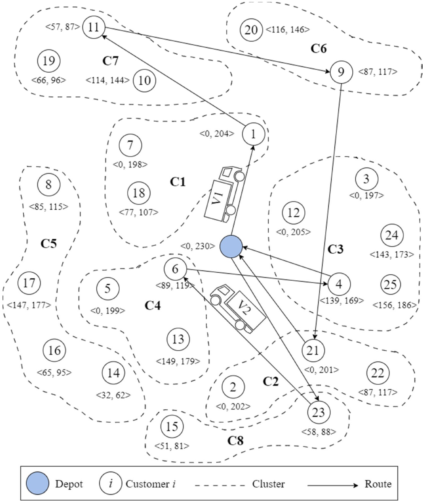

Fig. 2. Visual illustration of the example solution given in Fig. 1.

## 4.3. Neighborhood search strategy

The $\mathrm { S A _ { R L } }$ for Set-TOPTW uses four types of neighborhood moves: (1) swap, (2) insertion, (3) reversion, and (4) changing the visited customer in the cluster. Let N(X) denote the set of solutions neighboring the current solution X. At each iteration, a new solution $\left( X \right) ^ { P }$ is generated from N(X) through one of the four moves described as follows.

Fig. 3 illustrates how each move generates a new neighborhood solution. The swap move is performed by randomly choosing and swapping any two clusters to change the positions (Fig. 3a). For example, assuming that the swap move is applied to the solution in Fig. 3a, and the 3rd and 10th positions are randomly selected, the cluster numbers appearing in these positions are 6 and $5 ,$ respectively. These clusters are then swapped. The insertion move randomly selects two clusters that are not adjacent, removes one cluster from its current location, and then inserts it after another cluster (Fig. 3b). For example, in the same solution in Fig. 3b, Cluster 3 is inserted into the position in front of Cluster 6. The reversion move is performed by randomly selecting a substring of clusters in the solution representation and reversing its order (Fig. 3c). The change of the visited customer move is performed by randomly choosing a cluster and randomly changing the value in the solution representation (from 1 to the number of customers belonging to the chosen cluster) (Fig. 3d). The tours of the new solution must be decoded after a move. Hence, the clusters not selected in the previous solution may be selected after a move and vice versa. Noteworthily, the new solution is always feasible based on our solution representation scheme.

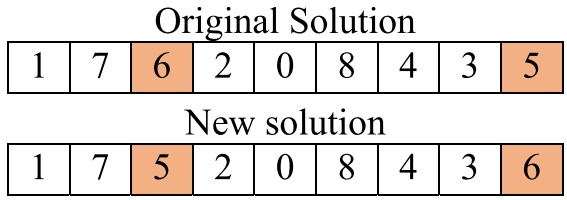

(a) Swap Move

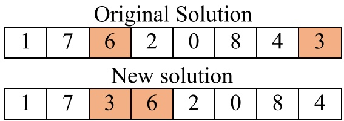

(b) Insert Move

(c) Reversion Move

(d) Change the Visited Customer Move

Fig. 3. Illustration of neighborhood moves.

## 4.4. SARL procedure

Fig. 4 shows the flowchart of the $\mathrm { S A _ { R L } }$ algorithm for the STOPTW. The algorithm begins by generating a random initial solution regarded as the current solution $X ,$ and sets the current temperature $T$ as the beginning temperature $T _ { o } .$ The current best solution $X _ { b e s t }$ and the best objective function value $F _ { b e s t }$ are set to be X and $o b j ( X ) ,$ , respectively.

For each iteration, a neighborhood solution $\left( X \right) ^ { P }$ is generated by selecting a move type according to the $\varepsilon =$ greedy strategy. When applying the ε - greedy strategy, there is a probability of $1 - \varepsilon \; (0 < \varepsilon <$ 1) selecting the best move (with the highest fitness value) and a probability of ε selecting a move from the other three movies using the roulette wheel selection technique. Let $\Delta = o b j ( X ) ^ { P } - o b j ( X )$ . If Δ is greater or equal than 0, then let the new solution $\left( X \right) ^ { P }$ as the current solution X. Otherwise, the current solution X is replaced by the new solution $\left( X \right) ^ { P }$ with probability exp( − $- \frac { \Delta } { T } )$ . The $F _ { b e s t }$ and $X _ { b e s t }$ is then replaced by obj(X) and $X ,$ respectively if the current solution X results a better fitness than the best solution $X _ { b e s t }$

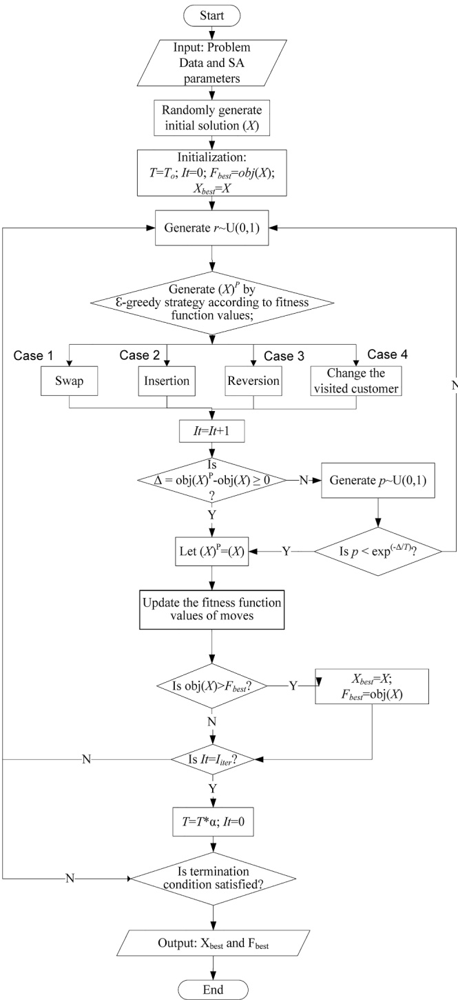

Fig. 4. Flowchart of $\mathrm { S A _ { R L } }$ for STOPTW.

The fitness function value of $\Pi ^ { N }$ used in the next iteration of the roulette wheel selection procedure was updated according to the formula modified from the ε - greedy algorithm as follows. Further, the following formula was applied to update the fitness function value of four moves: $f _ { i t } ^ { M o v e _ { q } } = \frac { n ^ { M o v e _ { q } } - 1 } { n ^ { M o v e _ { q } } } f _ { i t } ^ { M o v e _ { q } } + \frac { 1 } { n ^ { M o v e _ { q } } } \left[ O b j ( X ) ^ { P } - O b j ( X ) \right] / O b j ( X )$ where $f i t _ { i t e r } ^ { M o v e _ { q } } ( q = 1 , 2 , 3 , 4 )$ denotes the fitness function value of $M o v e _ { q }$ used in the next iteration of the roulette wheel selection procedure, and $n ^ { M o v e _ { q } }$ means the cumulative selected times of $M o v e _ { q }$ in the solution procedure.

The next step is to evaluate if the current number of iterations equals the maximum iteration. If it does, we decrease the temperature by the cooling rate $T = T ^ { \star } \alpha$ and restart the number of iterations $I t = 0 .$ Finally, the termination conditions are obtained in the proposed $\mathrm { S A _ { R L } }$ when the computational time reaches the time limit MaxT. When the termination condition is reached, the algorithm will result in the best solution $X _ { b e s t }$ and the best fitness value $F _ { b e s t }$

## 5. Computational experiment

The proposed $\mathrm { S A _ { R L } }$ for the STOPTW was coded in Microsoft Visual Studio ${ \tt C + + 2 0 1 9 } ,$ and the mathematical formulation was solved using the CPLEX by AMPL software and executed on a Windows 7 Professional PC with an Intel Core i7-4790 processor running at 3.60 GHz and 16.00 GB of RAM. In this section, the test instances generation is described, and the computational experiment results are discussed. In order to verify the efficiency of $\mathrm { S A } _ { \mathrm { R L } _ { 2 } }$ it was compared to the SA without reinforcement learning, denoted as SA. In the SA, a neighborhood move was selected randomly based on the same probability to generate a new solution $\left( X \right) ^ { P }$ instead of using the ε - greedy strategy to select the move type.

## 5.1. Test problems

Since there is no existing literature on the STOPTW, no benchmark instances also exist. Thus, we generated the problem instances by modifying two datasets. The first dataset (Set A) is a small dataset modified from the OPTW instances of Righini and Salani (2009) based on Solomon’s dataset (c100, r100, and rc100) (Solomon, 1987). The OPTW instances were modified by grouping the customers into clusters according to Archetti, et al. (2018) and adding the cluster profit. As presented in Archetti, et al. (2018), we also used 20 % of customers to determine the number of clusters and randomly assigned each customer to those clusters. Furthermore, the cluster profit was added by summing up the profit of each customer member in a cluster. In total, Set A consists of 29 instances, where each contains 100 customers and 20 clusters.

The second dataset (Set B) is a large dataset modified from the same dataset (Righini and Salani (2009). From this point forward, we refer to their dataset as the original dataset. In Set B, more customers were generated and added to the original dataset. We generated 100 and 200 new customers and assigned them to the existing 100 clusters. Hence, in total, there are 29 instances with 200 and 300 customers with 100 clusters. The steps of generating Set B are described as follows:

(1) New customer coordinates are randomly generated between an interval of $[ x _ { m i n } , x _ { m a x } ]$ and $[ y _ { m i n } , y _ { m a x } ] .$ . The min and max values are determined from the coordinates of customers in the original dataset.

(2) The service time value of the new customer instances is the same as the service time of the customers in the original dataset.

(3) Time windows of the new customer instances are generated based on the method explained by Solomon (1987).

(4) The first 100 customers are taken from the original dataset and assigned to Cluster 1 to Cluster 100, respectively. For example, Customers 1, 2, and 3 become members of Clusters 1, 2, and 3, respectively.

(5) The next 100 and 200 customers are generated randomly based on Steps (1) – (3). Then, each customer is assigned randomly to Cluster 1 to Cluster 100.

(6) The profit of each cluster is the same as the profit of the customers in the original dataset corresponding to that cluster.

## 5.2. Parameter setting

The proposed $\mathrm { S A _ { R L } }$ requires four parameters: the $T _ { o ^ { \circ } }$ - initial temperature, $I _ { i t e r } -$ the number of iterations, α- cooling rate, and the ε - greedy strategy. We implemented the Taguchi L16 orthogonal array as the experimental approach to define the parameters. The algorithm is executed in 5 independent runs for each combination on twelve randomly generated instances. For each run, a maximum time limit MaxT = numberofcodelength\*100 milliseconds is used as stopping criterion. In this experiment, the parameters were considered the controlled variables and the average relative percentage deviation (APRD) as the response variable. Equation (13) is the formulation of the Relative Percentage Deviation (RPD), considered the performance indicator of the algorithm’s effectiveness in selecting the best solution.

$$
RPD = \frac{P_{max}^{B} - P_{max}^{C}}{P_{max}^{B}}\times 100\%\tag{13}
$$

where $P _ { m a x } ^ { C }$ denotes the profit when applying configuration $C ,$ and $P _ { m a x } ^ { B }$ is the best profit overall combinations considering five runs, while ARPD is the average RPDs over the best-found solutions among nine test instances. Tables 3 and 4 show the orthogonal array for the ARPD calculation and the ARPD values obtained by the experiment, respectively.

According to $Table 4, $T _ { 0 }$$ has the largest range, indicating that the initial temperature significantly influences the RPD values. Based on the probability function $\exp ( - \frac { \Delta } { T } )$ from Section $4 . 5 , T _ { 0 }$ has a direct impact on accepting the worse solution. Hence, considering a larger $T _ { 0 }$ will increase the likelihood of accepting weaker solutions, the convergence rate will be faster. The second most important parameter is the cooling rate α. The third and fourth important parameters are $I _ { i t e r }$ and ε, respectively. Based on this analysis, we determined the parameter configuration as follows: $T _ { 0 } = 1 . 0 , I _ { i t e r } = 6 , 0 0 0 , \alpha = 0 . 9 8 ,$ , and $\varepsilon   = 0 . 6 ,$

## 5.3. Computational results

In this study, we execute each instance in six problem settings, which is shown in Table 5. The 1st column refers to the name of the problem, the 2nd column is which dataset the problem belongs to, and the 3rd-5th columns are the number of customers, number of clusters, and number of tours, respectively. For problem A [100, 20, 2], the CPU time limit of CPLEX is 3,600 s, and the CPU time limit of SA and $\mathrm { S A _ { R L } }$ were calculated based on $MaxT = \frac{n^{\pm}200}{1000} = 4$ seconds (where n is the cluster number). Meanwhile, the other problems are executed for 7,200 s as the CPU time limit of CPLEX and $MaxT = \frac{100^{2}200}{1000} = 20$ seconds as the CPU time limit of SA and $\mathrm { S A _ { R L } }$

Orthogonal array for ARPD calculation.

| Experiment | T0 | Iiter | α | ε |
| --- | --- | --- | --- | --- |
| 1 | 1.0 | 4,000 | 0.96 | 0.4 |
| 2 | 1.0 | 5,000 | 0.97 | 0.5 |
| 3 | 1.0 | 6,000 | 0.98 | 0.6 |
| 4 | 1.0 | 7,000 | 0.99 | 0.7 |
| 5 | 1.5 | 4,000 | 0.97 | 0.6 |
| 6 | 1.5 | 5,000 | 0.96 | 0.7 |
| 7 | 1.5 | 6,000 | 0.99 | 0.4 |
| 8 | 1.5 | 7,000 | 0.98 | 0.5 |
| 9 | 2.0 | 8,000 | 0.98 | 0.7 |
| 10 | 2.0 | 4,000 | 0.99 | 0.6 |
| 11 | 2.0 | 5,000 | 0.96 | 0.5 |
| 12 | 2.0 | 6,000 | 0.97 | 0.4 |
| 13 | 2.5 | 4,000 | 0.99 | 0.5 |
| 14 | 2.5 | 5,000 | 0.98 | 0.4 |
| 15 | 2.5 | 6,000 | 0.97 | 0.7 |
| 16 | 2.5 | 7,000 | 0.96 | 0.6 |

Table 4

ARPD values obtained by different levels of each parameter.

| Configuration | T0 | Iiter | α | ε |
| --- | --- | --- | --- | --- |
| 1 | 3.7584 | 3.8884 | 3.8039 | 3.8192 |
| 2 | 3.7676 | 3.8308 | 3.8196 | 3.8606 |
| 3 | 3.8541 | 3.8062 | 3.8175 | 3.8216 |
| 4 | 3.9654 | 3.8202 | 3.9045 | 3.8440 |
| Range | 0.2069 | 0.0822 | 0.1006 | 0.0414 |
| Rank | 1 | 3 | 2 | 4 |

Fig. 5 illustrates the performance comparison between SA with CPLEX and $\mathrm { S A _ { R L } }$ with CPLEX of each problem setting. The terms “Better”, “Equal”, and “Worse” in the legend respectively represent that the solutions of SA or $\mathrm { S A _ { R L } }$ are better, equal, or worse than CPLEX. Fig. 6 illustrates the solution comparison between SA and $\mathrm { S A _ { R L } }$ . In this figure, the terms “Better”, “Equal”, and “Worse” in the legend indicate that the $\mathrm { S A _ { R L } }$ results better, equal, and worse than $\mathbf { S A } ,$ respectively. In both Figs. 5 and 6, the numbers inside the tables represent the number of instances that are compared between algorithms, where there are 29 instances in total. The details of the computational experiments are presented in Appendices $\mathbf { A . 1 - A . 6 . }$ The 1st column (Instances) defines the name of the instances, and the 2nd and 3rd columns (CPLEX) are the profit obtained by the CPLEX and its computational time in seconds. The 4th – 7th columns show the best profit, average profit, the gap between CPLEX and the best profit, and the gap between CPLEX and the average profit of SA, respectively. The 8th – 11th columns show the respective performances of $\mathbf { S A } _ { \mathrm { R L } } ,$ The numbers in bold are the best solution for each instance of the problem. It must be noted that, the instances that can be solved by CPLEX under the time limits are the optimal solutions. The gaps were obtained using equations (14) and (15):

$$
b - \text {Gap} = \frac {\text {Profit} _ {\text {CPLEX}} - \text {Profit} _ {\text {best}}}{\text {Profit} _ {\text {CPLEX}}} \times 100 \%\tag{14}
$$

$$
a - \text {Gap} = \frac {\text {Profit} _ {\text {CPLEX}} - \text {Profit} _ {\text {avg}}}{\text {Profit} _ {\text {CPLEX}}} \times 100 \%\tag{15}
$$

Fig. 5 (a) shows the comparison between CPLEX with SA and $\mathrm { S A _ { R L } }$ of problem A [100, 20, 2]. The performances of SA and $\mathrm { S A _ { R L } }$ are similar, where eight optimal solutions and twelve better solutions than CPLEX can be found within a shorter computational time. Furthermore, looking at Fig. 6, both algorithms obtain equal solutions for all instances. Hence, it can be concluded that both SA and SARL are competitive solution approaches in solving small STOPTW instances.

The comparison between CPLEX with SA and $\mathrm { S A _ { R L } }$ of problem B [200, 100, 1], B [200, 100, 2], B [200, 100, 3], and B [200, 100, 4], are respectively shown in Fig. 1 (b) – (e). For problem B [200, 100, 1], both SA and $\mathrm { S A _ { R L } }$ can obtain 1 equal solution and 22 better solutions than CPLEX. In $\mathrm{Fig.~6,~SA_{RL}}$ obtains 3 better solutions than SA for this problem. Furthermore, in Appendix A.2, SARL outperforms SA in terms of both average and best runs. In problem B [200, 100, 2], both SA and $\mathrm { S A _ { R L } }$ produce 26 better solutions than CPLEX. $\mathrm { S A _ { R L } }$ still outperforms SA by resulting in 12 better solutions and two worse solutions than $\mathrm { S A _ { R L } }$ based on Fig. 6. This is also supported by Appendix A.3 which shows that $\mathrm { S A _ { R L } }$ obtains larger negative gaps than SA. Furthermore, for problem B [200, 100, 3], both SA and $\mathrm { S A _ { R L } }$ obtain 27 better solutions than CPLEX. Although both SA and $\mathrm { S A _ { R L } }$ obtain seven better solutions than each other, $\mathrm { S A _ { R L } }$ obtains larger negative gaps than SA. According to Appendix $A.4,\;SA_{RL}$ obtains − 74.053 % and − 70.732 % gaps for the best and average runs, respectively. Whereas, SA obtains − 73.769 % and − 70.491 % gaps for the best and average runs, respectively. Lastly, in problem B [200, 100, 4], $\mathrm { S A _ { R L } }$ still outperforms SA by resulting in 14 better solutions than $\mathbf { S A } ,$ while 6 better solutions than $\mathrm { S A _ { R L } }$ are resulted by SA. It is substantiated in Appendix A.5 that $\mathrm { S A _ { R L } }$ obtains larger negative average and best run gaps than SA.

In this experimental study, the largest problem setting is B [300, 100, 4]. According to $Fig. 5 $( \mathbf { f } ) , \: \mathrm { S A } _ { \mathrm { R L } }$$ and SA can obtain better solutions for almost all instances except one. In this problem setting, $\mathrm { S A _ { R L } }$ still results the best performance with 13 better solutions and 10 worse solutions than SA. Although SA outperforms $\mathrm { S A _ { R L } }$ in the best runs, $\mathrm { S A _ { R L } }$ still outperforms SA for the average runs. Therefore, it can be concluded that $\mathrm { S A _ { R L } }$ is a robust and competitive solution approach to solving small and large STOPTW problems.

Based on the numerical experiment, the proposed $\mathrm { S A _ { R L } }$ obtains highquality solutions within a reasonable computational time. Most of the orienteering problems must be solved within a short time because of the dynamic environment and the short planning horizon in practice. Hence, we can imply that it is feasible to implement the proposed SARL to solve the STOPTW in the real-world application.

## 5.4. Sensitivity analysis of the number of vehicles

As the purpose of this study is to develop a problem that imitates the real-world application, some managerial implications should be acquired. In this section, we analyze the impact of increasing the number of tours on the magnitude of profits. In the practical application, adding a tour requires one additional vehicle. Hence, we can imply this analysis as the sensitivity analysis of adding number of vehicles on the profits. Fig. 7 illustrates this analysis. The numbers inside the graph represent the profit growth of adding one vehicle. These values are the average profits retrieved from problem B [200, 100, 1], B [200, 100, 2], B [200, 100, 3], and B [200, 100, 4]. If the company is currently having one vehicle, adding one vehicle will increase 265.24 amount of profit. If one more vehicle is added, the profit will be increased by 235.14. Lastly, adding one more vehicle will increase the profit by 197.74.

As shown in the graph, it can be implied that the profit growth will decrease as more vehicles are utilized. Hence, the management should be able to compare the cost of adding one vehicle with the profit gained. If the cost of adding a new vehicle is too high compared with the profit gained, then it could be less beneficial for the company. A further costbenefit analysis is recommended to analyze the economic benefits of adding one vehicle.

## 6. Conclusions and future research directions

This paper introduces a new variant of the Orienteering Problem, the STOPTW which is an extension of the well-known TOPTW and SOP. The key characteristic of STOPTW is the customers were grouped into clusters and the profit is associated with the cluster. Furthermore, each customer has a time window. The objective of this problem is to find a set of routes to maximize the profit without exceeding the given time duration.

Table 5

Problem settings.

| Name | Dataset | Number of customers | Number of clusters | Number of tours |
| --- | --- | --- | --- | --- |
| A [100,20,2] | A | 100 | 20 | 2 |
| B [200,100,1] | B | 200 | 100 | 1 |
| B [200,100,2] | B | 200 | 100 | 2 |
| B [200,100,3] | B | 200 | 100 | 3 |
| B [200,100,4] | B | 200 | 100 | 4 |
| B [300,100,4] | B | 300 | 100 | 4 |

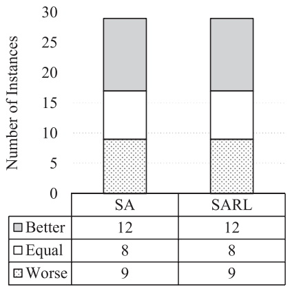

(a) A [100, 20, 2]

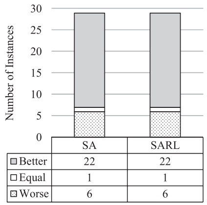

(b) B [200, 100, 1]

(c) B [200, 100,2]

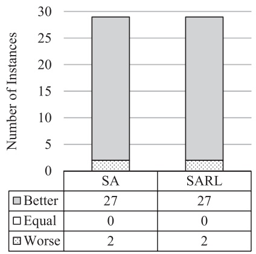

(d) B [200, 100, 3]

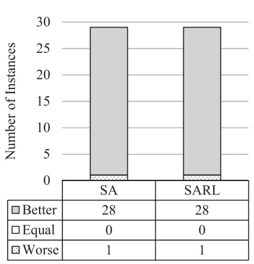

(e) B [200, 100, 4]

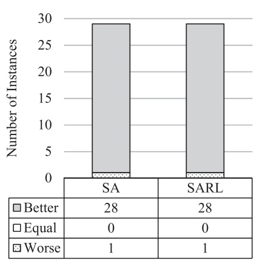

(f) B [300, 100, 4]

Fig. 5. Solution comparison between SA with CPLEX and $\mathrm { S A _ { R L } }$ with CPLEX.

To solve the STOPTW, we develop a simulated annealing algorithm, which has been proven successfully solve TOPTW. In addition, we also improved the proposed simulated annealing algorithm by embedding a reinforcement learning algorithm, namely a simulated annealing with reinforcement learning. The superiority of this algorithm is that it provides a learning mechanism of the fitness value resulted from each neighborhood move, which is contrary to the basic simulated annealing algorithm.

Numerical experiments were conducted on the newly generated benchmark instances for the STOPTW. A comparative analysis was made between CPLEX, SA, and $\mathrm { S A _ { R L } }$ . It shows that SA and $\mathrm { S A _ { R L } }$ can obtain optimal solutions for small-sized problems with lower computational times. In solving the small problems, the performance of SA and $\mathrm { S A _ { R L } }$ are similar. This is proven by the same gap percentages resulted from both algorithms. For large instances, both algorithms can obtain better solutions than CPLEX. Furthermore, $\mathrm { S A _ { R L } }$ outperforms SA in terms of solution quality. Specifically, SARL can obtain 13 better solutions than SA with lower gap percentages. In addition, this study investigates the impact of adding vehicles on profit growth. Based on this analysis, some managerial implications were retrieved.

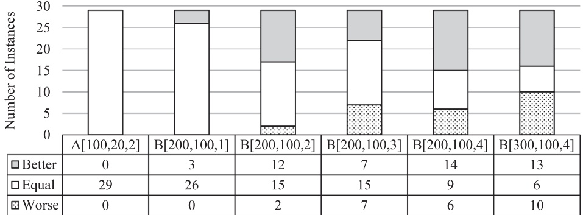

Fig. 6. Solution comparison between SA and $\mathrm { S A _ { R L } }$

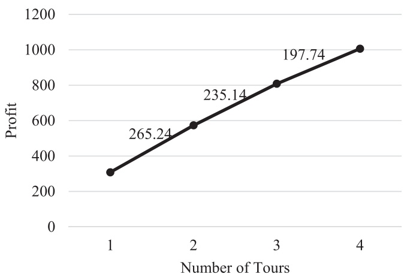

Fig. 7. Sensitivity analysis of the number of tours.

Although the proposed study has discovered the existing research gap, there are still some limitations that can be considered as the future research directions. First, more realistic assumptions should be added to the STOPTW. For an example, a time-dependent model should be considered where the time travel between two places depends on the departure time (Yu, et al., 2019). Maximizing the customer service level also could be considered in addition to maximize the profit in the objective function (Dutta, et al., 2020). This could balance the benefits between the company and the customer. Second, looking at the experimental results, the proposed SARL provides high-quality solutions with a reasonable computational time. Hence, the proposed $\mathrm { S A _ { R L } }$ could also be applied to different problems. Third, more reinforcement learning-based algorithms should be embedded to the simulated annealing or other metaheuristic algorithms to learn the performance of each operator. This could improve the quality of the solutions in terms of optimality and efficiency. Fourth, there exists an opportunity to develop more comprehensive solution approaches and refine performance evaluations for solving STOPTW. As the exact solution methods were proven to be effective in solving various TOP variants, adapting and extending these approaches for solving STOPTW could be a promising future research direction (Boussier, et al., 2006; El-Hajj, et al., 2016; Keshtkaran, et al.,

2016). Finally, our extensive literature review has revealed a notable scarcity in the implementation of both TOPTW and SOP variants within practical case studies. Hence, STOPTW offers a promising opportunity to be applied to diverse real-world scenarios, such as urban waste collection, tourist trip planning, and crowdsourcing problems (Babaee Tirkolaee, Abbasian, Soltani, & Ghaffarian, 2019; Gavalas, Konstantopoulos, Mastakas, Pantziou, & Vathis, 2015; Gunawan, et al., 2016; Tirkolaee, Abbasian, & Weber, 2021).

## CRediT authorship contribution statement

**Vincent F. Yu:** Conceptualization, Methodology, Supervision, Resources, Funding acquisition, Validation, Writing – review & editing. **Nabila Yuraisyah Salsabila:** Conceptualization, Methodology, Formal analysis, Investigation, Visualization, Writing – original draft. **Shih-Wei Lin:** Conceptualization, Methodology, Software, Validation, Funding acquisition, Investigation, Visualization, Writing – review & editing. **Aldy Gunawan:** Conceptualization, Methodology, Visualization, Supervision, Writing – review & editing.

## Declaration of Competing Interest

The authors declare that they have no known competing financial interests or personal relationships that could have appeared to influence the work reported in this paper.

## Data availability

Data will be made available on request.

## Acknowledgements

The work of V.-F. Yu was supported in part by the Ministry of Science and Technology, Taiwan, under Grant MOST 111-2410-H-011-020- MY3. The second author of the work is grateful to the Ministry of Science and Technology of the Republic of China (Taiwan) and the Chang Gung Memorial Hospital for financially supporting this research grants MOST109-2410-H-182-009-MY3/NSTC 112-2410-H-182-002-MY3 and BMRPA19, respectively.

Appendix A1. Results for Set a with 100 customers, 20 clusters, andm = 2

<table><tbody><tr><td rowspan="2">Instances</td><td rowspan="2">CPLEX Profit</td><td rowspan="2">Time (s)</td><td rowspan="2">SA Best</td><td rowspan="2">Avg</td><td rowspan="2">b-Gap</td><td rowspan="2">a-Gap</td><td rowspan="2">Time (s)</td><td rowspan="2">SARL Best</td><td rowspan="2">Avg</td><td rowspan="2">b-Gap</td><td rowspan="2">a-Gap</td><td rowspan="2">Time (s)</td></tr><tr></tr><tr><td>c101</td><td>1810</td><td>14.23</td><td>1780</td><td>1762</td><td>1.657</td><td>2.652</td><td>4.000</td><td>1780</td><td>1762</td><td>1.657</td><td>2.652</td><td>4.000</td></tr><tr><td>c102</td><td>1810</td><td>37.5</td><td>1810</td><td>1810</td><td>0.000</td><td>0.000</td><td>4.000</td><td>1810</td><td>1810</td><td>0.000</td><td>0.000</td><td>4.000</td></tr></tbody></table>

(continued on next page)

(continued )

| Instances | CPLEX Profit | Time (s) | SA Best | Avg | b-Gap | a-Gap | Time (s) | SARL Best | Avg | b-Gap | a-Gap | Time (s) |
| --- | --- | --- | --- | --- | --- | --- | --- | --- | --- | --- | --- | --- |
| c103 | 1810 | 202.16 | 1810 | 1810 | 0.000 | 0.000 | 4.000 | 1810 | 1810 | 0.000 | 0.000 | 4.000 |
| c104 | 1810 | 25.41 | 1810 | 1810 | 0.000 | 0.000 | 4.000 | 1810 | 1810 | 0.000 | 0.000 | 4.000 |
| c105 | 1810 | 255.76 | 1760 | 1740 | 2.762 | 3.867 | 4.000 | 1760 | 1740 | 2.762 | 3.867 | 4.000 |
| c106 | 1800 | 3600 | 1800 | 1800 | 0.000 | 0.000 | 4.000 | 1800 | 1800 | 0.000 | 0.000 | 4.000 |
| c107 | 1810 | 107.89 | 1780 | 1780 | 1.657 | 1.657 | 4.000 | 1780 | 1780 | 1.657 | 1.657 | 4.000 |
| c108 | 1810 | 248.1 | 1810 | 1810 | 0.000 | 0.000 | 4.000 | 1810 | 1810 | 0.000 | 0.000 | 4.000 |
| c109 | 1810 | 2287.93 | 1810 | 1810 | 0.000 | 0.000 | 4.000 | 1810 | 1810 | 0.000 | 0.000 | 4.000 |
| r101 | 1364 | 9.72 | 1319 | 1319 | 3.299 | 3.299 | 4.000 | 1319 | 1319 | 3.299 | 3.299 | 4.000 |
| r102 | 1316 | 3600 | 1458 | 1458 | -10.790 | -10.790 | 4.000 | 1458 | 1458 | -10.790 | -10.790 | 4.000 |
| r103 | 1448 | 3600 | 1309 | 1292.8 | 9.599 | 10.718 | 4.000 | 1309 | 1292.8 | 9.599 | 10.718 | 4.000 |
| r104 | 1393 | 3600 | 1458 | 1458 | -4.666 | -4.666 | 4.000 | 1458 | 1458 | -4.666 | -4.666 | 4.000 |
| r105 | 1349 | 3600 | 1389 | 1323.4 | -2.965 | 1.898 | 4.000 | 1389 | 1323.4 | -2.965 | 1.898 | 4.000 |
| r106 | 1378 | 3600 | 1418 | 1415.2 | -2.903 | -2.700 | 4.000 | 1418 | 1415.2 | -2.903 | -2.700 | 4.000 |
| r107 | 1358 | 3600 | 1458 | 1441.8 | -7.364 | -6.171 | 4.000 | 1458 | 1441.8 | -7.364 | -6.171 | 4.000 |
| r108 | 1339 | 3600 | 1458 | 1458 | -8.887 | -8.887 | 4.000 | 1458 | 1458 | -8.887 | -8.887 | 4.000 |
| r109 | 1427 | 3600 | 1435 | 1394.4 | -0.561 | 2.285 | 4.000 | 1435 | 1394.4 | -0.561 | 2.285 | 4.000 |
| r110 | 1422 | 3600 | 1400 | 1400 | 1.547 | 1.547 | 4.000 | 1400 | 1400 | 1.547 | 1.547 | 4.000 |
| r111 | 1458 | 3600 | 1458 | 1458 | 0.000 | 0.000 | 4.000 | 1458 | 1458 | 0.000 | 0.000 | 4.000 |
| r112 | 1403 | 3600 | 1458 | 1458 | -3.920 | -3.920 | 4.000 | 1458 | 1458 | -3.920 | -3.920 | 4.000 |
| rc101 | 1615 | 3600 | 1483 | 1483 | 8.173 | 8.173 | 4.000 | 1483 | 1483 | 8.173 | 8.173 | 4.000 |
| rc102 | 1595 | 3600 | 1587 | 1579.6 | 0.502 | 0.966 | 4.000 | 1587 | 1579.6 | 0.502 | 0.966 | 4.000 |
| rc103 | 1684 | 3600 | 1684 | 1598.8 | 0.000 | 5.059 | 4.000 | 1684 | 1598.8 | 0.000 | 5.059 | 4.000 |
| rc104 | 1558 | 3600 | 1670 | 1660.2 | -7.189 | -6.560 | 4.000 | 1670 | 1660.2 | -7.189 | -6.560 | 4.000 |
| rc105 | 1556 | 3600 | 1471 | 1421.4 | 5.463 | 8.650 | 4.000 | 1471 | 1421.4 | 5.463 | 8.650 | 4.000 |
| rc106 | 1628 | 3600 | 1631 | 1631 | -0.184 | -0.184 | 4.000 | 1631 | 1631 | -0.184 | -0.184 | 4.000 |
| rc107 | 1549 | 3600 | 1559 | 1537.8 | -0.646 | 0.723 | 4.000 | 1559 | 1537.8 | -0.646 | 0.723 | 4.000 |
| rc108 | 1627 | 3600 | 1681 | 1639.4 | -3.319 | -0.762 | 4.000 | 1681 | 1639.4 | -3.319 | -0.762 | 4.000 |
| Average |  |  |  |  | -0.646 | 0.236 | 4.000 |  |  | -0.646 | 0.236 | 4.000 |

Appendix A. 2 results for Set B with 200 customers, 100 clusters, and m = 1

| Instances | CPLEX Profit | Time (s) | SA Best | Avg | b-Gap | a-Gap | Time (s) | SARL Best | Avg | b-Gap | a-Gap | Time (s) |
| --- | --- | --- | --- | --- | --- | --- | --- | --- | --- | --- | --- | --- |
| c101 | 350 | 45.93 | 330 | 310 | 5.714 | 11.429 | 20.000 | 330 | 310 | 5.714 | 11.429 | 20.000 |
| c102 | 160 | 7200 | 370 | 358 | -131.250 | -123.750 | 20.000 | 370 | 358 | -131.250 | -123.750 | 20.000 |
| c103 | 150 | 7200 | 430 | 418 | -186.667 | -178.667 | 20.000 | 430 | 418 | -186.667 | -178.667 | 20.000 |
| c104 | 260 | 7200 | 430 | 418 | -65.385 | -60.769 | 20.000 | 430 | 418 | -65.385 | -60.769 | 20.000 |
| c105 | 360 | 7200 | 360 | 348 | 0.000 | 3.333 | 20.000 | 360 | 348 | 0.000 | 3.333 | 20.000 |
| c106 | 230 | 7200 | 370 | 348 | -60.870 | -51.304 | 20.000 | 370 | 348 | -60.870 | -51.304 | 20.000 |
| c107 | 240 | 7200 | 380 | 368 | -58.333 | -53.333 | 20.000 | 380 | 368 | -58.333 | -53.333 | 20.000 |
| c108 | 210 | 7200 | 420 | 376 | -100.000 | -79.048 | 20.000 | 420 | 376 | -100.000 | -79.048 | 20.000 |
| c109 | 230 | 7200 | 390 | 378 | -69.565 | -64.348 | 20.000 | 390 | 378 | -69.565 | -64.348 | 20.000 |
| r101 | 244 | 35.41 | 233 | 228.8 | 4.508 | 6.230 | 20.000 | 233 | 228.8 | 4.508 | 6.230 | 20.000 |
| r102 | 135 | 7200 | 270 | 252.4 | -100.000 | -86.963 | 20.000 | 270 | 252.4 | -100.000 | -86.963 | 20.000 |
| r103 | 99 | 7200 | 286 | 270 | -188.889 | -172.727 | 20.000 | 288 | 274.2 | -190.909 | -176.970 | 20.000 |
| r104 | 45 | 7200 | 313 | 308 | -595.556 | -584.444 | 20.000 | 313 | 308.6 | -595.556 | -585.778 | 20.000 |
| r105 | 280 | 7200 | 245 | 232 | 12.500 | 17.143 | 20.000 | 245 | 232 | 12.500 | 17.143 | 20.000 |
| r106 | 130 | 7200 | 310 | 306 | -138.462 | -135.385 | 20.000 | 310 | 306.8 | -138.462 | -136.000 | 20.000 |
| r107 | 120 | 7200 | 325 | 302.4 | -170.833 | -152.000 | 20.000 | 325 | 301.2 | -170.833 | -151.000 | 20.000 |
| r108 | 90 | 7200 | 315 | 309.4 | -250.000 | -243.778 | 20.000 | 320 | 310.2 | -255.556 | -244.667 | 20.000 |
| r109 | 116 | 7200 | 298 | 285.8 | -156.897 | -146.379 | 20.000 | 298 | 285.6 | -156.897 | -146.207 | 20.000 |
| r110 | 101 | 7200 | 294 | 279.4 | -191.089 | -176.634 | 20.000 | 294 | 279.6 | -191.089 | -176.832 | 20.000 |
| r111 | 100 | 7200 | 310 | 284.4 | -210.000 | -184.400 | 20.000 | 310 | 285.2 | -210.000 | -185.200 | 20.000 |
| r112 | 136 | 7200 | 303 | 287.8 | -122.794 | -111.618 | 20.000 | 303 | 288.2 | -122.794 | -111.912 | 20.000 |
| rc101 | 270 | 7200 | 247 | 241.4 | 8.519 | 10.593 | 20.000 | 247 | 241.4 | 8.519 | 10.593 | 20.000 |
| rc102 | 105 | 7200 | 321 | 293.8 | -205.714 | -179.810 | 20.000 | 321 | 295 | -205.714 | -180.952 | 20.000 |
| rc103 | 152 | 7200 | 310 | 291.2 | -103.947 | -91.579 | 20.000 | 310 | 292.4 | -103.947 | -92.368 | 20.000 |
| rc104 | 121 | 7200 | 336 | 311.2 | -177.686 | -157.190 | 20.000 | 336 | 313.4 | -177.686 | -159.008 | 20.000 |
| rc105 | 164 | 7200 | 294 | 272.6 | -79.268 | -66.220 | 20.000 | 294 | 273 | -79.268 | -66.463 | 20.000 |
| rc106 | 355 | 7200 | 282 | 273 | 20.563 | 23.099 | 20.000 | 282 | 274.2 | 20.563 | 22.761 | 20.000 |
| rc107 | 378 | 7200 | 290 | 273.4 | 23.280 | 27.672 | 20.000 | 290 | 271.6 | 23.280 | 28.148 | 20.000 |
| rc108 | 247 | 7200 | 317 | 291.6 | -28.340 | -18.057 | 20.000 | 321 | 294.8 | -29.960 | -19.352 | 20.000 |
| Average |  |  |  |  | -114.361 | -104.100 | 20.000 |  |  | -114.678 | -104.526 | 20.000 |

Appendix A. 3 results for Set B with 200 customers, 100 clusters, and m = 2

| Instances | CPLEX Profit | Time (s) | SA Best | Avg | b-Gap | a-Gap | Time (s) | SARL Best | Avg | b-Gap | a-Gap | Time (s) |
| --- | --- | --- | --- | --- | --- | --- | --- | --- | --- | --- | --- | --- |
| c101 | 650 | 7200 | 600 | 590 | 7.692 | 9.231 | 20.000 | 610 | 594 | 6.154 | 8.615 | 20.000 |
| c102 | 500 | 7200 | 650 | 638 | -30.000 | -27.600 | 20.000 | 650 | 638 | -30.000 | -27.600 | 20.000 |
| c103 | 450 | 7200 | 750 | 734 | -66.667 | -63.111 | 20.000 | 750 | 732 | -66.667 | -62.667 | 20.000 |
| c104 | 470 | 7200 | 750 | 748 | -59.574 | -59.149 | 20.000 | 750 | 750 | -59.574 | -59.574 | 20.000 |
| c105 | 660 | 7200 | 670 | 646 | -1.515 | 2.121 | 20.000 | 670 | 646 | -1.515 | 2.121 | 20.000 |
| c106 | 600 | 7200 | 650 | 626 | -8.333 | -4.333 | 20.000 | 650 | 626 | -8.333 | -4.333 | 20.000 |
| c107 | 650 | 7200 | 680 | 664 | -4.615 | -2.154 | 20.000 | 680 | 666 | -4.615 | -2.462 | 20.000 |
| c108 | 620 | 7200 | 690 | 680 | -11.290 | -9.677 | 20.000 | 690 | 680 | -11.290 | -9.677 | 20.000 |
| c109 | 450 | 7200 | 720 | 696 | -60.000 | -54.667 | 20.000 | 720 | 696 | -60.000 | -54.667 | 20.000 |
| r101 | 429 | 7200 | 400 | 391.6 | 6.760 | 8.718 | 20.000 | 400 | 391.6 | 6.760 | 8.718 | 20.000 |
| r102 | 235 | 7200 | 517 | 493.8 | -120.000 | -110.128 | 20.000 | 515 | 494.8 | -119.149 | -110.553 | 20.000 |
| r103 | 249 | 7200 | 567 | 538.8 | -127.711 | -116.386 | 20.000 | 566 | 539.2 | -127.309 | -116.546 | 20.000 |
| r104 | 187 | 7200 | 597 | 585.8 | -219.251 | -213.262 | 20.000 | 599 | 590.6 | -220.321 | -215.829 | 20.000 |
| r105 | 437 | 7200 | 461 | 452.8 | -5.492 | -3.616 | 20.000 | 461 | 453 | -5.492 | -3.661 | 20.000 |
| r106 | 341 | 7200 | 565 | 554 | -65.689 | -62.463 | 20.000 | 565 | 555.2 | -65.689 | -62.815 | 20.000 |
| r107 | 305 | 7200 | 557 | 549.8 | -82.623 | -80.262 | 20.000 | 571 | 561.4 | -87.213 | -84.066 | 20.000 |
| r108 | 338 | 7200 | 597 | 593.2 | -76.627 | -75.503 | 20.000 | 597 | 592.2 | -76.627 | -75.207 | 20.000 |
| r109 | 438 | 7200 | 576 | 547.2 | -31.507 | -24.932 | 20.000 | 578 | 548.4 | -31.963 | -25.205 | 20.000 |
| r110 | 295 | 7200 | 542 | 525 | -83.729 | -77.966 | 20.000 | 545 | 525.2 | -84.746 | -78.034 | 20.000 |
| r111 | 206 | 7200 | 563 | 554.4 | -173.301 | -169.126 | 20.000 | 565 | 555 | -174.272 | -169.417 | 20.000 |
| r112 | 302 | 7200 | 561 | 543.6 | -85.762 | -80.000 | 20.000 | 571 | 548.4 | -89.073 | -81.589 | 20.000 |
| rc101 | 529 | 7200 | 470 | 453.4 | 11.153 | 14.291 | 20.000 | 471 | 453.8 | 10.964 | 14.216 | 20.000 |
| rc102 | 459 | 7200 | 529 | 504.4 | -15.251 | -9.891 | 20.000 | 529 | 506 | -15.251 | -10.240 | 20.000 |
| rc103 | 325 | 7200 | 603 | 573.8 | -85.538 | -76.554 | 20.000 | 603 | 575.4 | -85.538 | -77.046 | 20.000 |
| rc104 | 278 | 7200 | 583 | 574 | -109.712 | -106.475 | 20.000 | 585 | 575.8 | -110.432 | -107.122 | 20.000 |
| rc105 | 406 | 7200 | 496 | 491.8 | -22.167 | -21.133 | 20.000 | 501 | 494 | -23.399 | -21.675 | 20.000 |
| rc106 | 477 | 7200 | 527 | 523.8 | -10.482 | -9.811 | 20.000 | 528 | 524.4 | -10.692 | -9.937 | 20.000 |
| rc107 | 378 | 7200 | 556 | 539 | -47.090 | -42.593 | 20.000 | 556 | 538 | -47.090 | -42.328 | 20.000 |
| rc108 | 301 | 7200 | 583 | 570.8 | -93.688 | -89.635 | 20.000 | 589 | 572.2 | -95.681 | -90.100 | 20.000 |
| Average |  |  |  |  | -57.656 | -53.657 | 20.000 |  |  | -58.209 | -54.092 | 20.000 |

Appendix A. 4 results for Set B with 200 customers, 100 clusters, and m = 3

| Instances | CPLEX Profit | Time (s) | SA Best | Avg | b-Gap | a-Gap | Time (s) | SARL Best | Avg | b-Gap | a-Gap | Time (s) |
| --- | --- | --- | --- | --- | --- | --- | --- | --- | --- | --- | --- | --- |
| c101 | 870 | 7200 | 850 | 836 | 2.299 | 3.908 | 20.000 | 850 | 836 | 2.299 | 3.908 | 20.000 |
| c102 | 640 | 7200 | 920 | 900 | -43.750 | -40.625 | 20.000 | 920 | 904 | -43.750 | -41.250 | 20.000 |
| c103 | 560 | 7200 | 990 | 984 | -76.786 | -75.714 | 20.000 | 1010 | 992 | -80.357 | -77.143 | 20.000 |
| c104 | 610 | 7200 | 1010 | 1006 | -65.574 | -64.918 | 20.000 | 1010 | 1000 | -65.574 | -63.934 | 20.000 |
| c105 | 750 | 7200 | 900 | 892 | -20.000 | -18.933 | 20.000 | 900 | 890 | -20.000 | -18.667 | 20.000 |
| c106 | 760 | 7200 | 910 | 888 | -19.737 | -16.842 | 20.000 | 910 | 888 | -19.737 | -16.842 | 20.000 |
| c107 | 750 | 7200 | 940 | 928 | -25.333 | -23.733 | 20.000 | 940 | 930 | -25.333 | -24.000 | 20.000 |
| c108 | 720 | 7200 | 950 | 946 | -31.944 | -31.389 | 20.000 | 950 | 946 | -31.944 | -31.389 | 20.000 |
| c109 | 530 | 7200 | 980 | 968 | -84.906 | -82.642 | 20.000 | 980 | 970 | -84.906 | -83.019 | 20.000 |
| r101 | 602 | 989.23 | 564 | 553.6 | 6.312 | 8.040 | 20.000 | 564 | 554.2 | 6.312 | 7.940 | 20.000 |
| r102 | 333 | 7200 | 747 | 726 | -124.324 | -118.018 | 20.000 | 743 | 726.4 | -123.123 | -118.138 | 20.000 |
| r103 | 312 | 7200 | 785 | 756.2 | -151.603 | -142.372 | 20.000 | 793 | 763.2 | -154.167 | -144.615 | 20.000 |
| r104 | 360 | 7200 | 814 | 795.4 | -126.111 | -120.944 | 20.000 | 815 | 798.2 | -126.389 | -121.722 | 20.000 |
| r105 | 547 | 7200 | 648 | 636.8 | -18.464 | -16.417 | 20.000 | 648 | 636.4 | -18.464 | -16.344 | 20.000 |
| r106 | 318 | 7200 | 789 | 771 | -148.113 | -142.453 | 20.000 | 798 | 772 | -150.943 | -142.767 | 20.000 |
| r107 | 371 | 7200 | 806 | 793.6 | -117.251 | -113.908 | 20.000 | 805 | 795.4 | -116.981 | -114.394 | 20.000 |
| r108 | 363 | 7200 | 849 | 843 | -133.884 | -132.231 | 20.000 | 848 | 841.6 | -133.609 | -131.846 | 20.000 |
| r109 | 489 | 7200 | 756 | 732.4 | -54.601 | -49.775 | 20.000 | 755 | 734.4 | -54.397 | -50.184 | 20.000 |
| r110 | 366 | 7200 | 744 | 732.4 | -103.279 | -100.109 | 20.000 | 746 | 734.4 | -103.825 | -100.656 | 20.000 |
| r111 | 422 | 7200 | 785 | 776 | -86.019 | -83.886 | 20.000 | 792 | 777.8 | -87.678 | -84.313 | 20.000 |
| r112 | 400 | 7200 | 790 | 780.6 | -97.500 | -95.150 | 20.000 | 801 | 788.4 | -100.250 | -97.100 | 20.000 |
| rc101 | 646 | 7200 | 686 | 663.2 | -6.192 | -2.663 | 20.000 | 686 | 664 | -6.192 | -2.786 | 20.000 |
| rc102 | 477 | 7200 | 787 | 754.2 | -64.990 | -58.113 | 20.000 | 787 | 757 | -64.990 | -58.700 | 20.000 |
| rc103 | 466 | 7200 | 837 | 822.4 | -79.614 | -76.481 | 20.000 | 827 | 819.2 | -77.468 | -75.794 | 20.000 |
| rc104 | 322 | 7200 | 872 | 849 | -170.807 | -163.665 | 20.000 | 872 | 846.4 | -170.807 | -162.857 | 20.000 |
| rc105 | 461 | 7200 | 718 | 706 | -55.748 | -53.145 | 20.000 | 718 | 706.8 | -55.748 | -53.319 | 20.000 |
| rc106 | 522 | 7200 | 757 | 743.6 | -45.019 | -42.452 | 20.000 | 757 | 743 | -45.019 | -42.337 | 20.000 |
| rc107 | 408 | 7200 | 824 | 812 | -101.961 | -99.020 | 20.000 | 823 | 812.6 | -101.716 | -99.167 | 20.000 |
| rc108 | 429 | 7200 | 834 | 817.6 | -94.406 | -90.583 | 20.000 | 827 | 814.2 | -92.774 | -89.790 | 20.000 |
| Average |  |  |  |  | -73.769 | -70.491 | 20.000 |  |  | -74.053 | -70.732 | 20.000 |

Appendix A. 5 results for Set B with 200 customers, 100 clusters, and m = 4

<table><tbody><tr><td rowspan="2">Instances</td><td rowspan="2">CPLEX Profit</td><td rowspan="2">Time (s)</td><td rowspan="2">SA Best</td><td rowspan="2">Avg</td><td rowspan="2">b-Gap</td><td rowspan="2">a-Gap</td><td rowspan="2">Time (s)</td><td rowspan="2">SARL Best</td><td rowspan="2">Avg</td><td rowspan="2">b-Gap</td><td rowspan="2">a-Gap</td><td rowspan="2">Time (s)</td></tr><tr></tr><tr><td>c101</td><td>1050</td><td>7200</td><td>1070</td><td>1036</td><td>-1.905</td><td>1.333</td><td>20.000</td><td>1060</td><td>1036</td><td>-0.952</td><td>1.333</td><td>20.000</td></tr><tr><td>c102</td><td>600</td><td>7200</td><td>1150</td><td>1146</td><td>-91.667</td><td>-91.000</td><td>20.000</td><td>1160</td><td>1148</td><td>-93.333</td><td>-91.333</td><td>20.000</td></tr><tr><td>c103</td><td>620</td><td>7200</td><td>1210</td><td>1204</td><td>-95.161</td><td>-94.194</td><td>20.000</td><td>1220</td><td>1210</td><td>-96.774</td><td>-95.161</td><td>20.000</td></tr></tbody></table>

(continued )

| Instances | CPLEX Profit | Time (s) | SA Best | Avg | b-Gap | a-Gap | Time (s) | SARL Best | Avg | b-Gap | a-Gap | Time (s) |
| --- | --- | --- | --- | --- | --- | --- | --- | --- | --- | --- | --- | --- |
| c104 | 640 | 7200 | 1230 | 1230 | -92.188 | -92.188 | 20.000 | 1230 | 1230 | -92.188 | -92.188 | 20.000 |
| c105 | 920 | 7200 | 1120 | 1108 | -21.739 | -20.435 | 20.000 | 1120 | 1108 | -21.739 | -20.435 | 20.000 |
| c106 | 900 | 7200 | 1120 | 1100 | -24.444 | -22.222 | 20.000 | 1120 | 1102 | -24.444 | -22.444 | 20.000 |
| c107 | 910 | 7200 | 1150 | 1134 | -26.374 | -24.615 | 20.000 | 1160 | 1140 | -27.473 | -25.275 | 20.000 |
| c108 | 820 | 7200 | 1160 | 1152 | -41.463 | -40.488 | 20.000 | 1160 | 1152 | -41.463 | -40.488 | 20.000 |
| c109 | 760 | 7200 | 1190 | 1180 | -56.579 | -55.263 | 20.000 | 1200 | 1184 | -57.895 | -55.789 | 20.000 |
| r101 | 759 | 7200 | 715 | 700.4 | 5.797 | 7.721 | 20.000 | 715 | 701.2 | 5.797 | 7.615 | 20.000 |
| r102 | 433 | 7200 | 910 | 887.4 | -110.162 | -104.942 | 20.000 | 911 | 887 | -110.393 | -104.850 | 20.000 |
| r103 | 313 | 7200 | 959 | 939.8 | -206.390 | -200.256 | 20.000 | 971 | 943.4 | -210.224 | -201.406 | 20.000 |
| r104 | 304 | 7200 | 1024 | 1012.6 | -236.842 | -233.092 | 20.000 | 1034 | 1014 | -240.132 | -233.553 | 20.000 |
| r105 | 646 | 7200 | 830 | 813.8 | -28.483 | -25.975 | 20.000 | 826 | 818.2 | -27.864 | -26.656 | 20.000 |
| r106 | 371 | 7200 | 971 | 947.6 | -161.725 | -155.418 | 20.000 | 963 | 948.2 | -159.569 | -155.580 | 20.000 |
| r107 | 402 | 7200 | 999 | 980.6 | -148.507 | -143.930 | 20.000 | 998 | 987 | -148.259 | -145.522 | 20.000 |
| r108 | 380 | 7200 | 1063 | 1053.8 | -179.737 | -177.316 | 20.000 | 1064 | 1052.8 | -180.000 | -177.053 | 20.000 |
| r109 | 575 | 7200 | 900 | 892.2 | -56.522 | -55.165 | 20.000 | 901 | 895.8 | -56.696 | -55.791 | 20.000 |
| r110 | 417 | 7200 | 907 | 899.8 | -117.506 | -115.779 | 20.000 | 910 | 902.2 | -118.225 | -116.355 | 20.000 |
| r111 | 354 | 7200 | 985 | 970.6 | -178.249 | -174.181 | 20.000 | 985 | 975.8 | -178.249 | -175.650 | 20.000 |
| r112 | 462 | 7200 | 1006 | 982.2 | -117.749 | -112.597 | 20.000 | 995 | 985.8 | -115.368 | -113.377 | 20.000 |
| rc101 | 648 | 7200 | 846 | 828.2 | -30.556 | -27.809 | 20.000 | 846 | 831.4 | -30.556 | -28.302 | 20.000 |
| rc102 | 448 | 7200 | 954 | 939.6 | -112.946 | -109.732 | 20.000 | 956 | 941.4 | -113.393 | -110.134 | 20.000 |
| rc103 | 394 | 7200 | 1032 | 1022.6 | -161.929 | -159.543 | 20.000 | 1042 | 1026 | -164.467 | -160.406 | 20.000 |
| rc104 | 289 | 7200 | 1102 | 1081.2 | -281.315 | -274.118 | 20.000 | 1100 | 1084.4 | -280.623 | -275.225 | 20.000 |
| rc105 | 526 | 7200 | 924 | 909 | -75.665 | -72.814 | 20.000 | 924 | 910.2 | -75.665 | -73.042 | 20.000 |
| rc106 | 625 | 7200 | 954 | 940.4 | -52.640 | -50.464 | 20.000 | 962 | 939.4 | -53.920 | -50.304 | 20.000 |
| rc107 | 489 | 7200 | 1037 | 1020.8 | -112.065 | -108.753 | 20.000 | 1054 | 1019.8 | -115.542 | -108.548 | 20.000 |
| rc108 | 449 | 7200 | 1039 | 992.4 | -131.403 | -121.024 | 20.000 | 1039 | 1002.2 | -131.403 | -123.207 | 20.000 |
| Average |  |  |  |  | -101.590 | -98.423 | 20.000 |  |  | -102.104 | -98.935 | 20.000 |

Appendix A. 6 results for Set B with 300 customers, 100 clusters, and m = 4

| Instances | CPLEX Profit | Time (s) | SA Best | Avg | b-Gap | a-Gap | Time (s) | SARL Best | Avg | b-Gap | a-Gap | Time (s) |
| --- | --- | --- | --- | --- | --- | --- | --- | --- | --- | --- | --- | --- |
| c101 | 920 | 7200 | 1090 | 1062 | -18.478 | -15.435 | 20.000 | 1090 | 1062 | -18.478 | -15.435 | 20.000 |
| c102 | 530 | 7200 | 1170 | 1162 | -120.755 | -119.245 | 20.000 | 1190 | 1164 | -124.528 | -119.623 | 20.000 |
| c103 | 640 | 7200 | 1210 | 1198 | -89.063 | -87.188 | 20.000 | 1210 | 1200 | -89.063 | -87.500 | 20.000 |
| c104 | 620 | 7200 | 1250 | 1222 | -101.613 | -97.097 | 20.000 | 1230 | 1220 | -98.387 | -96.774 | 20.000 |
| c105 | 990 | 7200 | 1150 | 1130 | -16.162 | -14.141 | 20.000 | 1150 | 1132 | -16.162 | -14.343 | 20.000 |
| c106 | 710 | 7200 | 1130 | 1112 | -59.155 | -56.620 | 20.000 | 1140 | 1112 | -60.563 | -56.620 | 20.000 |
| c107 | 940 | 7200 | 1160 | 1154 | -23.404 | -22.766 | 20.000 | 1170 | 1160 | -24.468 | -23.404 | 20.000 |
| c108 | 840 | 7200 | 1180 | 1176 | -40.476 | -40.000 | 20.000 | 1190 | 1174 | -41.667 | -39.762 | 20.000 |
| c109 | 830 | 7200 | 1200 | 1184 | -44.578 | -42.651 | 20.000 | 1200 | 1186 | -44.578 | -42.892 | 20.000 |
| r101 | 825 | 7200 | 729 | 715.2 | 11.636 | 13.309 | 20.000 | 729 | 715.2 | 11.636 | 13.309 | 20.000 |
| r102 | 384 | 7200 | 924 | 899.8 | -140.625 | -134.323 | 20.000 | 923 | 900 | -140.365 | -134.375 | 20.000 |
| r103 | 167 | 7200 | 1017 | 988.6 | -508.982 | -491.976 | 20.000 | 1012 | 990.2 | -505.988 | -492.934 | 20.000 |
| r104 | 215 | 7200 | 1061 | 1047.6 | -393.488 | -387.256 | 20.000 | 1059 | 1050.6 | -392.558 | -388.651 | 20.000 |
| r105 | 643 | 7200 | 865 | 836.6 | -34.526 | -30.109 | 20.000 | 875 | 838.2 | -36.081 | -30.358 | 20.000 |
| r106 | 430 | 7200 | 966 | 950 | -124.651 | -120.930 | 20.000 | 965 | 952.6 | -124.419 | -121.535 | 20.000 |
| r107 | 410 | 7200 | 1023 | 1004.2 | -149.512 | -144.927 | 20.000 | 1026 | 1001.8 | -150.244 | -144.341 | 20.000 |
| r108 | 298 | 7200 | 1069 | 1060 | -258.725 | -255.705 | 20.000 | 1073 | 1062.2 | -260.067 | -256.443 | 20.000 |
| r109 | 455 | 7200 | 948 | 936.8 | -108.352 | -105.890 | 20.000 | 953 | 933.8 | -109.451 | -105.231 | 20.000 |
| r110 | 425 | 7200 | 912 | 895 | -114.588 | -110.588 | 20.000 | 911 | 894.2 | -114.353 | -110.400 | 20.000 |
| r111 | 423 | 7200 | 1030 | 1011.8 | -143.499 | -139.196 | 20.000 | 1027 | 1013.4 | -142.790 | -139.574 | 20.000 |
| r112 | 264 | 7200 | 1028 | 995.2 | -289.394 | -276.970 | 20.000 | 1013 | 992.4 | -283.712 | -275.909 | 20.000 |
| rc101 | 751 | 7200 | 903 | 871.6 | -20.240 | -16.059 | 20.000 | 904 | 870.8 | -20.373 | -15.952 | 20.000 |
| rc102 | 383 | 7200 | 1017 | 987.4 | -165.535 | -157.807 | 20.000 | 1011 | 988.6 | -163.969 | -158.120 | 20.000 |
| rc103 | 362 | 7200 | 1082 | 1071.2 | -198.895 | -195.912 | 20.000 | 1088 | 1069.4 | -200.552 | -195.414 | 20.000 |
| rc104 | 281 | 7200 | 1147 | 1114 | -308.185 | -296.441 | 20.000 | 1160 | 1120.6 | -312.811 | -298.790 | 20.000 |
| rc105 | 502 | 7200 | 976 | 951.6 | -94.422 | -89.562 | 20.000 | 977 | 953.4 | -94.622 | -89.920 | 20.000 |
| rc106 | 614 | 7200 | 1047 | 1020.2 | -70.521 | -66.156 | 20.000 | 1050 | 1019 | -71.010 | -65.961 | 20.000 |
| rc107 | 381 | 7200 | 1040 | 995.2 | -172.966 | -161.207 | 20.000 | 1026 | 989.4 | -169.291 | -159.685 | 20.000 |
| rc108 | 366 | 7200 | 1050 | 1035.2 | -186.885 | -182.842 | 20.000 | 1050 | 1030.6 | -186.885 | -181.585 | 20.000 |
| Average |  |  |  |  | -137.450 | -132.610 | 20.000 |  |  | -137.441 | -132.697 | 20.000 |

## References

[Amarouche, Y., Guibadj, R. N., Chaalal, E., & Moukrim, A. (2020). Effective neighborhood search with optimal splitting and adaptive memory for the team orienteering problem with time windows. Computers & Operations Research, 123](http://refhub.elsevier.com/S0957-4174%2823%2902498-3/h0005).

[Angelelli, E., Archetti, C., & Vindigni, M. (2014). The Clustered Orienteering Problem. European Journal of Operational Research, 238, 404–414](http://refhub.elsevier.com/S0957-4174%2823%2902498-3/h0010).

[Archetti, C., Carrabs, F., & Cerulli, R. (2018). The set orienteering problem. European Journal of Operational Research, 267, 264–272](http://refhub.elsevier.com/S0957-4174%2823%2902498-3/h0015).

[Archetti, C., Hertz, A., & Speranza, M. G. (2006). Metaheuristics for the team orienteering problem. Journal of Heuristics, 13, 49–76](http://refhub.elsevier.com/S0957-4174%2823%2902498-3/h0020).

[Archetti, C., Speranza, M. G., & Vigo, D. (2014). Chapter 10: Vehicle routing problems with profits. In Vehicle routing: Problems, methods, and applications (second edition, pp. 273–297). SIAM](http://refhub.elsevier.com/S0957-4174%2823%2902498-3/h0025).

[Babaee Tirkolaee, E., Abbasian, P., Soltani, M., & Ghaffarian, S. A. (2019). Developing an applied algorithm for multi-trip vehicle routing problem with time windows in urban waste collection: A case study. Waste Management & Research, 37, 4–13](http://refhub.elsevier.com/S0957-4174%2823%2902498-3/h0030).

[Boussier, S., Feillet, D., & Gendreau, M. (2006). An exact algorithm for team orienteering problems., 4or, 5, 211–230](http://refhub.elsevier.com/S0957-4174%2823%2902498-3/h0035).

[Chao, I.-M., Golden, B. L., & Wasil, E. A. (1996a). A fast and effective heuristic for the orienteering problem. European Journal of Operational Research, 88, 475–489](http://refhub.elsevier.com/S0957-4174%2823%2902498-3/h0040).

[Chao, I.-M., Golden, B. L., & Wasil, E. A. (1996b). The team orienteering problem. European Journal of Operational Research, 88, 464–474](http://refhub.elsevier.com/S0957-4174%2823%2902498-3/h0045).

[Dontas, M., Sideris, G., Manousakis, E. G., & Zachariadis, E. E. (2023). An adaptive memory matheuristic for the set orienteering problem. European Journal of Operational Research](http://refhub.elsevier.com/S0957-4174%2823%2902498-3/h0050).

[Dutta, J., Barma, P. S., Mukherjee, A., Kar, S., & De, T. (2020). A multi-objective open set orienteering problem. Neural Computing and Applications, 32, 13953–13969](http://refhub.elsevier.com/S0957-4174%2823%2902498-3/h0055).

[El-Hajj, R., Dang, D.-C., & Moukrim, A. (2016). Solving the team orienteering problem with cutting planes. Computers & Operations Research, 74, 21–30](http://refhub.elsevier.com/S0957-4174%2823%2902498-3/h0060).

[Gavalas, D., Konstantopoulos, C., Mastakas, K., Pantziou, G., & Vathis, N. (2015). Heuristics for the time dependent team orienteering problem: Application to tourist route planning. Computers & Operations Research, 62, 36–50](http://refhub.elsevier.com/S0957-4174%2823%2902498-3/h0065).

[Golden, B. L., Levy, L., & Vohra, R. (1987). The orienteering problem. Naval Research Logistics, 34, 307–318](http://refhub.elsevier.com/S0957-4174%2823%2902498-3/h0070).

[Gunawan, A., Lau, H. C., & Vansteenwegen, P. (2016). Orienteering problem: A survey of recent variants, solution approaches and applications. European Journal of Operational Research, 255, 315–332](http://refhub.elsevier.com/S0957-4174%2823%2902498-3/h0075).

[Gunawan, A., Lau, H. C., Vansteenwegen, P., & Lu, K. (2017). Well-tuned algorithms for the Team Orienteering Problem with Time Windows. Journal of the Operational Research Society, 68, 861–876](http://refhub.elsevier.com/S0957-4174%2823%2902498-3/h0080).

[Hammami, F., Rekik, M., & Coelho, L. C. (2020). A hybrid adaptive large neighborhood search heuristic for the team orienteering problem. Computers & Operations Research, 123](http://refhub.elsevier.com/S0957-4174%2823%2902498-3/h0085).

[Hu, Q., & Lim, A. (2014). An iterative three-component heuristic for the team orienteering problem with time windows. European Journal of Operational Research, 232, 276–286](http://refhub.elsevier.com/S0957-4174%2823%2902498-3/h0090).

[Kantor, M. G., & Rosenwein, M. B. (1992). The Orienteering Problem with Time Windows. Journal of the Operational Research Society, 43, 629–635](http://refhub.elsevier.com/S0957-4174%2823%2902498-3/h0095).

[Karabulut, K., & Tasgetiren, M. F. (2020). An evolution strategy approach to the team orienteering problem with time windows. Computers & Industrial Engineering, 139](http://refhub.elsevier.com/S0957-4174%2823%2902498-3/h0100).

[Ke, L., Archetti, C., & Feng, Z. (2008). Ants can solve the team orienteering problem. Computers & Industrial Engineering, 54, 648–665](http://refhub.elsevier.com/S0957-4174%2823%2902498-3/h0105).

[Keshtkaran, M., Ziarati, K., Bettinelli, A., & Vigo, D. (2016). Enhanced exact solution methods for the Team Orienteering Problem. International Journal of Production Research, 54, 591–601](http://refhub.elsevier.com/S0957-4174%2823%2902498-3/h0110).

[Labadie, N., Mansini, R., Melechovský, J., & Wolfler Calvo, R. (2012). The Team Orienteering Problem with Time Windows: An LP-based Granular Variable Neighborhood Search. European Journal of Operational Research, 220, 15–27](http://refhub.elsevier.com/S0957-4174%2823%2902498-3/h0115).

[Lin, S.-W., & Yu, V. F. (2012). A simulated annealing heuristic for the team orienteering problem with time windows. European Journal of Operational Research, 217, 94–107](http://refhub.elsevier.com/S0957-4174%2823%2902498-3/h0120).

[Lin, S.-W., & Yu, V. F. (2015). A simulated annealing heuristic for the multiconstraint team orienteering problem with multiple time windows. Applied Soft Computing, 37, 632–642](http://refhub.elsevier.com/S0957-4174%2823%2902498-3/h0125).

[Montemanni, R., Weyland, D., & Gambardella, L. M. (2011). An Enhanced Ant Colony System for the Team Orienteering Problem with Time Windows. In In 2011 International Symposium on Computer Science and Society (pp. 381–384)](http://refhub.elsevier.com/S0957-4174%2823%2902498-3/h0130).

[Moosavi Heris, F. S., Ghannadpour, S. F., Bagheri, M., & Zandieh, F. (2022). A new accessibility based team orienteering approach for urban tourism routes optimization (A Real Life Case). Computers & Operations Research, 138](http://refhub.elsevier.com/S0957-4174%2823%2902498-3/h0135).

Pěnička, R., Faigl, J., & Saska, M. (2019). Variable Neighborhood Search for the Set [Orienteering Problem and its application to other Orienteering Problem variants. European Journal of Operational Research, 276, 816–825](http://refhub.elsevier.com/S0957-4174%2823%2902498-3/h0140).

[Righini, G., & Salani, M. (2009). Decremental state space relaxation strategies and initialization heuristics for solving the orienteering problem with time windows with dynamic programming. Computers & Operations Research, 36, 1191–1203](http://refhub.elsevier.com/S0957-4174%2823%2902498-3/h0145).

Rodríguez-Esparza, E., Masegosa, A. D., Oliva, D., & Onieva, E. (2022). A new Hyperheuristic based on Adaptive Simulated Annealing and Reinforcement Learning for the Capacitated Electric Vehicle Routing Problem. arXiv preprint arXiv:.03185.

[Ruiz-Meza, J., Brito, J., Montoya-Torres, J. R., Castro-Vergara, A., & Liu, A. (2022). Green Fuzzy Tourist Trip Design Problem. Adv. Oper. Res., 2022, 1–10](http://refhub.elsevier.com/S0957-4174%2823%2902498-3/h0155).

[Saeedvand, S., Aghdasi, H. S., & Baltes, J. (2020). Novel hybrid algorithm for Team Orienteering Problem with Time Windows for rescue applications. Applied Soft Computing, 96](http://refhub.elsevier.com/S0957-4174%2823%2902498-3/h0160).

[Salama, M., & Srinivas, S. (2021). Adaptive neighborhood simulated annealing for sustainability-oriented single machine scheduling with deterioration effect. Applied Soft Computing, 110, Article 107632](http://refhub.elsevier.com/S0957-4174%2823%2902498-3/h0165).

[Shahmardan, A., & Sajadieh, M. S. (2020). Truck scheduling in a multi-door cross-docking center with partial unloading – Reinforcement learning-based simulated annealing approaches. Computers & Industrial Engineering, 139, Article 106134](http://refhub.elsevier.com/S0957-4174%2823%2902498-3/h0170).

[Solomon, M. M. (1987). Algorithms for the vehicle routing and scheduling problems with time window constraints. Operations research, 35, 254–265](http://refhub.elsevier.com/S0957-4174%2823%2902498-3/h0175).

[Souffriau, W., Vansteenwegen, P., Vanden Berghe, G., & Van Oudheusden, D. (2011). The Multiconstraint Team Orienteering Problem with Multiple Time Windows. Transportation Science, 47, 53–63](http://refhub.elsevier.com/S0957-4174%2823%2902498-3/h0180).

[Tang, H., & Miller-Hooks, E. (2005). A TABU search heuristic for the team orienteering problem. Computers & Operations Research, 32, 1379–1407](http://refhub.elsevier.com/S0957-4174%2823%2902498-3/h0185).

[Tirkolaee, E. B., Abbasian, P., & Weber, G.-W. (2021). Sustainable fuzzy multi-trip location-routing problem for medical waste management during the COVID-19 outbreak. Science of The Total Environment, 756, Article 143607](http://refhub.elsevier.com/S0957-4174%2823%2902498-3/h0190).

[Tsiligiridis, T. (1984). Heuristic Methods Applied to Orienteering. Journal of the Operational Research Society, 35, 797–809](http://refhub.elsevier.com/S0957-4174%2823%2902498-3/h0195).

[Vansteenwegen, P., Souffriau, W., Berghe, G. V., & Oudheusden, D. V. (2009). A guided local search metaheuristic for the team orienteering problem. European Journal of Operational Research, 196, 118–127](http://refhub.elsevier.com/S0957-4174%2823%2902498-3/h0200).

[Vansteenwegen, P., Souffriau, W., & Van Oudheusden, D. (2011). The orienteering problem: A survey. European Journal of Operational Research, 209, 1–10](http://refhub.elsevier.com/S0957-4174%2823%2902498-3/h0205).

[Vansteenwegen, P., Souffriau, W., Vanden Berghe, G., & Van Oudheusden, D. (2009). Iterated local search for the team orienteering problem with time windows. Computers & Operations Research, 36, 3281–3290](http://refhub.elsevier.com/S0957-4174%2823%2902498-3/h0210).

[Yu, V. F., Jewpanya, P., Lin, S.-W., & Redi, A. A. N. P. (2019). Team orienteering problem with time windows and time-dependent scores. Computers & Industrial Engineering, 127, 213–224](http://refhub.elsevier.com/S0957-4174%2823%2902498-3/h0215).

[Yu, V. F., Jewpanya, P., Redi, A. A. N. P., & Tsao, Y.-C. (2021). Adaptive neighborhood simulated annealing for the heterogeneous fleet vehicle routing problem with multiple cross-docks. Computers & Operations Research, 129](http://refhub.elsevier.com/S0957-4174%2823%2902498-3/h0220).