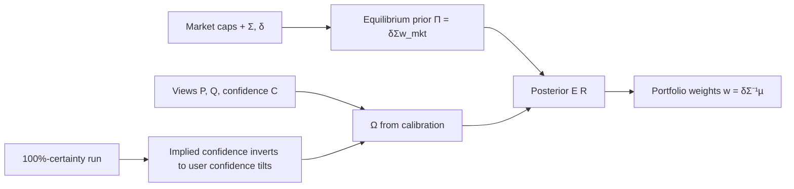

# Black-Litterman View Blending

> [!tldr] Black-Litterman starts from CAPM-implied equilibrium returns and Bayesian-blends investor views; the unconstrained optimal portfolio is the equilibrium portfolio plus confidence-weighted view tilts, and confidence can be implied from 100%-certainty runs or set directly by the user.

## Core Structure

- Reverse-optimized equilibrium prior Π = δΣw_mkt (He & Litterman ([[references/he2002-black-litterman-intuition]])'s δ form; Idzorek's λ form, eq. 2.1) with prior covariance τΣ; views enter as P·E[R] = Q with diagonal view covariance Ω.
- Posterior mean:

$$
E[R] = \left[(\tau\Sigma)^{-1}+P'\Omega^{-1}P\right]^{-1}\left[(\tau\Sigma)^{-1}\Pi+P'\Omega^{-1}Q\right]
$$

- Unconstrained optimal weights decompose as w* = w_eq + P'Λ; a view weight is positive iff the view is more bullish than the model without it (q > p'µ̄), and rises with bullishness and confidence (He & Litterman, lines 6, 113, 221).
- Only the ratio ω/τ enters the posterior returns once Ω is set by the He-Litterman calibration ω/τ = p_kΣp_k', so τ need not be specified separately (he2002 footnote, line 71; idzorek line 236). Literature guidance on τ is scarce: Lee sets it between 0.01 and 0.05 and calibrates to a target tracking error, Satchell & Scowcroft say it is often set to 1, and Blamont & Firoozy read τΣ as the standard error of estimate of Π, so τ ≈ 1/(number of observations) (idzorek, lines 212-214).
- With that calibration the 8-asset-class example yields Ω diagonal entries 0.000709, 0.000141, 0.000866 (idzorek eq. 2.8, line 233).
- Implied confidence: run the 100%-certainty case E[R_100%] = Π + τΣP'(PτΣP')⁻¹(Q − PΠ), then C_implied = (ŵ − w_mkt)/(w_100% − w_mkt) per asset; user-specified confidence C_k inverts this through tilts Tilt_k = (w_k,100% − w_mkt)·C_k (idzorek eq. 2.9-2.16, lines 349, 395-454).
- Constrained variants (risk, budget, beta) are linear combinations of the unconstrained optimum, the global min-variance portfolio, and the market equilibrium portfolio (he2002, lines 155-171, 231-247).

## Why It Matters

- The equilibrium prior tames extreme mean-variance weights: equal means across assets produce extreme weights, while the equilibrium start returns exactly market weights (he2002, lines 45, 67).
- Confidence becomes an interpretable dial: the user sets 0-100% confidence directly, and a single view propagates through covariance to all assets, not just the viewed ones (idzorek, lines 248-250).
- One Black-Litterman expected-return set can be reused across many client portfolios and benchmarks (he2002, line 177).
- The ex-ante information-ratio ceiling (Bevan-Winkelmann 2.0) gives a practical check on aggregate view strength (idzorek, lines 260, 308).
- A small mean change can push many assets far from market weights (Best & Grauer 1991, cited at idzorek line 27) — the extreme-sensitivity caution BL is built to answer.
- An absolute view breaks the unity constraint: the 8-class example's ŵ sums to 103.63% against 100.00% for w_mkt, so investors confined to a budget of 1 may want to drop absolute views (idzorek, lines 254, 310).

## Limitations

- Ω is the most abstract input; requiring a probability distribution per view suits only quantitative managers (idzorek, line 340, citing Herold 2003); [[references/meucci2006-beyond-black-litterman-copula]] replaces Ω with explicit confidence weights that pool each view's marginal distribution. ^[inferred]
- Implied confidences from the scaled-variance method ignore stated confidence levels (32.94/43.06/33.02% vs stated 25/50/65%), showing calibration sensitivity to τ and P-row weighting. ^[inferred]
- Garbled table digits in the idzorek extraction add digit-level uncertainty to the quoted examples. ^[ambiguous]
- The confidence calibration text in he2002 is garbled in extraction, so the exact ω/δ statement is not fully verifiable. ^[ambiguous]

## Related

- [[references/black1992-global-portfolio-optimization]]
- [[references/he2002-black-litterman-intuition]]
- [[references/idzorek20072-bl-confidence-levels]]
- [[concepts/ordering-information-portfolio-selection]]
- [[references/qian2001-conditional-distribution-portfolio-theory]] — shares black-litterman + portfolio-optimization tags with this page
- [[references/meucci2006-beyond-black-litterman-copula]] — confidence-weighted pooling of view distributions addresses the same Ω problem ^[inferred]

## Sources

- [[_papers/he2002intuition/he2002intuition-extracted.md]]
- [[_papers/he2002intuition/he2002intuition.md]]
- [[_papers/idzorek20072/idzorek20072-extracted.md]]
- [[_papers/idzorek20072/idzorek20072.md]]
