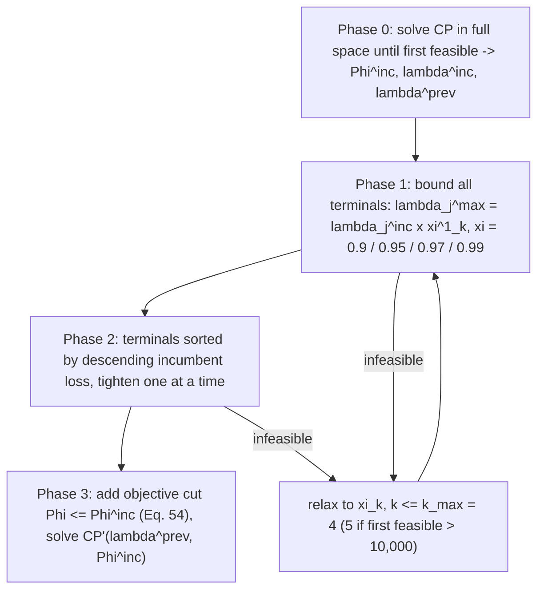

# Cumulative Volume Lower Bound Search

> [!tldr] A pattern for constraint-programming search on inventory-coupled scheduling: turn the inventory balance equation into a **valid lower bound on cumulative volume shipped from a terminal**, using initial inventory, inventory capacity, and a cap on total loss. Then iteratively tighten the loss cap phase by phase, solving a sequence of restricted CP models. Theorem 1 guarantees that no solution with a larger total loss than the incumbent satisfies the bound set, so the search prunes loss levels, not schedules.

![[_papers/goel2015constraint/images/page_6_chart_2.jpg]]
*Fig. 2 (verbatim): A feasible and an infeasible loading schedule based on constraint (45) for illustrative example.*

## Bound Derivation

Paper Eq. 42–44, modeled in CP as constraint (45), at production terminal $j$:

$$\tilde z_j\ \ge\ \text{step}\big(1,\ g^0_j-\gamma_j-\lambda_j\big)+\tilde p_j$$

and as constraint (47), at regasification terminal $j$:
$$\tilde z_j\ \ge\ \text{step}\big(1,\ -g^0_j-\lambda_j\big)+\tilde d_j$$

with $\tilde z_j$ = cumulative volume loaded/discharged up to time $t$ (a cumul function over interval variables), $g^0_j$ = initial inventory, $\gamma_j$ = inventory capacity, $\tilde p_j$ = cumulative production, $\tilde d_j$ = cumulative regasification, and $\lambda_j$ = total lost production (stockout) over the horizon at terminal $j$, capped by $\sum_{t'\le t} l_{j,t'} \le \lambda_j$ (Eq. 43); in CP, losses come from daily loss intervals $slt_{j,t}$. The bound follows from: inventory = production − losses, capacity $\le\gamma_j$; the full derivation is Eq. 42–47 with Theorem 1, proved in the paper's Section 6.

The final model CP'(λ, Φ) adds constraints (45), (47) and the objective cut (54) to the base CP model; the base model carries the presence/first-visit, ship-cargo coupling, sequence and berth constraints, inventory and demand constraints, plus the loss cap $\lambda_j$. Sub-problems in phases 1–2 terminate on optimality, infeasibility, branch limit and/or solution limit — the CP-Heur-nxksol configuration uses branch limit $n \cdot \sum_v |J^V_v|$ and solution limit $k$, CP-Heur-nx uses the branch limit without a solution limit.

## Measured Effect

Speed-up vs the MIP heuristic (paper Table 4, geometric mean, best-known value in 5 h):

| Configuration | Geometric mean |
|---|---|
| CP2 plain (CPOptimizer) | 4.55 |
| **CP-Heur-4x-1sol** | **10.5** |
| CP-Heur-32x | 7.86 |
Quality at common solve time (paper Table 5, % gap vs best known, positive = CP better): CP-Heur-4x-1sol beats MIP-Heur on 17 of 18 instances; its largest gaps are P16 +66.2, P22 +61.26, P24 +54.79, P23 +47.53, P13 +45.55, P11 +39.13, P20 +26.52, P25 +15.65, P18 +11.23. CP2 speed-ups (Table 4) peak at P24 1,300, P7 916, P11 384.67, P22 260.67.

## Limitations

- Valid inequality, not optimality proof: the bound prunes search space, Theorem 1 gives no bound on solution quality.
- The fraction schedule $\xi=[0.9,0.95,0.97,0.99]$ with $k_{max}=4$ (5 when the first feasible objective exceeds 10,000) is hand-set; the paper notes it is an accuracy control, not tuned.
- Phase 2 tightens terminals in descending order of incumbent loss; the ordering heuristic is not justified against alternatives.
- Requires a first feasible solution from the full-space Phase 0 search, whose quality drives everything downstream; the branch limit $n\sum_v|J^V_v|$ and solution limit $k$ apply to the phase 1–2 sub-problems (CP-Heur-nxksol), not to phase 0.
- The bound is stated for full-load/full-discharge intervals with fixed load volume per cargo; a split-delivery model would need a re-derivation. ^[inferred]

## Related

- [[concepts/disjunctive-scheduling-constraint-programming-model]]
- [[concepts/cp-sat-hint-start]]
- [[concepts/time-space-network-ship-flow-model]]
- [[concepts/mirp-modeling-continuous-vs-discrete-time]]
- [[concepts/annual-lng-delivery-program]]
- [[concepts/adaptive-large-neighborhood-search-for-mip]]
- [[references/goel2015-constraint-programming-lng-ship-scheduling]]
- [[references/goel2012-large-neighborhood-search-lng-inventory-routing]]

## Open Questions

- Phase 0 needs a first feasible solution; is a valid-incumbent warm start (hinting, as in CP-SAT `AddHint`) better than the phase-0 search? ^[inferred]
- The bound uses total loss per terminal. Time-windowed loss bounds ($\lambda_{j,t}$, as the paper proposes in its discussion) would be tighter, at what cost? ^[inferred]

## Sources

- [[_papers/goel2015constraint/goel2015constraint-extracted.md]]
- [[_papers/goel2015constraint/goel2015constraint.md]]
- [[_papers/goel2015constraint/images/page_6_chart_2.jpg]]
