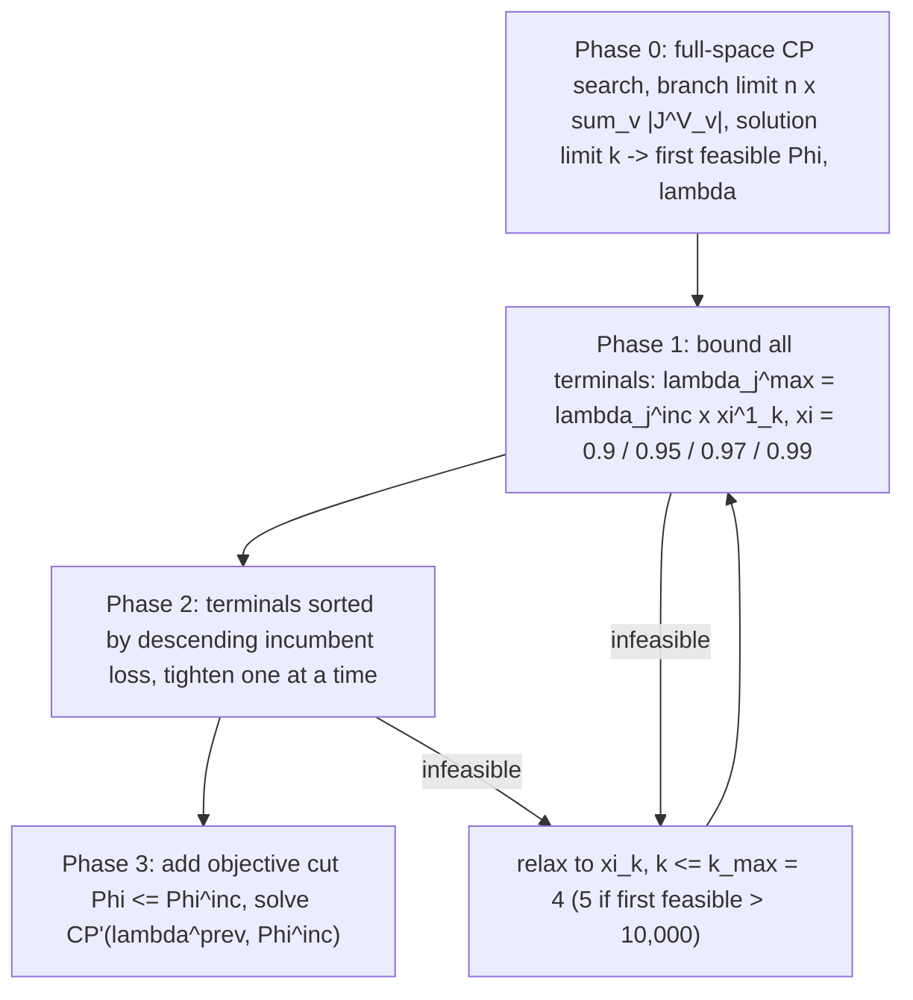

# Cumulative Volume Lower Bound Search

> [!tldr] A pattern for constraint-programming search on inventory-coupled scheduling: turn the inventory balance equation into a **valid lower bound on cumulative volume shipped from a terminal**, using initial inventory, inventory capacity, and a cap on total loss. Then iteratively tighten the loss cap phase by phase, solving a sequence of restricted CP models. Theorem 1 guarantees that no solution with a larger total loss than the incumbent satisfies the bound set, so the search prunes loss levels, not schedules.

![[_papers/goel2015constraint/images/page_6_chart_2.jpg]]
*Fig. 2 (Goel et al. 2015 paper): a feasible and an infeasible loading schedule under constraint (45) — $p_{j,t}=60$, $g^0_j=0$, $\gamma_j=320$, $\lambda_j=0$, loading 900 units; the shaded region is infeasible.*

## Bound Derivation

Paper Eq. 34–44 sequence, stated at production terminal $j$:

$$\tilde z_j\ \ge\ \text{step}\big(1,\ g^0_j-\gamma_j-\lambda_j\big)+\tilde p_j$$

and at regasification terminal $j$:

$$\tilde z_j\ \ge\ \text{step}\big(1,\ -g^0_j-\lambda_j\big)+\tilde d_j$$

with $\tilde z_j$ = cumulative volume loaded/discharged up to time $t$ (a cumul function over interval variables), $g^0_j$ = initial inventory, $\gamma_j$ = inventory capacity, $\tilde p_j$ = cumulative production, $\tilde d_j$ = cumulative regasification, and $\lambda_j$ = the added constraint $\sum_{v,i}\text{pulse}(c^{VJ}_{v,i,j},\gamma^V_j)\le\lambda_j$ bounding **total loss**. The bound follows from: inventory = production − losses, capacity $\le\gamma_j$; the paper gives the full derivation in appendix A.3.

The final model CP' adds: presence/first-visit, ship-cargo coupling, sequence constraints, demand constraints (paper Eq. 33), the loss cap $\lambda_j$, the cumulative lower bounds (Eq. 45–47), and the objective cut (Eq. 48).

## Measured Effect

Speed-up vs the MIP heuristic (paper Table 4, geometric mean, best-known value in 5 h):

| Configuration | Geometric mean |
|---|---|
| CP2 plain | 4.55 |
| CP-Heur-nx 4x | 6.10 |
| CP-Heur-nx 8x | 6.11 |
| CP-Heur-nx 16x | 6.21 |
| **CP-Heur-nxksol 4x, 1 solution** | **10.5** |

Quality at 5 h (paper Table 5, % gap vs best known, positive = CP better): CP-Heur-4x-1sol is better on 17 of 18 instances (P11 +39.1, P13 +45.6, P16 +66.2, P18 +15.4, P19 +33.4, P22 +13.5, P23 +2.2, P24 +2.5, P25 +1.1). Instance P24 records a speed-up of 1,300, P7 916, P11 384.7.

## Limitations

- Valid inequality, not optimality proof: the bound prunes search space, Theorem 1 gives no bound on solution quality.
- The fraction schedule $\xi=[0.9,0.95,0.97,0.99]$ with $k_{max}=4$ (5 when the first feasible objective exceeds 10,000) is hand-set; the paper notes it is an accuracy control, not tuned.
- Phase 2 tightens terminals in descending order of incumbent loss; the ordering heuristic is not justified against alternatives.
- Requires a first feasible solution, whose quality in Phase 0 drives everything downstream — the phase-0 branch/solution limits ($n$, $k$) are set from the variable count.
- The bound is stated for full-load/full-discharge intervals with fixed load volume per cargo; a split-delivery model would need a re-derivation. ^[inferred]

## Related

- [[concepts/disjunctive-scheduling-constraint-programming-model]]
- [[concepts/cp-sat-hint-start]]
- [[concepts/time-space-network-ship-flow-model]]
- [[concepts/mirp-modeling-continuous-vs-discrete-time]]
- [[concepts/annual-lng-delivery-program]]
- [[concepts/adaptive-large-neighborhood-search-for-mip]]
- [[references/goel2015-constraint-programming-lng-ship-scheduling]]
- [[references/goel2012-large-neighborhood-search-lng-inventory-routing]]

## Open Questions

- Phase 0 needs a first feasible solution; is a valid-incumbent warm start (hinting, as in CP-SAT `AddHint`) better than the phase-0 search? ^[inferred]
- The bound uses total loss per terminal. Time-windowed loss bounds ($\lambda_{j,t}$, as the paper proposes in its discussion) would be tighter, at what cost? ^[inferred]

## Sources

- [[_papers/goel2015constraint/goel2015constraint-extracted.md]]
- [[_papers/goel2015constraint/goel2015constraint.md]]
- [[_papers/goel2015constraint/images/page_6_chart_2.jpg]]
