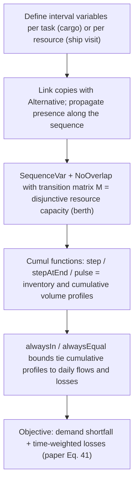

# Disjunctive Scheduling Constraint-Programming Model

> [!tldr] The CP representation of a scheduling-plus-inventory problem built from interval variables, `SequenceVar`/`NoOverlap` disjunctive constraints, and cumul functions (`pulse`, `step`, `stepAtEnd`, `alwaysIn`, `alwaysEqual`, `Alternative`, `First`, `typeOfNext`). Goel et al. show the encoding choice matters: the **task-perspective** model (CP1) uses 215,290 variables and 1.9 GB on the P14 instance and runs out of memory, while the **resource/ship-perspective** model (CP2) uses 15,375 variables and 203 MB on the same instance.

![[_papers/goel2015constraint/images/page_2_chart_15.jpg]]
![[_papers/goel2015constraint/images/page_2_chart_16.jpg]]
![[_papers/goel2015constraint/images/page_2_chart_19.jpg]]
*Fig. 1 (paper): the elementary cumul functions `pulse(x,k)`, `stepAtEnd(x,k,kmin,kmax)` and `step(t,k)` — the primitives used to write inventory profiles as cumulative curves over interval variables.*

## Encoding Primitives

Task-perspective (CP1, per terminal $j$):

- `c^J_{j,i}` = interval for cargo $i$ at $j$, domain $[t^{EC}_{j,i},\,t^{LC}_{j,i}+1)$
- `c^{JV}_{j,i,v}` = the cargo carried by ship $v$; `Alternative(c^J, {c^{JV}}_v)`
- presence chain `presenceOf(c^J_i) ⇒ presenceOf(c^J_{i-1})`
- `startOf(c^J_{i-1}) + τ_j ≤ startOf(c^J_i)`
- berth capacity `Σ_i pulse(c^J,1) ≤ b_j`
- alternation of loading/discharging, per-ship, via a cumul function
- inventory: $\tilde p_j$, $\tilde d_j$ as `step` profiles, $\tilde z_j=\sum_{v,i}\text{stepAtEnd}(c^{JV},\gamma^V_v)$, $\tilde l_j$ from daily loss intervals `slt_{j,t}` with `alwaysIn` bounds, and `alwaysEqual` complementarity constraints linking loss intervals to daily losses

Ship-perspective (CP2): variables are maximal ship visits $c^V_{v,i}$ with domain $[t^{EV}_{v,i},\,t^{LV}_{v,i})$, split by `Alternative` into cargo copies $c^{VJ}_{v,i,j}$; presence propagates $c^V_{v,i}\Rightarrow c^V_{v,i-1}$; `First(seq_v, a_v)` handles unavailability; `typeOfNext` with the transition matrix $M(j,\varphi_1)=1$, $M(j,\varphi_2)=0$, and `NoOverlap(seq_v, M)` enforces that a service day occupies a berth.

**Alternation inside the domains**: set $J^V_{v,i}=\{j\in J\}$, $J^L_{v,i}=\{j\in L\}$, $J^R_{v,i}=\{j\in R\}$, $J^V_{v,i}=J^L_{v,i}$ and $J^V_{v,i+1}=J^R_{v,i}$ when ship $v$ starts at a production terminal (the reverse when it starts at a regasification terminal). Full-load/full-discharge alternation is then guaranteed by the variable domains, so CP1's explicit alternation constraint is not needed — at the cost of not supporting split deliveries.

$$\tilde z_j=\sum_{v\in V}\sum_{i\in I_v}\text{stepAtEnd}\big(c^{VJ}_{v,i,j},\ \gamma^V_v\big)$$

## Variable Counts

Model sizes (paper Table 1):

| Instance $(|L|,|R|,|V|)$ | MIP 0-1 vars | CP1 vars (memory) | CP2 vars (memory) | CP2/CP1 vars |
|---|---|---|---|---|
| P13 (1,8,40) | 132,995 | 54,588 (503 MB) | 10,077 (141 MB) | 0.18 |
| P14 (1,10,69) | 232,856 | 215,290 (1.9 GB) | 15,375 (203 MB) | 0.07 |
| P18 (1,13,56) | 232,412 | 144,791 (1.2 GB) | 12,718 (216 MB) | 0.09 |
| P20 (1,18,100) | 476,426 | 337,155 (3.0 GB) | 26,783 (380 MB) | 0.08 |

## Why It Matters

- CP has no time discretization, so a daily-grid MIP and a continuous CP model of the same problem can be solved in the same framework; the MIP model here is [[concepts/time-space-network-ship-flow-model]].
- Modeling assumptions the representation inherits: one full day loading/discharging occupies a berth, integer travel days, no seasonality, fixed discharge volume = load − nominal boil-off, fixed regas rates. The paper's extensions relax these: split loads, variable discharge, seasonality, berth availability, and multi-period planning.
- The cumul-function inventory profiles are what make the cumulative lower bound in [[concepts/cumulative-volume-lower-bound-cp-search]] expressible.
- The CP literature's hinting capability (CP-SAT `AddHint`) is the natural bridge from an incumbent MIP solution to CP search; see [[concepts/cp-sat-hint-start]].

## Related

- [[concepts/cumulative-volume-lower-bound-cp-search]]
- [[concepts/cp-sat-hint-start]]
- [[concepts/time-space-network-ship-flow-model]]
- [[concepts/mirp-modeling-continuous-vs-discrete-time]]
- [[references/goel2015-constraint-programming-lng-ship-scheduling]]
- [[references/goel2012-large-neighborhood-search-lng-inventory-routing]]
- [[references/hendel2022-adaptive-lns-for-mip]]
- [[references/christiansen2008-maritime-inventory-routing-problems]]

## Limitations

- CP1 is memory-bound at large size (1.2–3.0 GB), so only CP2 is usable at 69–100 ships.
- CP2 cannot represent split delivery/split load; the encoding choice is a modeling commitment, not a tuning knob.
- The paper compares CP against a specialized MIP heuristic, not against an exact MIP bound, so "4–10× faster" is a heuristic-to-heuristic statement. ^[ambiguous]
- The transition matrix formulation requires full-load/full-discharge services with fixed duration. ^[inferred]

## Sources

- [[_papers/goel2015constraint/goel2015constraint-extracted.md]]
- [[_papers/goel2015constraint/goel2015constraint.md]]
- [[_papers/goel2015constraint/images/page_2_chart_15.jpg]]
- [[_papers/goel2015constraint/images/page_2_chart_16.jpg]]
- [[_papers/goel2015constraint/images/page_2_chart_19.jpg]]
