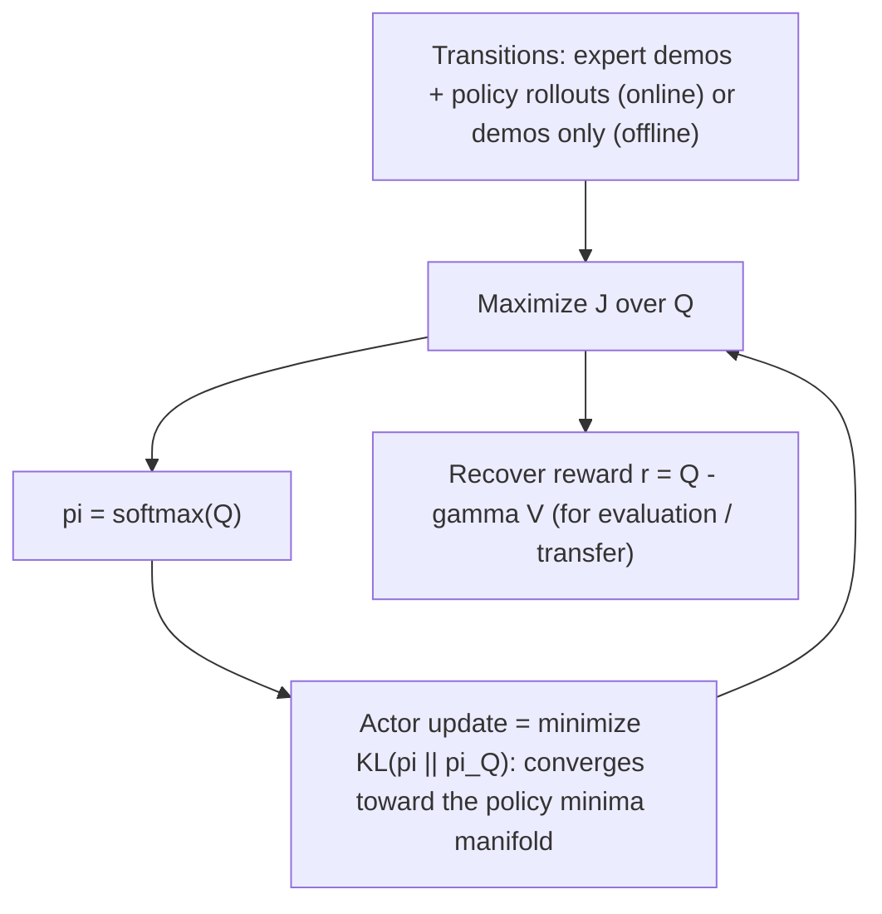

# Inverse Soft-Q Imitation Learning

> [!tldr] The pattern: represent reward **and** policy by a single soft-Q function, so imitation learning reduces to optimizing one learned object, with no adversarial min-max. The policy is $\pi_Q=\text{softmax}(Q)$, the reward is $r=Q-\gamma\mathbb E V^\pi$, and the objective is concave in $Q$ under the change of variables $r=\mathcal T^\pi Q$ (inverse soft Bellman, bijective). The learned Q is the object that carries the knowledge, not the reward.

![[_papers/garg2022iqlearn/images/page_27_image_0.jpg]]
*Fig. 14 (paper): "A variant of the Loop MDP from [34]. Taking actions labelled in green gives 1 reward, while actions in black give reward 0. The MDP is stochastic for action a1 in state s0, which with probability p leads to state s2, and with probability 1-p leads to state s1."*

## Structure

Soft optimality and the objective (paper Eqs. 1–2, 9):

$$\pi_Q(a|s)=\frac{1}{Z_s}\exp Q(s,a),\qquad Z_s=\sum_a\exp Q(s,a)$$

$$\mathcal J(\pi,Q)=\mathbb E_{\rho_E}\Big[\phi\big(Q(s,a)-\gamma\mathbb E_{s'\sim P}V^\pi(s')\big)\Big]-(1-\gamma)\,\mathbb E_{p_0}\big[V^\pi(s_0)\big]$$

The two properties that make this usable (paper Fig. 1): the policy minima manifold of $\mathcal J$ is an energy-based model of $Q$ (Prop 3.1), and the change of variables maps the saddle point of the reward/policy objective to the saddle point of the Q-objective (Prop 3.6). Reward recovery is the inverse transform $\mathcal T^\pi$ (paper Eq. 11):

$$r(s,a,s')=Q(s,a)-\gamma\,\mathbb E_{s'\sim P}V^\pi(s')$$

Instantiations by divergence (the $\phi/\psi$ pair): Jensen-Shannon, Hellinger, $\chi^2$, KL, Wasserstein-1 (with gradient penalty), total variation (with the $|Q|\le\frac{1}{1-\gamma}(\frac12+\log|A|)$ tanh bound). The offline $\chi^2$ form is:

$$\min_Q\ -\mathbb E_{\rho_E}[Q-V^*]+\frac{1}{4\alpha}\mathbb E_{\rho_E}\big[(Q-\gamma\mathbb E_{s'}V^*)^2\big]$$

which is **identical to CQL's Q1-learning objective with zero rewards** — the connection between offline RL regularization and imitation.

Implementation is <15 lines on top of DQN (discrete) or SAC (continuous); $\gamma=0.99$; batch size 32 for discrete Q-learning and 256 for SAC; Q learning rate 1e-4, SAC critic/policy learning rates 3e-4 with 3e-5 on complex continuous tasks; entropy coefficient 1e-2 (1e-3 optimal in some environments); soft target updates $\tau=0.05$ in the continuous case, and target networks gave no visible improvement in discrete training.

## Evidence

| Evidence | Number |
|---|---|
| MuJoCo return, 1 expert demo (Hopper / Half-Cheetah / Walker / Ant / Humanoid) | 3546 / 5077 / 5134 / 4363 / 5227 (expert 3533 / 5098 / 5275 / 4700 / 5313) |
| Reward Pearson correlation (CartPole / Hopper / Half-Cheetah / Pong) | 0.99 / 0.99 / 0.86 / 0.67 |
| Tabular IRL speed vs max-entropy IRL | >3× faster, similar rewards |
| Convergence speed vs prior adversarial methods | >3×, ~300k steps on Atari |
| Loop MDP episode reward (BC vs IQ online $\chi^2$) | 54 ± 5 vs 100 ± 0 |
| Divergence ablation (LunarLander) | JS ≈ Hellinger ≈ $\chi^2$; KL worse |
| $\gamma=0$ ablation (CartPole) | destabilized training, strong return decay |

## Limits of the Pattern

- Rewards depend on environment dynamics, so recovered rewards do not transfer trivially between tasks.
- Offline versions cannot recover from initial-state distribution shift; regularizing the reward on **both** expert and policy states (online) is what enables goal generalization — the lander first moves horizontally to the launch zone, landing at average reward 250 from 10 demos.
- Reward quality degrades in visually complex games (Pong correlation 0.67).
- A "KL-fix" f-divergence form (one line, prose form $f(t)=t \log t - t + 1$ in the source ^[ambiguous]) is needed to make ValueDICE's Donsker–Varadhan representation unbiased; the KL divergence itself is a weaker IL objective. ^[inferred]
- Preprint; baseline code differs per method, so the "3×" family of claims is not measured on one shared code base. ^[ambiguous]

## Related

- [[references/garg2022-iq-learn-inverse-soft-q]]
- [[references/bertsimas2020-predictive-to-prescriptive-analytics]]
- [[references/cheng2020-drone-routing-energy-function]]
- [[concepts/transformer-seq2seq-routing-solver]]
- [[concepts/statistical-investigation-lifecycle]]
- [[references/gendreau2019-handbook-metaheuristics]]

## Open Questions

- The objective is derived for tabular MDPs; function approximation is used in practice, and the exact setting is left open. ^[inferred]
- A model-based variant (learning a dynamic model to obtain state predictions) is named as future work. ^[inferred]

## Sources

- [[_papers/garg2022iqlearn/garg2022iqlearn-extracted.md]]
- [[_papers/garg2022iqlearn/garg2022iqlearn.md]]
- [[_papers/garg2022iqlearn/images/page_4_chart_9.jpg]]
- [[_papers/garg2022iqlearn/images/page_27_image_0.jpg]]
