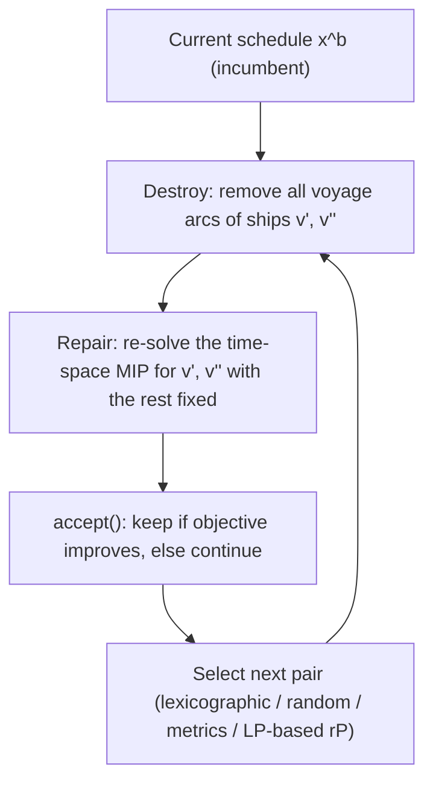

# Large Neighborhood Ship-Pair Destroy and Repair

> [!tldr] A ship-pair destroy/repair neighborhood: remove **all voyages of two ships** (a 2-opt-inspired destroy), keep the rest of the schedule fixed, and repair by re-solving the time-space MIP for the freed pair. Pairs are ranked by two metrics — lost production/stockouts eliminated by removing waiting, and the number of times one ship delays the other at the same terminal — and the pair with the highest combined value is chosen. Random-pair LNS already beats a strong MIP heuristic; metric-based selection makes it faster.

![[_papers/gendreau2019handbook/images/page_117_image_2.jpg]]
*Fig. 4.2 (Handbook of Metaheuristics, Ch. 4): the destroy-and-repair process — a destroy method removes part of a solution, a repair method rebuilds it, and the accept() step decides which solution continues the search.*

## Destroy / Repair Structure

Goel et al. (2012) define two neighborhoods on the same model:

1. **Voyage-shifting (TWIH)**: every voyage departure of a ship shifted by at most $m$ days ($m=4$ in the implementation), then re-solve the modified model — a sliding time-window neighborhood.
2. **Ship-pair (2SIH, variable-neighborhood style)**: pick ships $v',v''$, fix the schedule of all other ships, solve the reduced model for $v',v''$ only. Termination: stop after $C(|V|,2)$ consecutive non-improving iterations, or when the objective reaches 0.

This is exactly the LNS pattern of Pisinger & Ropke (Handbook of Metaheuristics Ch. 4): the neighborhood is defined implicitly by the destroy and repair methods, is **sampled** rather than fully searched, and belongs to the very large-scale neighborhood (VLSN) class, which the handbook motivates by the observation that large neighborhoods give higher-quality local optima and a more promising search path.

## Pair Selection

Pair metrics (paper §3.5.2):

$$\pi^1_v=\sum_{l\in L}\sum_{t\in T}w_{l,t}o_{l,t}+\sum_{r\in R}\sum_{t\in T}w_{r,t}s_{r,t}\ \text{(with all waiting for }v\text{ removed, terminal sequence unchanged)},\qquad \Pi^1_{v',v''}=\max(\pi^1_{v'},\pi^1_{v''})$$

$$\pi^2_{v',v''}=\big|\{t\in T:\exists j\in J\ \text{with}\ t\in I_{v',j}\cap I_{v'',j}\}\big|,\qquad \Pi^2_{v',v''}=\begin{cases}\pi^2_{v',v''}&\pi^1_{v'}\le\pi^1_{v''}\\ 0&\text{otherwise}\end{cases}$$

Candidate set: normalize $\Pi^1$ to $[\bar\pi^1_{min},\bar\pi^1_{max}]$, take pairs whose normalized $\Pi^1$ is within $\alpha=20\%$ of the max, then pick the pair with the largest $\Pi^2$.

The reduced model rP adds $\sum_{v\in V}y_v\le 2$, $y_v=1\Leftrightarrow\exists a\in A_v:x_a\ne\tilde x_a$, $y_v$ binary, and solves the **LP relaxation** (Dantzig–Wolfe decomposition on the three largest instances) to select the pair; the subproblem is separable per ship and coupled by inventory, berth and the $\sum y$ constraint.

## Measured Effect

Geometric mean speed-up vs CPLEX first feasible solution (paper Table 11, higher is better):

| Configuration | Geometric mean speed-up |
|---|---|
| H-Lexic | 13.61 |
| H-Randm (avg of 100 runs) | 13.60 |
| H-Mtrcs | 14.47 |
| **H-Model** | **15.72** |

Set 1, geometric mean vs H-Randm average (paper Table 12):

| Configuration | CPU speed-up | Subproblem-count reduction |
|---|---|---|
| H-Lexic | 0.94 | 1.10 |
| H-Mtrcs | 1.23 | 1.13 |
| **H-Model** | **1.22** | **1.68** |
| Ideal oracle (upper bound) | 2.22 | 2.05 |

![[_papers/goel2012large/images/page_22_chart_2.jpg]]
*Fig. 2 (Goel et al. 2012 paper): cumulative frequency of CPU time for 100 H-Randm runs on P13; 77% of random-pair runs are slower than the LP-selected-pair H-Model run.*

## Limitations

- LP-selection overhead is real: 4–35% of total CPU (P10 35%), and on P3/P10 H-Model needs the fewest subproblems yet beats H-Randm in CPU only 2% and 30% of the time, because its average subproblem takes 6.6 s vs 1.98 s for metric pairs.
- Solution quality is not uniformly better: in Set 2 (P5, P7, P13) the best-of-100 gap ranges 0.10%–108% from CPLEX first feasible, and metric-based selection wins 50%, 46%, 48% of runs by objective on P13/P14.
- The ship-pair neighborhood is bounded by $C(|V|,2)$ — the authors' stated motivation for using **four** ships to get a richer neighborhood, which they leave unimplemented.
- The ideal-oracle upper bound (2.05× subproblem reduction) shows a substantial gap remains between LP-based selection and optimal pair choice.

## Related

- [[concepts/large-neighborhood-search]]
- [[concepts/variable-neighborhood-search]]
- [[concepts/adaptive-large-neighborhood-search-for-mip]]
- [[concepts/dynamic-discretization-discovery]]
- [[concepts/time-space-network-ship-flow-model]]
- [[references/gendreau2019-handbook-metaheuristics]]
- [[references/goel2012-large-neighborhood-search-lng-inventory-routing]]
- [[references/goel2015-constraint-programming-lng-ship-scheduling]]
- [[references/hendel2022-adaptive-lns-for-mip]]
- [[references/boland2017-dynamic-discretization-tsptw]]

## Open Questions

- The handbook's LNS chapter prescribes simulated-annealing acceptance for escaping local optima; Goel et al. accept improving solutions only. Does SA acceptance on the ship-pair neighborhood improve the hard-instance gaps? ^[inferred]
- Four-ship neighborhoods are named as the richer next step. No published result quantifies their subproblem cost on quarter-million-binary models. ^[inferred]

## Sources

- [[_papers/goel2012large/goel2012large-extracted.md]]
- [[_papers/goel2012large/goel2012large.md]]
- [[_papers/gendreau2019handbook/gendreau2019handbook-extracted.md]]
- [[_papers/gendreau2019handbook/gendreau2019handbook.md]]
- [[_papers/gendreau2019handbook/images/page_117_image_2.jpg]]
- [[_papers/goel2012large/images/page_22_chart_2.jpg]]
