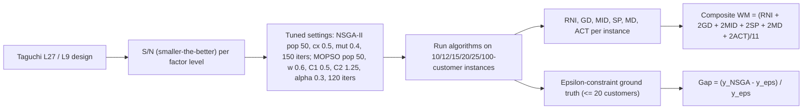

# Multi-Objective Metaheuristic Tuning and Front Validation

> [!tldr] The validation pattern used by Ganjia et al. (2026): tune metaheuristic factors with a Taguchi design under a "smaller-the-better" S/N ratio, generate Pareto fronts with the tuned algorithms, then measure the fronts against an **ε-constraint ground truth** with six metrics (RNI, GD, MID, SP, MD, ACT). The pattern is sound; the trap is composite metrics — a weighted mean of mixed-direction metrics can reverse the conclusion, and the direction convention has to be stated.

![[_papers/ganjia2026multiobjective/images/page_24_chart_5.jpg]]
*Fig. 5 (paper): the first Pareto fronts of NSGA-II and MOPSO; the front shape is what the metrics measure.*

## Procedure

1. **Factor selection and levels** for the search operators (population size, iteration count, crossover/mutation rates for NSGA-II; inertia, $C_1$, $C_2$, $\alpha$, iteration count for MOPSO).
2. **Taguchi array** — L27 for NSGA-II (6 factors × 3 levels), L9 for MOPSO; response = objective convergence.
3. **S/N, smaller-the-better**: $S/N=-\log\big(\sum_i y_i^2/n\big)$; pick the level with the best S/N (L27 is too large for full factorial, so experiments run on selected combinations).
4. **Ground truth** by ε-constraint: fix the cost weight, vary the time weight, solve $\min\{w_1Z_1+w_2Z_2\}$ subject to $Z_1\le\beta_1$; convert to a single-objective MIP by linearizing max operators.
5. **Gap check**: $Gap_i=(y^{NSGA}_i-y^\varepsilon_i)/y^\varepsilon_i$, reported as 0.002% (cost) and 0.008% (time) average, NSGA-II 0.000–0.008, MOPSO 0.008–0.033.
6. **Front metrics**: RNI (normalized distance to the ideal point), GD (generational distance), MID (mean ideal distance), SP (Shah and Tavares' pairwise spread), MD (mean diversity of points), ACT (algorithm convergence time).

Tuned results: NSGA-II 126.1965 → 69.30 MLCU cost (45%) and 23,950 → 858 h tardiness (96%) in 50 iterations; MOPSO 108.39 → 68.09 (32%) and 29,595 → 1,047 h. Metric averages: NSGA-II RNI 0.004 / GD 72 / MID 42 / SP 217 / MD 13 / ACT 48 s; MOPSO RNI 0.002 / GD 94 / MID 142 / SP 555 / MD 3 / ACT 60 s.

## The Composite-Metric Trap

NSGA-II wins 5 of 6 raw metrics (MOPSO wins RNI and ACT), yet the composite $WM=(RNI+2GD+2MID+2SP+2MD+2ACT)/11$ averages 0.57 for NSGA-II vs 0.61 for MOPSO — and RNI/MD favor MOPSO in raw values, so the composite's sign convention is not stated in the paper. A composite that mixes normalized distances, absolute spreads and time in seconds, with weights of 1 and 2, is not interpretable without declaring the direction of each term. ^[ambiguous]

The pattern that survives the trap: the raw-metric table plus the ε-constraint gap. The gap statement ("average gap of NSGA-II results from ε-constraint, 0.002 and 0.008 for cost and time") is what supports "NSGA-II finds high-quality Pareto solutions", and it is an absolute quality statement, not an algorithm-vs-algorithm ranking.

The single-objective tension is the cleanest evidence: 10-customer example, economic orientation cost 74.52 / time 9.43 h, customer orientation time 2.17 h / cost 245.11, ε-constraint compromise 112.98 / 5.29 h. The exact method solves up to 20 customers in 10–38 minutes and fails at 23 and 25 customers within the time limit; NSGA-II solves those in 0.35–0.45 minutes — the exact method is the validator, the metaheuristics are the scalable solvers.

## Related

- [[references/ganjia2026-multiobjective-sustainable-supply-chain-scheduling]]
- [[concepts/fuzzy-weighted-max-min-scalarization]]
- [[concepts/multi-objective-maritime-cargo-routing-scheduling]]
- [[concepts/hyper-heuristics]]
- [[concepts/parallel-metaheuristics-cooperative-search]]
- [[concepts/statistical-investigation-lifecycle]]
- [[references/gendreau2019-handbook-metaheuristics]]
- [[references/asghari2021-green-vrp-state-of-the-art-review]]
- [[concepts/multi-objective-maritime-cargo-routing-scheduling]]

## Open Questions

- The handbook records multi-objective **[[concepts/tabu-search|tabu search]]** (EJOR 185:1192–1212, 2008) and GPU multi-objective search, neither benchmarked here; a three-algorithm benchmark on the same instances with the same metric set would settle the ranking. ^[inferred]
- Taguchi S/N is applied to one response. A multi-response (per-objective) S/N analysis would tune the two objectives jointly, which is what the Pareto front requires. ^[inferred]

## Sources

- [[_papers/ganjia2026multiobjective/ganjia2026multiobjective-extracted.md]]
- [[_papers/ganjia2026multiobjective/ganjia2026multiobjective.md]]
- [[_papers/ganjia2026multiobjective/images/page_24_chart_5.jpg]]
