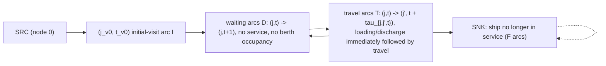

# Time-Space Network Ship-Flow Model

> [!tldr] The time-space network models ship scheduling as **integer multi-commodity net flow with each ship as a commodity** (Savelsbergh & Song, 2008): node $(j,t)$ marks that ship $v$ is at terminal $j$ at the start of day $t$, arcs carry one ship's path, and flow conservation, path-cover constraints and berth capacity turn the schedule into linear structure. It is the MIP backbone of the LNG inventory-routing literature.

![[_papers/goel2012large/images/page_6_image_2.jpg]]
*Fig. 1 Example of time-space network structure (Goel et al. 2012)*

## Core Structure

Node set $N_v=\{(j,t)\}\cup\{SRC,SNK\}$ for ship $v$; arc set $A_v=I\cup D\cup F\cup T$. The key device: a loading or discharging visit is **immediately followed by a travel arc**, which removes the symmetry between waiting at a terminal and starting travel from it.

Haug et al. use the same location-by-day grid with the sailing leg placed first inside each arc, so waiting, purge/cool-down and port operations follow the sail and berth occupancy is easier to count; the berth constraint counts own-vessel arcs, chartered vessels and FOB cargoes in the same period, and artificial origin arcs (to a vessel's first availability, and a zero-cost arc to the end of the horizon for unused vessels) close the flow [[references/haug2023-adp-speed-optimization-ports]] (lines 53-61, 101-265). Making vessel speed a decision adds binary speed variables that more than double the model's binary count, and the 365-day instance found no feasible solution within the time limit — grid size, not physics, is the binding constraint (lines 298-311, 319).

Ship flow conservation and path cover (paper Eqs. 2–4 are network-flow conservation constraints for each ship; the path-cover term $\sum_{a\in A_{v'}}x^{v'}_a\le 1$ is the paper's single-visit-per-ship condition, stated separately): ^[inferred]

$$\sum_{a\in O_v(j,t)}x^v_a=\sum_{a\in I_v(j,t)}x^v_a\ \ \forall(j,t)\in N_v,\qquad \sum_{a\in I_v}x^v_a=\sum_{a\in F_v}x^v_a=1,\qquad \sum_{a\in A_{v'}}x^{v'}_a\le 1$$

Cargo delivered to regasification terminal $r$ (paper Eq. 6): $Q^v_r=\sum_{a\in T^{(r)}_v}\gamma^{V}_vx^v_a$, with inventory balance $g_{r,t}=g_{r,t-1}+Q^v_r-d_{r,t}+s_{r,t}$, berth capacity $\sum_{v\in V}\sum_{a\in B(j,t)}x^v_a\le b_j$, and the annual-demand shortfall $\delta^D_r\ge D_r-\sum_{v}\sum_{a\in T^{(r)}_v}\gamma^V_vx^v_a$. Objective is the penalty sum $\min\sum_{l}w_{l,t}o_{l,t}+\sum_{r}w_{r,t}s_{r,t}+\sum_{r}w^D_r\delta^D_r$.

## Census and Numbers

Goel et al. (2012), Table 1 instance sizes: binary variables 12,812 (P1, 6 ships) up to 232,856 (P14, 69 ships, 10 regas terminals); constraints 6,406 (P6, 4 ships) → 79,425 (P14); continuous variables 1,827 (P8) → 11,691 (P14). Goel et al. (2015), Table 2: the same MIP has 232,856 0-1 variables for P14 while the ship-perspective CP model CP2 needs 15,375 variables (203.1 MB vs 1.9 GB) — the time-space grid is the size driver. The public MIRPLib benchmark builds its instances on the same time-space grid [[references/papageorgiou2014-mirplib-mirp-instance-library]].

Travel-time structure is monotone: $\tau_{j,j',t}\le\tau_{j,j',t+1}+1$; travel times are seasonal time-dependent integers (the paper lists seasonal travel times and seasonality in production rates among the complicating characteristics), and a loading/discharging visit occupies a berth for the period it is scheduled.

The penalty structure is a modeling requirement, not a detail: $w_{j,t}>w_{j,t+1}$ (monotonically decreasing) so a lost unit of production/regasification is reported at the time it is lost, preventing the model from shifting losses to cheaper days.

## Why It Matters

- The network makes ship routes, inventory and berth competition linear, so the model supports **supply-chain design analysis** — the paper's stated purpose — including the two extensions: inventory smoothening (maximize production inventory, minimize regasification inventory under an objective ceiling $\hat z^*+g$) and boundary-effect analysis (initial inventories and ship positions as decision variables).
- Discrete daily discretization is the price of this linearity: the number of nodes grows with the horizon, so a 365-day problem with 69 ships produces a quarter of a million binaries.^[extracted]
- The waiting/travel decomposition plus the path-cover constraint is the symmetry-reduction device that keeps the model solvable enough for [[references/pisinger2019-large-neighborhood-search|large-neighborhood search]]; see [[concepts/large-neighborhood-ship-pair-destroy-repair]].
- The same location-by-day network underlies time-expanded routing formulations such as [[references/paradiso2020-esf-multitrip-vrptw]] and discretized continuous-time models such as [[references/boland2017-continuous-time-service-network-design]].

## Related

- [[concepts/mirp-modeling-continuous-vs-discrete-time]]
- [[concepts/large-neighborhood-ship-pair-destroy-repair]]
- [[concepts/maritime-inventory-routing-problem]]
- [[concepts/annual-lng-delivery-program]]
- [[concepts/cumulative-volume-lower-bound-cp-search]]
- [[concepts/disjunctive-scheduling-constraint-programming-model]]
- [[references/goel2012-large-neighborhood-search-lng-inventory-routing]]
- [[references/goel2015-constraint-programming-lng-ship-scheduling]]
- [[references/fagerholt2023-maritime-inventory-routing-survey]]
- [[references/papageorgiou2014-mirplib-mirp-instance-library]]
- [[references/christiansen2008-maritime-inventory-routing-problems]]
- [[references/mutlu2016-lng-annual-delivery-program]] — shares lng + maritime tags with this page
- [[references/gronhaug2009-supply-chain-optimization-lng]] — binary arc-flow x_ijvt formulation on the same daily grid
- [[references/gronhaug2010-branch-and-price-lng-irp]] — prices duties on this network with side constraints and duty-limited paths
- [[references/haug2023-adp-speed-optimization-ports]] — same daily grid with sailing-first arcs, speed variables and berth counting over own, chartered and FOB vessels

## Open Questions

- Does the network admit split deliveries without exploding the arc set? Goel et al. (2012) restrict to full load/full discharge by design, noting prior operational papers (Fodstad et al. 2008, Grønhaug & Christiansen 2009) modeled split delivery; Goel et al. (2015) state CP2 "relies heavily" on single load/single discharge and is "difficult to extend" to split delivery or split loads. ^[ambiguous]
- The time-space grid is daily; the CP representation has no discretization. Which representation wins as horizons and fleets grow, given the CP model already scales to 100 ships? ^[inferred]

## Sources

- [[_papers/goel2012large/goel2012large-extracted.md]]
- [[_papers/goel2012large/goel2012large.md]]
- [[_papers/goel2012large/images/page_6_image_2.jpg]]
- [[_papers/gronhaug2009supply/gronhaug2009supply-extracted.md]]
- [[_papers/gronhaug2009supply/gronhaug2009supply.md]]
- [[_papers/gronhaug2010branchandprice/gronhaug2010branchandprice-extracted.md]]
- [[_papers/gronhaug2010branchandprice/gronhaug2010branchandprice.md]]
