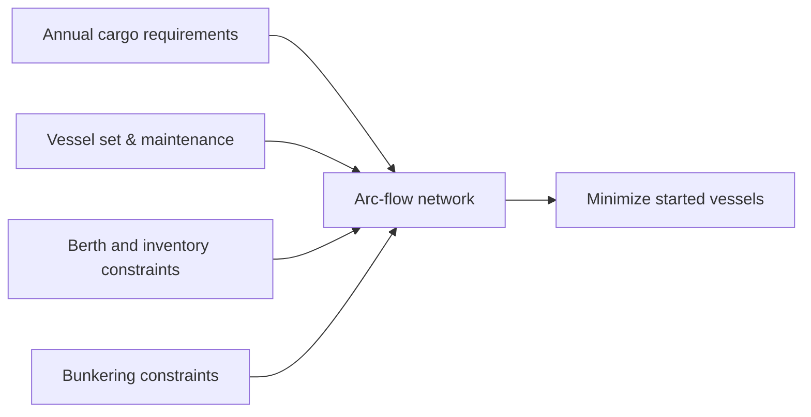

# Optimal planning of liquefied natural gas deliveries

> [!tldr] Presents a computationally tractable annual LNG planning MIP that directly targets minimum fleet size on real industrial instances.

## Problem & Motivation

Annual LNG delivery planning requires synchronizing cargo dates, heterogeneous vessel assignments, terminal inventory, berth capacity, maintenance windows, and bunkering operations. The paper seeks exact planning support at realistic scale.

## Method / Architecture

The model is built as a compact arc-flow mixed-integer program over vessel movement and cargo service events.

Diagram is reconstructed from the formulation structure. ^[inferred]

## Key Equations

$$
\min \sum_{v \in \mathcal{V}} x_{s_0,s_v}^{v}
$$

$$
\sum_{(s_v,i) \in \delta_{s_v}^{+}} x_{s_v,i}^{v} = x_{s_0,s_v}^{v} \qquad \forall v \in \mathcal{V}
$$

$$
\sum_{v \in \mathcal{V}} \sum_{j \in \mathcal{V}_2^c} \sum_{(i,j) \in \delta_i^{-}} x_{ij}^{v} = 1 \qquad \forall c \in \mathcal{C}
$$

## Results

| Setting | Result |
|---|---|
| Industrial LNG instances | Model remained tractable in commercial MIP solver runs |
| Largest reported scale | Up to 118 cargoes over a 373-day horizon |
| Business objective | Fleet-size minimization under operational constraints |

## Limitations

- The optimization objective prioritizes fleet size; other business objectives (e.g., spot-market revenue) are not primary in this formulation.
- Reported tests are tied to one major energy-company dataset, so transferability to different contract/terminal regimes should be validated separately. ^[inferred]

## Related

- [[concepts/annual-lng-delivery-program]]
- [[references/mutlu2016-lng-annual-delivery-program]]
- [[references/andersson2017-creating-annual-lng-delivery-programs]]
- [[references/deshpande2023-lng-adp-inventory-berth]]
- [[concepts/maritime-routing-under-uncertainty]]
- [[concepts/maritime-inventory-routing-problem]] — shares inventory-routing + maritime tags with this page
- [[concepts/time-space-network-ship-flow-model]] — shares lng + maritime + mixed-integer-programming tags with this page

## Sources

- [[_papers/al-haidous2016optimal/al-haidous2016optimal-extracted.md]]
- [[_papers/al-haidous2016optimal/al-haidous2016optimal.md]]
