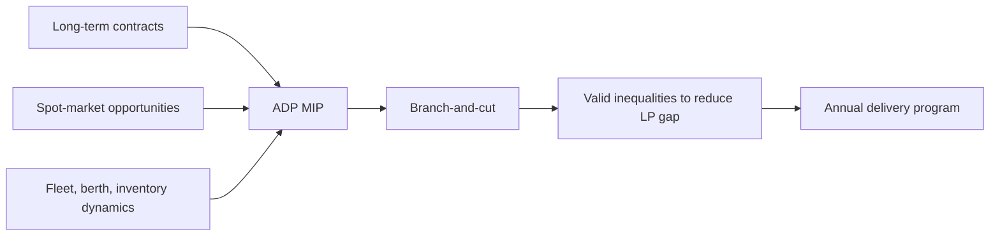

# Creating annual delivery programs of liquefied natural gas

> [!tldr] Formulates LNG annual planning as a branch-and-cut MIP that jointly handles contract service, inventory evolution, berth limits, and spot-market opportunity.

## Problem & Motivation

Large LNG producers must produce annual sailing plans for heterogeneous fleets while satisfying long-term contract obligations and exploiting spot-market opportunities. The challenge is to integrate these economic and operational constraints in one tractable model.

## Method / Architecture

The paper introduces a MIP solved with branch-and-cut and custom valid inequalities to tighten the LP relaxation.

Diagram is reconstructed from model and algorithm description. ^[inferred]

## Key Equations

$$
\min z = \text{transport cost} + \text{under/over-delivery penalties} - \text{spot-market revenue} - \text{terminal-inventory value}
$$

$$
\sum_{c\in C_g\setminus C^M}\sum_{v\in V_c}\sum_{t\in T_v} x_{cvt} + \sum_{c\in C_g\cap C^M}\sum_{v\in V^M}\sum_{\tilde{t}\in T_v} x_{cv\tilde{t}} \leq B_g
$$

$$
q_{g,t-1} + P_{gt} - q_{gt} - \sum_{c\in C_g\setminus C^M}\sum_{v\in V_c} L_v x_{cvt} = 0
$$

## Results

| Aspect | Reported outcome |
|---|---|
| Problem difficulty | Industrial ADP instances are highly complex |
| Algorithmic contribution | Valid inequalities materially reduce LP relaxation gap |
| Practical implication | Stronger formulations improve solvability of annual LNG plans |

## Limitations

- Computational effectiveness is shown qualitatively through gap reduction; runtime and optimality trade-offs depend on instance structure.
- The model is deterministic with respect to uncertainties like weather and spot-price volatility unless extended externally. ^[inferred]

## Related

- [[concepts/annual-lng-delivery-program]]
- [[references/al-haidous2016-optimal-lng-deliveries]]
- [[references/mutlu2016-lng-annual-delivery-program]]
- [[references/deshpande2023-lng-adp-inventory-berth]]
- [[concepts/maritime-routing-under-uncertainty]]

## Bibliographic Record

- Citation key: andersson2017creating
- DOI: `10.1007/s11081-015-9305-y`
- Canonical URL: <https://doi.org/10.1007/s11081-015-9305-y>
- Publication: *Optimization and Engineering*, 2017-03-01
- Authors: Henrik Andersson; Marielle Christiansen; Guy Desaulniers; Jørgen Glomvik Rakke
- Companion metadata note: [[_papers/andersson2017creating/andersson2017creating.md]]

## Sources

- [[_papers/andersson2017creating/andersson2017creating-extracted.md]]
- [[_papers/andersson2017creating/andersson2017creating.md]]
