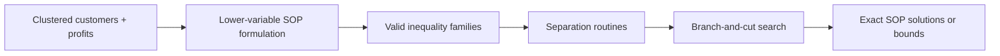

# A new formulation and a branch-and-cut algorithm for the set orienteering problem

> [!tldr] Introduces a tighter SOP formulation with fewer variables and stronger valid inequalities, then solves it with branch-and-cut to new exact baselines.

## Problem & Motivation

The Set Orienteering Problem (SOP) maximizes collected cluster profit with one vehicle under a route-duration bound. The paper targets the exact-solution gap left by earlier formulations when instance size grows.

## Method / Architecture

The paper proposes a new formulation (often called the clucut model in the extracted text) that removes some visit variables and strengthens the model with several valid-inequality classes plus dedicated separation routines.

Flow is reconstructed from method sections and algorithm narrative. ^[inferred]

## Key Equations

$$
\max \sum_{g \in \mathcal{P}} p_g z_g
$$

$$
\sum_{(i,j)\in A} c_{ij}x_{ij} \le T_{\max}
$$

## Results

| Setting | Result |
|---|---|
| SOP benchmark instances (Set1, 52–1084 vertices; tested up to 198) | Branch-and-cut solves instances with up to 100 customers; at the tightest duration limit ω = 0.4 it reaches optimality on 48 of 54 instances with rule g₁ and 47 with g₂ |
| Runtime behavior (Table 6, ω = 0.4) | Average branch-and-cut time 624/800 s vs 1342/1367 s for the relaxed formulation, average gap 6.32%/5.84% vs 16.15%/14.33%; cover and path inequalities add ~70–100% runtime improvement at ω = 0.4 |
| Comparison against earlier exact methods | Reported as new exact state-of-the-art |
| Sensitivity | Difficulty strongly depends on route-duration limit `T_max` (= ω × GTSF*, ω ∈ 0.4–0.8): small ω solves almost all instances up to 200 vertices, while larger ω fails for instances with more than 107 customers |

## Limitations

- Focuses on single-vehicle SOP, so direct transfer to richer multi-vehicle variants needs new modeling work.
- The cluster-cover inequalities are almost never effective and are removed from the final algorithm, and the value of the conditional cuts is described as debatable, so the cut portfolio is tuned for these benchmarks. ^[inferred]
- Runtime advantage depends on benchmark structure and on how restrictive `T_max` is. ^[inferred]

## Related

- [[concepts/set-orienteering-problem]]
- [[references/archetti2018-set-orienteering-problem]]
- [[references/lu2024-hybrid-evolutionary-algorithm-sop]]
- [[concepts/tabu-search]]
- [[concepts/cooperative-multi-agent-uav-routing]] — shares orienteering + routing tags with this page

## Sources

- [[_papers/archetti2023new/archetti2023new-extracted.md]]
- [[_papers/archetti2023new/archetti2023new.md]]
