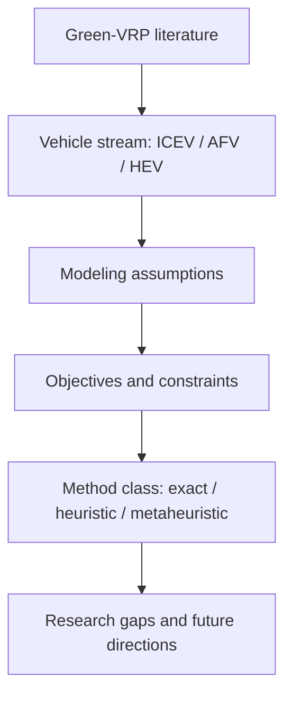

# Green vehicle routing problem: A state-of-the-art review

> [!tldr] Consolidates Green-VRP variants into a practical map of vehicle technologies, objective functions, uncertainty settings, and solution strategies.

## Problem & Motivation

Green-VRP studies were spread across multiple sub-communities (combustion, alternative-fuel, and hybrid fleets), making it hard to compare assumptions and methods. This review provides one structured synthesis.

## Method / Architecture

The review builds a taxonomy over problem variants, objective sets, operating scenarios, and optimization methods.

## Key Quantitative Anchors

| Anchor | Value |
|---|---|
| Review window | 2000–2020 |
| Papers analyzed | 313 |
| Main streams | ICEV, AFV, HEV |
| Output | Taxonomy + analytical tables + gap map |

## Results

| Theme | Takeaway |
|---|---|
| Coverage | Presents a broad and structured synthesis across major Green-VRP variants |
| Modeling | Highlights how energy/fuel assumptions change constraints and objectives |
| Methods | Contrasts exact, heuristic, and metaheuristic usage across streams |
| Future work | Identifies gaps where variant integration is still limited |

## Limitations

- As a review paper, it does not benchmark a new algorithmic solver directly.
- The taxonomy reflects evidence available through 2020; later growth areas may shift priorities. ^[inferred]

## Related

- [[concepts/green-vehicle-routing-problem-taxonomy]]
- [[concepts/vehicle-routing-with-synchronization-constraints]]
- [[concepts/hyper-heuristics]]
- [[concepts/large-neighborhood-search]]

## Sources

- [[_papers/asghari2021green/asghari2021green-extracted.md]]
- [[_papers/asghari2021green/asghari2021green.md]]
