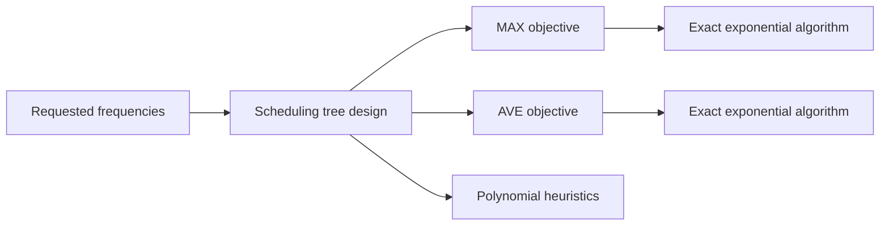

# Efficient algorithms for periodic scheduling

> [!tldr] Formalizes perfectly periodic scheduling quality by MAX and AVE criteria, then designs exact and heuristic tree-based algorithms under NP-hardness.

## Problem & Motivation

Given requested service frequencies, build perfectly periodic schedules where each client is served at exact regular intervals while keeping mismatch between requested and allocated frequency small.

## Method / Architecture

The paper uses tree scheduling (hierarchical round-robin) and analyzes both exact optimization and efficient heuristics for two objective families.

## Key Equations

$$
\text{ratio}_i = \frac{a_i}{b_i}
$$

$$
\text{MAX} = \max_i \left\{ \frac{a_i}{b_i} \right\} \ \text{(unweighted)}, \qquad
\text{AVE} = \sum_i a_i \cdot \frac{a_i}{b_i} = \sum_i \frac{a_i^2}{b_i} \ \text{(weighted by requested share)}
$$

## Results

| Result type | Reported finding |
|---|---|
| Complexity | Optimal perfectly periodic schedule is NP-hard |
| Exact methods | Exponential-time optimum algorithms for MAX and AVE |
| Practical methods | Tree-based heuristics run efficiently and perform strongly in simulations |
| Empirical note | Some heuristics can outperform prior non-perfectly-periodic baselines |

## Limitations

- Perfect periodicity may be too restrictive for bursty or nonstationary demand settings. ^[inferred]
- Evaluation focuses on studied traffic/request models and may not transfer unchanged to all workloads. ^[inferred]

## Related

- [[concepts/periodic-scheduling-under-capacity-constraints]]
- [[references/bar-noy2002-minimizing-periodic-scheduling-costs]]
- [[references/richards1996-scheduling-to-maximize-customer-satisfaction]] — periodic weekly assignment with per-slot minimum and maximum capacity, solved exactly as a capacitated transportation problem.
- [[concepts/set-team-orienteering-problem-with-time-windows]]

## Bibliographic Record

- Citation key: bar-noy2004efficient
- DOI: `10.1016/j.comnet.2003.12.017`
- Canonical URL: <https://www.sciencedirect.com/science/article/pii/S1389128604000052>
- Publication: *Computer Networks*, 2004-06-05
- Authors: Amotz Bar-Noy; Vladimir Dreizin; Boaz Patt-Shamir
- Companion metadata note: [[_papers/bar-noy2004efficient/bar-noy2004efficient.md]]

## Sources

- [[_papers/bar-noy2004efficient/bar-noy2004efficient-extracted.md]]
- [[_papers/bar-noy2004efficient/bar-noy2004efficient.md]]
